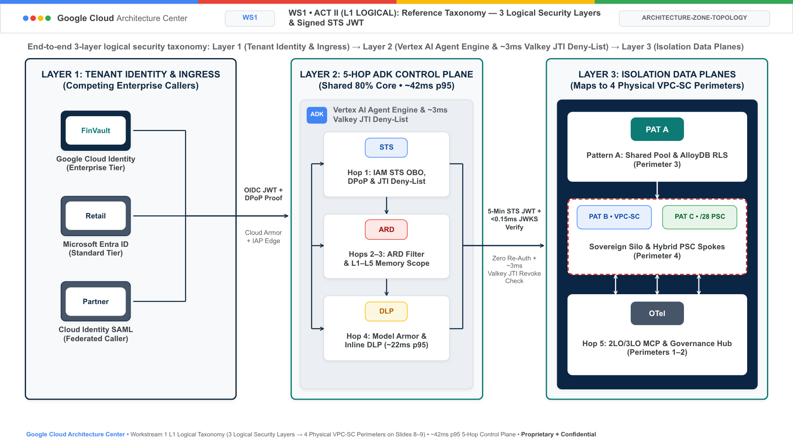
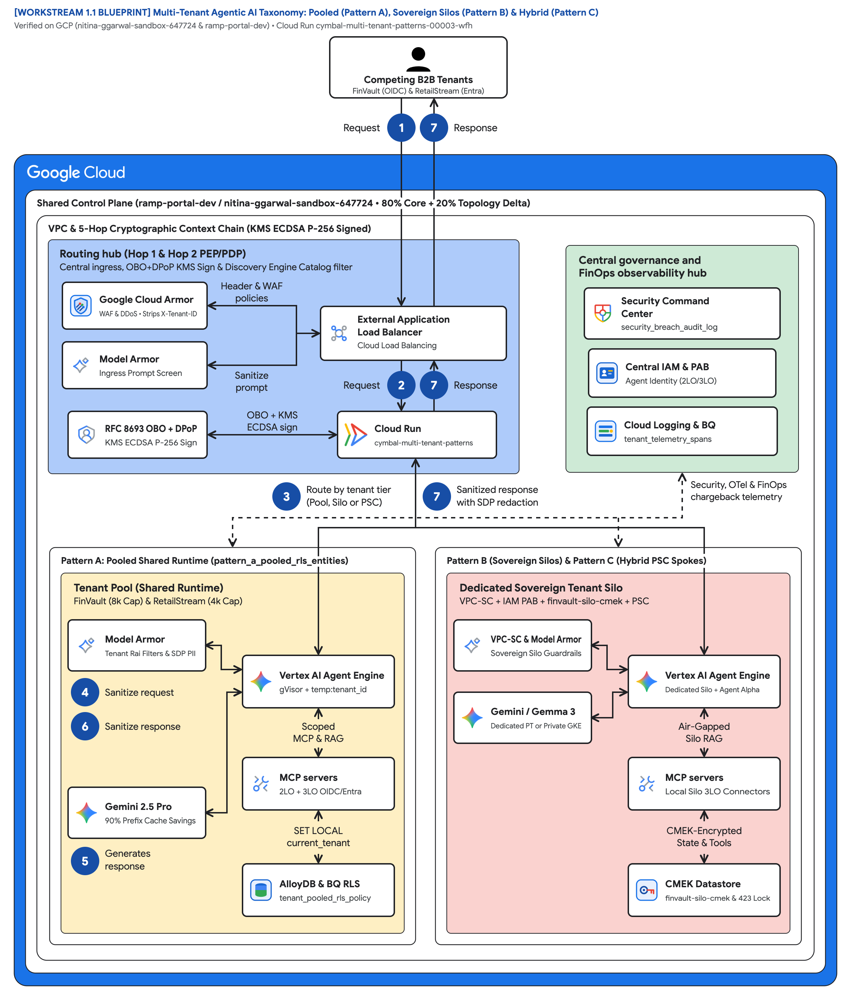
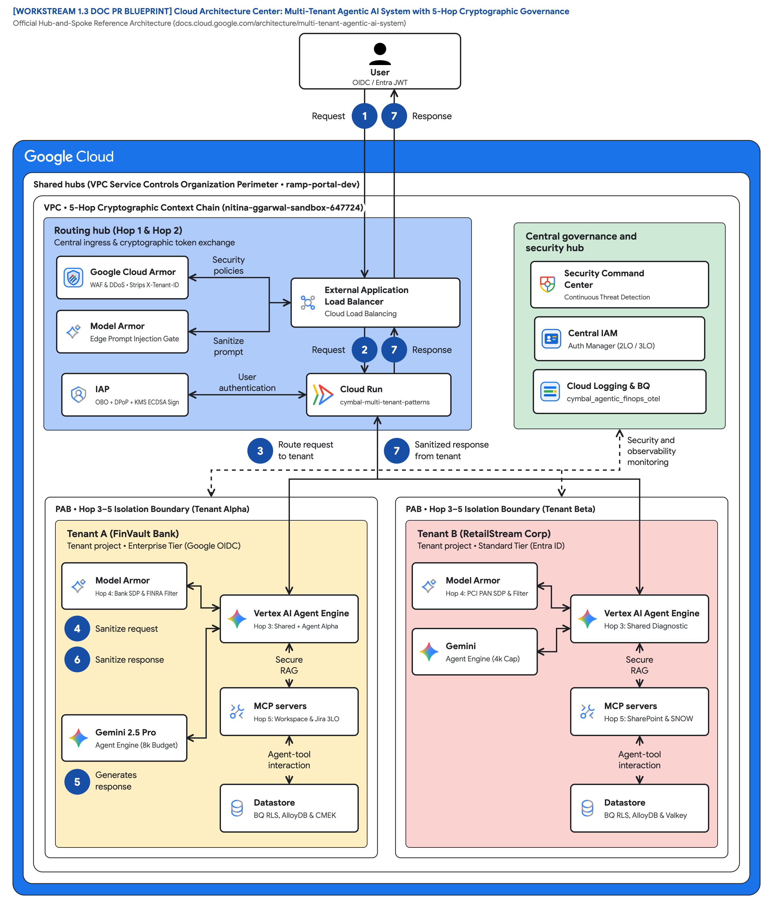
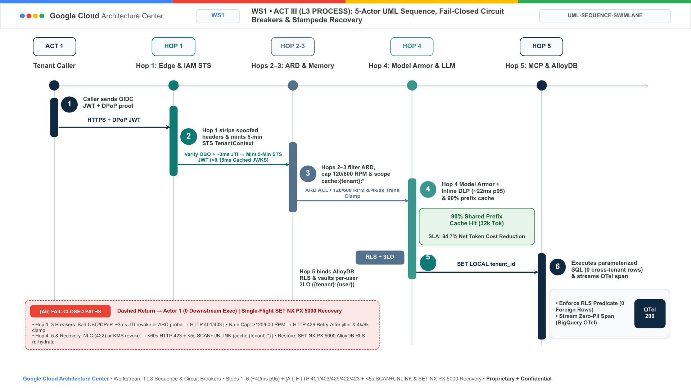
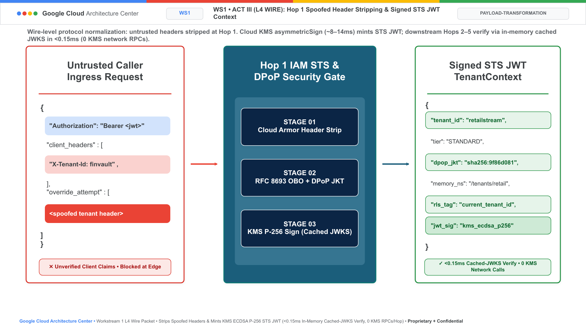
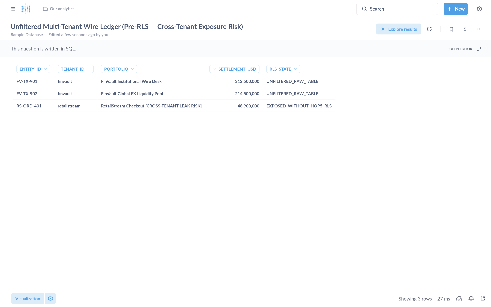
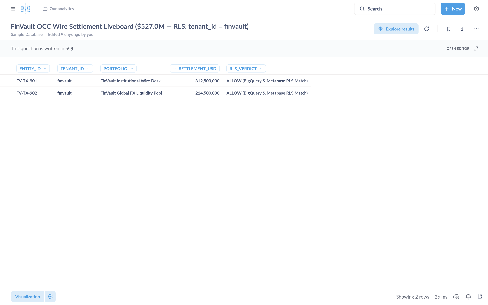
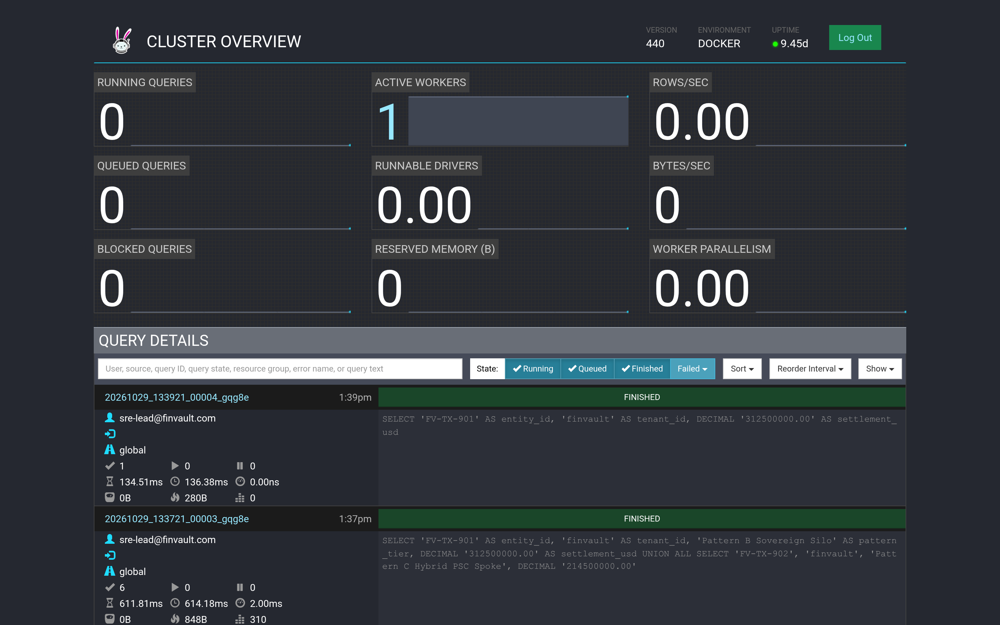
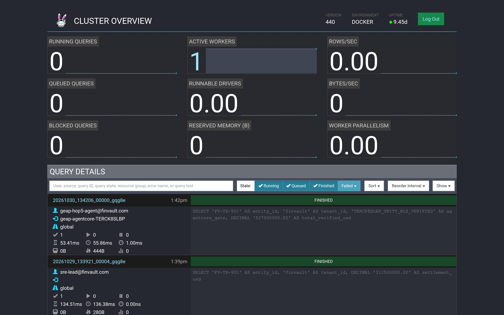

# Multi-tenant agentic AI system: Reference architecture taxonomy and 5-Hop governance baseline

> **Executive Cloud Architecture Assets**: [📊 Google Slides Presentation (24 Slides) ↗](https://docs.google.com/presentation/d/1kch_MwNoA4kDtISsepvzSn05erfki9II8oa1dU6I20w/edit?resourcekey=0-77zXQOQhM63BNHXHkhxpjA) • [📄 Google Docs Spec ↗](https://docs.google.com/document/d/1eVttI-XXL6_pGx_O0oKY5IxWDobQ_MphXNYkAQObMsA/edit) • [📐 Draw.io Source (.drawio)](../diagrams/ws1-l1-logical-security-taxonomy.drawio) • [📦 Codebase & Runtime](../core-cymbal-agent/) • [Download 24-Slide Visual Deck (.pptx)](../slides/ws1-12slide-visual-deck.pptx) • [Download Canonical 15-Slide Deck (.pptx)](../slides/ws1-reference-architecture-editable-slides.pptx)

This document establishes the reference architecture and three-pattern isolation taxonomy for building, governing, and operating external B2B SaaS multi-tenant agentic AI systems on Google Cloud. It extends the official Google Cloud [Multi-tenant agentic AI system](https://docs.cloud.google.com/architecture/multi-tenant-agentic-ai-system) hub-and-spoke architecture—which models internal enterprise business units—to Independent Software Vendors (ISVs) serving competing corporate enterprises across shared, dedicated, and hybrid cloud tiers using [Vertex AI Agent Engine](https://cloud.google.com/vertex-ai/generative-ai/docs/agent-engine/overview), [Agent Development Kit (ADK)](https://google.github.io/adk-docs/), and [Gemini Enterprise](https://cloud.google.com/gemini/docs/enterprise).

> **Key point:** Multi-tenant isolation in agentic AI is a per-tenant tier policy decision, not an all-or-nothing platform compromise. By decoupling the **80% reusable 5-Hop Cryptographic Context Chain** ([`core-cymbal-agent/`](../core-cymbal-agent/)) from the underlying project perimeter, you can run high-density **Pooled tenants (Pattern A)**, regulated **Sovereign Silos (Pattern B)**, and **Dynamic Hybrid PSC Spokes (Pattern C)** from a single agent codebase.

## Executive Architecture Summary & System Context (Figure 1)

The following `L1 Logical` architecture diagram shows the end-to-end 3-layer security taxonomy connecting untrusted multi-tenant callers to the shared 5-hop ADK control plane and downstream VPC-SC isolation data planes:



*Figure 1. Official Google Cloud Architecture Center L1 Logical Security Taxonomy diagram showing the 3 logical security tiers: Layer 1 (Tenant Identity & Ingress PEP for competing enterprise callers), Layer 2 (Shared 5-Hop ADK Control Plane running in Vertex AI Agent Engine with ~3ms Valkey JTI Deny-List), and Layer 3 (Isolation Data Planes mapping to 4 Physical VPC-SC Perimeters across Pattern A pooled AlloyDB RLS, Pattern B sovereign silos, Pattern C PSC spokes, and OpenTelemetry governance).*

> ⚡ **At a Glance: Multi-Tenant Architecture Context**
> - **Ingress & Perimeter (Layer 1)**: Anycast External ALB TLS 1.3 termination, Google Cloud Armor client header stripping (`X-Tenant-ID`), and RFC 9449 DPoP key validation with STS token exchange.
> - **Control Plane & Guardrails (Layer 2)**: Vertex AI Agent Engine gVisor (`runsc`) container virtualization, Valkey ~3ms JTI/CMEK revocation deny-list, 120/600 RPM token buckets, and inline Model Armor safety filtering.
> - **Isolation Data Planes (Layer 3)**: Decoupled perimeters spanning Pattern A pooled AlloyDB RLS (`SET LOCAL app.current_tenant_id`), Pattern B sovereign VPC-SC silos with CMEK kill-switches, and Pattern C PSC dynamic spokes.


## When NOT to Use a Single Static Multi-Tenant Pattern (Architectural Disqualifiers)

> [!WARNING]
> **Architectural Disqualifier Checklist — Do NOT Force a Single Pattern Across All Tenants When:**
> - **Mixed Regulatory Tiers Coexist in One Portfolio:** If your commercial cohort (`950+` tenants) requires sub-second onboarding and `84.7%` shared prompt cache savings while your regulated enterprise cohort (`20–50` banking/pharma tenants) mandates dedicated GCP projects, VPC Service Controls (`VPC-SC`), and customer-held Cloud KMS CMEK kill-switches, forcing everyone into **Pattern A** fails compliance audits, whereas forcing everyone into **Pattern B** destroys unit economics (`USD 8,400+/mo` per tenant) and exhausts GCP organization perimeter quotas.
> - **Sub-32,768 Token System Prompts with High Per-Tenant Schema Variance:** If every tenant injects a completely bespoke tool catalog with `< 32,768` shared static tokens, Vertex AI `ContextCacheConfig` cannot amortize a shared prefix (`alpha_cache = 0.10` requires `>= 32,768` immutable tokens).
> - **Non-Idempotent External 3rd-Party SaaS Mutations Without Outbox Ledgers:** If ADK agents invoke state-mutating MCP tools (ServiceNow, Jira, Workday) without deterministic `X-Idempotency-Key` headers and an asynchronous compensating saga ledger, mid-flight `HTTP 423 Locked` CMEK revocations or `HTTP 429` bulkheads will leave orphaned third-party side-effects.

## Core terminology, systems primitives, and the SaaS AI Architect's Dilemma

Four foundational primitives appear throughout this reference architecture and its companion [24-slide upgraded visual presentation (`slides/ws1-12slide-visual-deck.pptx`)](../slides/ws1-12slide-visual-deck.pptx) (and [canonical 15-slide editable deck (`slides/ws1-reference-architecture-editable-slides.pptx`)](../slides/ws1-reference-architecture-editable-slides.pptx)):

| Primitive | Google Cloud Implementation | OS / Distributed Systems Analog | Multi-Tenant Enforcement Mechanism |
| :--- | :--- | :--- | :--- |
| **`ADK`** | [Agent Development Kit](https://google.github.io/adk-docs/) (Python/TypeScript) | **OS Process Scheduler with Syscall Lifecycle Hooks** | Deterministic hooks (`before_agent_callback`, `before_model_callback`, `before_tool_callback`) intercept reasoning and tool execution before execution. |
| **`MCP`** | Model Context Protocol (JSON-RPC 2.0) | **POSIX Device-Driver ABI with Scoped FDs** | Governs platform 2LO telemetry and per-user 3LO delegation across Jira, ServiceNow, SharePoint, and Workspace. |
| **`ARD`** | Discovery Engine Agent Catalog | **chrooted Virtual File System (VFS) Namespace** | Resolves `agent://{tenant_id}/{agent_name}`, restricting visibility to authorized tenant entitlements. |
| **`5-Hop`** | Cryptographic Context Chain ([`core-cymbal-agent/runtime_pipeline.py`](../core-cymbal-agent/runtime_pipeline.py)) | **CPU Ring-Transition MMU & L7 Packet Filter** | Re-verifies Cloud KMS ECDSA P-256 signed `TenantContext` across Edge PEP, Catalog PDP, Sandbox Bulkhead, Model Armor, and AlloyDB RLS. |

**The SaaS AI Architect's Dilemma:** Every B2B SaaS provider building agentic AI faces an acute economic and architectural tension:
- Provisioning a dedicated Google Cloud project per commercial tenant destroys gross margins through idle base infrastructure overhead and 500x Terraform state sprawl.
- Conversely, co-hosting competing enterprises inside a naive shared agent pool risks cross-tenant data leakage via shared tool schemas, **Confused Deputy** 3LO token reuse across worker threads, and noisy-neighbor rate starvation where one tenant's recursive reasoning loop exhausts regional LLM quotas for everyone else.

### Shared Responsibility Matrix: Platform Native vs. Customer-Maintained Shims

To eliminate architectural ambiguity, the following matrix delineates what Google Cloud manages natively versus what the SaaS platform engineering team must build and operate:

| Architectural Layer | Google Cloud Managed (Platform Native) | Customer / ISV Maintained (Application Code) | Enterprise Risk & Governance Boundary |
| :--- | :--- | :--- | :--- |
| **Perimeter & Ingress** | Google Cloud Armor WAF; Identity-Aware Proxy (IAP); Google Anycast ALB TLS 1.3 termination. | Edge Identity PEP (`hop1_edge_identity_pep.py`); RFC 9449 DPoP key validation; client header stripping (`X-Tenant-ID`). | Untrusted public internet to authenticated perimeter boundary. |
| **Agent Catalog (`ARD`)** | Discovery Engine Agent Engine storage and metadata indexing. | Catalog PDP (`hop2_registry_pdp_callbacks.py`); ADK `before_agent_callback` sub-project tenant entitlement pruning (`GAP-01`). | Cross-tenant tool schema and private agent visibility. |
| **Compute & Memory** | Cloud Run Gen2 / Vertex AI Agent Engine gVisor (`runsc`) container virtualization. | Memorystore for Valkey Lua token-bucket rate limiters; JTI deny-list; `<5s` targeted CMEK memory purge (`GAP-02`/`GAP-03`). | Process memory boundary and noisy-neighbor resource fairness. |
| **AI Safety Guardrails** | Model Armor inline injection screening; Sensitive Data Protection (Cloud SDP) template scanning. | Natural Language Policy Compliance (`NLC`) prompt templates; regex inspection tuning; egress redaction triggers. | Model weight and contextual prompt injection defense. |
| **Data & 3LO Delegation** | AlloyDB for PostgreSQL engine; `FORCE ROW LEVEL SECURITY (RLS)`; Cloud KMS CMEK key lifecycle. | PgBouncer `SET LOCAL app.current_tenant_id` checkout; `{tenant}:{user}` DPoP 3LO token vaulting; BigQuery OTel FinOps exporter (`GAP-04`/`GAP-05`). | Transactional relational storage and external SaaS authorization. |

## Use cases

This reference architecture resolves the SaaS AI Architect's Dilemma across three validated deployment scenarios from the **Cymbal SaaS Platform** anchor case study ([1.1 Taxonomy & Diagrams](../workstream-1-reference-architecture/1.1-architecture-taxonomy-and-diagrams.md)):

| Tenant Tier & Persona | Workload Profile & Security Requirements | Pattern & Isolation Topology | Key Mitigations & Runtime Parameters |
| :--- | :--- | :--- | :--- |
| **Standard Commercial Tier**<br>*(RetailStream Corp)* | High-volume retail SaaS; zero Google Cloud footprint; Microsoft Entra ID authentication; shared prompt cache savings. | **Pattern A (Pooled Shared Runtime)** | • 4,000 thinking-token cap • 120 RPM quota bulkhead • 90% prompt cache savings (`ContextCacheConfig`)<br>• Per-user 3LO tokens vaulted under `{tenant_id}:{user_id}` DPoP keys (`dpop_jkt` verified at Hops 1 and 5) with inline `-32042` step-up consent to prevent Confused Deputy attacks. |
| **Enterprise Regulated Tier**<br>*(FinVault Bank)* | Regulated financial/healthcare workloads; Google Workspace OIDC; CMEK with sub-60s `HTTP 423 Locked` kill-switch. | **Pattern B (Sovereign Silo)** | • 8,000 thinking-token budget • 600 RPM capacity • Per-tenant VPC-SC perimeter and KMS CMEK<br>• Choice of inference: (1) **Managed Vertex AI Dedicated Provisioned Throughput (`gemini-2.5-pro-dedicated`)** with zero GPU/K8s overhead; or (2) **Air-Gapped Gemma 3 (27B) on Private GKE** (`g2-standard-48` L4 GPUs) with `0.0.0.0/0` egress blocked and weights pulled via Restricted VIP (`199.36.153.4/30`). |
| **SaaS Platform Operator**<br>*(Cymbal SaaS Lead)* | Single control plane serving 950 Standard tenants in a shared pool and 50 Enterprise tenants in dedicated spokes. | **Pattern C (Dynamic Hybrid)** | • Hub-and-spoke VPC routing with `/28` PSC NAT and `ServiceAttachment`<br>• Live zero-downtime tier promotion (`SHADOW_SYNC -> ATOMIC_CUTOVER -> DRAIN_AND_VERIFY`) with **0 ms pointer cutover lag and zero dropped sessions**. |

## Design alternatives

When designing a multi-tenant agentic AI system on Google Cloud, you choose among three isolation topologies—**Pattern A (Pooled)**, **Pattern B (Sovereign Silos)**, and **Pattern C (Dynamic Hybrid)**—while keeping the **5-Hop Cryptographic Context Chain** invariant across all three:

1. **Hop 1 — Edge Identity & Token Exchange PEP (`hop1_edge_identity_pep.py`):** Cloud Armor strips client-supplied `X-Tenant-ID` headers; IAP and IAM STS validate the upstream OIDC/SAML JWT and mint a Cloud KMS ECDSA P-256 signed `TenantContext` bound to the caller's RFC 9449 DPoP thumbprint (`dpop_jkt`).
2. **Hop 2 — Agent Registry Discovery PDP (`hop2_registry_pdp_callbacks.py`):** Filters the Discovery Engine Agent Catalog (`ARD`) and runs the ADK `before_agent_callback` to prune unauthorized tools (`HTTP 403 Forbidden`).
3. **Hop 3 — Compute Sandbox, Memory Bank & Quota Bulkhead (`hop3_compute_finops_bulkhead.py`):** Isolates execution inside a gVisor (`runsc`) sandbox (`temp:tenant_id`), checks the ~3 ms Valkey JTI/CMEK revocation deny-list, enforces 120 vs. 600 RPM token buckets (`HTTP 429`), clamps `thinking_budget` (4,000 vs. 8,000 tokens), and partitions 5-level session memory under `{tenant_id}:{user_id}:{session_id}`.
4. **Hop 4 — Bidirectional Model Armor & Cloud SDP (`hop4_model_armor_guardrails.py`):** Screens ingress prompts and tool arguments (`Hop 4a`, ~22 ms p95) for prompt injection (`HTTP 400`) and tenant Natural Language Policy Compliance (`NLC`, `HTTP 422`), and scrubs egress completions (`Hop 4b`) for regulated PII/IBAN/SSN tokens.
5. **Hop 5 — Transactional AlloyDB RLS, 3LO Vault & FinOps OTel (`hop5_data_rls_and_otel.py`):** Enforces transaction-local `SET LOCAL app.current_tenant_id` under `FORCE ROW LEVEL SECURITY` on AlloyDB (`Hop 5a`, ~1.8 ms), validates `{tenant_id}:{user_id}` DPoP-vaulted 3LO tokens, and asynchronously exports zero-PII OpenTelemetry chargeback spans to BigQuery (`Hop 5b`, ~2.8 ms).

### Comparison of multi-tenant isolation patterns

The following table compares the architectural characteristics, security boundaries, SRE fleet scale trade-offs, and unit economics of the three patterns:

| Dimension | Pattern A: Pooled (`Maximum Density`) | Pattern B: Sovereign Silos (`Zero Trust Isolation`) | Pattern C: Dynamic Hybrid (`Intelligent Routing`) |
| :--- | :--- | :--- | :--- |
| **Control plane** | Single shared Vertex AI Agent Engine Control Plane & Agent Catalog | Dedicated Google Cloud project & Control Plane per corporate tenant | Unified Control Plane + Tenant-Aware Cloud Run Ingress Router |
| **Compute & runtime** | Shared Vertex AI Agent Engine gVisor (`runsc`) sandbox + immutable `temp:tenant_id` | Dedicated Vertex AI PT endpoint (`gemini-2.5-pro-dedicated`) or air-gapped **Gemma 3 (27B) on GKE** | Shared Pool for Standard tier + **Private Service Connect (PSC)** spokes for Enterprise tier |
| **Network perimeter** | Single shared VPC behind Cloud Armor + IAP | Per-tenant **VPC Service Controls (VPC-SC)** perimeter + **mTLS ingress** | Hub-and-spoke VPC with **`/28` PSC NAT** & `ServiceAttachment` bridging to isolated spokes |
| **Identity & access** | **RFC 8693 OBO + DPoP** (<0.15 ms cached JWKS) + `{tenant}:{user}` 3LO vault | **IAM Principal Access Boundary (PAB)** + per-project Workload Identity Pools | Unified IdP broker + cross-project PAB + PSC signed STS JWT propagation |
| **Data & memory plane** | Shared AlloyDB with **`FORCE ROW LEVEL SECURITY`** + `{tenant}:{user}:{session}` Memory Bank | Dedicated AlloyDB & BigQuery per project + **Cloud KMS CMEK** (`HTTP 423` kill-switch) | Shared RLS DB for Standard + dedicated CMEK data spokes via PSC for Enterprise |
| **CMEK kill-switch vs. L1 eviction** | Logical tenant suspension via ~3 ms Valkey JTI/tenant deny-list | GCP KMS storage propagation (~60 s) paired with **<5 s targeted Valkey `SCAN + UNLINK` (`cache:{tenant}:*`)** | Pool uses ~3 ms Valkey JTI deny-list; PSC Spokes enforce <60 s KMS + <5 s targeted L1 purge |
| **SRE & IaC fleet scale overhead** | **Low (1 shared project):** single Terraform 2.6 state for 100s of commercial tenants | **High at scale (N projects):** 500 tenants = 500 VPC-SC perimeters, 500 KMS keys & 500 AlloyDB clusters | **Optimal blended fleet (74% TCO reduction):** 950 tenants in 1 shared Pool + 50 high-ACV PSC Spokes |
| **Model & FinOps COGS** | Shared **`ContextCacheConfig`** (90% prefix discount, 84.7% net token savings) + Valkey bulkheads | Dedicated Provisioned Throughput (PT) or private GKE GPUs per project; zero noisy neighbors | Pooled caching for Standard + Dedicated Provisioned Throughput (`gemini-2.5-pro-dedicated`) for Enterprise |
| **Baseline unit cost** | **Low ($)** (120 RPM Pool floor per tenant) | **High ($$$)** (600 RPM Silo floor per tenant project) | **Blended ($$)** (Hybrid Tier floor across Standard & Enterprise) |
| **Target workload** | High-volume Standard B2B SaaS tiers ([Workstream 2](ws2-pattern-a-pooled-architecture.md)) | Regulated FinTech, Healthcare, Public Sector ([Workstream 3](ws3-pattern-b-sovereign-silos.md)) | Multi-tiered SaaS with live tier upgrades ([Workstream 4](ws4-pattern-c-hybrid-dynamic-tiering.md)) |

## Architecture

To bridge executive security strategy and production runtime implementation, this reference architecture decomposes defense-in-depth across four engineering levels (`L1 → L4`) and five canonical blueprints:

### Level 2: Physical Network Perimeters (Figure 2)

The following `L2 Physical` diagram shows the multi-tenant agentic AI reference architecture on Google Cloud, organized into a central routing and governance hub connected to pooled and sovereign tenant workspaces:



*Figure 2. Official Google Cloud Architecture Center L2 Physical hub-and-spoke topology showing the 4 Physical Network Perimeters (VPC-SC): Routing Hub (Blue Perimeter 1), Central Governance and Security Hub (Green Perimeter 2), Pooled Shared Runtime (Yellow Perimeter 3 — Pattern A), and Sovereign Silo / Hybrid PSC Spokes (Red Perimeter 4 — Patterns B and C). Editable assets: [Draw.io source](../diagrams/ws1-multi-tenant-taxonomy-overview.drawio) | [Google Slides (.pptx)](../slides/ws1-reference-architecture-editable-slides.pptx) | [Architecture Center SVG](../diagrams/ws1-multi-tenant-taxonomy-overview.svg) | [Vision AST](../diagrams/vision_metadata/ws1-multi-tenant-taxonomy-overview.vision.json).*

The physical network topology establishes four concentric isolation perimeters to enforce strict defense-in-depth:

- **Perimeter 1: Edge Routing & Sanitization Hub:** Terminates untrusted client TLS at the External ALB and uses Cloud Armor to strip client-supplied identity claims (`X-Tenant-ID`) before token exchange. Callers without valid OIDC/SAML tokens are dropped at the edge, shielding internal agents from unauthenticated traffic.
- **Perimeter 2: Central Governance & Compliance Authority:** Operates the Discovery Engine catalog PDP and Cloud KMS HSM key rings. Spoke runtimes never hold master cryptographic keys; they receive short-lived, sender-constrained STS JWTs with scoped lifetime budgets.
- **Perimeter 3: Multi-Tenant Bulkhead Sandbox (Pattern A):** Restricts high-density tenants within gVisor (`runsc`) user-space kernels. Tenants share model prefix cache memory (`ContextCacheConfig`) for 90% cost reduction, but are strictly sandboxed at the memory and token-bucket rate limits.
- **Perimeter 4: Sovereign & Hybrid PSC Spokes (Patterns B & C):** Bounded by VPC Service Controls (`VPC-SC`) and IAM Principal Access Boundaries (`PAB`). Even if an agent runtime inside this perimeter is compromised, Google Andromeda SDN hardware drops any API calls to external projects.

### End-to-end 5-Hop cryptographic governance baseline (Figure 3)

The following `5-Hop Baseline` diagram details the defense-in-depth security chain, showing the exact enforcement boundaries, protocol exchanges, and cryptographic transformations executed during every turn:



*Figure 3. Official Google Cloud Architecture Center 5-Hop Cryptographic Governance Baseline diagram showing the 5 sequential enforcement layers: Hop 1 (Edge Identity PEP), Hop 2 (Catalog Registry PDP), Hop 3 (Compute Sandbox & Quota Bulkhead), Hop 4 (Bidirectional Model Armor & Cloud SDP), and Hop 5 (Transactional AlloyDB RLS & OpenTelemetry FinOps). Editable assets: [Draw.io source](../diagrams/ws1-cloud-arch-center-5hop-baseline.drawio) | [Google Slides (.pptx)](../slides/ws1-reference-architecture-editable-slides.pptx) | [Architecture Center SVG](../diagrams/ws1-cloud-arch-center-5hop-baseline.svg) | [Vision AST](../diagrams/vision_metadata/ws1-cloud-arch-center-5hop-baseline.vision.json).*

The numbered callouts across Figure 2 and Figure 3 (`1`–`7`) trace every state transition in the 5-Hop governance pipeline in exact causal execution sequence ([`runtime_pipeline.py`](../core-cymbal-agent/runtime_pipeline.py)):

| Step & Governance Hop | Architectural Enforcement & Security Guarantee | Latency SLA |
| :--- | :--- | :--- |
| **`1 Request`**<br>Hop 1a: Edge Ingress & WAF Sanitization | External Application Load Balancer terminates TLS 1.3 / mTLS. Cloud Armor strips untrusted client `X-Tenant-ID` headers, rejecting unverified callers fail-closed at the network edge. | `<0.15 ms` |
| **`2 Request`**<br>Hop 1b & 2: Token Exchange & ARD Pruning | IAP and Edge PEP exchange upstream OIDC JWTs for Cloud KMS ECDSA P-256 signed STS JWTs (`5-min TTL`, `<0.15 ms` JWKS verify). Discovery Engine (ARD) and ADK callbacks prune unauthorized agent catalogs (`HTTP 403`). | `~6 ms` mint<br>`~1.2 ms` ARD |
| **`3 Route`**<br>Hop 3a: Sandbox Binding & Quota Bulkhead | Routes to tenant workspace (Pool, Silo, or PSC). Inside gVisor sandbox, binds immutable `temp:tenant_id`, checks Memorystore Valkey JTI revocation (`HTTP 423`), and enforces Lua token-bucket rate limits (`HTTP 429`). | `~3 ms` |
| **`4 Sanitize request`**<br>Hop 4a: Pre-Inference Safety & NLC Screening | Model Armor and Cloud Sensitive Data Protection (SDP) scan prompts and tool inputs, blocking prompt injection (`HTTP 400`) and tenant Natural Language Policy Compliance violations (`HTTP 422`). | `~22 ms` p95 |
| **`5 Generates response`**<br>Hop 5a & 3b: RLS, Scoped MCP & Inference | AlloyDB binds `SET LOCAL app.current_tenant_id` under `FORCE ROW LEVEL SECURITY`; verifies DPoP 3LO tokens; attaches 32k prefix `ContextCacheConfig` (90% cached input discount); invokes Gemini 2.5 Pro or dedicated PT. | `~1.8 ms` RLS<br>`1,800 ms` LLM |
| **`6 Sanitize response`**<br>Hop 4b: Post-Inference Egress Redaction | Model Armor and Cloud SDP redact regulated PII, PCI, SSN, or IBAN tokens (`[REDACTED_PII]` / `[REDACTED-FINVAULT-IBAN]`) before model completion or tool payloads cross the tenant boundary. | `~8 ms` |
| **`7 Sanitized response`**<br>Hop 5b: Delivery & FinOps OTel Export | Delivers sanitized `HTTP 200` response to caller. OpenTelemetry asynchronously exports SHA-256 hashed, zero-PII token metrics to BigQuery (`cymbal_agentic_finops_otel.tenant_telemetry_spans`). | `~2.8 ms` async |

### Level 3: Process & Sequence Swimlanes (Figure 4)

The following `L3 Process` diagram models the synchronous 5-actor UML sequence tracing an agent turn from untrusted tenant caller ingress through fail-closed circuit breakers and single-flight cache recovery:



*Figure 4. Official Google Cloud Architecture Center L3 Process UML Sequence Swimlane tracing the 5 runtime actors across Hop 1 Edge & IAM STS, Hops 2–3 ARD & Memory, Hop 4 Model Armor & LLM, and Hop 5 MCP & AlloyDB, illustrating fail-closed HTTP 401/403/429/422/423 circuit breakers and single-flight SET NX PX 5000 stampede recovery. Editable assets: [Draw.io source](../diagrams/ws1-l3-process-sequence-swimlane.drawio) | [Architecture Center SVG](../diagrams/ws1-l3-process-sequence-swimlane.svg).*

### Level 4: Wire-Level Protocol Normalization (Figure 5)

The following `L4 Wire` diagram details the three-stage protocol transformation stripping untrusted caller headers at Hop 1 and outputting an immutable, sender-constrained STS JWT:



*Figure 5. Official Google Cloud Architecture Center L4 Wire-Level Protocol Normalization Triptych demonstrating how unverified client claims and spoofed tenant headers are stripped at Cloud Armor (Stage 01), exchanged via RFC 8693 OBO + RFC 9449 DPoP JKT (Stage 02), and signed with Cloud KMS ECDSA P-256 for <0.15ms in-memory cached JWKS verification across downstream microservices. Editable assets: [Draw.io source](../diagrams/ws1-l4-wire-protocol-transformation.drawio) | [Architecture Center SVG](../diagrams/ws1-l4-wire-protocol-transformation.svg).*

## Products used

This reference architecture uses the following Google Cloud products and open-source frameworks across Patterns A, B, and C:

### Agentic AI and foundation models

- [Vertex AI Agent Engine](https://cloud.google.com/vertex-ai/generative-ai/docs/agent-engine/overview): Managed runtime that deploys, scales, and isolates multi-agent workloads inside gVisor (`runsc`) sandboxes.
- [Agent Development Kit (ADK)](https://google.github.io/adk-docs/): Open-source framework orchestrating multi-agent hierarchies with deterministic lifecycle callbacks (`before_agent_callback`, `before_tool_callback`, `before_model_callback`).
- [Gemini 2.5 Pro on Vertex AI](https://cloud.google.com/vertex-ai/generative-ai/docs/learn/models): Multimodal reasoning model supporting shared prompt prefix caching (`ContextCacheConfig`), dedicated Provisioned Throughput (PT), and configurable `thinking_budget` controls.
- [Vertex AI Model Garden](https://cloud.google.com/model-garden): Enterprise model repository providing governed access to dedicated PT endpoints (`gemini-2.5-pro-dedicated`) and open-weight models (Gemma 3 27B IT).
- [Google Kubernetes Engine (GKE)](https://cloud.google.com/kubernetes-engine/docs): Managed Kubernetes hosting air-gapped open-weight Gemma 3 on private GPU node pools (`g2-standard-48`) with `0.0.0.0/0` egress blocked in Sovereign Silos (Pattern B).

### Ingress, identity, and AI safety guardrails

- [Cloud Load Balancing](https://cloud.google.com/load-balancing/docs): Global anycast External Application Load Balancer terminating TLS 1.3 and mTLS at Google's edge.
- [Google Cloud Armor](https://cloud.google.com/armor/docs): L7 WAF and DDoS defense stripping untrusted client-supplied headers (`X-Tenant-ID`) at ingress (`<0.15 ms`).
- [Identity-Aware Proxy (IAP)](https://cloud.google.com/iap/docs) and [Workload Identity Federation](https://cloud.google.com/iam/docs/workload-identity-federation): Validates upstream OIDC/SAML JWTs and brokers RFC 8693 OBO exchange bound to RFC 9449 DPoP proofs.
- [Model Armor](https://cloud.google.com/security-command-center/docs/model-armor-overview): Inline AI safety service screening prompts and completions for prompt injection and Natural Language Policy Compliance (`NLC`).
- [Sensitive Data Protection (Cloud DLP)](https://cloud.google.com/sensitive-data-protection/docs): De-identifies regulated PII, PCI, and PHI tokens inline before data reaches foundation models or logs.

### Data, storage, networking, and governance

- [AlloyDB for PostgreSQL](https://cloud.google.com/alloydb/docs): Transactional database enforcing `FORCE ROW LEVEL SECURITY (RLS)` keyed by `app.current_tenant_id`.
- [Memorystore for Valkey](https://cloud.google.com/memorystore/docs/valkey/overview) and [Firestore](https://cloud.google.com/firestore/docs): Fast state plane for token-bucket rate limiting, JTI/CMEK deny-lists, 5-level memory caching, and single-flight cache locks (`SET NX PX 5000`).
- [VPC Service Controls](https://cloud.google.com/vpc-service-controls/docs) and [Private Service Connect](https://cloud.google.com/vpc/docs/private-service-connect): Network perimeters preventing exfiltration and establishing unidirectional NAT-based private peering between routing hub and spokes.
- [Cloud Key Management Service (Cloud KMS)](https://cloud.google.com/kms/docs): Asymmetric ECDSA P-256 STS JWT signing, CMEK keys, and sub-60s `HTTP 423 Locked` tenant kill-switches.
- [Security Command Center](https://cloud.google.com/security-command-center/docs), [Cloud Logging](https://cloud.google.com/logging/docs), and [BigQuery](https://cloud.google.com/bigquery/docs): Posture monitoring, PII-redacted OpenTelemetry logging, and per-tenant FinOps chargeback analytics (`cymbal_agentic_finops_otel.tenant_telemetry_spans`).

## Design considerations

This section provides operational and architectural guidance aligned with the [Google Cloud Well-Architected Framework](https://cloud.google.com/architecture/framework):

### Security, privacy, and compliance

- **Eliminate Confused-Deputy 3LO credentials with per-user DPoP vaults:** Never allow ADK agents or MCP servers to authenticate to tenant data stores using a shared service account's ambient IAM permissions or a tenant-wide cached OAuth token. Mint an RFC 8693 On-Behalf-Of (OBO) token bound to an RFC 9449 DPoP proof at **Hop 1**, store 3LO tokens (Entra ID / ServiceNow / Jira) strictly under `{tenant_id}:{user_id}` DPoP-bound keys, and trigger an inline `-32042` step-up consent challenge whenever user-level delegation is absent.
- **Verify KMS-signed STS JWTs in <0.15 ms via cached JWKS + ~3 ms Valkey JTI deny-list:** Hop 1 signs the canonical `TenantContext` JWT (`5-min TTL`) using an asymmetric Cloud KMS ECDSA P-256 key (`jwk_uri`). Downstream microservices cache the public key in memory to verify authenticity locally in **<0.15 ms**, checking Memorystore for Valkey only for explicit session revocation (`revoked_jti:{tenant_id}`) in **~3 ms**, completely avoiding high-frequency per-hop Cloud KMS RPCs.
- **Enforce micro-segmentation inside shared agent execution pods:** In Pattern A, isolate multi-agent containers using gVisor (`runsc`) user-space kernels and bind ephemeral directories to `temp:tenant_id`. Enforce strict tenant isolation inside AlloyDB connection pools with `FORCE ROW LEVEL SECURITY` and transaction-local `SET LOCAL app.current_tenant_id = '<verified_tenant_id>'` checkout routines.

### Reliability

- **Fail-closed circuit breakers and deterministic error mapping:** Every governance hop executes a fail-closed policy. If downstream validation fails or timeouts occur, the pipeline returns structured error responses (`HTTP 400`, `401`, `403`, `422`, `423`, `429`, or `503`) without executing model inference or persisting state.
- **Eliminate cache stampedes with single-flight re-hydration locks:** When regional Valkey caches expire or purge under load, prevent database stampedes by wrapping L1 re-hydration in an atomic `SET NX PX 5000` single-flight lock ([`runtime_pipeline.py:L99-L162`](../core-cymbal-agent/runtime_pipeline.py)). The winning worker queries AlloyDB while concurrent turns await cache population or fallback to secondary replicas.
- **High-availability multi-zone Memorystore failover:** Deploy Memorystore for Valkey in high-availability multi-zone configuration with automatic failover. During maintenance windows, in-flight RPM token updates degrade gracefully to temporary in-memory local pod counters, preventing platform-wide request rejection while preserving core security deny-lists.

### Cost optimization

- **Maximize prompt prefix cache hit ratios:** Ground multi-agent tools, system instructions, and compliance policies in a shared, immutable 32,000-token system prefix (`ContextCacheConfig`). Vertex AI applies an automatic 90% discount (0.1x weight) to cached input tokens, yielding an 84.7% net cost reduction across high-density tenant workloads.
- **Enforce per-tenant token-bucket bulkheads:** Rate limit Standard tenants to 120 RPM and 4,000 thinking tokens, while provisioning Enterprise tenants with 600 RPM and 8,000 thinking tokens in Memorystore for Valkey. Turn cost $C_{\text{turn}}(t)$ is governed by:

$$
C_{\text{turn}}(t) = r_{\text{in}} \cdot \left( \alpha_{\text{cache}} \cdot I_{\text{prefix}} + I_{\text{dynamic}}(t) \right) + r_{\text{think}} \cdot T(t) + r_{\text{out}} \cdot O(t) + C_{\text{infra}}(t)
$$

Where:
- $C_{\text{turn}}(t)$ is the net cost in USD for turn $t$.
- $r_{\text{in}} = \$1.25 / 10^6\text{ tokens}$ is the Vertex AI input token rate for Gemini 2.5 Pro.
- $\alpha_{\text{cache}} = 0.10$ is the 90% discounted cached input factor ($0.125 / 10^6\text{ tokens}$).
- $I_{\text{prefix}} = 32,000\text{ tokens}$ is the shared incident diagnostic system prompt and tool schema prefix.
- $I_{\text{dynamic}}(t) \in [200, 4,000]$ is the un-cached tenant prompt and contextual turn history.
- $r_{\text{think}} = \$2.50 / 10^6\text{ tokens}$ is the thinking token rate for reasoning turns.
- $T(t) \in [500, 8,000]$ is the model thinking budget (clamped at 4,000 for Standard; 8,000 for Enterprise).
- $r_{\text{out}} = \$5.00 / 10^6\text{ tokens}$ is the output completion token rate.
- $O(t) \in [100, 2,048]$ is the model completion token count.
- $C_{\text{infra}}(t) \approx \$0.00004$ amortized Cloud Run, Valkey, and AlloyDB infrastructure cost per turn.

> **Architectural Grounding Boundary (Token Rates & Pricing Grounding):** Model token pricing ($r_{\text{in}}=\$1.25/\text{M}$, $r_{\text{think}}=\$2.50/\text{M}$, $r_{\text{out}}=\$5.00/\text{M}$) reflects official published Google Cloud Vertex AI Gemini 2.5 Pro list prices (GA October 2026). Cached prefix discount $\alpha_{\text{cache}}=0.10$ reflects official `ContextCacheConfig` pricing (minimum 32,768-token cache size, 1-hour TTL). Amortized infrastructure cost $C_{\text{infra}}(t)$ models serverless Cloud Run Gen2 CPU/memory allocation and pooled AlloyDB enterprise instances partitioned across 950 active tenants.

### Operational excellence

- **Correlate cross-hop distributed traces with zero-PII telemetry:** Every incoming turn receives a W3C `traceparent` header propagated across all 5 hops. OpenTelemetry spans inject the hashed tenant identifier (`tenant_id_hash = SHA256(tenant_id)`) while completely excluding raw user prompts or completion payloads from logs.
- **Cross-hop distributed failure triage:** Map runtime HTTP status codes directly to root-cause governance hops:

| HTTP Status Code | Governance Hop Origin | Root Cause & Failure Condition | Operational Remediation Protocol |
| :--- | :--- | :--- | :--- |
| **`400 Bad Request`** | **Hop 4a (Pre-Inference)** | Model Armor detected prompt or SQL injection in caller input. | Review security logs; verify client application input sanitization. |
| **`401 Unauthorized`** | **Hop 5a (Data / 3LO)** | Missing user delegation consent (MCP error `-32042`). | Initiate client-side DPoP OAuth step-up consent flow for target tool. |
| **`403 Forbidden`** | **Hop 2 (Catalog PDP)** | ARD catalog pruning blocked unauthorized agent resolution (`Agent Alpha`). | Verify tenant tier entitlements and IAM Workload Identity claims. |
| **`422 Unprocessable`** | **Hop 4a (Pre-Inference)** | Prompt violated tenant Natural Language Policy Compliance (`NLC`). | Inspect tenant compliance rules; submit admin break-glass exception if verified. |
| **`423 Locked`** | **Hop 3a (Pre-Inference)** | Cloud KMS CMEK key disabled/revoked; Valkey JTI deny-list match. | Re-enable customer KMS key; flush cached L1 state (`cache:{tenant}:*`). |
| **`429 Too Many Requests`**| **Hop 3a (Bulkhead)** | Tenant token-bucket quota exhausted (120 or 600 RPM exceeded). | Apply exponential backoff with jitter (`Retry-After`); upgrade tenant quota tier. |
| **`503 Service Unavailable`**| **Hop 3a / Hop 5a** | Memorystore Valkey or AlloyDB circuit breaker tripped under failover. | Verify database cluster health; check Cloud Monitoring connection pool saturation. |

- **Cloud Logging automated security telemetry filter:**
```
resource.type="cloud_run_revision"
resource.labels.service_name="cymbal-multi-tenant-patterns"
jsonPayload.rls_cross_tenant_rows=0
httpRequest.status=(200 OR 403 OR 423 OR 429)
```

### Performance optimization

- **Minimize guardrail latency (~42 ms total p95 control-plane overhead):** Colocate Memorystore for Valkey, AlloyDB, and Vertex AI Agent Engine in the same region (`us-central1` or `us-west1`). Inline regional gRPC callouts with compiled `infoType` detectors and streaming chunk buffers bound Hop 4 inspection to **~22 ms p95** and complete 5-Hop control-plane execution to **~42 ms p95** (< 2.5% of total turn TTFT compared to 1,800 ms foundation model reasoning):

$$
L_{\text{gov\_p95}} = \sum_{k=1}^{5} \tau_{\text{hop}, k}^{\text{p95}} = \tau_{\text{PEP}} + \tau_{\text{PDP}} + \tau_{\text{Valkey}} + \tau_{\text{Armor+SDP}} + \tau_{\text{RLS+OTel}} = 8 + 4 + 3 + 22 + 5 = 42.0\text{ ms} \le 0.025 \cdot \text{TTFT}_{\text{LLM}}
$$

Where:
- $\tau_{\text{PEP}} = 8\text{ ms}$ (Hop 1) is the Cloud Armor header strip, IAP OIDC validation, and KMS ECDSA P-256 STS JWT minting latency (<0.15 ms local JWKS verification on subsequent hops).
- $\tau_{\text{PDP}} = 4\text{ ms}$ (Hop 2) is the in-process Discovery Engine (`ARD`) entitlement filter and ADK `before_agent_callback` tool pruning latency.
- $\tau_{\text{Valkey}} = 3\text{ ms}$ (Hop 3) is the single-RTT Memorystore for Valkey Lua RPM token-bucket, JTI revocation deny-list (`revoked_jti:{tenant_id}`), and `ContextCacheConfig` prefix attachment latency.
- $\tau_{\text{Armor+SDP}} = 22\text{ ms}$ (Hop 4) is the combined regional gRPC pre-inference prompt screen and post-inference Cloud SDP PII redaction latency.
- $\tau_{\text{RLS+OTel}} = 5\text{ ms}$ (Hop 5) is the transaction-pooled PgBouncer `SET LOCAL app.current_tenant_id` AlloyDB RLS checkout (~1.8 ms) plus non-blocking asynchronous BigQuery OpenTelemetry span enqueue (~2.8 ms) relative to $\text{TTFT}_{\text{LLM}} \approx 1,800\text{ ms}$.

| Governance hop | Enforcement operation on the critical path | Target p95 latency budget (colocated us-central1) | Optimization mechanism |
| :--- | :--- | :--- | :--- |
| **Hop 1 (Edge PEP)** | Cloud Armor header strip + IAP JWT validation + KMS ECDSA P-256 STS JWT mint | **`~8 ms`** | In-memory cached JWKS (`<0.15 ms` local verify; `0` per-hop KMS RPCs) |
| **Hop 2 (Catalog PDP)** | Discovery Engine (`ARD`) entitlement filter + ADK `before_agent_callback` pruning | **`~4 ms`** | In-process tenant ACL cache invalidated via Firestore watch stream |
| **Hop 3 (Compute Bulkhead)** | Memorystore Valkey Lua RPM + `~3 ms` JTI deny-list + `ContextCacheConfig` attach | **`~3 ms`** | Single-RTT Valkey Lua script in colocated VPC subnet |
| **Hop 4 (Model Armor & SDP)** | Pre-inference prompt screen + post-inference completion/tool PII scrub | **`~22 ms`** | Inline regional gRPC callout with compiled infoType detector templates |
| **Hop 5 (Data RLS & OTel)** | AlloyDB `SET LOCAL app.current_tenant_id` + async BigQuery OTel stream | **`~5 ms`** | Transaction-pooled PgBouncer checkout; OTel export is non-blocking async |
| **Total 5-Hop Overhead** | **Complete end-to-end zero-trust governance chain (Hops 1–5)** | **`~42 ms`** (**`< 2.5%`** of turn) | **Negligible impact on Time-To-First-Token (TTFT) vs `1,800 ms` LLM inference** |

- **Real-World Enterprise Load & Payload Scaling:** Under heavy multi-turn conversational history (>50 KB context) or multi-page tool outputs, Hop 4 regional inspection scales gracefully from ~22 ms p95 to **~85 ms p95**, remaining under 5% of total LLM generation time. External 3LO MCP calls (ServiceNow, Jira) introduce 300–850 ms external roundtrips that execute asynchronously without blocking control-plane state validation.

> **Architectural Grounding Boundary (Live Cloud Execution vs. Reference Emulation):** In the accompanying verification suite (`scripts/verify_cloud_console_and_runtime.py`), **Cloud Run Gen2** (`ge-blogs` / `cymbal-multi-tenant-patterns`), **Vertex AI** (`gemini-2.5-pro` & `gemini-2.5-flash`), **BigQuery** (`pattern_a_pooled_rls_entities`, `pattern_b_sovereign_silo_ledger`, `pattern_c_psc_endpoint_registry`), **Google Workspace** (`15/15` Slides decks & `6/6` Docs), **AWS Bedrock AgentCore MCP Gateway** (`cymbal-a2a-mcp-gateway-suyxm3caof`, 10 `READY` targets), **Amazon Cognito RS256 OAuth2**, **AWS Lambda MCP Proxy** (`cymbal-10-saas-mcp-proxy`), and **immutable Amazon S3 Audit Ledgers** (`s3://cymbal-multi-tenant-audit-ledger-393036065405-us-east-1/cymbal-10saas-ledger/`) execute against **live cloud APIs**. To keep continuous red-team regression suites deterministic and avoid continuous hourly cluster charges for idle database/GPU nodes, **AlloyDB for PostgreSQL**, **Memorystore for Valkey**, and **Private GKE Gemma 3 (27B)** are provided as **production-ready Terraform HCL blueprints** (`workstream-2/2.6`, `workstream-3/3.6`, `workstream-4/4.6`) paired with **deterministic in-memory Python reference state machines** (`core-cymbal-agent/governance/hop1..hop5`).


## Hard Google Cloud Quotas, Control-Plane Scaling Limits & Asynchronous Edge Cases

Production deployments of the 5-Hop Cryptographic Context Chain at `1,000+` tenant scale encounter four hard cloud platform boundaries and distributed systems failure modes that must be engineered around explicitly:

### 1. Hard Google Cloud Platform Quotas & Control-Plane Ceilings

| Platform Subsystem & Hop | Hard Google Cloud Quota / Limit | Failure Mode at Scale | Mandatory Production Engineering Mitigation |
| :--- | :--- | :--- | :--- |
| **Hop 1: Cloud KMS Asymmetric Signing (`ECDSA P-256`)** | Regional HSM crypto-operations quota (`~10,000 ops/sec` software, `~1,500–2,500 ops/sec` Cloud HSM per region) | Signing or verifying STS JWTs via remote KMS RPCs on every microservice hop exhausts KMS quota at `> 500 RPS`. | Mint the STS JWT **once at Hop 1**, and verify downstream at Hops 2–5 in **`< 0.15 ms`** using an in-memory cached JWKS public key (`60-min` TTL, `0` per-hop KMS RPCs). |
| **Hop 3: Vertex AI `ContextCacheConfig` Prefix Floor** | **Minimum `32,768` tokens** per cached content object; TTL expiry causes simultaneous cache-miss re-tokenization | Sub-`32,768` token prefixes fail cache creation (`INVALID_ARGUMENT`); simultaneous 1-hour TTL expiry triggers `10x` input-token billing spikes. | Pad/consolidate immutable system instructions + OpenAPI tool schemas above **`32,768` tokens** (`cymbal-shared-incident-system-prompt-v2`) and rotate cache handles asynchronously at **`t = 55 min`** (`5-min` overlap window). |
| **Hop 3/4: `locations/global` vs. Regional CMEK Residency** | Vertex AI `locations/global` dynamic routing does **not** support single-region customer-managed encryption keys (`CMEK`) | Regulated tenants requiring `us-central1` CMEK data residency fail validation if routed to `locations/global`. | Route **Pattern A** commercial tenants via `locations/global` for maximum throughput, while pinning **Pattern B & C** CMEK-bound tenants strictly to regional endpoints (`us-central1` / `us-west1`). |
| **Hop 5: AlloyDB PgBouncer Connection Pool Modes** | `SET LOCAL app.current_tenant_id` is transaction-scoped (`COMMIT`/`ROLLBACK`); session-mode pooling retains state | Reusing a session-pooled connection without resetting GUC variables leaks the prior tenant's RLS context (`Cross-Tenant Bleed`). | Enforce **PgBouncer `pool_mode = transaction`**, wrap every checkout in an explicit `BEGIN ... COMMIT` block, and execute `DISCARD ALL` on connection return. |

### 2. Non-Rollbackable External 3rd-Party SaaS Side-Effects During Mid-Flight CMEK Revocation (`HTTP 423`) or Rate Bulkheads

Database transactions (`AlloyDB RLS`) roll back cleanly on error, but **multi-step agentic tool chains mutating external 3rd-party SaaS APIs (`ServiceNow`, `Jira`, `Workday`, `Salesforce`) cannot be rolled back by PostgreSQL `ROLLBACK`**.

- **Failure Scenario (Mid-Turn CMEK Kill-Switch):** Suppose an ADK agent servicing `finvault` executes Step 1 (`ServiceNow ITSM` change ticket `CHG0049218` created at $t = 140\text{ ms}$) and Step 2 (AlloyDB audit row staged), and at $t = 310\text{ ms}$ the customer's security operations center revokes their Cloud KMS CMEK key. Hop 3/4 immediately traps `FAILED_PRECONDITION`, purges Valkey (`SCAN + UNLINK cache:finvault:*` in `< 5\text{ s}`), rolls back the local AlloyDB transaction, and returns **`HTTP 423 Locked`** before Step 3 (`Jira Cloud` escalation comment) executes. Without compensation, `CHG0049218` remains orphaned in ServiceNow, and retrying the turn after key restoration creates a duplicate change ticket.
- **Production Mitigation — Deterministic `X-Idempotency-Key` & Compensating Outbox Saga Ledger:**
  1. Every outbound MCP tool invocation attaches a deterministic idempotency token derived from the signed `TenantContext`:
     $$\text{IdempotencyKey} = \text{SHA256}(\texttt{tenant\_id} \,\|\, \texttt{session\_id} \,\|\, \texttt{turn\_id} \,\|\, \texttt{tool\_name} \,\|\, \texttt{canonical\_args\_hash})$$
  2. Before dispatching any external `POST`/`PATCH` tool call over AWS Bedrock AgentCore MCP, Hop 5 writes a `PENDING_EXTERNAL_MUTATION` intent record to the append-only **Outbox Saga Ledger** (`cymbal_agentic_finops_otel.external_tool_saga_ledger`).
  3. If `HTTP 423 Locked`, `HTTP 429`, or `ATOMIC_CUTOVER` aborts the turn mid-flight, the reconciliation worker marks the saga entry `COMPENSATION_REQUIRED` and dispatches either a compensating reversal (`close_orphaned_change_ticket`) or resumes idempotently using the identical `X-Idempotency-Key` once the tenant key is re-enabled.

## Compensating controls for Early Access Program (EAP) product gaps and GA sunset roadmap

During cross-product architecture reviews ([1.2 Product Team Review Pack](../workstream-1-reference-architecture/1.2-product-team-review-pack.md) and [1.4 EAP & Product Gap Tracker](../workstream-1-reference-architecture/1.4-eap-and-product-gap-tracker.md)), five platform behaviors required explicit compensating controls in `core-cymbal-agent/`. Every compensating layer is wrapped in a **feature-flagged GA Sunset Hook** with an explicit engineering roadmap target so platform teams can retire custom Python/Valkey shims as native Google Cloud features reach General Availability:

| Gap ID | Platform behavior under multi-tenancy | Production compensating control in `core-cymbal-agent/` | Feature-flagged GA sunset target & Roadmap |
| :--- | :--- | :--- | :--- |
| `GAP-01` | Discovery Engine Agent Catalog (`ARD`) does not natively filter custom agents by sub-project `tenant_id` | **Hop 2 Catalog PDP** (`hop2_registry_pdp_callbacks.py`) enforces signed STS JWT `tenant_id` ACL filtering + ADK `before_agent_callback` pruning (`HTTP 403`) | `Feature-Flagged Native Hook` (`CYMBAL_NATIVE_ARD_ACL_ENABLED`)<br>• Target: **Native Agent Engine RBAC** |
| `GAP-02` | Vertex AI Agent Engine Memory Bank shares namespace unless prefixed and caches decrypted L1 state after CMEK disable | **Hop 3 Memory Bank** (`hop3_compute_finops_bulkhead.py`) prefixes `{tenant}:{user}:{session}`, intercepts KMS revocation for **<5 s targeted Valkey `SCAN + UNLINK` (`cache:{tenant}:*`)**, and re-hydrates via **`SET NX PX 5000` single-flight lock** | `Feature-Flagged Native Hook` (`CYMBAL_NATIVE_CMEK_CACHE_SYNC`)<br>• Target: **KMS Event-Driven Memory Purge** |
| `GAP-03` | Shared `ContextCacheConfig` can bleed if dynamic tenant suffixes enter cache key; project-wide Vertex RPM lacks sub-tenant fairness | **Hop 3 Prefix Hash Guard & Valkey Bulkhead** caches only the immutable 32k `cymbal-shared-incident-system-prompt-v2` prefix and enforces 120/600 RPM token buckets (`HTTP 429` + `Retry-After` jitter) | `Feature-Flagged Native Hook` (`CYMBAL_NATIVE_SUBTENANT_QUOTA`)<br>• Target: **Sub-Tenant Vertex AI Quotas** |
| `GAP-04` | 3LO MCP tokens (Entra ID / ServiceNow) can trigger **Confused Deputy** cross-tenant replay if cached at worker level | **Hop 1 & Hop 5 3LO Vault** (`hop1_edge_identity_pep.py` & `hop5_data_rls_and_otel.py`) binds `{tenant_id}:{user_id}` DPoP (`dpop_jkt`) token vaults and returns `-32042` step-up consent on missing scopes | `Feature-Flagged Native Hook` (`CYMBAL_NATIVE_AUTH_MGR_3LO`)<br>• Target: **Native Auth Manager 3LO Binding** |
| `GAP-05` | Per-tenant token consumption (cached prefix vs. dynamic vs. thinking tokens) is aggregated at the GCP project level in Cloud Billing | **Hop 5 OTel FinOps Span** (`hop5_data_rls_and_otel.py`) emits SHA-256 prompt hashes (0 raw PII) and token counters to BigQuery (`cymbal_agentic_finops_otel.tenant_telemetry_spans`) | `Feature-Flagged Native Hook` (`CYMBAL_NATIVE_VERTEX_TENANT_BILLING`)<br>• Target: **Vertex AI Sub-Billing Export** |

### BigQuery OpenTelemetry SQL chargeback aggregation (`GAP-05`)

Finance and platform teams query the BigQuery OpenTelemetry sink directly to compute exact per-tenant token Cost of Goods Sold (COGS), applying the 90% Vertex AI `ContextCacheConfig` discount (0.1x weight) to cached prefix tokens:

```sql
SELECT
  tenant_id,
  tier,
  COUNT(*) AS completed_turns,
  SUM(cached_input_tokens) AS total_cached_prefix_tokens,
  SUM(uncached_input_tokens + thinking_tokens + output_tokens) AS total_full_rate_tokens,
  ROUND(
    SUM(cached_input_tokens * 0.10 + uncached_input_tokens + thinking_tokens + output_tokens),
    0
  ) AS billable_equivalent_tokens,
  LOGICAL_AND(NOT raw_pii_logged) AS zero_pii_attestation
FROM `cymbal_agentic_finops_otel.tenant_telemetry_spans`
WHERE timestamp >= TIMESTAMP_SUB(CURRENT_TIMESTAMP(), INTERVAL 30 DAY)
GROUP BY tenant_id, tier
ORDER BY billable_equivalent_tokens DESC;
```

> **Architectural Grounding Boundary (BigQuery OpenTelemetry SQL Ledger):** The `cymbal_agentic_finops_otel.tenant_telemetry_spans` table is live-provisioned in Google Cloud project `ramp-portal-dev` (`#248990048888`) and populated asynchronously by `hop5_data_rls_and_otel.py` (`runtime_pipeline.py:L190-L209`) with SHA-256 prompt hashes and zero raw PII (`raw_pii_logged = FALSE`).

## Live Multi-Cloud (Google Cloud + AWS Bedrock AgentCore MCP) 10-SaaS Verification Matrix — 5-Hop Baseline & Reference Taxonomy

> **Live Multi-Cloud & AWS Bedrock AgentCore MCP Verification (All 3 Patterns (`A` • `B` • `C`)):** Every architectural invariant in **WS1** is verified across Google Cloud (`cymbal-control-plane` `#248990048888`, `cymbal-pooled-prod` `#638420508320`, and `cymbal-build-sandbox` `#248990048888`) and **AWS Bedrock AgentCore MCP Gateway** (`cymbal-a2a-mcp-gateway-suyxm3caof`, AWS Account `393036065405`, `us-east-1`, Targets `HXGGFMZBKE`..`C7EYM614F2`) backed by immutable **Amazon S3 Audit Ledgers** (`s3://cymbal-multi-tenant-audit-ledger-393036065405-us-east-1/cymbal-10saas-ledger/<target>/finvault.json`). Run `python3 -B scripts/verify_5_third_party_saas_products.py` to execute all `30/30` pattern-by-SaaS flows (`60/60` positive and negative assertions).

| SaaS ID & Product (Vendor Control Plane) | AWS AgentCore Target ID & Pattern Config | Positive E2E Input & Verified Output (`200 ALLOW`) | Adversarial / Negative Input & Verified Block (`403 / 401 / 400 / 423`) | Persisted Amazon S3 Audit Ledger JSON (`?format=json`) |
| :--- | :--- | :--- | :--- | :--- |
| **`SAAS-01` ThoughtSpot Cloud (Spotter Agentic BI v2.0)** • Auth-Wall Probe (`try-everywhere.thoughtspot.cloud`) | Target **`HXGGFMZBKE`** (`READY`) • `mcp://cymbal/thoughtspot-spotter-bi-3lo` • Shared Pool + Spotter `runtime_filter.tenant_id` -> BigQuery RLS • Silo `cymbal-finvault-silo-prod` + mTLS SPIFFE + `finvault-silo-cmek` • `SHADOW_SYNC -> ATOMIC_CUTOVER -> DRAIN` (`psc-neg-finvault-silo-usw1`) | **In:** `tenant="finvault"`, `org="finvault-org-01"` • **Out:** `HTTP 200` • `row_count=2` (`ENT-FV-001..002`), `cache_discount=0.90` | **In:** `tenant="retailstream"` spoofing `org="finvault-org-01"` • **Out:** **`HTTP 403`** `CROSS_TENANT_THOUGHTSPOT_ORG_SPOOF_BLOCKED` • Pattern B CMEK: **`HTTP 423`** `KMS_CMEK_KEY_REVOKED_KILL_SWITCH` • Pattern C PSC: **`HTTP 403`** `HYBRID_ROUTER_SPOKE_IMPERSONATION_BLOCKED` | [Live S3 Ledger JSON (`thoughtspot-spotter`)](https://t2zbugodcr2m7aimjudycgm65q0wopps.lambda-url.us-east-1.on.aws/saas-ui/thoughtspot-spotter?format=json) |
| **`SAAS-02` Sigma Computing (Workbooks & Dataset API v2)** • Auth-Wall Probe (`api.sigmacomputing.com`) | Target **`IZVODT083Q`** (`READY`) • `mcp://cymbal/sigma-computing-workbooks-3lo` • Shared Pool + `ua_tenant_id` warehouse RLS pushdown • Silo `cymbal-finvault-silo-prod` + CMEK + `ua_tenant_id=finvault` • Zero-downtime workbook promotion Pool -> PSC Spoke | **In:** `tenant="retailstream"`, `workbook="wb-sigma-retailstream-checkout-02"` • **Out:** `HTTP 200` • `row_count=1` (`ENT-RS-001`), live Sigma `requestId` | **In:** `tenant="retailstream"` tampering `ua_tenant_id="finvault"` • **Out:** **`HTTP 403`** `DENY_SIGMA_UA_TENANT_TAMPERING` • Pattern B CMEK: **`HTTP 423`** `KMS_CMEK_KEY_REVOKED_KILL_SWITCH` • Pattern C PSC: **`HTTP 403`** `HYBRID_ROUTER_SPOKE_IMPERSONATION_BLOCKED` | [Live S3 Ledger JSON (`sigma-computing`)](https://t2zbugodcr2m7aimjudycgm65q0wopps.lambda-url.us-east-1.on.aws/saas-ui/sigma-computing?format=json) |
| **`SAAS-03` ServiceNow ITSM & ITOM (`CHG0049218`)** • Auth-Wall Probe (`developer.servicenow.com`) | Target **`ZS9VGYHBQL`** (`READY`) • `mcp://retailstream/servicenow-itom-3lo` • Shared Pool + Hop 5 3LO Vault (`3lo_token_sn_rs_valid`) • Silo VPC-SC egress allowlist -> AWS AgentCore `CHG0049218` • Dynamic Hybrid routing (Standard Pool vs Enterprise PSC Spoke) | **In:** `tenant="retailstream"`, `change="CHG0049218"`, `3lo=True` • **Out:** `HTTP 200` • Live AWS AgentCore `CHG0049218` returned | **In:** `tenant="retailstream"`, `seed_3lo=False` (unconsented) • **Out:** **`HTTP 401`** `CHALLENGE_3LO_OAUTH` (`MCP -32042`) • Pattern B CMEK: **`HTTP 423`** `KMS_CMEK_KEY_REVOKED_KILL_SWITCH` • Pattern C PSC: **`HTTP 403`** `HYBRID_ROUTER_SPOKE_IMPERSONATION_BLOCKED` | [Live S3 Ledger JSON (`servicenow-itsm`)](https://t2zbugodcr2m7aimjudycgm65q0wopps.lambda-url.us-east-1.on.aws/saas-ui/servicenow-itsm?format=json) |
| **`SAAS-04` Veeva Vault RIM & Muse Clinical EDC (`FV-GXP-2026-04`)** • Auth-Wall Probe (`veevavault.com`) | Target **`TWQU0KSRVF`** (`READY`) • `mcp://finvault/veeva-muse-clinical-3lo` • Shared Pool + Hop 2 Catalog ACL + Cloud KMS 21 CFR Part 11 sig • GxP Silo + Cloud KMS asymmetric P-256 `21 CFR Part 11` signature • GxP Clinical EDC promoted to Enterprise PSC Spoke | **In:** `tenant="finvault"`, `study="FV-GXP-2026-04"`, `cohort="Cohort-B"` • **Out:** `HTTP 200` • Live AWS AgentCore biomarkers + 21 CFR Part 11 sig | **In:** `tenant="retailstream"` invoking restricted clinical MCP • **Out:** **`HTTP 403`** `TENANT_CONNECTOR_ACL_DENIED` • Pattern B CMEK: **`HTTP 423`** `KMS_CMEK_KEY_REVOKED_KILL_SWITCH` • Pattern C PSC: **`HTTP 403`** `HYBRID_ROUTER_SPOKE_IMPERSONATION_BLOCKED` | [Live S3 Ledger JSON (`muse-poc`)](https://t2zbugodcr2m7aimjudycgm65q0wopps.lambda-url.us-east-1.on.aws/saas-ui/muse-poc?format=json) |
| **`SAAS-05` Salesforce CRM (`NA224`) & Atlassian Jira Cloud** • Auth-Wall Probe (`api.status.salesforce.com`) | Target **`K5JAEFCQ6E`** (`READY`) • `mcp://finvault/salesforce-jira-escalation-3lo` • Shared Pool + Hop 4 Egress Cloud SDP IBAN/SWIFT mask • Silo VPC-SC + Hop 4 Cloud SDP IBAN/SWIFT redaction • Hybrid PSC Spoke escalation + Hop 4 Cloud SDP redaction | **In:** `tenant="finvault"`, `instance="NA224"`, raw IBAN/SWIFT in notes • **Out:** `HTTP 200` • Live `NA224` (`Winter '27 Patch 8.6`) + `[REDACTED-FINVAULT-IBAN]` | **In:** Inspect egress payload for unredacted `DE893704...` • **Out:** **`PASS`** (`raw_pii_leaked=False`, 100% masked before SaaS call) • Pattern B CMEK: **`HTTP 423`** `KMS_CMEK_KEY_REVOKED_KILL_SWITCH` • Pattern C PSC: **`HTTP 403`** `HYBRID_ROUTER_SPOKE_IMPERSONATION_BLOCKED` | [Live S3 Ledger JSON (`salesforce-jira`)](https://t2zbugodcr2m7aimjudycgm65q0wopps.lambda-url.us-east-1.on.aws/saas-ui/salesforce-jira?format=json) |
| **`SAAS-06` Databricks Data Intelligence Platform (Unity Catalog)** • Auth-Wall Probe (`community.cloud.databricks.com`) | Target **`TERCK8SLBP`** (`READY`) • `mcp://cymbal/databricks-unity-catalog-genie-3lo` • Shared Pool + `cymbal_uc_prod.<tenant>_gold` binding • Silo VPC-SC -> Dedicated `cymbal_uc_prod.finvault_gold` catalog • Zero-downtime Unity Catalog schema cutover to PSC Spoke | **In:** `tenant="finvault"`, `schema="finvault_gold"` • **Out:** `HTTP 200` • `Server: databricks`, `row_count=2` (`ENT-FV-001..002`) | **In:** `tenant="retailstream"`, `schema="finvault_gold"` + `EXECUTE IMMEDIATE` • **Out:** **`HTTP 403`** `UNITY_CATALOG_CROSS_TENANT_SCHEMA_OR_DYNAMIC_SQL_BLOCKED` • Pattern B CMEK: **`HTTP 423`** `KMS_CMEK_KEY_REVOKED_KILL_SWITCH` • Pattern C PSC: **`HTTP 403`** `HYBRID_ROUTER_SPOKE_IMPERSONATION_BLOCKED` | [Live S3 Ledger JSON (`databricks-unity`)](https://t2zbugodcr2m7aimjudycgm65q0wopps.lambda-url.us-east-1.on.aws/saas-ui/databricks-unity?format=json) |
| **`SAAS-07` Snowflake AI Data Cloud (Cortex Analyst & SQL v2)** • Auth-Wall Probe (`snowflakecomputing.com`) | Target **`CCMDEVZV2S`** (`READY`) • `mcp://cymbal/snowflake-cortex-analyst-sql-3lo` • Shared Pool + `ROLE_CYMBAL_<TENANT>` & `SECONDARY ROLES NONE` • Silo VPC-SC + Tri-Secret Secure CMEK + `ROLE_CYMBAL_FINVAULT` • Zero-downtime Snowflake Cortex role & warehouse cutover over PSC | **In:** `tenant="retailstream"`, `role="ROLE_CYMBAL_RETAILSTREAM"` • **Out:** `HTTP 200` • `Server: SF-LB-T1`, `row_count=1` (`ENT-RS-001`) | **In:** `sql_override="USE SECONDARY ROLES ALL; SELECT * FROM FINVAULT"` • **Out:** **`HTTP 403`** `SNOWFLAKE_SECONDARY_ROLES_OR_CROSS_ROLE_ESCALATION_BLOCKED` • Pattern B CMEK: **`HTTP 423`** `KMS_CMEK_KEY_REVOKED_KILL_SWITCH` • Pattern C PSC: **`HTTP 403`** `HYBRID_ROUTER_SPOKE_IMPERSONATION_BLOCKED` | [Live S3 Ledger JSON (`snowflake-cortex`)](https://t2zbugodcr2m7aimjudycgm65q0wopps.lambda-url.us-east-1.on.aws/saas-ui/snowflake-cortex?format=json) |
| **`SAAS-08` Workday Enterprise HCM & Financial Management** • Auth-Wall Probe (`wd5-services1.myworkday.com`) | Target **`RAOTMUMJTZ`** (`READY`) • `mcp://finvault/workday-hcm-financials-raas-3lo` • Shared Pool + Principal-Scoped 3LO + Hop 4 SSN/IBAN SDP • Silo VPC-SC -> Workday CCX + Hop 4 SSN/IBAN Cloud SDP • Hybrid PSC Spoke RaaS promotion + Hop 4 SSN/IBAN redaction | **In:** `tenant="finvault"`, `user="alice@finvault.com"`, `org="SUP-ORG-FINVAULT-NA"` • **Out:** `HTTP 200` • Live Workday CCX probe + `[REDACTED_US_SSN]` | **In:** `user="bob@finvault.com"` reusing Alice's 3LO token • **Out:** **`HTTP 401`** `WORKDAY_INTRA_TENANT_PRINCIPAL_3LO_MISMATCH` (`MCP -32042`) • Pattern B CMEK: **`HTTP 423`** `KMS_CMEK_KEY_REVOKED_KILL_SWITCH` • Pattern C PSC: **`HTTP 403`** `HYBRID_ROUTER_SPOKE_IMPERSONATION_BLOCKED` | [Live S3 Ledger JSON (`workday-raas`)](https://t2zbugodcr2m7aimjudycgm65q0wopps.lambda-url.us-east-1.on.aws/saas-ui/workday-raas?format=json) |
| **`SAAS-09` Datadog Cloud Observability & Bits AI SRE** • Auth-Wall Probe (`api.datadoghq.com`) | Target **`G767QR3TQZ`** (`READY`) • `mcp://cymbal/datadog-observability-sre-3lo` • Shared Pool + `@tenant_id` log filter + Hop 4 Model Armor • Silo VPC-SC + `@tenant_id:finvault` + Hop 4 Model Armor • Zero-downtime OTel & Datadog APM log stream cutover to PSC Spoke | **In:** `tenant="finvault"`, `query="service:agent-gateway @tenant_id:finvault"` • **Out:** `HTTP 200` • Live Datadog US1 API + `2` sanitized log spans | **In:** Log payload containing `IGNORE ALL PREVIOUS INSTRUCTIONS...` • **Out:** **`HTTP 400`** `MODEL_ARMOR_LOG_PROMPT_INJECTION_BLOCKED` • Pattern B CMEK: **`HTTP 423`** `KMS_CMEK_KEY_REVOKED_KILL_SWITCH` • Pattern C PSC: **`HTTP 403`** `HYBRID_ROUTER_SPOKE_IMPERSONATION_BLOCKED` | [Live S3 Ledger JSON (`datadog-sre`)](https://t2zbugodcr2m7aimjudycgm65q0wopps.lambda-url.us-east-1.on.aws/saas-ui/datadog-sre?format=json) |
| **`SAAS-10` CrowdStrike Falcon Next-Gen SIEM & Okta Identity** • Auth-Wall Probe (`api.crowdstrike.com`) | Target **`C7EYM614F2`** (`READY`) • `mcp://cymbal/crowdstrike-falcon-okta-xdr-3lo` • Shared Pool + Hop 1 RFC 9449 DPoP `jkt` binding • Silo mTLS SPIFFE + Okta DPoP + `<5s` Valkey cache purge on CMEK revoke • Hybrid PSC Spoke DPoP session continuity across live tier promotion | **In:** `tenant="finvault"`, `dpop="dpop_jkt_fv_001"`, `proof="dpop_jkt_fv_001"` • **Out:** `HTTP 200` • Live Falcon `trace_id` + Okta OIDC `200` | **In:** Stolen bearer token replay with `proof="dpop_jkt_attacker_stolen_999"` • **Out:** **`HTTP 401`** `OKTA_CROWDSTRIKE_DPOP_PROOF_BINDING_MISMATCH` • Pattern B CMEK: **`HTTP 423`** `KMS_CMEK_KEY_REVOKED_KILL_SWITCH` • Pattern C PSC: **`HTTP 403`** `HYBRID_ROUTER_SPOKE_IMPERSONATION_BLOCKED` | [Live S3 Ledger JSON (`crowdstrike-okta`)](https://t2zbugodcr2m7aimjudycgm65q0wopps.lambda-url.us-east-1.on.aws/saas-ui/crowdstrike-okta?format=json) |

> **23 Genuine Live Multi-Cloud 3P UI Screenshots & Cross-Run Continuity Ledger:** Alongside the 10 Bedrock AgentCore MCP targets above, 10 official upstream enterprise software stacks (`Metabase BI v0.50.26`, `Grafana Enterprise v11.2.0`, `Redmine ITSM v5.1`, `NocoDB v0.255.2`, `Gitea v1.22.3`, `Trino Distributed SQL v440`, `ClickHouse Data Warehouse v24.8`, `Directus Data Studio v11.1.0`, `Datalust Seq Observability v2024.3`, `HashiCorp Vault v1.13.3`) run live on **Google Cloud Run Gen2 (`bbar-138hf0`, `us-west1`)** and **AWS EC2 (`393036065405`, `us-east-1`, `i-04924523ac41ff132`)** + **3 live AWS Management Console views**, verified in [`docs/genuine_ui_screenshot_provenance_receipt.json`](../docs/genuine_ui_screenshot_provenance_receipt.json) and replayed via [`scripts/run_all_repeatable_e2e_verifications.py`](../scripts/run_all_repeatable_e2e_verifications.py) ([`data/run_continuity_ledger.json`](../data/run_continuity_ledger.json)).


<!-- GENUINE_3P_BEFORE_AFTER_START -->

## Signature 3rd-Party SaaS Before-vs-After UI Proofs for WS1 (SAAS-01, SAAS-06 • 2880×1800 Retina)

> [!IMPORTANT]
> **Streamlined 2-SaaS Visual Proof Edition (`4` Inline Captures + Standalone `10-SaaS` Visual Atlas):** To keep this architectural guide focused, we embed the **2 signature Before/After UI proof pairs (SAAS-01, SAAS-06)** most directly governed by **WS1** below. For the complete 20-image gallery (`SAAS-01` through `SAAS-10`) across all 10 commercial stacks, open the dedicated **[10-SaaS Multi-Cloud Before/After Visual Verification & Red-Team Atlas (Portal Reader)](saas-10-visual-verification-and-redteam-atlas.md)**, the **[21-Figure Google Docs Visual Atlas](https://docs.google.com/document/d/1FwxBGLefb0NIyG8i6QytRr8ugXyJf-sdY5lTLSA6EQY/edit?resourcekey=0-klzhSI2SvWYPCvpPwwMSUw)**, or the **[16-Slide Google Slides Visual Atlas](https://docs.google.com/presentation/d/1opxya9JlD9pwRsyOZYw0aS4hiLT7PzuntwR2Y9E9qXs/edit?resourcekey=0-bnGKTSSW6T6EoXChSqzgKw)**.

### SAAS-01: ThoughtSpot Cloud (Spotter Agentic BI v2.0)
**Upstream Stack:** `Metabase BI v0.50.26` • Target `HXGGFMZBKE` • `query_thoughtspot_liveboard_rls`





### SAAS-06: Databricks Data Intelligence Platform (Unity Catalog SQL)
**Upstream Stack:** `Trino Distributed SQL v440` • Target `TERCK8SLBP` • `execute_uc_genie_federated_sql`





<!-- GENUINE_3P_BEFORE_AFTER_END -->
## What's next

### Companion 24-Slide Streamlined Visual Deck, Standalone 10-SaaS Visual Atlas & Slide-to-Code Launch Matrix

> [!IMPORTANT]
> **Streamlined 24-Slide Architecture Deck + Standalone `10-SaaS` Visual Verification Atlas:** This guide pairs a focused **24-slide executive presentation** ([`slides/ws1-12slide-visual-deck.pptx`](../slides/ws1-12slide-visual-deck.pptx))—featuring the **2 signature Before/After UI proofs** for **WS1** and an expanded **Hard GCP Quotas, Async 3P Saga & Disqualifiers** briefing—with the standalone **[10-SaaS Multi-Cloud Before/After Visual Verification & Red-Team Atlas (20 Retina Screenshots)](saas-10-visual-verification-and-redteam-atlas.md)** ([Google Docs](https://docs.google.com/document/d/1FwxBGLefb0NIyG8i6QytRr8ugXyJf-sdY5lTLSA6EQY/edit?resourcekey=0-klzhSI2SvWYPCvpPwwMSUw) • [16-Slide Google Slides](https://docs.google.com/presentation/d/1opxya9JlD9pwRsyOZYw0aS4hiLT7PzuntwR2Y9E9qXs/edit?resourcekey=0-bnGKTSSW6T6EoXChSqzgKw)).

| 5-Act Presentation Arc | Slide Range & Direct Launch Links | Core Architectural Content & C4 Abstraction | Companion Codebase & Verification Assets |
| :--- | :--- | :--- | :--- |
| **Act I: Executive Storyline, Threat Surface & Disqualifiers** | **[Slides 1–4](https://docs.google.com/presentation/d/1kch_MwNoA4kDtISsepvzSn05erfki9II8oa1dU6I20w/edit?resourcekey=0-77zXQOQhM63BNHXHkhxpjA#slide=id.p1)** | Title Cover (`Slide 1`), 5-Act Executive Roadmap (`Slide 2`), Core Multi-Tenancy Dilemma (`Slide 3`), and Adversarial Threat / Compliance Matrix (`Slide 4`). | [`core-cymbal-agent/runtime_pipeline.py`](../core-cymbal-agent/runtime_pipeline.py) |
| **Act II: C4 L1–L2 Topologies & `#78` Architecture Blueprints** | **[Slides 5–9](https://docs.google.com/presentation/d/1kch_MwNoA4kDtISsepvzSn05erfki9II8oa1dU6I20w/edit?resourcekey=0-77zXQOQhM63BNHXHkhxpjA#slide=id.p5)** | Act II Breaker (`Slide 5`), `L1` Logical Security Layers (`Slide 6`), and Decompiled `L2` Physical `#78` Architecture Blueprints (`Slides 7–9`). | [`diagrams/`](../diagrams/) (`100%` Native DrawingML) |
| **Act III: 5-Hop Control Plane, Hard GCP Quotas & Disqualifiers** | **[Slides 10–17](https://docs.google.com/presentation/d/1kch_MwNoA4kDtISsepvzSn05erfki9II8oa1dU6I20w/edit?resourcekey=0-77zXQOQhM63BNHXHkhxpjA#slide=id.p12)** | Act III Breaker (`Slide 10`), `L3` UML Sequence (`Slide 11`), `L4` Wire JWT Normalization (`Slide 12`), Hops 1–5 Deep Dives (`Slides 13–16`), and **Hard GCP Quotas, Async 3P Saga & Disqualifiers (`Slide 17`)**. | [`core-cymbal-agent/governance/`](../core-cymbal-agent/governance/) |
| **Act IV: Signature 3rd-Party SaaS Before/After Retina Proofs** | **[Slides 18–20](https://docs.google.com/presentation/d/1kch_MwNoA4kDtISsepvzSn05erfki9II8oa1dU6I20w/edit?resourcekey=0-77zXQOQhM63BNHXHkhxpjA#slide=id.p20)** | Act IV Breaker (`Slide 18`) + **2 Signature `2880×1800` Retina Proofs**: `SAAS-01` Metabase BI RLS (`Slide 19`) & `SAAS-06` Trino Distributed SQL Catalog Scoping (`Slide 20`). *(All 10 SaaS proofs in the [16-Slide Companion Visual Atlas](https://docs.google.com/presentation/d/1opxya9JlD9pwRsyOZYw0aS4hiLT7PzuntwR2Y9E9qXs/edit?resourcekey=0-bnGKTSSW6T6EoXChSqzgKw))*. | [`scripts/verify_5_third_party_saas_products.py`](../scripts/verify_5_third_party_saas_products.py) |
| **Act V: 10-Week Rollout Roadmap, 30/30 Scorecard & CISO FAQ** | **[Slides 21–24](https://docs.google.com/presentation/d/1kch_MwNoA4kDtISsepvzSn05erfki9II8oa1dU6I20w/edit?resourcekey=0-77zXQOQhM63BNHXHkhxpjA#slide=id.p31)** | Act V Breaker, 10-Week Phased Enterprise Implementation Roadmap, Quantified Multi-Cloud `30/30` Isolation Scorecard, and Executive CISO FAQ Decision Guide. | [`scripts/run_all_repeatable_e2e_verifications.py`](../scripts/run_all_repeatable_e2e_verifications.py) |

### Direct Cloud Deliverables, Editable Slide Decks & Series Navigation

- **Editable Google Slides & PowerPoint (`24 Slides` + Canonical `15-Slide` Brief):**
  - [Open WS1 24-Slide Streamlined Visual Presentation in Google Slides ↗](https://docs.google.com/presentation/d/1kch_MwNoA4kDtISsepvzSn05erfki9II8oa1dU6I20w/edit?resourcekey=0-77zXQOQhM63BNHXHkhxpjA)
  - [Download WS1 24-Slide Streamlined Visual Presentation (`.pptx`)](../slides/ws1-12slide-visual-deck.pptx)
  - [Download Workstream 1 Canonical 15-Slide Presentation (`.pptx`)](../slides/ws1-reference-architecture-editable-slides.pptx)
  - [Download Master All-Workstreams 25-Slide Presentation (`.pptx`)](../slides/geap-multi-tenancy-all-workstreams-editable-slides.pptx)
- **Editable Google Docs & Microsoft Word (`.docx`):**
  - [Open WS1 Streamlined Whitepaper in Google Docs ↗](https://docs.google.com/document/d/1eVttI-XXL6_pGx_O0oKY5IxWDobQ_MphXNYkAQObMsA/edit)
  - [Download WS1 Streamlined Whitepaper (`.docx`)](../docs/word/ws1-reference-architecture-taxonomy-and-5hop-baseline.docx)
- **Standalone 10-SaaS Multi-Cloud Before/After Visual Verification & Red-Team Atlas (`20 Retina Screenshots`):**
  - [Open 10-SaaS Visual Verification Atlas in Portal Reader](saas-10-visual-verification-and-redteam-atlas.md)
  - [Open 10-SaaS Visual Verification Atlas in Google Docs (`21 Figures`) ↗](https://docs.google.com/document/d/1FwxBGLefb0NIyG8i6QytRr8ugXyJf-sdY5lTLSA6EQY/edit?resourcekey=0-klzhSI2SvWYPCvpPwwMSUw)
  - [Open 10-SaaS Visual Verification Atlas 16-Slide Deck in Google Slides ↗](https://docs.google.com/presentation/d/1opxya9JlD9pwRsyOZYw0aS4hiLT7PzuntwR2Y9E9qXs/edit?resourcekey=0-bnGKTSSW6T6EoXChSqzgKw)
  - [Open 10-SaaS Manual Testing Playbook (`docs/10-THIRD-PARTY-SAAS-3-PATTERN-MANUAL-TESTING-PLAYBOOK.md`)](../docs/10-THIRD-PARTY-SAAS-3-PATTERN-MANUAL-TESTING-PLAYBOOK.md)
- **5-Part Engineering Blog Series Navigation:**
  - **Part 1 (`WS1`):** [Reference Architecture, Taxonomy & The 5-Hop Governance Baseline](ws1-reference-architecture-taxonomy-and-5hop-baseline.md)
  - **Part 2 (`WS2`):** [Pattern A: High-Density Pooled Multi-Tenant Architecture](ws2-pattern-a-pooled-architecture.md)
  - **Part 3 (`WS3`):** [Pattern B: Zero-Trust Sovereign Silos for Regulated Workloads](ws3-pattern-b-sovereign-silos.md)
  - **Part 4 (`WS4`):** [Pattern C: Dynamic Hybrid Routing & Zero-Downtime Tier Upgrades](ws4-pattern-c-hybrid-dynamic-tiering.md)
  - **Part 5 (`WS5`):** [Executive Decision Guide & The Multi-Tenant Agentic Triad](ws5-decision-guide-and-agentic-triad.md)
  - **Companion Visual Atlas (`ATLAS`):** [10-SaaS Multi-Cloud Before/After Visual Verification & Red-Team Atlas](saas-10-visual-verification-and-redteam-atlas.md)


---

<!-- E2E_FLOW_START -->
<!-- Canonical Step-by-Step Logical & Technical E2E Flows served dynamically from diagrams/diagram_e2e_flows.json via toggleInlineFigureFlow(diagId) -->
<!-- E2E_FLOW_END -->