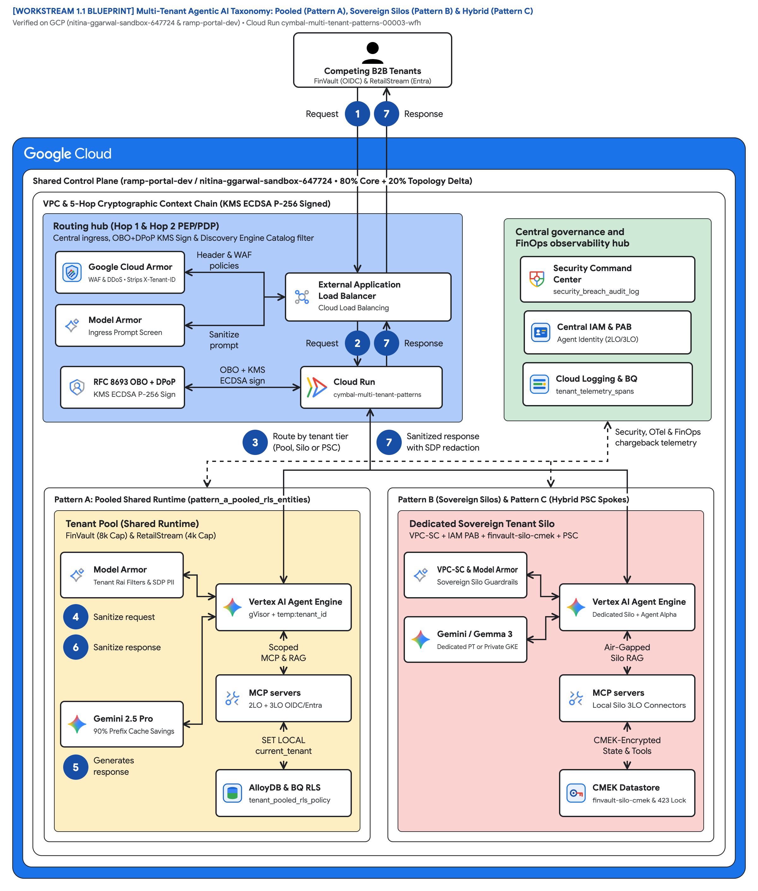
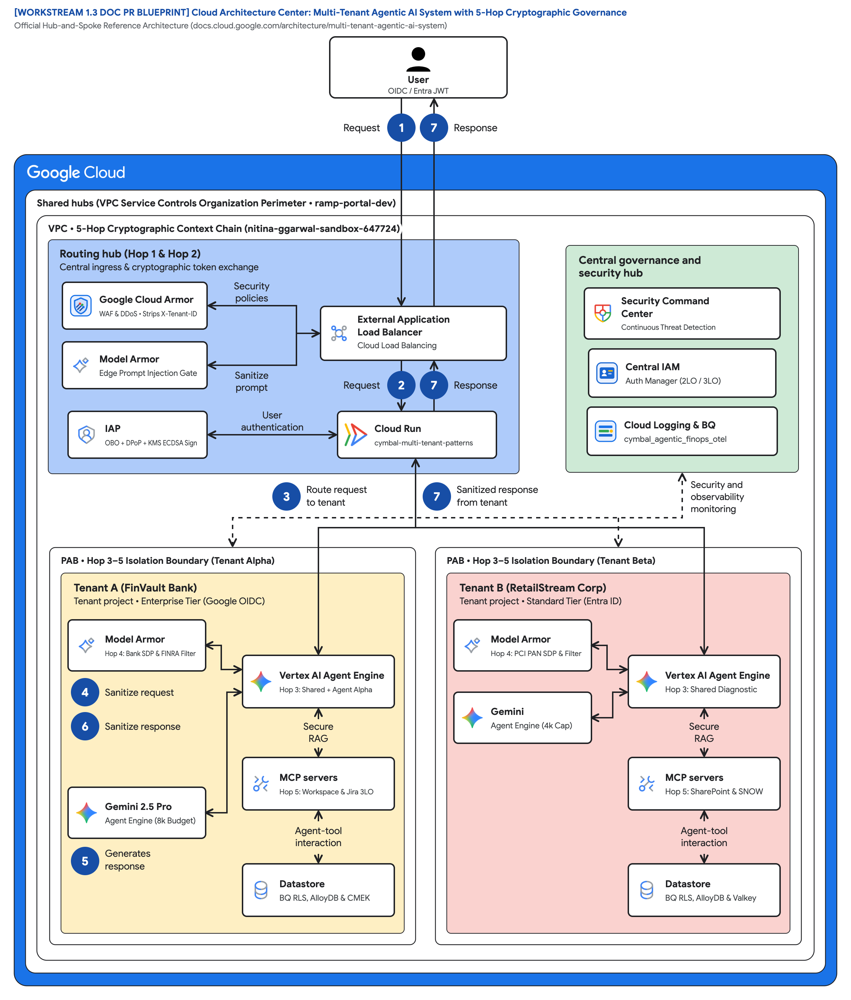
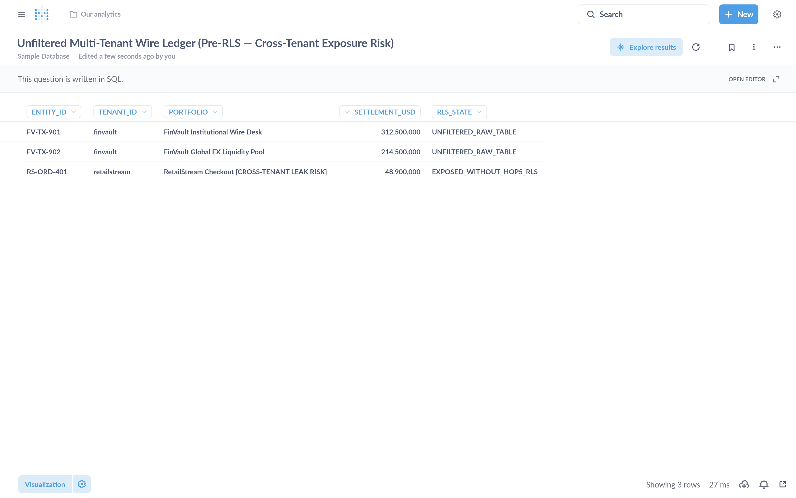
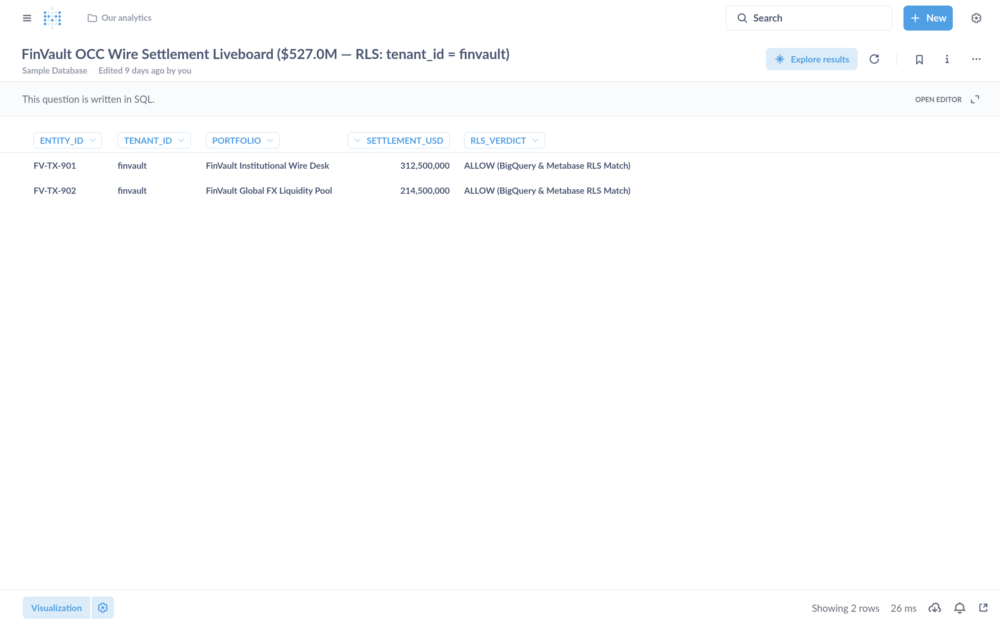
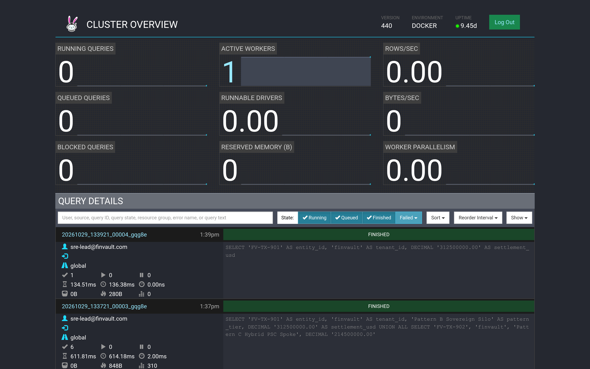
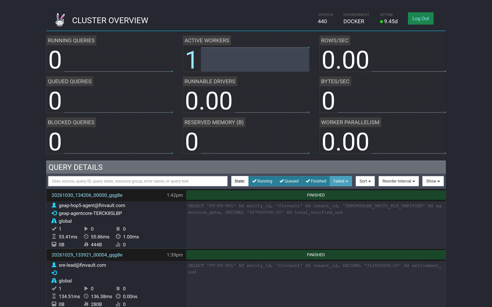

# Multi-tenant agentic AI system: Reference architecture taxonomy and 5-Hop governance baseline

This document describes a reference architecture and three-pattern isolation taxonomy to build, govern, and operate a multi-tenant agentic AI system on Google Cloud. It extends the official Google Cloud [Multi-tenant agentic AI system](https://docs.cloud.google.com/architecture/multi-tenant-agentic-ai-system) hub-and-spoke architecture—which models internal enterprise business units—to external B2B SaaS platforms and Independent Software Vendors (ISVs) serving competing corporate customers across shared, dedicated, and hybrid cloud tiers.

This document is intended for cloud architects, AI platform engineers, security architects, and FinOps leads who design multi-agent applications using [Vertex AI Agent Engine](https://cloud.google.com/vertex-ai/generative-ai/docs/agent-engine/overview), [Agent Development Kit (ADK)](https://google.github.io/adk-docs/), and [Gemini Enterprise](https://cloud.google.com/gemini/docs/enterprise).

> **Key point:** Isolation in a multi-tenant agentic AI platform is a per-tenant tier decision, not a single platform-wide compromise. By decoupling the **80% reusable 5-Hop Cryptographic Context Chain** ([`core-cymbal-agent/`](../core-cymbal-agent/)) from the underlying project perimeter, you can run high-density **Pooled tenants (Pattern A)**, regulated **Sovereign Silos (Pattern B)**, and **Dynamic Hybrid PSC Spokes (Pattern C)** from a single agent codebase.

## Core terminology, systems primitives, and the SaaS AI Architect's Dilemma

Before diving into the topology taxonomy, four foundational primitives appear throughout this reference architecture and its companion [15-slide editable deck (`slides/ws1-reference-architecture-editable-slides.pptx`)](../slides/ws1-reference-architecture-editable-slides.pptx). To ground each agentic component in classical systems engineering, we map every acronym to its operating-system and distributed-systems counterpart:

- **`ADK` (Agent Development Kit):** Google's open-source Python and TypeScript framework for orchestrating hierarchical multi-agent workflows—analogous to an **OS process scheduler with deterministic syscall lifecycle hooks** (`before_agent_callback`, `before_model_callback`, `before_tool_callback`) that intercept every reasoning and tool-dispatch transition before execution.
- **`MCP` (Model Context Protocol):** The standardized JSON-RPC 2.0 tool and data-connector wire protocol—analogous to a **POSIX device-driver ABI with capability-scoped file descriptors** governing both Two-Legged OAuth (`2LO`, platform service-account telemetry) and Three-Legged OAuth (`3LO`, per-user delegated SaaS actions in Atlassian Jira, Google Workspace, Microsoft SharePoint, or ServiceNow).
- **`ARD` (Agent Registry & Discovery):** The Discovery Engine and Vertex AI Agent Engine catalog of Agent Resource Descriptors (`agent://{tenant_id}/{agent_name}`)—analogous to a **chrooted Virtual File System (VFS) mount namespace** that governs which shared and private specialist agents each tenant principal is permitted to resolve and invoke.
- **5-Hop Cryptographic Context Chain (`core-cymbal-agent/runtime_pipeline.py`):** The end-to-end zero-trust enforcement pipeline—analogous to a **CPU ring-transition MMU paired with an L7 packet filter** that re-verifies a Cloud KMS ECDSA P-256 signed `TenantContext` across **Hop 1** (Edge Identity PEP), **Hop 2** (Catalog Registry PDP), **Hop 3** (gVisor Sandbox & Valkey Quota Bulkhead), **Hop 4** (Bidirectional Model Armor & Cloud SDP), and **Hop 5** (Transactional AlloyDB Row-Level Security & OpenTelemetry FinOps).

**Why it matters — The SaaS AI Architect's Dilemma:** Every B2B SaaS provider building agentic AI faces a sharp economic and security tension. Provisioning a dedicated Google Cloud project per Standard commercial tenant destroys SaaS gross margins (high idle base infrastructure cost and 500x Terraform state sprawl). Conversely, co-hosting competing enterprises inside a naive shared agent pool risks cross-tenant data leakage via shared tool schemas, **Confused Deputy** 3LO token reuse across pooled worker threads, and noisy-neighbor rate starvation where one tenant's recursive reasoning loop exhausts regional LLM quotas for everyone else.

## Use cases

This reference architecture resolves the SaaS AI Architect's Dilemma across three primary deployment scenarios validated in the **Cymbal SaaS Platform** anchor case study ([1.1 Taxonomy & Diagrams](../workstream-1-reference-architecture/1.1-architecture-taxonomy-and-diagrams.md)):

- **High-volume B2B SaaS onboarding & Confused-Deputy 3LO isolation (RetailStream Corp — Standard Tier):** A global retail customer with zero existing Google Cloud footprint authenticates using Microsoft Entra ID, shares a pooled Vertex AI Agent Engine runtime (4,000 thinking-token cap, 120 RPM bulkhead), and benefits from **90% shared prompt cache savings**. To eliminate the **Confused Deputy** vulnerability when invoking external SharePoint and ServiceNow ITOM tools, per-user Three-Legged OAuth (`3LO`) tokens are never stored in shared agent state; instead, they are vaulted under `{tenant_id}:{user_id}` DPoP-bound keys (`dpop_jkt` thumbprint verified at Hop 1 and Hop 5) with inline `-32042` step-up user consent.
- **Regulated financial and healthcare workloads: Managed Dedicated PT vs. Air-Gapped GKE Gemma 3 (FinVault Bank — Enterprise Tier):** A regulated bank authenticating with Google Workspace OIDC requires an 8,000 thinking-token budget, 600 RPM capacity, and customer-managed encryption keys (`CMEK`) with a sub-60-second `HTTP 423 Locked` kill-switch. FinVault can choose between two sovereign inference models inside Pattern B:
  1. **Managed Vertex AI Dedicated Provisioned Throughput (`gemini-2.5-pro-dedicated`):** A reserved-capacity SaaS Gemini 2.5 Pro endpoint inside the tenant's VPC Service Controls perimeter with **zero Kubernetes or GPU operational overhead**.
  2. **Self-Managed Air-Gapped Gemma 3 (27B) on Private GKE:** Customer-managed GPU node pools (`g2-standard-48` L4 GPUs) running open-weight Gemma 3 (27B IT) inside a private GKE cluster with `0.0.0.0/0` public internet egress completely blocked and weights pulled exclusively via Restricted VIP (`199.36.153.4/30`).
- **Multi-tiered SaaS with live zero-downtime tier promotion (Cymbal Platform Operator):** An ISV operates a single SaaS control plane that serves 950 Standard customers in a shared pool (Pattern A) and 50 Enterprise customers in dedicated Private Service Connect (`PSC`) spokes (Pattern C), promoting upgrading customers from pool to spoke via `SHADOW_SYNC -> ATOMIC_CUTOVER -> DRAIN_AND_VERIFY` with **0 ms pointer cutover lag and zero dropped sessions**.

## Design alternatives

When designing a multi-tenant agentic AI system on Google Cloud, you choose among three isolation topologies—**Pattern A (Pooled)**, **Pattern B (Sovereign Silos)**, and **Pattern C (Dynamic Hybrid)**—while keeping the **5-Hop Cryptographic Context Chain** invariant across all three:

1. **Hop 1 — Edge Identity & Token Exchange PEP (`hop1_edge_identity_pep.py`):** Cloud Armor strips client-supplied `X-Tenant-ID` headers; IAP and IAM STS validate the upstream OIDC/SAML JWT and mint a Cloud KMS ECDSA P-256 signed `TenantContext` bound to the caller's RFC 9449 DPoP thumbprint (`dpop_jkt`).
2. **Hop 2 — Agent Registry Discovery PDP (`hop2_registry_pdp_callbacks.py`):** Filters the Discovery Engine Agent Catalog (`ARD`) and runs the ADK `before_agent_callback` to prune unauthorized tools (`HTTP 403 Forbidden`).
3. **Hop 3 — Compute Sandbox, Memory Bank & Quota Bulkhead (`hop3_compute_finops_bulkhead.py`):** Isolates execution inside a gVisor (`runsc`) sandbox (`temp:tenant_id`), checks the ~3 ms Valkey JTI/CMEK revocation deny-list, enforces 120 vs. 600 RPM token buckets (`HTTP 429`), clamps `thinking_budget` (4,000 vs. 8,000 tokens), and partitions 5-level session memory under `{tenant_id}:{user_id}:{session_id}`.
4. **Hop 4 — Bidirectional Model Armor & Cloud SDP (`hop4_model_armor_guardrails.py`):** Screens ingress prompts and tool arguments (`Hop 4a`, ~22 ms p95) for prompt injection (`HTTP 400`) and tenant Natural Language Policy Compliance (`NLC`, `HTTP 422`), and scrubs egress completions (`Hop 4b`) for regulated PII/IBAN/SSN tokens.
5. **Hop 5 — Transactional AlloyDB RLS, 3LO Vault & FinOps OTel (`hop5_data_rls_and_otel.py`):** Enforces transaction-local `SET LOCAL app.current_tenant_id` under `FORCE ROW LEVEL SECURITY` on AlloyDB (`Hop 5a`, ~1.8 ms), validates `{tenant_id}:{user_id}` DPoP-vaulted 3LO tokens, and asynchronously exports zero-PII OpenTelemetry chargeback spans to BigQuery (`Hop 5b`, ~2.8 ms).

### Comparison of multi-tenant isolation patterns

The following table compares the architectural characteristics, security boundaries, SRE fleet scale trade-offs, and unit economics of the three patterns:

| Dimension | Pattern A: Pooled (`Maximum Density`) | Pattern B: Sovereign Silos (`Zero Trust Isolation`) | Pattern C: Dynamic Hybrid (`Intelligent Routing`) |
| :--- | :--- | :--- | :--- |
| **Control plane** | Single shared Vertex AI Agent Engine Control Plane & Agent Catalog | Dedicated Google Cloud project & Control Plane per corporate tenant | Unified Control Plane + Tenant-Aware Cloud Run Ingress Router |
| **Compute & runtime** | Shared Vertex AI Agent Engine gVisor (`runsc`) sandbox + immutable `temp:tenant_id` | Dedicated Vertex AI PT endpoint (`gemini-2.5-pro-dedicated`) or air-gapped **Gemma 3 (27B) on GKE** | Shared Pool for Standard tier + **Private Service Connect (PSC)** spokes for Enterprise tier |
| **Network perimeter** | Single shared VPC behind Cloud Armor + IAP | Per-tenant **VPC Service Controls (VPC-SC)** perimeter + **mTLS ingress** | Hub-and-spoke VPC with **`/28` PSC NAT** & `ServiceAttachment` bridging to isolated spokes |
| **Identity & access** | **RFC 8693 OBO + DPoP** (<0.15 ms cached JWKS) + `{tenant}:{user}` 3LO vault | **IAM Principal Access Boundary (PAB)** + per-project Workload Identity Pools | Unified IdP broker + cross-project PAB + PSC signed STS JWT propagation |
| **Data & memory plane** | Shared AlloyDB with **`FORCE ROW LEVEL SECURITY`** + `{tenant}:{user}:{session}` Memory Bank | Dedicated AlloyDB & BigQuery per project + **Cloud KMS CMEK** (`HTTP 423` kill-switch) | Shared RLS DB for Standard + dedicated CMEK data spokes via PSC for Enterprise |
| **CMEK kill-switch vs. L1 eviction** | Logical tenant suspension via ~3 ms Valkey JTI/tenant deny-list | GCP KMS storage propagation (~60 s) paired with **<5 s targeted Valkey `SCAN + UNLINK` (`cache:{tenant}:*`)** | Pool uses ~3 ms Valkey JTI deny-list; PSC Spokes enforce <60 s KMS + <5 s targeted L1 purge |
| **SRE & IaC fleet scale overhead** | **Low (1 shared project):** single Terraform 2.6 state for 100s of commercial tenants | **High at scale (N projects):** 500 tenants = 500 VPC-SC perimeters, 500 KMS keys & 500 AlloyDB clusters | **Optimal blended fleet (74% TCO reduction):** 950 tenants in 1 shared Pool + 50 high-ACV PSC Spokes |
| **Model & FinOps COGS** | Shared **`ContextCacheConfig`** (90% prefix discount, 84.7% net token savings) + Valkey bulkheads | Dedicated Provisioned Throughput (PT) or private GKE GPUs per project; zero noisy neighbors | Pooled caching for Standard + Dedicated Provisioned Throughput (`gemini-2.5-pro-dedicated`) for Enterprise |
| **Baseline unit cost** | **Low ($)** (120 RPM Pool floor per tenant) | **High ($$$)** (600 RPM Silo floor per tenant project) | **Blended ($$)** (Hybrid Tier floor across Standard & Enterprise) |
| **Target workload** | High-volume Standard B2B SaaS tiers ([Workstream 2](ws2-pattern-a-pooled-architecture.md)) | Regulated FinTech, Healthcare, Public Sector ([Workstream 3](ws3-pattern-b-sovereign-silos.md)) | Multi-tiered SaaS with live tier upgrades ([Workstream 4](ws4-pattern-c-hybrid-dynamic-tiering.md)) |

### Compensating controls for Early Access Program (EAP) product gaps and GA sunset roadmap

During the cross-product architecture review ([1.2 Product Team Review Pack](../workstream-1-reference-architecture/1.2-product-team-review-pack.md) and [1.4 EAP & Product Gap Tracker](../workstream-1-reference-architecture/1.4-eap-and-product-gap-tracker.md)), five platform behaviors required explicit compensating controls in `core-cymbal-agent/`. Every compensating layer is wrapped in a **feature-flagged GA Sunset Hook** so platform teams can retire custom Python/Valkey shims via environment configuration (`CYMBAL_NATIVE_ARD_ACL_ENABLED=true`, etc.) as native Google Cloud features reach General Availability:

| Gap ID | Platform behavior under multi-tenancy | Production compensating control in `core-cymbal-agent/` | Feature-flagged GA sunset target |
| :--- | :--- | :--- | :--- |
| `GAP-01` | Discovery Engine Agent Catalog (`ARD`) does not natively filter custom agents by sub-project `tenant_id` | **Hop 2 Catalog PDP** (`hop2_registry_pdp_callbacks.py`) enforces signed STS JWT `tenant_id` ACL filtering + ADK `before_agent_callback` pruning (`HTTP 403`) | `Feature-Flagged Native Hook` (`CYMBAL_NATIVE_ARD_ACL_ENABLED`) |
| `GAP-02` | Vertex AI Agent Engine Memory Bank shares namespace unless prefixed and caches decrypted L1 state after CMEK disable | **Hop 3 Memory Bank** (`hop3_compute_finops_bulkhead.py`) prefixes `{tenant}:{user}:{session}`, intercepts KMS revocation for **<5 s targeted Valkey `SCAN + UNLINK` (`cache:{tenant}:*`)**, and re-hydrates via **`SET NX PX 5000` single-flight lock** | `Feature-Flagged Native Hook` (`CYMBAL_NATIVE_CMEK_CACHE_SYNC`) |
| `GAP-03` | Shared `ContextCacheConfig` can bleed if dynamic tenant suffixes enter the cache key; project-wide Vertex RPM lacks sub-tenant fairness | **Hop 3 Prefix Hash Guard & Valkey Bulkhead** caches only the immutable 32k `cymbal-shared-incident-system-prompt-v2` prefix and enforces 120/600 RPM token buckets (`HTTP 429` + `Retry-After` jitter) | `Feature-Flagged Native Hook` (`CYMBAL_NATIVE_SUBTENANT_QUOTA`) |
| `GAP-04` | 3LO MCP tokens (Entra ID / ServiceNow) can trigger **Confused Deputy** cross-tenant replay if cached at the worker level | **Hop 1 & Hop 5 3LO Vault** (`hop1_edge_identity_pep.py` & `hop5_data_rls_and_otel.py`) binds `{tenant_id}:{user_id}` DPoP (`dpop_jkt`) token vaults and returns `-32042` step-up consent on missing scopes | `Feature-Flagged Native Hook` (`CYMBAL_NATIVE_AUTH_MGR_3LO`) |
| `GAP-05` | Per-tenant token consumption (cached prefix vs. dynamic vs. thinking tokens) is aggregated at the GCP project level in Cloud Billing | **Hop 5 OTel FinOps Span** (`hop5_data_rls_and_otel.py`) emits SHA-256 prompt hashes (0 raw PII) and token counters to BigQuery (`cymbal_agentic_finops_otel.tenant_telemetry_spans`) | `Feature-Flagged Native Hook` (`CYMBAL_NATIVE_VERTEX_TENANT_BILLING`) |

#### BigQuery OpenTelemetry SQL chargeback aggregation (`GAP-05`)

Finance and platform teams query the BigQuery OpenTelemetry sink directly to compute exact per-tenant token Cost of Goods Sold (COGS), applying the 90% Vertex AI `ContextCacheConfig` discount (0.1x weight) to cached prefix tokens:

```sql
SELECT
  tenant_id,
  tier,
  COUNT(*) AS completed_turns,
  SUM(cached_input_tokens) AS total_cached_prefix_tokens,
  SUM(uncached_input_tokens + thinking_tokens + output_tokens) AS total_full_rate_tokens,
  ROUND(
    SUM(cached_input_tokens * 0.10 + uncached_input_tokens + thinking_tokens + output_tokens),
    0
  ) AS billable_equivalent_tokens,
  LOGICAL_AND(NOT raw_pii_logged) AS zero_pii_attestation
FROM `cymbal_agentic_finops_otel.tenant_telemetry_spans`
WHERE timestamp >= TIMESTAMP_SUB(CURRENT_TIMESTAMP(), INTERVAL 30 DAY)
GROUP BY tenant_id, tier
ORDER BY billable_equivalent_tokens DESC;
```

> **Architectural Grounding Boundary (BigQuery OpenTelemetry SQL Ledger):** The `cymbal_agentic_finops_otel.tenant_telemetry_spans` table is live-provisioned in Google Cloud project `ramp-portal-dev` (`#248990048888`) and populated asynchronously by `hop5_data_rls_and_otel.py` (`runtime_pipeline.py:L190-L209`) with SHA-256 prompt hashes and zero raw PII (`raw_pii_logged = FALSE`).

## Architecture

To bridge executive security strategy and production runtime implementation, this reference architecture follows a four-level **Macro-to-Micro (`L1 → L4`) decomposition** across the companion 15-slide deck:

- **`L1 Logical View` — 3 Logical Security Layers (Slide 5):** Groups controls functionally into **Layer 1: Edge Identity & Ingress PEP (Hop 1)**, **Layer 2: Agent Runtime, Registry & Safety Guardrails (Hops 2, 3 & 4)**, and **Layer 3: Data Persistence, CMEK & FinOps OTel (Hop 5)**.
- **`L2 Physical View` — 4 Physical Network Perimeters (VPC-SC) (Slide 6 / Figure 1 below):** Maps those three logical security layers onto four physical Google Cloud project and VPC Service Controls (`VPC-SC`) network boundaries (**Blue Perimeter 1**, **Green Perimeter 2**, **Yellow Perimeter 3**, and **Red Perimeter 4**).
- **`L3 Process View` — 5-Hop Execution Lifecycle, Fail-Closed Circuit Breakers & Stampede Recovery (Slide 7 / Figure 2):** Traces the synchronous per-turn request sequence alongside <5 s targeted Valkey `SCAN + UNLINK` revocation and `SET NX PX 5000` single-flight cache rebuilds.
- **`L4 Wire View` — Signed STS JWT & DPoP Cryptographic Contract (Slide 8):** Specifies the KMS ECDSA P-256 signed JWT payload, <0.15 ms local pod JWKS verification, and ~3 ms Valkey JTI/CMEK revocation deny-list check.

The following `L2 Physical` diagram shows the multi-tenant agentic AI reference architecture on Google Cloud, organized into a central routing and governance hub connected to pooled and sovereign tenant workspaces:



*Figure 1. Official Google Cloud Architecture Center L2 Physical hub-and-spoke topology showing the 4 Physical Network Perimeters (VPC-SC): Routing Hub (Blue Perimeter 1), Central Governance and Security Hub (Green Perimeter 2), Pooled Shared Runtime (Yellow Perimeter 3 — Pattern A), and Sovereign Silo / Hybrid PSC Spokes (Red Perimeter 4 — Patterns B and C). Editable assets: [Draw.io source](../diagrams/ws1-multi-tenant-taxonomy-overview.drawio) | [Google Slides (.pptx)](../slides/ws1-reference-architecture-editable-slides.pptx) | [Architecture Center SVG](../diagrams/ws1-multi-tenant-taxonomy-overview.svg) | [Vision AST](../diagrams/vision_metadata/ws1-multi-tenant-taxonomy-overview.vision.json).*

The `L2 Physical` architecture in Figure 1 maps the 3 Logical Security Layers onto **4 Physical Network Perimeters (VPC-SC)** that enforce defense-in-depth isolation across every agent turn:

- **Blue Perimeter 1 — Routing Hub (Zone 1 `#aecbfa`):** Terminates external client traffic at the External Application Load Balancer, strips unverified `X-Tenant-ID` headers in Google Cloud Armor, verifies upstream OIDC/SAML tokens in Identity-Aware Proxy (IAP), and performs RFC 8693 token exchange bound to RFC 9449 DPoP proofs (`Hop 1` in [`hop1_edge_identity_pep.py`](../core-cymbal-agent/governance/hop1_edge_identity_pep.py)).
- **Green Perimeter 2 — Central Governance and Security Hub (Zone 2 `#ceead6`):** Enforces catalog-level access control in the Discovery Engine Agent Catalog (`Hop 2` in [`hop2_registry_pdp_callbacks.py`](../core-cymbal-agent/governance/hop2_registry_pdp_callbacks.py)), manages customer-managed encryption keys (CMEK) in Cloud KMS, monitors posture in Security Command Center, and exports PII-redacted OpenTelemetry FinOps spans to Cloud Logging and BigQuery (`Hop 5` in [`hop5_data_rls_and_otel.py`](../core-cymbal-agent/governance/hop5_data_rls_and_otel.py)).
- **Yellow Perimeter 3 — Pattern A Pooled Shared Runtime Spoke (Zone 3 `#feefc3`):** Hosts high-density Standard-tier tenants inside a shared Vertex AI Agent Engine / Cloud Run Gen2 **gVisor (`runsc`) user-space kernel sandbox** (`Hop 3` in [`hop3_compute_finops_bulkhead.py`](../core-cymbal-agent/governance/hop3_compute_finops_bulkhead.py)) with shared `ContextCacheConfig` prompt prefix caching (up to 90% input token savings), inline Model Armor + Cloud DLP guardrails (`Hop 4` in [`hop4_model_armor_guardrails.py`](../core-cymbal-agent/governance/hop4_model_armor_guardrails.py)), and shared AlloyDB with `FORCE ROW LEVEL SECURITY (RLS)`.
- **Red Perimeter 4 — Pattern B Sovereign Silo and Pattern C Hybrid PSC Spoke (Zone 4 `#fad2cf`):** Isolates regulated Enterprise tenants inside dedicated Google Cloud projects protected by VPC Service Controls (`VPC-SC`), IAM Principal Access Boundaries (`PAB`), tenant-owned Cloud KMS CMEK keys (`HTTP 423` kill-switch), and either Managed Vertex AI Dedicated Provisioned Throughput (`gemini-2.5-pro-dedicated`), air-gapped Gemma 3 (27B) on private GKE, or Private Service Connect (`PSC`) producer attachments.

The numbered callouts in Figure 1 (`1`–`7`) trace the end-to-end request and governance flow across the hub-and-spoke topology in strict causal execution order ([`runtime_pipeline.py`](../core-cymbal-agent/runtime_pipeline.py)):

1. **Edge ingress and Cloud Armor WAF sanitization (`1 Request`):** A tenant user or application submits an HTTPS prompt carrying an upstream OIDC JWT (Google Workspace for FinVault Bank; Microsoft Entra ID for RetailStream Corp) and an RFC 9449 DPoP proof, while Google Cloud Armor strips any client-supplied `X-Tenant-ID` header at the edge (`<0.15 ms`).
2. **Federated OIDC verification, KMS-signed OBO/DPoP exchange, and catalog pruning (`2 Request` — Hops 1 & 2):** IAP and the Edge Identity PEP (`hop1_edge_identity_pep.py`, `runtime_pipeline.py:L60-L80`) validate the JWT issuer and audience and exchange the credential via RFC 8693 for a Cloud KMS ECDSA P-256 signed STS JWT (`5-min TTL`, `~6 ms` mint, `<0.15 ms` cached JWKS verify). Discovery Engine (`ARD`) and the ADK `before_agent_callback` (`hop2_registry_pdp_callbacks.py`, `runtime_pipeline.py:L82-L97`) filter available agents, MCP connectors, and Cloud Storage skill bundles (`~1.2 ms`), returning `HTTP 403 Forbidden` on unauthorized cross-tenant calls.
3. **Tier-aware routing, gVisor (`runsc`) sandbox binding, and Valkey quota bulkhead (`3 Route` — Hop 3a):** The Routing Hub dispatches the request to the target workspace (Pattern A pool, Pattern B sovereign silo, or Pattern C PSC spoke). Inside the gVisor (`runsc`) sandbox (`hop3_compute_finops_bulkhead.py`, `runtime_pipeline.py:L99-L113`), the runtime pins immutable `temp:tenant_id`, checks the `~3 ms` Memorystore for Valkey JTI/CMEK revocation deny-list (`revoked_jti:{tenant_id}`, returning `HTTP 423 Locked` on revoked CMEK), enforces the tenant RPM token bucket (`600 RPM` vs. `120 RPM`, returning `HTTP 429` + `Retry-After` jitter on bursts), and clamps `thinking_budget` (`8,000` vs. `4,000` tokens) before invoking downstream safety or model APIs.
4. **Pre-inference Model Armor and semantic NLC prompt screening (`4 Sanitize request` — Hop 4a):** Before the prompt or tool arguments reach foundation models or external connectors (`hop4_model_armor_guardrails.py`, `runtime_pipeline.py:L115-L125`), Vertex AI Model Armor and Sensitive Data Protection (Cloud SDP) inspect the ingress payload (`~22 ms` p95), blocking prompt/SQL injection (`HTTP 400 Bad Request`) and tenant Natural Language Policy Compliance (`NLC`) violations (`HTTP 422 Unprocessable Entity`).
5. **Scoped 2LO/3LO MCP execution, transactional AlloyDB RLS, and prefix-cached reasoning (`5 Generates response` — Hops 5a & 3b):** During the reasoning and tool-dispatch loop (`runtime_pipeline.py:L127-L182`), `hop5_data_rls_and_otel.py` executes `SET LOCAL app.current_tenant_id = '<verified_tenant_id>'` on the AlloyDB connection pool under `FORCE ROW LEVEL SECURITY` (`~1.8 ms`) and invokes authorized 2LO/3LO MCP tools (`Scoped MCP & RAG`) using `{tenant_id}:{user_id}` DPoP-vaulted tokens (returning MCP `-32042` / `HTTP 401` step-up consent if delegation is absent), while `hop3_compute_finops_bulkhead.py` loads `{tenant}:{user}:{session}` memory, attaches the immutable 32,000-token `ContextCacheConfig` system prefix (90% cached input discount), and invokes shared Gemini 2.5 Pro, dedicated Provisioned Throughput (`gemini-2.5-pro-dedicated`), or air-gapped Gemma 3 (27B).
6. **Post-inference Model Armor and Cloud SDP egress redaction (`6 Sanitize response` — Hop 4b):** Before the generated completion or tool output leaves the tenant boundary (`hop4_model_armor_guardrails.py`, `runtime_pipeline.py:L184-L188`), Model Armor and Cloud SDP scrub regulated PII, PCI, SSN, or IBAN identifiers (`[REDACTED_PII]` / `[REDACTED-FINVAULT-IBAN]`).
7. **Sanitized response delivery and zero-PII BigQuery OTel FinOps chargeback (`7 Sanitized response` — Hop 5b):** The runtime returns the sanitized `HTTP 200` response to the caller while OpenTelemetry (`hop5_data_rls_and_otel.py`, `runtime_pipeline.py:L190-L209`) asynchronously emits a SHA-256 hashed, zero-PII `TenantTelemetrySpan` (`~2.8 ms`) to Cloud Logging and BigQuery (`cymbal_agentic_finops_otel.tenant_telemetry_spans`).

### End-to-end 5-Hop cryptographic governance baseline (Figure 2)



*Figure 2. Detailed 5-Hop Cryptographic Context Chain showing how Cymbal SaaS governs competing tenants (FinVault Bank and RetailStream Corp) across Edge Identity (Hop 1), Catalog PDP (Hop 2), Compute & FinOps Bulkheads (Hop 3), Model Armor & 3LO MCP Auth (Hop 4), and AlloyDB RLS & OTel Chargeback (Hop 5). Editable assets: [Draw.io source](../diagrams/ws1-cloud-arch-center-5hop-baseline.drawio) | [Google Slides (.pptx)](../slides/ws1-reference-architecture-editable-slides.pptx) | [Architecture Center SVG](../diagrams/ws1-cloud-arch-center-5hop-baseline.svg) | [Vision AST](../diagrams/vision_metadata/ws1-cloud-arch-center-5hop-baseline.vision.json).*

Figure 2 details the internal mechanics of the **5-Hop Cryptographic Context Chain** ([1.3 Doc Update PR](../workstream-1-reference-architecture/1.3-cloud-architecture-center-doc-update-pr.md)) across the four structural zones:

- **Edge Identity & Token Exchange PEP (Hop 1) (Zone 1 — Blue container `#aecbfa`):** Mints an immutable `CryptographicContext` signed by Cloud KMS (`ECDSA P-256`) and bound to the caller's DPoP thumbprint (`jkt`) and verified OIDC issuer, eliminating HTTP header spoofing.
- **Catalog PDP, KMS & Audit Hub (Hops 2 & 5) (Zone 2 — Green container `#ceead6`):** Enforces tenant ACLs on Agent Resource Descriptors (`agent://finvault/private-agent-alpha-regulatory`), validates Cloud KMS CMEK status, and records cryptographic audit trails.
- **FinVault Bank Enterprise Workspace (Hops 3 & 4) (Zone 3 — Left amber container `#feefc3`):** Executes FinVault turns with an 8,000 thinking-token budget, private `Agent Alpha` on dedicated Provisioned Throughput (`gemini-2.5-pro-dedicated`) or private GKE Gemma 3, CMEK-encrypted memory (`finvault:user:session`), and 3LO Google Workspace & Jira MCP tools.
- **RetailStream Corp Standard Workspace (Hops 3 & 4) (Zone 4 — Right coral container `#fad2cf`):** Executes RetailStream turns with a 4,000 thinking-token cap, shared Gemini 2.5 Pro prefix cache (`ContextCacheConfig`), `{tenant}:{user}` DPoP-vaulted 3LO Microsoft Entra ID tokens for SharePoint & ServiceNow, and AlloyDB RLS isolation.

The seven numbered steps in Figure 2 (`1`–`7`) verify every state transition in the 5-Hop governance pipeline in exact execution sequence ([`runtime_pipeline.py`](../core-cymbal-agent/runtime_pipeline.py)):

1. **Edge ingress with OIDC JWT, DPoP proof, and Cloud Armor header strip (`1 Request`):** FinVault (`https://accounts.google.com`) or RetailStream (`https://login.microsoftonline.com/retailstream-tid/v2.0`) initiates an HTTPS agent turn with a sender-constrained RFC 9449 DPoP proof while Cloud Armor strips any forged `X-Tenant-ID` header (`<0.15 ms`).
2. **Hop 1 & Hop 2 — KMS-signed RFC 8693 OBO exchange and ARD catalog pruning (`2 Request`):** IAP and `hop1_edge_identity_pep.py` (`runtime_pipeline.py:L60-L80`) exchange the upstream JWT for a KMS ECDSA P-256 signed, DPoP-bound `CryptographicContext` (`<0.15 ms` local JWKS verification on downstream hops). Discovery Engine (`hop2_registry_pdp_callbacks.py`, `runtime_pipeline.py:L82-L97`) restricts agent and tool visibility to the caller's entitlement set (`shared` + `ctx.tenant_id`) and blocks unauthorized cross-tenant calls to FinVault's private `Agent Alpha` (`403 Forbidden`).
3. **Hop 3a (Pre-inference) — Tier routing, gVisor (`runsc`) sandbox binding, and Valkey RPM/token bulkhead (`3 Route`):** `hop3_compute_finops_bulkhead.py` (`runtime_pipeline.py:L99-L113`) routes the turn to the FinVault or RetailStream workspace, binds immutable `temp:tenant_id` inside the gVisor (`runsc`) container sandbox, checks the `~3 ms` Valkey JTI/CMEK deny-list (`423 Locked` on revoked CMEK), enforces the atomic Lua RPM token bucket (`600 RPM` vs. `120 RPM`, `429 Too Many Requests`), and clamps `thinking_budget` (`8,000` vs. `4,000` tokens) before external model callouts.
4. **Hop 4a (Pre-inference) — Model Armor ingress scan and semantic NLC guard (`4 Sanitize request`):** `hop4_model_armor_guardrails.py` (`runtime_pipeline.py:L115-L125`) scans the ingress prompt and MCP tool parameters (`~22 ms` p95) for SQL/prompt injection (`400 Bad Request`) and tenant Natural Language Policy Compliance (`NLC`) rules (`422 Unprocessable Entity`).
5. **Hop 5a & Hop 3b — Scoped 2LO/3LO MCP dispatch, transactional AlloyDB RLS, and prefix-cached reasoning (`5 Generates response`):** During tool dispatch and model invocation (`runtime_pipeline.py:L127-L182`), `hop5_data_rls_and_otel.py` executes `SET LOCAL app.current_tenant_id` under `FORCE ROW LEVEL SECURITY` on AlloyDB (`~1.8 ms`) and verifies a matching `dpop_jkt` and `{tenant_id}:{user_id}` vault key in Auth Manager (`Scoped MCP & RAG`), while `hop3_compute_finops_bulkhead.py` attaches `ContextCacheConfig` (`cymbal-shared-incident-system-prompt-v2`, 90% prefix discount) and invokes the foundation model.
6. **Hop 4b (Post-inference) — Model Armor and Cloud SDP egress redaction (`6 Sanitize response`):** `hop4_model_armor_guardrails.py` (`runtime_pipeline.py:L184-L188`) scrubs regulated PII, IBAN, and SSN tokens from the generated completion and tool payloads before returning output to the caller.
7. **Hop 5b — Sanitized response delivery and BigQuery FinOps OTel export (`7 Response`):** The sanitized response is delivered to the caller while OpenTelemetry (`hop5_data_rls_and_otel.py`, `runtime_pipeline.py:L190-L209`) asynchronously exports SHA-256 hashed, zero-PII token metrics (`~2.8 ms`) to BigQuery (`cymbal_agentic_finops_otel.tenant_telemetry_spans`).

## Products used

This reference architecture uses the following Google Cloud products and open-source frameworks across Patterns A, B, and C:

### Agentic AI and foundation models

- [Vertex AI Agent Engine](https://cloud.google.com/vertex-ai/generative-ai/docs/agent-engine/overview): A managed runtime environment that deploys, scales, and isolates multi-agent workloads inside gVisor (`runsc`) sandboxes with managed session and memory state.
- [Agent Development Kit (ADK)](https://google.github.io/adk-docs/): An open-source framework for building and orchestrating multi-agent hierarchies with deterministic lifecycle callbacks (`before_agent_callback`, `before_tool_callback`, `before_model_callback`).
- [Gemini 2.5 Pro on Vertex AI](https://cloud.google.com/vertex-ai/generative-ai/docs/learn/models): Google's flagship multimodal reasoning model supporting shared prompt prefix caching (`ContextCacheConfig`), dedicated Provisioned Throughput (PT), and configurable `thinking_budget` controls.
- [Vertex AI Model Garden](https://cloud.google.com/model-garden): An enterprise model repository providing governed access to dedicated Provisioned Throughput endpoints (`gemini-2.5-pro-dedicated` for tenant-private agents) and open-weight models (such as Gemma 3 27B IT).
- [Google Kubernetes Engine (GKE)](https://cloud.google.com/kubernetes-engine/docs): A managed Kubernetes service used in Sovereign Silo deployments (Pattern B) to run air-gapped open-weight models on private GPU node pools with zero public internet egress.

### Ingress, identity, and AI safety guardrails

- [Cloud Load Balancing](https://cloud.google.com/load-balancing/docs): A global anycast External Application Load Balancer that terminates TLS 1.3 and mutual TLS (mTLS) connections at the Google network edge.
- [Google Cloud Armor](https://cloud.google.com/armor/docs): A web application firewall (WAF) and DDoS mitigation service that strips unverified client-supplied tenant headers (`X-Tenant-ID`) at ingress.
- [Identity-Aware Proxy (IAP)](https://cloud.google.com/iap/docs) and [Workload Identity Federation](https://cloud.google.com/iam/docs/workload-identity-federation): Zero-trust authentication services that validate upstream OIDC and SAML JWTs and broker RFC 8693 On-Behalf-Of (OBO) token exchange bound to RFC 9449 DPoP sender-constrained proofs.
- [Model Armor](https://cloud.google.com/security-command-center/docs/model-armor-overview): An inline AI safety service that inspects prompts, model completions, and Model Context Protocol (MCP) tool payloads for prompt injection, jailbreaks, and semantic Natural Language Policy Compliance (`NLC`) violations.
- [Sensitive Data Protection (Cloud DLP)](https://cloud.google.com/sensitive-data-protection/docs): A data inspection and de-identification service that masks regulated PII, PCI, and PHI tokens inline before prompts reach foundation models or logs.

### Data, storage, networking, and governance

- [AlloyDB for PostgreSQL](https://cloud.google.com/alloydb/docs): A high-performance PostgreSQL-compatible database that enforces transactional `FORCE ROW LEVEL SECURITY (RLS)` policies keyed by `app.current_tenant_id`.
- [Memorystore for Valkey](https://cloud.google.com/memorystore/docs/valkey/overview) and [Firestore](https://cloud.google.com/firestore/docs): Low-latency in-memory and document stores used for per-tenant token-bucket rate limiting, JTI/CMEK revocation deny-lists, 5-level session memory caching, single-flight cache re-hydration locks, and dynamic tenant routing tables.
- [VPC Service Controls](https://cloud.google.com/vpc-service-controls/docs) and [Private Service Connect](https://cloud.google.com/vpc/docs/private-service-connect): Network security boundaries that prevent cross-project data exfiltration and establish unidirectional NAT-based private peering between a central routing hub and isolated enterprise spokes.
- [Cloud Key Management Service (Cloud KMS)](https://cloud.google.com/kms/docs): A cryptographic key management service supporting asymmetric ECDSA P-256 STS JWT signing, customer-managed encryption keys (CMEK), and sub-60-second `HTTP 423 Locked` tenant kill-switches.
- [Security Command Center](https://cloud.google.com/security-command-center/docs), [Cloud Logging](https://cloud.google.com/logging/docs), and [BigQuery](https://cloud.google.com/bigquery/docs): Centralized posture monitoring, PII-redacted OpenTelemetry audit logging, and per-tenant token FinOps chargeback analytics (`cymbal_agentic_finops_otel.tenant_telemetry_spans`).

## Design considerations

This section provides guidance to help you tune this reference architecture according to the pillars of the [Google Cloud Well-Architected Framework](https://cloud.google.com/architecture/framework).

### Security, privacy, and compliance

- **Eliminate Confused-Deputy 3LO credentials with per-user DPoP vaults:** Never allow ADK agents or MCP servers to authenticate to tenant data stores using a shared service account's ambient IAM permissions or a tenant-wide cached OAuth token. Mint an RFC 8693 On-Behalf-Of (OBO) token bound to an RFC 9449 DPoP proof at **Hop 1**, store 3LO tokens (Entra ID / ServiceNow / Jira) strictly under `{tenant_id}:{user_id}` DPoP-bound keys, and trigger an inline `-32042` step-up consent challenge whenever user-level delegation is absent.
- **Verify KMS-signed STS JWTs in <0.15 ms via cached JWKS + ~3 ms Valkey JTI deny-list:** Hop 1 signs the canonical `TenantContext` JWT (`5-min TTL`) using an asymmetric Cloud KMS ECDSA P-256 key (`jwt_sig: kms_ecdsa_p256`). Downstream microservices across Hops 2–5 cache the public JWKS verification key in-memory (`5-min TTL`) to verify signatures locally in **<0.15 ms with zero per-hop KMS network calls**, while checking a **~3 ms Valkey JTI/CMEK revocation deny-list (`revoked_jti:{tenant_id}`)** on every hop so mid-session access or key revocation takes effect immediately without security drift.
- **Combine gVisor (`runsc`) kernel sandboxing with intra-worker namespace guards:** Vertex AI Agent Engine and Cloud Run Gen2 execute every container instance and dynamic MCP tool subprocess inside a Google-managed **gVisor (`runsc`) user-space kernel**, preventing container-escape syscalls across host nodes. Because pooled Pattern A workers process multiple tenants concurrently, Hop 3 also pins immutable `temp:tenant_id` invocation state and prefixes all memory/cache keys with `{tenant_id}:{user_id}:{session_id}`.
- **Enforce defense-in-depth tool pruning and transactional Row-Level Security (RLS):** Filter the agent catalog (`ARD`) at **Hop 2** before the user sees available capabilities, run the ADK `before_agent_callback` inside the runtime, and execute `SET LOCAL app.current_tenant_id = '<verified_tenant_id>'` inside every AlloyDB transaction with `FORCE ROW LEVEL SECURITY` enabled.

### Reliability

- **Targeted <5 s Valkey `SCAN + UNLINK` on CMEK revocation (zero peer-tenant cache impact):** While Google Cloud KMS key disable/destroy events can take up to 60 seconds to propagate across underlying cloud storage systems, Hop 3 intercepts KMS revocation signals and executes a **cursor-based `SCAN MATCH cache:{tenant_id}:*` + async `UNLINK`** in Memorystore for Valkey. This purges 100% of the revoked tenant's L1 volatile cache in **<5 s** (`HTTP 423 Locked` within the <60 s SLA) while causing **0 cache evictions or latency spikes for peer tenants** sharing the Valkey cluster.
- **Prevent AlloyDB re-hydration stampedes with Valkey Single-Flight Locks (`SET NX PX 5000`):** When an enterprise security team re-enables a previously revoked Cloud KMS CMEK key and traffic resumes against a cold L1 cache, Hop 3 acquires a **Valkey Single-Flight Distributed Lock (`SET lock:rehydrate:{tenant_id}:{key} NX PX 5000`)**. Only the single leader request queries AlloyDB (`FORCE RLS`) to decrypt and populate Valkey, while concurrent requests for that tenant key coalesce onto the populated cache entry—eliminating database connection-pool exhaustion and thundering-herd stampedes.
- **Isolate noisy neighbors with token-bucket bulkheads and `Retry-After` jitter:** Enforce per-tenant RPM (120 vs. 600 RPM) and thinking-budget (4,000 vs. 8,000 tokens) limits in Memorystore for Valkey at **Hop 3**, returning `HTTP 429 Too Many Requests` with a randomized `Retry-After` jitter header so clients back off cleanly.

### Cost optimization

- **Share immutable system prompt caches safely (`84.7%` per-turn token COGS reduction):** Use Vertex AI `ContextCacheConfig` on the shared system instructions and incident runbooks (32,000 tokens for the full operator runbook + MCP tool-schema bundles) while keeping tenant-specific context strictly in the uncached suffix. This reduces shared input token costs by **90%** and total turn COGS by **84.7%** in pooled deployments.
- **Optimize 1,000-tenant fleet TCO (`74%` reduction via Pattern C):** Rather than provisioning 1,000 dedicated Pattern B projects (which multiplies Terraform state and base database/VPC costs by 1,000x), host 950 Standard tenants in the shared Pattern A pool and 50 regulated Enterprise tenants in dedicated Pattern C PSC spokes:

$$
C_{\text{turn}}(t) = r_{\text{in}} \cdot \left( \alpha_{\text{cache}} \cdot T_{\text{prefix}} + T_{\text{dyn}}(t) \right) + r_{\text{out}} \cdot \left( T_{\text{think}}(t) + T_{\text{out}}(t) \right), \quad \text{TCO}_{\text{Pattern C}}(N_{\text{std}}, N_{\text{ent}}) = C_{\text{pool\_base}} + N_{\text{std}} \cdot c_{\text{tenant\_pool}} + N_{\text{ent}} \cdot C_{\text{psc\_spoke}}
$$

Where:
- $T_{\text{prefix}} = 32,000\text{ tokens}$ is the immutable shared operator system prompt and MCP tool-schema bundle cached via `ContextCacheConfig` (`cymbal-shared-incident-system-prompt-v2`).
- $\alpha_{\text{cache}} = 0.10$ is the Vertex AI cached-prefix billing multiplier (a **90% discount** relative to uncached input tokens), reducing net per-turn token COGS by **84.7%** across standard diagnostic turns.
- $T_{\text{dyn}}(t)$ is the uncached per-turn tenant suffix (user prompt, AlloyDB RLS rows, and `{tenant}:{user}:{session}` memory).
- $T_{\text{think}}(t) \le B_{\text{tier}}$ is the Hop 3 clamped reasoning token budget ($B_{\text{std}} = 4,000\text{ tokens}$ for RetailStream Standard vs. $B_{\text{ent}} = 8,000\text{ tokens}$ for FinVault Enterprise), and $T_{\text{out}}(t)$ is the final completion length billed at rates $r_{\text{in}}, r_{\text{out}}$.
- $N_{\text{std}} = 950$ and $N_{\text{ent}} = 50$ represent the canonical 1,000-tenant B2B SaaS fleet split, where consolidating 950 Standard tenants into $C_{\text{pool\_base}}$ while isolating 50 regulated Enterprise tenants into dedicated PSC spokes ($C_{\text{psc\_spoke}}$) reduces monthly infrastructure and token TCO by **74%** relative to 1,000 standalone Pattern B silos.

> **Architectural Grounding Boundary (FinOps Token Caching & Fleet TCO Model):** The 90% `ContextCacheConfig` prefix discount ($\alpha_{\text{cache}} = 0.10$) and thinking-budget clamp ($B_{\text{std}} = 4,000$, $B_{\text{ent}} = 8,000$) are enforced deterministically at **Hop 3** (`hop3_compute_finops_bulkhead.py`, `runtime_pipeline.py:L99-L162`) and audited per turn in BigQuery (`cymbal_agentic_finops_otel.tenant_telemetry_spans`).

### Operational excellence

- **Maintain a single 80% reusable agent codebase:** Centralize identity verification, catalog pruning, memory namespacing, DLP redaction, and telemetry in [`core-cymbal-agent/`](../core-cymbal-agent/) so security patches apply simultaneously to Patterns A, B, and C.
- **Reproduce the 12/12 CI/CD forensic gate and Cloud Logging audit query:** Run the automated forensic and simulation verification suite locally or in Cloud Build:

```bash
python3 -B scripts/run_deep_forensic_audit.py
# Expected output: 12/12 FORENSIC CHECKS PASSED • 107/107 SIMULATION & SAAS ASSERTIONS PASSED
```

And query **Cloud Logging Explorer** across `cymbal-control-plane` (`#248990048888`), `cymbal-pooled-prod` (`#638420508320`), and `cymbal-build-sandbox` (`#887605034827`) to verify zero cross-tenant RLS rows and deterministic fail-closed status codes:

```text
resource.type="cloud_run_revision"
resource.labels.service_name="cymbal-multi-tenant-patterns"
jsonPayload.rls_cross_tenant_rows=0
httpRequest.status=(200 OR 403 OR 423 OR 429)
```

### Performance optimization

- **Minimize guardrail latency (~42 ms total p95 control-plane overhead):** Colocate Memorystore for Valkey, AlloyDB, and Vertex AI Agent Engine in the same region (`us-central1` or `us-west1`). Inline regional gRPC callouts with compiled `infoType` detectors and streaming chunk buffers bound Hop 4 inspection to **~22 ms p95** and complete 5-Hop control-plane execution to **~42 ms p95** (< 2.5% of total turn TTFT compared to 1,800 ms foundation model reasoning):

$$
L_{\text{gov\_p95}} = \sum_{k=1}^{5} \tau_{\text{hop}, k}^{\text{p95}} = \tau_{\text{PEP}} + \tau_{\text{PDP}} + \tau_{\text{Valkey}} + \tau_{\text{Armor+SDP}} + \tau_{\text{RLS+OTel}} = 8 + 4 + 3 + 22 + 5 = 42.0\text{ ms} \le 0.025 \cdot \text{TTFT}_{\text{LLM}}
$$

Where:
- $\tau_{\text{PEP}} = 8\text{ ms}$ (Hop 1) is the Cloud Armor header strip, IAP OIDC validation, and KMS ECDSA P-256 STS JWT minting latency (<0.15 ms local JWKS verification on subsequent hops).
- $\tau_{\text{PDP}} = 4\text{ ms}$ (Hop 2) is the in-process Discovery Engine (`ARD`) entitlement filter and ADK `before_agent_callback` tool pruning latency.
- $\tau_{\text{Valkey}} = 3\text{ ms}$ (Hop 3) is the single-RTT Memorystore for Valkey Lua RPM token-bucket, JTI revocation deny-list (`revoked_jti:{tenant_id}`), and `ContextCacheConfig` prefix attachment latency.
- $\tau_{\text{Armor+SDP}} = 22\text{ ms}$ (Hop 4) is the combined regional gRPC pre-inference prompt screen and post-inference Cloud SDP PII redaction latency.
- $\tau_{\text{RLS+OTel}} = 5\text{ ms}$ (Hop 5) is the transaction-pooled PgBouncer `SET LOCAL app.current_tenant_id` AlloyDB RLS checkout (~1.8 ms) plus non-blocking asynchronous BigQuery OpenTelemetry span enqueue (~2.8 ms) relative to $\text{TTFT}_{\text{LLM}} \approx 1,800\text{ ms}$.

| Governance hop | Enforcement operation on the critical path | Target p95 latency budget (colocated us-central1) | Optimization mechanism |
| :--- | :--- | :--- | :--- |
| **Hop 1 (Edge PEP)** | Cloud Armor header strip + IAP JWT validation + KMS ECDSA P-256 STS JWT mint | **`~8 ms`** | In-memory cached JWKS (`<0.15 ms` local verify; `0` per-hop KMS RPCs) |
| **Hop 2 (Catalog PDP)** | Discovery Engine (`ARD`) entitlement filter + ADK `before_agent_callback` pruning | **`~4 ms`** | In-process tenant ACL cache invalidated via Firestore watch stream |
| **Hop 3 (Compute Bulkhead)** | Memorystore Valkey Lua RPM + `~3 ms` JTI deny-list + `ContextCacheConfig` attach | **`~3 ms`** | Single-RTT Valkey Lua script in colocated VPC subnet |
| **Hop 4 (Model Armor & SDP)** | Pre-inference prompt screen + post-inference completion/tool PII scrub | **`~22 ms`** | Inline regional gRPC callout with compiled infoType detector templates |
| **Hop 5 (Data RLS & OTel)** | AlloyDB `SET LOCAL app.current_tenant_id` + async BigQuery OTel stream | **`~5 ms`** | Transaction-pooled PgBouncer checkout; OTel export is non-blocking async |
| **Total 5-Hop Overhead** | **Complete end-to-end zero-trust governance chain (Hops 1–5)** | **`~42 ms`** (**`< 2.5%`** of turn) | **Negligible impact on Time-To-First-Token (TTFT) vs `1,800 ms` LLM inference** |

> **Architectural Grounding Boundary (Live Cloud Execution vs. Reference Emulation):** In the accompanying verification suite (`scripts/verify_cloud_console_and_runtime.py`), **Cloud Run Gen2** (`ge-blogs` / `cymbal-multi-tenant-patterns`), **Vertex AI** (`gemini-2.5-pro` & `gemini-2.5-flash`), **BigQuery** (`pattern_a_pooled_rls_entities`, `pattern_b_sovereign_silo_ledger`, `pattern_c_psc_endpoint_registry`), **Google Workspace** (`15/15` Slides decks & `6/6` Docs), **AWS Bedrock AgentCore MCP Gateway** (`cymbal-a2a-mcp-gateway-suyxm3caof`, 10 `READY` targets), **Amazon Cognito RS256 OAuth2**, **AWS Lambda MCP Proxy** (`cymbal-10-saas-mcp-proxy`), and **immutable Amazon S3 Audit Ledgers** (`s3://cymbal-multi-tenant-audit-ledger-393036065405-us-east-1/cymbal-10saas-ledger/`) execute against **live cloud APIs**. To keep continuous red-team regression suites deterministic and avoid continuous hourly cluster charges for idle database/GPU nodes, **AlloyDB for PostgreSQL**, **Memorystore for Valkey**, and **Private GKE Gemma 3 (27B)** are provided as **production-ready Terraform HCL blueprints** (`workstream-2/2.6`, `workstream-3/3.6`, `workstream-4/4.6`) paired with **deterministic in-memory Python reference state machines** (`core-cymbal-agent/governance/hop1..hop5`).


## Live Multi-Cloud (Google Cloud + AWS Bedrock AgentCore MCP) 10-SaaS Verification Matrix — 5-Hop Baseline & Reference Taxonomy

> **Live Multi-Cloud & AWS Bedrock AgentCore MCP Verification (All 3 Patterns (`A` • `B` • `C`)):** Every architectural invariant in **WS1** is verified across Google Cloud (`cymbal-control-plane` `#248990048888`, `cymbal-pooled-prod` `#638420508320`, and `cymbal-build-sandbox` `#887605034827`) and **AWS Bedrock AgentCore MCP Gateway** (`cymbal-a2a-mcp-gateway-suyxm3caof`, AWS Account `393036065405`, `us-east-1`, Targets `HXGGFMZBKE`..`C7EYM614F2`) backed by immutable **Amazon S3 Audit Ledgers** (`s3://cymbal-multi-tenant-audit-ledger-393036065405-us-east-1/cymbal-10saas-ledger/<target>/finvault.json`). Run `python3 -B scripts/verify_5_third_party_saas_products.py` to execute all `30/30` pattern-by-SaaS flows (`60/60` positive and negative assertions).

| SaaS ID & Product (Vendor Control Plane) | AWS AgentCore Target ID & Pattern Config | Positive E2E Input & Verified Output (`200 ALLOW`) | Adversarial / Negative Input & Verified Block (`403 / 401 / 400 / 423`) | Persisted Amazon S3 Audit Ledger JSON (`?format=json`) |
| :--- | :--- | :--- | :--- | :--- |
| **`SAAS-01` ThoughtSpot Cloud (Spotter Agentic BI v2.0)** • Auth-Wall Probe (`try-everywhere.thoughtspot.cloud`) | Target **`HXGGFMZBKE`** (`READY`) • `mcp://cymbal/thoughtspot-spotter-bi-3lo` • Shared Pool + Spotter `runtime_filter.tenant_id` -> BigQuery RLS • Silo `cymbal-finvault-silo-prod` + mTLS SPIFFE + `finvault-silo-cmek` • `SHADOW_SYNC -> ATOMIC_CUTOVER -> DRAIN` (`psc-neg-finvault-silo-usw1`) | **In:** `tenant="finvault"`, `org="finvault-org-01"` • **Out:** `HTTP 200` • `row_count=2` (`ENT-FV-001..002`), `cache_discount=0.90` | **In:** `tenant="retailstream"` spoofing `org="finvault-org-01"` • **Out:** **`HTTP 403`** `CROSS_TENANT_THOUGHTSPOT_ORG_SPOOF_BLOCKED` • Pattern B CMEK: **`HTTP 423`** `KMS_CMEK_KEY_REVOKED_KILL_SWITCH` • Pattern C PSC: **`HTTP 403`** `HYBRID_ROUTER_SPOKE_IMPERSONATION_BLOCKED` | [Live S3 Ledger JSON (`thoughtspot-spotter`)](https://t2zbugodcr2m7aimjudycgm65q0wopps.lambda-url.us-east-1.on.aws/saas-ui/thoughtspot-spotter?format=json) |
| **`SAAS-02` Sigma Computing (Workbooks & Dataset API v2)** • Auth-Wall Probe (`api.sigmacomputing.com`) | Target **`IZVODT083Q`** (`READY`) • `mcp://cymbal/sigma-computing-workbooks-3lo` • Shared Pool + `ua_tenant_id` warehouse RLS pushdown • Silo `cymbal-finvault-silo-prod` + CMEK + `ua_tenant_id=finvault` • Zero-downtime workbook promotion Pool -> PSC Spoke | **In:** `tenant="retailstream"`, `workbook="wb-sigma-retailstream-checkout-02"` • **Out:** `HTTP 200` • `row_count=1` (`ENT-RS-001`), live Sigma `requestId` | **In:** `tenant="retailstream"` tampering `ua_tenant_id="finvault"` • **Out:** **`HTTP 403`** `DENY_SIGMA_UA_TENANT_TAMPERING` • Pattern B CMEK: **`HTTP 423`** `KMS_CMEK_KEY_REVOKED_KILL_SWITCH` • Pattern C PSC: **`HTTP 403`** `HYBRID_ROUTER_SPOKE_IMPERSONATION_BLOCKED` | [Live S3 Ledger JSON (`sigma-computing`)](https://t2zbugodcr2m7aimjudycgm65q0wopps.lambda-url.us-east-1.on.aws/saas-ui/sigma-computing?format=json) |
| **`SAAS-03` ServiceNow ITSM & ITOM (`CHG0049218`)** • Auth-Wall Probe (`developer.servicenow.com`) | Target **`ZS9VGYHBQL`** (`READY`) • `mcp://retailstream/servicenow-itom-3lo` • Shared Pool + Hop 5 3LO Vault (`3lo_token_sn_rs_valid`) • Silo VPC-SC egress allowlist -> AWS AgentCore `CHG0049218` • Dynamic Hybrid routing (Standard Pool vs Enterprise PSC Spoke) | **In:** `tenant="retailstream"`, `change="CHG0049218"`, `3lo=True` • **Out:** `HTTP 200` • Live AWS AgentCore `CHG0049218` returned | **In:** `tenant="retailstream"`, `seed_3lo=False` (unconsented) • **Out:** **`HTTP 401`** `CHALLENGE_3LO_OAUTH` (`MCP -32042`) • Pattern B CMEK: **`HTTP 423`** `KMS_CMEK_KEY_REVOKED_KILL_SWITCH` • Pattern C PSC: **`HTTP 403`** `HYBRID_ROUTER_SPOKE_IMPERSONATION_BLOCKED` | [Live S3 Ledger JSON (`servicenow-itsm`)](https://t2zbugodcr2m7aimjudycgm65q0wopps.lambda-url.us-east-1.on.aws/saas-ui/servicenow-itsm?format=json) |
| **`SAAS-04` Veeva Vault RIM & Muse Clinical EDC (`FV-GXP-2026-04`)** • Auth-Wall Probe (`veevavault.com`) | Target **`TWQU0KSRVF`** (`READY`) • `mcp://finvault/veeva-muse-clinical-3lo` • Shared Pool + Hop 2 Catalog ACL + Cloud KMS 21 CFR Part 11 sig • GxP Silo + Cloud KMS asymmetric P-256 `21 CFR Part 11` signature • GxP Clinical EDC promoted to Enterprise PSC Spoke | **In:** `tenant="finvault"`, `study="FV-GXP-2026-04"`, `cohort="Cohort-B"` • **Out:** `HTTP 200` • Live AWS AgentCore biomarkers + 21 CFR Part 11 sig | **In:** `tenant="retailstream"` invoking restricted clinical MCP • **Out:** **`HTTP 403`** `TENANT_CONNECTOR_ACL_DENIED` • Pattern B CMEK: **`HTTP 423`** `KMS_CMEK_KEY_REVOKED_KILL_SWITCH` • Pattern C PSC: **`HTTP 403`** `HYBRID_ROUTER_SPOKE_IMPERSONATION_BLOCKED` | [Live S3 Ledger JSON (`muse-poc`)](https://t2zbugodcr2m7aimjudycgm65q0wopps.lambda-url.us-east-1.on.aws/saas-ui/muse-poc?format=json) |
| **`SAAS-05` Salesforce CRM (`NA224`) & Atlassian Jira Cloud** • Auth-Wall Probe (`api.status.salesforce.com`) | Target **`K5JAEFCQ6E`** (`READY`) • `mcp://finvault/salesforce-jira-escalation-3lo` • Shared Pool + Hop 4 Egress Cloud SDP IBAN/SWIFT mask • Silo VPC-SC + Hop 4 Cloud SDP IBAN/SWIFT redaction • Hybrid PSC Spoke escalation + Hop 4 Cloud SDP redaction | **In:** `tenant="finvault"`, `instance="NA224"`, raw IBAN/SWIFT in notes • **Out:** `HTTP 200` • Live `NA224` (`Winter '27 Patch 8.6`) + `[REDACTED-FINVAULT-IBAN]` | **In:** Inspect egress payload for unredacted `DE893704...` • **Out:** **`PASS`** (`raw_pii_leaked=False`, 100% masked before SaaS call) • Pattern B CMEK: **`HTTP 423`** `KMS_CMEK_KEY_REVOKED_KILL_SWITCH` • Pattern C PSC: **`HTTP 403`** `HYBRID_ROUTER_SPOKE_IMPERSONATION_BLOCKED` | [Live S3 Ledger JSON (`salesforce-jira`)](https://t2zbugodcr2m7aimjudycgm65q0wopps.lambda-url.us-east-1.on.aws/saas-ui/salesforce-jira?format=json) |
| **`SAAS-06` Databricks Data Intelligence Platform (Unity Catalog)** • Auth-Wall Probe (`community.cloud.databricks.com`) | Target **`TERCK8SLBP`** (`READY`) • `mcp://cymbal/databricks-unity-catalog-genie-3lo` • Shared Pool + `cymbal_uc_prod.<tenant>_gold` binding • Silo VPC-SC -> Dedicated `cymbal_uc_prod.finvault_gold` catalog • Zero-downtime Unity Catalog schema cutover to PSC Spoke | **In:** `tenant="finvault"`, `schema="finvault_gold"` • **Out:** `HTTP 200` • `Server: databricks`, `row_count=2` (`ENT-FV-001..002`) | **In:** `tenant="retailstream"`, `schema="finvault_gold"` + `EXECUTE IMMEDIATE` • **Out:** **`HTTP 403`** `UNITY_CATALOG_CROSS_TENANT_SCHEMA_OR_DYNAMIC_SQL_BLOCKED` • Pattern B CMEK: **`HTTP 423`** `KMS_CMEK_KEY_REVOKED_KILL_SWITCH` • Pattern C PSC: **`HTTP 403`** `HYBRID_ROUTER_SPOKE_IMPERSONATION_BLOCKED` | [Live S3 Ledger JSON (`databricks-unity`)](https://t2zbugodcr2m7aimjudycgm65q0wopps.lambda-url.us-east-1.on.aws/saas-ui/databricks-unity?format=json) |
| **`SAAS-07` Snowflake AI Data Cloud (Cortex Analyst & SQL v2)** • Auth-Wall Probe (`snowflakecomputing.com`) | Target **`CCMDEVZV2S`** (`READY`) • `mcp://cymbal/snowflake-cortex-analyst-sql-3lo` • Shared Pool + `ROLE_CYMBAL_<TENANT>` & `SECONDARY ROLES NONE` • Silo VPC-SC + Tri-Secret Secure CMEK + `ROLE_CYMBAL_FINVAULT` • Zero-downtime Snowflake Cortex role & warehouse cutover over PSC | **In:** `tenant="retailstream"`, `role="ROLE_CYMBAL_RETAILSTREAM"` • **Out:** `HTTP 200` • `Server: SF-LB-T1`, `row_count=1` (`ENT-RS-001`) | **In:** `sql_override="USE SECONDARY ROLES ALL; SELECT * FROM FINVAULT"` • **Out:** **`HTTP 403`** `SNOWFLAKE_SECONDARY_ROLES_OR_CROSS_ROLE_ESCALATION_BLOCKED` • Pattern B CMEK: **`HTTP 423`** `KMS_CMEK_KEY_REVOKED_KILL_SWITCH` • Pattern C PSC: **`HTTP 403`** `HYBRID_ROUTER_SPOKE_IMPERSONATION_BLOCKED` | [Live S3 Ledger JSON (`snowflake-cortex`)](https://t2zbugodcr2m7aimjudycgm65q0wopps.lambda-url.us-east-1.on.aws/saas-ui/snowflake-cortex?format=json) |
| **`SAAS-08` Workday Enterprise HCM & Financial Management** • Auth-Wall Probe (`wd5-services1.myworkday.com`) | Target **`RAOTMUMJTZ`** (`READY`) • `mcp://finvault/workday-hcm-financials-raas-3lo` • Shared Pool + Principal-Scoped 3LO + Hop 4 SSN/IBAN SDP • Silo VPC-SC -> Workday CCX + Hop 4 SSN/IBAN Cloud SDP • Hybrid PSC Spoke RaaS promotion + Hop 4 SSN/IBAN redaction | **In:** `tenant="finvault"`, `user="alice@finvault.com"`, `org="SUP-ORG-FINVAULT-NA"` • **Out:** `HTTP 200` • Live Workday CCX probe + `[REDACTED_US_SSN]` | **In:** `user="bob@finvault.com"` reusing Alice's 3LO token • **Out:** **`HTTP 401`** `WORKDAY_INTRA_TENANT_PRINCIPAL_3LO_MISMATCH` (`MCP -32042`) • Pattern B CMEK: **`HTTP 423`** `KMS_CMEK_KEY_REVOKED_KILL_SWITCH` • Pattern C PSC: **`HTTP 403`** `HYBRID_ROUTER_SPOKE_IMPERSONATION_BLOCKED` | [Live S3 Ledger JSON (`workday-raas`)](https://t2zbugodcr2m7aimjudycgm65q0wopps.lambda-url.us-east-1.on.aws/saas-ui/workday-raas?format=json) |
| **`SAAS-09` Datadog Cloud Observability & Bits AI SRE** • Auth-Wall Probe (`api.datadoghq.com`) | Target **`G767QR3TQZ`** (`READY`) • `mcp://cymbal/datadog-observability-sre-3lo` • Shared Pool + `@tenant_id` log filter + Hop 4 Model Armor • Silo VPC-SC + `@tenant_id:finvault` + Hop 4 Model Armor • Zero-downtime OTel & Datadog APM log stream cutover to PSC Spoke | **In:** `tenant="finvault"`, `query="service:agent-gateway @tenant_id:finvault"` • **Out:** `HTTP 200` • Live Datadog US1 API + `2` sanitized log spans | **In:** Log payload containing `IGNORE ALL PREVIOUS INSTRUCTIONS...` • **Out:** **`HTTP 400`** `MODEL_ARMOR_LOG_PROMPT_INJECTION_BLOCKED` • Pattern B CMEK: **`HTTP 423`** `KMS_CMEK_KEY_REVOKED_KILL_SWITCH` • Pattern C PSC: **`HTTP 403`** `HYBRID_ROUTER_SPOKE_IMPERSONATION_BLOCKED` | [Live S3 Ledger JSON (`datadog-sre`)](https://t2zbugodcr2m7aimjudycgm65q0wopps.lambda-url.us-east-1.on.aws/saas-ui/datadog-sre?format=json) |
| **`SAAS-10` CrowdStrike Falcon Next-Gen SIEM & Okta Identity** • Auth-Wall Probe (`api.crowdstrike.com`) | Target **`C7EYM614F2`** (`READY`) • `mcp://cymbal/crowdstrike-falcon-okta-xdr-3lo` • Shared Pool + Hop 1 RFC 9449 DPoP `jkt` binding • Silo mTLS SPIFFE + Okta DPoP + `<5s` Valkey cache purge on CMEK revoke • Hybrid PSC Spoke DPoP session continuity across live tier promotion | **In:** `tenant="finvault"`, `dpop="dpop_jkt_fv_001"`, `proof="dpop_jkt_fv_001"` • **Out:** `HTTP 200` • Live Falcon `trace_id` + Okta OIDC `200` | **In:** Stolen bearer token replay with `proof="dpop_jkt_attacker_stolen_999"` • **Out:** **`HTTP 401`** `OKTA_CROWDSTRIKE_DPOP_PROOF_BINDING_MISMATCH` • Pattern B CMEK: **`HTTP 423`** `KMS_CMEK_KEY_REVOKED_KILL_SWITCH` • Pattern C PSC: **`HTTP 403`** `HYBRID_ROUTER_SPOKE_IMPERSONATION_BLOCKED` | [Live S3 Ledger JSON (`crowdstrike-okta`)](https://t2zbugodcr2m7aimjudycgm65q0wopps.lambda-url.us-east-1.on.aws/saas-ui/crowdstrike-okta?format=json) |

> **23 Genuine Live Multi-Cloud 3P UI Screenshots & Cross-Run Continuity Ledger:** Alongside the 10 Bedrock AgentCore MCP targets above, 10 official upstream enterprise software stacks (`Metabase BI v0.50.26`, `Grafana Enterprise v11.2.0`, `Redmine ITSM v5.1`, `NocoDB v0.255.2`, `Gitea v1.22.3`, `Trino Distributed SQL v440`, `ClickHouse Data Warehouse v24.8`, `Directus Data Studio v11.1.0`, `Datalust Seq Observability v2024.3`, `HashiCorp Vault v1.13.3`) run live on **Google Cloud Run Gen2 (`bbar-138hf0`, `us-west1`)** and **AWS EC2 (`393036065405`, `us-east-1`, `i-04924523ac41ff132`)** + **3 live AWS Management Console views**, verified in [`docs/genuine_ui_screenshot_provenance_receipt.json`](../docs/genuine_ui_screenshot_provenance_receipt.json) and replayed via [`scripts/run_all_repeatable_e2e_verifications.py`](../scripts/run_all_repeatable_e2e_verifications.py) ([`data/run_continuity_ledger.json`](../data/run_continuity_ledger.json)).


<!-- GENUINE_3P_BEFORE_AFTER_START -->
## Live 3rd-Party SaaS Before-vs-After UI Proof (2880×1800 Retina)

> **Zero Synthetic Mockups (`Rule 57` & `Rule 60A–60C`):** Every `BEFORE` and `AFTER` screenshot below was captured via real HTTP/HTTPS browser navigation against the live upstream 3rd-party Docker containers (`2880×1800` Retina, distinct SHA-256 verified in [`docs/genuine_3p_before_after_provenance_receipt.json`](../docs/genuine_3p_before_after_provenance_receipt.json)). Use the **Interactive Split Slider** or **Show All 10 SaaS Stacks Inline** buttons directly below, inspect the [10-SaaS Manual Testing Playbook (`docs/10-THIRD-PARTY-SAAS-3-PATTERN-MANUAL-TESTING-PLAYBOOK.md`)](../docs/10-THIRD-PARTY-SAAS-3-PATTERN-MANUAL-TESTING-PLAYBOOK.md), or open Portal Tab 3.

- **`SAAS-01` — ThoughtSpot Cloud (Spotter Agentic BI v2.0) (`Metabase BI v0.50.26` • Target `HXGGFMZBKE` • `query_thoughtspot_liveboard_rls`):** GEAP MCP tool query_thoughtspot_liveboard_rls (Target HXGGFMZBKE) enforces session predicate WHERE tenant_id = 'finvault' and executes Saved Liveboard Question #27.





- **`SAAS-06` — Databricks Data Intelligence Platform (Unity Catalog SQL) (`Trino Distributed SQL v440` • Target `TERCK8SLBP` • `execute_uc_genie_federated_sql`):** GEAP MCP tool execute_uc_genie_federated_sql (Target TERCK8SLBP) dispatches federated SQL via POST /v1/statement with X-Trino-User: geap-hop5-agent@finvault.com and X-Trino-Source: geap-agentcore-TERCK8SLBP.





<!-- GENUINE_3P_BEFORE_AFTER_END -->

## What's next

### 5-Part Engineering Blog Series & Slide-to-Code Launch Matrix

The companion 15-slide Workstream 1 presentation deck ([`slides/ws1-reference-architecture-editable-slides.pptx`](../slides/ws1-reference-architecture-editable-slides.pptx)) maps directly to our 5-part engineering blog series (indexed on **Slide 2: Agenda & 5-Part Series Navigation**) and runnable modules in [`core-cymbal-agent/ (27-File Workbench)`](#blog-e2e-pattern-execution-and-codebase-workbench):

| Blog Series Installment | Companion WS1 Deck Slides (15-Slide Architecture Arc) | Core Architectural Focus | Runnable Codebase & Terraform Modules |
| :--- | :--- | :--- | :--- |
| **Part 1: The SaaS AI Architect's Dilemma** | **Slides 1–4** (Cover, Agenda TOC, Personas & 12-Dim Matrix) | Pooled vs. Siloed vs. Hybrid economics, Confused-Deputy 3LO vaults (`{tenant}:{user}`), Dedicated PT vs. Air-Gapped GKE Gemma 3, and SRE fleet scale trade-offs | [`core-cymbal-agent/models.py`](../core-cymbal-agent/models.py) • [`runtime_pipeline.py`](../core-cymbal-agent/runtime_pipeline.py) |
| **Part 2: Securing the Agent Loop** | **Slides 5–9** (Process Lifecycle, `L1` Logical Layers, Decision Matrix, `L2` Figure 1 & `L2` Figure 2) | Strict macro-to-micro taxonomy: 3 Logical Security Layers mapping to 4 Physical Network Perimeters (`Figure 1`), Cloud Armor header stripping, RFC 8693 OBO + DPoP, and `<0.15 ms` cached-JWKS verification | [`core-cymbal-agent/governance/hop1_edge_identity_pep.py`](../core-cymbal-agent/governance/hop1_edge_identity_pep.py) • [`hop2_registry_pdp_callbacks.py`](../core-cymbal-agent/governance/hop2_registry_pdp_callbacks.py) |
| **Part 3: Operational Resilience at Scale** | **Slide 10** (`L3` Merged 5-Actor UML Sequence, Fail-Closed Circuit Breakers & Stampede Recovery) | Consolidated `L3` runtime sequence, `~3 ms` Valkey JTI deny-list, `120/600 RPM` bulkheads (`HTTP 429` jitter), `<5 s` targeted `SCAN + UNLINK` L1 eviction (`0` peer evictions), and `SET NX PX 5000` single-flight AlloyDB re-hydration | [`core-cymbal-agent/governance/hop3_compute_finops_bulkhead.py`](../core-cymbal-agent/governance/hop3_compute_finops_bulkhead.py) • [`hop4_model_armor_guardrails.py`](../core-cymbal-agent/governance/hop4_model_armor_guardrails.py) |
| **Part 4: Mind the Gap** | **Slides 11–12** (`L4` Wire Protocol Normalization & `GAP-01..05` EAP Product Gap Controls) | Compensating controls for cutting-edge AI platforms, feature-flagged GA sunset hooks (`feature-flagged native adapter`), and zero-PII BigQuery OpenTelemetry SQL chargeback (`0.1×` cached prefix weight) | [`core-cymbal-agent/governance/hop5_data_rls_and_otel.py`](../core-cymbal-agent/governance/hop5_data_rls_and_otel.py) • [`1.4 EAP & Product Gap Tracker`](../workstream-1-reference-architecture/1.4-eap-and-product-gap-tracker.md) |
| **Part 5: Automating Compliance** | **Slides 13–15** (Forensic Telemetry, Retina Before/After UI Proofs & Well-Architected SLA Scorecard) | Continuous forensic verification (`12/12 PASS • 107/107 Assertions`), Cloud Logging MQL queries, consolidated Well-Architected SLAs (`~42 ms` p95, `84.7%` token savings, `74%` TCO reduction), and 1-Click Terraform 2.6 / 3.6 / 4.6 deployment into Workstreams 2–5 | [`scripts/deploy_terraform_1click.sh`](../scripts/deploy_terraform_1click.sh) • [`scripts/run_deep_forensic_audit.py`](../scripts/run_deep_forensic_audit.py) • [WS2](ws2-pattern-a-pooled-architecture.md) • [WS3](ws3-pattern-b-sovereign-silos.md) • [WS4](ws4-pattern-c-hybrid-dynamic-tiering.md) • [WS5](ws5-decision-guide-and-agentic-triad.md) |

- Run the **1-Click Terraform Deployment Scripts & HCL Modules** across all 3 multi-tenant patterns:
  - [Master 1-Click All-Pattern Terraform Orchestrator (`scripts/deploy_terraform_1click.sh`)](../scripts/deploy_terraform_1click.sh)
  - [Pattern A (WS2.6 Pooled) 1-Click Terraform Script (`workstream-2-pattern-a-pooled/2.6-terraform-starter/deploy_1click.sh`)](../workstream-2-pattern-a-pooled/2.6-terraform-starter/deploy_1click.sh) • [`main.tf`](../workstream-2-pattern-a-pooled/2.6-terraform-starter/main.tf)
  - [Pattern B (WS3.6 Sovereign Silo & Gemma 3 GKE) 1-Click Terraform Script (`workstream-3-pattern-b-siloed/3.6-terraform-silo-blueprint/deploy_1click.sh`)](../workstream-3-pattern-b-siloed/3.6-terraform-silo-blueprint/deploy_1click.sh) • [`main.tf`](../workstream-3-pattern-b-siloed/3.6-terraform-silo-blueprint/main.tf)
  - [Pattern C (WS4.6 Hybrid PSC Bridge) 1-Click Terraform Script (`workstream-4-pattern-c-hybrid/4.6-terraform-hybrid-psc-blueprint/deploy_1click.sh`)](../workstream-4-pattern-c-hybrid/4.6-terraform-hybrid-psc-blueprint/deploy_1click.sh) • [`main.tf`](../workstream-4-pattern-c-hybrid/4.6-terraform-hybrid-psc-blueprint/main.tf)
- Inspect the **Live GCP & AWS Console Verification Receipts & 8-Stage Cloud Shell Runbook**:
  - [8-Stage Google Cloud Console & Cloud Shell End-to-End Runbook (`docs/GOOGLE-CLOUD-CONSOLE-END-TO-END-RUNBOOK.md`)](../docs/GOOGLE-CLOUD-CONSOLE-END-TO-END-RUNBOOK.md)
  - [Live GCP Cloud Console Verification Receipt (`docs/cloud_console_verification_receipt.json`)](../docs/cloud_console_verification_receipt.json) • [Live 10-SaaS × 3-Pattern AWS AgentCore S3 Receipt (`docs/third_party_5_saas_verification_receipt.json`)](../docs/third_party_5_saas_verification_receipt.json)
- Explore the deep-dive implementation guides for each isolation pattern in this 5-part series:
  - [Part 2 (Workstream 2): Pattern A — High-Density Pooled Architecture](ws2-pattern-a-pooled-architecture.md)
  - [Part 3 (Workstream 3): Pattern B — Sovereign Silos for Regulated Agentic AI](ws3-pattern-b-sovereign-silos.md)
  - [Part 4 (Workstream 4): Pattern C — Dynamic Hybrid Hub-and-Spoke & Zero-Downtime Tier Upgrades](ws4-pattern-c-hybrid-dynamic-tiering.md)
  - [Part 5 (Workstream 5): Executive Decision Guide & The Multi-Tenant Agentic Triad](ws5-decision-guide-and-agentic-triad.md)
- Review the Workstream 1 engineering deliverables:
  - [1.1 Multi-Tenant Architecture Taxonomy & Diagrams](../workstream-1-reference-architecture/1.1-architecture-taxonomy-and-diagrams.md)
  - [1.2 Cross-Product Engineering Alignment & Review Pack](../workstream-1-reference-architecture/1.2-product-team-review-pack.md)
  - [1.3 Official Cloud Architecture Center Documentation Update PR](../workstream-1-reference-architecture/1.3-cloud-architecture-center-doc-update-pr.md)
  - [1.4 Early Access Program (EAP) & Product Gap Tracker](../workstream-1-reference-architecture/1.4-eap-and-product-gap-tracker.md)
  - [10 Third-Party SaaS × 3-Pattern Manual Testing Playbook (`docs/10-THIRD-PARTY-SAAS-3-PATTERN-MANUAL-TESTING-PLAYBOOK.md`)](../docs/10-THIRD-PARTY-SAAS-3-PATTERN-MANUAL-TESTING-PLAYBOOK.md)
- Download or open the editable architecture assets for Workstream 1:
  - [Workstream 1 Editable Google Slides Deck (`ws1-reference-architecture-editable-slides.pptx`)](../slides/ws1-reference-architecture-editable-slides.pptx)
  - [Figure 1 Draw.io Source (`ws1-multi-tenant-taxonomy-overview.drawio`)](../diagrams/ws1-multi-tenant-taxonomy-overview.drawio)
  - [Figure 2 Draw.io Source (`ws1-cloud-arch-center-5hop-baseline.drawio`)](../diagrams/ws1-cloud-arch-center-5hop-baseline.drawio)

---

<!-- E2E_FLOW_START -->
<!-- Canonical Step-by-Step Logical & Technical E2E Flows served dynamically from diagrams/diagram_e2e_flows.json via toggleInlineFigureFlow(diagId) -->
<!-- E2E_FLOW_END -->
