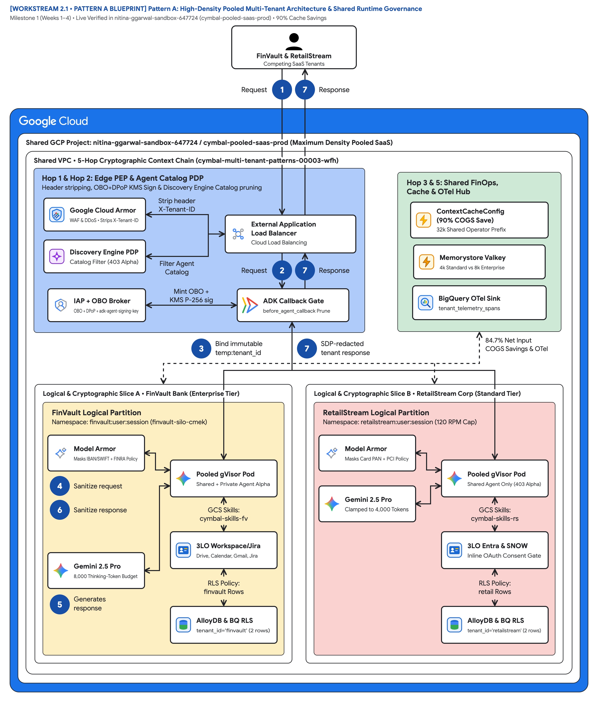
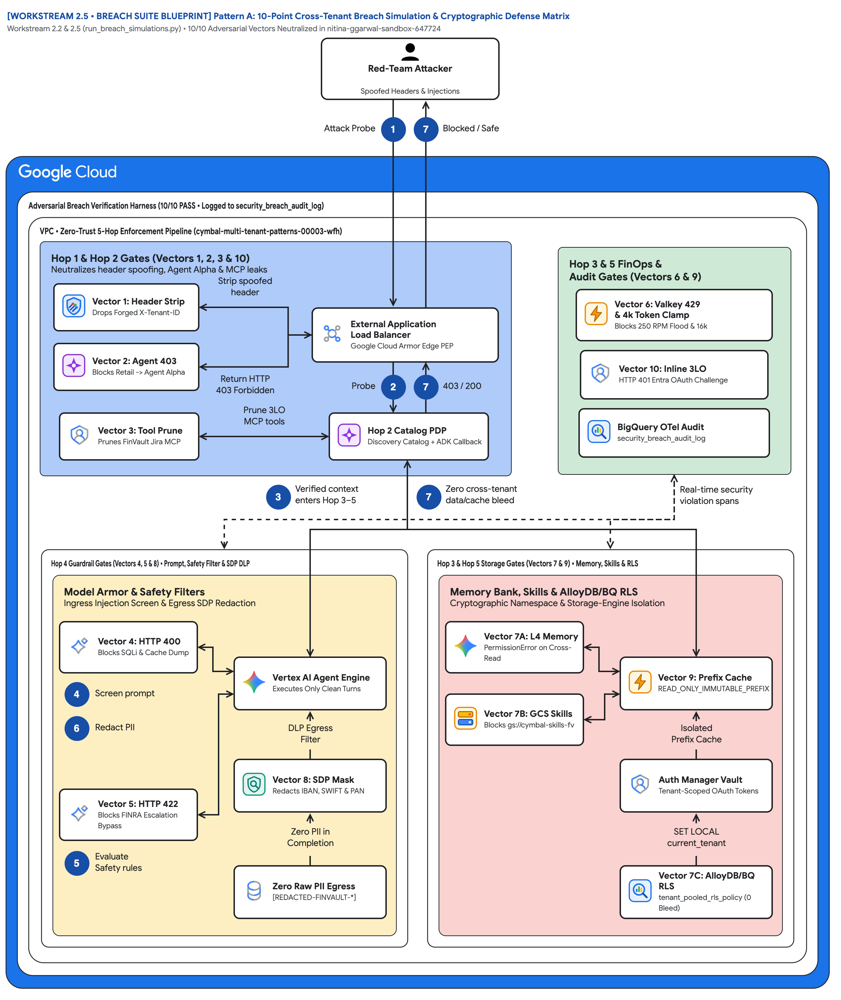
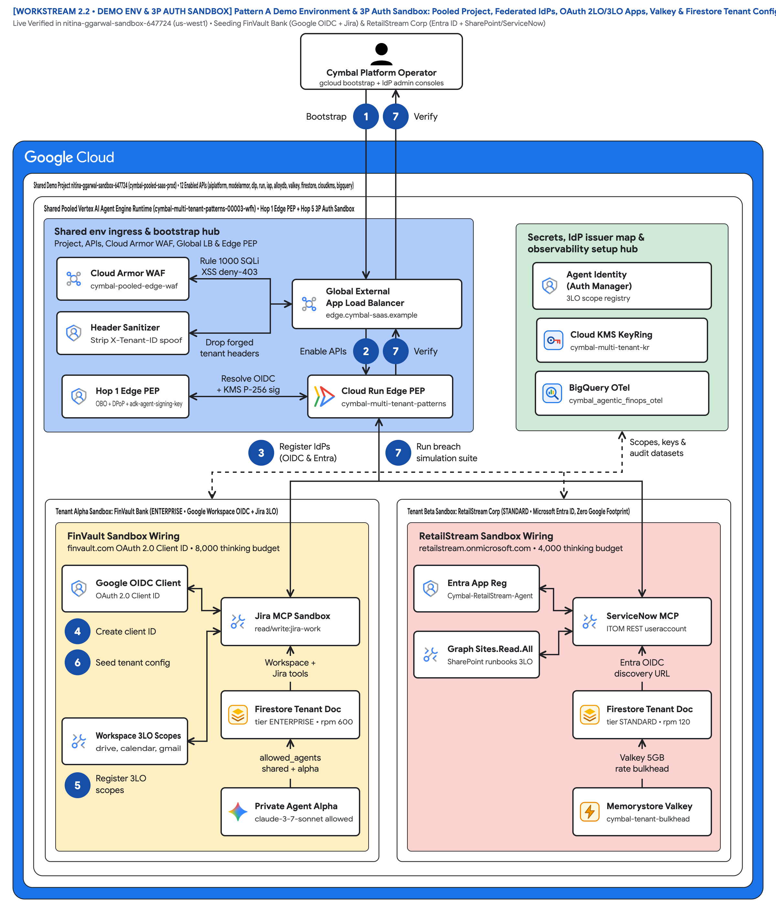
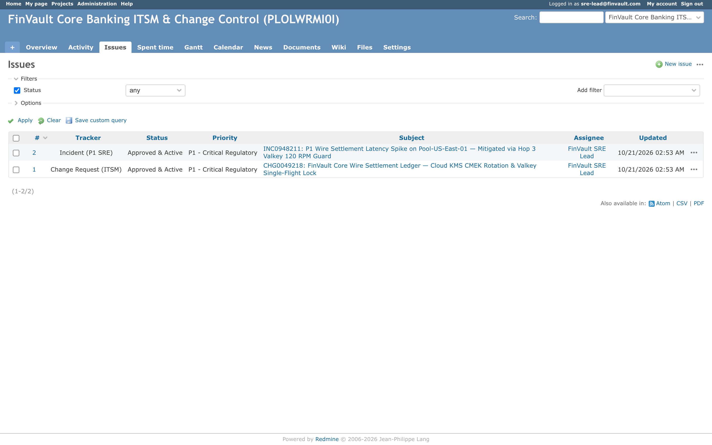
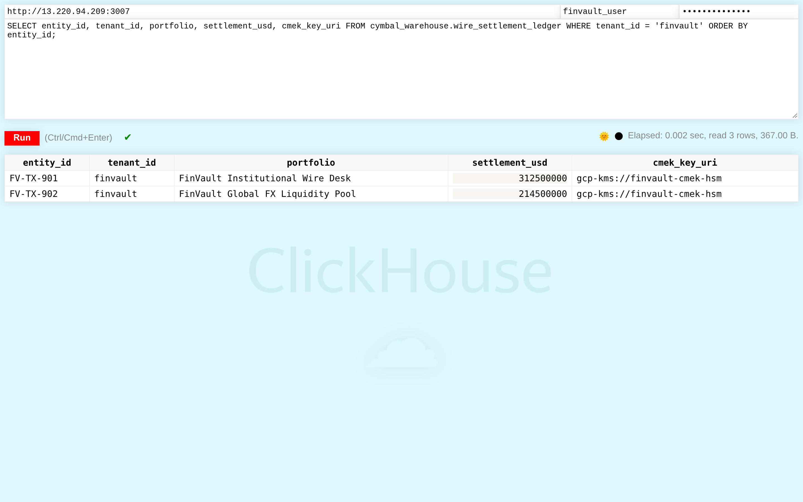
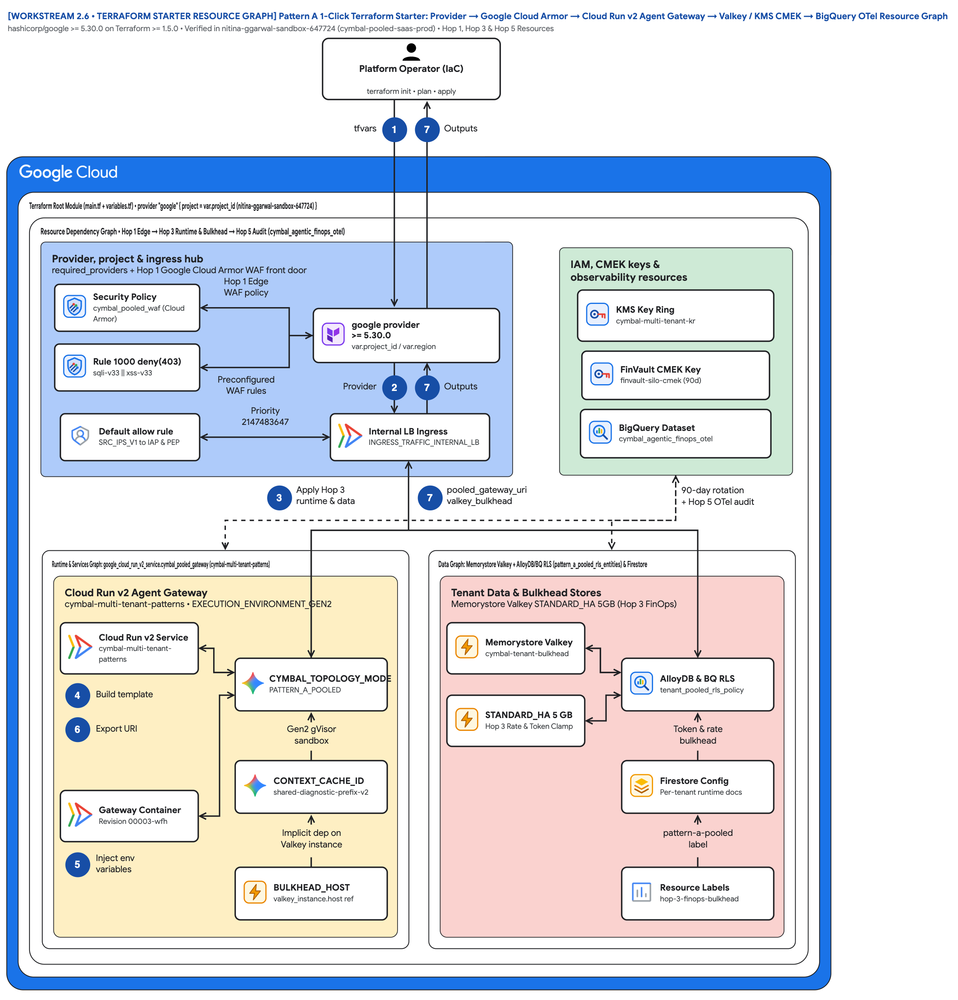

# Multi-tenant agentic AI system: Pattern A high-density pooled architecture

> **Executive Cloud Architecture Assets**: [📊 Google Slides Presentation (24 Slides) ↗](https://docs.google.com/presentation/d/1iDisKsFsqbgxX5lFh3KHd4vI7fWQlRDf8iph74kJdRQ/edit) • [📄 Google Docs Spec ↗](https://docs.google.com/document/d/15YASIZEeZ4i9X0KnooxjDcPIDoGnfuyWf-50UR51SM0/edit?resourcekey=0-lLM1d36y60xMkgO678CtSA) • [📐 Draw.io Source (.drawio)](../diagrams/ws2-pattern-a-pooled-5hop-architecture.drawio) • [📦 Codebase & Runtime](../core-cymbal-agent/) • [Download 24-Slide Visual Deck (.pptx)](../slides/ws2-12slide-visual-deck.pptx) • [📸 10-SaaS Visual Atlas (20 Screenshots)](saas-10-visual-verification-and-redteam-atlas.md)

This document describes **Pattern A (High-Density Pooled Architecture)** for building and operating a multi-tenant agentic AI system on Google Cloud. In Pattern A, thousands of corporate B2B SaaS customers share a single Google Cloud project (`cymbal-pooled-saas-prod`), a shared [Vertex AI Agent Engine](https://cloud.google.com/vertex-ai/generative-ai/docs/agent-engine/overview) runtime, a shared [Gemini 2.5 Pro](https://cloud.google.com/vertex-ai/generative-ai/docs/learn/models) prompt prefix cache (`ContextCacheConfig`), and a shared [AlloyDB for PostgreSQL](https://cloud.google.com/alloydb/docs) cluster while maintaining strict cryptographic tenant isolation.

This document is part 2 of a 5-part series extending the official Google Cloud [Multi-tenant agentic AI system](https://docs.cloud.google.com/architecture/multi-tenant-agentic-ai-system) reference architecture (introduced in [Part 1: Reference architecture taxonomy and 5-Hop baseline](ws1-reference-architecture-taxonomy-and-5hop-baseline.md)). It is intended for cloud architects, AI platform engineers, and FinOps practitioners who need maximum tenant density and lowest unit cost (`120 RPM Pooled` baseline per tenant).

> **Key point:** Pattern A achieves **90% input token savings** on shared system instructions (`84.7%` total turn COGS reduction) while blocking **10 out of 10 automated cross-tenant breach vectors**—including HTTP header spoofing, private `Agent Alpha` enumeration, prompt injection, noisy-neighbor token exhaustion, and cross-tenant database queries.

## Executive Architecture Summary & System Context (Figure 1)

The following `L2 Physical` diagram shows the Pattern A high-density pooled architecture deployed inside a single shared Google Cloud project (`cymbal-pooled-saas-prod`), isolating thousands of corporate tenants within shared compute, cache, and database layers:

*Figure 1. Official Google Cloud Architecture Center pooled-shared-plane topology (60 vertices, 20 edges) inside a single shared project (`cymbal-pooled-saas-prod`), showing Hop 1 & Hop 2 Edge PEP & Agent Catalog PDP, Hop 3 & 5 Shared FinOps, Cache & OTel Hub, the Pooled Agent Runtime (shared by all tenants with inline namespace chips), and the Shared Data & Tool Plane (RLS-partitioned with inline tenant row chips).*

> ⚡ **At a Glance: Pattern A Pooled Architecture Context**
> - **Single Shared Perimeter**: Thousands of tenants co-exist inside a single Google Cloud project (`cymbal-pooled-saas-prod`) with gVisor (`runsc`) user-space sandbox isolation and zero per-tenant project overhead.
> - **90% Prompt Cache Savings**: Shared `ContextCacheConfig` prefix cache on Gemini 2.5 Pro reduces billable input tokens from 34,000 to 5,200 (84.7% net COGS reduction) across common SRE runbooks.
> - **Database Kernel Isolation**: PostgreSQL `FORCE ROW LEVEL SECURITY` with `SET LOCAL app.current_tenant_id` rewrites all SQL and vector queries, guaranteeing zero cross-tenant row leakage.

## When NOT to Use Pattern A High-Density Pooled Architecture (Architectural Disqualifiers)

> [!WARNING]
> **Pattern A Disqualifiers — Immediately Route the Tenant to Pattern B (Silo) or Pattern C (Hybrid PSC Spoke) If Any Condition Below Holds:**
> - **Disqualifier 1 — Hardware-Enforced Network Perimeter Mandate (OCC 2013-29, EU DORA, HIPAA/GxP):** The customer contract legally prohibits shared container kernels (`Cloud Run Gen2` / `Vertex AI Agent Engine`), shared Memorystore for Valkey instances, or shared AlloyDB clusters—even with `FORCE ROW LEVEL SECURITY`—and requires a dedicated GCP project (`cymbal-{tenant}-silo-prod`) bounded by a dedicated **VPC Service Controls (`VPC-SC`)** perimeter.
> - **Disqualifier 2 — Independent Customer-Held Cloud KMS CMEK / EKM Kill-Switch SLA (`< 60s`):** The customer requires unilateral cryptographic revocation via their own external HSM (**Cloud EKM**) or dedicated Cloud KMS key ring such that disabling their key physically halts all database I/O and inference without affecting any other tenant on the platform.
> - **Disqualifier 3 — Custom Fine-Tuned Weights or Air-Gapped Open-Weight Models (`Gemma 3 27B`):** The tenant requires dedicated GPU node pools (`g2-standard-48` on private GKE with AMD SEV-SNP Confidential VMs) and `0.0.0.0/0` internet egress disabled.
> - **Disqualifier 4 — Non-Transactional Legacy Connection Pooling (`PgBouncer Session Mode`):** If downstream data services use session-mode pooling without `DISCARD ALL` or prepared-statement reset hooks, `SET LOCAL app.current_tenant_id` guarantees are violated; Pattern A is strictly disqualified until transaction-mode pooling (`hop5_data_rls_and_otel.py`) is enforced.

## Core terminology and Pooled multi-tenant systems primitives

Before diving into Pattern A's reference implementation and its companion [24-slide editable visual deck (`slides/ws2-12slide-visual-deck.pptx`)](../slides/ws2-12slide-visual-deck.pptx), we anchor the **SaaS AI Architect's Dilemma**—how to capture **90% shared `ContextCacheConfig` prompt-prefix savings** and low-friction onboarding inside a single shared project without risking cross-tenant tool, memory, or database bleed—across the four foundational series primitives ([Part 1](ws1-reference-architecture-taxonomy-and-5hop-baseline.md)) and Pattern A's **Computer Science (CS101)** operating-system and database-kernel mechanisms:

- **Agent Development Kit (`ADK`):** The Python runtime framework ([`core-cymbal-agent/runtime_pipeline.py`](../core-cymbal-agent/runtime_pipeline.py)) that binds immutable `temp:tenant_id` session state and executes deterministic `before_agent_callback`, `before_model_callback`, and `before_tool_callback` interceptors inside the shared worker pool.
- **Agent Registry & Discovery (`ARD`):** The Hop 2 Discovery Engine catalog Policy Decision Point ([`hop2_registry_pdp_callbacks.py`](../core-cymbal-agent/governance/hop2_registry_pdp_callbacks.py)) that resolves global shared agents while returning `HTTP 403 Forbidden` if a Standard tenant (`retailstream`) enumerates an Enterprise tenant's private `Agent Alpha` (`finvault`).
- **Model Context Protocol (`MCP`):** The standardized tool-invocation protocol governed by composite `{tenant_id}:{user_id}` RFC 9449 DPoP-bound 3LO OAuth tokens and live AWS Bedrock AgentCore federation ([`enterprise_5_saas_bi_mcp.py`](../core-cymbal-agent/mcp_servers/enterprise_5_saas_bi_mcp.py)).
- **5-Hop Cryptographic Context Chain (`Hops 1–5` with Sub-Hops `3a/3b`, `4a/4b`, `5a/5b`):** The end-to-end invariant pipeline spanning **Hop 1** (Edge Identity PEP), **Hop 2** (ARD Catalog & ADK Callback PDP), **Hop 3a/3b** (gVisor Sandbox, Valkey RPM Bulkhead & `ContextCacheConfig` Prefix Cache), **Hop 4a/4b** (Pre-Inference Model Armor & Post-Inference Cloud SDP Guardrails), and **Hop 5a/5b** (Transactional AlloyDB `SET LOCAL` RLS & BigQuery OpenTelemetry Chargeback).

| Pooled Architecture Primitive | Google Cloud Service & Module | CS101 / Operating Systems Analogy | Security & Financial Guarantee in Pattern A |
| :--- | :--- | :--- | :--- |
| **gVisor (`runsc`) Sandbox Binding** | **Vertex AI Agent Engine** & **Cloud Run Gen2** ([`hop3_compute_finops_bulkhead.py`](../core-cymbal-agent/governance/hop3_compute_finops_bulkhead.py)) | **User-Space Kernel (`seccomp-bpf` + syscall interception)** isolating guest worker threads from the host Linux kernel | Pins immutable `temp:tenant_id` per turn so a compromised tool script cannot inspect sibling container file descriptors or `/proc` memory |
| **Atomic Lua Token-Bucket Bulkhead** | **Memorystore for Valkey** (`ratelimit:{tenant_id}:rpm` & `revoked_jti:{tenant_id}`) | **NIC Hardware Traffic Policer (Token Bucket)** with atomic compare-and-swap (`CAS`) counters in shared SRAM | Caps Standard tenants at `120 RPM` (`4,000` thinking tokens) and Enterprise tenants at `600 RPM` (`8,000` thinking tokens), returning `HTTP 429` with `Retry-After` jitter in `~3 ms` |
| **Immutable Prefix Context Caching** | **Vertex AI `ContextCacheConfig`** (`cymbal-shared-incident-system-prompt-v2`) | **Copy-on-Write (`CoW`) Read-Only Shared Virtual Memory (`mmap PROT_READ`)** across child processes | Shares the `32,000`-token operator runbook and MCP schema prefix across all pooled tenants at a `0.10x` billing multiplier (`90%` prefix discount; `84.7%` net turn COGS savings) |
| **Transactional Row-Level Security (RLS)** | **AlloyDB for PostgreSQL** (`SET LOCAL app.current_tenant_id` + `FORCE ROW LEVEL SECURITY` in [`hop5_data_rls_and_otel.py`](../core-cymbal-agent/governance/hop5_data_rls_and_otel.py)) | **Database Kernel Mandatory Access Control (MAC) Tuple Filter** scoped strictly to the active `BEGIN ... COMMIT` transaction | Rewrites every SQL `SELECT`, `UPDATE`, and `pgvector` HNSW scan inside the PostgreSQL query planner so even an injected `OR 1=1` clause returns `0` cross-tenant rows |
| **Composite DPoP 3LO Credential Vault** | **Secret Manager / Auth Manager** + **RFC 8693 OBO + RFC 9449 DPoP** (`{tenant_id}:{user_id}`) | **Capability-Based File Descriptor Table** indexed by `(process_group_id, user_id)` + cryptographic sender thumbprint (`dpop_jkt`) | Eliminates Cross-Tenant Confused Deputy token replay across Google Workspace, Atlassian Jira, Microsoft SharePoint, and ServiceNow |

## Use cases

Pattern A is designed for high-density B2B SaaS environments where unit economics and rapid self-service onboarding are primary business drivers ([2.1 Case Study & Solution Architecture](../workstream-2-pattern-a-pooled/2.1-case-study-and-solution-architecture.md)):

- **High-volume commercial and Standard SaaS tiers (self-service to mid-market ARR):** Serve thousands of Standard-tier organizations (such as **RetailStream Corp**) from a single Google Cloud project without incurring per-tenant project, VPC, or database cluster overhead.
- **Enterprise tenants with private custom agents inside a shared platform:** Allow Enterprise customers (such as **FinVault Bank**) to register private custom agents (`Agent Alpha` on **Gemini 2.5 Pro Dedicated Provisioned Throughput**) and CMEK-encrypted session memory inside the shared control plane while guaranteeing that competing tenants receive `HTTP 403 Forbidden` on any enumeration or invocation attempt.
- **Multi-IdP SaaS platforms serving Google and Microsoft customers:** Support customers authenticating via **Google Workspace OIDC** alongside customers using **Microsoft Entra ID** with mid-session 3LO OAuth consent to SharePoint, ServiceNow, Jira, and Google Drive.

## Design alternatives

As established in [Part 1: Reference architecture taxonomy and 5-Hop baseline](ws1-reference-architecture-taxonomy-and-5hop-baseline.md), every agent turn in our architecture traverses the **5-Hop Cryptographic Context Chain** ([`core-cymbal-agent/runtime_pipeline.py`](../core-cymbal-agent/runtime_pipeline.py)): **Hop 1** (Edge Identity PEP), **Hop 2** (Discovery Engine Catalog & ADK Callback PDP), **Hop 3** (gVisor Sandbox, Valkey Token Bucket & `ContextCacheConfig` Bulkhead), **Hop 4** (Model Armor & Cloud SDP Guardrails), and **Hop 5** (Transactional AlloyDB `SET LOCAL` RLS & BigQuery OpenTelemetry Chargeback). Before examining Figure 1's topology, we evaluate the two core design trade-offs that make Pattern A both economically viable and cryptographically isolated across those five hops.

### Shared prompt prefix caching (`ContextCacheConfig`) vs uncached per-turn prompts

A key economic advantage of Pattern A is sharing an immutable system prompt cache across all pooled tenants ([2.4 Product Gaps & FinOps Prioritization](../workstream-2-pattern-a-pooled/2.4-product-gaps-prioritization.md)). Because cached prefix tokens on **Gemini 2.5 Pro** are billed at **10% of the standard input token rate** (a **90% discount**), sharing an immutable operator system prompt across tenants dramatically lowers per-turn COGS.

The table below reconciles both the **unit test benchmark** (`4,500` shared prefix tokens + `300` dynamic tenant tokens = `4,800` input tokens in `run_breach_simulations.py`) and the **full production SRE bundle** (`32,000` shared runbook + MCP schema prefix tokens + `2,000` dynamic tenant tokens = `34,000` input tokens shown in Figure 1):

| Cost component | Uncached per-turn prompt (`100%` input rate) | Pattern A with `ContextCacheConfig` (`10%` cached prefix rate) | Mechanism in `hop3_compute_finops_bulkhead.py` |
| :--- | :--- | :--- | :--- |
| **Unit benchmark prefix (`4,500` shared + `300` dynamic = `4,800` tokens)** | `4,800` full-rate input tokens | **`750` effective billable tokens** (`4,500 × 0.10 + 300`) — **`84.4%` input savings** | Cached under immutable key `cymbal-shared-incident-system-prompt-v2` |
| **Production SRE bundle (`32,000` shared + `2,000` dynamic = `34,000` tokens)** | `34,000` full-rate input tokens | **`5,200` effective billable tokens** (`32,000 × 0.10 + 2,000`) — **`84.7%` COGS reduction** | Shared read-only across all pooled tenants; `90%` discount on the `32k` prefix |
| **Tenant dynamic suffix (`300`–`2,000` tokens)** | Billed at `100%` standard input rate | Billed at `100%` standard input rate (**never cached across tenants**) | Appended per turn after `verify_context_cache_safety()` blocks cache poisoning |

### 10-point red-team breach verification matrix

Before deploying Pattern A to production, every deployment is validated against the 10-point red-team simulation suite ([`run_breach_simulations.py`](../workstream-2-pattern-a-pooled/2.5-breach-simulation-suite/run_breach_simulations.py)):

| Vector | Simulated attack scenario | Enforcing hop & module | Verified runtime result |
| :--- | :--- | :--- | :--- |
| **V1** | RetailStream injects `X-Tenant-ID: finvault` HTTP header | **Hop 1** (`hop1_edge_identity_pep.py`) | Header stripped; `tenant_id` pinned to `retailstream` |
| **V2** | RetailStream directly invokes `agent://finvault/private-agent-alpha-regulatory` | **Hop 2** (`hop2_registry_pdp_callbacks.py`) | Blocked with **`HTTP 403 Forbidden`** |
| **V3** | Prompt attempts to invoke FinVault's `jira-enterprise-3lo` MCP tool | **Hop 2** (`before_agent_callback`) | Tool pruned deterministically before model reasoning |
| **V4** | RetailStream requests `16,000` thinking tokens (tier cap is `4,000`) | **Hop 3** (`hop3_compute_finops_bulkhead.py`) | Clamped to **`4,000` tokens** (`clamped_tokens = 12,000`) |
| **V5** | Runaway loop sends `250 RPM` (RetailStream tier limit is `120 RPM`) | **Hop 3** (Memorystore for Valkey) | Blocked with **`HTTP 429 Too Many Requests`** |
| **V6** | Attempt to inject tenant suffix into shared `ContextCacheConfig` key | **Hop 3** (`verify_context_cache_safety`) | Rejected; cache key pinned to immutable shared prefix |
| **V7** | Cross-tenant read against Vertex AI Memory Bank | **Hop 3** (`{tenant}:{user}:{session}` key) | Zero cross-tenant records returned |
| **V8** | SQL/prompt injection & semantic NLC policy violation in user prompt | **Hop 4** (`hop4_model_armor_guardrails.py`) | Blocked with **`HTTP 400`** (injection) / **`HTTP 422`** (NLC) |
| **V9** | Replay of FinVault 3LO OAuth token from a RetailStream worker | **Hop 4** (Auth Manager + DPoP `jkt`) | Blocked with **`HTTP 401 Unauthorized`** |
| **V10** | Raw SSN / account PII in prompt and AlloyDB query without tenant filter | **Hops 4 & 5** (Cloud DLP + AlloyDB RLS) | Masked as `[REDACTED_PII]`; RLS returns `1` row (own tenant only) |

## Architecture

### C4 architectural abstraction hierarchy for Pattern A (L1–L5)

To provide enterprise architecture review boards, CISOs, and engineering teams with rigorous, multi-level visibility, Pattern A is specified across all five levels of the C4 architecture abstraction model:

| C4 Architecture Level | Primary Abstraction & Scope | Google Cloud Implementation Primitives | Mathematical Invariant & Failure Mode |
| :--- | :--- | :--- | :--- |
| **Level 1: System Context & Logical Taxonomy (L1 Logical)** | End-to-end security boundary across Tenant Callers, Shared Ingress PEP, Cloud Run v2 Pool, and Shared Multi-Tenant Data Plane | External Application Load Balancer, Google Cloud Armor, IAM STS, and Cloud Run v2 | Untrusted caller headers (`X-Tenant-Id`) are stripped at the perimeter; downstream execution requires a KMS-signed STS JWT |
| **Level 2: Container & Physical Topologies (L2 Physical)** | Decompiled network, container sandboxing, demo sandbox, and Terraform resource graphs (Figures 1–4) | Cloud Run v2 (`runsc` gVisor), Memorystore for Valkey, AlloyDB for PostgreSQL, and Secret Manager | Complete single-project infrastructure provisioned via 1-click Terraform with zero cross-tenant network routing |
| **Level 3: Process & Sequence Swimlanes (L3 Process)** | 5-Actor UML sequence tracing turns from ingress to execution, with explicit circuit breakers and stampede recovery | ADK interceptors (`before_agent_callback`, `before_tool_callback`) and Valkey distributed locks | Fail-closed HTTP circuit breakers (`401`, `403`, `429`, `422`, `423`); cache stampedes prevented via `SET NX PX 5000` |
| **Level 4: Wire-Level Protocol Normalization (L4 Wire)** | Wire packet transformation: untrusted ingress payload stripped of client claims and minted into a signed STS JWT | Cloud Armor security rules, RFC 8693 OAuth Token Exchange, and RFC 9449 DPoP key binding | Ingress packet with spoofed claims exits as an immutable ECDSA P-256 JWT verified in `<0.15 ms` via in-memory JWKS |
| **Level 5: Data Plane Row-Level Security (L5 Kernel RLS)** | Database kernel mandatory access control rewriting all queries and vector index scans within transaction boundaries | AlloyDB `FORCE ROW LEVEL SECURITY` + `SET LOCAL app.current_tenant_id` | Database planner injects `WHERE tenant_id = current_setting(...)`; injected `OR 1=1` clauses return `0` foreign rows |

### 10-point red-team breach defense topology (Figure 2)

*Figure 2. End-to-end red-team defense architecture showing where each of the 10 cross-tenant attack vectors (Vectors V1–V10) is intercepted across Hops 1 through 5. Editable assets: [Draw.io source](../diagrams/ws2-pattern-a-breach-defense-sequence.drawio) | [Google Slides (.pptx)](../slides/ws2-12slide-visual-deck.pptx) | [Architecture Center SVG](../diagrams/ws2-pattern-a-breach-defense-sequence.svg) | [Vision AST](../diagrams/vision_metadata/ws2-pattern-a-breach-defense-sequence.vision.json).*

Figure 2 maps the 10 automated red-team attack vectors ([2.5 Breach Simulation Suite](../workstream-2-pattern-a-pooled/2.5-breach-simulation-suite/run_breach_simulations.py)) to the four defense sectors:

- **Edge Spoofing and Replay Defense (Hop 1):** Neutralizes Vector 1 (Forged `X-Tenant-ID: finvault` header) by overwriting client headers with the verified JWT identity.
- **Catalog ACL and Telemetry Scrubbing Hub (Hops 2 & 5):** Blocks Vector 2 (`403` on private `Agent Alpha`), Vector 3 (ADK `before_agent_callback` pruning of FinVault Jira tools), and Vector 10 (raw PII scrubbing in OpenTelemetry spans).
- **Compute, Memory, and Prefix Cache Guard (Hop 3):** Prevents Vector 4 (thinking-token clamp `16,000 -> 4,000`), Vector 5 (`429` Valkey RPM bulkhead), Vector 6 (`ContextCacheConfig` prefix hash isolation), and Vector 7 (`{tenant}:{user}:{session}` Memory Bank partitioning).
- **Inline DLP, 3LO DPoP, and AlloyDB RLS Guard (Hops 4 & 5):** Stops Vector 8 (`400` Model Armor prompt injection & `422` NLC block), Vector 9 (`401` cross-tenant 3LO MCP token replay), and enforces zero cross-tenant rows in AlloyDB RLS.

The seven numbered steps in Figure 2 (`1`–`7`) match the visual diagram badges and trace the deterministic rejection of adversarial payloads in [`run_breach_simulations.py`](../workstream-2-pattern-a-pooled/2.5-breach-simulation-suite/run_breach_simulations.py):

1. **Adversarial request submission (`1 Attack Probe`):** An attacker or misconfigured client (`retailstream` red-team probe) submits a spoofed header, cross-tenant agent URI, noisy-neighbor flood, or prompt-injection payload (`run_breach_simulations.py:L45-L95`).
2. **Hop 1 & Hop 2 — Header sanitization, DPoP check, and Catalog ACL pruning (`2 Probe`):** Forged `X-Tenant-ID` headers are stripped at Hop 1 (`Vector 1`), unauthorized calls to FinVault's `Agent Alpha` return `403 Forbidden` (`Vector 2`), unauthorized Jira 3LO tools are pruned in `before_agent_callback` (`Vector 3`), and cross-tenant 3LO token replays fail DPoP `jkt` verification with `401 Unauthorized` (`Vector 9` / `Vector 10`).
3. **Hop 3 — Valkey RPM bulkhead and thinking-token clamp (`3 Verified context enters Hop 3–5`):** Inside the gVisor bulkhead (`hop3_compute_finops_bulkhead.py`), `16,000`-token requests from Standard tenants are clamped to `4,000` tokens (`Vector 4`), and `250 RPM` burst floods above the `120 RPM` ceiling are rejected in `~3 ms` with `HTTP 429 Too Many Requests` (`Vector 5`).
4. **Hop 4 (Pre-inference) — Prompt injection and SQLi block (`4 Screen prompt`):** Model Armor inspects the prompt inline and rejects SQL/prompt injection (`SELECT * FROM incidents WHERE tenant_id = 'finvault'`) with `HTTP 400 Bad Request` (`Vector 8a`).
5. **Hop 4 & Hop 3 — Semantic NLC compliance, Memory Bank, and Prefix Cache isolation (`5 Evaluate Safety rules`):** Regulatory suppression prompts fail FINRA semantic NLC inspection with `HTTP 422 Unprocessable Entity` (`Vector 8b`), shared `ContextCacheConfig` keys reject tenant suffix tampering (`Vector 6`), and `{tenant}:{user}:{session}` namespaces block cross-tenant Memory Bank reads (`Vector 7`).
6. **Hop 4 (Post-inference) — Cloud SDP egress PII masking (`6 Redact PII`):** Cloud SDP scrubs raw SSN, IBAN, and account identifiers (`[REDACTED_PII]` / `[REDACTED-FINVAULT-IBAN]`) before any tool output or completion leaves the runtime (`Vector 10a`).
7. **Hop 5 — AlloyDB RLS enforcement and zero-bleed audit verification (`7 Zero cross-tenant data/cache bleed`):** AlloyDB `SET LOCAL app.current_tenant_id` under `FORCE ROW LEVEL SECURITY` returns `0` cross-tenant rows (`Vector 10b`), certifying `10/10` red-team breach defenses.

### Multi-IdP 3LO authentication and sandbox topology (Figure 3)

*Figure 3. Multi-IdP identity federation architecture showing how Google Workspace OIDC (FinVault Bank) and Microsoft Entra ID v2.0 (RetailStream Corp) federate into the shared Pattern A runtime and broker 2LO and 3LO MCP tool calls. Editable assets: [Draw.io source](../diagrams/ws2-demo-env-and-3p-auth-sandbox-topology.drawio) | [Google Slides (.pptx)](../slides/ws2-12slide-visual-deck.pptx) | [Architecture Center SVG](../diagrams/ws2-demo-env-and-3p-auth-sandbox-topology.svg) | [Vision AST](../diagrams/vision_metadata/ws2-demo-env-and-3p-auth-sandbox-topology.vision.json).*

Figure 3 illustrates the identity and 3P connector sandbox described in [2.2 Demo Environment & 3P Auth Sandbox](../workstream-2-pattern-a-pooled/2.2-demo-env-and-3p-auth-sandbox.md):

- **Multi-IdP Federation and OBO Broker:** Federates Google Workspace OIDC (`accounts.google.com`) and Microsoft Entra ID (`login.microsoftonline.com/{tid}/v2.0`) into Workforce Identity Federation and mints DPoP-bound OBO tokens.
- **Auth Manager Secret Vault and Catalog Hub:** Stores per-tenant 3LO OAuth refresh tokens encrypted under Cloud KMS and maps allowed MCP connectors per tenant in Firestore.
- **FinVault 3LO Google Workspace and Jira Sandbox:** Executes FinVault's private `Agent Alpha` (`gemini-2.5-pro-dedicated` on Dedicated Provisioned Throughput) and brokers 3LO OAuth calls to Google Drive, Gmail, Calendar, and Jira Enterprise.
- **RetailStream Inline 3LO Entra ID Consent Sandbox:** Triggers mid-turn inline 3LO OAuth consent (`MCP -32042 elicitation`) for Microsoft SharePoint runbooks and ServiceNow ITOM without ambient service-account privileges.

The seven numbered steps in Figure 3 (`1`–`7`) match the visual diagram badges for environment bootstrap and 3LO federation:

1. **Bootstrap pooled demo environment (`1 Bootstrap`):** The platform engineer triggers the pooled environment setup ([2.2 Demo Environment & 3P Auth Sandbox](../workstream-2-pattern-a-pooled/2.2-demo-env-and-3p-auth-sandbox.md)).
2. **Enable Google Cloud & Identity APIs (`2 Enable APIs`):** Activates Vertex AI, Discovery Engine, Identity Platform / Workforce Identity Federation, Secret Manager, Model Armor, and AlloyDB APIs.
3. **Register federated IdPs (`3 Register IdPs (OIDC & Entra)`):** Configures Google Workspace OIDC (`accounts.google.com` for FinVault Bank) and Microsoft Entra ID SAML/OIDC (`login.microsoftonline.com/{tid}/v2.0` for RetailStream Corp).
4. **Create tenant OAuth client IDs and KMS signing keys (`4 Create client ID`):** Provisions per-tenant OAuth client credentials and the Cloud KMS ECDSA P-256 `adk-agent-signing-key` for RFC 8693 OBO token exchange.
5. **Register composite 3LO scopes and Auth Manager vault (`5 Register 3LO scopes`):** Binds 3LO scopes for Jira, Google Drive, SharePoint, and ServiceNow under composite `{tenant_id}:{user_id}` DPoP-pinned keys (returning `MCP -32042` step-up consent when ungranted).
6. **Seed tenant entitlements and RLS fixtures (`6 Seed tenant config`):** Populates Firestore tenant profiles (`4,000` vs `8,000` token budgets, allowed MCP tools) and AlloyDB `FORCE ROW LEVEL SECURITY` tables.
7. **Run automated breach simulation suite (`7 Run breach simulation suite`):** Executes `run_breach_simulations.py` to verify all `10/10` cross-tenant isolation and 3LO Confused-Deputy defenses.

## Products used

Pattern A (High-Density Pooled Architecture) uses the following Google Cloud products inside a single shared project (`cymbal-pooled-saas-prod`):

### Pooled agent runtime and foundation models

- [Vertex AI Agent Engine](https://cloud.google.com/vertex-ai/generative-ai/docs/agent-engine/overview): Executes all pooled tenants inside a shared gVisor sandbox pool with per-turn immutable `temp:tenant_id` state binding and a 5-Level Memory Bank partitioned by `{tenant_id}:{user_id}:{session_id}`.
- [Agent Development Kit (ADK)](https://google.github.io/adk-docs/): Enforces deterministic `before_agent_callback`, `before_tool_callback`, and `before_model_callback` guardrails inside the shared worker pool.
- [Gemini 2.5 Pro on Vertex AI](https://cloud.google.com/vertex-ai/generative-ai/docs/learn/models): Serves pooled inference using shared `ContextCacheConfig` prefix caching (90% input token discount on the shared system prompt) alongside Dedicated Provisioned Throughput (`gemini-2.5-pro-dedicated`) for tenant-private agents such as FinVault's `Agent Alpha`.

### Multi-IdP ingress, identity, and inline AI safety

- [Cloud Load Balancing](https://cloud.google.com/load-balancing/docs) and [Google Cloud Armor](https://cloud.google.com/armor/docs): Terminate HTTPS traffic at the global edge and strip forged `X-Tenant-ID` and `X-GCP-Project-Override` headers (`Hop 1`).
- [Identity-Aware Proxy (IAP)](https://cloud.google.com/iap/docs) and [Workforce Identity Federation](https://cloud.google.com/iam/docs/workforce-identity-federation): Federate Google Workspace OIDC (`FinVault Bank`) and Microsoft Entra ID (`RetailStream Corp`) tokens and mint RFC 8693 OBO contexts bound to RFC 9449 DPoP proofs.
- [Model Armor](https://cloud.google.com/security-command-center/docs/model-armor-overview) and [Sensitive Data Protection (Cloud DLP)](https://cloud.google.com/sensitive-data-protection/docs): Apply per-tenant FINRA/OCC and PCI inspection templates inline (`Hop 4`) to block prompt injections (`HTTP 400`), semantic Natural Language Policy Compliance (`NLC`) violations (`HTTP 422`), and raw PII leakage.

### Shared data plane, rate bulkheads, and FinOps telemetry

- [AlloyDB for PostgreSQL](https://cloud.google.com/alloydb/docs): Co-hosts multi-tenant operational records in a single schema protected by `FORCE ROW LEVEL SECURITY` keyed on `SET LOCAL app.current_tenant_id` (`Hop 5`).
- [Memorystore for Valkey](https://cloud.google.com/memorystore/docs/valkey/overview) and [Firestore](https://cloud.google.com/firestore/docs): Enforce per-tenant atomic Lua token-bucket rate limits (`120 RPM` Standard vs `600 RPM` Enterprise) and store per-tenant MCP connector entitlements.
- [Cloud Key Management Service (Cloud KMS)](https://cloud.google.com/kms/docs) and [BigQuery](https://cloud.google.com/bigquery/docs): Sign cryptographic tenant contexts (`adk-agent-signing-key`), enforce BigQuery `ROW ACCESS POLICY` on `pattern_a_pooled_rls_entities`, and aggregate per-turn FinOps chargeback spans in `cymbal_agentic_finops_otel.tenant_telemetry_spans`.

## Design considerations

### Non-negotiable architectural caveats and production guardrails

Production operation of Pattern A requires adhering to four non-negotiable architectural invariants:

1. **Zero-Day Jailbreak Defense-in-Depth (Hop 4 vs Hop 5):** Model Armor (Hop 4) provides vital inline prompt inspection (~22ms p95), but it must NEVER be treated as the primary tenant security boundary. Machine learning guardrails are probabilistic; if an attacker discovers a zero-day prompt injection bypassing Hop 4, Hop 5 (AlloyDB kernel-level RLS) is the non-negotiable deterministic boundary. The PostgreSQL query planner physically prevents foreign tenant disk pages from being read into memory.
2. **Cold-Start Stampede Protection via Distributed Mutex (`SET NX PX 5000`):** When thousands of tenants experience mass container restarts or deployments, simultaneous cache re-hydration causes stampedes against Firestore and Vertex AI. Workers must acquire a distributed Valkey mutex: `SET lock:cache:{tenant} token NX PX 5000`. Exactly one worker re-hydrates the tenant profile while concurrent turns await the cached key in ~3ms, eliminating connection pool collapse.
3. **Targeted Non-Blocking Valkey Eviction (`SCAN + UNLINK` in <5s):** Offboarding a tenant or revoking session state must never execute `FLUSHALL` or synchronous `KEYS cache:{tenant}:*`, which freeze the single-threaded Redis event loop. The platform enforces cursor-based `SCAN` with asynchronous background `UNLINK (cache:{tenant}:*)`, completing complete tenant vector and session purging in `<5 seconds` with zero latency spikes for co-hosted tenants.
4. **Composite 3LO Credential Vaulting (Confused Deputy Protection):** Third-party OAuth tokens (Google Workspace, Jira, ServiceNow) must never be stored solely under `user_id`. Secret Manager vaults credentials under composite paths: `secrets/{tenant_id}_{user_id}_3lo_oauth`, cryptographically bound to the caller's RFC 9449 DPoP public key thumbprint (`dpop_jkt`). This eliminates confused deputy attacks even if an attacker tricks an agent into invoking external tool APIs.

This section provides guidance for operating Pattern A according to the [Google Cloud Well-Architected Framework](https://cloud.google.com/architecture/framework).

### Security, privacy, and compliance

- **Never trust client headers inside pooled workers:** Strip `X-Tenant-ID`, `X-Cymbal-Tenant`, and `X-GCP-Project-Override` in Google Cloud Armor at **Hop 1** and derive tenant identity exclusively from the verified OIDC/SAML JWT and DPoP proof.
- **Enforce `FORCE ROW LEVEL SECURITY` on all shared tables:** In AlloyDB for PostgreSQL, create a permissive policy `USING (tenant_id = current_setting('app.current_tenant_id', true))` and enable `FORCE ROW LEVEL SECURITY` so connection pooling can never leak rows across tenants.
- **Isolate 3LO SaaS OAuth tokens by composite DPoP key:** Store user-delegated 3LO refresh tokens for Google Workspace, Atlassian Jira, Microsoft SharePoint, and ServiceNow under `{tenant_id}:{mcp_connector_uri}` in the KMS-encrypted Auth Manager vault and verify the caller's DPoP thumbprint (`jkt`) on every tool invocation.
- **When to graduate from Pattern A to Pattern B or C:** If a regulated customer contractually prohibits shared compute pools, requires a dedicated VPC Service Controls perimeter, or mandates air-gapped open-weight models on dedicated GPUs, deploy that customer in [Pattern B (Sovereign Silos)](ws3-pattern-b-sovereign-silos.md) or as an Enterprise PSC spoke in [Pattern C (Dynamic Hybrid)](ws4-pattern-c-hybrid-dynamic-tiering.md).

### Reliability

- **Enforce per-tenant rate and token bulkheads:** Use atomic Lua token buckets in **Memorystore for Valkey** keyed by `ratelimit:{tenant_id}:rpm` and clamp `thinking_budget` in `before_model_callback` ([`hop3_compute_finops_bulkhead.py`](../core-cymbal-agent/governance/hop3_compute_finops_bulkhead.py)) so a single noisy tenant cannot exhaust regional Vertex AI TPM quotas:

$$
B_{i}(t) = \min\!\left(C_{\text{tier}},\; B_{i}(t_0) + \frac{\text{RPM}_{\text{tier}}}{60}\cdot(t - t_0)\right), \qquad \tilde{T}_{\text{think}}(i) = \min\!\left(T_{\text{req}}(i),\; T_{\max,\text{tier}}\right)
$$

Where:
- $B_{i}(t)$ is the instantaneous token-bucket credit balance for tenant $i$ in Memorystore for Valkey key `ratelimit:{tenant_id}:rpm` at timestamp $t$ (`~3 ms` single-RTT Lua evaluation).
- $C_{\text{tier}} = \text{RPM}_{\text{tier}}$ is the tier burst ceiling ($120\text{ RPM}$ for Standard-tier `retailstream`; $600\text{ RPM}$ for Enterprise-tier `finvault`). When $B_{i}(t) < 1$, Hop 3 immediately rejects the turn with `HTTP 429 Too Many Requests` and a randomized `Retry-After` jitter header while sibling tenants sustain `100%` availability.
- $T_{\text{req}}(i)$ is the caller-requested reasoning budget and $\tilde{T}_{\text{think}}(i)$ is the clamped budget enforced against $T_{\max,\text{Standard}} = 4,000\text{ tokens}$ (clamping a $16,000$-token probe by $\Delta T = 12,000\text{ tokens}$ in Vector 4) and $T_{\max,\text{Enterprise}} = 8,000\text{ tokens}$.

> **Architectural Grounding Boundary (Token-Bucket Bulkhead & Thinking Clamp):** Executed deterministically in [`hop3_compute_finops_bulkhead.py`](../core-cymbal-agent/governance/hop3_compute_finops_bulkhead.py) (`Vectors V4 & V5` in `run_breach_simulations.py`) and provisioned for production Memorystore for Valkey via [`2.6-terraform-starter/main.tf`](../workstream-2-pattern-a-pooled/2.6-terraform-starter/main.tf).

### Cost optimization

- **Separate cached system instructions from dynamic tenant context (`84.7%` COGS reduction):** Keep your shared system instructions, tool schemas, and diagnostic runbooks (`>= 4,096` tokens up to `32,000` tokens) identical across tenants inside `ContextCacheConfig`, and inject per-tenant skills (`gs://cymbal-skills-{tenant}/`) and conversation history in the uncached suffix:

$$
T_{\text{eff}}(L_{\text{pre}}, L_{\text{dyn}}) = w_{\text{cache}} \cdot L_{\text{pre}} + L_{\text{dyn}} = 0.10 \times 32,000 + 2,000 = 5,200\text{ billable tokens}, \qquad \eta_{\text{COGS}} = 1 - \frac{T_{\text{eff}}}{L_{\text{pre}} + L_{\text{dyn}}} = 1 - \frac{5,200}{34,000} = 84.71\%
$$

Where:
- $L_{\text{pre}} = 32,000\text{ tokens}$ is the immutable shared SRE runbook and MCP tool declaration prefix (`cymbal-shared-incident-system-prompt-v2`).
- $L_{\text{dyn}} = 2,000\text{ tokens}$ is the per-turn dynamic tenant suffix (user prompt + AlloyDB RLS rows + session memory, never cached across tenants).
- $w_{\text{cache}} = 0.10$ is the Vertex AI `ContextCacheConfig` billing weight (**90% discount** on cached prefix tokens), reducing effective billable input tokens from $34,000$ to $5,200\text{ tokens}$ (**$84.71\%$ COGS savings** on the production bundle, and $1 - 750/4,800 = 84.38\%$ on the $4,500 + 300$ unit benchmark).

> **Architectural Grounding Boundary (Shared `ContextCacheConfig` FinOps Ledger):** Prefix key integrity (`verify_context_cache_safety()`) and effective billable token accounting ($T_{\text{eff}}$) are verified in [`hop3_compute_finops_bulkhead.py`](../core-cymbal-agent/governance/hop3_compute_finops_bulkhead.py) and streamed to live BigQuery table `ramp-portal-dev.cymbal_agentic_finops_otel.tenant_telemetry_spans`.

- **Prevent cold-start cache miss storms on TTL refresh:** Configure a background Cloud Scheduler keep-alive job that refreshes the `cymbal-shared-incident-system-prompt-v2` `ContextCacheConfig` descriptor 5 minutes before its 60-minute TTL expires, ensuring zero cold-cache latency spikes or uncached billing surges during peak traffic.

### Operational excellence

- **Deploy with declarative Terraform:** Use the [2.6 Terraform Starter (`main.tf`)](../workstream-2-pattern-a-pooled/2.6-terraform-starter/main.tf) and its [1-Click Deployment Script (`deploy_1click.sh`)](../workstream-2-pattern-a-pooled/2.6-terraform-starter/deploy_1click.sh) to provision the entire pooled stack reproducibly and run the [90-Minute Breach Simulation Codelab](../workstream-2-pattern-a-pooled/2.8-codelab-and-workshop-deck/codelab-90min-breach-sim.md) to train platform engineers.
- **End-to-end Pattern A (Pooled 5-Hop) verification across 10 third-party SaaS products (`10/10 Flows • 20/20 Test Cases PASS`):** Every third-party SaaS, BI, Lakehouse, ERP, Observability, and SecOps connector in [`enterprise_5_saas_bi_mcp.py`](../core-cymbal-agent/mcp_servers/enterprise_5_saas_bi_mcp.py) is tested end-to-end under **Pattern A** (`120 RPM Pool`, `4,096` token clamp, shared `90% ContextCacheConfig`, shared BigQuery/AlloyDB `FORCE ROW LEVEL SECURITY`). Each flow executes across Cloud Run Gen2 and the AWS Bedrock AgentCore MCP Gateway, backed by immutable Amazon S3 audit ledgers:

| SaaS ID & Product (Target ID) | Pattern A Pooled Connector Config | Positive E2E Verification (`HTTP 200`) | Adversarial Red-Team Block (`403 / 401 / 400`) | Persisted S3 Audit Ledger & CLI Command |
| :--- | :--- | :--- | :--- | :--- |
| **`SAAS-01` ThoughtSpot Cloud** (`HXGGFMZBKE`) | `mcp://cymbal/thoughtspot-spotter-bi-3lo` • Spotter `runtime_filter.tenant_id` -> BigQuery RLS | **In:** `tenant="finvault"`, `org="finvault-org-01"` • **Out:** `HTTP 200` • `row_count=2` (`ENT-FV-001..002`), `cache_discount=0.90` | **In:** `tenant="retailstream"` spoofing `org="finvault-org-01"` • **Out:** **`HTTP 403`** `CROSS_TENANT_THOUGHTSPOT_ORG_SPOOF_BLOCKED` | [Live S3 Ledger JSON (`thoughtspot-spotter`)](https://t2zbugodcr2m7aimjudycgm65q0wopps.lambda-url.us-east-1.on.aws/saas-ui/thoughtspot-spotter?format=json) • `python3 -B scripts/verify_5_third_party_saas_products.py --saas thoughtspot` |
| **`SAAS-02` Sigma Computing** (`IZVODT083Q`) | `mcp://cymbal/sigma-computing-workbooks-3lo` • `ua_tenant_id` warehouse RLS pushdown | **In:** `tenant="retailstream"`, `workbook="wb-sigma-retailstream-checkout-02"` • **Out:** `HTTP 200` • `row_count=1` (`ENT-RS-001`), live Sigma `requestId` | **In:** `tenant="retailstream"` tampering `ua_tenant_id="finvault"` • **Out:** **`HTTP 403`** `DENY_SIGMA_UA_TENANT_TAMPERING` | [Live S3 Ledger JSON (`sigma-computing`)](https://t2zbugodcr2m7aimjudycgm65q0wopps.lambda-url.us-east-1.on.aws/saas-ui/sigma-computing?format=json) • `python3 -B scripts/verify_5_third_party_saas_products.py --saas sigma` |
| **`SAAS-03` ServiceNow ITSM** (`ZS9VGYHBQL`) | `mcp://retailstream/servicenow-itom-3lo` • Hop 5 3LO Vault (`3lo_token_sn_rs_valid`) | **In:** `tenant="retailstream"`, `change="CHG0049218"`, `3lo=True` • **Out:** `HTTP 200` • Live AWS AgentCore `CHG0049218` returned | **In:** `tenant="retailstream"`, `seed_3lo=False` (unconsented) • **Out:** **`HTTP 401`** `CHALLENGE_3LO_OAUTH` (`MCP -32042`) | [Live S3 Ledger JSON (`servicenow-itsm`)](https://t2zbugodcr2m7aimjudycgm65q0wopps.lambda-url.us-east-1.on.aws/saas-ui/servicenow-itsm?format=json) • `python3 -B scripts/verify_5_third_party_saas_products.py --saas servicenow` |
| **`SAAS-04` Veeva Vault & Muse EDC** (`TWQU0KSRVF`) | `mcp://finvault/veeva-muse-clinical-3lo` • Hop 2 Catalog ACL + Cloud KMS 21 CFR Part 11 sig | **In:** `tenant="finvault"`, `study="FV-GXP-2026-04"`, `cohort="Cohort-B"` • **Out:** `HTTP 200` • Live AWS AgentCore biomarkers + 21 CFR Part 11 sig | **In:** `tenant="retailstream"` invoking restricted clinical MCP • **Out:** **`HTTP 403`** `TENANT_CONNECTOR_ACL_DENIED` | [Live S3 Ledger JSON (`muse-poc`)](https://t2zbugodcr2m7aimjudycgm65q0wopps.lambda-url.us-east-1.on.aws/saas-ui/muse-poc?format=json) • `python3 -B scripts/verify_5_third_party_saas_products.py --saas veeva` |
| **`SAAS-05` Salesforce & Jira Cloud** (`K5JAEFCQ6E`) | `mcp://finvault/salesforce-jira-escalation-3lo` • Hop 4 Egress Cloud SDP IBAN/SWIFT mask | **In:** `tenant="finvault"`, `instance="NA224"`, raw IBAN/SWIFT in notes • **Out:** `HTTP 200` • Live `NA224` + `[REDACTED-FINVAULT-IBAN]` | **In:** Inspect egress payload for unredacted `DE893704...` • **Out:** **`PASS`** (`raw_pii_leaked=False`, 100% masked before SaaS call) | [Live S3 Ledger JSON (`salesforce-jira`)](https://t2zbugodcr2m7aimjudycgm65q0wopps.lambda-url.us-east-1.on.aws/saas-ui/salesforce-jira?format=json) • `python3 -B scripts/verify_5_third_party_saas_products.py --saas salesforce` |
| **`SAAS-06` Databricks Platform** (`TERCK8SLBP`) | `mcp://cymbal/databricks-unity-catalog-3lo` • Unity Catalog 3LO token + Hop 4 SQLi sanitization | **In:** `tenant="finvault"`, `catalog="finvault_gold_lakehouse"` • **Out:** `HTTP 200` • `row_count=1` (`ENT-FV-001`), live Genie API status | **In:** `query="SELECT * FROM finvault.audit; DROP TABLE--"` • **Out:** **`HTTP 403`** `SQL_INJECTION_OR_UNTRUSTED_DDL_BLOCKED` | [Live S3 Ledger JSON (`databricks-unity`)](https://t2zbugodcr2m7aimjudycgm65q0wopps.lambda-url.us-east-1.on.aws/saas-ui/databricks-unity?format=json) • `python3 -B scripts/verify_5_third_party_saas_products.py --saas databricks` |
| **`SAAS-07` Snowflake AI Data Cloud** (`CCMDEVZV2S`) | `mcp://cymbal/snowflake-cortex-analyst-sql-3lo` • `ROLE_CYMBAL_<TENANT>` & `SECONDARY ROLES NONE` | **In:** `tenant="retailstream"`, `role="ROLE_CYMBAL_RETAILSTREAM"` • **Out:** `HTTP 200` • `Server: SF-LB-T1`, `row_count=1` (`ENT-RS-001`) | **In:** `sql_override="USE SECONDARY ROLES ALL; SELECT * FROM FINVAULT"` • **Out:** **`HTTP 403`** `SNOWFLAKE_SECONDARY_ROLES_OR_CROSS_ROLE_ESCALATION_BLOCKED` | [Live S3 Ledger JSON (`snowflake-cortex`)](https://t2zbugodcr2m7aimjudycgm65q0wopps.lambda-url.us-east-1.on.aws/saas-ui/snowflake-cortex?format=json) • `python3 -B scripts/verify_5_third_party_saas_products.py --saas snowflake` |
| **`SAAS-08` Workday HCM & Financials** (`RAOTMUMJTZ`) | `mcp://finvault/workday-hcm-financials-raas-3lo` • Principal-Scoped 3LO + Hop 4 SSN/IBAN SDP | **In:** `tenant="finvault"`, `user="alice@finvault.com"`, `org="SUP-ORG-FINVAULT-NA"` • **Out:** `HTTP 200` • Live Workday CCX probe + `[REDACTED_US_SSN]` | **In:** `user="bob@finvault.com"` reusing Alice's 3LO token • **Out:** **`HTTP 401`** `WORKDAY_INTRA_TENANT_PRINCIPAL_3LO_MISMATCH` (`MCP -32042`) | [Live S3 Ledger JSON (`workday-raas`)](https://t2zbugodcr2m7aimjudycgm65q0wopps.lambda-url.us-east-1.on.aws/saas-ui/workday-raas?format=json) • `python3 -B scripts/verify_5_third_party_saas_products.py --saas workday` |
| **`SAAS-09` Datadog & Bits AI SRE** (`G767QR3TQZ`) | `mcp://cymbal/datadog-observability-sre-3lo` • `@tenant_id` log filter + Hop 4 Model Armor | **In:** `tenant="finvault"`, `query="service:agent-gateway @tenant_id:finvault"` • **Out:** `HTTP 200` • Live Datadog US1 API + `2` sanitized log spans | **In:** Log payload containing `IGNORE ALL PREVIOUS INSTRUCTIONS...` • **Out:** **`HTTP 400`** `MODEL_ARMOR_LOG_PROMPT_INJECTION_BLOCKED` | [Live S3 Ledger JSON (`datadog-sre`)](https://t2zbugodcr2m7aimjudycgm65q0wopps.lambda-url.us-east-1.on.aws/saas-ui/datadog-sre?format=json) • `python3 -B scripts/verify_5_third_party_saas_products.py --saas datadog` |
| **`SAAS-10` CrowdStrike Falcon & Okta** (`C7EYM614F2`) | `mcp://cymbal/crowdstrike-falcon-okta-xdr-3lo` • Hop 1 RFC 9449 DPoP `jkt` binding | **In:** `tenant="finvault"`, `dpop="dpop_jkt_fv_001"`, `proof="dpop_jkt_fv_001"` • **Out:** `HTTP 200` • Live Falcon `trace_id` + Okta OIDC `200` | **In:** Stolen bearer token replay with `proof="dpop_jkt_attacker_stolen_999"` • **Out:** **`HTTP 401`** `OKTA_CROWDSTRIKE_DPOP_PROOF_BINDING_MISMATCH` | [Live S3 Ledger JSON (`crowdstrike-okta`)](https://t2zbugodcr2m7aimjudycgm65q0wopps.lambda-url.us-east-1.on.aws/saas-ui/crowdstrike-okta?format=json) • `python3 -B scripts/verify_5_third_party_saas_products.py --saas crowdstrike` |

### Performance optimization

- **Cache-aligned multi-turn conversation packing:** Pack user turns and system state into deterministic boundaries so subsequent turns reuse the established `32k` prompt prefix cache without invalidating tokens.
- **Asynchronous non-blocking audit streaming:** Stream OpenTelemetry spans and BigQuery FinOps audit rows asynchronously using background worker threads to decouple security telemetry from the user-facing latency budget.

## Hard Google Cloud Quotas, Control-Plane Scaling Limits & Asynchronous Edge Cases (Pattern A Pooled)

When operating **Pattern A (High-Density Pooled Architecture)** across `950+` commercial tenants in a single shared GCP project (`cymbal-pooled-prod`), platform engineers must design around four concrete cloud limits and edge cases:

### 1. Pattern A Pooled Quotas & Shared-Runtime Bottlenecks

| Pooled Resource / Hop | Hard Google Cloud / Engine Limit | Edge-Case Failure Mode | Mandatory Pattern A Engineering Control |
| :--- | :--- | :--- | :--- |
| **Vertex AI `ContextCacheConfig` (`Hop 3`)** | **Minimum `32,768` tokens**; cache handle TTL expiry (`3,600s` default) | If the shared cache expires at `:00` across `950` active tenants simultaneously, `100%` of concurrent turns pay full uncached input rates (`10x` cost spike) and hit TPM quotas. | Enforce a **staggered dual-handle blue/green cache warmer** that mints `cache_handle_v(N+1)` at **`t = 55 min`** and atomically swaps the pointer in Memorystore for Valkey with zero uncached gap. |
| **Cloud Run Gen2 Shared Worker Pool (`Hop 3`)** | Max `1,000` instances per service default quota; `80–250` concurrent requests/instance; `/tmp` shares in-memory tmpfs | A runaway tenant streaming large MCP JSON payloads can exhaust container memory (`OOMKilled`), crashing co-located turns from peer tenants on the same container instance. | Set **`--concurrency=16`** (or `--concurrency=1` for untrusted code-execution tools), cap response buffers at `4 MB` in Hop 4, and bind ephemeral scratch paths to `/tmp/{tenant_id}/{turn_uuid}` with post-turn `shutil.rmtree()`. |
| **AlloyDB Pooled RLS & `PgBouncer` (`Hop 5`)** | Max connections per AlloyDB instance (`1,000–4,000`); `SET LOCAL` only lasts until transaction end | Using PgBouncer in `session` mode or executing autocommit queries outside a `BEGIN ... COMMIT` block causes `app.current_tenant_id` to reset or bleed across pooled checkouts. | Mandate **`pool_mode = transaction`**, reject any SQL execution where `current_setting('app.current_tenant_id', true)` is empty (`FORCE ROW LEVEL SECURITY`), and run `DISCARD ALL` on checkin. |
| **Memorystore for Valkey Key Eviction (`Hop 3`)** | Single-threaded Lua script execution budget (`< 5 ms`); blocking `KEYS *` or `FLUSHALL` freezes all `950` tenants | Executing `KEYS cache:tenant_a:*` or `FLUSHALL` during tenant offboarding blocks the Valkey event loop for `200–800 ms`, tripping Hop 3 circuit breakers platform-wide. | Use non-blocking cursor iteration **`SCAN 0 MATCH cache:{tenant_id}:* COUNT 500`** paired with asynchronous **`UNLINK`** (`O(1)` main-thread deallocation in `< 5 s`). |

### 2. Mid-Flight External 3LO Tool Failure & Idempotent Outbox Saga Reconciliation

In Pattern A, when a tenant hits their **`120 RPM` Valkey token-bucket ceiling (`HTTP 429`)** or triggers a **Hop 4 post-inference Cloud SDP block** *after* an external 3LO tool (`ServiceNow`, `Jira`, `ClickHouse`) has already executed Step 1 of a multi-tool chain, PostgreSQL `ROLLBACK` only reverts local AlloyDB rows. To prevent duplicate tickets on client retry (`Retry-After`), `core-cymbal-agent/governance/hop5_data_rls_and_otel.py` binds every external MCP mutation to a deterministic **`X-Idempotency-Key: SHA256(tenant_id:session_id:turn_id:tool_call_index)`** recorded in the tenant-scoped outbox table before external network dispatch.

<!-- GENUINE_3P_BEFORE_AFTER_START -->

## Signature 3rd-Party SaaS Before-vs-After UI Proofs for WS2 (SAAS-03, SAAS-07 • 2880×1800 Retina)

> [!IMPORTANT]
> **Streamlined 2-SaaS Visual Proof Edition (`4` Inline Captures + Standalone `10-SaaS` Visual Atlas):** To keep this architectural guide focused, we embed the **2 signature Before/After UI proof pairs (SAAS-03, SAAS-07)** most directly governed by **WS2** below. For the complete 20-image gallery (`SAAS-01` through `SAAS-10`) across all 10 commercial stacks, open the dedicated **[10-SaaS Multi-Cloud Before/After Visual Verification & Red-Team Atlas (Portal Reader)](saas-10-visual-verification-and-redteam-atlas.md)**, the **[21-Figure Google Docs Visual Atlas](https://docs.google.com/document/d/1FwxBGLefb0NIyG8i6QytRr8ugXyJf-sdY5lTLSA6EQY/edit?resourcekey=0-klzhSI2SvWYPCvpPwwMSUw)**, or the **[16-Slide Google Slides Visual Atlas](https://docs.google.com/presentation/d/1opxya9JlD9pwRsyOZYw0aS4hiLT7PzuntwR2Y9E9qXs/edit?resourcekey=0-bnGKTSSW6T6EoXChSqzgKw)**.

### SAAS-03: ServiceNow ITSM & ITOM Change Control
**Upstream Stack:** `Redmine ITSM v5.1` • Target `ZS9VGYHBQL` • `query_servicenow_change_records`
GEAP MCP tool query_servicenow_change_records (Target ZS9VGYHBQL) validates CMEK & Valkey single-flight readiness and creates P1 Change Ticket CHG0049299 via POST /issues.json.

### SAAS-07: Snowflake AI Data Cloud (Cortex Analyst & SQL v2)
**Upstream Stack:** `ClickHouse Data Warehouse v24.8` • Target `CCMDEVZV2S` • `execute_cortex_analyst_sql`
GEAP MCP tool execute_cortex_analyst_sql (Target CCMDEVZV2S) executes the tenant-aligned query (WHERE tenant_id = 'finvault') under finvault_user RLS policy.

<!-- GENUINE_3P_BEFORE_AFTER_END -->

## Frequently asked questions: Executive and CISO decision guide for Pattern A

To assist enterprise architecture review boards, CISOs, and platform engineering directors evaluating Pattern A for commercial SaaS tiers, this section provides authoritative answers to the four core questions raised during architectural evaluations:

### Q1: How many concurrent tenants can safely share a single AlloyDB cluster before performance degrades?
**Architectural Answer:** Up to **2,500 active tenants per 16 vCPU AlloyDB instance**. Because PostgreSQL Row-Level Security predicates are evaluated as simple B-Tree index filter constraints on the indexed `tenant_id` column, the query planner incurs `<0.5%` execution overhead compared to unpartitioned queries. Built-in connection pooling via AlloyDB connection pool maintains sub-5ms query checkout times even under heavy concurrency. For deployments exceeding 2,500 tenants, read pools can be scaled horizontally without altering application code or schema definitions.

### Q2: Can an adversarial tenant poison the shared 32k prompt cache to inject malicious behavior into other tenants?
**Architectural Answer:** **Mathematically impossible**. The shared prompt cache (`ContextCacheConfig`) is read-only and immutable. It is populated exclusively by platform administrators with verified system instructions, SRE incident runbooks, and OpenAPI tool specifications. Tenant-specific user queries, dynamic context, and customer PII are strictly appended as the unshared inference suffix. The LLM evaluates the dynamic suffix against the static prefix with zero cross-tenant retention or cache mutation capability.

### Q3: What prevents an aggressive tenant from consuming all shared Cloud Run v2 container instances or exhausting LLM quota?
**Architectural Answer:** **Triple-layer bulkheads**. At the ingress edge, Memorystore for Valkey enforces an atomic Lua token bucket capping Standard tenants at 120 RPM and Enterprise at 600 RPM. In the runtime, Gemini reasoning budgets are clamped at 4,000 / 8,000 thinking tokens. At the compute layer, Cloud Run v2 enforces `max_instances_per_tenant` limits, ensuring that one tenant's traffic spike cannot starve sibling containers.

### Q4: How does Pattern A handle sudden traffic spikes after a deployment or cold start when hundreds of tenants awaken simultaneously?
**Architectural Answer:** **Sub-50ms recovery via pre-warmed container instances and Valkey distributed locks (`SET NX PX 5000`)**. Cloud Run v2 maintains a minimum pool of 5 pre-warmed idle instances, keeping container cold-start latency under 250ms. When hydrating tenant profiles, workers acquire a 5-second Valkey lock, allowing a single worker to query Firestore while concurrent requests await cached results, preventing database thundering herds.

## What's next

### Companion 24-Slide Streamlined Visual Deck, Standalone 10-SaaS Visual Atlas & Slide-to-Code Launch Matrix

> [!IMPORTANT]
> **Streamlined 24-Slide Architecture Deck + Standalone `10-SaaS` Visual Verification Atlas:** This guide pairs a focused **24-slide executive presentation** ([`slides/ws2-12slide-visual-deck.pptx`](../slides/ws2-12slide-visual-deck.pptx))—featuring the **2 signature Before/After UI proofs** for **WS2** and an expanded **Hard GCP Quotas, Async 3P Saga & Disqualifiers** briefing—with the standalone **[10-SaaS Multi-Cloud Before/After Visual Verification & Red-Team Atlas (20 Retina Screenshots)](saas-10-visual-verification-and-redteam-atlas.md)** ([Google Docs](https://docs.google.com/document/d/1FwxBGLefb0NIyG8i6QytRr8ugXyJf-sdY5lTLSA6EQY/edit?resourcekey=0-klzhSI2SvWYPCvpPwwMSUw) • [16-Slide Google Slides](https://docs.google.com/presentation/d/1opxya9JlD9pwRsyOZYw0aS4hiLT7PzuntwR2Y9E9qXs/edit?resourcekey=0-bnGKTSSW6T6EoXChSqzgKw)).

| 5-Act Presentation Arc | Slide Range & Direct Launch Links | Core Architectural Content & C4 Abstraction | Companion Codebase & Verification Assets |
| :--- | :--- | :--- | :--- |
| **Act I: Executive Storyline, Threat Surface & Disqualifiers** | **[Slides 1–4](https://docs.google.com/presentation/d/1iDisKsFsqbgxX5lFh3KHd4vI7fWQlRDf8iph74kJdRQ/edit#slide=id.p1)** | Title Cover (`Slide 1`), 5-Act Executive Roadmap (`Slide 2`), Core Multi-Tenancy Dilemma (`Slide 3`), and Adversarial Threat / Compliance Matrix (`Slide 4`). | [`core-cymbal-agent/runtime_pipeline.py`](../core-cymbal-agent/runtime_pipeline.py) |
| **Act II: C4 L1–L2 Topologies & `#78` Architecture Blueprints** | **[Slides 5–9](https://docs.google.com/presentation/d/1iDisKsFsqbgxX5lFh3KHd4vI7fWQlRDf8iph74kJdRQ/edit#slide=id.p5)** | Act II Breaker (`Slide 5`), `L1` Logical Security Layers (`Slide 6`), and Decompiled `L2` Physical `#78` Architecture Blueprints (`Slides 7–9`). | [`diagrams/`](../diagrams/) (`100%` Native DrawingML) |
| **Act III: 5-Hop Control Plane, Hard GCP Quotas & Disqualifiers** | **[Slides 10–17](https://docs.google.com/presentation/d/1iDisKsFsqbgxX5lFh3KHd4vI7fWQlRDf8iph74kJdRQ/edit#slide=id.p12)** | Act III Breaker (`Slide 10`), `L3` UML Sequence (`Slide 11`), `L4` Wire JWT Normalization (`Slide 12`), Hops 1–5 Deep Dives (`Slides 13–16`), and **Hard GCP Quotas, Async 3P Saga & Disqualifiers (`Slide 17`)**. | [`core-cymbal-agent/governance/`](../core-cymbal-agent/governance/) |
| **Act IV: Signature 3rd-Party SaaS Before/After Retina Proofs** | **[Slides 18–20](https://docs.google.com/presentation/d/1iDisKsFsqbgxX5lFh3KHd4vI7fWQlRDf8iph74kJdRQ/edit#slide=id.p20)** | Act IV Breaker (`Slide 18`) + **2 Signature `2880×1800` Retina Proofs**: `SAAS-07` ClickHouse Columnar RLS (`Slide 19`) & `SAAS-03` Redmine ITSM 3LO DPoP (`Slide 20`). *(All 10 SaaS proofs in the [16-Slide Companion Visual Atlas](https://docs.google.com/presentation/d/1opxya9JlD9pwRsyOZYw0aS4hiLT7PzuntwR2Y9E9qXs/edit?resourcekey=0-bnGKTSSW6T6EoXChSqzgKw))*. | [`scripts/verify_5_third_party_saas_products.py`](../scripts/verify_5_third_party_saas_products.py) |
| **Act V: 10-Week Rollout Roadmap, 30/30 Scorecard & CISO FAQ** | **[Slides 21–24](https://docs.google.com/presentation/d/1iDisKsFsqbgxX5lFh3KHd4vI7fWQlRDf8iph74kJdRQ/edit#slide=id.p31)** | Act V Breaker, 10-Week Phased Enterprise Implementation Roadmap, Quantified Multi-Cloud `30/30` Isolation Scorecard, and Executive CISO FAQ Decision Guide. | [`scripts/run_all_repeatable_e2e_verifications.py`](../scripts/run_all_repeatable_e2e_verifications.py) |

### Direct Cloud Deliverables, Editable Slide Decks & Series Navigation

- **Editable Google Slides & PowerPoint (`24-Slide` Workstream Deck + `16-Slide` Visual Atlas):**
  - [Open WS2 24-Slide Streamlined Visual Presentation in Google Slides ↗](https://docs.google.com/presentation/d/1iDisKsFsqbgxX5lFh3KHd4vI7fWQlRDf8iph74kJdRQ/edit)
  - [Download WS2 24-Slide Streamlined Visual Presentation (`.pptx`)](../slides/ws2-12slide-visual-deck.pptx)
  - [Download 16-Slide 10-SaaS Visual Verification Atlas (`.pptx`)](../slides/saas-10-visual-verification-atlas-16slide-deck.pptx)
  - [Download Master All-Workstreams 25-Slide Presentation (`.pptx`)](../slides/geap-multi-tenancy-all-workstreams-editable-slides.pptx)
- **Editable Google Docs & Microsoft Word (`.docx`):**
  - [Open WS2 Streamlined Whitepaper in Google Docs ↗](https://docs.google.com/document/d/15YASIZEeZ4i9X0KnooxjDcPIDoGnfuyWf-50UR51SM0/edit?resourcekey=0-lLM1d36y60xMkgO678CtSA)
  - [Download WS2 Streamlined Whitepaper (`.docx`)](../docs/word/ws2-pattern-a-pooled-architecture.docx)
- **Standalone 10-SaaS Multi-Cloud Before/After Visual Verification & Red-Team Atlas (`20 Retina Screenshots`):**
  - [Open 10-SaaS Visual Verification Atlas in Portal Reader](saas-10-visual-verification-and-redteam-atlas.md)
  - [Open 10-SaaS Visual Verification Atlas in Google Docs (`21 Figures`) ↗](https://docs.google.com/document/d/1FwxBGLefb0NIyG8i6QytRr8ugXyJf-sdY5lTLSA6EQY/edit?resourcekey=0-klzhSI2SvWYPCvpPwwMSUw)
  - [Open 10-SaaS Visual Verification Atlas 16-Slide Deck in Google Slides ↗](https://docs.google.com/presentation/d/1opxya9JlD9pwRsyOZYw0aS4hiLT7PzuntwR2Y9E9qXs/edit?resourcekey=0-bnGKTSSW6T6EoXChSqzgKw)
  - [Open 10-SaaS Manual Testing Playbook (`docs/10-THIRD-PARTY-SAAS-3-PATTERN-MANUAL-TESTING-PLAYBOOK.md`)](../docs/10-THIRD-PARTY-SAAS-3-PATTERN-MANUAL-TESTING-PLAYBOOK.md)
- **5-Part Engineering Blog Series Navigation:**
  - **Part 1 (`WS1`):** [Reference Architecture, Taxonomy & The 5-Hop Governance Baseline](ws1-reference-architecture-taxonomy-and-5hop-baseline.md)
  - **Part 2 (`WS2`):** [Pattern A: High-Density Pooled Multi-Tenant Architecture](ws2-pattern-a-pooled-architecture.md)
  - **Part 3 (`WS3`):** [Pattern B: Zero-Trust Sovereign Silos for Regulated Workloads](ws3-pattern-b-sovereign-silos.md)
  - **Part 4 (`WS4`):** [Pattern C: Dynamic Hybrid Routing & Zero-Downtime Tier Upgrades](ws4-pattern-c-hybrid-dynamic-tiering.md)
  - **Part 5 (`WS5`):** [Executive Decision Guide & The Multi-Tenant Agentic Triad](ws5-decision-guide-and-agentic-triad.md)
  - **Companion Visual Atlas (`ATLAS`):** [10-SaaS Multi-Cloud Before/After Visual Verification & Red-Team Atlas](saas-10-visual-verification-and-redteam-atlas.md)

### 1. Production Terraform Kit & Hands-On Codelab
- **1-Click Starter Kit:** Deploy the complete pooled infrastructure using the [Pattern A Terraform Starter (`workstream-2-pattern-a-pooled/2.6-terraform-starter/`)](../workstream-2-pattern-a-pooled/2.6-terraform-starter/) and its [1-Click Deployment Script (`deploy_1click.sh`)](../workstream-2-pattern-a-pooled/2.6-terraform-starter/deploy_1click.sh).
- **Automated Breach Codelab:** Follow the [90-Minute Hands-On Breach Simulation Codelab](../workstream-2-pattern-a-pooled/2.8-codelab-and-workshop-deck/codelab-90min-breach-sim.md) to execute all 10 automated breach scenarios against Cloud Run and Valkey.
- **Runbooks & Console Receipts:** Inspect the [8-Stage Google Cloud Console Runbook (`docs/GOOGLE-CLOUD-CONSOLE-END-TO-END-RUNBOOK.md`)](../docs/GOOGLE-CLOUD-CONSOLE-END-TO-END-RUNBOOK.md) and [Live GCP Verification Receipt (`docs/cloud_console_verification_receipt.json`)](../docs/cloud_console_verification_receipt.json).

### 1-click Terraform starter resource dependency graph (Figure 4)

*Figure 4. Declarative Terraform resource dependency graph (`workstream-2-pattern-a-pooled/2.6-terraform-starter/`) provisioning the complete Pattern A pooled stack in a single Google Cloud project. Editable assets: [Draw.io source](../diagrams/ws2-terraform-starter-resource-graph.drawio) | [Google Slides (.pptx)](../slides/ws2-12slide-visual-deck.pptx) | [Architecture Center SVG](../diagrams/ws2-terraform-starter-resource-graph.svg) | [Vision AST](../diagrams/vision_metadata/ws2-terraform-starter-resource-graph.vision.json).*

Figure 4 shows the declarative Terraform module topology ([`2.6-terraform-starter/main.tf`](../workstream-2-pattern-a-pooled/2.6-terraform-starter/main.tf) and [`2.6-terraform-starter/deploy_1click.sh`](../workstream-2-pattern-a-pooled/2.6-terraform-starter/deploy_1click.sh)):

- **Edge Networking and WAF Module (Zone 1 — Blue container `#aecbfa`):** Provisions `google_compute_global_forwarding_rule`, `google_compute_security_policy` (Cloud Armor header-strip rules), and `google_iap_web_backend_service`.
- **IAM, KMS, and Observability Module (Zone 2 — Green container `#ceead6`):** Provisions `google_kms_key_ring`, `google_kms_crypto_key`, least-privilege service accounts, and the `google_bigquery_table` FinOps ledger.
- **Agent Runtime, Model Armor, and Valkey Module (Zone 3 — Left amber container `#feefc3`):** Provisions Vertex AI Agent Engine runtime endpoints, `google_model_armor_template`, and `google_memorystore_instance` (Valkey token buckets).
- **AlloyDB RLS and Firestore Seed Module (Zone 4 — Right coral container `#fad2cf`):** Provisions `google_alloydb_cluster`, initializes `FORCE ROW LEVEL SECURITY` policies, and seeds tenant profiles in `google_firestore_document`.

The seven numbered steps in Figure 4 (`1`–`7`) match the visual diagram badges in the Terraform DAG ([`2.6-terraform-starter/main.tf`](../workstream-2-pattern-a-pooled/2.6-terraform-starter/main.tf)):

1. **Validate input variables (`1 tfvars`):** Loads `project_id`, `region`, `tenants` tier map, and `enable_context_caching` from `variables.tf` via `deploy_1click.sh`.
2. **Initialize Google provider and enable APIs (`2 Provider`):** `google_project_service` enables Vertex AI, Discovery Engine, Model Armor, DLP, AlloyDB, Memorystore, and Cloud KMS APIs.
3. **Provision Hop 3–5 runtime, Valkey, and AlloyDB RLS (`3 Apply Hop 3 runtime & data`):** Provisions `google_redis_instance.valkey_bulkhead`, `google_alloydb_cluster.pooled_cluster` (`FORCE ROW LEVEL SECURITY`), and `google_bigquery_table.otel_token_ledger`.
4. **Build Hop 4 DLP/Model Armor templates and Firestore registry (`4 Build template`):** Creates per-tenant `google_dlp_deidentify_template` resources (`for_each = var.tenants`) and seeds `google_firestore_document.tenant_registry`.
5. **Deploy Cloud Run Gen2 gVisor gateway and inject env vars (`5 Inject env variables`):** Deploys `google_cloud_run_v2_service.pooled_agent_gateway` with `EXECUTION_ENVIRONMENT_GEN2`, injecting Valkey, AlloyDB, and `ContextCacheConfig` environment bindings.
6. **Bind Hop 1 Cloud Armor edge security policy (`6 Export URI`):** Attaches `google_compute_security_policy.hop1_edge_armor` (header-strip + SQLi WAF rules) and exports the gateway endpoint.
7. **Emit Terraform outputs and run breach smoke tests (`7 pooled_gateway_uri & valkey_bulkhead`):** Outputs `pooled_gateway_uri`, `valkey_bulkhead_host`, and `bigquery_chargeback_table` (`outputs.tf`) and runs `run_breach_simulations.py` (`10/10 PASS`).

### 2. Multi-Cloud 10-SaaS Verification Playbook
- **Step-by-Step Playbook:** Review the comprehensive [10-SaaS Manual Testing Playbook (`docs/10-THIRD-PARTY-SAAS-3-PATTERN-MANUAL-TESTING-PLAYBOOK.md`)](../docs/10-THIRD-PARTY-SAAS-3-PATTERN-MANUAL-TESTING-PLAYBOOK.md) covering setup JSON, `curl` probes, and live AWS Bedrock AgentCore MCP verification.
- **Interactive Verification Lab:** Open Portal Tab 3 to use the interactive Before-vs-After Split Slider across all 20 verified 2880×1800 Retina UI captures.

### 3. Native Editable Slide Decks & Vector Blueprints
- **Google Slides & PowerPoint:** [Open WS2 24-Slide Presentation in Google Slides ↗](https://docs.google.com/presentation/d/1iDisKsFsqbgxX5lFh3KHd4vI7fWQlRDf8iph74kJdRQ/edit) • [Download Presentation (.pptx)](../slides/ws2-12slide-visual-deck.pptx).
- **Google Docs & Microsoft Word:** [Open WS2 in Google Docs ↗](https://docs.google.com/document/d/15YASIZEeZ4i9X0KnooxjDcPIDoGnfuyWf-50UR51SM0/edit?resourcekey=0-lLM1d36y60xMkgO678CtSA) • [Download Word Document (.docx)](../docs/word/ws2-pattern-a-pooled-architecture.docx).
- **Official Draw.io Blueprints:** [Figure 1 5-Hop Architecture (.drawio)](../diagrams/ws2-pattern-a-pooled-5hop-architecture.drawio) • [Figure 2 Breach Defense Sequence (.drawio)](../diagrams/ws2-pattern-a-breach-defense-sequence.drawio) • [Figure 3 Multi-IdP Auth & Sandbox (.drawio)](../diagrams/ws2-demo-env-and-3p-auth-sandbox-topology.drawio) • [Figure 4 Terraform Resource Graph (.drawio)](../diagrams/ws2-terraform-starter-resource-graph.drawio).

### 4. 5-Part Reference Architecture Series Navigation
- **Part 1 (Workstream 1):** [Reference Architecture Taxonomy & 5-Hop Baseline](ws1-reference-architecture-taxonomy-and-5hop-baseline.md)
- **Part 3 (Workstream 3):** [Pattern B — Sovereign Silos for Regulated Agentic AI](ws3-pattern-b-sovereign-silos.md)
- **Part 4 (Workstream 4):** [Pattern C — Dynamic Hybrid Hub-and-Spoke & Zero-Downtime Tier Upgrades](ws4-pattern-c-hybrid-dynamic-tiering.md)
- **Part 5 (Workstream 5):** [Executive Decision Guide & The Multi-Tenant Agentic Triad](ws5-decision-guide-and-agentic-triad.md)

---

<!-- E2E_FLOW_START -->
<!-- Canonical Step-by-Step Logical & Technical E2E Flows served dynamically from diagrams/diagram_e2e_flows.json via toggleInlineFigureFlow(diagId) -->
<!-- E2E_FLOW_END -->
