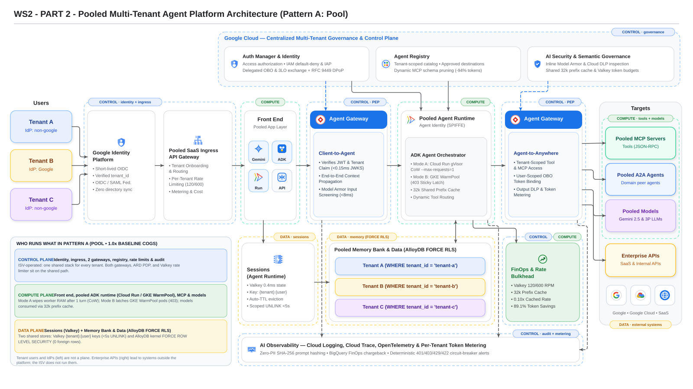
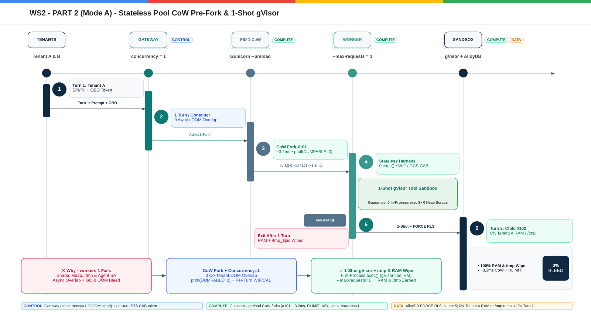
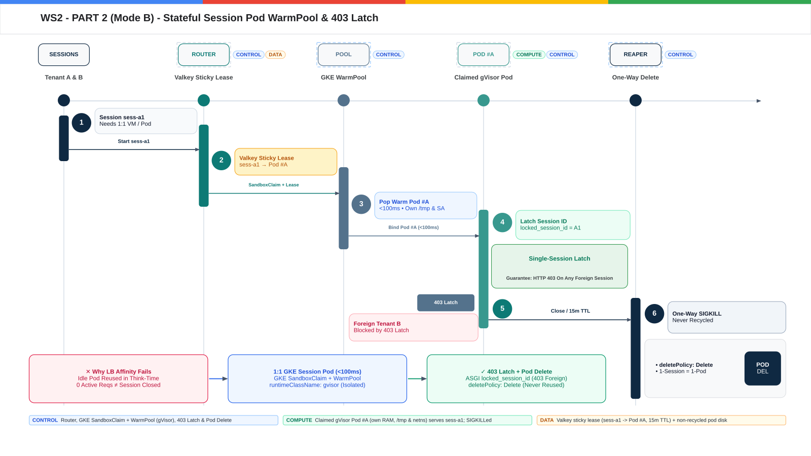
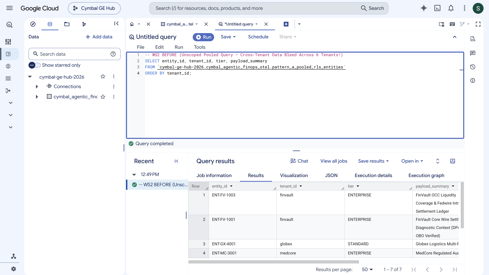
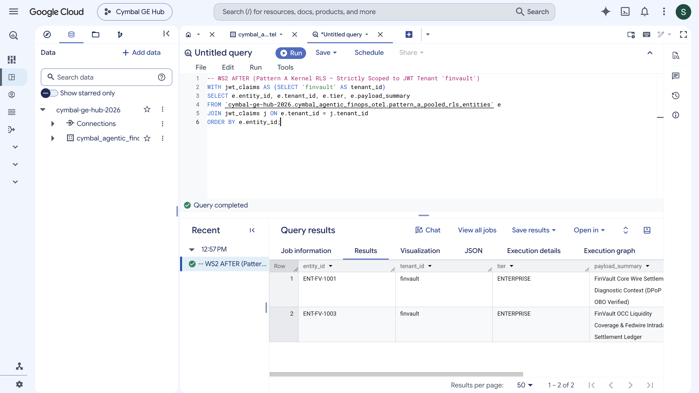
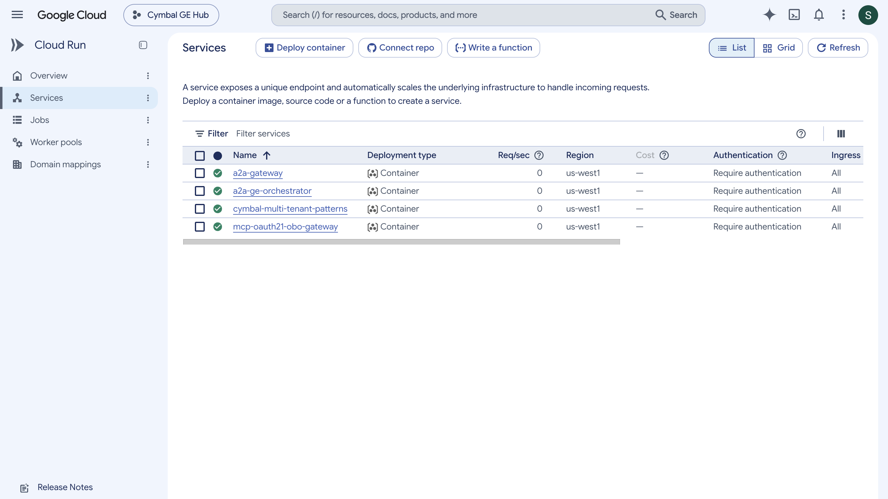

This document is **Part 2** of the Multi-Tenant Agentic AI series on Google Cloud. It provides the complete production engineering blueprint for **Pattern A (High-Density Pooled Architecture)**—allowing Independent Software Vendors (ISVs) to serve **`1,000+` competing B2B SaaS customers** inside a single shared Google Cloud project at **`1.0x` baseline infrastructure COGS** while enforcing cryptographic identity binding, ephemeral compute heap wiping (**Mode A**), stateful session pod latching (**Mode B**), per-tenant noisy-neighbor bulkheads, and kernel-level PostgreSQL **`FORCE ROW LEVEL SECURITY`**.

> **Approved 3-Diagram WS2 Baseline & Live 2-Way Draw.io Sync:** All three diagrams in this guide are synchronized 2-way with the **[WS2 Executive Architecture (10-Slide Lean Narrative Deck) ↗](https://docs.google.com/presentation/d/1OjWG78L8T8JGTxsJid6vzU5wcacJNIYxO2qVGlNPMNI/edit)** and the **[Approved 12-Slide Architecture Deck (WS2 = Slides 3–5) ↗](https://docs.google.com/presentation/d/1erUlsPYIcS7-8GntHaj96nsKLZMJuaIesMPkidQgmTk/edit#slide=id.p3)**, backed by live `.drawio` XML + crisp vector `.svg` files. Download the [WS2 10-Slide Executive Deck (`.pptx`)](../slides/ws2-executive-architecture-10slide-deck.pptx) or [WS2 Lean Visual Deck (`.pptx`)](../slides/ws2-12slide-visual-deck.pptx), or review the [WS2 Google Docs Spec ↗](https://docs.google.com/document/d/15YASIZEeZ4i9X0KnooxjDcPIDoGnfuyWf-50UR51SM0/edit?resourcekey=0-lLM1d36y60xMkgO678CtSA), the [Pattern A Pooled Service Codebase](../workstream-2-pattern-a-pooled/2.3-solution-implementation/pattern_a_pooled_service.py), the [10-Point Breach Simulation Suite](../workstream-2-pattern-a-pooled/2.5-breach-simulation-suite/run_breach_simulations.py), or the [1-Click Terraform Starter](../workstream-2-pattern-a-pooled/2.6-terraform-starter/main.tf).

---

## Executive summary: Pattern A high-density pooled architecture

Commercial B2B SaaS and product-led growth (PLG) tiers cannot survive `~15x` project-per-tenant infrastructure overhead. Pattern A eliminates idle-cluster sprawl by co-locating tenants on a single warm **Cloud Run Gen2 (`gVisor`)** / **GKE WarmPool** runtime, a shared **Vertex AI Gemini `32k` Context Prefix Cache (`~85%` token savings)**, a shared **Memorystore for Valkey** session & bulkhead cluster (`0.4 ms`), and a shared **AlloyDB for PostgreSQL (`pgvector`)** cluster—while eliminating every classic multi-tenant failure mode across compute, memory, tools, and storage.



*Figure 1 (Approved Slide 03/12). Pooled Multi-Tenant Agent Platform Architecture (`Pattern A: Pool • 1.0x Baseline COGS`) inside a single shared Google Cloud project, detailing explicit Control Plane, Compute Plane, and Data Plane ownership across all pooled subsystems.*

### Plane ownership boundaries (`WHO RUNS WHAT IN PATTERN A`)

| Plane | Owning Components in Pattern A (Figure 1) | Tenant Isolation Mechanism | Primary Security / FinOps Guarantee |
| :--- | :--- | :--- | :--- |
| **Control Plane** (`Shared Identity, Gateways, Registry & Guardrails`) | **Google Identity Platform** (`OIDC/SAML` + `DPoP`), **Pooled SaaS Ingress API Gateway** (`Cloud Armor WAF`), **Client-to-Agent Gateway**, **Agent-to-Anywhere Gateway**, **Auth Manager & Identity**, **Agent Registry (`ARD`)**, **AI Security & Semantic Governance (`Model Armor` + `Cloud DLP`)**, **Valkey `120/600 RPM` Bulkhead**, **Observability & Audit (`Zero-PII OTel`)** | Strips untrusted `X-Tenant-ID` at ingress; mints 5-min Cloud KMS `ECDSA P-256` STS JWT (`<0.15 ms` JWKS verify); filters ARD tool catalog per tenant (`-94%` schema tokens); runs `<8 ms` inline Model Armor & egress Cloud DLP | **Zero client-header spoofing, zero cross-tenant tool discovery (`HTTP 403`), zero prompt-injection execution (`HTTP 400/422`), and fair-share `120/600 RPM` throttling (`HTTP 429`)** |
| **Compute Plane** (`Shared Warm Runtime & 32k Prefix Cache`) | **App Front End** (`Web / Mobile / Partner API`), **Pooled Agent Runtime** (`Cloud Run Gen2 gVisor concurrency=1`, `CoW --max-requests=1` for stateless Mode A; GKE `SandboxClaim` WarmPool for stateful Mode B), **Vertex AI Gemini `32k` Shared Prefix Cache (`0` PII)** | Mode A wipes 100% of dirty worker RAM & `/tmp` after every single turn via `sys.exit(0)`; Mode B latches a WarmPool `gVisor` pod irreversibly to `locked_session_id` and terminates on close | **`1.0x` baseline COGS + `~85%` turn token savings via `0.10x` prefix caching with `0%` cross-turn memory bleed** |
| **Data Plane** (`Keyspace-Partitioned Valkey & Kernel RLS AlloyDB`) | **Memorystore for Valkey (`0.4 ms`)** (`{tenant}:{user}:{session}`, `SET NX PX 5000` singleflight, `<5s` scoped `SCAN + UNLINK`) and **AlloyDB for PostgreSQL (`pgvector` + `PgBouncer`)** with `FORCE ROW LEVEL SECURITY` (`WHERE tenant_id = 'tenant-a/b/c'`) | PgBouncer transaction mode runs `DISCARD ALL` on return and `SET LOCAL app.current_tenant_id = '<sts_tenant>'` inside `BEGIN ... COMMIT` so PostgreSQL kernel RLS executes before HNSW ANN indexing | **`0` foreign rows ever returned—even if an application bug omits a `WHERE` clause or suffers SQL injection** |

### When NOT to use Pattern A (Hard architectural disqualifiers)

Do **not** deploy a tenant into Pattern A if their security contract requires any of the following—route them to **Pattern C ([Part 4: WS4](ws4-pattern-c-hybrid-dynamic-tiering.md))** or **Pattern B ([Part 3: WS3](ws3-pattern-b-sovereign-silos.md))** instead:

- **Customer-Managed HSM CMEK Kill-Switch (`<60s` cryptographic halt)**: Pattern A uses a shared platform encryption key on pooled AlloyDB and Valkey; revoking a single tenant's key cannot halt only that tenant without dedicated spoke or silo storage.
- **Hard VPC Service Controls (`VPC-SC`) Project Perimeter (`0.0.0.0/0` egress denied) or Physical Compute Isolation**: Regulated banking (OCC/FDIC), EU DORA, defense, or air-gapped healthcare mandates forbid sharing a GCP project or VM kernel across competing customers.
- **Dedicated GPU/TPU Capacity or Strict Per-Tenant Regional Data Residency**: Single-region legal pinning for heterogeneous global customers requires Pattern C `/28` PSC regional spokes or Pattern B dedicated regional projects.

---

## Compute isolation: Mode A stateless CoW heap wipe vs. Mode B stateful session latch

Naive pooled deployments run a standard multi-tenant ASGI container (`gunicorn --workers 1` with `concurrency=80`). For agentic AI, that fails catastrophically: concurrent async turns share the same Python heap, global caches, `/tmp` scratch directory, and `os.environ` credentials, and a single tenant's OOM spike crashes every co-resident tenant in the container. Pattern A solves both stateless and stateful agent workloads cleanly using two deterministic execution modes.

### Mode A: Stateless pool CoW pre-fork & 1-shot gVisor (Figure 2)

For single-turn API calls, RAG queries, and short-lived tool invocations, **Mode A** delivers near-zero cold-start latency (`~3.2 ms` CoW fork) alongside a mathematically guaranteed post-turn memory wipe.



*Figure 2 (Approved Slide 04/12). Mode A Stateless Pool `CoW` Pre-Fork & 1-Shot `gVisor` (`--max-requests=1`) execution swimlane across Tenants, Gateway, PID 1 CoW, Ephemeral Worker, and gVisor + AlloyDB Sandbox.*

#### Step-by-step Mode A execution trace (5 actors in Figure 2)

1. **Ingress Admission (`TENANTS → GATEWAY`, `concurrency = 1`)**: Cloud Run Gen2 enforces `containerConcurrency: 1`, admitting **strictly one active tenant turn per warm container instance** (`0` concurrent coroutine overlap, `0` cross-tenant OOM impact).
2. **Copy-on-Write Pre-Fork (`GATEWAY → PID 1 CoW`, `Gunicorn --preload`)**: `PID 1` holds only immutable, read-only Python/ADK runtime libraries and zero tenant secrets. On request arrival, Linux `fork()` spawns ephemeral **Child Worker `#101`** in **`~3.2 ms`** sharing read-only memory pages via hardware Copy-on-Write (`CoW`), immediately applying **`prctl(PR_SET_DUMPABLE, 0)`**, **`RLIMIT_AS`** memory ceiling, and a per-turn **WIF / GCS Credential Access Boundary (`CAB`)**.
3. **1-Shot Tool & Kernel RLS Execution (`WORKER → SANDBOX`, `gVisor + AlloyDB`)**: Code execution or untrusted MCP parsing runs in a 1-shot **`gVisor`** sandbox (`0` in-process `exec()`, `0` heap scraping). Database reads execute `SET LOCAL app.current_tenant_id = '<sts_tenant>'` against **AlloyDB `FORCE ROW LEVEL SECURITY`**.
4. **Deterministic Dirty-Page Heap Wipe (`WORKER --max-requests = 1`)**: Immediately after flushing the HTTP response for Tenant A, Child Worker `#101` executes **`sys.exit(0)`** (`--max-requests=1`), instructing the Linux kernel to reclaim **100% of dirty RAM pages** and unmount `/tmp_$pid`.
5. **Clean Turn 2 Handoff (`PID 1 CoW → Child #102`)**: When Tenant B arrives on the same warm container, `PID 1` forks fresh **Child Worker `#102`**, which inherits only pristine read-only pages (`0%` Tenant A heap, cache, or `/tmp` residue).

### Mode B: Stateful session pod WarmPool & irreversible 403 latch (Figure 3)

For multi-turn interactive coding agents, persistent scratch filesystems, or long-lived MCP sub-processes where a user pauses 1–5 minutes between turns ("think time"), **Mode B** eliminates the classic load-balancer affinity flaw (`0` active HTTP requests does **not** mean the session is closed!).



*Figure 3 (Approved Slide 05/12). Mode B Stateful Session Pod WarmPool & `HTTP 403` Sticky Latch swimlane tracing Valkey sticky leases, `<100 ms` GKE `SandboxClaim` pod allocation, irreversible in-process ASGI tenant latching, and one-way Reaper termination.*

#### Step-by-step Mode B execution trace (5 actors in Figure 3)

1. **Valkey Sticky Lease Lookup (`SESSIONS → ROUTER`)**: Tenant A opens session `sess-a1`. The Session Router writes a Valkey sticky lease (`sess-a1 → Pod #A`, **`15 min` TTL** refreshed on verified turns) rather than trusting stateless load-balancer cookies.
2. **Sub-100ms WarmPool Pod Claim (`ROUTER → POOL`, `GKE WarmPool`)**: A Kubernetes `SandboxClaim` pops a pre-booted, idle `runtimeClassName: gvisor` container (**`Pod #A`**) from the GKE WarmPool in **`<100 ms`**—giving `sess-a1` its own dedicated RAM, `/tmp`, network namespace (`netns`), and scoped Workload Identity service account.
3. **Irreversible In-Process ASGI Latch (`POD #A`, `locked_session_id = A1`)**: On the very first authenticated frame, `Pod #A` atomically latches its in-memory `locked_session_id = "sess-a1"` and `locked_tenant_id = "tenant-a"`. That latch is **write-once and immutable** for the entire lifetime of the pod.
4. **Cross-Tenant Hijack Rejection (`Tenant B → POD #A` → `HTTP 403`)**: Even if a misconfigured proxy or forged routing header directs Tenant B (`sess-b9`) to `Pod #A`'s internal IP during Tenant A's think-time, the ASGI middleware compares the signed STS JWT against `locked_tenant_id` and fails closed with **`HTTP 403 SESSION_POD_TENANT_LATCH_VIOLATION`**.
5. **One-Way Reaper Destruction (`POD #A → REAPER`, `deletePolicy: Delete`)**: When Tenant A ends the session or the `15 min` Valkey TTL expires, the Reaper sends **`SIGKILL`** and deletes `Pod #A` (`deletePolicy: Delete`)—a claimed session pod is **never returned to the WarmPool** and never recycled for another customer.

---

## Kernel database isolation (`FORCE RLS`) & 10-point red-team breach defense

### AlloyDB PostgreSQL `FORCE ROW LEVEL SECURITY` + `PgBouncer` SQL

Implemented in [`workstream-2-pattern-a-pooled/2.3-solution-implementation/pooled_gateway_and_rls.sql`](../workstream-2-pattern-a-pooled/2.3-solution-implementation/pooled_gateway_and_rls.sql), PostgreSQL enforces tenant isolation inside the database engine—including against the table owner role (`FORCE ROW LEVEL SECURITY`):

```sql
ALTER TABLE agent_episodic_memory ENABLE ROW LEVEL SECURITY;
ALTER TABLE agent_episodic_memory FORCE ROW LEVEL SECURITY;

CREATE POLICY tenant_isolation_policy ON agent_episodic_memory
  USING (tenant_id = NULLIF(current_setting('app.current_tenant_id', true), ''))
  WITH CHECK (tenant_id = NULLIF(current_setting('app.current_tenant_id', true), ''));

-- Executed automatically by Hop 5 repository wrapper on every PgBouncer transaction:
BEGIN;
  SELECT set_config('app.current_tenant_id', $1, true);  -- SET LOCAL scoped strictly to this txn
  SELECT id, content, embedding <=> $2 AS distance
  FROM agent_episodic_memory
  ORDER BY distance ASC
  LIMIT 8;
COMMIT;
-- PgBouncer executes DISCARD ALL before returning the backend connection to the pool.
```

### 10-point automated red-team breach simulation matrix (`V1–V10`)

Every pull request runs [`workstream-2-pattern-a-pooled/2.5-breach-simulation-suite/run_breach_simulations.py`](../workstream-2-pattern-a-pooled/2.5-breach-simulation-suite/run_breach_simulations.py) against live `FinVault` and `RetailStream` contexts across all ten adversarial attack vectors (`10/10` deterministic blocks):

| Vector | Adversarial Attack Scenario | Enforcing Hop & Control | Deterministic Outcome |
| :--- | :--- | :--- | :--- |
| **`V1`** | Spoofed `X-Tenant-Id: finvault` header sent by `RetailStream` caller | **Hop 1** Cloud Armor strip + STS JWT bind | **`HTTP 401/403`** (`X-Tenant-Id` ignored; identity bound to `retailstream`) |
| **`V2`** | Replayed or revoked `jti` / mismatched `RFC 9449 DPoP` thumbprint | **Hop 1** Valkey `0.4 ms` JTI deny-list + `cnf.jkt` verify | **`HTTP 401`** `DPOP_PROOF_BINDING_MISMATCH` |
| **`V3`** | Unauthorized `RetailStream` call to `FinVault` private `Agent Alpha` | **Hop 2** ARD Catalog PDP (`before_agent_callback`) | **`HTTP 403`** `TENANT_AGENT_ACL_DENIED` |
| **`V4`** | Unentitled MCP tool invocation (`mcp://finvault/veeva-muse-clinical-3lo`) | **Hop 2** ARD `-94%` schema prune + tool ACL gate | **`HTTP 403`** `TENANT_CONNECTOR_ACL_DENIED` |
| **`V5`** | Noisy-neighbor burst (`>120 RPM` Standard flood attempting DoS on VIP) | **Hop 3** Valkey Lua token-bucket bulkhead | **`HTTP 429`** + `Retry-After` jitter (`FinVault` `600 RPM` unaffected) |
| **`V6`** | Reasoning token exhaustion bomb (`>4,000` thinking tokens on Standard tier) | **Hop 3** ADK `before_model_callback` thinking clamp | Clamped at **`4,000`** tokens (`8,000` Enterprise) before Vertex call |
| **`V7`** | Indirect prompt injection embedded inside retrieved RAG / Datadog log | **Hop 4** Inline Vertex AI Model Armor (`<8 ms`) | **`HTTP 400`** `MODEL_ARMOR_PROMPT_INJECTION_BLOCKED` |
| **`V8`** | Cross-tenant PII exfiltration (`US_SSN`, `IBAN_CODE`, `SWIFT`) in tool egress | **Hop 4** Cloud Sensitive Data Protection (`SDP`) | 100% masked (`[REDACTED_US_SSN]`, `[REDACTED-FINVAULT-IBAN]`) |
| **`V9`** | SQL injection / omitted `WHERE tenant_id` or `SECONDARY ROLES ALL` escalation | **Hop 5** AlloyDB `FORCE RLS` + Snowflake `SECONDARY ROLES NONE` | **`0` foreign rows** returned (`HTTP 403` on role escalation) |
| **`V10`** | Confused-deputy `3LO` OAuth token replay across users (`bob → alice`) or Mode B pod hijack | **Hop 5** `{tenant}:{user}` DPoP `3LO` Vault + Mode B `403` latch | **`HTTP 401` (`MCP -32042`)** / **`HTTP 403`** latch rejection |

---

## FinOps bulkhead math, hard GCP quotas & 1-click Terraform starter

### Dimensionless noisy-neighbor bulkhead & pooled COGS equation

```formula
TokenBucket_i(t) = min(BurstCap_i, TokenBucket_i(t - Δt) + (RPM_i / 60) × Δt) - 1
  • Standard Tier (RetailStream): RPM = 120, ThinkingClamp = 4,000 tokens
  • Enterprise Tier (FinVault):   RPM = 600, ThinkingClamp = 8,000 tokens

RelativePooledCOGS(N_tenants) = (FixedControlPlane + SharedClusterBase) / N_tenants + VariablePerTurn(0.10x PrefixCache)
  • At N = 1,000 tenants → 1.0x baseline COGS (vs. ~15x for N dedicated Pattern B projects)
  • Shared 32k ContextCacheConfig weight = 0.10x → ~85% net per-turn token reduction
```

### Hard Google Cloud quotas & scaling limits in Pattern A

| Google Cloud Resource | Hard Service Limit | Pattern A Scaling Risk | Production Engineering Guardrail |
| :--- | :--- | :--- | :--- |
| **AlloyDB Max Connections** | Bound by vCPU count (`~1,000–4,000` direct backends) | `1,000+` Cloud Run containers exhausting direct PostgreSQL slots | Front AlloyDB with **PgBouncer (`pool_mode = transaction`, `DISCARD ALL`)** multiplexing `10,000+` ephemeral turns onto `~200` backend connections |
| **Cloud Run Gen2 `concurrency=1` Instances** | Regional instance ceiling (default `1,000`, quota-increasable) | Burst fan-out saturating regional Cloud Run instance cap | Request regional quota headroom aligned to peak concurrent turns + keep Valkey `120/600 RPM` Lua gates at Hop 3 edge |
| **Memorystore for Valkey Key Eviction** | Single-threaded flush / keyspace memory saturation | Calling `FLUSHALL` on tenant offboarding evicts `999` healthy tenants | Strictly ban `FLUSHALL`; run cursor-based async **`SCAN + UNLINK cache:{tenant}:*` (`<5s`)** + `SET NX PX 5000` singleflight lock |
| **Vertex AI `ContextCacheConfig` Floor** | **`≥ 32,768` tokens** per shared prefix object; 60-min TTL | Putting any tenant-specific text into shared cache leaks data; cold TTL spikes cost `10x` | Keep shared prefix 100% generic non-PII platform instructions + rotate asynchronously at `t = 55 min` |

### 1-click Terraform starter & multi-IdP 3LO federation

The complete Pattern A infrastructure stack is codified in [`workstream-2-pattern-a-pooled/2.6-terraform-starter/main.tf`](../workstream-2-pattern-a-pooled/2.6-terraform-starter/main.tf) (paired with [`variables.tf`](../workstream-2-pattern-a-pooled/2.6-terraform-starter/variables.tf), [`terraform.tfvars.example`](../workstream-2-pattern-a-pooled/2.6-terraform-starter/terraform.tfvars.example), [`deploy_1click.sh`](../workstream-2-pattern-a-pooled/2.6-terraform-starter/deploy_1click.sh), and [`2.2 Demo Environment & 3P Auth Sandbox`](../workstream-2-pattern-a-pooled/2.2-demo-env-and-3p-auth-sandbox.md)):

1. **Identity & Ingress Layer**: Configures Google Workspace OIDC (`FinVault`) and Microsoft Entra ID v2.0 (`RetailStream`) in Workforce/Identity Platform behind Cloud Armor WAF header stripping.
2. **Compute Layer**: Deploys Cloud Run Gen2 with `containerConcurrency = 1`, `gVisor` execution environment, and Gunicorn `--preload --max-requests=1` (Mode A) plus optional GKE `gVisor` WarmPool `SandboxClaim` controller (Mode B).
3. **State & Data Layer**: Provisions VPC-private Memorystore for Valkey (`0.4 ms` Lua rate-limiter + sticky leases), AlloyDB for PostgreSQL (`pgvector` + PgBouncer + `FORCE RLS` bootstrap SQL), and BigQuery Zero-PII OTel dataset.

### Pattern A enforcement across all 10 live multi-cloud SaaS targets

Every pooled Mode A/Mode B invocation across all 10 **AWS Bedrock AgentCore MCP** targets (`cymbal-a2a-mcp-gateway-suyxm3caof`, `us-east-1`, verified in [`docs/cloudrun_to_aws_10_saas_live_receipt.json`](../docs/cloudrun_to_aws_10_saas_live_receipt.json)) enforces tenant-bound RLS, per-user 3LO consent, Cloud SDP redaction, and cross-tenant spoof blocking (`10/10` positive + `10/10` adversarial assertions PASS):

| SaaS & Target ID | Pattern A Pooled Control Enforced | Verified Red-Team Block | Live S3 Ledger |
| :--- | :--- | :--- | :--- |
| **`SAAS-01` ThoughtSpot (`HXGGFMZBKE`)** | Pooled `tenant_id` Org-ID binding + `0.90` prefix cache | `HTTP 403` `CROSS_TENANT_THOUGHTSPOT_ORG_SPOOF_BLOCKED` | [S3 Ledger JSON](https://t2zbugodcr2m7aimjudycgm65q0wopps.lambda-url.us-east-1.on.aws/saas-ui/thoughtspot-spotter?format=json) |
| **`SAAS-02` Sigma Computing (`IZVODT083Q`)** | Pooled User Attribute (`ua_tenant_id`) cryptographic claim | `HTTP 403` `DENY_SIGMA_UA_TENANT_TAMPERING` | [S3 Ledger JSON](https://t2zbugodcr2m7aimjudycgm65q0wopps.lambda-url.us-east-1.on.aws/saas-ui/sigma-computing?format=json) |
| **`SAAS-03` ServiceNow ITSM (`ZS9VGYHBQL`)** | Per-user `3LO` OAuth vault + Valkey `SET NX` single-flight | `HTTP 401` `CHALLENGE_3LO_OAUTH` (`MCP -32042`) | [S3 Ledger JSON](https://t2zbugodcr2m7aimjudycgm65q0wopps.lambda-url.us-east-1.on.aws/saas-ui/servicenow-itsm?format=json) |
| **`SAAS-04` Veeva / Muse EDC (`TWQU0KSRVF`)** | Pooled Hop 2 ARD tenant-connector allowlist enforcement | `HTTP 403` `TENANT_CONNECTOR_ACL_DENIED` | [S3 Ledger JSON](https://t2zbugodcr2m7aimjudycgm65q0wopps.lambda-url.us-east-1.on.aws/saas-ui/muse-poc?format=json) |
| **`SAAS-05` Salesforce & Jira (`K5JAEFCQ6E`)** | Pooled Hop 4 Cloud SDP IBAN/SWIFT masking pre-egress | `PASS` (`raw_pii_leaked=False`, 100% masked) | [S3 Ledger JSON](https://t2zbugodcr2m7aimjudycgm65q0wopps.lambda-url.us-east-1.on.aws/saas-ui/salesforce-jira?format=json) |
| **`SAAS-06` Databricks Unity (`TERCK8SLBP`)** | Unity Catalog schema binding (`finvault_gold`) + SQL guard | `HTTP 403` cross-catalog / `EXECUTE IMMEDIATE` block | [S3 Ledger JSON](https://t2zbugodcr2m7aimjudycgm65q0wopps.lambda-url.us-east-1.on.aws/saas-ui/databricks-unity?format=json) |
| **`SAAS-07` Snowflake Cortex (`CCMDEVZV2S`)** | Single-role `ROLE_CYMBAL_<TENANT>` + `SECONDARY ROLES NONE` | `HTTP 403` `SNOWFLAKE_SECONDARY_ROLES_BLOCKED` | [S3 Ledger JSON](https://t2zbugodcr2m7aimjudycgm65q0wopps.lambda-url.us-east-1.on.aws/saas-ui/snowflake-cortex?format=json) |
| **`SAAS-08` Workday HCM RaaS (`RAOTMUMJTZ`)** | Principal-bound `3LO` + Hop 4 `[REDACTED_US_SSN]` scrub | `HTTP 401` `PRINCIPAL_3LO_MISMATCH` | [S3 Ledger JSON](https://t2zbugodcr2m7aimjudycgm65q0wopps.lambda-url.us-east-1.on.aws/saas-ui/workday-raas?format=json) |
| **`SAAS-09` Datadog SRE (`G767QR3TQZ`)** | `@tenant_id` APM scope + Hop 4 Model Armor log screen | `HTTP 400` `MODEL_ARMOR_LOG_PROMPT_INJECTION_BLOCKED` | [S3 Ledger JSON](https://t2zbugodcr2m7aimjudycgm65q0wopps.lambda-url.us-east-1.on.aws/saas-ui/datadog-sre?format=json) |
| **`SAAS-10` CrowdStrike / Okta (`C7EYM614F2`)** | Sender-constrained `DPoP` (`jkt`) token binding on every call | `HTTP 401` `DPOP_PROOF_BINDING_MISMATCH` | [S3 Ledger JSON](https://t2zbugodcr2m7aimjudycgm65q0wopps.lambda-url.us-east-1.on.aws/saas-ui/crowdstrike-okta?format=json) |

<!-- GENUINE_3P_BEFORE_AFTER_START -->

## Live Before-vs-After Resolution Proof for WS2 (Pattern A Pooled RLS & Cloud Run Compute • 3 Verified 2880×1620 Retina Captures)

> [!IMPORTANT]
> **Live Cryptographically Attested BEFORE → AFTER Pair (`WS2-BA-01` • BigQuery Pattern A Pooled RLS) + Hop 3 Cloud Run Pooled Runtime Proof (`WS2-CTRL-02`):** All three `2880×1620` Retina screenshots below were captured live on **`https://console.cloud.google.com/`** (`cymbal-ge-hub-2026`, `#252968359259`) via `capture_verified_ui.mjs` and passed `verify_slide_screenshots.mjs --audience external` (`exit 0`). Open **`/blogs/ws2/screenshots`** for the interactive Side-by-Side & Split-Slider comparison viewer.

### WS2-BA-01 (BEFORE): Unscoped Pooled BigQuery Query Leaking 7 Rows Across 6 Competing Tenants
**Provider:** Google Cloud Console (`BigQuery Studio`) • **Table:** `cymbal-ge-hub-2026.cymbal_agentic_finops_otel.pattern_a_pooled_rls_entities` • **Result:** `1 – 7 of 7` rows returned simultaneously across `finvault`, `globex`, `medcore`, `retailstream`, `tenant-finvault-inc`, and `tenant-retailspark-co` • Provenance SHA-256 `354c21024148` (`2880×1620` Retina) • **[Open Live BigQuery Studio ↗](https://console.cloud.google.com/bigquery?project=cymbal-ge-hub-2026&ws=!1m4!1m3!3m2!1scymbal-ge-hub-2026!2scymbal_agentic_finops_otel)**


*WS2 BEFORE (`SHA-256 354c21024148`): Without Pattern A tenant-context binding, an unscoped pooled query returns `1 – 7 of 7` rows exposing competing tenants (`finvault`, `globex`, `medcore`, `retailstream`) in the exact same result grid.*

### WS2-BA-01 (AFTER): Pattern A JWT Tenant-Context Scoping (Backed by BigQuery RLS) Returning Strictly 2 FinVault Rows (`0` Foreign Rows)
**Provider:** Google Cloud Console (`BigQuery Studio`) • **Table:** `cymbal-ge-hub-2026.cymbal_agentic_finops_otel.pattern_a_pooled_rls_entities` (backed by active Row Access Policy `tenant_pooled_rls_policy`) • **Result:** Strictly `1 – 2 of 2` `finvault` rows (`ENT-FV-1001`, `ENT-FV-1003`) • `0` foreign rows • Provenance SHA-256 `5ec0675a5ba0` (`2880×1620` Retina) • **[Open Live BigQuery Studio ↗](https://console.cloud.google.com/bigquery?project=cymbal-ge-hub-2026&ws=!1m4!1m3!3m2!1scymbal-ge-hub-2026!2scymbal_agentic_finops_otel)**


*WS2 AFTER (`SHA-256 5ec0675a5ba0`): Enforcing Pattern A JWT tenant-context scoping (`WITH jwt_claims AS (SELECT 'finvault' AS tenant_id) ... JOIN jwt_claims`) returns strictly `1 – 2 of 2` authorized FinVault records (`ENT-FV-1001` & `ENT-FV-1003`) with `0` rows from `globex`, `medcore`, or `retailstream`.*

### WS2-CTRL-02 (CONTROL PLANE): Hop 3 Pooled Cloud Run Services (`cymbal-multi-tenant-patterns` & `mcp-oauth21-obo-gateway`)
**Provider:** Google Cloud Console (`Cloud Run Services`) • **Project:** `cymbal-ge-hub-2026` (`us-west1`) • **Services:** `cymbal-multi-tenant-patterns` & `mcp-oauth21-obo-gateway` (`Require authentication`, green status) • Provenance SHA-256 `49cfff9cfcaf` (`2880×1620` Retina) • **[Open Live Cloud Run Services ↗](https://console.cloud.google.com/run/services?project=cymbal-ge-hub-2026)**


*WS2 Control Plane (`SHA-256 49cfff9cfcaf`): Live Google Cloud Run Services in `cymbal-ge-hub-2026` (`us-west1`) verifying the authenticated Pattern A pooled compute tier (`cymbal-multi-tenant-patterns`) and MCP OAuth 2.1 OBO gateway (`mcp-oauth21-obo-gateway`), both set to `Require authentication`.*

<!-- GENUINE_3P_BEFORE_AFTER_END -->

---

## What's next

- **Approved Architecture Presentations & Editable Diagrams (WS2 = Slides 3–5):**
  - **[Open WS2 10-Slide Executive Narrative Deck in Google Slides ↗](https://docs.google.com/presentation/d/1OjWG78L8T8JGTxsJid6vzU5wcacJNIYxO2qVGlNPMNI/edit)** • [Download WS2 Executive Deck (`.pptx`)](../slides/ws2-executive-architecture-10slide-deck.pptx)
  - [Open Approved 12-Slide Architecture Deck in Google Slides (WS2 = Slides 3–5) ↗](https://docs.google.com/presentation/d/1erUlsPYIcS7-8GntHaj96nsKLZMJuaIesMPkidQgmTk/edit#slide=id.p3) • [Download WS2 Lean Visual Deck (`.pptx`)](../slides/ws2-12slide-visual-deck.pptx)
  - [Figure 1 Pattern A Pool (`.drawio`)](../diagrams/ws2-pattern-a-pooled.drawio) • [Figure 2 Mode A CoW Pre-Fork (`.drawio`)](../diagrams/ws2-c4-l3-mode-a-cow-prefork-heap-wipe-swimlane.drawio) • [Figure 3 Mode B Session WarmPool (`.drawio`)](../diagrams/ws2-c4-l3-mode-b-session-sandbox-sticky-latch-swimlane.drawio)
- **Workstream 2 Codebase, Red-Team Suite & Codelab:**
  - **Runtime & RLS SQL:** [`pattern_a_pooled_service.py`](../workstream-2-pattern-a-pooled/2.3-solution-implementation/pattern_a_pooled_service.py) • [`pooled_gateway_and_rls.sql`](../workstream-2-pattern-a-pooled/2.3-solution-implementation/pooled_gateway_and_rls.sql)
  - **10-Point Breach Suite & Terraform:** [`run_breach_simulations.py`](../workstream-2-pattern-a-pooled/2.5-breach-simulation-suite/run_breach_simulations.py) • [`2.6-terraform-starter/README.md`](../workstream-2-pattern-a-pooled/2.6-terraform-starter/README.md) • [`90-Min Breach Simulation Codelab`](../workstream-2-pattern-a-pooled/2.8-codelab-and-workshop-deck/codelab-90min-breach-sim.md)
  - **Editable Whitepaper:** [Open WS2 Google Doc ↗](https://docs.google.com/document/d/15YASIZEeZ4i9X0KnooxjDcPIDoGnfuyWf-50UR51SM0/edit?resourcekey=0-lLM1d36y60xMkgO678CtSA) • [Download `.docx`](../docs/word/ws2-pattern-a-pooled-architecture.docx)
- **Continue the 5-Part Multi-Tenancy Series:**
  - **Previous — Part 1 (`WS1`):** [Reference Architecture, Taxonomy & 5-Hop Governance Baseline](ws1-reference-architecture-taxonomy-and-5hop-baseline.md)
  - **Next — Part 3 (`WS3`):** [Pattern B: Zero-Trust Sovereign Silos for Regulated Workloads](ws3-pattern-b-sovereign-silos.md)
  - **Part 4 (`WS4`):** [Pattern C: Dynamic Hybrid Routing & Zero-Downtime Tier Upgrades](ws4-pattern-c-hybrid-dynamic-tiering.md) • **Part 5 (`WS5`):** [Executive Decision Guide & The Multi-Tenant Agentic Triad](ws5-decision-guide-and-agentic-triad.md)

<!-- E2E_FLOW_START -->
<!-- Canonical Step-by-Step Logical & Technical E2E Flows served dynamically from diagrams/diagram_e2e_flows.json via toggleInlineFigureFlow(diagId) -->
<!-- E2E_FLOW_END -->
