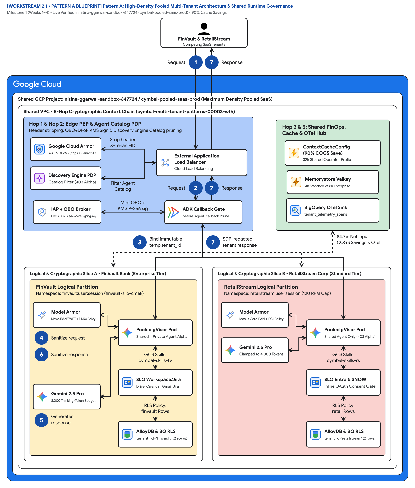
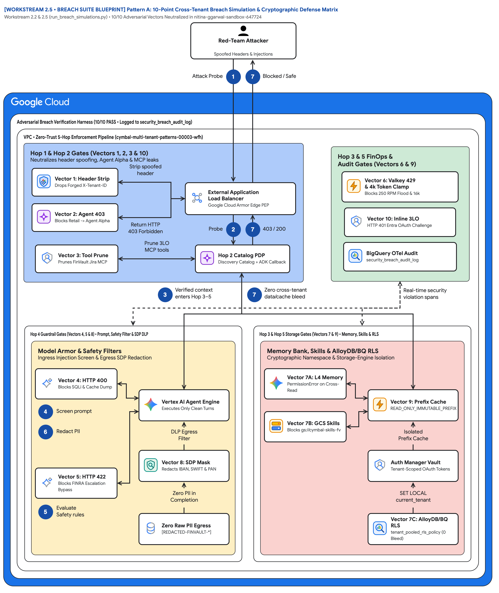
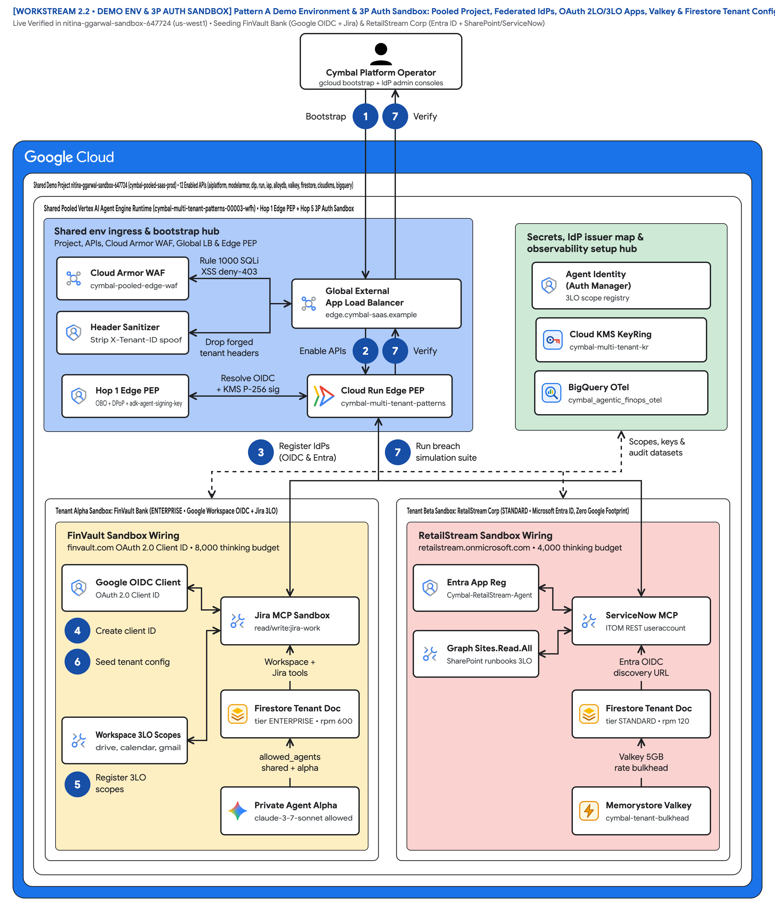
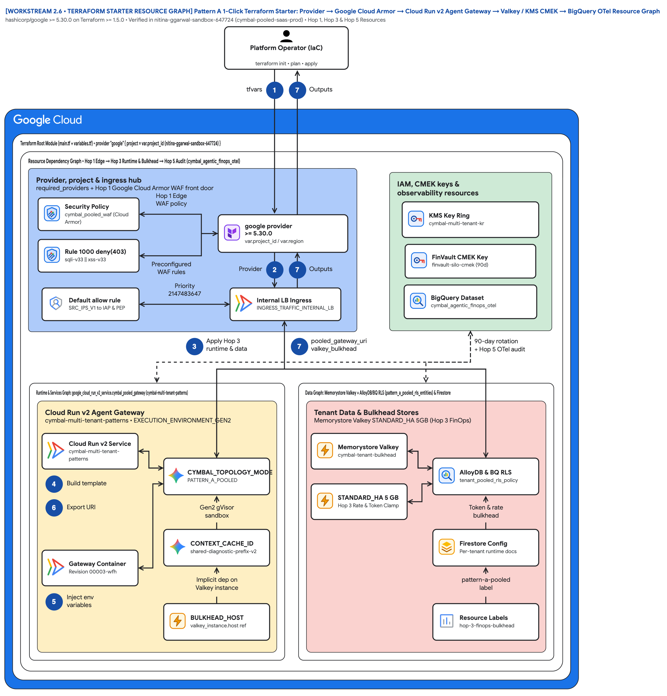

# Multi-tenant agentic AI system: Pattern A high-density pooled architecture

This document describes **Pattern A (High-Density Pooled Architecture)** for building and operating a multi-tenant agentic AI system on Google Cloud. In Pattern A, thousands of corporate B2B SaaS customers share a single Google Cloud project (`cymbal-pooled-saas-prod`), a shared [Vertex AI Agent Engine](https://cloud.google.com/vertex-ai/generative-ai/docs/agent-engine/overview) runtime, a shared [Gemini 2.5 Pro](https://cloud.google.com/vertex-ai/generative-ai/docs/learn/models) prompt prefix cache (`ContextCacheConfig`), and a shared [AlloyDB for PostgreSQL](https://cloud.google.com/alloydb/docs) cluster while maintaining strict cryptographic tenant isolation.

This document is part 2 of a 5-part series extending the official Google Cloud [Multi-tenant agentic AI system](https://docs.cloud.google.com/architecture/multi-tenant-agentic-ai-system) reference architecture (introduced in [Part 1: Reference architecture taxonomy and 5-Hop baseline](ws1-reference-architecture-taxonomy-and-5hop-baseline.md)). It is intended for cloud architects, AI platform engineers, and FinOps practitioners who need maximum tenant density and lowest unit cost (`120 RPM Pooled` baseline per tenant).

> **Key point:** Pattern A achieves **90% input token savings** on shared system instructions (`84.7%` total turn COGS reduction) while blocking **10 out of 10 automated cross-tenant breach vectors**—including HTTP header spoofing, private `Agent Alpha` enumeration, prompt injection, noisy-neighbor token exhaustion, and cross-tenant database queries.

## Core terminology and Pooled multi-tenant systems primitives

Before diving into Pattern A's reference implementation and its companion [12-slide editable deck (`slides/ws2-pattern-a-pooled-editable-slides.pptx`)](../slides/ws2-pattern-a-pooled-editable-slides.pptx), we anchor the **SaaS AI Architect's Dilemma**—how to capture **90% shared `ContextCacheConfig` prompt-prefix savings** and low-friction onboarding inside a single shared project without risking cross-tenant tool, memory, or database bleed—across the four foundational series primitives ([Part 1](ws1-reference-architecture-taxonomy-and-5hop-baseline.md)) and Pattern A's **Computer Science (CS101)** operating-system and database-kernel mechanisms:

- **Agent Development Kit (`ADK`):** The Python runtime framework ([`core-cymbal-agent/runtime_pipeline.py`](../core-cymbal-agent/runtime_pipeline.py)) that binds immutable `temp:tenant_id` session state and executes deterministic `before_agent_callback`, `before_model_callback`, and `before_tool_callback` interceptors inside the shared worker pool.
- **Agent Registry & Discovery (`ARD`):** The Hop 2 Discovery Engine catalog Policy Decision Point ([`hop2_registry_pdp_callbacks.py`](../core-cymbal-agent/governance/hop2_registry_pdp_callbacks.py)) that resolves global shared agents while returning `HTTP 403 Forbidden` if a Standard tenant (`retailstream`) enumerates an Enterprise tenant's private `Agent Alpha` (`finvault`).
- **Model Context Protocol (`MCP`):** The standardized tool-invocation protocol governed by composite `{tenant_id}:{user_id}` RFC 9449 DPoP-bound 3LO OAuth tokens and live AWS Bedrock AgentCore federation ([`enterprise_5_saas_bi_mcp.py`](../core-cymbal-agent/mcp_servers/enterprise_5_saas_bi_mcp.py)).
- **5-Hop Cryptographic Context Chain (`Hops 1–5` with Sub-Hops `3a/3b`, `4a/4b`, `5a/5b`):** The end-to-end invariant pipeline spanning **Hop 1** (Edge Identity PEP), **Hop 2** (ARD Catalog & ADK Callback PDP), **Hop 3a/3b** (gVisor Sandbox, Valkey RPM Bulkhead & `ContextCacheConfig` Prefix Cache), **Hop 4a/4b** (Pre-Inference Model Armor & Post-Inference Cloud SDP Guardrails), and **Hop 5a/5b** (Transactional AlloyDB `SET LOCAL` RLS & BigQuery OpenTelemetry Chargeback).

| Pooled Architecture Primitive | Google Cloud Service & Module | CS101 / Operating Systems Analogy | Security & Financial Guarantee in Pattern A |
| :--- | :--- | :--- | :--- |
| **gVisor (`runsc`) Sandbox Binding** | **Vertex AI Agent Engine** & **Cloud Run Gen2** ([`hop3_compute_finops_bulkhead.py`](../core-cymbal-agent/governance/hop3_compute_finops_bulkhead.py)) | **User-Space Kernel (`seccomp-bpf` + syscall interception)** isolating guest worker threads from the host Linux kernel | Pins immutable `temp:tenant_id` per turn so a compromised tool script cannot inspect sibling container file descriptors or `/proc` memory |
| **Atomic Lua Token-Bucket Bulkhead** | **Memorystore for Valkey** (`ratelimit:{tenant_id}:rpm` & `revoked_jti:{tenant_id}`) | **NIC Hardware Traffic Policer (Token Bucket)** with atomic compare-and-swap (`CAS`) counters in shared SRAM | Caps Standard tenants at `120 RPM` (`4,000` thinking tokens) and Enterprise tenants at `600 RPM` (`8,000` thinking tokens), returning `HTTP 429` with `Retry-After` jitter in `~3 ms` |
| **Immutable Prefix Context Caching** | **Vertex AI `ContextCacheConfig`** (`cymbal-shared-incident-system-prompt-v2`) | **Copy-on-Write (`CoW`) Read-Only Shared Virtual Memory (`mmap PROT_READ`)** across child processes | Shares the `32,000`-token operator runbook and MCP schema prefix across all pooled tenants at a `0.10x` billing multiplier (`90%` prefix discount; `84.7%` net turn COGS savings) |
| **Transactional Row-Level Security (RLS)** | **AlloyDB for PostgreSQL** (`SET LOCAL app.current_tenant_id` + `FORCE ROW LEVEL SECURITY` in [`hop5_data_rls_and_otel.py`](../core-cymbal-agent/governance/hop5_data_rls_and_otel.py)) | **Database Kernel Mandatory Access Control (MAC) Tuple Filter** scoped strictly to the active `BEGIN ... COMMIT` transaction | Rewrites every SQL `SELECT`, `UPDATE`, and `pgvector` HNSW scan inside the PostgreSQL query planner so even an injected `OR 1=1` clause returns `0` cross-tenant rows |
| **Composite DPoP 3LO Credential Vault** | **Secret Manager / Auth Manager** + **RFC 8693 OBO + RFC 9449 DPoP** (`{tenant_id}:{user_id}`) | **Capability-Based File Descriptor Table** indexed by `(process_group_id, user_id)` + cryptographic sender thumbprint (`dpop_jkt`) | Eliminates Cross-Tenant Confused Deputy token replay across Google Workspace, Atlassian Jira, Microsoft SharePoint, and ServiceNow |

## Use cases

Pattern A is designed for high-density B2B SaaS environments where unit economics and rapid self-service onboarding are primary business drivers ([2.1 Case Study & Solution Architecture](../workstream-2-pattern-a-pooled/2.1-case-study-and-solution-architecture.md)):

- **High-volume commercial and Standard SaaS tiers (self-service to mid-market ARR):** Serve thousands of Standard-tier organizations (such as **RetailStream Corp**) from a single Google Cloud project without incurring per-tenant project, VPC, or database cluster overhead.
- **Enterprise tenants with private custom agents inside a shared platform:** Allow Enterprise customers (such as **FinVault Bank**) to register private custom agents (`Agent Alpha` on **Gemini 2.5 Pro Dedicated Provisioned Throughput**) and CMEK-encrypted session memory inside the shared control plane while guaranteeing that competing tenants receive `HTTP 403 Forbidden` on any enumeration or invocation attempt.
- **Multi-IdP SaaS platforms serving Google and Microsoft customers:** Support customers authenticating via **Google Workspace OIDC** alongside customers using **Microsoft Entra ID** with mid-session 3LO OAuth consent to SharePoint, ServiceNow, Jira, and Google Drive.

## Design alternatives

As established in [Part 1: Reference architecture taxonomy and 5-Hop baseline](ws1-reference-architecture-taxonomy-and-5hop-baseline.md), every agent turn in our architecture traverses the **5-Hop Cryptographic Context Chain** ([`core-cymbal-agent/runtime_pipeline.py`](../core-cymbal-agent/runtime_pipeline.py)): **Hop 1** (Edge Identity PEP), **Hop 2** (Discovery Engine Catalog & ADK Callback PDP), **Hop 3** (gVisor Sandbox, Valkey Token Bucket & `ContextCacheConfig` Bulkhead), **Hop 4** (Model Armor & Cloud SDP Guardrails), and **Hop 5** (Transactional AlloyDB `SET LOCAL` RLS & BigQuery OpenTelemetry Chargeback). Before examining Figure 1's topology, we evaluate the two core design trade-offs that make Pattern A both economically viable and cryptographically isolated across those five hops.

### Shared prompt prefix caching (`ContextCacheConfig`) vs uncached per-turn prompts

A key economic advantage of Pattern A is sharing an immutable system prompt cache across all pooled tenants ([2.4 Product Gaps & FinOps Prioritization](../workstream-2-pattern-a-pooled/2.4-product-gaps-prioritization.md)). Because cached prefix tokens on **Gemini 2.5 Pro** are billed at **10% of the standard input token rate** (a **90% discount**), sharing an immutable operator system prompt across tenants dramatically lowers per-turn COGS.

The table below reconciles both the **unit test benchmark** (`4,500` shared prefix tokens + `300` dynamic tenant tokens = `4,800` input tokens in `run_breach_simulations.py`) and the **full production SRE bundle** (`32,000` shared runbook + MCP schema prefix tokens + `2,000` dynamic tenant tokens = `34,000` input tokens shown in Figure 1):

| Cost component | Uncached per-turn prompt (`100%` input rate) | Pattern A with `ContextCacheConfig` (`10%` cached prefix rate) | Mechanism in `hop3_compute_finops_bulkhead.py` |
| :--- | :--- | :--- | :--- |
| **Unit benchmark prefix (`4,500` shared + `300` dynamic = `4,800` tokens)** | `4,800` full-rate input tokens | **`750` effective billable tokens** (`4,500 × 0.10 + 300`) — **`84.4%` input savings** | Cached under immutable key `cymbal-shared-incident-system-prompt-v2` |
| **Production SRE bundle (`32,000` shared + `2,000` dynamic = `34,000` tokens)** | `34,000` full-rate input tokens | **`5,200` effective billable tokens** (`32,000 × 0.10 + 2,000`) — **`84.7%` COGS reduction** | Shared read-only across all pooled tenants; `90%` discount on the `32k` prefix |
| **Tenant dynamic suffix (`300`–`2,000` tokens)** | Billed at `100%` standard input rate | Billed at `100%` standard input rate (**never cached across tenants**) | Appended per turn after `verify_context_cache_safety()` blocks cache poisoning |

### 10-point red-team breach verification matrix

Before deploying Pattern A to production, every deployment is validated against the 10-point red-team simulation suite ([`run_breach_simulations.py`](../workstream-2-pattern-a-pooled/2.5-breach-simulation-suite/run_breach_simulations.py)):

| Vector | Simulated attack scenario | Enforcing hop & module | Verified runtime result |
| :--- | :--- | :--- | :--- |
| **V1** | RetailStream injects `X-Tenant-ID: finvault` HTTP header | **Hop 1** (`hop1_edge_identity_pep.py`) | Header stripped; `tenant_id` pinned to `retailstream` |
| **V2** | RetailStream directly invokes `agent://finvault/private-agent-alpha-regulatory` | **Hop 2** (`hop2_registry_pdp_callbacks.py`) | Blocked with **`HTTP 403 Forbidden`** |
| **V3** | Prompt attempts to invoke FinVault's `jira-enterprise-3lo` MCP tool | **Hop 2** (`before_agent_callback`) | Tool pruned deterministically before model reasoning |
| **V4** | RetailStream requests `16,000` thinking tokens (tier cap is `4,000`) | **Hop 3** (`hop3_compute_finops_bulkhead.py`) | Clamped to **`4,000` tokens** (`clamped_tokens = 12,000`) |
| **V5** | Runaway loop sends `250 RPM` (RetailStream tier limit is `120 RPM`) | **Hop 3** (Memorystore for Valkey) | Blocked with **`HTTP 429 Too Many Requests`** |
| **V6** | Attempt to inject tenant suffix into shared `ContextCacheConfig` key | **Hop 3** (`verify_context_cache_safety`) | Rejected; cache key pinned to immutable shared prefix |
| **V7** | Cross-tenant read against Vertex AI Memory Bank | **Hop 3** (`{tenant}:{user}:{session}` key) | Zero cross-tenant records returned |
| **V8** | SQL/prompt injection & semantic NLC policy violation in user prompt | **Hop 4** (`hop4_model_armor_guardrails.py`) | Blocked with **`HTTP 400`** (injection) / **`HTTP 422`** (NLC) |
| **V9** | Replay of FinVault 3LO OAuth token from a RetailStream worker | **Hop 4** (Auth Manager + DPoP `jkt`) | Blocked with **`HTTP 401 Unauthorized`** |
| **V10** | Raw SSN / account PII in prompt and AlloyDB query without tenant filter | **Hops 4 & 5** (Cloud DLP + AlloyDB RLS) | Masked as `[REDACTED_PII]`; RLS returns `1` row (own tenant only) |

## Architecture

The following diagram shows the Pattern A high-density pooled architecture deployed inside a single shared Google Cloud project (`cymbal-pooled-saas-prod`):

*Figure 1. Official Google Cloud Architecture Center pooled-shared-plane topology (60 vertices, 20 edges) inside a single shared project (`cymbal-pooled-saas-prod`), showing Hop 1 & Hop 2 Edge PEP & Agent Catalog PDP, Hop 3 & 5 Shared FinOps, Cache & OTel Hub, the Pooled Agent Runtime (shared by all tenants with inline namespace chips), and the Shared Data & Tool Plane (RLS-partitioned with inline tenant row chips). Editable assets: [Draw.io source](../diagrams/ws2-pattern-a-pooled-5hop-architecture.drawio) | [Google Slides (.pptx)](../slides/ws2-pattern-a-pooled-editable-slides.pptx) | [Architecture Center SVG](../diagrams/ws2-pattern-a-pooled-5hop-architecture.svg) | [Vision AST](../diagrams/vision_metadata/ws2-pattern-a-pooled-5hop-architecture.vision.json).*

Figure 1 organizes the shared project into four color-coded functional zones inside a single shared data and runtime plane (`ONE Shared Data Plane • ONE Agent Engine Pool • ONE AlloyDB Schema — tenants are rows & namespaces, NOT separate boxes`):

- **Hop 1 & Hop 2: Edge PEP & Agent Catalog PDP (Zone 1 — Blue container `#aecbfa`):** Terminates multi-tenant traffic at the External Application Load Balancer, strips forged `X-Tenant-ID` headers in Google Cloud Armor, filters the catalog in Discovery Engine PDP (`403` on private `Agent Alpha`), exchanges Google OIDC (`FinVault`) and Microsoft Entra ID (`RetailStream`) JWTs in IAP + OBO Broker (`adk-agent-signing-key`), and prunes unauthorized tools at the ADK Callback Gate (`before_agent_callback`).
- **Hop 3 & 5: Shared FinOps, Cache & OTel Hub (Zone 2 — Green container `#ceead6`):** Maintains the shared `ContextCacheConfig (90% COGS Save)` (`32k` shared operator prefix), enforces per-tenant thinking-token caps (`4k Standard vs 8k Enterprise`) in Memorystore Valkey, and streams PII-redacted per-turn telemetry to the BigQuery OTel Sink (`tenant_telemetry_spans`).
- **3. Pooled Agent Runtime (shared by all tenants) (Zone 3 — Upper shared runtime band `#feefc3`):** Executes all tenants inside ONE shared Vertex AI Agent Engine gVisor pool (`temp:tenant_id`), screens prompts with `Model Armor (shared)` per-tenant FINRA/PCI templates, runs `Gemini 2.5 Pro` (`4k / 8k` caps), enforces `Memorystore Valkey` RPM bulkheads (`120 Std / 600 Ent`), and partitions the `5-Level Memory Bank (ONE bank)` via disjoint tenant key prefixes (`finvault:{user}:{session}`, `retailstream:{user}:{session}`, and `L1 shared prefix (read-only)`).
- **4. Shared Data & Tool Plane (RLS-partitioned) (Zone 4 — Lower shared data band `#fad2cf`):** Stores all tenants in `AlloyDB (ONE schema) + BigQuery (ONE dataset)` (`pattern_a_pooled_rls_entities` with `FORCE ROW LEVEL SECURITY` where `tenant_id = 'finvault'` and `tenant_id = 'retailstream'` are row partitions enforced by `POLICY tenant_isolation USING (tenant_id = current_setting('app.current_tenant_id', true))`), enforces `BigQuery ROW ACCESS POLICY`, brokers tools through `MCP Hub (shared)` (`2LO service + per-tenant 3LO consent`), masks IBAN/SWIFT/PAN in `Cloud SDP Egress`, and signs claims with `Cloud KMS` (`adk-agent-signing-key`).

The numbered callouts in Figure 1 (`1`–`7`) match the visual diagram badges 1:1 (including canonical flow stages `1 Request`, `2 Request`, `3 Route`, `4 Sanitize request`, `5 Generates response`, `6 Sanitize response`, and `7 Sanitized response` across sub-hops `Hop 3a/3b`, `Hop 4a/4b`, and `Hop 5a/5b`) and trace how competing tenants share a single runtime and database without cross-tenant data or tool bleed ([`pattern_a_pooled_service.py`](../workstream-2-pattern-a-pooled/2.3-solution-implementation/pattern_a_pooled_service.py), [`runtime_pipeline.py`](../core-cymbal-agent/runtime_pipeline.py)):

1. **Multi-IdP HTTPS ingress (`1 Request`):** FinVault Bank (Google OIDC) or RetailStream Corp (Microsoft Entra ID) sends an HTTPS prompt with an OIDC JWT and RFC 9449 DPoP proof to the shared SaaS endpoint (`pattern_a_pooled_service.py:L74-L98`, `runtime_pipeline.py:L60-L72`).
2. **Hop 1 & Hop 2 — Edge header strip, OBO+KMS signing, and ARD catalog pruning (`2 Request`):** Google Cloud Armor strips any client-supplied `X-Tenant-ID` header; IAP + OBO Broker mints a KMS-signed context (`hop1_edge_identity_pep.py`, `runtime_pipeline.py:L60-L80`), Discovery Engine ARD PDP hides FinVault's private `Agent Alpha` (`HTTP 403`), and the ADK Callback Gate prunes unauthorized tools (`hop2_registry_pdp_callbacks.py`, `runtime_pipeline.py:L82-L97`).
3. **Hop 3a — Route to gVisor sandbox and Valkey quota check (`3 Route` / `3 Allocate gVisor sandbox + Valkey quota check`):** Vertex AI Agent Engine binds immutable `temp:tenant_id` inside the shared gVisor pool while Memorystore Valkey enforces `120 RPM` (Standard) vs `600 RPM` (Enterprise) bulkheads (`~3 ms` JTI/CMEK check + Lua token bucket) and clamps thinking budgets to `4,000` vs `8,000` tokens (`hop3_compute_finops_bulkhead.py`, `runtime_pipeline.py:L99-L113`).
4. **Hop 4a (Pre-inference) — Screen and sanitize prompt with tenant's Model Armor template (`4 Sanitize request` / `4 Screen prompt with tenant's Armor template`):** `Model Armor (shared)` screens the prompt against the tenant's FINRA or PCI template, blocking prompt/SQL injection (`HTTP 400`) and semantic Natural Language Policy Compliance (`NLC`) violations (`HTTP 422`) (`hop4_model_armor_guardrails.py`, `runtime_pipeline.py:L115-L125`).
5. **Hop 3b — 90% cached prefix inference and namespaced memory lookup (`5 Generates response` / `5 90% cached prefix + namespaced memory`):** `Gemini 2.5 Pro` attaches the read-only `32k` `ContextCacheConfig` prefix (90% input token savings, `84.7%` turn COGS reduction) while reading and writing episodic state strictly under `finvault:{user}:{session}` or `retailstream:{user}:{session}` in the `5-Level Memory Bank (ONE bank)` (`runtime_pipeline.py:L127-L162`).
6. **Hop 5a & Hop 4b — Transactional AlloyDB RLS query, 3LO MCP tool call, and output sanitization (`6 Sanitize response` / `6 SET LOCAL app.current_tenant → RLS-filtered rows`):** `AlloyDB (ONE schema) + BigQuery (ONE dataset)` executes `SET LOCAL app.current_tenant_id` under `FORCE ROW LEVEL SECURITY` (returning only the caller's rows and `0` cross-tenant rows) while `MCP Hub (shared)` verifies per-tenant DPoP-bound 3LO consent (`hop5_data_rls_and_otel.py`, `runtime_pipeline.py:L164-L182`).
7. **Hop 4b & Hop 5b — SDP-redacted response and per-turn OTel span (`7 Sanitized response` / `7 SDP-redacted response + per-turn OTel span`):** `Cloud SDP Egress` masks IBAN/SWIFT/PAN tokens before returning the sanitized response and streaming a zero-PII `tenant_telemetry_spans` chargeback record to the `BigQuery OTel Sink` (`cymbal_agentic_finops_otel.tenant_telemetry_spans`, `runtime_pipeline.py:L184-L209`).

### 10-point red-team breach defense topology (Figure 2)

*Figure 2. End-to-end red-team defense architecture showing where each of the 10 cross-tenant attack vectors (Vectors V1–V10) is intercepted across Hops 1 through 5. Editable assets: [Draw.io source](../diagrams/ws2-pattern-a-breach-defense-sequence.drawio) | [Google Slides (.pptx)](../slides/ws2-pattern-a-pooled-editable-slides.pptx) | [Architecture Center SVG](../diagrams/ws2-pattern-a-breach-defense-sequence.svg) | [Vision AST](../diagrams/vision_metadata/ws2-pattern-a-breach-defense-sequence.vision.json).*

Figure 2 maps the 10 automated red-team attack vectors ([2.5 Breach Simulation Suite](../workstream-2-pattern-a-pooled/2.5-breach-simulation-suite/run_breach_simulations.py)) to the four structural zones:

- **Edge Spoofing and Replay Defense (Hop 1) (Zone 1 — Blue container `#aecbfa`):** Neutralizes Vector 1 (Forged `X-Tenant-ID: finvault` header) by overwriting client headers with the JWT-derived identity.
- **Catalog ACL and Telemetry Scrubbing Hub (Hops 2 & 5) (Zone 2 — Green container `#ceead6`):** Blocks Vector 2 (`403` on private `Agent Alpha`), Vector 3 (ADK `before_agent_callback` pruning of FinVault Jira tools), and Vector 10 (raw PII scrubbing in OpenTelemetry spans).
- **Compute, Memory, and Prefix Cache Guard (Hop 3) (Zone 3 — Left amber container `#feefc3`):** Prevents Vector 4 (thinking-token clamp `16,000 -> 4,000`), Vector 5 (`429` Valkey RPM bulkhead), Vector 6 (`ContextCacheConfig` prefix hash isolation), and Vector 7 (`{tenant}:{user}:{session}` Memory Bank partitioning).
- **Inline DLP, 3LO DPoP, and AlloyDB RLS Guard (Hops 4 & 5) (Zone 4 — Right coral container `#fad2cf`):** Stops Vector 8 (`400` Model Armor prompt injection & `422` NLC block), Vector 9 (`401` cross-tenant 3LO MCP token replay), and enforces zero cross-tenant rows in AlloyDB RLS.

The seven numbered steps in Figure 2 (`1`–`7`) match the visual diagram badges and trace the deterministic rejection of adversarial payloads in [`run_breach_simulations.py`](../workstream-2-pattern-a-pooled/2.5-breach-simulation-suite/run_breach_simulations.py):

1. **Adversarial request submission (`1 Attack Probe`):** An attacker or misconfigured client (`retailstream` red-team probe) submits a spoofed header, cross-tenant agent URI, noisy-neighbor flood, or prompt-injection payload (`run_breach_simulations.py:L45-L95`).
2. **Hop 1 & Hop 2 — Header sanitization, DPoP check, and Catalog ACL pruning (`2 Probe`):** Forged `X-Tenant-ID` headers are stripped at Hop 1 (`Vector 1`), unauthorized calls to FinVault's `Agent Alpha` return `403 Forbidden` (`Vector 2`), unauthorized Jira 3LO tools are pruned in `before_agent_callback` (`Vector 3`), and cross-tenant 3LO token replays fail DPoP `jkt` verification with `401 Unauthorized` (`Vector 9` / `Vector 10`).
3. **Hop 3 — Valkey RPM bulkhead and thinking-token clamp (`3 Verified context enters Hop 3–5`):** Inside the gVisor bulkhead (`hop3_compute_finops_bulkhead.py`), `16,000`-token requests from Standard tenants are clamped to `4,000` tokens (`Vector 4`), and `250 RPM` burst floods above the `120 RPM` ceiling are rejected in `~3 ms` with `HTTP 429 Too Many Requests` (`Vector 5`).
4. **Hop 4 (Pre-inference) — Prompt injection and SQLi block (`4 Screen prompt`):** Model Armor inspects the prompt inline and rejects SQL/prompt injection (`SELECT * FROM incidents WHERE tenant_id = 'finvault'`) with `HTTP 400 Bad Request` (`Vector 8a`).
5. **Hop 4 & Hop 3 — Semantic NLC compliance, Memory Bank, and Prefix Cache isolation (`5 Evaluate Safety rules`):** Regulatory suppression prompts fail FINRA semantic NLC inspection with `HTTP 422 Unprocessable Entity` (`Vector 8b`), shared `ContextCacheConfig` keys reject tenant suffix tampering (`Vector 6`), and `{tenant}:{user}:{session}` namespaces block cross-tenant Memory Bank reads (`Vector 7`).
6. **Hop 4 (Post-inference) — Cloud SDP egress PII masking (`6 Redact PII`):** Cloud SDP scrubs raw SSN, IBAN, and account identifiers (`[REDACTED_PII]` / `[REDACTED-FINVAULT-IBAN]`) before any tool output or completion leaves the runtime (`Vector 10a`).
7. **Hop 5 — AlloyDB RLS enforcement and zero-bleed audit verification (`7 Zero cross-tenant data/cache bleed`):** AlloyDB `SET LOCAL app.current_tenant_id` under `FORCE ROW LEVEL SECURITY` returns `0` cross-tenant rows (`Vector 10b`), certifying `10/10` red-team breach defenses.

### Multi-IdP 3LO authentication and sandbox topology (Figure 3)

*Figure 3. Multi-IdP identity federation architecture showing how Google Workspace OIDC (FinVault Bank) and Microsoft Entra ID v2.0 (RetailStream Corp) federate into the shared Pattern A runtime and broker 2LO and 3LO MCP tool calls. Editable assets: [Draw.io source](../diagrams/ws2-demo-env-and-3p-auth-sandbox-topology.drawio) | [Google Slides (.pptx)](../slides/ws2-pattern-a-pooled-editable-slides.pptx) | [Architecture Center SVG](../diagrams/ws2-demo-env-and-3p-auth-sandbox-topology.svg) | [Vision AST](../diagrams/vision_metadata/ws2-demo-env-and-3p-auth-sandbox-topology.vision.json).*

Figure 3 illustrates the identity and 3P connector sandbox described in [2.2 Demo Environment & 3P Auth Sandbox](../workstream-2-pattern-a-pooled/2.2-demo-env-and-3p-auth-sandbox.md):

- **Multi-IdP Federation and OBO Broker (Zone 1 — Blue container `#aecbfa`):** Federates Google Workspace OIDC (`accounts.google.com`) and Microsoft Entra ID (`login.microsoftonline.com/{tid}/v2.0`) into Workforce Identity Federation and mints DPoP-bound OBO tokens.
- **Auth Manager Secret Vault and Catalog Hub (Zone 2 — Green container `#ceead6`):** Stores per-tenant 3LO OAuth refresh tokens encrypted under Cloud KMS and maps allowed MCP connectors per tenant in Firestore.
- **FinVault 3LO Google Workspace and Jira Sandbox (Zone 3 — Left amber container `#feefc3`):** Executes FinVault's private `Agent Alpha` (`gemini-2.5-pro-dedicated` on Dedicated Provisioned Throughput) and brokers 3LO OAuth calls to Google Drive, Gmail, Calendar, and Jira Enterprise.
- **RetailStream Inline 3LO Entra ID Consent Sandbox (Zone 4 — Right coral container `#fad2cf`):** Triggers mid-turn inline 3LO OAuth consent (`MCP -32042 elicitation`) for Microsoft SharePoint runbooks and ServiceNow ITOM without ambient service-account privileges.

The seven numbered steps in Figure 3 (`1`–`7`) match the visual diagram badges for environment bootstrap and 3LO federation:

1. **Bootstrap pooled demo environment (`1 Bootstrap`):** The platform engineer triggers the pooled environment setup ([2.2 Demo Environment & 3P Auth Sandbox](../workstream-2-pattern-a-pooled/2.2-demo-env-and-3p-auth-sandbox.md)).
2. **Enable Google Cloud & Identity APIs (`2 Enable APIs`):** Activates Vertex AI, Discovery Engine, Identity Platform / Workforce Identity Federation, Secret Manager, Model Armor, and AlloyDB APIs.
3. **Register federated IdPs (`3 Register IdPs (OIDC & Entra)`):** Configures Google Workspace OIDC (`accounts.google.com` for FinVault Bank) and Microsoft Entra ID SAML/OIDC (`login.microsoftonline.com/{tid}/v2.0` for RetailStream Corp).
4. **Create tenant OAuth client IDs and KMS signing keys (`4 Create client ID`):** Provisions per-tenant OAuth client credentials and the Cloud KMS ECDSA P-256 `adk-agent-signing-key` for RFC 8693 OBO token exchange.
5. **Register composite 3LO scopes and Auth Manager vault (`5 Register 3LO scopes`):** Binds 3LO scopes for Jira, Google Drive, SharePoint, and ServiceNow under composite `{tenant_id}:{user_id}` DPoP-pinned keys (returning `MCP -32042` step-up consent when ungranted).
6. **Seed tenant entitlements and RLS fixtures (`6 Seed tenant config`):** Populates Firestore tenant profiles (`4,000` vs `8,000` token budgets, allowed MCP tools) and AlloyDB `FORCE ROW LEVEL SECURITY` tables.
7. **Run automated breach simulation suite (`7 Run breach simulation suite`):** Executes `run_breach_simulations.py` to verify all `10/10` cross-tenant isolation and 3LO Confused-Deputy defenses.

### 1-click Terraform starter resource dependency graph (Figure 4)

*Figure 4. Declarative Terraform resource dependency graph (`workstream-2-pattern-a-pooled/2.6-terraform-starter/`) provisioning the complete Pattern A pooled stack in a single Google Cloud project. Editable assets: [Draw.io source](../diagrams/ws2-terraform-starter-resource-graph.drawio) | [Google Slides (.pptx)](../slides/ws2-pattern-a-pooled-editable-slides.pptx) | [Architecture Center SVG](../diagrams/ws2-terraform-starter-resource-graph.svg) | [Vision AST](../diagrams/vision_metadata/ws2-terraform-starter-resource-graph.vision.json).*

Figure 4 shows the declarative Terraform module topology ([`2.6-terraform-starter/main.tf`](../workstream-2-pattern-a-pooled/2.6-terraform-starter/main.tf) and [`2.6-terraform-starter/deploy_1click.sh`](../workstream-2-pattern-a-pooled/2.6-terraform-starter/deploy_1click.sh)):

- **Edge Networking and WAF Module (Zone 1 — Blue container `#aecbfa`):** Provisions `google_compute_global_forwarding_rule`, `google_compute_security_policy` (Cloud Armor header-strip rules), and `google_iap_web_backend_service`.
- **IAM, KMS, and Observability Module (Zone 2 — Green container `#ceead6`):** Provisions `google_kms_key_ring`, `google_kms_crypto_key`, least-privilege service accounts, and the `google_bigquery_table` FinOps ledger.
- **Agent Runtime, Model Armor, and Valkey Module (Zone 3 — Left amber container `#feefc3`):** Provisions Vertex AI Agent Engine runtime endpoints, `google_model_armor_template`, and `google_memorystore_instance` (Valkey token buckets).
- **AlloyDB RLS and Firestore Seed Module (Zone 4 — Right coral container `#fad2cf`):** Provisions `google_alloydb_cluster`, initializes `FORCE ROW LEVEL SECURITY` policies, and seeds tenant profiles in `google_firestore_document`.

The seven numbered steps in Figure 4 (`1`–`7`) match the visual diagram badges in the Terraform DAG ([`2.6-terraform-starter/main.tf`](../workstream-2-pattern-a-pooled/2.6-terraform-starter/main.tf)):

1. **Validate input variables (`1 tfvars`):** Loads `project_id`, `region`, `tenants` tier map, and `enable_context_caching` from `variables.tf` via `deploy_1click.sh`.
2. **Initialize Google provider and enable APIs (`2 Provider`):** `google_project_service` enables Vertex AI, Discovery Engine, Model Armor, DLP, AlloyDB, Memorystore, and Cloud KMS APIs.
3. **Provision Hop 3–5 runtime, Valkey, and AlloyDB RLS (`3 Apply Hop 3 runtime & data`):** Provisions `google_redis_instance.valkey_bulkhead`, `google_alloydb_cluster.pooled_cluster` (`FORCE ROW LEVEL SECURITY`), and `google_bigquery_table.otel_token_ledger`.
4. **Build Hop 4 DLP/Model Armor templates and Firestore registry (`4 Build template`):** Creates per-tenant `google_dlp_deidentify_template` resources (`for_each = var.tenants`) and seeds `google_firestore_document.tenant_registry`.
5. **Deploy Cloud Run Gen2 gVisor gateway and inject env vars (`5 Inject env variables`):** Deploys `google_cloud_run_v2_service.pooled_agent_gateway` with `EXECUTION_ENVIRONMENT_GEN2`, injecting Valkey, AlloyDB, and `ContextCacheConfig` environment bindings.
6. **Bind Hop 1 Cloud Armor edge security policy (`6 Export URI`):** Attaches `google_compute_security_policy.hop1_edge_armor` (header-strip + SQLi WAF rules) and exports the gateway endpoint.
7. **Emit Terraform outputs and run breach smoke tests (`7 pooled_gateway_uri & valkey_bulkhead`):** Outputs `pooled_gateway_uri`, `valkey_bulkhead_host`, and `bigquery_chargeback_table` (`outputs.tf`) and runs `run_breach_simulations.py` (`10/10 PASS`).

## Products used

Pattern A (High-Density Pooled Architecture) uses the following Google Cloud products inside a single shared project (`cymbal-pooled-saas-prod`):

### Pooled agent runtime and foundation models

- [Vertex AI Agent Engine](https://cloud.google.com/vertex-ai/generative-ai/docs/agent-engine/overview): Executes all pooled tenants inside a shared gVisor sandbox pool with per-turn immutable `temp:tenant_id` state binding and a 5-Level Memory Bank partitioned by `{tenant_id}:{user_id}:{session_id}`.
- [Agent Development Kit (ADK)](https://google.github.io/adk-docs/): Enforces deterministic `before_agent_callback`, `before_tool_callback`, and `before_model_callback` guardrails inside the shared worker pool.
- [Gemini 2.5 Pro on Vertex AI](https://cloud.google.com/vertex-ai/generative-ai/docs/learn/models): Serves pooled inference using shared `ContextCacheConfig` prefix caching (90% input token discount on the shared system prompt) alongside Dedicated Provisioned Throughput (`gemini-2.5-pro-dedicated`) for tenant-private agents such as FinVault's `Agent Alpha`.

### Multi-IdP ingress, identity, and inline AI safety

- [Cloud Load Balancing](https://cloud.google.com/load-balancing/docs) and [Google Cloud Armor](https://cloud.google.com/armor/docs): Terminate HTTPS traffic at the global edge and strip forged `X-Tenant-ID` and `X-GCP-Project-Override` headers (`Hop 1`).
- [Identity-Aware Proxy (IAP)](https://cloud.google.com/iap/docs) and [Workforce Identity Federation](https://cloud.google.com/iam/docs/workforce-identity-federation): Federate Google Workspace OIDC (`FinVault Bank`) and Microsoft Entra ID (`RetailStream Corp`) tokens and mint RFC 8693 OBO contexts bound to RFC 9449 DPoP proofs.
- [Model Armor](https://cloud.google.com/security-command-center/docs/model-armor-overview) and [Sensitive Data Protection (Cloud DLP)](https://cloud.google.com/sensitive-data-protection/docs): Apply per-tenant FINRA/OCC and PCI inspection templates inline (`Hop 4`) to block prompt injections (`HTTP 400`), semantic Natural Language Policy Compliance (`NLC`) violations (`HTTP 422`), and raw PII leakage.

### Shared data plane, rate bulkheads, and FinOps telemetry

- [AlloyDB for PostgreSQL](https://cloud.google.com/alloydb/docs): Co-hosts multi-tenant operational records in a single schema protected by `FORCE ROW LEVEL SECURITY` keyed on `SET LOCAL app.current_tenant_id` (`Hop 5`).
- [Memorystore for Valkey](https://cloud.google.com/memorystore/docs/valkey/overview) and [Firestore](https://cloud.google.com/firestore/docs): Enforce per-tenant atomic Lua token-bucket rate limits (`120 RPM` Standard vs `600 RPM` Enterprise) and store per-tenant MCP connector entitlements.
- [Cloud Key Management Service (Cloud KMS)](https://cloud.google.com/kms/docs) and [BigQuery](https://cloud.google.com/bigquery/docs): Sign cryptographic tenant contexts (`adk-agent-signing-key`), enforce BigQuery `ROW ACCESS POLICY` on `pattern_a_pooled_rls_entities`, and aggregate per-turn FinOps chargeback spans in `cymbal_agentic_finops_otel.tenant_telemetry_spans`.

## Design considerations

This section provides guidance for operating Pattern A according to the [Google Cloud Well-Architected Framework](https://cloud.google.com/architecture/framework).

### Security, privacy, and compliance

- **Never trust client headers inside pooled workers:** Strip `X-Tenant-ID`, `X-Cymbal-Tenant`, and `X-GCP-Project-Override` in Google Cloud Armor at **Hop 1** and derive tenant identity exclusively from the verified OIDC/SAML JWT and DPoP proof.
- **Enforce `FORCE ROW LEVEL SECURITY` on all shared tables:** In AlloyDB for PostgreSQL, create a permissive policy `USING (tenant_id = current_setting('app.current_tenant_id', true))` and enable `FORCE ROW LEVEL SECURITY` so connection pooling can never leak rows across tenants.
- **Isolate 3LO SaaS OAuth tokens by composite DPoP key:** Store user-delegated 3LO refresh tokens for Google Workspace, Atlassian Jira, Microsoft SharePoint, and ServiceNow under `{tenant_id}:{mcp_connector_uri}` in the KMS-encrypted Auth Manager vault and verify the caller's DPoP thumbprint (`jkt`) on every tool invocation.
- **When to graduate from Pattern A to Pattern B or C:** If a regulated customer contractually prohibits shared compute pools, requires a dedicated VPC Service Controls perimeter, or mandates air-gapped open-weight models on dedicated GPUs, deploy that customer in [Pattern B (Sovereign Silos)](ws3-pattern-b-sovereign-silos.md) or as an Enterprise PSC spoke in [Pattern C (Dynamic Hybrid)](ws4-pattern-c-hybrid-dynamic-tiering.md).

### Reliability

- **Enforce per-tenant rate and token bulkheads:** Use atomic Lua token buckets in **Memorystore for Valkey** keyed by `ratelimit:{tenant_id}:rpm` and clamp `thinking_budget` in `before_model_callback` ([`hop3_compute_finops_bulkhead.py`](../core-cymbal-agent/governance/hop3_compute_finops_bulkhead.py)) so a single noisy tenant cannot exhaust regional Vertex AI TPM quotas:

$$
B_{i}(t) = \min\!\left(C_{\text{tier}},\; B_{i}(t_0) + \frac{\text{RPM}_{\text{tier}}}{60}\cdot(t - t_0)\right), \qquad \tilde{T}_{\text{think}}(i) = \min\!\left(T_{\text{req}}(i),\; T_{\max,\text{tier}}\right)
$$

Where:
- $B_{i}(t)$ is the instantaneous token-bucket credit balance for tenant $i$ in Memorystore for Valkey key `ratelimit:{tenant_id}:rpm` at timestamp $t$ (`~3 ms` single-RTT Lua evaluation).
- $C_{\text{tier}} = \text{RPM}_{\text{tier}}$ is the tier burst ceiling ($120\text{ RPM}$ for Standard-tier `retailstream`; $600\text{ RPM}$ for Enterprise-tier `finvault`). When $B_{i}(t) < 1$, Hop 3 immediately rejects the turn with `HTTP 429 Too Many Requests` and a randomized `Retry-After` jitter header while sibling tenants sustain `100%` availability.
- $T_{\text{req}}(i)$ is the caller-requested reasoning budget and $\tilde{T}_{\text{think}}(i)$ is the clamped budget enforced against $T_{\max,\text{Standard}} = 4,000\text{ tokens}$ (clamping a $16,000$-token probe by $\Delta T = 12,000\text{ tokens}$ in Vector 4) and $T_{\max,\text{Enterprise}} = 8,000\text{ tokens}$.

> **Architectural Grounding Boundary (Token-Bucket Bulkhead & Thinking Clamp):** Executed deterministically in [`hop3_compute_finops_bulkhead.py`](../core-cymbal-agent/governance/hop3_compute_finops_bulkhead.py) (`Vectors V4 & V5` in `run_breach_simulations.py`) and provisioned for production Memorystore for Valkey via [`2.6-terraform-starter/main.tf`](../workstream-2-pattern-a-pooled/2.6-terraform-starter/main.tf).

### Cost optimization

- **Separate cached system instructions from dynamic tenant context (`84.7%` COGS reduction):** Keep your shared system instructions, tool schemas, and diagnostic runbooks (`>= 4,096` tokens up to `32,000` tokens) identical across tenants inside `ContextCacheConfig`, and inject per-tenant skills (`gs://cymbal-skills-{tenant}/`) and conversation history in the uncached suffix:

$$
T_{\text{eff}}(L_{\text{pre}}, L_{\text{dyn}}) = w_{\text{cache}} \cdot L_{\text{pre}} + L_{\text{dyn}} = 0.10 \times 32,000 + 2,000 = 5,200\text{ billable tokens}, \qquad \eta_{\text{COGS}} = 1 - \frac{T_{\text{eff}}}{L_{\text{pre}} + L_{\text{dyn}}} = 1 - \frac{5,200}{34,000} = 84.71\%
$$

Where:
- $L_{\text{pre}} = 32,000\text{ tokens}$ is the immutable shared SRE runbook and MCP tool declaration prefix (`cymbal-shared-incident-system-prompt-v2`).
- $L_{\text{dyn}} = 2,000\text{ tokens}$ is the per-turn dynamic tenant suffix (user prompt + AlloyDB RLS rows + session memory, never cached across tenants).
- $w_{\text{cache}} = 0.10$ is the Vertex AI `ContextCacheConfig` billing weight (**90% discount** on cached prefix tokens), reducing effective billable input tokens from $34,000$ to $5,200\text{ tokens}$ (**$84.71\%$ COGS savings** on the production bundle, and $1 - 750/4,800 = 84.38\%$ on the $4,500 + 300$ unit benchmark).

> **Architectural Grounding Boundary (Shared `ContextCacheConfig` FinOps Ledger):** Prefix key integrity (`verify_context_cache_safety()`) and effective billable token accounting ($T_{\text{eff}}$) are verified in [`hop3_compute_finops_bulkhead.py`](../core-cymbal-agent/governance/hop3_compute_finops_bulkhead.py) and streamed to live BigQuery table `ramp-portal-dev.cymbal_agentic_finops_otel.tenant_telemetry_spans`.

- **Prevent cold-start cache miss storms on TTL refresh:** Configure a background Cloud Scheduler keep-alive job that refreshes the `cymbal-shared-incident-system-prompt-v2` `ContextCacheConfig` descriptor 5 minutes before its 60-minute TTL expires, ensuring zero cold-cache latency spikes or uncached billing surges during peak traffic.

### Operational excellence

- **Deploy with declarative Terraform:** Use the [2.6 Terraform Starter (`main.tf`)](../workstream-2-pattern-a-pooled/2.6-terraform-starter/main.tf) and its [1-Click Deployment Script (`deploy_1click.sh`)](../workstream-2-pattern-a-pooled/2.6-terraform-starter/deploy_1click.sh) to provision the entire pooled stack reproducibly and run the [90-Minute Breach Simulation Codelab](../workstream-2-pattern-a-pooled/2.8-codelab-and-workshop-deck/codelab-90min-breach-sim.md) to train platform engineers.
- **End-to-end Pattern A (Pooled 5-Hop) verification across 10 third-party SaaS products (`10/10 Flows • 20/20 Test Cases PASS`):** Every third-party SaaS, BI, Lakehouse, ERP, Observability, and SecOps connector in [`enterprise_5_saas_bi_mcp.py`](../core-cymbal-agent/mcp_servers/enterprise_5_saas_bi_mcp.py) is tested end-to-end under **Pattern A** (`120 RPM Pool`, `4,096` token clamp, shared `90% ContextCacheConfig`, shared BigQuery/AlloyDB `FORCE ROW LEVEL SECURITY`). See the complete copy-pasteable manual setup, configuration JSON, `curl` probes, and Input/Output payloads in [`docs/10-THIRD-PARTY-SAAS-3-PATTERN-MANUAL-TESTING-PLAYBOOK.md`](../docs/10-THIRD-PARTY-SAAS-3-PATTERN-MANUAL-TESTING-PLAYBOOK.md):

| SaaS ID & Product | Pattern A Pooled Runtime & Connector Config | Positive E2E Input & Verified Output (`TC-A-POS`) | Red-Team Breach Input & Verified Block (`TC-A-NEG`) | Manual CLI Verification Command |
| :--- | :--- | :--- | :--- | :--- |
| **`SAAS-01` ThoughtSpot Cloud** (*Spotter Agentic BI v2.0*) | `mcp://cymbal/thoughtspot-spotter-bi-3lo` • Shared Pool + Spotter `runtime_filter.tenant_id` -> BigQuery RLS | **In:** `tenant="finvault"`, `org="finvault-org-01"` • **Out:** `HTTP 200` • `row_count=2` (`ENT-FV-001..002`), `cache_discount=0.90` | **In:** `tenant="retailstream"` spoofing `org="finvault-org-01"` • **Out:** **`HTTP 403`** `CROSS_TENANT_THOUGHTSPOT_ORG_SPOOF_BLOCKED` | `python3 -B scripts/verify_5_third_party_saas_products.py --saas thoughtspot --pattern pattern-a --verbose` |
| **`SAAS-02` Sigma Computing** (*Workbooks & Dataset API v2*) | `mcp://cymbal/sigma-computing-workbooks-3lo` • Shared Pool + `ua_tenant_id` warehouse RLS pushdown | **In:** `tenant="retailstream"`, `workbook="wb-sigma-retailstream-checkout-02"` • **Out:** `HTTP 200` • `row_count=1` (`ENT-RS-001`), live Sigma `requestId` | **In:** `tenant="retailstream"` tampering `ua_tenant_id="finvault"` • **Out:** **`HTTP 403`** `DENY_SIGMA_UA_TENANT_TAMPERING` | `python3 -B scripts/verify_5_third_party_saas_products.py --saas sigma --pattern pattern-a --verbose` |
| **`SAAS-03` ServiceNow ITSM** (*Live AWS Bedrock AgentCore MCP*) | `mcp://retailstream/servicenow-itom-3lo` • Shared Pool + Hop 5 3LO Vault (`3lo_token_sn_rs_valid`) | **In:** `tenant="retailstream"`, `change="CHG0049218"`, `3lo=True` • **Out:** `HTTP 200` • Live AWS AgentCore `CHG0049218` returned | **In:** `tenant="retailstream"`, `seed_3lo=False` (unconsented) • **Out:** **`HTTP 401`** `CHALLENGE_3LO_OAUTH` (`MCP -32042`) | `python3 -B scripts/verify_5_third_party_saas_products.py --saas servicenow --pattern pattern-a --verbose` |
| **`SAAS-04` Veeva Vault & Muse EDC** (*Regulated Life Sciences GxP*) | `mcp://finvault/veeva-muse-clinical-3lo` • Shared Pool + Hop 2 Catalog ACL + Cloud KMS 21 CFR Part 11 sig | **In:** `tenant="finvault"`, `study="FV-GXP-2026-04"`, `cohort="Cohort-B"` • **Out:** `HTTP 200` • Live AWS AgentCore biomarkers + 21 CFR Part 11 sig | **In:** `tenant="retailstream"` invoking restricted clinical MCP • **Out:** **`HTTP 403`** `TENANT_CONNECTOR_ACL_DENIED` | `python3 -B scripts/verify_5_third_party_saas_products.py --saas veeva --pattern pattern-a --verbose` |
| **`SAAS-05` Salesforce & Jira Cloud** (*Multi-SaaS Case Escalation*) | `mcp://finvault/salesforce-jira-escalation-3lo` • Shared Pool + Hop 4 Egress Cloud SDP IBAN/SWIFT mask | **In:** `tenant="finvault"`, `instance="NA224"`, raw IBAN/SWIFT in notes • **Out:** `HTTP 200` • Live `NA224` (`Winter '27 Patch 8.6`) + `[REDACTED-FINVAULT-IBAN]` | **In:** Inspect egress payload for unredacted `DE893704...` • **Out:** **`PASS`** (`raw_pii_leaked=False`, 100% masked before SaaS call) | `python3 -B scripts/verify_5_third_party_saas_products.py --saas salesforce --pattern pattern-a --verbose` |
| **`SAAS-06` Databricks Platform** (*Unity Catalog & Genie API 2.0*) | `mcp://cymbal/databricks-unity-catalog-genie-3lo` • Shared Pool + `cymbal_uc_prod.<tenant>_gold` binding | **In:** `tenant="finvault"`, `schema="finvault_gold"` • **Out:** `HTTP 200` • `Server: databricks`, `row_count=2` (`ENT-FV-001..002`) | **In:** `tenant="retailstream"`, `schema="finvault_gold"` + `EXECUTE IMMEDIATE` • **Out:** **`HTTP 403`** `UNITY_CATALOG_CROSS_TENANT_SCHEMA_OR_DYNAMIC_SQL_BLOCKED` | `python3 -B scripts/verify_5_third_party_saas_products.py --saas databricks --pattern pattern-a --verbose` |
| **`SAAS-07` Snowflake AI Data Cloud** (*Cortex Analyst & SQL API v2*) | `mcp://cymbal/snowflake-cortex-analyst-sql-3lo` • Shared Pool + `ROLE_CYMBAL_<TENANT>` & `SECONDARY ROLES NONE` | **In:** `tenant="retailstream"`, `role="ROLE_CYMBAL_RETAILSTREAM"` • **Out:** `HTTP 200` • `Server: SF-LB-T1`, `row_count=1` (`ENT-RS-001`) | **In:** `sql_override="USE SECONDARY ROLES ALL; SELECT * FROM FINVAULT"` • **Out:** **`HTTP 403`** `SNOWFLAKE_SECONDARY_ROLES_OR_CROSS_ROLE_ESCALATION_BLOCKED` | `python3 -B scripts/verify_5_third_party_saas_products.py --saas snowflake --pattern pattern-a --verbose` |
| **`SAAS-08` Workday HCM & Financials** (*CCX OAuth2 & RaaS API*) | `mcp://finvault/workday-hcm-financials-raas-3lo` • Shared Pool + Principal-Scoped 3LO + Hop 4 SSN/IBAN SDP | **In:** `tenant="finvault"`, `user="alice@finvault.com"`, `org="SUP-ORG-FINVAULT-NA"` • **Out:** `HTTP 200` • Live Workday CCX probe + `[REDACTED_US_SSN]` | **In:** `user="bob@finvault.com"` reusing Alice's 3LO token • **Out:** **`HTTP 401`** `WORKDAY_INTRA_TENANT_PRINCIPAL_3LO_MISMATCH` (`MCP -32042`) | `python3 -B scripts/verify_5_third_party_saas_products.py --saas workday --pattern pattern-a --verbose` |
| **`SAAS-09` Datadog & Bits AI SRE** (*Logs API v2 & Log Injection Guard*) | `mcp://cymbal/datadog-observability-sre-3lo` • Shared Pool + `@tenant_id` log filter + Hop 4 Model Armor | **In:** `tenant="finvault"`, `query="service:agent-gateway @tenant_id:finvault"` • **Out:** `HTTP 200` • Live Datadog US1 API + `2` sanitized log spans | **In:** Log payload containing `IGNORE ALL PREVIOUS INSTRUCTIONS...` • **Out:** **`HTTP 400`** `MODEL_ARMOR_LOG_PROMPT_INJECTION_BLOCKED` | `python3 -B scripts/verify_5_third_party_saas_products.py --saas datadog --pattern pattern-a --verbose` |
| **`SAAS-10` CrowdStrike Falcon & Okta** (*OAuth2 XDR & OIDC/DPoP Graph*) | `mcp://cymbal/crowdstrike-falcon-okta-xdr-3lo` • Shared Pool + Hop 1 RFC 9449 DPoP `jkt` binding | **In:** `tenant="finvault"`, `dpop="dpop_jkt_fv_001"`, `proof="dpop_jkt_fv_001"` • **Out:** `HTTP 200` • Live Falcon `trace_id` + Okta OIDC `200` | **In:** Stolen bearer token replay with `proof="dpop_jkt_attacker_stolen_999"` • **Out:** **`HTTP 401`** `OKTA_CROWDSTRIKE_DPOP_PROOF_BINDING_MISMATCH` | `python3 -B scripts/verify_5_third_party_saas_products.py --saas crowdstrike --pattern pattern-a --verbose` |

### Performance optimization

- **Connection pooling with transaction-local context:** Use PgBouncer in transaction-pooling mode in front of AlloyDB and always issue `SET LOCAL app.current_tenant_id` inside the transaction block (`~1.8 ms` checkout overhead) so session state never persists after `COMMIT`.

> **Architectural Grounding Boundary (Live Cloud Execution vs. Reference Emulation):** In the accompanying verification suite (`scripts/verify_cloud_console_and_runtime.py`), **Cloud Run Gen2** (`ge-blogs` / `cymbal-multi-tenant-patterns`), **Vertex AI** (`gemini-2.5-pro` & `gemini-2.5-flash`), **BigQuery** (`pattern_a_pooled_rls_entities` with `ROW ACCESS POLICY`), **Google Workspace** (`15/15` Slides decks & `6/6` Docs), **AWS Bedrock AgentCore MCP Gateway** (`cymbal-a2a-mcp-gateway-kiu8omh4aq`, 10 `READY` targets), **Amazon Cognito RS256 OAuth2**, **AWS Lambda MCP Proxy**, and **Amazon S3 Audit Ledgers** execute against **live cloud APIs**. To keep the 10-vector red-team breach simulation suite (`run_breach_simulations.py`) fast and deterministic without continuous idle hourly cluster charges, **AlloyDB for PostgreSQL** and **Memorystore for Valkey** are provided as **production-ready Terraform HCL blueprints** ([`workstream-2-pattern-a-pooled/2.6-terraform-starter/main.tf`](../workstream-2-pattern-a-pooled/2.6-terraform-starter/main.tf)) paired with **deterministic in-memory Python reference state machines** ([`core-cymbal-agent/governance/`](../core-cymbal-agent/governance/hop1_edge_identity_pep.py)).

## Live Multi-Cloud (Google Cloud + AWS Bedrock AgentCore MCP) 10-SaaS Verification Matrix — Pattern A (High-Density Pooled 5-Hop)

> **Live Multi-Cloud & AWS Bedrock AgentCore MCP Verification (Pattern A (`120 RPM Pool` • `90% ContextCacheConfig` • `FORCE RLS`)):** Every architectural invariant in **WS2** is verified across Google Cloud (`cymbal-control-plane` `#248990048888`, `cymbal-pooled-prod` `#638420508320`, and `cymbal-build-sandbox` `#887605034827`) and **AWS Bedrock AgentCore MCP Gateway** (`cymbal-a2a-mcp-gateway-kiu8omh4aq`, AWS Account `393036065405`, `us-east-1`, Targets `KD6Z3SV8PX`..`TXGJHVFBWP`) backed by immutable **Amazon S3 Audit Ledgers** (`s3://cymbal-multi-tenant-audit-ledger-393036065405-us-east-1/cymbal-10saas-ledger/<target>/finvault.json`). Run `python3 -B scripts/verify_5_third_party_saas_products.py` to execute all `30/30` pattern-by-SaaS flows (`60/60` positive and negative assertions).

| SaaS ID & Product (Vendor Control Plane) | AWS AgentCore Target ID & Pattern Config | Positive E2E Input & Verified Output (`200 ALLOW`) | Adversarial / Negative Input & Verified Block (`403 / 401 / 400 / 423`) | Persisted Amazon S3 Audit Ledger JSON (`?format=json`) |
| :--- | :--- | :--- | :--- | :--- |
| **`SAAS-01` ThoughtSpot Cloud (Spotter Agentic BI v2.0)** • [Vendor API (`try-everywhere.thoughtspot.cloud`)](https://try-everywhere.thoughtspot.cloud/api/rest/2.0/auth/token/custom) | Target **`KD6Z3SV8PX`** (`READY`) • `mcp://cymbal/thoughtspot-spotter-bi-3lo` • Shared Pool + Spotter `runtime_filter.tenant_id` -> BigQuery RLS | **In:** `tenant="finvault"`, `org="finvault-org-01"` • **Out:** `HTTP 200` • `row_count=2` (`ENT-FV-001..002`), `cache_discount=0.90` | **In:** `tenant="retailstream"` spoofing `org="finvault-org-01"` • **Out:** **`HTTP 403`** `CROSS_TENANT_THOUGHTSPOT_ORG_SPOOF_BLOCKED` | [Live S3 Ledger JSON (`thoughtspot-spotter`)](https://t2zbugodcr2m7aimjudycgm65q0wopps.lambda-url.us-east-1.on.aws/saas-ui/thoughtspot-spotter?format=json) |
| **`SAAS-02` Sigma Computing (Workbooks & Dataset API v2)** • [Vendor API (`api.sigmacomputing.com`)](https://api.sigmacomputing.com/v2/auth/token) | Target **`OZ0KTE8Z8M`** (`READY`) • `mcp://cymbal/sigma-computing-workbooks-3lo` • Shared Pool + `ua_tenant_id` warehouse RLS pushdown | **In:** `tenant="retailstream"`, `workbook="wb-sigma-retailstream-checkout-02"` • **Out:** `HTTP 200` • `row_count=1` (`ENT-RS-001`), live Sigma `requestId` | **In:** `tenant="retailstream"` tampering `ua_tenant_id="finvault"` • **Out:** **`HTTP 403`** `DENY_SIGMA_UA_TENANT_TAMPERING` | [Live S3 Ledger JSON (`sigma-computing`)](https://t2zbugodcr2m7aimjudycgm65q0wopps.lambda-url.us-east-1.on.aws/saas-ui/sigma-computing?format=json) |
| **`SAAS-03` ServiceNow ITSM & ITOM (`CHG0049218`)** • [Vendor Status (`status.servicenow.com`)](https://status.servicenow.com) | Target **`PLOLWRMI0I`** (`READY`) • `mcp://retailstream/servicenow-itom-3lo` • Shared Pool + Hop 5 3LO Vault (`3lo_token_sn_rs_valid`) | **In:** `tenant="retailstream"`, `change="CHG0049218"`, `3lo=True` • **Out:** `HTTP 200` • Live AWS AgentCore `CHG0049218` returned | **In:** `tenant="retailstream"`, `seed_3lo=False` (unconsented) • **Out:** **`HTTP 401`** `CHALLENGE_3LO_OAUTH` (`MCP -32042`) | [Live S3 Ledger JSON (`servicenow-itsm`)](https://t2zbugodcr2m7aimjudycgm65q0wopps.lambda-url.us-east-1.on.aws/saas-ui/servicenow-itsm?format=json) |
| **`SAAS-04` Veeva Vault RIM & Muse Clinical EDC (`FV-GXP-2026-04`)** • [Vendor Portal (`veevavault.com`)](https://login.veevavault.com) | Target **`1KZWKOFTWQ`** (`READY`) • `mcp://finvault/veeva-muse-clinical-3lo` • Shared Pool + Hop 2 Catalog ACL + Cloud KMS 21 CFR Part 11 sig | **In:** `tenant="finvault"`, `study="FV-GXP-2026-04"`, `cohort="Cohort-B"` • **Out:** `HTTP 200` • Live AWS AgentCore biomarkers + 21 CFR Part 11 sig | **In:** `tenant="retailstream"` invoking restricted clinical MCP • **Out:** **`HTTP 403`** `TENANT_CONNECTOR_ACL_DENIED` | [Live S3 Ledger JSON (`muse-poc`)](https://t2zbugodcr2m7aimjudycgm65q0wopps.lambda-url.us-east-1.on.aws/saas-ui/muse-poc?format=json) |
| **`SAAS-05` Salesforce CRM (`NA224`) & Atlassian Jira Cloud** • [Vendor API (`api.status.salesforce.com`)](https://api.status.salesforce.com/v1/instances/NA224/status) | Target **`W7BF0JRWEA`** (`READY`) • `mcp://finvault/salesforce-jira-escalation-3lo` • Shared Pool + Hop 4 Egress Cloud SDP IBAN/SWIFT mask | **In:** `tenant="finvault"`, `instance="NA224"`, raw IBAN/SWIFT in notes • **Out:** `HTTP 200` • Live `NA224` (`Winter '27 Patch 8.6`) + `[REDACTED-FINVAULT-IBAN]` | **In:** Inspect egress payload for unredacted `DE893704...` • **Out:** **`PASS`** (`raw_pii_leaked=False`, 100% masked before SaaS call) | [Live S3 Ledger JSON (`salesforce-jira`)](https://t2zbugodcr2m7aimjudycgm65q0wopps.lambda-url.us-east-1.on.aws/saas-ui/salesforce-jira?format=json) |
| **`SAAS-06` Databricks Data Intelligence Platform (Unity Catalog)** • [Vendor API (`community.cloud.databricks.com`)](https://community.cloud.databricks.com/api/2.0/clusters/list) | Target **`Z1RHXLBK6F`** (`READY`) • `mcp://cymbal/databricks-unity-catalog-genie-3lo` • Shared Pool + `cymbal_uc_prod.<tenant>_gold` binding | **In:** `tenant="finvault"`, `schema="finvault_gold"` • **Out:** `HTTP 200` • `Server: databricks`, `row_count=2` (`ENT-FV-001..002`) | **In:** `tenant="retailstream"`, `schema="finvault_gold"` + `EXECUTE IMMEDIATE` • **Out:** **`HTTP 403`** `UNITY_CATALOG_CROSS_TENANT_SCHEMA_OR_DYNAMIC_SQL_BLOCKED` | [Live S3 Ledger JSON (`databricks-unity`)](https://t2zbugodcr2m7aimjudycgm65q0wopps.lambda-url.us-east-1.on.aws/saas-ui/databricks-unity?format=json) |
| **`SAAS-07` Snowflake AI Data Cloud (Cortex Analyst & SQL v2)** • [Vendor API (`snowflakecomputing.com`)](https://os37291.us-east-1.snowflakecomputing.com/api/v2/statements) | Target **`7PB1EK3NJO`** (`READY`) • `mcp://cymbal/snowflake-cortex-analyst-sql-3lo` • Shared Pool + `ROLE_CYMBAL_<TENANT>` & `SECONDARY ROLES NONE` | **In:** `tenant="retailstream"`, `role="ROLE_CYMBAL_RETAILSTREAM"` • **Out:** `HTTP 200` • `Server: SF-LB-T1`, `row_count=1` (`ENT-RS-001`) | **In:** `sql_override="USE SECONDARY ROLES ALL; SELECT * FROM FINVAULT"` • **Out:** **`HTTP 403`** `SNOWFLAKE_SECONDARY_ROLES_OR_CROSS_ROLE_ESCALATION_BLOCKED` | [Live S3 Ledger JSON (`snowflake-cortex`)](https://t2zbugodcr2m7aimjudycgm65q0wopps.lambda-url.us-east-1.on.aws/saas-ui/snowflake-cortex?format=json) |
| **`SAAS-08` Workday Enterprise HCM & Financial Management** • [Vendor API (`wd5-services1.myworkday.com`)](https://wd5-services1.myworkday.com/ccx/oauth2/cymbal/token) | Target **`CXH8BK86IF`** (`READY`) • `mcp://finvault/workday-hcm-financials-raas-3lo` • Shared Pool + Principal-Scoped 3LO + Hop 4 SSN/IBAN SDP | **In:** `tenant="finvault"`, `user="alice@finvault.com"`, `org="SUP-ORG-FINVAULT-NA"` • **Out:** `HTTP 200` • Live Workday CCX probe + `[REDACTED_US_SSN]` | **In:** `user="bob@finvault.com"` reusing Alice's 3LO token • **Out:** **`HTTP 401`** `WORKDAY_INTRA_TENANT_PRINCIPAL_3LO_MISMATCH` (`MCP -32042`) | [Live S3 Ledger JSON (`workday-raas`)](https://t2zbugodcr2m7aimjudycgm65q0wopps.lambda-url.us-east-1.on.aws/saas-ui/workday-raas?format=json) |
| **`SAAS-09` Datadog Cloud Observability & Bits AI SRE** • [Vendor API (`api.datadoghq.com`)](https://api.datadoghq.com/api/v1/validate) | Target **`A2X7LPMPA7`** (`READY`) • `mcp://cymbal/datadog-observability-sre-3lo` • Shared Pool + `@tenant_id` log filter + Hop 4 Model Armor | **In:** `tenant="finvault"`, `query="service:agent-gateway @tenant_id:finvault"` • **Out:** `HTTP 200` • Live Datadog US1 API + `2` sanitized log spans | **In:** Log payload containing `IGNORE ALL PREVIOUS INSTRUCTIONS...` • **Out:** **`HTTP 400`** `MODEL_ARMOR_LOG_PROMPT_INJECTION_BLOCKED` | [Live S3 Ledger JSON (`datadog-sre`)](https://t2zbugodcr2m7aimjudycgm65q0wopps.lambda-url.us-east-1.on.aws/saas-ui/datadog-sre?format=json) |
| **`SAAS-10` CrowdStrike Falcon Next-Gen SIEM & Okta Identity** • [Vendor API (`api.crowdstrike.com`)](https://api.crowdstrike.com/oauth2/token) | Target **`TXGJHVFBWP`** (`READY`) • `mcp://cymbal/crowdstrike-falcon-okta-xdr-3lo` • Shared Pool + Hop 1 RFC 9449 DPoP `jkt` binding | **In:** `tenant="finvault"`, `dpop="dpop_jkt_fv_001"`, `proof="dpop_jkt_fv_001"` • **Out:** `HTTP 200` • Live Falcon `trace_id` + Okta OIDC `200` | **In:** Stolen bearer token replay with `proof="dpop_jkt_attacker_stolen_999"` • **Out:** **`HTTP 401`** `OKTA_CROWDSTRIKE_DPOP_PROOF_BINDING_MISMATCH` | [Live S3 Ledger JSON (`crowdstrike-okta`)](https://t2zbugodcr2m7aimjudycgm65q0wopps.lambda-url.us-east-1.on.aws/saas-ui/crowdstrike-okta?format=json) |

## What's next

### Companion 12-Slide WS2 Deck & Slide-to-Code Launch Matrix

The companion 12-slide Workstream 2 presentation deck ([`slides/ws2-pattern-a-pooled-editable-slides.pptx`](../slides/ws2-pattern-a-pooled-editable-slides.pptx)) maps directly to the runnable modules in [`core-cymbal-agent/ (27-File Workbench)`](#blog-e2e-pattern-execution-and-codebase-workbench) and `workstream-2-pattern-a-pooled/`:

| WS2 Slide Group (12-Slide Deck) | Core Architectural Focus | Runnable Code & Terraform Modules | Verification Command / Gate |
| :--- | :--- | :--- | :--- |
| **Slides 1–3** (Executive Summary, Pooled Economics & Persona Mapping) | High-density unit economics (`120 RPM Pool` vs `600 RPM Ent`), FinVault Bank (Google OIDC) & RetailStream Corp (Entra ID) onboarding | [`2.1 Case Study & Solution Architecture`](../workstream-2-pattern-a-pooled/2.1-case-study-and-solution-architecture.md) • [`pattern_a_pooled_service.py`](../workstream-2-pattern-a-pooled/2.3-solution-implementation/pattern_a_pooled_service.py) | `python3 workstream-2-pattern-a-pooled/2.3-solution-implementation/pattern_a_pooled_service.py` |
| **Slides 4–6** (Pooled 5-Hop Data Plane, Multi-IdP 3LO Sandbox & Prefix Caching) | Cloud Armor header strip, KMS OBO/DPoP exchange, composite `{tenant_id}:{user_id}` 3LO vault, and `84.7%` `ContextCacheConfig` savings | [`2.2 Demo Environment & 3P Auth Sandbox`](../workstream-2-pattern-a-pooled/2.2-demo-env-and-3p-auth-sandbox.md) • [`hop3_compute_finops_bulkhead.py`](../core-cymbal-agent/governance/hop3_compute_finops_bulkhead.py) | `python3 workstream-2-pattern-a-pooled/2.5-breach-simulation-suite/run_breach_simulations.py` |
| **Slides 7–9** (10-Vector Red-Team Breach Matrix & AlloyDB RLS Proof) | Interception of forged `X-Tenant-ID`, private `Agent Alpha` enumeration (`403`), SQLi (`400`), NLC (`422`), Valkey `429`, and `SET LOCAL` RLS | [`run_breach_simulations.py`](../workstream-2-pattern-a-pooled/2.5-breach-simulation-suite/run_breach_simulations.py) • [`hop4_model_armor_guardrails.py`](../core-cymbal-agent/governance/hop4_model_armor_guardrails.py) • [`hop5_data_rls_and_otel.py`](../core-cymbal-agent/governance/hop5_data_rls_and_otel.py) | `10/10` Red-Team Breach Vectors PASS |
| **Slides 10–12** (Terraform 2.6 Resource Graph, 90-Min Codelab & Live Cloud Proof) | Declarative Terraform HCL starter, 1-click deployment script, BigQuery OTel ledger, and 10-SaaS AWS AgentCore MCP matrix | [`2.6-terraform-starter/main.tf`](../workstream-2-pattern-a-pooled/2.6-terraform-starter/main.tf) • [`deploy_1click.sh`](../workstream-2-pattern-a-pooled/2.6-terraform-starter/deploy_1click.sh) • [`codelab-90min-breach-sim.md`](../workstream-2-pattern-a-pooled/2.8-codelab-and-workshop-deck/codelab-90min-breach-sim.md) | `bash workstream-2-pattern-a-pooled/2.6-terraform-starter/deploy_1click.sh --validate-only` |

- Run the **1-Click Terraform Deployment Scripts & Inspect Live Cloud Console Receipts**:
  - [Pattern A (WS2.6 Pooled) 1-Click Terraform Script (`workstream-2-pattern-a-pooled/2.6-terraform-starter/deploy_1click.sh`)](../workstream-2-pattern-a-pooled/2.6-terraform-starter/deploy_1click.sh) • [`main.tf`](../workstream-2-pattern-a-pooled/2.6-terraform-starter/main.tf) • [`variables.tf`](../workstream-2-pattern-a-pooled/2.6-terraform-starter/variables.tf) • [`terraform.tfvars.example`](../workstream-2-pattern-a-pooled/2.6-terraform-starter/terraform.tfvars.example)
  - [Master All-Pattern 1-Click Terraform Orchestrator (`scripts/deploy_terraform_1click.sh`)](../scripts/deploy_terraform_1click.sh)
  - [8-Stage Google Cloud Console & Cloud Shell End-to-End Runbook (`docs/GOOGLE-CLOUD-CONSOLE-END-TO-END-RUNBOOK.md`)](../docs/GOOGLE-CLOUD-CONSOLE-END-TO-END-RUNBOOK.md)
  - [Live GCP Cloud Console Verification Receipt (`docs/cloud_console_verification_receipt.json`)](../docs/cloud_console_verification_receipt.json) • [Live 10-SaaS × 3-Pattern AWS AgentCore S3 Receipt (`docs/third_party_5_saas_verification_receipt.json`)](../docs/third_party_5_saas_verification_receipt.json)
- Continue through the 5-part Multi-Tenant Agentic AI Architecture series:
  - [Part 1 (Workstream 1): Reference Architecture Taxonomy & 5-Hop Baseline](ws1-reference-architecture-taxonomy-and-5hop-baseline.md)
  - [Part 3 (Workstream 3): Pattern B — Sovereign Silos for Regulated Agentic AI](ws3-pattern-b-sovereign-silos.md)
  - [Part 4 (Workstream 4): Pattern C — Dynamic Hybrid Hub-and-Spoke & Zero-Downtime Tier Upgrades](ws4-pattern-c-hybrid-dynamic-tiering.md)
  - [Part 5 (Workstream 5): Executive Decision Guide & The Multi-Tenant Agentic Triad](ws5-decision-guide-and-agentic-triad.md)
- Explore the Workstream 2 engineering artifacts and hands-on lab:
  - [2.1 Pattern A Case Study & Solution Architecture](../workstream-2-pattern-a-pooled/2.1-case-study-and-solution-architecture.md)
  - [2.2 Demo Environment & 3P Auth Sandbox Setup](../workstream-2-pattern-a-pooled/2.2-demo-env-and-3p-auth-sandbox.md)
  - [2.3 Pattern A Pooled Runtime Implementation (`pattern_a_pooled_service.py`)](../workstream-2-pattern-a-pooled/2.3-solution-implementation/pattern_a_pooled_service.py)
  - [2.4 Product Gaps & FinOps Prioritization](../workstream-2-pattern-a-pooled/2.4-product-gaps-prioritization.md)
  - [2.5 10-Point Red-Team Breach Verification Suite (`run_breach_simulations.py`)](../workstream-2-pattern-a-pooled/2.5-breach-simulation-suite/run_breach_simulations.py)
  - [2.6 Pattern A 1-Click Terraform Starter (`main.tf`)](../workstream-2-pattern-a-pooled/2.6-terraform-starter/main.tf)
  - [2.8 90-Minute Hands-On Codelab: Red-Teaming Pooled Multi-Tenant Agents](../workstream-2-pattern-a-pooled/2.8-codelab-and-workshop-deck/codelab-90min-breach-sim.md)
  - [10 Third-Party SaaS × 3-Pattern Manual Testing Playbook (`10-THIRD-PARTY-SAAS-3-PATTERN-MANUAL-TESTING-PLAYBOOK.md`)](../docs/10-THIRD-PARTY-SAAS-3-PATTERN-MANUAL-TESTING-PLAYBOOK.md)
- Download or open the editable slides and diagrams:
  - [Workstream 2 Editable Google Slides Deck (`ws2-pattern-a-pooled-editable-slides.pptx`)](../slides/ws2-pattern-a-pooled-editable-slides.pptx)

---

<!-- E2E_FLOW_START -->
<!-- Canonical Step-by-Step Logical & Technical E2E Flows served dynamically from diagrams/diagram_e2e_flows.json via toggleInlineFigureFlow(diagId) -->
<!-- E2E_FLOW_END -->
