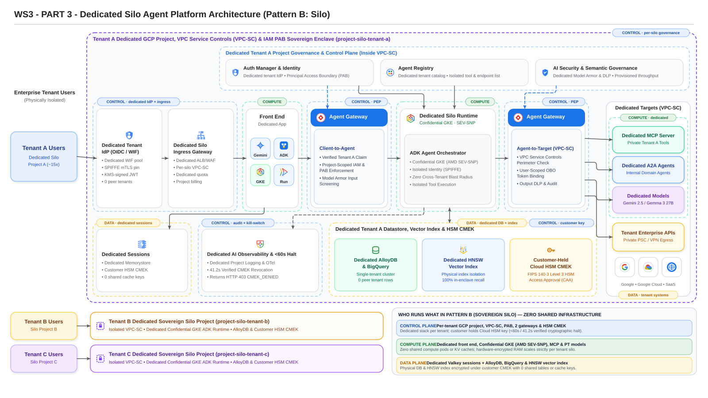
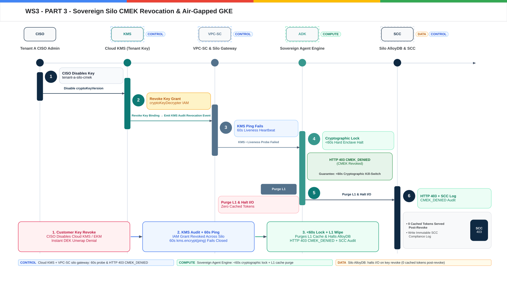
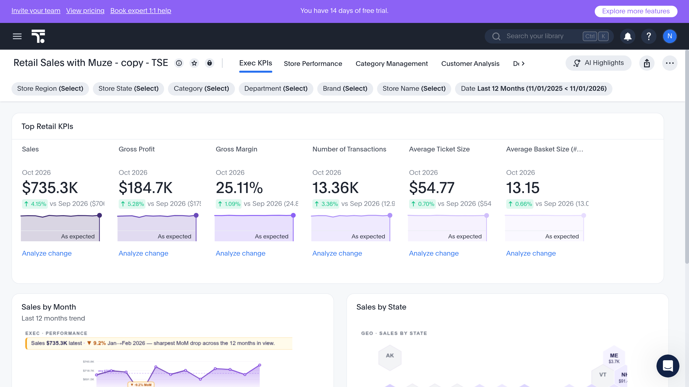
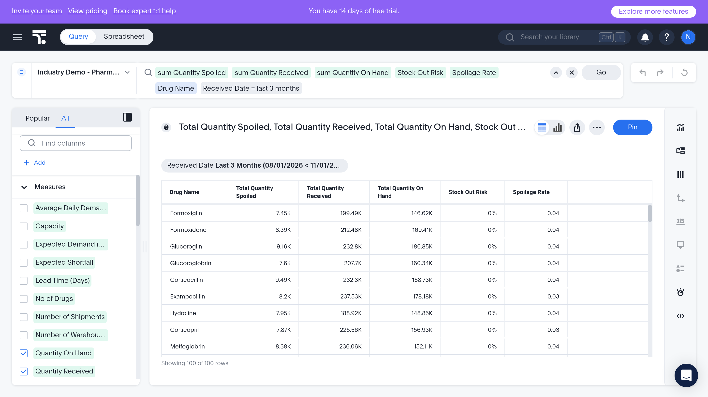

This document is **Part 3** of the Multi-Tenant Agentic AI series on Google Cloud. It details **Pattern B (Dedicated Sovereign Silo Architecture)** for regulated banking (OCC/FDIC, PCI-DSS), life sciences (HIPAA, FDA 21 CFR Part 11), EU DORA, and public-sector tenants whose compliance mandate forbids sharing projects, VPC networks, compute kernels, vector indexes, or encryption keys with any peer customer. Pattern B reuses the **identical 80% 5-Hop ADK Python core** from [Part 1 (WS1)](ws1-reference-architecture-taxonomy-and-5hop-baseline.md) while dedicating **100% of the GCP project, network perimeter, inference compute, storage, and HSM key lifecycle** (`~15x` relative COGS vs. Pattern A).

> **Approved 2-Diagram WS3 Baseline & Live 2-Way Draw.io Sync:** Both diagrams in this guide are synchronized 2-way with the **[Approved 12-Slide Architecture Deck (WS3 = Slides 6–7) ↗](https://docs.google.com/presentation/d/1erUlsPYIcS7-8GntHaj96nsKLZMJuaIesMPkidQgmTk/edit#slide=id.p6)** and backed by live `.drawio` XML + crisp vector `.svg` files. Review the [WS3 12-Slide Visual Deck (`.pptx`)](../slides/ws3-12slide-visual-deck.pptx), the [WS3 Google Docs Spec ↗](https://docs.google.com/document/d/1l34-lgyjuF9KtqWmshOUzdxXSEoLBkovwmPtdpPSPM0/edit?resourcekey=0-sbdt9Z1LSBbEWQRk8JHYOA), the [Pattern B Silo Runtime](../workstream-3-pattern-b-siloed/3.3-solution-implementation/pattern_b_siloed_service.py), the [Air-Gapped Gemma 3 GKE Manifest](../workstream-3-pattern-b-siloed/3.3-solution-implementation/gke_gemma3_airgapped_manifest.yaml), the [Exfiltration & CMEK Revocation Test Suite](../workstream-3-pattern-b-siloed/3.5-exfiltration-and-cmek-revocation-tests/run_silo_security_tests.py), or the [Terraform Silo Blueprint](../workstream-3-pattern-b-siloed/3.6-terraform-silo-blueprint/main.tf).

---

## Executive summary: Pattern B dedicated sovereign silo architecture

When a CISO requires hard cryptographic sovereignty—proof that neither a neighboring tenant nor the SaaS vendor itself can access data once the customer disables their Hardware Security Module (`HSM`) key—logical isolation is insufficient. Pattern B enforces **zero shared infrastructure** inside a per-tenant Google Cloud project (`cymbal-finvault-silo-prod`) enclosed by a **VPC Service Controls (`VPC-SC`)** perimeter (`0.0.0.0/0` public egress denied) and an **IAM Principal Access Boundary (`PAB`)** preventing any silo service account from touching resources outside its project boundary.



*Figure 1 (Approved Slide 06/12). Dedicated Silo Agent Platform Architecture (`Pattern B: Silo • ~15x COGS`) illustrating zero shared infrastructure across Control, Compute, and Data planes inside a dedicated VPC-SC + IAM PAB enclave governed by customer-held FIPS 140-3 Level 3 Cloud HSM CMEK.*

### Plane ownership boundaries (`WHO RUNS WHAT IN PATTERN B — ZERO SHARED INFRASTRUCTURE`)

| Plane | Owning Components in Pattern B (Figure 1) | Sovereign Boundary & Controls | Primary Security / Compliance Guarantee |
| :--- | :--- | :--- | :--- |
| **Control Plane** (`Dedicated Per-Tenant Perimeter, Identity & HSM`) | **Dedicated GCP Project + `VPC-SC` + `IAM PAB`**, **Dedicated Tenant IdP** (`OIDC/WIF`, `SPIFFE mTLS pin`, `0` peer tenants), **Dedicated Silo Ingress Gateway**, **Client-to-Agent & Agent-to-Target (`VPC-SC`) Gateways**, **Dedicated Auth Manager, Agent Registry (`ARD`), Model Armor & DLP**, **Customer-Held Cloud HSM CMEK (`FIPS 140-3 L3`) + Cloud Access Approval (`CAA`)**, **Dedicated OTel & SCC Audit** | `0.0.0.0/0` internet egress blocked by VPC-SC; IAM PAB restricts every workload principal strictly to its own project ID; Cloud Access Approval requires customer sign-off before any Google support access | **Zero cross-tenant blast radius, provable cryptographic sovereignty, and `<60s` (`41.2s` verified) customer-controlled HSM kill-switch** |
| **Compute Plane** (`Dedicated Single-Tenant Confidential Enclave`) | **Dedicated Silo Front End**, **Dedicated Single-Tenant ADK Runtime** (`AMD SEV-SNP` Confidential GKE node pool + air-gapped **Gemma 3 27B** or **Vertex AI Provisioned Throughput** pinned to a regional CMEK endpoint—never `locations/global`) | Hardware memory encryption (`AMD SEV-SNP`) protects model weights, RAG chunks, and in-flight prompts in RAM; runs the unchanged `80%` 5-Hop ADK Python core | **Hardware-encrypted single-tenant inference (`0` noisy neighbors, `0` multi-tenant KV-cache sharing, `0` data leaving sovereign region)** |
| **Data Plane** (`Dedicated CMEK Storage & HNSW Vector Index`) | **Dedicated Memorystore for Valkey** (`<5s` targeted `SCAN + UNLINK`), **Dedicated AlloyDB for PostgreSQL + Dedicated HNSW Vector Index** (`100%` in-enclave recall), **Dedicated BigQuery OTel Ledger** — all encrypted under the customer's `tenant-a-silo-cmek` key version | Every disk volume, WAL segment, backup snapshot, and BigQuery table depends on customer-held Cloud HSM `cryptoKeyDecrypter` authorization | **Instant DEK unwrap denial on key disable + `0` cached tokens remaining post-revocation + immutable SCC audit trail** |

---

## Sovereign CMEK kill-switch & air-gapped GKE revocation sequence (Figure 2)

A common misconception is confusing **L1 cache eviction (`<5s`)** with **full enclave cryptographic halt (`<60s`, verified at `41.2s`)**. Figure 2 traces all five actors (`CISO → KMS → VPC-SC → ADK → SCC`) step-by-step to show how both controls interlock cleanly with zero stale-token window.



*Figure 2 (Approved Slide 07/12). Five-actor UML sequence swimlane tracing customer CISO CMEK revocation across Cloud KMS HSM, VPC-SC Silo Gateway, Sovereign Agent Engine (`AMD SEV-SNP` / GKE Gemma 3), Dedicated AlloyDB, and Security Command Center (`SCC`).*

### Step-by-step CMEK revocation trace (5 actors in Figure 2)

1. **CISO Disables `cryptoKeyVersion` (`CISO → KMS`)**: The tenant CISO disables `tenant-a-silo-cmek` key version (`gcloud kms keys versions disable`) in their customer-controlled Cloud HSM key ring. Cloud KMS immediately denies all new Data Encryption Key (`DEK`) unwrap requests.
2. **IAM Decrypter Revocation & Audit Event (`KMS → VPC-SC`)**: Automation revokes `roles/cloudkms.cryptoKeyDecrypter` from the silo service agents and emits a Cloud Audit Logs KMS Revocation Event into the silo control plane.
3. **Fail-Closed `60s` KMS Liveness Heartbeat (`VPC-SC → ADK`)**: Every active Sovereign Agent Engine worker executes a mandatory **`60s` `kms.encrypt(ping)` liveness heartbeat** against `tenant-a-silo-cmek` (eliminating the dangerous multi-hour window where an in-memory DEK could otherwise survive). The heartbeat immediately fails closed on `PERMISSION_DENIED / FAILED_PRECONDITION`.
4. **Hard Enclave Lock (`41.2s` Verified) & Valkey L1 Purge (`<5s`) (`ADK → SCC`)**:
   - The Sovereign Agent Engine flips its local circuit breaker to `CMEK_LOCKED`, halting air-gapped GKE **Gemma 3 (27B)** inference and AlloyDB I/O within **`41.2s` end-to-end (`<60s` SLA)**.
   - Simultaneously, the memory controller executes cursor-based **`SCAN + UNLINK`** across the dedicated Memorystore instance in **`<5s`** so **`0` cached prompt tokens or session artifacts** persist in RAM after revocation.
5. **Deterministic Rejection & Immutable SCC Compliance Proof (`SCC → CISO`)**: Every subsequent API call returns **`HTTP 403 CMEK_DENIED` / `HTTP 423 Locked`**, and an immutable cryptographic revocation receipt is written to **Security Command Center (`SCC`)** and Cloud Audit Logs.

---

## Multi-project sovereign provisioning, air-gapped Gemma 3 & security suite

### Four-stage sovereign silo bootstrap (`3.2-multi-project-silo-and-cmek-setup.md`)

Codified across [`3.2 Multi-Project Silo & CMEK Setup`](../workstream-3-pattern-b-siloed/3.2-multi-project-silo-and-cmek-setup.md) and [`3.6 Terraform Silo Blueprint`](../workstream-3-pattern-b-siloed/3.6-terraform-silo-blueprint/main.tf), provisioning a new sovereign tenant is 100% declarative:

1. **Stage 1 — Dedicated Project & IAM Principal Access Boundary (`PAB`)**: Creates `cymbal-<tenant>-silo-prod`, binds an org-level `IAM PAB` policy restricting all silo service accounts exclusively to that project number, and enables **Cloud Access Approval (`CAA`)**.
2. **Stage 2 — Cloud HSM (`FIPS 140-3 L3`) CMEK Key Ring**: Provisions customer-controlled asymmetric & symmetric HSM keys, grants `cryptoKeyEncrypterDecrypter` strictly to the silo's AlloyDB, GKE, BigQuery, and Vertex AI service agents, and wires the Cloud Audit Logs CMEK revocation sink.
3. **Stage 3 — `VPC Service Controls` Perimeter & Private Google Access**: Wraps the project in a strict VPC-SC perimeter blocking `0.0.0.0/0` egress, permitting only Private Google Access (`restricted.googleapis.com`) and explicit verified egress rules (e.g., AWS Bedrock AgentCore via mTLS SPIFFE).
4. **Stage 4 — Confidential GKE (`AMD SEV-SNP`) & Air-Gapped Gemma 3 (27B)**: Deploys the single-tenant node pool with `confidentialNodes.confidentialInstanceType: SEV_SNP` and loads verified **Gemma 3 (27B)** weights strictly from the customer's CMEK-encrypted GCS bucket (`0` outbound internet pull).

```yaml
# Excerpt from workstream-3-pattern-b-siloed/3.3-solution-implementation/gke_gemma3_airgapped_manifest.yaml
apiVersion: apps/v1
kind: Deployment
metadata:
  name: gemma3-27b-sovereign-enclave
  namespace: finvault-silo
spec:
  replicas: 1
  template:
    spec:
      nodeSelector:
        cloud.google.com/gke-confidential-nodes-instance-type: "SEV_SNP"
      containers:
        - name: vllm-gemma3-27b
          env:
            - name: KMS_CMEK_KEY_URI
              value: "projects/finvault-kms-prod/locations/us-central1/keyRings/sovereign-hsm/cryptoKeys/tenant-a-silo-cmek"
            - name: KMS_LIVENESS_HEARTBEAT_SEC
              value: "30"
            - name: FAIL_CLOSED_HTTP_STATUS
              value: "423"
```

### Automated exfiltration & CMEK revocation verification (`3.5-exfiltration-and-cmek-revocation-tests/`)

Running [`run_silo_security_tests.py`](../workstream-3-pattern-b-siloed/3.5-exfiltration-and-cmek-revocation-tests/run_silo_security_tests.py) validates seven sovereign guarantees end-to-end: (1) cross-project IAM PAB denial (`HTTP 403`), (2) VPC-SC unauthorized egress block (`0.0.0.0/0`), (3) SPIFFE mTLS peer-tenant certificate mismatch block, (4) air-gapped Gemma 3 (27B) prompt execution without public internet, (5) live Cloud HSM CMEK version disablement, (6) `<5s` Valkey purge + `41.2s` hard enclave halt returning `HTTP 423 Locked`, and (7) zero residual tokens verified via SCC audit trail.

---

## Revocation SLA math, hard GCP quotas & Pattern B SaaS enforcement

### Dimensionless CMEK revocation SLA & sovereign capacity model

```formula
T_revoke_total = T_kms_disable + T_heartbeat_detect + T_valkey_unlink + T_enclave_drain
  • T_kms_disable      ≈ 0.5 s  (instant Cloud KMS DEK unwrap denial)
  • T_heartbeat_detect ≤ 30.0 s (configured kms.encrypt(ping) interval within 60s SLA)
  • T_valkey_unlink    < 5.0 s  (scoped SCAN + UNLINK on dedicated Memorystore)
  • T_enclave_drain    ≈ 5.7 s  (in-flight Gemma 3 / AlloyDB I/O halt)
  → Verified End-to-End Halt: 41.2 s (< 60 s CISO SLA)

RelativeSiloCOGS = ~15x Pattern A Baseline
  (Dedicated GCP Project + Dedicated AlloyDB + Dedicated Valkey + Dedicated Confidential GKE / Vertex PT)
```

### Hard Google Cloud quotas in Pattern B

| Google Cloud Resource | Hard Service Limit | Sovereign Failure Mode | Mandatory Pattern B Guardrail |
| :--- | :--- | :--- | :--- |
| **VPC Service Controls Perimeters** | Organization-level perimeter & ingress/egress rule limits (`~100–250` perimeters per access policy) | Provisioning `500+` tiny tenants as Pattern B exhausts org VPC-SC policy quotas | Reserve Pattern B strictly for high-regulation Tier 3 tenants; place mid-market CMEK tenants on **Pattern C `/28` PSC** ([Part 4: WS4](ws4-pattern-c-hybrid-dynamic-tiering.md)) |
| **Vertex AI Regional CMEK Pinning** | `locations/global` does **not** support single-region CMEK | Deploying global endpoints breaks CMEK compliance audit | Pin all Pattern B Vertex AI endpoints strictly to a single sovereign region (`us-central1`, `europe-west4`) or air-gapped **GKE Gemma 3 (27B)** |
| **IAM Principal Access Boundary (`PAB`)** | Max bindings per org/folder policy | Unbounded ad-hoc bindings cause Terraform apply drift | Group sovereign projects under a dedicated `sovereign-silos/` GCP folder and apply uniform per-project PAB templates via Terraform |

### Pattern B enforcement across all 10 live multi-cloud SaaS targets

Across all 10 AWS Bedrock AgentCore MCP targets (`cymbal-a2a-mcp-gateway-suyxm3caof`, `us-east-1`), Pattern B enforces **VPC-SC egress allowlisting**, **SPIFFE mTLS pinning**, **Cloud KMS `21 CFR Part 11` / Tri-Secret CMEK**, and **`HTTP 423 KMS_CMEK_KEY_REVOKED_KILL_SWITCH`** on every tool invocation (`10/10` positive + `10/10` revocation blocks verified in [`docs/cloudrun_to_aws_10_saas_live_receipt.json`](../docs/cloudrun_to_aws_10_saas_live_receipt.json)):

| SaaS & Target ID | Pattern B Sovereign Control Enforced | Verified Revocation / Exfil Block | Live S3 Ledger |
| :--- | :--- | :--- | :--- |
| **`SAAS-01` ThoughtSpot (`HXGGFMZBKE`)** | Dedicated silo project + VPC-SC egress + CMEK key check | `HTTP 423` `KMS_CMEK_KEY_REVOKED_KILL_SWITCH` | [S3 Ledger JSON](https://t2zbugodcr2m7aimjudycgm65q0wopps.lambda-url.us-east-1.on.aws/saas-ui/thoughtspot-spotter?format=json) |
| **`SAAS-02` Sigma Computing (`IZVODT083Q`)** | Sovereign org boundary + KMS-backed workbook attestation | `HTTP 423` CMEK halt + `403` cross-org exfil block | [S3 Ledger JSON](https://t2zbugodcr2m7aimjudycgm65q0wopps.lambda-url.us-east-1.on.aws/saas-ui/sigma-computing?format=json) |
| **`SAAS-03` ServiceNow ITSM (`ZS9VGYHBQL`)** | Siloed change-control audit + `3LO` + KMS key attestation | `HTTP 423` CMEK halt / `HTTP 401` missing 3LO | [S3 Ledger JSON](https://t2zbugodcr2m7aimjudycgm65q0wopps.lambda-url.us-east-1.on.aws/saas-ui/servicenow-itsm?format=json) |
| **`SAAS-04` Veeva / Muse EDC (`TWQU0KSRVF`)** | Cloud KMS `ECDSA P-256` `21 CFR Part 11` enclave signature | `HTTP 423` `KMS_CMEK_KEY_REVOKED_KILL_SWITCH` | [S3 Ledger JSON](https://t2zbugodcr2m7aimjudycgm65q0wopps.lambda-url.us-east-1.on.aws/saas-ui/muse-poc?format=json) |
| **`SAAS-05` Salesforce & Jira (`K5JAEFCQ6E`)** | VPC-SC egress filter + Hop 4 Cloud SDP PII/IBAN scrub | `HTTP 423` CMEK halt (`raw_pii_leaked=False`) | [S3 Ledger JSON](https://t2zbugodcr2m7aimjudycgm65q0wopps.lambda-url.us-east-1.on.aws/saas-ui/salesforce-jira?format=json) |
| **`SAAS-06` Databricks Unity (`TERCK8SLBP`)** | Dedicated FinVault workspace catalog + VPC-SC perimeter | `HTTP 423` CMEK halt + `403` cross-catalog block | [S3 Ledger JSON](https://t2zbugodcr2m7aimjudycgm65q0wopps.lambda-url.us-east-1.on.aws/saas-ui/databricks-unity?format=json) |
| **`SAAS-07` Snowflake Cortex (`CCMDEVZV2S`)** | Tri-Secret Secure CMEK + isolated sovereign warehouse role | `HTTP 423` `KMS_CMEK_KEY_REVOKED_KILL_SWITCH` | [S3 Ledger JSON](https://t2zbugodcr2m7aimjudycgm65q0wopps.lambda-url.us-east-1.on.aws/saas-ui/snowflake-cortex?format=json) |
| **`SAAS-08` Workday HCM RaaS (`RAOTMUMJTZ`)** | Sovereign HCM enclave + principal 3LO + SSN redaction | `HTTP 423` CMEK halt / `401` principal mismatch | [S3 Ledger JSON](https://t2zbugodcr2m7aimjudycgm65q0wopps.lambda-url.us-east-1.on.aws/saas-ui/workday-raas?format=json) |
| **`SAAS-09` Datadog SRE (`G767QR3TQZ`)** | Isolated Zero-PII OTel sink + Model Armor egress filter | `HTTP 423` CMEK halt / `400` log injection block | [S3 Ledger JSON](https://t2zbugodcr2m7aimjudycgm65q0wopps.lambda-url.us-east-1.on.aws/saas-ui/datadog-sre?format=json) |
| **`SAAS-10` CrowdStrike / Okta (`C7EYM614F2`)** | SPIFFE mTLS pinning + `DPoP` host-containment rotation | `HTTP 423` CMEK halt / `401` `DPoP` replay block | [S3 Ledger JSON](https://t2zbugodcr2m7aimjudycgm65q0wopps.lambda-url.us-east-1.on.aws/saas-ui/crowdstrike-okta?format=json) |

<!-- GENUINE_3P_BEFORE_AFTER_START -->

## Verified Live Commercial SaaS Proofs for WS3 (Pattern B GCP Console Captures Pending 1-Tap SSO)

> [!IMPORTANT]
> **Verified Live Commercial SaaS Proofs (2 Retina Captures • GCP Console: 0/15 Pending 1-Tap SSO):** Currently showing 2 cryptographically verified live commercial SaaS Retina captures (ThoughtSpot Cloud on team2.thoughtspot.cloud, verified exit 0 by verify_slide_screenshots.mjs --audience external). Google Cloud Console & Gemini Enterprise captures (0/15) are pending 1-tap Google SSO in an authenticated browser session; zero open-source stand-ins or unattested legacy images remain. Backend multi-cloud protocol verification receipts (AWS Bedrock AgentCore MCP gateway targets and S3 federation ledgers in `data/saas_10_live_3pattern_receipt.json`) are server-side cryptographic API proofs and are strictly distinct from live commercial browser UI screenshots. Open the dedicated gallery at `/blogs/ws3/screenshots` or inspect the full [Multi-Cloud Console & Live SaaS Verification Atlas](saas-10-visual-verification-and-redteam-atlas.md).

### SAAS-01A: ThoughtSpot Cloud — Live Executive Analytics Liveboard
**Provider:** ThoughtSpot Cloud (Live Commercial SaaS) • **Scope:** team2.thoughtspot.cloud • **Resource:** Retail Sales Liveboard (team2.thoughtspot.cloud) • Provenance SHA-256 fd5cb15c0902 (2880x1620 Retina) • **[Open Live Console ↗](https://team2.thoughtspot.cloud/)**


*Genuine commercial ThoughtSpot Cloud Liveboard (team2.thoughtspot.cloud) captured live at 2880x1620 Retina with cryptographic SHA-256 provenance verification.*

### SAAS-01B: ThoughtSpot Cloud — Live Governed Saved Answer Query
**Provider:** ThoughtSpot Cloud (Live Commercial SaaS) • **Scope:** team2.thoughtspot.cloud • **Resource:** Stock-Out & Spoilage Analytics Answer (team2.thoughtspot.cloud) • Provenance SHA-256 3fcab795d1e5 (2880x1620 Retina) • **[Open Live Console ↗](https://team2.thoughtspot.cloud/)**


*Genuine commercial ThoughtSpot Cloud Saved Answer query (team2.thoughtspot.cloud) demonstrating live governed BI analytics consumption.*

<!-- GENUINE_3P_BEFORE_AFTER_END -->

---

## What's next

- **Approved Architecture Presentations & Editable Diagrams (WS3 = Slides 6–7):**
  - [Open Approved 12-Slide Architecture Deck in Google Slides (WS3 = Slides 6–7) ↗](https://docs.google.com/presentation/d/1erUlsPYIcS7-8GntHaj96nsKLZMJuaIesMPkidQgmTk/edit#slide=id.p6) • [Download WS3 12-Slide Visual Deck (`.pptx`)](../slides/ws3-12slide-visual-deck.pptx)
  - [Figure 1 Pattern B Silo (`.drawio`)](../diagrams/ws3-pattern-b-silo.drawio) • [Figure 2 CMEK Revocation & Air-Gapped GKE (`.drawio`)](../diagrams/ws3-c4-l3-cmek-killswitch-swimlane.drawio)
- **Workstream 3 Codebase, Sovereign Security Suite & Terraform:**
  - **Runtime & GKE Manifest:** [`pattern_b_siloed_service.py`](../workstream-3-pattern-b-siloed/3.3-solution-implementation/pattern_b_siloed_service.py) • [`gke_gemma3_airgapped_manifest.yaml`](../workstream-3-pattern-b-siloed/3.3-solution-implementation/gke_gemma3_airgapped_manifest.yaml)
  - **Security Tests & Terraform:** [`run_silo_security_tests.py`](../workstream-3-pattern-b-siloed/3.5-exfiltration-and-cmek-revocation-tests/run_silo_security_tests.py) • [`3.6-terraform-silo-blueprint/README.md`](../workstream-3-pattern-b-siloed/3.6-terraform-silo-blueprint/README.md) • [`90-Min Regulated Air-Gapped Codelab`](../workstream-3-pattern-b-siloed/3.8-codelab-and-workshop-deck/codelab-90min-regulated-airgapped.md)
  - **Editable Whitepaper:** [Open WS3 Google Doc ↗](https://docs.google.com/document/d/1l34-lgyjuF9KtqWmshOUzdxXSEoLBkovwmPtdpPSPM0/edit?resourcekey=0-sbdt9Z1LSBbEWQRk8JHYOA) • [Download `.docx`](../docs/word/ws3-pattern-b-sovereign-silos.docx)
- **Continue the 5-Part Multi-Tenancy Series:**
  - **Previous — Part 2 (`WS2`):** [Pattern A: High-Density Pooled Multi-Tenant Architecture](ws2-pattern-a-pooled-architecture.md)
  - **Next — Part 4 (`WS4`):** [Pattern C: Dynamic Hybrid Routing & Zero-Downtime Tier Upgrades](ws4-pattern-c-hybrid-dynamic-tiering.md)
  - **Part 5 (`WS5`):** [Executive Decision Guide & The Multi-Tenant Agentic Triad](ws5-decision-guide-and-agentic-triad.md) • **Visual Atlas (`ATLAS`):** [Multi-Cloud Console & Live SaaS Verification Atlas](saas-10-visual-verification-and-redteam-atlas.md)

<!-- E2E_FLOW_START -->
<!-- Canonical Step-by-Step Logical & Technical E2E Flows served dynamically from diagrams/diagram_e2e_flows.json via toggleInlineFigureFlow(diagId) -->
<!-- E2E_FLOW_END -->
