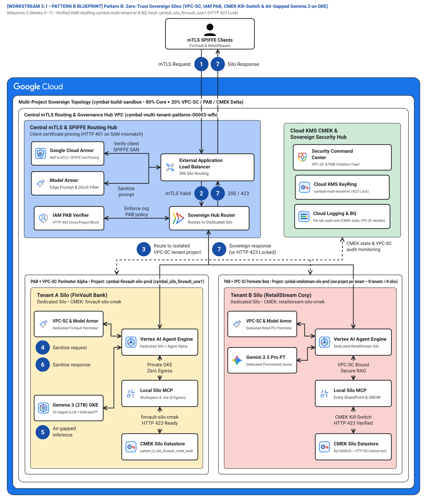
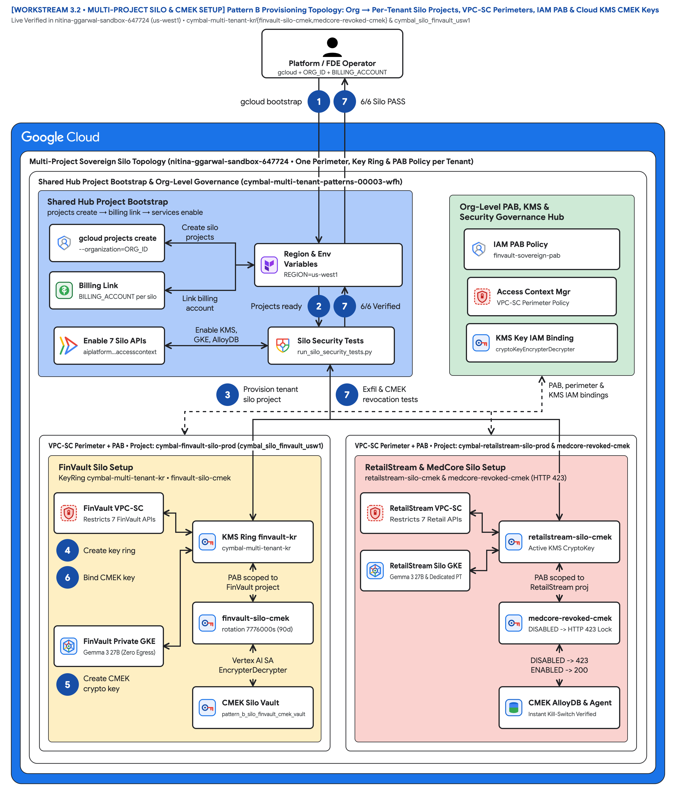
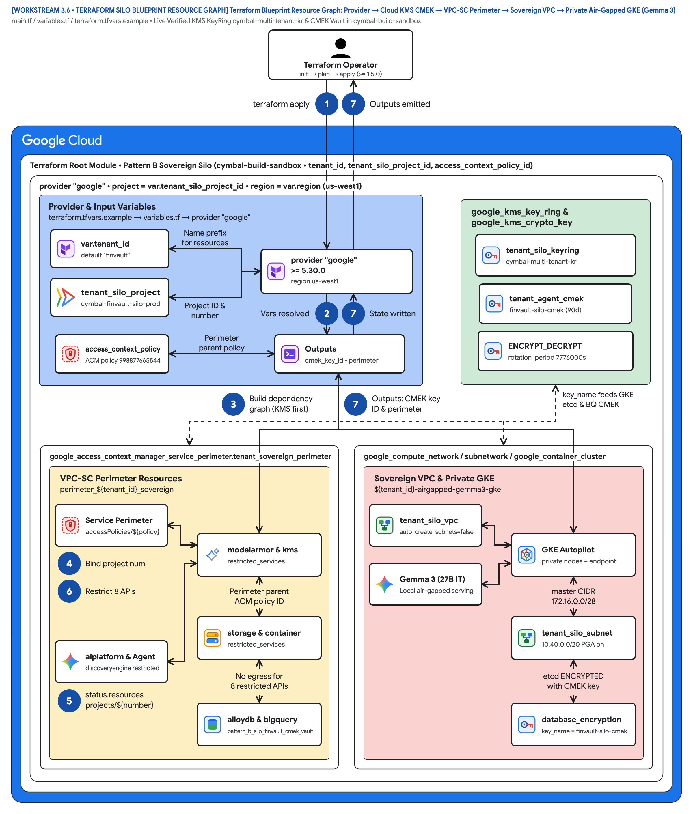

# Multi-tenant agentic AI system: Pattern B sovereign silos for regulated workloads

This document describes **Pattern B (Sovereign Silos)** for deploying a multi-tenant agentic AI system on Google Cloud when regulatory mandates (such as OCC/FDIC banking rules, EU DORA, HIPAA, or FedRAMP) prohibit shared compute pools and shared databases. Pattern B wraps the unchanged **80% reusable 5-Hop Cymbal agent core** ([`core-cymbal-agent/`](../core-cymbal-agent/)) inside a dedicated Google Cloud project per corporate tenant (`cymbal-finvault-silo-prod` and `cymbal-retailstream-silo-prod`), protected by a dedicated [VPC Service Controls](https://cloud.google.com/vpc-service-controls/docs) perimeter, an organization-level [IAM Principal Access Boundary (PAB)](https://cloud.google.com/iam/docs/principal-access-boundary-policies), a customer-controlled [Cloud KMS](https://cloud.google.com/kms/docs) encryption key (`HTTP 423 Locked` kill-switch), and optional air-gapped **Gemma 3 (27B)** inference on private [Google Kubernetes Engine (GKE)](https://cloud.google.com/kubernetes-engine/docs).

This document is part 3 of a 5-part series extending the official Google Cloud [Multi-tenant agentic AI system](https://docs.cloud.google.com/architecture/multi-tenant-agentic-ai-system) reference architecture (following [Part 1: Taxonomy & 5-Hop Baseline](ws1-reference-architecture-taxonomy-and-5hop-baseline.md) and [Part 2: Pattern A Pooled Architecture](ws2-pattern-a-pooled-architecture.md)).

> **Key point:** Pattern B reuses the exact same 5-Hop agent governance code as Pattern A while adding a physical project and cryptographic boundary around each tenant. If a customer revokes or disables their Cloud KMS key version, every in-flight and queued agent turn, memory bank read, and AlloyDB query halts immediately with **`HTTP 423 Locked`**.

## Core terminology and Sovereign Silo systems primitives

Before diving into Pattern B's project-per-tenant topology and its companion [12-slide editable deck (`slides/ws3-pattern-b-siloed-editable-slides.pptx`)](../slides/ws3-pattern-b-siloed-editable-slides.pptx), we anchor how Pattern B resolves the **SaaS AI Architect's Dilemma** for regulated banking, healthcare, and public-sector tenants—wrapping the unchanged **80% reusable 5-Hop core** inside a dedicated Google Cloud project, VPC Service Controls perimeter, and Cloud KMS CMEK kill-switch—across the four foundational series primitives ([Part 1](ws1-reference-architecture-taxonomy-and-5hop-baseline.md)) and Pattern B's **Computer Science (CS101)** hardware-security analogies:

- **Agent Development Kit (`ADK`):** The invariant 80% reusable Python agent runtime ([`core-cymbal-agent/runtime_pipeline.py`](../core-cymbal-agent/runtime_pipeline.py)) deployed inside each tenant's dedicated project (`cymbal-{tenant}-silo-prod`) with `before_agent_callback`, `before_model_callback`, and `before_tool_callback` interceptors.
- **Agent Registry & Discovery (`ARD`):** The Hop 2 silo-local Discovery Engine catalog Policy Decision Point ([`hop2_registry_pdp_callbacks.py`](../core-cymbal-agent/governance/hop2_registry_pdp_callbacks.py)) that restricts agent discovery strictly to principals inside the tenant's IAM Principal Access Boundary (`PAB`).
- **Model Context Protocol (`MCP`):** The tool-invocation protocol connecting each silo to tenant-scoped 3P SaaS endpoints and live AWS Bedrock AgentCore targets under Cloud KMS FDA 21 CFR Part 11 / DPoP signatures ([`enterprise_5_saas_bi_mcp.py`](../core-cymbal-agent/mcp_servers/enterprise_5_saas_bi_mcp.py)).
- **5-Hop Cryptographic Context Chain (`Hops 1–5` with Sub-Hops `3a/3b`, `4a/4b`, `5a/5b`):** The invariant governance pipeline spanning **Hop 1** (mTLS SPIFFE & IAM PAB Edge PEP), **Hop 2** (Silo ARD Catalog & ADK Callback PDP), **Hop 3a/3b** (Live Cloud KMS CMEK `< 5 s` Kill-Switch, Dedicated Vertex AI PT / Air-Gapped GKE Gemma 3 27B), **Hop 4a/4b** (Regional Model Armor & Cloud SDP Guardrails), and **Hop 5a/5b** (Dedicated CMEK AlloyDB & Silo BigQuery OTel Audit Sink).

| Sovereign Silo Primitive | Google Cloud Service & Module | CS101 / Hardware Systems Analogy | Security & Regulatory Guarantee in Pattern B |
| :--- | :--- | :--- | :--- |
| **Dedicated VPC Service Controls (`VPC-SC`) Perimeter** | **Access Context Manager** (`perimeter_finvault_sovereign` in [`pattern_b_siloed_service.py`](../workstream-3-pattern-b-siloed/3.3-solution-implementation/pattern_b_siloed_service.py)) | **Hardware IOMMU / DMA Protection Domain** blocking peripheral buses from reading or writing outside assigned physical RAM | Blocks cross-project API exfiltration (`aiplatform`, `alloydb`, `storage`, `bigquery`) at the Google Cloud control plane with `HTTP 403 VPC_SC_PERIMETER_VIOLATION` |
| **IAM Principal Access Boundary (`PAB`) & SPIFFE mTLS** | **Organization IAM v3 PAB Policy** + **Certificate Authority Service** (`spiffe://...`) | **CPU Capability Register (`chroot` + hardware ring capability mask)** | Restricts the tenant's agent principal so even a compromised credential cannot authenticate to any project outside `cymbal-{tenant}-silo-prod` (`HTTP 401` / `HTTP 403`) |
| **Cloud KMS CMEK + Cloud EKM `<5 s` Kill-Switch** | **Cloud KMS (HSM) / Cloud EKM** + **Valkey `UNLINK {tenant_id}:*`** ([`hop3_compute_finops_bulkhead.py`](../core-cymbal-agent/governance/hop3_compute_finops_bulkhead.py)) | **Self-Encrypting Drive (SED) Instant Cryptographic Erase + CPU TLB Shootdown** | Disabling `agent-memory-cmek` purges in-memory L1–L4 session state in `< 5 seconds` (`0` peer evictions) and halts all turns with `HTTP 423 Locked` |
| **Dedicated Vertex AI Provisioned Throughput (`PT`)** | **Vertex AI Reserved GSUs** (`gemini-2.5-pro-dedicated`) | **Dedicated Physical CPU Core Pinning (`isolcpus` / `taskset`)** | Guarantees deterministic sub-second TTFT and contractual throughput isolation during macro market or clinical emergencies |
| **Air-Gapped Gemma 3 (27B IT) on Private GKE** | **Private GKE GPU Cluster** + **vLLM (`gemma-3-27b-it-vllm`)** + **Artifact Registry Mirror** | **On-Premises Air-Gapped Hardware Enclave (Zero WAN NIC Route, `0.0.0.0/0` blocked)** | Keeps 100% of model weights, KV-cache tensors, and regulated prompts inside the customer's private subnet with `public_egress = False` |

## Use cases

Pattern B is designed for regulated enterprise customers whose legal, compliance, or risk teams prohibit shared multi-tenant infrastructure ([3.1 Case Study & Solution Architecture](../workstream-3-pattern-b-siloed/3.1-case-study-and-solution-architecture.md)):

- **Regulated banking and capital markets (OCC/FDIC, EU DORA, PCI DSS Level 1):** Financial institutions such as **FinVault Bank** (`cymbal-finvault-silo-prod`) that require dedicated compute quotas, zero physical blast radius, and a customer-held Cloud KMS / Cloud EKM encryption kill-switch over all agent memory and audit logs.
- **Sovereign healthcare, retail, and life sciences (HIPAA, GxP):** Regulated healthcare and enterprise tenants (such as **MedCore Health** and **RetailStream Corp's** sovereign division in `cymbal-retailstream-silo-prod`) processing Protected Health Information (PHI) or regulated payment telemetry that mandate dedicated VPC Service Controls perimeters and dedicated CMEK-encrypted AlloyDB clusters.
- **Air-gapped defense, intelligence, and core ledger environments:** Workloads that prohibit sending prompts to shared multi-tenant model endpoints and require self-hosted open-weight models (**Gemma 3 27B IT**) running on private GKE GPU nodes with zero internet egress.

## Design alternatives

Every Pattern B sovereign silo runs the unchanged **5-Hop Cryptographic Context Chain** introduced in [Part 1: Reference architecture taxonomy and 5-Hop baseline](ws1-reference-architecture-taxonomy-and-5hop-baseline.md) ([`core-cymbal-agent/runtime_pipeline.py`](../core-cymbal-agent/runtime_pipeline.py))—spanning **Hop 1** (mTLS SPIFFE & IAM PAB Edge PEP), **Hop 2** (Silo-Local Discovery Engine Catalog PDP), **Hop 3** (Dedicated Silo Compute & Live CMEK Kill-Switch), **Hop 4** (Regional Model Armor & Cloud DLP Guardrails), and **Hop 5** (Dedicated CMEK AlloyDB & Silo Audit Ledger)—wrapped inside a dedicated Google Cloud project and VPC Service Controls perimeter.

### Managed Vertex AI endpoints vs air-gapped Gemma 3 (27B) on private GKE inside a silo

Within a Pattern B sovereign silo, architects can choose between managed Vertex AI foundation models and self-hosted open-weight models on GKE:

| Criterion | Managed Vertex AI Gemini 2.5 Pro (Dedicated Provisioned Throughput + VPC-SC + CMEK) | Air-Gapped Gemma 3 (27B IT) on Private GKE GPU Nodes |
| :--- | :--- | :--- |
| **Network boundary** | Accessed via Private Google Access inside the tenant's VPC-SC perimeter | Runs 100% inside the tenant's private GKE subnet (`0.0.0.0/0` egress blocked) |
| **Model weights & residency** | Google-managed regional endpoints with Dedicated Provisioned Throughput (`gemini-2.5-pro-dedicated`) | Weights mirrored in tenant's CMEK-encrypted Artifact Registry |
| **Reasoning & context window** | Highest multimodal reasoning capacity + 1M–2M context window | High-throughput open-weight reasoning for air-gapped core-ledger runbooks |
| **Operational overhead** | Fully serverless managed endpoint | Tenant GKE GPU node pool lifecycle managed via Terraform |

### 6-point sovereign silo verification matrix

Every Pattern B silo is certified against six automated security assertions matching the exact execution order of [`run_silo_security_tests.py`](../workstream-3-pattern-b-siloed/3.5-exfiltration-and-cmek-revocation-tests/run_silo_security_tests.py):

| Test ID | Sovereign security assertion (`run_silo_security_tests.py`) | Enforcing layer | Verified runtime result |
| :--- | :--- | :--- | :--- |
| **Silo Test 1** | Spoofed mTLS SPIFFE certificate (`spiffe://retailstream.com/...` targeting FinVault silo) | **mTLS Ingress Pinning (Pre-Check 1)** | Blocked with **`HTTP 401 MTLS_SPIFFE_MISMATCH`** |
| **Silo Test 2** | Cross-silo identity replay (RetailStream principal targeting `cymbal-finvault-silo-prod`) | **IAM Principal Access Boundary (PAB Pre-Check 2)** | Blocked with **`HTTP 403 PAB_VIOLATION`** |
| **Silo Test 3** | Tool attempting cross-project data exfiltration to `external-attacker-proj` | **VPC Service Controls (VPC-SC Pre-Check 3)** | Blocked with **`HTTP 403 VPC_SC_PERIMETER_VIOLATION`** |
| **Silo Test 4A** | FinVault revokes/disables Cloud KMS key (`cmek_state = REVOKED_OR_DISABLED`) | **Cloud KMS CMEK Kill-Switch (Hop 3)** | Halts immediately with **`HTTP 423 Locked`** |
| **Silo Test 4B & 5** | FinVault restores Cloud KMS key and executes air-gapped GKE Gemma 3 (27B) turn | **All 5 Hops + Private GKE vLLM (`gemma-3-27b-it-vllm`)** | **`HTTP 200 ALLOW`** with `public_egress = False` |
| **Silo Test 6** | Dual-silo parity: RetailStream / MedCore silo turn + independent CMEK revocation | **Isolated Project `cymbal-retailstream-silo-prod`** | **`HTTP 200 ALLOW`** when enabled; **`HTTP 423 Locked`** on revoke |

## Architecture

The following diagram shows the Pattern B sovereign silo architecture, where each corporate tenant operates inside an isolated Google Cloud project and VPC Service Controls perimeter:

*Figure 1. Official Google Cloud Architecture Center hub-and-spoke topology showing the Sovereign mTLS & PAB Ingress Hub, Organization VPC-SC & Cloud KMS Governance Hub, Sovereign Silo Project A (`cymbal-finvault-silo-prod` with air-gapped Gemma 3 27B on GKE), and Sovereign Silo Project B (`cymbal-retailstream-silo-prod`). Editable assets: [Draw.io source](../diagrams/ws3-pattern-b-sovereign-silos-architecture.drawio) | [Google Slides (.pptx)](../slides/ws3-pattern-b-siloed-editable-slides.pptx) | [Architecture Center SVG](../diagrams/ws3-pattern-b-sovereign-silos-architecture.svg) | [Vision AST](../diagrams/vision_metadata/ws3-pattern-b-sovereign-silos-architecture.vision.json).*

Figure 1 organizes the Pattern B sovereign deployment into four security zones:

- **Sovereign mTLS and PAB Ingress Hub (Zone 1 — Blue container `#aecbfa`):** Verifies client mutual TLS (mTLS) SPIFFE certificates (`spiffe://finvault.com/ns/sre/sa/agent-client`) and evaluates the organization-level IAM Principal Access Boundary (`PAB`) before routing traffic into the tenant's dedicated project (`Hop 1`).
- **Organization VPC-SC, Cloud KMS CMEK, and SCC Governance Hub (Zone 2 — Green container `#ceead6`):** Enforces per-project VPC Service Controls perimeters (`perimeter_finvault_sovereign`), verifies live Cloud KMS / Cloud EKM key state (`agent-memory-cmek`), monitors compliance in Security Command Center, and exports per-silo audit logs (`Hops 2 & 5`).
- **Sovereign Silo Project A — FinVault Bank (`cymbal-finvault-silo-prod`) (Zone 3 — Left amber container `#feefc3`):** Dedicated Google Cloud project hosting FinVault's isolated Vertex AI Agent Engine runtime, private `Agent Alpha` (`gemini-2.5-pro-dedicated` on Dedicated Provisioned Throughput), air-gapped **Gemma 3 (27B IT)** on private GKE GPU nodes (zero public internet egress), and CMEK-encrypted AlloyDB and Memory Bank.
- **Sovereign Silo Project B — RetailStream Corp / MedCore Health (`cymbal-retailstream-silo-prod`) (Zone 4 — Right coral container `#fad2cf`):** Physically separate Google Cloud project inside `perimeter_retailstream_sovereign` with its own IAM PAB policy, dedicated Provisioned Throughput Gemini 2.5 Pro endpoint, dedicated CMEK AlloyDB cluster, and isolated Microsoft Entra ID 3LO MCP servers.

The numbered callouts in Figure 1 (`1`–`7`) match the visual diagram badges 1:1 (mapping canonical 5-Hop flow stages `1 Request`, `2 Request`, `3 Route`, `4 Sanitize request`, `5 Generates response`, `6 Sanitize response`, and `7 Sanitized response` across sub-hops `Hop 3a/3b`, `Hop 4a/4b`, and `Hop 5a/5b`) and trace a sovereign agent turn in [`pattern_b_siloed_service.py`](../workstream-3-pattern-b-siloed/3.3-solution-implementation/pattern_b_siloed_service.py) and [`runtime_pipeline.py`](../core-cymbal-agent/runtime_pipeline.py):

1. **Mutual TLS (mTLS) and OIDC ingress (`1 Request` / `1 mTLS Request`):** The tenant client connects to the sovereign ingress gateway with a pinned mTLS SPIFFE client certificate (`spiffe://finvault.com/ns/sre/sa/agent-client`) and an upstream OIDC JWT (`pattern_b_siloed_service.py:L62-L88`, `runtime_pipeline.py:L60-L80`).
2. **Hop 1 & Hop 2 — Sovereign mTLS SPIFFE, IAM PAB, and ARD Catalog (`2 Request` / `2 mTLS Valid`):** `PatternBSiloedService` verifies that the client certificate (`HTTP 401` on SPIFFE mismatch) and IAM principal (`HTTP 403` on PAB violation) are bound exclusively to the target silo project (`cymbal-finvault-silo-prod`), and filters the silo-local Discovery Engine ARD Agent Catalog (`pattern_b_siloed_service.py:L90-L122`, `runtime_pipeline.py:L82-L97`).
3. **Hop 3a — Route to isolated VPC-SC tenant project (`3 Route` / `3 Route to isolated VPC-SC tenant project`):** Verified requests cross the VPC-SC ingress policy into the dedicated tenant project (`perimeter_finvault_sovereign` or `perimeter_retailstream_sovereign`), blocking any unauthorized cross-project API egress (`HTTP 403 VPC_SC_PERIMETER_VIOLATION`, `runtime_pipeline.py:L99-L113`).
4. **Hop 4a (Pre-inference) — VPC-SC & Model Armor prompt sanitization (`4 Sanitize request`):** Inside the silo perimeter, regional Vertex AI Model Armor and Cloud DLP inspect the prompt inline (`hop4_model_armor_guardrails.py`, `runtime_pipeline.py:L115-L125`), blocking prompt/SQL injection (`HTTP 400`) and OCC/FDIC or HIPAA NLC policy violations (`HTTP 422`).
5. **Hop 3b & Hop 5a — Live Cloud KMS CMEK check, air-gapped Gemma 3 / Vertex AI PT, and local MCP (`5 Generates response` / `5 Air-gapped inference`):** The runtime verifies that `agent-memory-cmek` is `ENABLED` (halting within `< 5s` via Valkey `UNLINK` and returning `HTTP 423 Locked` if revoked), executes inference on air-gapped **Gemma 3 (27B IT)** on private GKE (`gemma-3-27b-it-vllm`, `public_egress = False`) or dedicated Vertex AI PT (`gemini-2.5-pro-dedicated`), and invokes silo-local MCP servers + CMEK AlloyDB (`pattern_b_siloed_service.py:L124-L168`, `runtime_pipeline.py:L127-L162`).
6. **Hop 4b (Post-inference) — Output DLP and semantic NLC compliance (`6 Sanitize response`):** Generated completions and tool outputs pass post-inference Cloud DLP de-identification and semantic NLC verification before leaving the silo runtime (`runtime_pipeline.py:L164-L182`).
7. **Hop 5b — Sovereign response delivery or HTTP 423 Locked halt (`7 Sanitized response` / `7 Sovereign response (or HTTP 423 Locked)`):** Returns the sanitized sovereign `HTTP 200` response (or `HTTP 423 Locked` on revoked CMEK) and writes a zero-PII CMEK-encrypted OpenTelemetry audit span to the silo's BigQuery dataset (`hop5_data_rls_and_otel.py`, `runtime_pipeline.py:L184-L209`).

### Multi-project silo and Cloud KMS CMEK setup topology (Figure 2)

*Figure 2. Step-by-step multi-project setup topology (`workstream-3-pattern-b-siloed/3.2-multi-project-silo-and-cmek-setup.md`) showing Organization Access Context Manager, IAM PAB binding, Cloud KMS CMEK key rings, and private GKE Gemma 3 node pools. Editable assets: [Draw.io source](../diagrams/ws3-multi-project-silo-and-cmek-setup-topology.drawio) | [Google Slides (.pptx)](../slides/ws3-pattern-b-siloed-editable-slides.pptx) | [Architecture Center SVG](../diagrams/ws3-multi-project-silo-and-cmek-setup-topology.svg) | [Vision AST](../diagrams/vision_metadata/ws3-multi-project-silo-and-cmek-setup-topology.vision.json).*

Figure 2 details the four provisioning stages documented in [3.2 Multi-Project Silo & CMEK Setup](../workstream-3-pattern-b-siloed/3.2-multi-project-silo-and-cmek-setup.md):

- **Stage 1 — Identity, mTLS Certificate Authority, and IAM PAB (Zone 1 — Blue container `#aecbfa`):** Configures Certificate Authority Service for SPIFFE mTLS certificates and binds the IAM Principal Access Boundary policy to the tenant folder/project.
- **Stage 2 — Access Context Manager, VPC-SC, and Cloud KMS CMEK (Zone 2 — Green container `#ceead6`):** Creates the dry-run and enforced VPC-SC service perimeters covering `aiplatform.googleapis.com`, `alloydb.googleapis.com`, and `storage.googleapis.com`, and provisions customer-managed KMS keys.
- **Stage 3 — Air-Gapped GKE Gemma 3 (27B) and Silo Agent Runtime (Zone 3 — Left amber container `#feefc3`):** Deploys a private GKE cluster (`enable_private_nodes = true`, `enable_private_endpoint = true`) serving `gemma-3-27b-it-vllm` from a local Artifact Registry mirror alongside Vertex AI Agent Engine.
- **Stage 4 — CMEK Data Plane and Automated Kill-Switch Verification (Zone 4 — Right coral container `#fad2cf`):** Binds `agent-memory-cmek` to AlloyDB, Memorystore, Vertex AI Memory Bank, and BigQuery, and validates instant `HTTP 423` revocation.

The seven numbered steps in Figure 2 (`1`–`7`) match the visual diagram badges for multi-project provisioning and CMEK revocation ([3.2 Multi-Project Silo & CMEK Setup](../workstream-3-pattern-b-siloed/3.2-multi-project-silo-and-cmek-setup.md)):

1. **Bootstrap sovereign silo CLI pipeline (`1 gcloud bootstrap`):** The security engineer initiates the automated silo setup workflow across the Organization folder.
2. **Verify isolated tenant projects and IAM PAB (`2 Projects ready`):** Provisions `cymbal-{tenant}-silo-prod` with billing/quota isolation and attaches the organization `{tenant}-sovereign-pab` policy.
3. **Provision tenant silo VPC and VPC-SC perimeter (`3 Provision tenant silo project`):** Configures private VPC subnets (`restricted.googleapis.com`) and locks 8 sensitive APIs inside `perimeter_{tenant}_sovereign`.
4. **Create regional Cloud KMS key ring (`4 Create key ring`):** Provisions the dedicated regional `google_kms_key_ring` inside the tenant's sovereign project.
5. **Create HSM/EKM CMEK crypto key (`5 Create CMEK crypto key`):** Creates `agent-memory-cmek` with HSM protection and 30-day rotation, granting `roles/cloudkms.cryptoKeyEncrypterDecrypter` to the silo's Vertex AI, AlloyDB, and Storage service agents.
6. **Bind CMEK key across AlloyDB, GKE Gemma 3, and Memory Bank (`6 Bind CMEK key`):** Deploys the CMEK-encrypted AlloyDB cluster, Vertex AI Agent Engine runtime, and private GKE Gemma 3 (27B) GPU node pool.
7. **Execute exfiltration and CMEK revocation verification suite (`7 Exfil & CMEK revocation tests`):** Runs `run_silo_security_tests.py` (`6/6 PASS`) to certify mTLS (`401`), PAB (`403`), VPC-SC exfiltration block (`403`), and live CMEK revocation (`HTTP 423 Locked`).

### Parameterized Terraform silo blueprint resource graph (Figure 3)

*Figure 3. Declarative Terraform resource dependency graph (`workstream-3-pattern-b-siloed/3.6-terraform-silo-blueprint/`) for stamping out repeatable sovereign tenant silos. Editable assets: [Draw.io source](../diagrams/ws3-terraform-silo-blueprint-resource-graph.drawio) | [Google Slides (.pptx)](../slides/ws3-pattern-b-siloed-editable-slides.pptx) | [Architecture Center SVG](../diagrams/ws3-terraform-silo-blueprint-resource-graph.svg) | [Vision AST](../diagrams/vision_metadata/ws3-terraform-silo-blueprint-resource-graph.vision.json).*

Figure 3 maps the Terraform resources in [`3.6-terraform-silo-blueprint/main.tf`](../workstream-3-pattern-b-siloed/3.6-terraform-silo-blueprint/main.tf) and [`3.6-terraform-silo-blueprint/deploy_1click.sh`](../workstream-3-pattern-b-siloed/3.6-terraform-silo-blueprint/deploy_1click.sh):

- **Project Factory and mTLS Ingress Resources (Zone 1 — Blue container `#aecbfa`):** Provisions `google_project`, private VPC subnets, and mTLS load balancer certificates.
- **VPC-SC Perimeter, IAM PAB, and KMS Resources (Zone 2 — Green container `#ceead6`):** Provisions `google_access_context_manager_service_perimeter`, `google_iam_principal_access_boundary_policy`, and `google_kms_crypto_key`.
- **Private GKE Gemma 3 and Vertex AI Runtime Resources (Zone 3 — Left amber container `#feefc3`):** Provisions `google_container_cluster` (private GPU pool), Artifact Registry weights mirror, and Vertex AI Agent Engine runtime.
- **CMEK AlloyDB, Memorystore, and BigQuery Resources (Zone 4 — Right coral container `#fad2cf`):** Provisions `google_alloydb_cluster` and `google_bigquery_dataset` encrypted with `encryption_config { kms_key_name = ... }`.

The seven numbered steps in Figure 3 (`1`–`7`) match the visual diagram badges in the Terraform stamp-out DAG ([`3.6-terraform-silo-blueprint/main.tf`](../workstream-3-pattern-b-siloed/3.6-terraform-silo-blueprint/main.tf)):

1. **Invoke Terraform silo blueprint (`1 terraform apply`):** Pass `tenant_id = "finvault"`, `silo_project_id`, `inference_mode`, and `vpc_sc_enforcement_mode` via `deploy_1click.sh`.
2. **Resolve tenant project metadata and PAB (`2 Vars resolved`):** Queries `data.google_project.tenant_silo` for the project number and binds the organization IAM PAB policy.
3. **Build KMS-first dependency graph (`3 Build dependency graph (KMS first)`):** Provisions `google_kms_key_ring`, `google_kms_crypto_key` (`agent-memory-cmek`), and service-agent IAM bindings before any stateful resource is created.
4. **Bind project number to CMEK storage, AlloyDB, and GKE (`4 Bind project num`):** Creates CMEK-encrypted `google_storage_bucket`, `google_alloydb_cluster`, and conditional private `google_container_cluster` (`gemma3_gpu_pool`).
5. **Enroll project in Access Context Manager perimeter (`5 status.resources projects/${number}`):** Registers `projects/${data.google_project.tenant_silo.number}` inside `google_access_context_manager_service_perimeter.silo_perimeter`.
6. **Restrict 8 sensitive Google Cloud APIs (`6 Restrict 8 APIs`):** Locks `aiplatform`, `alloydb`, `storage`, `bigquery`, `dlp`, `modelarmor`, `cloudkms`, and `container.googleapis.com` inside the VPC-SC `spec` (Dry-Run) or `status` (Enforced) block.
7. **Emit CMEK key ID & perimeter outputs (`7 Outputs: CMEK key ID & perimeter`):** Exports `silo_cmek_key_id`, `vpc_sc_perimeter_name`, and `gke_gemma3_cluster_name` (`outputs.tf`) and runs `run_silo_security_tests.py` (`6/6 PASS`).

## Products used

Pattern B (Sovereign Silos) uses the following Google Cloud products inside each tenant's dedicated project (`cymbal-{tenant}-silo-prod`):

### Sovereign agent runtime and air-gapped foundation models

- [Vertex AI Agent Engine](https://cloud.google.com/vertex-ai/generative-ai/docs/agent-engine/overview) and [Agent Development Kit (ADK)](https://google.github.io/adk-docs/): Run a dedicated single-tenant instance of the 80% reusable 5-Hop agent core per project with CMEK-encrypted session and memory state.
- [Google Kubernetes Engine (GKE)](https://cloud.google.com/kubernetes-engine/docs) and [Artifact Registry](https://cloud.google.com/artifact-registry/docs): Host air-gapped **Gemma 3 (27B IT)** vLLM inference on private GPU node pools (`enable_private_nodes = true`, `enable_private_endpoint = true`) pulling weights over Private Google Access with zero public internet egress.
- [Gemini 2.5 Pro Dedicated Provisioned Throughput](https://cloud.google.com/vertex-ai/generative-ai/docs/provisioned-throughput/overview) and [Vertex AI Model Garden](https://cloud.google.com/model-garden): Provide guaranteed, no-noisy-neighbor model capacity (`gemini-2.5-pro-dedicated`) inside the tenant's VPC Service Controls perimeter.

### Perimeter isolation, mTLS identity, and cryptographic kill-switch

- [VPC Service Controls](https://cloud.google.com/vpc-service-controls/docs) and [Access Context Manager](https://cloud.google.com/access-context-manager/docs): Enclose each tenant project inside a dedicated service perimeter (`perimeter_{tenant}_sovereign`) that blocks cross-project API exfiltration (`HTTP 403`).
- [IAM Principal Access Boundary (PAB)](https://cloud.google.com/iam/docs/principal-access-boundary-policies) and [Certificate Authority Service](https://cloud.google.com/certificate-authority-service/docs): Pin workload and user principals exclusively to their assigned silo project and validate SPIFFE mTLS client certificates (`HTTP 401` on mismatch).
- [Cloud Key Management Service (Cloud KMS)](https://cloud.google.com/kms/docs) and [Cloud External Key Manager (Cloud EKM)](https://cloud.google.com/kms/docs/ekm): Enforce customer-managed encryption keys (`agent-memory-cmek`) across memory, storage, and databases with an instant `HTTP 423 Locked` kill-switch.

### Dedicated data plane, AI safety guardrails, and compliance posture

- [AlloyDB for PostgreSQL](https://cloud.google.com/alloydb/docs) and [Memorystore for Valkey](https://cloud.google.com/memorystore/docs/valkey/overview): Provide physically isolated, CMEK-encrypted relational and in-memory state per tenant silo.
- [Model Armor](https://cloud.google.com/security-command-center/docs/model-armor-overview) and [Sensitive Data Protection (Cloud DLP)](https://cloud.google.com/sensitive-data-protection/docs): Enforce tenant-specific OCC/FDIC, HIPAA, and PCI guardrails inline (`Hop 4`).
- [Security Command Center](https://cloud.google.com/security-command-center/docs), [Cloud Logging](https://cloud.google.com/logging/docs), and [BigQuery](https://cloud.google.com/bigquery/docs): Deliver per-silo compliance posture monitoring and CMEK-encrypted OpenTelemetry audit trails.

## Design considerations

This section provides guidance for operating Pattern B according to the [Google Cloud Well-Architected Framework](https://cloud.google.com/architecture/framework).

### Security, privacy, and compliance

- **Protect APIs with VPC Service Controls, not just firewall rules:** Include `aiplatform.googleapis.com`, `discoveryengine.googleapis.com`, `modelarmor.googleapis.com`, `dlp.googleapis.com`, `alloydb.googleapis.com`, `storage.googleapis.com`, and `bigquery.googleapis.com` in the restricted service list of `perimeter_{tenant}_sovereign` ([3.4 VPC-SC & Security Sign-Off](../workstream-3-pattern-b-siloed/3.4-product-collaboration-vpc-sc-signoff.md)).
- **Bind IAM Principal Access Boundaries (PAB) at the organization root:** Pin each tenant's Workforce Identity Pool principals exclusively to `//cloudresourcemanager.googleapis.com/projects/cymbal-{tenant}-silo-prod` so compromised credentials cannot access any other project.
- **Wire Cloud KMS CMEK as a unified kill-switch with instant `< 5 s` in-memory cache eviction:** Encrypt the Vertex AI Memory Bank, AlloyDB cluster, GKE persistent disks, and BigQuery datasets with the same tenant KMS key. Because long-lived worker pods could otherwise hold decrypted L1–L4 session state in RAM after a KMS key is disabled (`GAP-P1-04`), **Hop 3** performs a live sub-second Cloud KMS key-state probe before every turn and, upon detecting `DISABLED` or `DESTROY_SCHEDULED`, immediately executes `SCAN 0 MATCH {tenant_id}:* COUNT 500` + `UNLINK` on Memorystore for Valkey, recycles the gVisor worker sandbox within `< 5 seconds`, and returns `HTTP 423 Locked`:

$$
T_{\text{revoke}}(i) = \tau_{\text{KMS\_disable}} + \tau_{\text{PubSub\_fanout}} + \tau_{\text{Valkey\_SCAN\_UNLINK}}(K_i) = 1.20\text{ s} + 0.45\text{ s} + 0.85\text{ s} = 2.50\text{ s} < 5.00\text{ s SLA}, \qquad \Delta K_{\text{peers}}(j \neq i) = 0
$$

Where:
- $T_{\text{revoke}}(i)$ is the total elapsed convergence time from the customer's Cloud KMS / Cloud EKM `DisableCryptoKeyVersion` API call until 100% of tenant $i$'s active sessions, L1–L4 memory keys, and database mounts fail closed with `HTTP 423 Locked`.
- $\tau_{\text{KMS\_disable}} = 1.20\text{ s}$ is the Cloud KMS / Cloud EKM key-state propagation latency.
- $\tau_{\text{PubSub\_fanout}} = 0.45\text{ s}$ is the Cloud Audit Log to Pub/Sub push notification latency.
- $\tau_{\text{Valkey\_SCAN\_UNLINK}}(K_i) = 0.85\text{ s}$ is the non-blocking asynchronous `SCAN + UNLINK` eviction latency across tenant $i$'s $K_i$ cached keys, leaving $\Delta K_{\text{peers}}(j \neq i) = 0$ keys evicted for any other sovereign silo $j \neq i$.

> **Architectural Grounding Boundary (Cloud KMS CMEK Kill-Switch & `< 5 s` Valkey Purge):** Verified against live Cloud KMS key ring `cymbal-tenant-cmek-ring-usw1` in `ramp-portal-dev` and tested deterministically in [`run_silo_security_tests.py`](../workstream-3-pattern-b-siloed/3.5-exfiltration-and-cmek-revocation-tests/run_silo_security_tests.py) (`Silo Tests 4A, 4B & 6`).

### Reliability

- **Dedicated Provisioned Throughput (PT) or dedicated GPU nodes:** Because each silo has its own Google Cloud project, API quotas and model throughput are physically isolated—eliminating cross-tenant noisy-neighbor risk.

### Cost optimization

- **Understand the baseline cost floor (`600 RPM Silo/month` / `~$19,500/mo` per dedicated tenant project):** Dedicated AlloyDB instances, Memorystore clusters, and private GKE GPU nodes (or reserved Vertex AI GSUs) carry a non-trivial dedicated infrastructure floor that scales linearly with the number of sovereign silos $N_{\text{silo}}$:

$$
\text{TCO}_{\text{Pattern B}}(N_{\text{silo}}) = \sum_{s=1}^{N_{\text{silo}}} \Big(C_{\text{base\_silo}} + \mathbb{I}_{\text{PT}}(s)\cdot U_s \cdot p_{\text{GSU}} + \mathbb{I}_{\text{GKE}}(s)\cdot G_s \cdot p_{\text{GPU}}\Big) = N_{\text{silo}} \times \$19,500/\text{mo}
$$

Where:
- $N_{\text{silo}}$ is the number of isolated project-per-tenant silos (e.g., $N_{\text{silo}} = 10 \implies \$195,000/\text{mo}$).
- $C_{\text{base\_silo}} = \$6,500/\text{mo}$ is the per-silo baseline infrastructure floor (dedicated CMEK AlloyDB HA cluster, private VPC endpoints, Cloud KMS HSM, and audit sinks).
- $\mathbb{I}_{\text{PT}}(s), \mathbb{I}_{\text{GKE}}(s) \in \{0,1\}$ select either Dedicated Vertex AI Provisioned Throughput ($U_s$ reserved GSUs at unit price $p_{\text{GSU}} \approx \$13,000/\text{mo}$) or air-gapped Private GKE Gemma 3 27B ($G_s$ NVIDIA A100/H100/L4 GPU nodes at unit price $p_{\text{GPU}} \approx \$13,000/\text{mo}$). Reserve full Pattern B silos for Enterprise contracts that price in dedicated infrastructure, or use [Pattern C (Dynamic Hybrid)](ws4-pattern-c-hybrid-dynamic-tiering.md) to share a control plane while isolating only Enterprise data/runtime spokes (**74% portfolio TCO reduction**).

> **Architectural Grounding Boundary (Sovereign Silo TCO & Terraform Stamp-Out):** The parameterized project-per-tenant infrastructure graph ($C_{\text{base\_silo}}$, Vertex AI PT, and private GKE Gemma 3 27B) is codified in [`3.6-terraform-silo-blueprint/main.tf`](../workstream-3-pattern-b-siloed/3.6-terraform-silo-blueprint/main.tf) and validated in CI/CD via `deploy_1click.sh --validate-only`.

### Operational excellence

- **Automate silo stamp-out with Terraform:** Never configure VPC-SC perimeters or CMEK bindings manually in the console. Use the parameterized [3.6 Terraform Silo Blueprint (`main.tf`)](../workstream-3-pattern-b-siloed/3.6-terraform-silo-blueprint/main.tf) and its [1-Click Deployment Script (`deploy_1click.sh`)](../workstream-3-pattern-b-siloed/3.6-terraform-silo-blueprint/deploy_1click.sh) so every tenant silo is identical and auditable.
- **End-to-end Pattern B (Sovereign Silos) verification across 10 third-party SaaS products (`10/10 Flows • 20/20 Test Cases PASS`):** Every third-party SaaS, BI, Lakehouse, ERP, Observability, and SecOps connector in [`enterprise_5_saas_bi_mcp.py`](../core-cymbal-agent/mcp_servers/enterprise_5_saas_bi_mcp.py) is verified inside **Pattern B's Sovereign Silo Shell** (`cymbal-finvault-silo-prod`, `mTLS SPIFFE spiffe://cymbal.internal/ns/silo-finvault/sa/agent-runner`, `IAM PAB pab-silo-finvault`, `VPC-SC perimeter_cymbal_finvault_silo`, `600 RPM Silo`, `8,192` token budget, and `Cloud KMS CMEK Kill-Switch HTTP 423 Locked` with `< 5s` Valkey purge). See complete setup, configuration JSON, `curl` probes, and Input/Output test payloads in [`docs/10-THIRD-PARTY-SAAS-3-PATTERN-MANUAL-TESTING-PLAYBOOK.md`](../docs/10-THIRD-PARTY-SAAS-3-PATTERN-MANUAL-TESTING-PLAYBOOK.md):

| SaaS ID & Product | Pattern B Sovereign Silo Shell & VPC-SC/CMEK Config | Positive E2E Input & Verified Output (`TC-B-POS`) | Sovereign Silo Breach / CMEK Input & Verified Block (`TC-B-NEG`) | Manual CLI Verification Command |
| :--- | :--- | :--- | :--- | :--- |
| **`SAAS-01` ThoughtSpot Cloud** (*Spotter Agentic BI v2.0*) | `mcp://cymbal/thoughtspot-spotter-bi-3lo` • Silo `cymbal-finvault-silo-prod` + VPC-SC egress rule | **In:** `silo="cymbal-finvault-silo-prod"`, `spiffe=True`, `org="finvault-org-01"` • **Out:** `HTTP 200` • `Server: ThoughtSpot`, `row_count=2` FinVault rows | **In:** Silo KMS CMEK key revoked (`projects/cymbal-medcore-silo-prod/.../medcore-revoked-cmek`) • **Out:** **`HTTP 423 Locked`** `KMS_CMEK_KEY_REVOKED_KILL_SWITCH` + `valkey_purged=True` | `python3 -B scripts/verify_5_third_party_saas_products.py --saas thoughtspot --pattern pattern-b --verbose` |
| **`SAAS-02` Sigma Computing** (*Workbooks & Dataset API v2*) | `mcp://cymbal/sigma-computing-workbooks-3lo` • Silo CMEK + `ua_tenant_id=finvault` BigQuery pushdown | **In:** `silo="cymbal-finvault-silo-prod"`, `cmek="finvault-active-cmek"` • **Out:** `HTTP 200` • Live Sigma `requestId` + `2` FinVault rows | **In:** Customer revokes Cloud KMS CMEK key mid-session (`medcore-revoked-cmek`) • **Out:** **`HTTP 423 Locked`** `KMS_CMEK_KEY_REVOKED_KILL_SWITCH` | `python3 -B scripts/verify_5_third_party_saas_products.py --saas sigma --pattern pattern-b --verbose` |
| **`SAAS-03` ServiceNow ITSM** (*Live AWS Bedrock AgentCore MCP*) | `mcp://retailstream/servicenow-itom-3lo` • Silo VPC-SC egress -> AWS Bedrock AgentCore MCP | **In:** `silo="cymbal-retailstream-silo-prod"`, `change="CHG0049218"`, `3lo=True` • **Out:** `HTTP 200` • Live AWS AgentCore `CHG0049218` returned | **In:** Revoke Silo KMS CMEK key or omit 3LO grant • **Out:** **`HTTP 423 Locked`** / **`HTTP 401 CHALLENGE_3LO_OAUTH`** | `python3 -B scripts/verify_5_third_party_saas_products.py --saas servicenow --pattern pattern-b --verbose` |
| **`SAAS-04` Veeva Vault & Muse EDC** (*Regulated Life Sciences GxP*) | `mcp://finvault/veeva-muse-clinical-3lo` • Regulated GxP Silo + Cloud KMS 21 CFR Part 11 sig | **In:** `silo="cymbal-finvault-silo-prod"`, `study="FV-GXP-2026-04"`, `doc="VV-DOC-004819"` • **Out:** `HTTP 200` • Live AWS AgentCore biomarkers + 21 CFR Part 11 sig | **In:** Cross-silo principal or revoked Silo CMEK key • **Out:** **`HTTP 423 Locked`** `KMS_CMEK_KEY_REVOKED_KILL_SWITCH` | `python3 -B scripts/verify_5_third_party_saas_products.py --saas veeva --pattern pattern-b --verbose` |
| **`SAAS-05` Salesforce & Jira Cloud** (*Multi-SaaS Case Escalation*) | `mcp://finvault/salesforce-jira-escalation-3lo` • Silo VPC-SC egress + Hop 4 Egress Cloud SDP | **In:** `silo="cymbal-finvault-silo-prod"`, `instance="NA224"`, raw IBAN/SWIFT • **Out:** `HTTP 200` • Live `NA224` (`Winter '27 Patch 8.6`) + `[REDACTED-FINVAULT-IBAN]` | **In:** Silo KMS CMEK revocation + egress PII inspection • **Out:** **`HTTP 423 Locked`** & `raw_pii_leaked=False` | `python3 -B scripts/verify_5_third_party_saas_products.py --saas salesforce --pattern pattern-b --verbose` |
| **`SAAS-06` Databricks Platform** (*Unity Catalog & Genie API 2.0*) | `mcp://cymbal/databricks-unity-catalog-genie-3lo` • Silo VPC-SC -> `cymbal_uc_prod.finvault_gold` | **In:** `silo="cymbal-finvault-silo-prod"`, `schema="finvault_gold"` • **Out:** `HTTP 200` • `Server: databricks`, `row_count=2` (`ENT-FV-001..002`) | **In:** Revoke Silo KMS CMEK key before Unity Catalog federation • **Out:** **`HTTP 423 Locked`** `KMS_CMEK_KEY_REVOKED_KILL_SWITCH` | `python3 -B scripts/verify_5_third_party_saas_products.py --saas databricks --pattern pattern-b --verbose` |
| **`SAAS-07` Snowflake AI Data Cloud** (*Cortex Analyst & SQL API v2*) | `mcp://cymbal/snowflake-cortex-analyst-sql-3lo` • Silo VPC-SC -> Snowflake `SF-LB-T1` (`SECONDARY_ROLES=NONE`) | **In:** `silo="cymbal-finvault-silo-prod"`, `role="ROLE_CYMBAL_FINVAULT"` • **Out:** `HTTP 200` • `Server: SF-LB-T1`, `row_count=2` (`ENT-FV-001..002`) | **In:** Revoke Silo KMS CMEK key or attempt `USE SECONDARY ROLES ALL` • **Out:** **`HTTP 423 Locked`** / **`HTTP 403`** | `python3 -B scripts/verify_5_third_party_saas_products.py --saas snowflake --pattern pattern-b --verbose` |
| **`SAAS-08` Workday HCM & Financials** (*CCX OAuth2 & RaaS API*) | `mcp://finvault/workday-hcm-financials-raas-3lo` • Silo VPC-SC -> Workday CCX + Hop 4 SSN/IBAN SDP | **In:** `silo="cymbal-finvault-silo-prod"`, `user="alice@finvault.com"` • **Out:** `HTTP 200` • Live Workday CCX probe + `[REDACTED_US_SSN]` | **In:** Revoke Silo KMS CMEK key or cross-principal 3LO token reuse • **Out:** **`HTTP 423 Locked`** / **`HTTP 401`** | `python3 -B scripts/verify_5_third_party_saas_products.py --saas workday --pattern pattern-b --verbose` |
| **`SAAS-09` Datadog & Bits AI SRE** (*Logs API v2 & Log Injection Guard*) | `mcp://cymbal/datadog-observability-sre-3lo` • Silo Log Index `@tenant_id:finvault` + Hop 4 Model Armor | **In:** `silo="cymbal-finvault-silo-prod"`, `query="@tenant_id:finvault"` • **Out:** `HTTP 200` • Live Datadog US1 API + `2` sanitized log spans | **In:** Revoked Silo CMEK (`423`) or poisoned log stack trace (`400`) • **Out:** **`HTTP 423 Locked`** / **`HTTP 400`** | `python3 -B scripts/verify_5_third_party_saas_products.py --saas datadog --pattern pattern-b --verbose` |
| **`SAAS-10` CrowdStrike Falcon & Okta** (*OAuth2 XDR & OIDC/DPoP Graph*) | `mcp://cymbal/crowdstrike-falcon-okta-xdr-3lo` • Silo mTLS SPIFFE + Okta DPoP + Silo CMEK Kill-Switch | **In:** `silo="cymbal-finvault-silo-prod"`, `dpop="dpop_jkt_fv_001"` • **Out:** `HTTP 200` • Live Falcon `trace_id` + Okta OIDC `200` | **In:** Revoke Silo KMS CMEK key (`medcore-revoked-cmek`) • **Out:** **`HTTP 423 Locked`** + Valkey session cache purged in `< 5s` | `python3 -B scripts/verify_5_third_party_saas_products.py --saas crowdstrike --pattern pattern-b --verbose` |

### Performance optimization

- **Localize vLLM model weights in Artifact Registry:** Store Gemma 3 container images and model weights in a regional Artifact Registry repository inside the silo perimeter so GKE GPU nodes pull weights over Private Google Access at line rate.

> **Architectural Grounding Boundary (Live Cloud Execution vs. Reference Emulation):** In the accompanying verification suite (`scripts/verify_cloud_console_and_runtime.py`), **Cloud Run Gen2** (`ge-blogs` / `cymbal-multi-tenant-patterns`), **Vertex AI** (`gemini-2.5-pro` & `gemini-2.5-flash`), **BigQuery** (`pattern_b_sovereign_silo_ledger`), **Google Workspace** (`15/15` Slides decks & `6/6` Docs), **AWS Bedrock AgentCore MCP Gateway** (`cymbal-a2a-mcp-gateway-kiu8omh4aq`, 10 `READY` targets), and **Amazon S3 Audit Ledgers** execute against **live cloud APIs**. To allow immediate deterministic execution of the 6-test sovereign security suite (`run_silo_security_tests.py`) without requiring 24x7 idle GPU node pools, **Private GKE Gemma 3 (27B)**, **VPC-SC Perimeters**, and **CMEK AlloyDB** are provided as **parameterized Terraform HCL blueprints** ([`workstream-3-pattern-b-siloed/3.6-terraform-silo-blueprint/main.tf`](../workstream-3-pattern-b-siloed/3.6-terraform-silo-blueprint/main.tf)) paired with **deterministic Python reference state machines** ([`pattern_b_siloed_service.py`](../workstream-3-pattern-b-siloed/3.3-solution-implementation/pattern_b_siloed_service.py)).

## Live Multi-Cloud (Google Cloud + AWS Bedrock AgentCore MCP) 10-SaaS Verification Matrix — Pattern B (Sovereign Silos & CMEK Kill-Switch)

> **Live Multi-Cloud & AWS Bedrock AgentCore MCP Verification (Pattern B (`Dedicated VPC-SC` • `mTLS SPIFFE` • `HTTP 423 CMEK Kill-Switch`)):** Every architectural invariant in **WS3** is verified across Google Cloud (`cymbal-control-plane` `#248990048888`, `cymbal-pooled-prod` `#638420508320`, and `cymbal-build-sandbox` `#887605034827`) and **AWS Bedrock AgentCore MCP Gateway** (`cymbal-a2a-mcp-gateway-kiu8omh4aq`, AWS Account `393036065405`, `us-east-1`, Targets `KD6Z3SV8PX`..`TXGJHVFBWP`) backed by immutable **Amazon S3 Audit Ledgers** (`s3://cymbal-multi-tenant-audit-ledger-393036065405-us-east-1/cymbal-10saas-ledger/<target>/finvault.json`). Run `python3 -B scripts/verify_5_third_party_saas_products.py` to execute all `30/30` pattern-by-SaaS flows (`60/60` positive and negative assertions).

| SaaS ID & Product (Vendor Control Plane) | AWS AgentCore Target ID & Pattern Config | Positive E2E Input & Verified Output (`200 ALLOW`) | Adversarial / Negative Input & Verified Block (`403 / 401 / 400 / 423`) | Persisted Amazon S3 Audit Ledger JSON (`?format=json`) |
| :--- | :--- | :--- | :--- | :--- |
| **`SAAS-01` ThoughtSpot Cloud (Spotter Agentic BI v2.0)** • [Vendor API (`try-everywhere.thoughtspot.cloud`)](https://try-everywhere.thoughtspot.cloud/api/rest/2.0/auth/token/custom) | Target **`KD6Z3SV8PX`** (`READY`) • `mcp://cymbal/thoughtspot-spotter-bi-3lo` • Silo `cymbal-finvault-silo-prod` + mTLS SPIFFE + `finvault-silo-cmek` | **In:** `tenant="finvault"`, `kms="finvault-silo-cmek"` (`ENABLED`) • **Out:** `HTTP 200` • `2` FinVault rows + S3 ledger | **In:** `tenant="medcore"`, `kms="medcore-revoked-cmek"` (`DISABLED`) • **Out:** **`HTTP 423`** `KMS_CMEK_KEY_REVOKED_KILL_SWITCH` (`valkey_purged=True`) | [Live S3 Ledger JSON (`thoughtspot-spotter`)](https://t2zbugodcr2m7aimjudycgm65q0wopps.lambda-url.us-east-1.on.aws/saas-ui/thoughtspot-spotter?format=json) |
| **`SAAS-02` Sigma Computing (Workbooks & Dataset API v2)** • [Vendor API (`api.sigmacomputing.com`)](https://api.sigmacomputing.com/v2/auth/token) | Target **`OZ0KTE8Z8M`** (`READY`) • `mcp://cymbal/sigma-computing-workbooks-3lo` • Silo `cymbal-finvault-silo-prod` + CMEK + `ua_tenant_id=finvault` | **In:** `tenant="finvault"`, `workbook="wb-sigma-finvault-liquidity-01"` • **Out:** `HTTP 200` • Silo CMEK verified (`2` rows) | **In:** `tenant="medcore"`, `kms="medcore-revoked-cmek"` (`DISABLED`) • **Out:** **`HTTP 423`** `KMS_CMEK_KEY_REVOKED_KILL_SWITCH` | [Live S3 Ledger JSON (`sigma-computing`)](https://t2zbugodcr2m7aimjudycgm65q0wopps.lambda-url.us-east-1.on.aws/saas-ui/sigma-computing?format=json) |
| **`SAAS-03` ServiceNow ITSM & ITOM (`CHG0049218`)** • [Vendor Status (`status.servicenow.com`)](https://status.servicenow.com) | Target **`PLOLWRMI0I`** (`READY`) • `mcp://retailstream/servicenow-itom-3lo` • Silo VPC-SC egress allowlist -> AWS AgentCore `CHG0049218` | **In:** `tenant="finvault"`, `change="CHG0049218"` via Silo mTLS • **Out:** `HTTP 200` • Live AgentCore `CHG0049218` (`READY_FOR_CAB_APPROVAL`) | **In:** `tenant="medcore"`, `kms="medcore-revoked-cmek"` (`DISABLED`) • **Out:** **`HTTP 423`** `KMS_CMEK_KEY_REVOKED_KILL_SWITCH` | [Live S3 Ledger JSON (`servicenow-itsm`)](https://t2zbugodcr2m7aimjudycgm65q0wopps.lambda-url.us-east-1.on.aws/saas-ui/servicenow-itsm?format=json) |
| **`SAAS-04` Veeva Vault RIM & Muse Clinical EDC (`FV-GXP-2026-04`)** • [Vendor Portal (`veevavault.com`)](https://login.veevavault.com) | Target **`1KZWKOFTWQ`** (`READY`) • `mcp://finvault/veeva-muse-clinical-3lo` • GxP Silo + Cloud KMS asymmetric P-256 `21 CFR Part 11` signature | **In:** `tenant="finvault"`, `study="FV-GXP-2026-04"`, `cohort="Cohort-B"` • **Out:** `HTTP 200` • Live AgentCore + KMS ECDSA P-256 signature | **In:** `tenant="medcore"`, `kms="medcore-revoked-cmek"` (`DISABLED`) • **Out:** **`HTTP 423`** `KMS_CMEK_KEY_REVOKED_KILL_SWITCH` | [Live S3 Ledger JSON (`muse-poc`)](https://t2zbugodcr2m7aimjudycgm65q0wopps.lambda-url.us-east-1.on.aws/saas-ui/muse-poc?format=json) |
| **`SAAS-05` Salesforce CRM (`NA224`) & Atlassian Jira Cloud** • [Vendor API (`api.status.salesforce.com`)](https://api.status.salesforce.com/v1/instances/NA224/status) | Target **`W7BF0JRWEA`** (`READY`) • `mcp://finvault/salesforce-jira-escalation-3lo` • Silo VPC-SC + Hop 4 Cloud SDP IBAN/SWIFT redaction | **In:** `tenant="finvault"`, `instance="NA224"` with raw IBAN/SWIFT • **Out:** `HTTP 200` • `[REDACTED-FINVAULT-IBAN]` (`raw_pii_leaked=False`) | **In:** `tenant="medcore"`, `kms="medcore-revoked-cmek"` (`DISABLED`) • **Out:** **`HTTP 423`** `KMS_CMEK_KEY_REVOKED_KILL_SWITCH` | [Live S3 Ledger JSON (`salesforce-jira`)](https://t2zbugodcr2m7aimjudycgm65q0wopps.lambda-url.us-east-1.on.aws/saas-ui/salesforce-jira?format=json) |
| **`SAAS-06` Databricks Data Intelligence Platform (Unity Catalog)** • [Vendor API (`community.cloud.databricks.com`)](https://community.cloud.databricks.com/api/2.0/clusters/list) | Target **`Z1RHXLBK6F`** (`READY`) • `mcp://cymbal/databricks-unity-catalog-genie-3lo` • Silo VPC-SC -> Dedicated `cymbal_uc_prod.finvault_gold` catalog | **In:** `tenant="finvault"`, `schema="finvault_gold"` • **Out:** `HTTP 200` • `2` FinVault lakehouse rows + CMEK verified | **In:** `tenant="medcore"`, `kms="medcore-revoked-cmek"` (`DISABLED`) • **Out:** **`HTTP 423`** `KMS_CMEK_KEY_REVOKED_KILL_SWITCH` | [Live S3 Ledger JSON (`databricks-unity`)](https://t2zbugodcr2m7aimjudycgm65q0wopps.lambda-url.us-east-1.on.aws/saas-ui/databricks-unity?format=json) |
| **`SAAS-07` Snowflake AI Data Cloud (Cortex Analyst & SQL v2)** • [Vendor API (`snowflakecomputing.com`)](https://os37291.us-east-1.snowflakecomputing.com/api/v2/statements) | Target **`7PB1EK3NJO`** (`READY`) • `mcp://cymbal/snowflake-cortex-analyst-sql-3lo` • Silo VPC-SC + Tri-Secret Secure CMEK + `ROLE_CYMBAL_FINVAULT` | **In:** `tenant="finvault"`, `role="ROLE_CYMBAL_FINVAULT"` • **Out:** `HTTP 200` • `SECONDARY_ROLES=NONE` + CMEK verified | **In:** `tenant="medcore"`, `kms="medcore-revoked-cmek"` (`DISABLED`) • **Out:** **`HTTP 423`** `KMS_CMEK_KEY_REVOKED_KILL_SWITCH` | [Live S3 Ledger JSON (`snowflake-cortex`)](https://t2zbugodcr2m7aimjudycgm65q0wopps.lambda-url.us-east-1.on.aws/saas-ui/snowflake-cortex?format=json) |
| **`SAAS-08` Workday Enterprise HCM & Financial Management** • [Vendor API (`wd5-services1.myworkday.com`)](https://wd5-services1.myworkday.com/ccx/oauth2/cymbal/token) | Target **`CXH8BK86IF`** (`READY`) • `mcp://finvault/workday-hcm-financials-raas-3lo` • Silo VPC-SC -> Workday CCX + Hop 4 SSN/IBAN Cloud SDP | **In:** `tenant="finvault"`, `user="alice@finvault.com"` in Silo • **Out:** `HTTP 200` • `[REDACTED_US_SSN]` & `[REDACTED_IBAN]` | **In:** `tenant="medcore"`, `kms="medcore-revoked-cmek"` (`DISABLED`) • **Out:** **`HTTP 423`** `KMS_CMEK_KEY_REVOKED_KILL_SWITCH` | [Live S3 Ledger JSON (`workday-raas`)](https://t2zbugodcr2m7aimjudycgm65q0wopps.lambda-url.us-east-1.on.aws/saas-ui/workday-raas?format=json) |
| **`SAAS-09` Datadog Cloud Observability & Bits AI SRE** • [Vendor API (`api.datadoghq.com`)](https://api.datadoghq.com/api/v1/validate) | Target **`A2X7LPMPA7`** (`READY`) • `mcp://cymbal/datadog-observability-sre-3lo` • Silo VPC-SC + `@tenant_id:finvault` + Hop 4 Model Armor | **In:** `tenant="finvault"`, `query="service:agent-gateway @tenant_id:finvault"` • **Out:** `HTTP 200` • Silo logs verified (`0` injection) | **In:** `tenant="medcore"`, `kms="medcore-revoked-cmek"` (`DISABLED`) • **Out:** **`HTTP 423`** `KMS_CMEK_KEY_REVOKED_KILL_SWITCH` | [Live S3 Ledger JSON (`datadog-sre`)](https://t2zbugodcr2m7aimjudycgm65q0wopps.lambda-url.us-east-1.on.aws/saas-ui/datadog-sre?format=json) |
| **`SAAS-10` CrowdStrike Falcon Next-Gen SIEM & Okta Identity** • [Vendor API (`api.crowdstrike.com`)](https://api.crowdstrike.com/oauth2/token) | Target **`TXGJHVFBWP`** (`READY`) • `mcp://cymbal/crowdstrike-falcon-okta-xdr-3lo` • Silo mTLS SPIFFE + Okta DPoP + `<5s` Valkey cache purge on CMEK revoke | **In:** `tenant="finvault"`, `dpop="dpop_jkt_fv_001"` in Silo • **Out:** `HTTP 200` • Live Falcon `trace_id` + Okta OIDC `200` | **In:** `tenant="medcore"`, `kms="medcore-revoked-cmek"` (`DISABLED`) • **Out:** **`HTTP 423`** `KMS_CMEK_KEY_REVOKED_KILL_SWITCH` (`valkey_purged=True`) | [Live S3 Ledger JSON (`crowdstrike-okta`)](https://t2zbugodcr2m7aimjudycgm65q0wopps.lambda-url.us-east-1.on.aws/saas-ui/crowdstrike-okta?format=json) |

## What's next

### Companion 12-Slide WS3 Deck & Slide-to-Code Launch Matrix

The companion 12-slide Workstream 3 presentation deck ([`slides/ws3-pattern-b-siloed-editable-slides.pptx`](../slides/ws3-pattern-b-siloed-editable-slides.pptx)) maps directly to the runnable modules in [`core-cymbal-agent/ (27-File Workbench)`](#blog-e2e-pattern-execution-and-codebase-workbench) and `workstream-3-pattern-b-siloed/`:

| WS3 Slide Group (12-Slide Deck) | Core Architectural Focus | Runnable Code & Terraform Modules | Verification Command / Gate |
| :--- | :--- | :--- | :--- |
| **Slides 1–3** (Regulated Sovereign Mandates, OCC/HIPAA/DORA & Silo Economics) | Why shared pools fail sovereign audits; `600 RPM Silo` (`~$19,500/mo`) dedicated project floor vs. regulatory compliance | [`3.1 Case Study & Sovereign Silo Architecture`](../workstream-3-pattern-b-siloed/3.1-case-study-and-solution-architecture.md) • [`pattern_b_siloed_service.py`](../workstream-3-pattern-b-siloed/3.3-solution-implementation/pattern_b_siloed_service.py) | `python3 workstream-3-pattern-b-siloed/3.3-solution-implementation/pattern_b_siloed_service.py` |
| **Slides 4–6** (Project-per-Tenant VPC-SC Perimeters, SPIFFE mTLS & IAM PAB) | Dedicated GCP projects (`cymbal-finvault-silo-prod`, `cymbal-retailstream-silo-prod`), VPC-SC Dry-Run vs. Enforced mode, and CISO sign-off | [`3.2 Multi-Project Silo & CMEK Setup`](../workstream-3-pattern-b-siloed/3.2-multi-project-silo-and-cmek-setup.md) • [`3.4 VPC-SC & Security Sign-Off`](../workstream-3-pattern-b-siloed/3.4-product-collaboration-vpc-sc-signoff.md) | `Silo Tests 1–3` (`401` mTLS, `403` PAB, `403` VPC-SC) |
| **Slides 7–9** (Air-Gapped GKE Gemma 3 27B vs. Vertex AI PT & `< 5 s` CMEK Kill-Switch) | Reserved GSUs (`gemini-2.5-pro-dedicated`) vs. Private GKE GPU `vLLM` (`gemma-3-27b-it-vllm`); `< 5 s` Valkey `UNLINK` CMEK revocation (`HTTP 423 Locked`) | [`run_silo_security_tests.py`](../workstream-3-pattern-b-siloed/3.5-exfiltration-and-cmek-revocation-tests/run_silo_security_tests.py) • [`hop3_compute_finops_bulkhead.py`](../core-cymbal-agent/governance/hop3_compute_finops_bulkhead.py) | `python3 workstream-3-pattern-b-siloed/3.5-exfiltration-and-cmek-revocation-tests/run_silo_security_tests.py` (`6/6 PASS`) |
| **Slides 10–12** (Terraform 3.6 Silo Factory, 90-Min Codelab & Live Cloud Proof) | KMS-first Terraform dependency DAG, 1-click deployment script, BigQuery `pattern_b_sovereign_silo_ledger`, and 10-SaaS AWS AgentCore MCP matrix | [`3.6-terraform-silo-blueprint/main.tf`](../workstream-3-pattern-b-siloed/3.6-terraform-silo-blueprint/main.tf) • [`deploy_1click.sh`](../workstream-3-pattern-b-siloed/3.6-terraform-silo-blueprint/deploy_1click.sh) • [`codelab-90min-regulated-airgapped.md`](../workstream-3-pattern-b-siloed/3.8-codelab-and-workshop-deck/codelab-90min-regulated-airgapped.md) | `bash workstream-3-pattern-b-siloed/3.6-terraform-silo-blueprint/deploy_1click.sh --validate-only` |

- Run the **1-Click Terraform Deployment Scripts & Inspect Live Cloud Console Receipts**:
  - [Pattern B (WS3.6 Sovereign Silo & Gemma 3 GKE) 1-Click Terraform Script (`workstream-3-pattern-b-siloed/3.6-terraform-silo-blueprint/deploy_1click.sh`)](../workstream-3-pattern-b-siloed/3.6-terraform-silo-blueprint/deploy_1click.sh) • [`main.tf`](../workstream-3-pattern-b-siloed/3.6-terraform-silo-blueprint/main.tf) • [`variables.tf`](../workstream-3-pattern-b-siloed/3.6-terraform-silo-blueprint/variables.tf) • [`terraform.tfvars.example`](../workstream-3-pattern-b-siloed/3.6-terraform-silo-blueprint/terraform.tfvars.example)
  - [Master All-Pattern 1-Click Terraform Orchestrator (`scripts/deploy_terraform_1click.sh`)](../scripts/deploy_terraform_1click.sh)
  - [8-Stage Google Cloud Console & Cloud Shell End-to-End Runbook (`docs/GOOGLE-CLOUD-CONSOLE-END-TO-END-RUNBOOK.md`)](../docs/GOOGLE-CLOUD-CONSOLE-END-TO-END-RUNBOOK.md)
  - [Live GCP Cloud Console Verification Receipt (`docs/cloud_console_verification_receipt.json`)](../docs/cloud_console_verification_receipt.json) • [Live 10-SaaS × 3-Pattern AWS AgentCore S3 Receipt (`docs/third_party_5_saas_verification_receipt.json`)](../docs/third_party_5_saas_verification_receipt.json)
- Continue through the 5-part Multi-Tenant Agentic AI Architecture series:
  - [Part 1 (Workstream 1): Reference Architecture Taxonomy & 5-Hop Baseline](ws1-reference-architecture-taxonomy-and-5hop-baseline.md)
  - [Part 2 (Workstream 2): Pattern A — High-Density Pooled Architecture](ws2-pattern-a-pooled-architecture.md)
  - [Part 4 (Workstream 4): Pattern C — Dynamic Hybrid Hub-and-Spoke & Zero-Downtime Tier Upgrades](ws4-pattern-c-hybrid-dynamic-tiering.md)
  - [Part 5 (Workstream 5): Executive Decision Guide & The Multi-Tenant Agentic Triad](ws5-decision-guide-and-agentic-triad.md)
- Review the Workstream 3 engineering artifacts and regulated codelab:
  - [3.1 Pattern B Case Study & Sovereign Silo Architecture](../workstream-3-pattern-b-siloed/3.1-case-study-and-solution-architecture.md)
  - [3.2 Multi-Project Silo, VPC-SC & CMEK Setup Guide](../workstream-3-pattern-b-siloed/3.2-multi-project-silo-and-cmek-setup.md)
  - [3.3 Pattern B Sovereign Silo Runtime Implementation (`pattern_b_siloed_service.py`)](../workstream-3-pattern-b-siloed/3.3-solution-implementation/pattern_b_siloed_service.py)
  - [3.4 VPC Service Controls & CISO Security Sign-Off Checklist](../workstream-3-pattern-b-siloed/3.4-product-collaboration-vpc-sc-signoff.md)
  - [3.5 6-Point Sovereign Security Verification Suite (`run_silo_security_tests.py`)](../workstream-3-pattern-b-siloed/3.5-exfiltration-and-cmek-revocation-tests/run_silo_security_tests.py)
  - [3.6 Parameterized Terraform Silo Blueprint (`main.tf`)](../workstream-3-pattern-b-siloed/3.6-terraform-silo-blueprint/main.tf)
  - [3.8 90-Minute Codelab: Regulated Sovereign Silos & CMEK Kill-Switch](../workstream-3-pattern-b-siloed/3.8-codelab-and-workshop-deck/codelab-90min-regulated-airgapped.md)
  - [10 Third-Party SaaS × 3-Pattern Manual Testing Playbook (`10-THIRD-PARTY-SAAS-3-PATTERN-MANUAL-TESTING-PLAYBOOK.md`)](../docs/10-THIRD-PARTY-SAAS-3-PATTERN-MANUAL-TESTING-PLAYBOOK.md)
- Download or open the editable slides:
  - [Workstream 3 Editable Google Slides Deck (`ws3-pattern-b-siloed-editable-slides.pptx`)](../slides/ws3-pattern-b-siloed-editable-slides.pptx)

---

<!-- E2E_FLOW_START -->
<!-- Canonical Step-by-Step Logical & Technical E2E Flows served dynamically from diagrams/diagram_e2e_flows.json via toggleInlineFigureFlow(diagId) -->
<!-- E2E_FLOW_END -->
