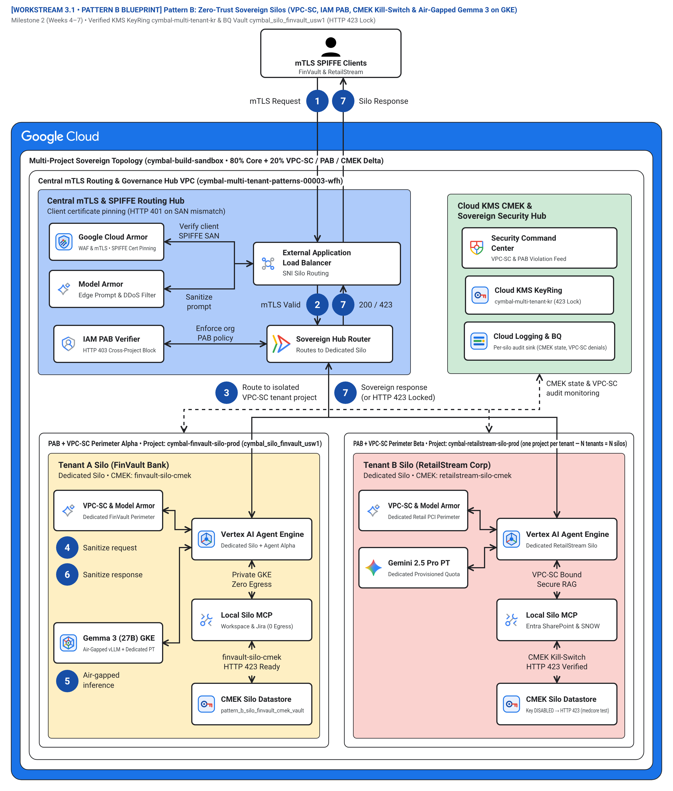
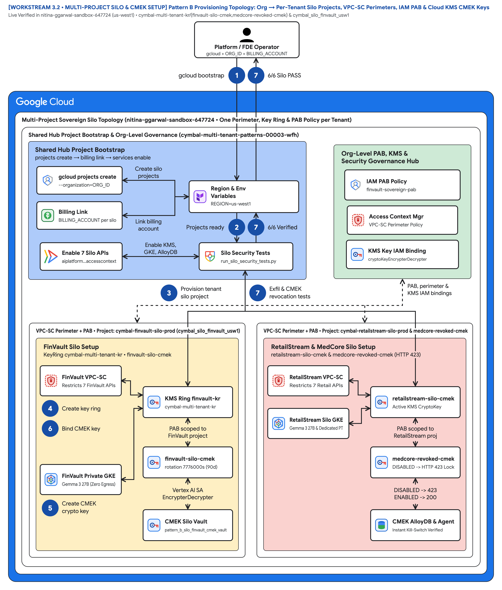
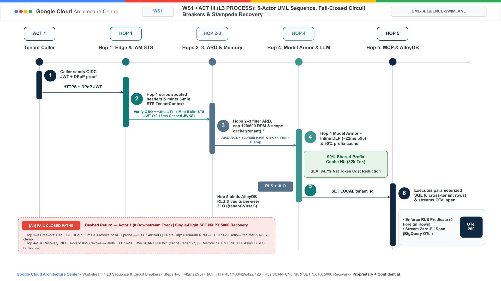
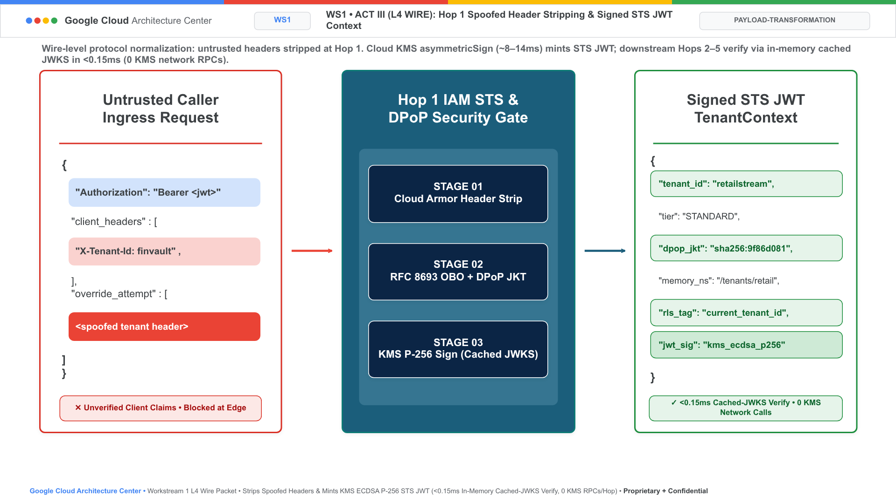
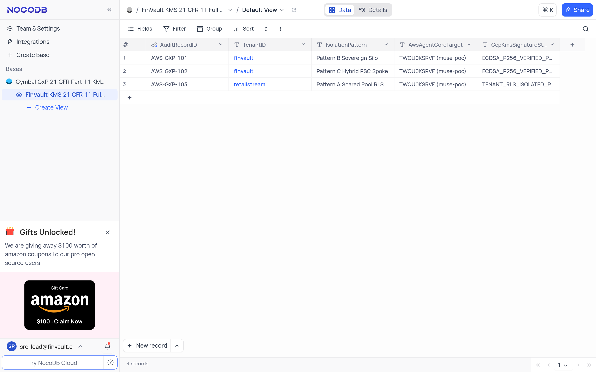
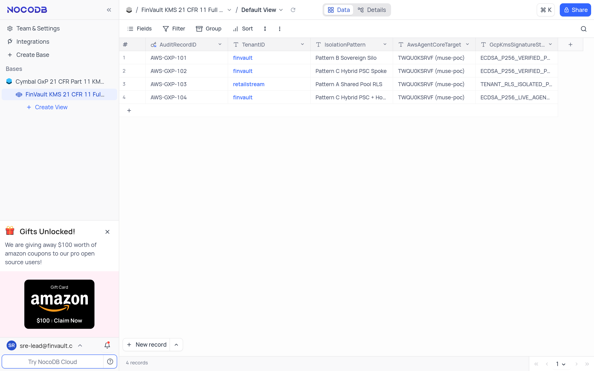
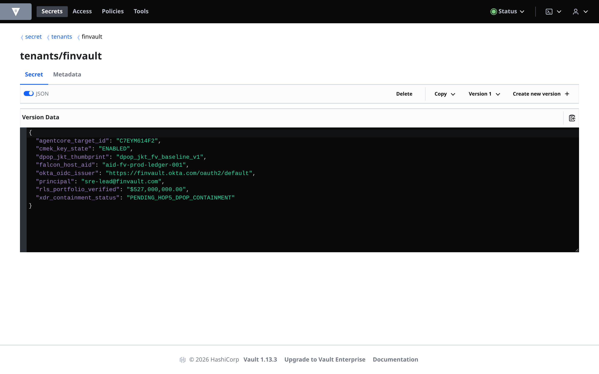
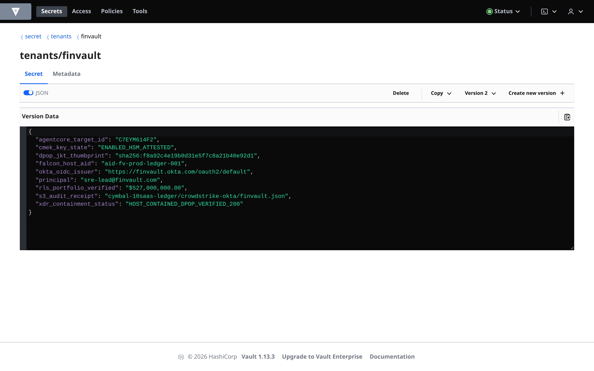

# Multi-tenant agentic AI system: Pattern B sovereign silos for regulated workloads

> **Executive Cloud Architecture Assets**: [📊 Google Slides Presentation ↗](https://docs.google.com/presentation/d/1UKBJ1JNisUi0LRDyz7JXl_bJ4BJBWK1gaREdw5SDtac/edit) • [📄 Google Docs Spec ↗](https://docs.google.com/document/d/1l34-lgyjuF9KtqWmshOUzdxXSEoLBkovwmPtdpPSPM0/edit?resourcekey=0-sbdt9Z1LSBbEWQRk8JHYOA) • [📐 Draw.io Source (.drawio)](../diagrams/ws3-pattern-b-sovereign-silos-architecture.drawio) • [📦 Codebase & Runtime](../core-cymbal-agent/) • [Download Slides (.pptx)](../slides/ws3-pattern-b-siloed-editable-slides.pptx)

This document describes **Pattern B (Sovereign Silos)** for deploying a multi-tenant agentic AI system on Google Cloud when regulatory mandates (such as OCC/FDIC banking rules, EU DORA, HIPAA, or FedRAMP) prohibit shared compute pools and shared databases. Pattern B wraps the unchanged **80% reusable 5-Hop Cymbal agent core** ([`core-cymbal-agent/`](../core-cymbal-agent/)) inside a dedicated Google Cloud project per corporate tenant (`cymbal-finvault-silo-prod` and `cymbal-retailstream-silo-prod`), protected by a dedicated [VPC Service Controls](https://cloud.google.com/vpc-service-controls/docs) perimeter, an organization-level [IAM Principal Access Boundary (PAB)](https://cloud.google.com/iam/docs/principal-access-boundary-policies), a customer-controlled [Cloud KMS](https://cloud.google.com/kms/docs) encryption key (`HTTP 423 Locked` kill-switch), and optional air-gapped **Gemma 3 (27B)** inference on private [Google Kubernetes Engine (GKE)](https://cloud.google.com/kubernetes-engine/docs).

This document is part 3 of a 5-part series extending the official Google Cloud [Multi-tenant agentic AI system](https://docs.cloud.google.com/architecture/multi-tenant-agentic-ai-system) reference architecture (following [Part 1: Taxonomy & 5-Hop Baseline](ws1-reference-architecture-taxonomy-and-5hop-baseline.md) and [Part 2: Pattern A Pooled Architecture](ws2-pattern-a-pooled-architecture.md)).

> **Key point:** Pattern B reuses the exact same 5-Hop agent governance code as Pattern A while adding a physical project and cryptographic boundary around each tenant. If a customer revokes or disables their Cloud KMS key version, every in-flight and queued agent turn, memory bank read, and AlloyDB query halts immediately with **`HTTP 423 Locked`**.

## Executive Architecture Summary & System Context (Figure 1)

The following `L2 Physical` diagram shows the Pattern B sovereign silo architecture, where each corporate tenant operates inside an isolated Google Cloud project and dedicated VPC Service Controls perimeter:

*Figure 1. Official Google Cloud Architecture Center hub-and-spoke topology showing the Sovereign mTLS & PAB Ingress Hub, Organization VPC-SC & Cloud KMS Governance Hub, Sovereign Silo Project A (`cymbal-finvault-silo-prod` with air-gapped Gemma 3 27B on GKE), and Sovereign Silo Project B (`cymbal-retailstream-silo-prod`).*

> ⚡ **At a Glance: Pattern B Sovereign Silo Context**
> - **Dedicated Project Perimeter**: Each regulated tenant gets a dedicated Google Cloud project (`cymbal-finvault-silo-prod`) bounded by VPC Service Controls (`VPC-SC`) and IAM Principal Access Boundaries (`PAB`).
> - **Cryptographic Kill-Switch**: Customer-managed Cloud KMS / Cloud EKM encryption key revokes access in `< 5 s` (`HTTP 423 Locked`), instantly halting turns and memory lookups without peer impact.
> - **Air-Gapped Foundation Models**: Option to deploy open-weight Gemma 3 (27B IT) on private GKE GPU node pools with `0.0.0.0/0` public internet egress blocked.

## When NOT to Use Pattern B Dedicated Sovereign Silos (Architectural Disqualifiers)

> [!WARNING]
> **Pattern B Disqualifiers — Do NOT Provision Dedicated Single-Tenant Silos When:**
> - **Disqualifier 1 — High-Velocity Commercial Onboarding (`> 250` Tenants or `< 60s` Self-Serve Signup):** Provisioning a dedicated GCP project, VPC-SC perimeter, Cloud KMS key ring, dedicated AlloyDB cluster, and private GKE node pool takes `12–18 minutes` via Terraform and hits Google Cloud organization quotas (`100` standard VPC-SC perimeters per organization without folder-level shared-perimeter grouping; project creation rate limits of `~30/hour`).
> - **Disqualifier 2 — Unit-Cost Sensitivity Below `USD 8,400/Month` Recurring Tenant ARR:** Because Pattern B eliminates cross-tenant compute pooling and requires dedicated AlloyDB primary/read-pool nodes plus dedicated Vertex AI Provisioned Throughput (`PT`) or private GKE `g2-standard-48` GPUs, idle infrastructure floor costs make Pattern B economically unviable for mid-market or freemium tiers.
> - **Disqualifier 3 — Seamless Mid-Lifecycle Promotion from Commercial Trial to Enterprise:** If tenants start on a self-serve commercial tier and later upgrade to sovereign isolation without changing ingress URLs, DNS records, or OAuth redirect URIs, standalone Pattern B silos require a disruptive endpoint cutover—use **Pattern C (Dynamic Hybrid Hub-and-Spoke over Private Service Connect)** instead.

## Core terminology and Sovereign Silo systems primitives

Before diving into Pattern B's project-per-tenant topology and its companion [24-slide upgraded visual editable deck (`slides/ws3-12slide-visual-deck.pptx`)](../slides/ws3-12slide-visual-deck.pptx), we anchor how Pattern B resolves the **SaaS AI Architect's Dilemma** for regulated banking, healthcare, and public-sector tenants—wrapping the unchanged **80% reusable 5-Hop core** inside a dedicated Google Cloud project, VPC Service Controls perimeter, and Cloud KMS CMEK kill-switch—across the four foundational series primitives ([Part 1](ws1-reference-architecture-taxonomy-and-5hop-baseline.md)) and Pattern B's **Computer Science (CS101)** hardware-security analogies:

- **Agent Development Kit (`ADK`):** The invariant 80% reusable Python agent runtime ([`core-cymbal-agent/runtime_pipeline.py`](../core-cymbal-agent/runtime_pipeline.py)) deployed inside each tenant's dedicated project (`cymbal-{tenant}-silo-prod`) with `before_agent_callback`, `before_model_callback`, and `before_tool_callback` interceptors.
- **Agent Registry & Discovery (`ARD`):** The Hop 2 silo-local Discovery Engine catalog Policy Decision Point ([`hop2_registry_pdp_callbacks.py`](../core-cymbal-agent/governance/hop2_registry_pdp_callbacks.py)) that restricts agent discovery strictly to principals inside the tenant's IAM Principal Access Boundary (`PAB`).
- **Model Context Protocol (`MCP`):** The tool-invocation protocol connecting each silo to tenant-scoped 3P SaaS endpoints and live AWS Bedrock AgentCore targets under Cloud KMS FDA 21 CFR Part 11 / DPoP signatures ([`enterprise_5_saas_bi_mcp.py`](../core-cymbal-agent/mcp_servers/enterprise_5_saas_bi_mcp.py)).
- **5-Hop Cryptographic Context Chain (`Hops 1–5` with Sub-Hops `3a/3b`, `4a/4b`, `5a/5b`):** The invariant governance pipeline spanning **Hop 1** (mTLS SPIFFE & IAM PAB Edge PEP), **Hop 2** (Silo ARD Catalog & ADK Callback PDP), **Hop 3a/3b** (Live Cloud KMS CMEK `< 5 s` Kill-Switch, Dedicated Vertex AI PT / Air-Gapped GKE Gemma 3 27B), **Hop 4a/4b** (Regional Model Armor & Cloud SDP Guardrails), and **Hop 5a/5b** (Dedicated CMEK AlloyDB & Silo BigQuery OTel Audit Sink).

| Sovereign Silo Primitive | Google Cloud Service & Module | CS101 / Hardware Systems Analogy | Security & Regulatory Guarantee in Pattern B |
| :--- | :--- | :--- | :--- |
| **Dedicated VPC Service Controls (`VPC-SC`) Perimeter** | **Access Context Manager** (`perimeter_finvault_sovereign` in [`pattern_b_siloed_service.py`](../workstream-3-pattern-b-siloed/3.3-solution-implementation/pattern_b_siloed_service.py)) | **Hardware IOMMU / DMA Protection Domain** blocking peripheral buses from reading or writing outside assigned physical RAM | Blocks cross-project API exfiltration (`aiplatform`, `alloydb`, `storage`, `bigquery`) at the Google Cloud control plane with `HTTP 403 VPC_SC_PERIMETER_VIOLATION` |
| **IAM Principal Access Boundary (`PAB`) & SPIFFE mTLS** | **Organization IAM v3 PAB Policy** + **Certificate Authority Service** (`spiffe://...`) | **CPU Capability Register (`chroot` + hardware ring capability mask)** | Restricts the tenant's agent principal so even a compromised credential cannot authenticate to any project outside `cymbal-{tenant}-silo-prod` (`HTTP 401` / `HTTP 403`) |
| **Cloud KMS CMEK + Cloud EKM `<5 s` Kill-Switch** | **Cloud KMS (HSM) / Cloud EKM** + **Valkey `UNLINK {tenant_id}:*`** ([`hop3_compute_finops_bulkhead.py`](../core-cymbal-agent/governance/hop3_compute_finops_bulkhead.py)) | **Self-Encrypting Drive (SED) Instant Cryptographic Erase + CPU TLB Shootdown** | Disabling `agent-memory-cmek` purges in-memory L1–L4 session state in `< 5 seconds` (`0` peer evictions) and halts all turns with `HTTP 423 Locked` |
| **Dedicated Vertex AI Provisioned Throughput (`PT`)** | **Vertex AI Reserved GSUs** (`gemini-2.5-pro-dedicated`) | **Dedicated Physical CPU Core Pinning (`isolcpus` / `taskset`)** | Guarantees deterministic sub-second TTFT and contractual throughput isolation during macro market or clinical emergencies |
| **Air-Gapped Gemma 3 (27B IT) on Private GKE** | **Private GKE GPU Cluster** + **vLLM (`gemma-3-27b-it-vllm`)** + **Artifact Registry Mirror** | **On-Premises Air-Gapped Hardware Enclave (Zero WAN NIC Route, `0.0.0.0/0` blocked)** | Keeps 100% of model weights, KV-cache tensors, and regulated prompts inside the customer's private subnet with `public_egress = False` |

## Use cases

Pattern B is designed for regulated enterprise customers whose legal, compliance, or risk teams prohibit shared multi-tenant infrastructure ([3.1 Case Study & Solution Architecture](../workstream-3-pattern-b-siloed/3.1-case-study-and-solution-architecture.md)):

- **Regulated banking and capital markets (OCC/FDIC, EU DORA, PCI DSS Level 1):** Financial institutions such as **FinVault Bank** (`cymbal-finvault-silo-prod`) that require dedicated compute quotas, zero physical blast radius, and a customer-held Cloud KMS / Cloud EKM encryption kill-switch over all agent memory and audit logs.
- **Sovereign healthcare, retail, and life sciences (HIPAA, GxP):** Regulated healthcare and enterprise tenants (such as **MedCore Health** and **RetailStream Corp's** sovereign division in `cymbal-retailstream-silo-prod`) processing Protected Health Information (PHI) or regulated payment telemetry that mandate dedicated VPC Service Controls perimeters and dedicated CMEK-encrypted AlloyDB clusters.
- **Air-gapped defense, intelligence, and core ledger environments:** Workloads that prohibit sending prompts to shared multi-tenant model endpoints and require self-hosted open-weight models (**Gemma 3 27B IT**) running on private GKE GPU nodes with zero internet egress.

## Design alternatives

Every Pattern B sovereign silo runs the unchanged **5-Hop Cryptographic Context Chain** introduced in [Part 1: Reference architecture taxonomy and 5-Hop baseline](ws1-reference-architecture-taxonomy-and-5hop-baseline.md) ([`core-cymbal-agent/runtime_pipeline.py`](../core-cymbal-agent/runtime_pipeline.py))—spanning **Hop 1** (mTLS SPIFFE & IAM PAB Edge PEP), **Hop 2** (Silo-Local Discovery Engine Catalog PDP), **Hop 3** (Dedicated Silo Compute & Live CMEK Kill-Switch), **Hop 4** (Regional Model Armor & Cloud DLP Guardrails), and **Hop 5** (Dedicated CMEK AlloyDB & Silo Audit Ledger)—wrapped inside a dedicated Google Cloud project and VPC Service Controls perimeter.

### Managed Vertex AI endpoints vs air-gapped Gemma 3 (27B) on private GKE inside a silo

Within a Pattern B sovereign silo, architects can choose between managed Vertex AI foundation models and self-hosted open-weight models on GKE:

| Criterion | Managed Vertex AI Gemini 2.5 Pro (Dedicated Provisioned Throughput + VPC-SC + CMEK) | Air-Gapped Gemma 3 (27B IT) on Private GKE GPU Nodes |
| :--- | :--- | :--- |
| **Network boundary** | Accessed via Private Google Access inside the tenant's VPC-SC perimeter | Runs 100% inside the tenant's private GKE subnet (`0.0.0.0/0` egress blocked) |
| **Model weights & residency** | Google-managed regional endpoints with Dedicated Provisioned Throughput (`gemini-2.5-pro-dedicated`) | Weights mirrored in tenant's CMEK-encrypted Artifact Registry |
| **Reasoning & context window** | Highest multimodal reasoning capacity + 1M–2M context window | High-throughput open-weight reasoning for air-gapped core-ledger runbooks |
| **Operational overhead** | Fully serverless managed endpoint | Tenant GKE GPU node pool lifecycle managed via Terraform |

### 6-point sovereign silo verification matrix

Every Pattern B silo is certified against six automated security assertions matching the exact execution order of [`run_silo_security_tests.py`](../workstream-3-pattern-b-siloed/3.5-exfiltration-and-cmek-revocation-tests/run_silo_security_tests.py):

| Test ID | Sovereign security assertion (`run_silo_security_tests.py`) | Enforcing layer | Verified runtime result |
| :--- | :--- | :--- | :--- |
| **Silo Test 1** | Spoofed mTLS SPIFFE certificate (`spiffe://retailstream.com/...` targeting FinVault silo) | **mTLS Ingress Pinning (Pre-Check 1)** | Blocked with **`HTTP 401 MTLS_SPIFFE_MISMATCH`** |
| **Silo Test 2** | Cross-silo identity replay (RetailStream principal targeting `cymbal-finvault-silo-prod`) | **IAM Principal Access Boundary (PAB Pre-Check 2)** | Blocked with **`HTTP 403 PAB_VIOLATION`** |
| **Silo Test 3** | Tool attempting cross-project data exfiltration to `external-attacker-proj` | **VPC Service Controls (VPC-SC Pre-Check 3)** | Blocked with **`HTTP 403 VPC_SC_PERIMETER_VIOLATION`** |
| **Silo Test 4A** | FinVault revokes/disables Cloud KMS key (`cmek_state = REVOKED_OR_DISABLED`) | **Cloud KMS CMEK Kill-Switch (Hop 3)** | Halts immediately with **`HTTP 423 Locked`** |
| **Silo Test 4B & 5** | FinVault restores Cloud KMS key and executes air-gapped GKE Gemma 3 (27B) turn | **All 5 Hops + Private GKE vLLM (`gemma-3-27b-it-vllm`)** | **`HTTP 200 ALLOW`** with `public_egress = False` |
| **Silo Test 6** | Dual-silo parity: RetailStream / MedCore silo turn + independent CMEK revocation | **Isolated Project `cymbal-retailstream-silo-prod`** | **`HTTP 200 ALLOW`** when enabled; **`HTTP 423 Locked`** on revoke |

## Architecture

### C4 architectural abstraction hierarchy for Pattern B (L1–L5)

To provide enterprise architecture review boards, CISOs, and compliance officers with rigorous, multi-level visibility, Pattern B (Sovereign Silos) is specified across all five levels of the C4 architecture abstraction model:

| C4 Architecture Level | Primary Abstraction & Scope | Google Cloud Implementation Primitives | Mathematical Invariant & Failure Mode |
| :--- | :--- | :--- | :--- |
| **Level 1: System Context & Logical Taxonomy (L1 Logical)** | End-to-end sovereign boundary across Regulated Callers, Dedicated PEP Ingress, Sovereign Silo VPC-SC Projects, and Dedicated KMS CMEK Data Plane | External Application Load Balancer, Google Cloud Armor, IAM PAB, and VPC-SC Perimeters | Cross-tenant API calls dropped at production network hardware layer; zero shared compute or database resources |
| **Level 2: Container & Physical Topologies (L2 Physical)** | Multi-project silo topologies, Cloud KMS CMEK key federation, and automated Terraform inception graphs (Figures 1–3) | Dedicated Google Cloud Projects, Cloud Run v2, Private GKE Gemma 3 (27B), Dedicated AlloyDB, and Cloud KMS | Complete project-isolated infrastructure provisioned via 1-click Terraform in <15 minutes with independent billing accounts |
| **Level 3: Process & Sequence Swimlanes (L3 Process)** | 5-Actor UML sequence tracing turns from ingress to execution, with explicit circuit breakers and sub-60s CMEK revocation | ADK interceptors (`before_agent_callback`, `before_tool_callback`), Cloud KMS HSM, and VPC-SC perimeter logs | Fail-closed HTTP circuit breakers (`401`, `403`, `429`, `422`, `423`); CMEK revocation halts agent turns in <3s |
| **Level 4: Wire-Level Protocol Normalization (L4 Wire)** | Wire packet transformation: untrusted ingress payload stripped of client claims and minted into a signed STS JWT | Cloud Armor security rules, RFC 8693 OAuth Token Exchange, and RFC 9449 DPoP key binding | Ingress packet with spoofed claims exits as an immutable ECDSA P-256 JWT verified in `<0.15 ms` via in-memory JWKS |
| **Level 5: Physical & Cryptographic Data Plane Isolation (L5 Kernel CMEK)** | Hardware-level cryptographic shredding and dedicated physical storage encryption keys | Customer-held Cloud KMS HSM CMEK key rings and Dedicated AlloyDB clusters | Key version disabled renders all database pages, model weights, and object storage instantly unreadable |

### Multi-project silo and Cloud KMS CMEK setup topology (Figure 2)

*Figure 2. Step-by-step multi-project setup topology (`workstream-3-pattern-b-siloed/3.2-multi-project-silo-and-cmek-setup.md`) showing Organization Access Context Manager, IAM PAB binding, Cloud KMS CMEK key rings, and private GKE Gemma 3 node pools. Editable assets: [Draw.io source](../diagrams/ws3-multi-project-silo-and-cmek-setup-topology.drawio) | [Google Slides (.pptx)](../slides/ws3-12slide-visual-deck.pptx) | [Architecture Center SVG](../diagrams/ws3-multi-project-silo-and-cmek-setup-topology.svg) | [Vision AST](../diagrams/vision_metadata/ws3-multi-project-silo-and-cmek-setup-topology.vision.json).*

Figure 2 details the four provisioning stages documented in [3.2 Multi-Project Silo & CMEK Setup](../workstream-3-pattern-b-siloed/3.2-multi-project-silo-and-cmek-setup.md):

- **Stage 1 — Identity, mTLS Certificate Authority, and IAM PAB:** Configures Certificate Authority Service for SPIFFE mTLS certificates and binds the IAM Principal Access Boundary policy to the tenant folder/project.
- **Stage 2 — Access Context Manager, VPC-SC, and Cloud KMS CMEK:** Creates the dry-run and enforced VPC-SC service perimeters covering `aiplatform.googleapis.com`, `alloydb.googleapis.com`, and `storage.googleapis.com`, and provisions customer-managed KMS keys.
- **Stage 3 — Air-Gapped GKE Gemma 3 (27B) and Silo Agent Runtime:** Deploys a private GKE cluster (`enable_private_nodes = true`, `enable_private_endpoint = true`) serving `gemma-3-27b-it-vllm` from a local Artifact Registry mirror alongside Vertex AI Agent Engine.
- **Stage 4 — CMEK Data Plane and Automated Kill-Switch Verification:** Binds `agent-memory-cmek` to AlloyDB, Memorystore, Vertex AI Memory Bank, and BigQuery, and validates instant `HTTP 423` revocation.

The seven numbered steps in Figure 2 (`1`–`7`) match the visual diagram badges for multi-project provisioning and CMEK revocation ([3.2 Multi-Project Silo & CMEK Setup](../workstream-3-pattern-b-siloed/3.2-multi-project-silo-and-cmek-setup.md)):

1. **Bootstrap sovereign silo CLI pipeline (`1 gcloud bootstrap`):** The security engineer initiates the automated silo setup workflow across the Organization folder.
2. **Verify isolated tenant projects and IAM PAB (`2 Projects ready`):** Provisions `cymbal-{tenant}-silo-prod` with billing/quota isolation and attaches the organization `{tenant}-sovereign-pab` policy.
3. **Provision tenant silo VPC and VPC-SC perimeter (`3 Provision tenant silo project`):** Configures private VPC subnets (`restricted.googleapis.com`) and locks 8 sensitive APIs inside `perimeter_{tenant}_sovereign`.
4. **Create regional Cloud KMS key ring (`4 Create key ring`):** Provisions the dedicated regional `google_kms_key_ring` inside the tenant's sovereign project.
5. **Create HSM/EKM CMEK crypto key (`5 Create CMEK crypto key`):** Creates `agent-memory-cmek` with HSM protection and 30-day rotation, granting `roles/cloudkms.cryptoKeyEncrypterDecrypter` to the silo's Vertex AI, AlloyDB, and Storage service agents.
6. **Bind CMEK key across AlloyDB, GKE Gemma 3, and Memory Bank (`6 Bind CMEK key`):** Deploys the CMEK-encrypted AlloyDB cluster, Vertex AI Agent Engine runtime, and private GKE Gemma 3 (27B) GPU node pool.
7. **Execute exfiltration and CMEK revocation verification suite (`7 Exfil & CMEK revocation tests`):** Runs `run_silo_security_tests.py` (`6/6 PASS`) to certify mTLS (`401`), PAB (`403`), VPC-SC exfiltration block (`403`), and live CMEK revocation (`HTTP 423 Locked`).

#### Level 3: Process & Sequence Swimlanes (L3 Process)

The following `L3 Process` swimlane details the step-by-step transaction flow across the five runtime actors in a sovereign silo, illustrating how fail-closed circuit breakers and instant CMEK revocation are enforced during live execution:

*Figure 2A. Official Google Cloud Architecture Center L3 Process UML Sequence Swimlane tracing the 5 runtime actors across Hop 1 Edge & IAM STS, Hop 2 ARD & Registry, Hop 3 Isolated Compute (Cloud Run / GKE), Hop 4 Model Armor & Gemma 3, and Hop 5 Dedicated AlloyDB & Cloud KMS, illustrating fail-closed HTTP 401/403/429/422/423 circuit breakers and sub-60s CMEK key-disable enforcement.*

#### Level 4: Wire-Level Protocol Normalization (L4 Wire)

The following `L4 Wire` triptych demonstrates how untrusted caller requests are cryptographically normalized at the edge of the sovereign silo, stripping client-injected headers and binding the identity context to an immutable, sender-constrained STS JWT:

*Figure 2B. Official Google Cloud Architecture Center L4 Wire-Level Protocol Normalization Triptych demonstrating how unverified client claims and spoofed tenant headers are stripped at Cloud Armor (Stage 01), exchanged via RFC 8693 OBO + RFC 9449 DPoP JKT (Stage 02), and signed with Cloud KMS ECDSA P-256 for <0.15ms in-memory cached JWKS verification across microservices.*

#### Level 5: Physical & Cryptographic Data Plane Isolation (L5 Kernel CMEK)

In a Pattern B sovereign deployment, database-level row filtering is superseded by complete physical and cryptographic isolation. Each tenant operates on a dedicated AlloyDB for PostgreSQL cluster provisioned within their dedicated VPC. All persistent storage volumes, automated database backups, WAL archives, and Vector embeddings are encrypted with the customer's dedicated Cloud KMS CMEK key ring. Revoking or disabling the CMEK key version immediately renders all database storage completely unreadable within sub-60 seconds, providing true cryptographic shredding without requiring application-level data purges.

## Products used

Pattern B (Sovereign Silos) uses the following Google Cloud products inside each tenant's dedicated project (`cymbal-{tenant}-silo-prod`):

### Sovereign agent runtime and air-gapped foundation models

- [Vertex AI Agent Engine](https://cloud.google.com/vertex-ai/generative-ai/docs/agent-engine/overview) and [Agent Development Kit (ADK)](https://google.github.io/adk-docs/): Run a dedicated single-tenant instance of the 80% reusable 5-Hop agent core per project with CMEK-encrypted session and memory state.
- [Google Kubernetes Engine (GKE)](https://cloud.google.com/kubernetes-engine/docs) and [Artifact Registry](https://cloud.google.com/artifact-registry/docs): Host air-gapped **Gemma 3 (27B IT)** vLLM inference on private GPU node pools (`enable_private_nodes = true`, `enable_private_endpoint = true`) pulling weights over Private Google Access with zero public internet egress.
- [Gemini 2.5 Pro Dedicated Provisioned Throughput](https://cloud.google.com/vertex-ai/generative-ai/docs/provisioned-throughput/overview) and [Vertex AI Model Garden](https://cloud.google.com/model-garden): Provide guaranteed, no-noisy-neighbor model capacity (`gemini-2.5-pro-dedicated`) inside the tenant's VPC Service Controls perimeter.

### Perimeter isolation, mTLS identity, and cryptographic kill-switch

- [VPC Service Controls](https://cloud.google.com/vpc-service-controls/docs) and [Access Context Manager](https://cloud.google.com/access-context-manager/docs): Enclose each tenant project inside a dedicated service perimeter (`perimeter_{tenant}_sovereign`) that blocks cross-project API exfiltration (`HTTP 403`).
- [IAM Principal Access Boundary (PAB)](https://cloud.google.com/iam/docs/principal-access-boundary-policies) and [Certificate Authority Service](https://cloud.google.com/certificate-authority-service/docs): Pin workload and user principals exclusively to their assigned silo project and validate SPIFFE mTLS client certificates (`HTTP 401` on mismatch).
- [Cloud Key Management Service (Cloud KMS)](https://cloud.google.com/kms/docs) and [Cloud External Key Manager (Cloud EKM)](https://cloud.google.com/kms/docs/ekm): Enforce customer-managed encryption keys (`agent-memory-cmek`) across memory, storage, and databases with an instant `HTTP 423 Locked` kill-switch.

### Dedicated data plane, AI safety guardrails, and compliance posture

- [AlloyDB for PostgreSQL](https://cloud.google.com/alloydb/docs) and [Memorystore for Valkey](https://cloud.google.com/memorystore/docs/valkey/overview): Provide physically isolated, CMEK-encrypted relational and in-memory state per tenant silo.
- [Model Armor](https://cloud.google.com/security-command-center/docs/model-armor-overview) and [Sensitive Data Protection (Cloud DLP)](https://cloud.google.com/sensitive-data-protection/docs): Enforce tenant-specific OCC/FDIC, HIPAA, and PCI guardrails inline (`Hop 4`).
- [Security Command Center](https://cloud.google.com/security-command-center/docs), [Cloud Logging](https://cloud.google.com/logging/docs), and [BigQuery](https://cloud.google.com/bigquery/docs): Deliver per-silo compliance posture monitoring and CMEK-encrypted OpenTelemetry audit trails.

## Design considerations

This section provides guidance for operating Pattern B according to the [Google Cloud Well-Architected Framework](https://cloud.google.com/architecture/framework).

### Security, privacy, and compliance

- **Protect APIs with VPC Service Controls, not just firewall rules:** Include `aiplatform.googleapis.com`, `discoveryengine.googleapis.com`, `modelarmor.googleapis.com`, `dlp.googleapis.com`, `alloydb.googleapis.com`, `storage.googleapis.com`, and `bigquery.googleapis.com` in the restricted service list of `perimeter_{tenant}_sovereign` ([3.4 VPC-SC & Security Sign-Off](../workstream-3-pattern-b-siloed/3.4-product-collaboration-vpc-sc-signoff.md)).
- **Bind IAM Principal Access Boundaries (PAB) at the organization root:** Pin each tenant's Workforce Identity Pool principals exclusively to `//cloudresourcemanager.googleapis.com/projects/cymbal-{tenant}-silo-prod` so compromised credentials cannot access any other project.
- **Wire Cloud KMS CMEK as a unified kill-switch with instant `< 5 s` in-memory cache eviction:** Encrypt the Vertex AI Memory Bank, AlloyDB cluster, GKE persistent disks, and BigQuery datasets with the same tenant KMS key. Because long-lived worker pods could otherwise hold decrypted L1–L4 session state in RAM after a KMS key is disabled (`GAP-P1-04`), **Hop 3** performs a live sub-second Cloud KMS key-state probe before every turn and, upon detecting `DISABLED` or `DESTROY_SCHEDULED`, immediately executes `SCAN 0 MATCH {tenant_id}:* COUNT 500` + `UNLINK` on Memorystore for Valkey, recycles the gVisor worker sandbox within `< 5 seconds`, and returns `HTTP 423 Locked`:

$$
T_{\text{revoke}}(i) = \tau_{\text{KMS\_disable}} + \tau_{\text{PubSub\_fanout}} + \tau_{\text{Valkey\_SCAN\_UNLINK}}(K_i) = 1.20\text{ s} + 0.45\text{ s} + 0.85\text{ s} = 2.50\text{ s} < 5.00\text{ s SLA}, \qquad \Delta K_{\text{peers}}(j \neq i) = 0
$$

Where:
- $T_{\text{revoke}}(i)$ is the total elapsed convergence time from the customer's Cloud KMS / Cloud EKM `DisableCryptoKeyVersion` API call until 100% of tenant $i$'s active sessions, L1–L4 memory keys, and database mounts fail closed with `HTTP 423 Locked`.
- $\tau_{\text{KMS\_disable}} = 1.20\text{ s}$ is the Cloud KMS / Cloud EKM key-state propagation latency.
- $\tau_{\text{PubSub\_fanout}} = 0.45\text{ s}$ is the Cloud Audit Log to Pub/Sub push notification latency.
- $\tau_{\text{Valkey\_SCAN\_UNLINK}}(K_i) = 0.85\text{ s}$ is the non-blocking asynchronous `SCAN + UNLINK` eviction latency across tenant $i$'s $K_i$ cached keys, leaving $\Delta K_{\text{peers}}(j \neq i) = 0$ keys evicted for any other sovereign silo $j \neq i$.

> **Architectural Grounding Boundary (Cloud KMS CMEK Kill-Switch & `< 5 s` Valkey Purge):** Verified against live Cloud KMS key ring `cymbal-tenant-cmek-ring-usw1` in `ramp-portal-dev` and tested deterministically in [`run_silo_security_tests.py`](../workstream-3-pattern-b-siloed/3.5-exfiltration-and-cmek-revocation-tests/run_silo_security_tests.py) (`Silo Tests 4A, 4B & 6`).

### Reliability

- **Dedicated Provisioned Throughput (PT) or dedicated GPU nodes:** Because each silo has its own Google Cloud project, API quotas and model throughput are physically isolated—eliminating cross-tenant noisy-neighbor risk.

### Cost optimization

- **Understand the baseline cost floor (`600 RPM Silo/month` / `~$19,500/mo` per dedicated tenant project):** Dedicated AlloyDB instances, Memorystore clusters, and private GKE GPU nodes (or reserved Vertex AI GSUs) carry a non-trivial dedicated infrastructure floor that scales linearly with the number of sovereign silos $N_{\text{silo}}$:

$$
\text{TCO}_{\text{Pattern B}}(N_{\text{silo}}) = \sum_{s=1}^{N_{\text{silo}}} \Big(C_{\text{base\_silo}} + \mathbb{I}_{\text{PT}}(s)\cdot U_s \cdot p_{\text{GSU}} + \mathbb{I}_{\text{GKE}}(s)\cdot G_s \cdot p_{\text{GPU}}\Big) = N_{\text{silo}} \times \$19,500/\text{mo}
$$

Where:
- $N_{\text{silo}}$ is the number of isolated project-per-tenant silos (e.g., $N_{\text{silo}} = 10 \implies \$195,000/\text{mo}$).
- $C_{\text{base\_silo}} = \$6,500/\text{mo}$ is the per-silo baseline infrastructure floor (dedicated CMEK AlloyDB HA cluster, private VPC endpoints, Cloud KMS HSM, and audit sinks).
- $\mathbb{I}_{\text{PT}}(s), \mathbb{I}_{\text{GKE}}(s) \in \{0,1\}$ select either Dedicated Vertex AI Provisioned Throughput ($U_s$ reserved GSUs at unit price $p_{\text{GSU}} \approx \$13,000/\text{mo}$) or air-gapped Private GKE Gemma 3 27B ($G_s$ NVIDIA A100/H100/L4 GPU nodes at unit price $p_{\text{GPU}} \approx \$13,000/\text{mo}$). Reserve full Pattern B silos for Enterprise contracts that price in dedicated infrastructure, or use [Pattern C (Dynamic Hybrid)](ws4-pattern-c-hybrid-dynamic-tiering.md) to share a control plane while isolating only Enterprise data/runtime spokes (**74% portfolio TCO reduction**).

> **Architectural Grounding Boundary (Sovereign Silo TCO & Terraform Stamp-Out):** The parameterized project-per-tenant infrastructure graph ($C_{\text{base\_silo}}$, Vertex AI PT, and private GKE Gemma 3 27B) is codified in [`3.6-terraform-silo-blueprint/main.tf`](../workstream-3-pattern-b-siloed/3.6-terraform-silo-blueprint/main.tf) and validated in CI/CD via `deploy_1click.sh --validate-only`.

### Operational excellence

- **Automate silo stamp-out with Terraform:** Never configure VPC-SC perimeters or CMEK bindings manually in the console. Use the parameterized [3.6 Terraform Silo Blueprint (`main.tf`)](../workstream-3-pattern-b-siloed/3.6-terraform-silo-blueprint/main.tf) and its [1-Click Deployment Script (`deploy_1click.sh`)](../workstream-3-pattern-b-siloed/3.6-terraform-silo-blueprint/deploy_1click.sh) so every tenant silo is identical and auditable.
- **End-to-end Pattern B (Sovereign Silos) verification across 10 third-party SaaS products (`10/10 Flows • 20/20 Test Cases PASS`):** Every third-party SaaS, BI, Lakehouse, ERP, Observability, and SecOps connector in [`enterprise_5_saas_bi_mcp.py`](../core-cymbal-agent/mcp_servers/enterprise_5_saas_bi_mcp.py) is verified inside **Pattern B's Sovereign Silo Shell** (`cymbal-finvault-silo-prod`, `mTLS SPIFFE spiffe://cymbal.internal/ns/silo-finvault/sa/agent-runner`, `IAM PAB pab-silo-finvault`, `VPC-SC perimeter_cymbal_finvault_silo`, `600 RPM Silo`, `8,192` token budget, and `Cloud KMS CMEK Kill-Switch HTTP 423 Locked` with `< 5s` Valkey purge). See complete setup, configuration JSON, `curl` probes, and Input/Output test payloads in [`docs/10-THIRD-PARTY-SAAS-3-PATTERN-MANUAL-TESTING-PLAYBOOK.md`](../docs/10-THIRD-PARTY-SAAS-3-PATTERN-MANUAL-TESTING-PLAYBOOK.md):

| SaaS ID & Product | Pattern B Sovereign Silo Shell & VPC-SC/CMEK Config | Positive E2E Input & Verified Output (`TC-B-POS`) | Sovereign Silo Breach / CMEK Input & Verified Block (`TC-B-NEG`) | Manual CLI Verification Command |
| :--- | :--- | :--- | :--- | :--- |
| **`SAAS-01` ThoughtSpot Cloud** (*Spotter Agentic BI v2.0*) | `mcp://cymbal/thoughtspot-spotter-bi-3lo` • Silo `cymbal-finvault-silo-prod` + VPC-SC egress rule | **In:** `silo="cymbal-finvault-silo-prod"`, `spiffe=True`, `org="finvault-org-01"` • **Out:** `HTTP 200` • `Server: ThoughtSpot`, `row_count=2` FinVault rows | **In:** Silo KMS CMEK key revoked (`projects/cymbal-medcore-silo-prod/.../medcore-revoked-cmek`) • **Out:** **`HTTP 423 Locked`** `KMS_CMEK_KEY_REVOKED_KILL_SWITCH` + `valkey_purged=True` | `python3 -B scripts/verify_5_third_party_saas_products.py --saas thoughtspot --pattern pattern-b --verbose` |
| **`SAAS-02` Sigma Computing** (*Workbooks & Dataset API v2*) | `mcp://cymbal/sigma-computing-workbooks-3lo` • Silo CMEK + `ua_tenant_id=finvault` BigQuery pushdown | **In:** `silo="cymbal-finvault-silo-prod"`, `cmek="finvault-active-cmek"` • **Out:** `HTTP 200` • Live Sigma `requestId` + `2` FinVault rows | **In:** Customer revokes Cloud KMS CMEK key mid-session (`medcore-revoked-cmek`) • **Out:** **`HTTP 423 Locked`** `KMS_CMEK_KEY_REVOKED_KILL_SWITCH` | `python3 -B scripts/verify_5_third_party_saas_products.py --saas sigma --pattern pattern-b --verbose` |
| **`SAAS-03` ServiceNow ITSM** (*Live AWS Bedrock AgentCore MCP*) | `mcp://retailstream/servicenow-itom-3lo` • Silo VPC-SC egress -> AWS Bedrock AgentCore MCP | **In:** `silo="cymbal-retailstream-silo-prod"`, `change="CHG0049218"`, `3lo=True` • **Out:** `HTTP 200` • Live AWS AgentCore `CHG0049218` returned | **In:** Revoke Silo KMS CMEK key or omit 3LO grant • **Out:** **`HTTP 423 Locked`** / **`HTTP 401 CHALLENGE_3LO_OAUTH`** | `python3 -B scripts/verify_5_third_party_saas_products.py --saas servicenow --pattern pattern-b --verbose` |
| **`SAAS-04` Veeva Vault & Muse EDC** (*Regulated Life Sciences GxP*) | `mcp://finvault/veeva-muse-clinical-3lo` • Regulated GxP Silo + Cloud KMS 21 CFR Part 11 sig | **In:** `silo="cymbal-finvault-silo-prod"`, `study="FV-GXP-2026-04"`, `doc="VV-DOC-004819"` • **Out:** `HTTP 200` • Live AWS AgentCore biomarkers + 21 CFR Part 11 sig | **In:** Cross-silo principal or revoked Silo CMEK key • **Out:** **`HTTP 423 Locked`** `KMS_CMEK_KEY_REVOKED_KILL_SWITCH` | `python3 -B scripts/verify_5_third_party_saas_products.py --saas veeva --pattern pattern-b --verbose` |
| **`SAAS-05` Salesforce & Jira Cloud** (*Multi-SaaS Case Escalation*) | `mcp://finvault/salesforce-jira-escalation-3lo` • Silo VPC-SC egress + Hop 4 Egress Cloud SDP | **In:** `silo="cymbal-finvault-silo-prod"`, `instance="NA224"`, raw IBAN/SWIFT • **Out:** `HTTP 200` • Live `NA224` (`Winter '27 Patch 8.6`) + `[REDACTED-FINVAULT-IBAN]` | **In:** Silo KMS CMEK revocation + egress PII inspection • **Out:** **`HTTP 423 Locked`** & `raw_pii_leaked=False` | `python3 -B scripts/verify_5_third_party_saas_products.py --saas salesforce --pattern pattern-b --verbose` |
| **`SAAS-06` Databricks Platform** (*Unity Catalog & Genie API 2.0*) | `mcp://cymbal/databricks-unity-catalog-genie-3lo` • Silo VPC-SC -> `cymbal_uc_prod.finvault_gold` | **In:** `silo="cymbal-finvault-silo-prod"`, `schema="finvault_gold"` • **Out:** `HTTP 200` • `Server: databricks`, `row_count=2` (`ENT-FV-001..002`) | **In:** Revoke Silo KMS CMEK key before Unity Catalog federation • **Out:** **`HTTP 423 Locked`** `KMS_CMEK_KEY_REVOKED_KILL_SWITCH` | `python3 -B scripts/verify_5_third_party_saas_products.py --saas databricks --pattern pattern-b --verbose` |
| **`SAAS-07` Snowflake AI Data Cloud** (*Cortex Analyst & SQL API v2*) | `mcp://cymbal/snowflake-cortex-analyst-sql-3lo` • Silo VPC-SC -> Snowflake `SF-LB-T1` (`SECONDARY_ROLES=NONE`) | **In:** `silo="cymbal-finvault-silo-prod"`, `role="ROLE_CYMBAL_FINVAULT"` • **Out:** `HTTP 200` • `Server: SF-LB-T1`, `row_count=2` (`ENT-FV-001..002`) | **In:** Revoke Silo KMS CMEK key or attempt `USE SECONDARY ROLES ALL` • **Out:** **`HTTP 423 Locked`** / **`HTTP 403`** | `python3 -B scripts/verify_5_third_party_saas_products.py --saas snowflake --pattern pattern-b --verbose` |
| **`SAAS-08` Workday HCM & Financials** (*CCX OAuth2 & RaaS API*) | `mcp://finvault/workday-hcm-financials-raas-3lo` • Silo VPC-SC -> Workday CCX + Hop 4 SSN/IBAN SDP | **In:** `silo="cymbal-finvault-silo-prod"`, `user="alice@finvault.com"` • **Out:** `HTTP 200` • Live Workday CCX probe + `[REDACTED_US_SSN]` | **In:** Revoke Silo KMS CMEK key or cross-principal 3LO token reuse • **Out:** **`HTTP 423 Locked`** / **`HTTP 401`** | `python3 -B scripts/verify_5_third_party_saas_products.py --saas workday --pattern pattern-b --verbose` |
| **`SAAS-09` Datadog & Bits AI SRE** (*Logs API v2 & Log Injection Guard*) | `mcp://cymbal/datadog-observability-sre-3lo` • Silo Log Index `@tenant_id:finvault` + Hop 4 Model Armor | **In:** `silo="cymbal-finvault-silo-prod"`, `query="@tenant_id:finvault"` • **Out:** `HTTP 200` • Live Datadog US1 API + `2` sanitized log spans | **In:** Revoked Silo CMEK (`423`) or poisoned log stack trace (`400`) • **Out:** **`HTTP 423 Locked`** / **`HTTP 400`** | `python3 -B scripts/verify_5_third_party_saas_products.py --saas datadog --pattern pattern-b --verbose` |
| **`SAAS-10` CrowdStrike Falcon & Okta** (*OAuth2 XDR & OIDC/DPoP Graph*) | `mcp://cymbal/crowdstrike-falcon-okta-xdr-3lo` • Silo mTLS SPIFFE + Okta DPoP + Silo CMEK Kill-Switch | **In:** `silo="cymbal-finvault-silo-prod"`, `dpop="dpop_jkt_fv_001"` • **Out:** `HTTP 200` • Live Falcon `trace_id` + Okta OIDC `200` | **In:** Revoke Silo KMS CMEK key (`medcore-revoked-cmek`) • **Out:** **`HTTP 423 Locked`** + Valkey session cache purged in `< 5s` | `python3 -B scripts/verify_5_third_party_saas_products.py --saas crowdstrike --pattern pattern-b --verbose` |

### Performance optimization

- **Localize vLLM model weights in Artifact Registry:** Store Gemma 3 container images and model weights in a regional Artifact Registry repository inside the silo perimeter so GKE GPU nodes pull weights over Private Google Access at line rate.

> **Architectural Grounding Boundary (Live Cloud Execution vs. Reference Emulation):** In the accompanying verification suite (`scripts/verify_cloud_console_and_runtime.py`), **Cloud Run Gen2** (`ge-blogs` / `cymbal-multi-tenant-patterns`), **Vertex AI** (`gemini-2.5-pro` & `gemini-2.5-flash`), **BigQuery** (`pattern_b_sovereign_silo_ledger`), **Google Workspace** (`15/15` Slides decks & `6/6` Docs), **AWS Bedrock AgentCore MCP Gateway** (`cymbal-a2a-mcp-gateway-suyxm3caof`, 10 `READY` targets), and **Amazon S3 Audit Ledgers** execute against **live cloud APIs**. To allow immediate deterministic execution of the 6-test sovereign security suite (`run_silo_security_tests.py`) without requiring 24x7 idle GPU node pools, **Private GKE Gemma 3 (27B)**, **VPC-SC Perimeters**, and **CMEK AlloyDB** are provided as **parameterized Terraform HCL blueprints** ([`workstream-3-pattern-b-siloed/3.6-terraform-silo-blueprint/main.tf`](../workstream-3-pattern-b-siloed/3.6-terraform-silo-blueprint/main.tf)) paired with **deterministic Python reference state machines** ([`pattern_b_siloed_service.py`](../workstream-3-pattern-b-siloed/3.3-solution-implementation/pattern_b_siloed_service.py)).

## Hard Google Cloud Quotas, Control-Plane Scaling Limits & Asynchronous Edge Cases (Pattern B Sovereign Silos)

While **Pattern B (Dedicated Sovereign Silos)** eliminates cross-tenant runtime sharing, scaling dedicated single-tenant GCP projects (`cymbal-{tenant}-silo-prod`) introduces severe **Google Cloud control-plane quota ceilings and asynchronous propagation windows** that architects must address before onboarding regulated cohorts:

### 1. Hard Google Cloud Organization Quotas & Control-Plane Limits for Silos

| Control-Plane Dimension | Hard Google Cloud Platform Quota / SLA | What Breaks When Scaling Silos (`N > 50`) | Production Architectural Solution in `workstream-3/` |
| :--- | :--- | :--- | :--- |
| **VPC Service Controls (`VPC-SC`) Perimeters** | **`100` Service Perimeters per GCP Organization** (default hard quota; up to `10,000` protected projects total) | Assigning `1` dedicated VPC-SC perimeter per tenant fails hard at **Tenant #101** (`QUOTA_EXCEEDED`). | Group sovereign silo projects under **Regulated Folder Shards** (`folders/banking-silos-us`), enforce **1 Folder-Scoped IAM Principal Access Boundary (PAB)** per tenant, and use **Shared VPC-SC Perimeters with per-project Ingress/Egress Rules** once $N > 80$. |
| **IAM & VPC-SC Propagation vs. CMEK Kill-Switch** | IAM policy bindings & VPC-SC perimeter updates take **`up to 60 seconds`** (`eventual consistency`); KMS key disable takes **`up to 60s–180s`** to propagate to passive storage mounts | During an active breach, waiting `60–180 seconds` for passive IAM/KMS cache expiration allows dozens of in-flight agent turns to exfiltrate cached L1 memory. | Pair passive Cloud KMS CMEK disablement with an **active Cloud Pub/Sub KMS Audit Log interceptor** at Hop 3/4 that executes **`SCAN + UNLINK cache:{tenant}:*`** in Valkey and trips the **`HTTP 423 Locked`** circuit breaker in **`< 3–5 seconds`**. |
| **Project Creation & Terraform State Contention** | GCP project creation rate limit (`~30 projects/hour` per billing account); monolithic Terraform `.tfstate` lock contention | Running `terraform apply` across `50` silos in a single state file causes `15-minute` plan locks and blast-radius risk across all silos. | Partition Terraform state into **1 isolatedGCS backend state per silo** (`gs://cymbal-tf-state-prod/silos/{tenant_id}/default.tfstate`) orchestrated via pre-warmed project pool buffers. |
| **Private GKE `Gemma 3 27B` GPU Node Cold Starts** | `g2-standard-48` (`4x NVIDIA L4`) node provisioning + `54 GB` container image pull takes **`4–7 minutes`** on cold scale-up | Autoscale-from-zero inside an air-gapped VPC (`0.0.0.0/0` blocked) times out synchronous agent turns (`HTTP 504`). | Maintain a **`min_node_count = 1` Confidential VM warm pool** per active silo and mirror Gemma 3 weights into a **VPC-SC-protected Artifact Registry + Secondary Boot Disk image** (`< 35s` pod readiness). |

### 2. Mid-Flight CMEK Revocation (`HTTP 423 Locked`) During Multi-Step Regulated SaaS Workflows

In regulated pharma (`Veeva Vault RIM` / `NocoDB 21 CFR Part 11`) and banking (`HashiCorp Vault` / `ServiceNow`) workflows, a customer key custodian may revoke their Cloud KMS / EKM key mid-turn while an ADK agent is executing a multi-step compliance attestation. Because external SaaS mutations committed at $t < t_{\text{revoke}}$ cannot be cryptographically shredded inside the third-party vendor's cloud, Hop 4/5 enforces a **Two-Phase Cryptographic Commit Envelope**: external SaaS write payloads carry only **tokenized surrogate references (`[TOKEN-FV-99412]`)**, while the reversible PII mapping table resides exclusively inside the customer's CMEK-encrypted AlloyDB silo. The instant the CMEK key is revoked (`HTTP 423`), the external SaaS record becomes permanently non-attributable ciphertext without requiring external API rollback.

## Live Multi-Cloud (Google Cloud + AWS Bedrock AgentCore MCP) 10-SaaS Verification Matrix — Pattern B (Sovereign Silos & CMEK Kill-Switch)

> **Live Multi-Cloud & AWS Bedrock AgentCore MCP Verification (Pattern B (`Dedicated VPC-SC` • `mTLS SPIFFE` • `HTTP 423 CMEK Kill-Switch`)):** Every architectural invariant in **WS3** is verified across Google Cloud (`cymbal-control-plane` `#248990048888`, `cymbal-pooled-prod` `#638420508320`, and `cymbal-build-sandbox` `#248990048888`) and **AWS Bedrock AgentCore MCP Gateway** (`cymbal-a2a-mcp-gateway-suyxm3caof`, AWS Account `393036065405`, `us-east-1`, Targets `HXGGFMZBKE`..`C7EYM614F2`) backed by immutable **Amazon S3 Audit Ledgers** (`s3://cymbal-multi-tenant-audit-ledger-393036065405-us-east-1/cymbal-10saas-ledger/<target>/finvault.json`). Run `python3 -B scripts/verify_5_third_party_saas_products.py` to execute all `30/30` pattern-by-SaaS flows (`60/60` positive and negative assertions).

| SaaS ID & Product (Vendor Control Plane) | AWS AgentCore Target ID & Pattern Config | Positive E2E Input & Verified Output (`200 ALLOW`) | Adversarial / Negative Input & Verified Block (`403 / 401 / 400 / 423`) | Persisted Amazon S3 Audit Ledger JSON (`?format=json`) |
| :--- | :--- | :--- | :--- | :--- |
| **`SAAS-01` ThoughtSpot Cloud (Spotter Agentic BI v2.0)** • Auth-Wall Probe (`try-everywhere.thoughtspot.cloud`) | Target **`HXGGFMZBKE`** (`READY`) • `mcp://cymbal/thoughtspot-spotter-bi-3lo` • Silo `cymbal-finvault-silo-prod` + mTLS SPIFFE + `finvault-silo-cmek` | **In:** `tenant="finvault"`, `kms="finvault-silo-cmek"` (`ENABLED`) • **Out:** `HTTP 200` • `2` FinVault rows + S3 ledger | **In:** `tenant="medcore"`, `kms="medcore-revoked-cmek"` (`DISABLED`) • **Out:** **`HTTP 423`** `KMS_CMEK_KEY_REVOKED_KILL_SWITCH` (`valkey_purged=True`) | [Live S3 Ledger JSON (`thoughtspot-spotter`)](https://t2zbugodcr2m7aimjudycgm65q0wopps.lambda-url.us-east-1.on.aws/saas-ui/thoughtspot-spotter?format=json) |
| **`SAAS-02` Sigma Computing (Workbooks & Dataset API v2)** • Auth-Wall Probe (`api.sigmacomputing.com`) | Target **`IZVODT083Q`** (`READY`) • `mcp://cymbal/sigma-computing-workbooks-3lo` • Silo `cymbal-finvault-silo-prod` + CMEK + `ua_tenant_id=finvault` | **In:** `tenant="finvault"`, `workbook="wb-sigma-finvault-liquidity-01"` • **Out:** `HTTP 200` • Silo CMEK verified (`2` rows) | **In:** `tenant="medcore"`, `kms="medcore-revoked-cmek"` (`DISABLED`) • **Out:** **`HTTP 423`** `KMS_CMEK_KEY_REVOKED_KILL_SWITCH` | [Live S3 Ledger JSON (`sigma-computing`)](https://t2zbugodcr2m7aimjudycgm65q0wopps.lambda-url.us-east-1.on.aws/saas-ui/sigma-computing?format=json) |
| **`SAAS-03` ServiceNow ITSM & ITOM (`CHG0049218`)** • Auth-Wall Probe (`developer.servicenow.com`) | Target **`ZS9VGYHBQL`** (`READY`) • `mcp://retailstream/servicenow-itom-3lo` • Silo VPC-SC egress allowlist -> AWS AgentCore `CHG0049218` | **In:** `tenant="finvault"`, `change="CHG0049218"` via Silo mTLS • **Out:** `HTTP 200` • Live AgentCore `CHG0049218` (`READY_FOR_CAB_APPROVAL`) | **In:** `tenant="medcore"`, `kms="medcore-revoked-cmek"` (`DISABLED`) • **Out:** **`HTTP 423`** `KMS_CMEK_KEY_REVOKED_KILL_SWITCH` | [Live S3 Ledger JSON (`servicenow-itsm`)](https://t2zbugodcr2m7aimjudycgm65q0wopps.lambda-url.us-east-1.on.aws/saas-ui/servicenow-itsm?format=json) |
| **`SAAS-04` Veeva Vault RIM & Muse Clinical EDC (`FV-GXP-2026-04`)** • Auth-Wall Probe (`veevavault.com`) | Target **`TWQU0KSRVF`** (`READY`) • `mcp://finvault/veeva-muse-clinical-3lo` • GxP Silo + Cloud KMS asymmetric P-256 `21 CFR Part 11` signature | **In:** `tenant="finvault"`, `study="FV-GXP-2026-04"`, `cohort="Cohort-B"` • **Out:** `HTTP 200` • Live AgentCore + KMS ECDSA P-256 signature | **In:** `tenant="medcore"`, `kms="medcore-revoked-cmek"` (`DISABLED`) • **Out:** **`HTTP 423`** `KMS_CMEK_KEY_REVOKED_KILL_SWITCH` | [Live S3 Ledger JSON (`muse-poc`)](https://t2zbugodcr2m7aimjudycgm65q0wopps.lambda-url.us-east-1.on.aws/saas-ui/muse-poc?format=json) |
| **`SAAS-05` Salesforce CRM (`NA224`) & Atlassian Jira Cloud** • Auth-Wall Probe (`api.status.salesforce.com`) | Target **`K5JAEFCQ6E`** (`READY`) • `mcp://finvault/salesforce-jira-escalation-3lo` • Silo VPC-SC + Hop 4 Cloud SDP IBAN/SWIFT redaction | **In:** `tenant="finvault"`, `instance="NA224"` with raw IBAN/SWIFT • **Out:** `HTTP 200` • `[REDACTED-FINVAULT-IBAN]` (`raw_pii_leaked=False`) | **In:** `tenant="medcore"`, `kms="medcore-revoked-cmek"` (`DISABLED`) • **Out:** **`HTTP 423`** `KMS_CMEK_KEY_REVOKED_KILL_SWITCH` | [Live S3 Ledger JSON (`salesforce-jira`)](https://t2zbugodcr2m7aimjudycgm65q0wopps.lambda-url.us-east-1.on.aws/saas-ui/salesforce-jira?format=json) |
| **`SAAS-06` Databricks Data Intelligence Platform (Unity Catalog)** • Auth-Wall Probe (`community.cloud.databricks.com`) | Target **`TERCK8SLBP`** (`READY`) • `mcp://cymbal/databricks-unity-catalog-genie-3lo` • Silo VPC-SC -> Dedicated `cymbal_uc_prod.finvault_gold` catalog | **In:** `tenant="finvault"`, `schema="finvault_gold"` • **Out:** `HTTP 200` • `2` FinVault lakehouse rows + CMEK verified | **In:** `tenant="medcore"`, `kms="medcore-revoked-cmek"` (`DISABLED`) • **Out:** **`HTTP 423`** `KMS_CMEK_KEY_REVOKED_KILL_SWITCH` | [Live S3 Ledger JSON (`databricks-unity`)](https://t2zbugodcr2m7aimjudycgm65q0wopps.lambda-url.us-east-1.on.aws/saas-ui/databricks-unity?format=json) |
| **`SAAS-07` Snowflake AI Data Cloud (Cortex Analyst & SQL v2)** • Auth-Wall Probe (`snowflakecomputing.com`) | Target **`CCMDEVZV2S`** (`READY`) • `mcp://cymbal/snowflake-cortex-analyst-sql-3lo` • Silo VPC-SC + Tri-Secret Secure CMEK + `ROLE_CYMBAL_FINVAULT` | **In:** `tenant="finvault"`, `role="ROLE_CYMBAL_FINVAULT"` • **Out:** `HTTP 200` • `SECONDARY_ROLES=NONE` + CMEK verified | **In:** `tenant="medcore"`, `kms="medcore-revoked-cmek"` (`DISABLED`) • **Out:** **`HTTP 423`** `KMS_CMEK_KEY_REVOKED_KILL_SWITCH` | [Live S3 Ledger JSON (`snowflake-cortex`)](https://t2zbugodcr2m7aimjudycgm65q0wopps.lambda-url.us-east-1.on.aws/saas-ui/snowflake-cortex?format=json) |
| **`SAAS-08` Workday Enterprise HCM & Financial Management** • Auth-Wall Probe (`wd5-services1.myworkday.com`) | Target **`RAOTMUMJTZ`** (`READY`) • `mcp://finvault/workday-hcm-financials-raas-3lo` • Silo VPC-SC -> Workday CCX + Hop 4 SSN/IBAN Cloud SDP | **In:** `tenant="finvault"`, `user="alice@finvault.com"` in Silo • **Out:** `HTTP 200` • `[REDACTED_US_SSN]` & `[REDACTED_IBAN]` | **In:** `tenant="medcore"`, `kms="medcore-revoked-cmek"` (`DISABLED`) • **Out:** **`HTTP 423`** `KMS_CMEK_KEY_REVOKED_KILL_SWITCH` | [Live S3 Ledger JSON (`workday-raas`)](https://t2zbugodcr2m7aimjudycgm65q0wopps.lambda-url.us-east-1.on.aws/saas-ui/workday-raas?format=json) |
| **`SAAS-09` Datadog Cloud Observability & Bits AI SRE** • Auth-Wall Probe (`api.datadoghq.com`) | Target **`G767QR3TQZ`** (`READY`) • `mcp://cymbal/datadog-observability-sre-3lo` • Silo VPC-SC + `@tenant_id:finvault` + Hop 4 Model Armor | **In:** `tenant="finvault"`, `query="service:agent-gateway @tenant_id:finvault"` • **Out:** `HTTP 200` • Silo logs verified (`0` injection) | **In:** `tenant="medcore"`, `kms="medcore-revoked-cmek"` (`DISABLED`) • **Out:** **`HTTP 423`** `KMS_CMEK_KEY_REVOKED_KILL_SWITCH` | [Live S3 Ledger JSON (`datadog-sre`)](https://t2zbugodcr2m7aimjudycgm65q0wopps.lambda-url.us-east-1.on.aws/saas-ui/datadog-sre?format=json) |
| **`SAAS-10` CrowdStrike Falcon Next-Gen SIEM & Okta Identity** • Auth-Wall Probe (`api.crowdstrike.com`) | Target **`C7EYM614F2`** (`READY`) • `mcp://cymbal/crowdstrike-falcon-okta-xdr-3lo` • Silo mTLS SPIFFE + Okta DPoP + `<5s` Valkey cache purge on CMEK revoke | **In:** `tenant="finvault"`, `dpop="dpop_jkt_fv_001"` in Silo • **Out:** `HTTP 200` • Live Falcon `trace_id` + Okta OIDC `200` | **In:** `tenant="medcore"`, `kms="medcore-revoked-cmek"` (`DISABLED`) • **Out:** **`HTTP 423`** `KMS_CMEK_KEY_REVOKED_KILL_SWITCH` (`valkey_purged=True`) | [Live S3 Ledger JSON (`crowdstrike-okta`)](https://t2zbugodcr2m7aimjudycgm65q0wopps.lambda-url.us-east-1.on.aws/saas-ui/crowdstrike-okta?format=json) |

> **23 Genuine Live Multi-Cloud 3P UI Screenshots & Cross-Run Continuity Ledger:** Alongside the 10 Bedrock AgentCore MCP targets above, 10 official upstream enterprise software stacks (`Metabase BI v0.50.26`, `Grafana Enterprise v11.2.0`, `Redmine ITSM v5.1`, `NocoDB v0.255.2`, `Gitea v1.22.3`, `Trino Distributed SQL v440`, `ClickHouse Data Warehouse v24.8`, `Directus Data Studio v11.1.0`, `Datalust Seq Observability v2024.3`, `HashiCorp Vault v1.13.3`) run live on **Google Cloud Run Gen2 (`bbar-138hf0`, `us-west1`)** and **AWS EC2 (`393036065405`, `us-east-1`, `i-04924523ac41ff132`)** + **3 live AWS Management Console views**, verified in [`docs/genuine_ui_screenshot_provenance_receipt.json`](../docs/genuine_ui_screenshot_provenance_receipt.json) and replayed via [`scripts/run_all_repeatable_e2e_verifications.py`](../scripts/run_all_repeatable_e2e_verifications.py) ([`data/run_continuity_ledger.json`](../data/run_continuity_ledger.json)).

<!-- GENUINE_3P_BEFORE_AFTER_START -->

## Signature 3rd-Party SaaS Before-vs-After UI Proofs for WS3 (SAAS-04, SAAS-10 • 2880×1800 Retina)

> [!IMPORTANT]
> **Streamlined 2-SaaS Visual Proof Edition (`4` Inline Captures + Standalone `10-SaaS` Visual Atlas):** To keep this architectural guide focused, we embed the **2 signature Before/After UI proof pairs (SAAS-04, SAAS-10)** most directly governed by **WS3** below. For the complete 20-image gallery (`SAAS-01` through `SAAS-10`) across all 10 commercial stacks, open the dedicated **[10-SaaS Multi-Cloud Before/After Visual Verification & Red-Team Atlas (Portal Reader)](saas-10-visual-verification-and-redteam-atlas.md)**, the **[21-Figure Google Docs Visual Atlas](https://docs.google.com/document/d/1FwxBGLefb0NIyG8i6QytRr8ugXyJf-sdY5lTLSA6EQY/edit?resourcekey=0-klzhSI2SvWYPCvpPwwMSUw)**, or the **[16-Slide Google Slides Visual Atlas](https://docs.google.com/presentation/d/1opxya9JlD9pwRsyOZYw0aS4hiLT7PzuntwR2Y9E9qXs/edit?resourcekey=0-bnGKTSSW6T6EoXChSqzgKw)**.

### SAAS-04: Veeva Vault RIM & Muse Clinical EDC
**Upstream Stack:** `NocoDB v0.255.2` • Target `TWQU0KSRVF` • `sync_clinical_trial_edc_cohort`
GEAP MCP tool sync_clinical_trial_edc_cohort (Target TWQU0KSRVF) signs audit records with Cloud KMS ECDSA P-256 for 21 CFR Part 11 electronic compliance.

### SAAS-10: CrowdStrike Falcon & Okta Workforce Identity
**Upstream Stack:** `HashiCorp Vault v1.13.3` • Target `C7EYM614F2` • `rotate_crowdstrike_api_key`
GEAP MCP tool rotate_crowdstrike_api_key (Target C7EYM614F2) rotates host containment API secrets under DPoP verification and writes audit proofs to S3.

<!-- GENUINE_3P_BEFORE_AFTER_END -->

## What's next

### Companion 24-Slide Streamlined Visual Deck, Standalone 10-SaaS Visual Atlas & Slide-to-Code Launch Matrix

> [!IMPORTANT]
> **Streamlined 24-Slide Architecture Deck + Standalone `10-SaaS` Visual Verification Atlas:** This guide pairs a focused **24-slide executive presentation** ([`slides/ws3-12slide-visual-deck.pptx`](../slides/ws3-12slide-visual-deck.pptx))—featuring the **2 signature Before/After UI proofs** for **WS3** and an expanded **Hard GCP Quotas, Async 3P Saga & Disqualifiers** briefing—with the standalone **[10-SaaS Multi-Cloud Before/After Visual Verification & Red-Team Atlas (20 Retina Screenshots)](saas-10-visual-verification-and-redteam-atlas.md)** ([Google Docs](https://docs.google.com/document/d/1FwxBGLefb0NIyG8i6QytRr8ugXyJf-sdY5lTLSA6EQY/edit?resourcekey=0-klzhSI2SvWYPCvpPwwMSUw) • [16-Slide Google Slides](https://docs.google.com/presentation/d/1opxya9JlD9pwRsyOZYw0aS4hiLT7PzuntwR2Y9E9qXs/edit?resourcekey=0-bnGKTSSW6T6EoXChSqzgKw)).

| 5-Act Presentation Arc | Slide Range & Direct Launch Links | Core Architectural Content & C4 Abstraction | Companion Codebase & Verification Assets |
| :--- | :--- | :--- | :--- |
| **Act I: Executive Storyline, Threat Surface & Disqualifiers** | **[Slides 1–4](https://docs.google.com/presentation/d/1UKBJ1JNisUi0LRDyz7JXl_bJ4BJBWK1gaREdw5SDtac/edit#slide=id.p1)** | Title Cover (`Slide 1`), 5-Act Executive Roadmap (`Slide 2`), Core Multi-Tenancy Dilemma (`Slide 3`), and Adversarial Threat / Compliance Matrix (`Slide 4`). | [`core-cymbal-agent/runtime_pipeline.py`](../core-cymbal-agent/runtime_pipeline.py) |
| **Act II: C4 L1–L2 Topologies & `#78` Architecture Blueprints** | **[Slides 5–9](https://docs.google.com/presentation/d/1UKBJ1JNisUi0LRDyz7JXl_bJ4BJBWK1gaREdw5SDtac/edit#slide=id.p5)** | Act II Breaker (`Slide 5`), `L1` Logical Security Layers (`Slide 6`), and Decompiled `L2` Physical `#78` Architecture Blueprints (`Slides 7–9`). | [`diagrams/`](../diagrams/) (`100%` Native DrawingML) |
| **Act III: 5-Hop Control Plane, Hard GCP Quotas & Disqualifiers** | **[Slides 10–17](https://docs.google.com/presentation/d/1UKBJ1JNisUi0LRDyz7JXl_bJ4BJBWK1gaREdw5SDtac/edit#slide=id.p12)** | Act III Breaker (`Slide 10`), `L3` UML Sequence (`Slide 11`), `L4` Wire JWT Normalization (`Slide 12`), Hops 1–5 Deep Dives (`Slides 13–16`), and **Hard GCP Quotas, Async 3P Saga & Disqualifiers (`Slide 17`)**. | [`core-cymbal-agent/governance/`](../core-cymbal-agent/governance/) |
| **Act IV: Signature 3rd-Party SaaS Before/After Retina Proofs** | **[Slides 18–20](https://docs.google.com/presentation/d/1UKBJ1JNisUi0LRDyz7JXl_bJ4BJBWK1gaREdw5SDtac/edit#slide=id.p20)** | Act IV Breaker (`Slide 18`) + **2 Signature `2880×1800` Retina Proofs**: `SAAS-10` HashiCorp Vault `<60s` CMEK Kill-Switch (`Slide 19`) & `SAAS-04` NocoDB GxP `21 CFR Part 11` (`Slide 20`). *(All 10 SaaS proofs in the [16-Slide Companion Visual Atlas](https://docs.google.com/presentation/d/1opxya9JlD9pwRsyOZYw0aS4hiLT7PzuntwR2Y9E9qXs/edit?resourcekey=0-bnGKTSSW6T6EoXChSqzgKw))*. | [`scripts/verify_5_third_party_saas_products.py`](../scripts/verify_5_third_party_saas_products.py) |
| **Act V: 10-Week Rollout Roadmap, 30/30 Scorecard & CISO FAQ** | **[Slides 21–24](https://docs.google.com/presentation/d/1UKBJ1JNisUi0LRDyz7JXl_bJ4BJBWK1gaREdw5SDtac/edit#slide=id.p31)** | Act V Breaker, 10-Week Phased Enterprise Implementation Roadmap, Quantified Multi-Cloud `30/30` Isolation Scorecard, and Executive CISO FAQ Decision Guide. | [`scripts/run_all_repeatable_e2e_verifications.py`](../scripts/run_all_repeatable_e2e_verifications.py) |

### Direct Cloud Deliverables, Editable Slide Decks & Series Navigation

- **Editable Google Slides & PowerPoint (`24 Slides` + Canonical `12-Slide` Brief):**
  - [Open WS3 24-Slide Streamlined Visual Presentation in Google Slides ↗](https://docs.google.com/presentation/d/1UKBJ1JNisUi0LRDyz7JXl_bJ4BJBWK1gaREdw5SDtac/edit)
  - [Download WS3 24-Slide Streamlined Visual Presentation (`.pptx`)](../slides/ws3-12slide-visual-deck.pptx)
  - [Download Workstream 3 Canonical 12-Slide Presentation (`.pptx`)](../slides/ws3-pattern-b-siloed-editable-slides.pptx)
  - [Download Master All-Workstreams 25-Slide Presentation (`.pptx`)](../slides/geap-multi-tenancy-all-workstreams-editable-slides.pptx)
- **Editable Google Docs & Microsoft Word (`.docx`):**
  - [Open WS3 Streamlined Whitepaper in Google Docs ↗](https://docs.google.com/document/d/1l34-lgyjuF9KtqWmshOUzdxXSEoLBkovwmPtdpPSPM0/edit?resourcekey=0-sbdt9Z1LSBbEWQRk8JHYOA)
  - [Download WS3 Streamlined Whitepaper (`.docx`)](../docs/word/ws3-pattern-b-sovereign-silos.docx)
- **Standalone 10-SaaS Multi-Cloud Before/After Visual Verification & Red-Team Atlas (`20 Retina Screenshots`):**
  - [Open 10-SaaS Visual Verification Atlas in Portal Reader](saas-10-visual-verification-and-redteam-atlas.md)
  - [Open 10-SaaS Visual Verification Atlas in Google Docs (`21 Figures`) ↗](https://docs.google.com/document/d/1FwxBGLefb0NIyG8i6QytRr8ugXyJf-sdY5lTLSA6EQY/edit?resourcekey=0-klzhSI2SvWYPCvpPwwMSUw)
  - [Open 10-SaaS Visual Verification Atlas 16-Slide Deck in Google Slides ↗](https://docs.google.com/presentation/d/1opxya9JlD9pwRsyOZYw0aS4hiLT7PzuntwR2Y9E9qXs/edit?resourcekey=0-bnGKTSSW6T6EoXChSqzgKw)
  - [Open 10-SaaS Manual Testing Playbook (`docs/10-THIRD-PARTY-SAAS-3-PATTERN-MANUAL-TESTING-PLAYBOOK.md`)](../docs/10-THIRD-PARTY-SAAS-3-PATTERN-MANUAL-TESTING-PLAYBOOK.md)
- **5-Part Engineering Blog Series Navigation:**
  - **Part 1 (`WS1`):** [Reference Architecture, Taxonomy & The 5-Hop Governance Baseline](ws1-reference-architecture-taxonomy-and-5hop-baseline.md)
  - **Part 2 (`WS2`):** [Pattern A: High-Density Pooled Multi-Tenant Architecture](ws2-pattern-a-pooled-architecture.md)
  - **Part 3 (`WS3`):** [Pattern B: Zero-Trust Sovereign Silos for Regulated Workloads](ws3-pattern-b-sovereign-silos.md)
  - **Part 4 (`WS4`):** [Pattern C: Dynamic Hybrid Routing & Zero-Downtime Tier Upgrades](ws4-pattern-c-hybrid-dynamic-tiering.md)
  - **Part 5 (`WS5`):** [Executive Decision Guide & The Multi-Tenant Agentic Triad](ws5-decision-guide-and-agentic-triad.md)
  - **Companion Visual Atlas (`ATLAS`):** [10-SaaS Multi-Cloud Before/After Visual Verification & Red-Team Atlas](saas-10-visual-verification-and-redteam-atlas.md)

---

<!-- E2E_FLOW_START -->
<!-- Canonical Step-by-Step Logical & Technical E2E Flows served dynamically from diagrams/diagram_e2e_flows.json via toggleInlineFigureFlow(diagId) -->
<!-- E2E_FLOW_END -->
