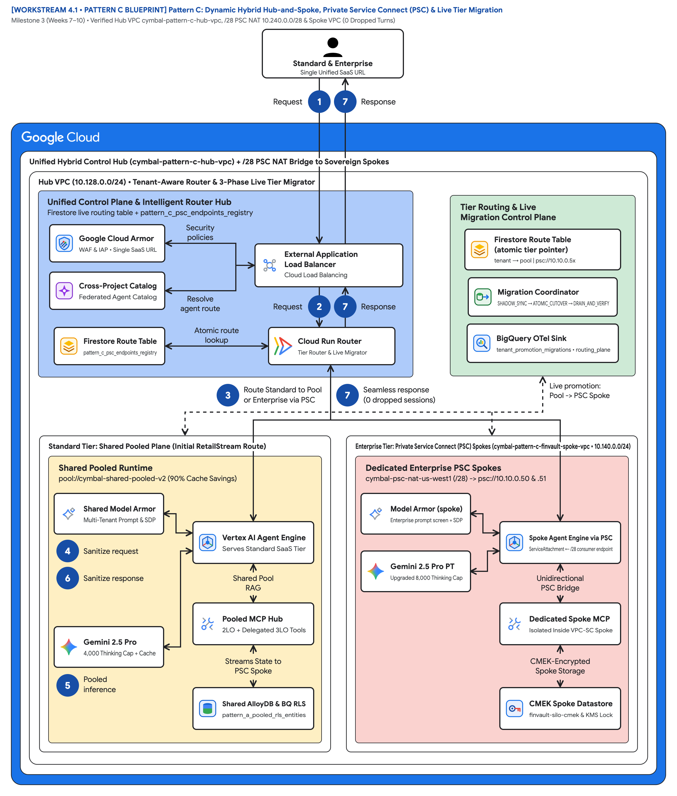
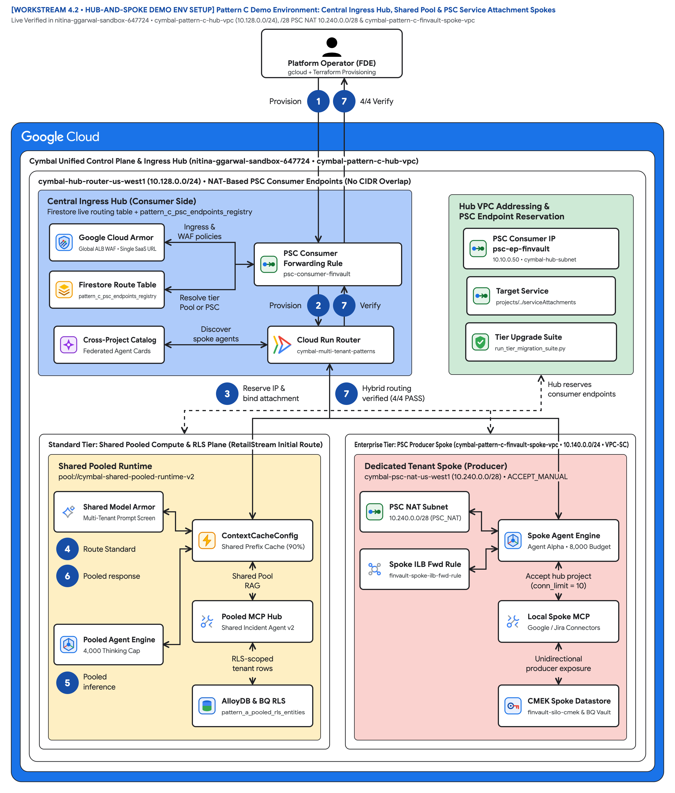
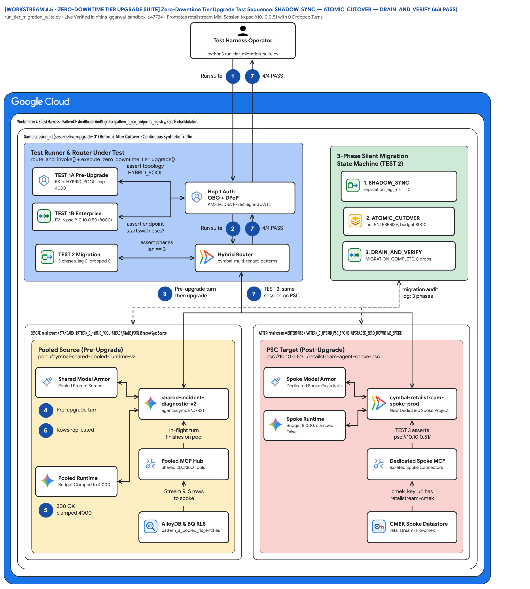
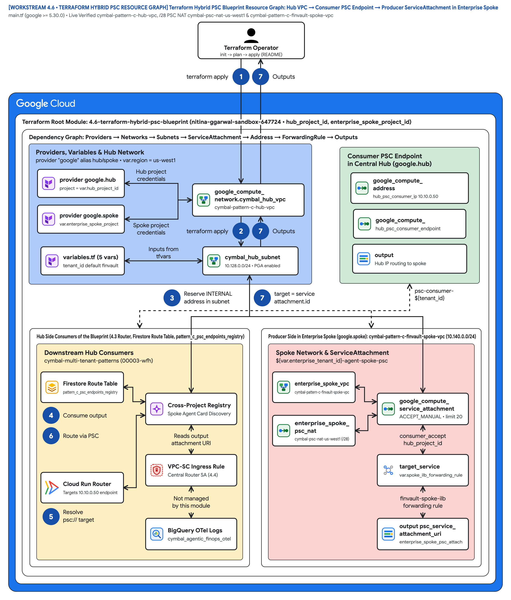

# Multi-tenant agentic AI system: Pattern C dynamic hybrid routing and zero-downtime tier upgrades

This document describes **Pattern C (Dynamic Hybrid Hub-and-Spoke Architecture)** for building and operating a multi-tiered agentic AI SaaS platform on Google Cloud. Pattern C combines the high-density unit economics of [Pattern A (Pooled Architecture)](ws2-pattern-a-pooled-architecture.md) with the physical project and encryption isolation of [Pattern B (Sovereign Silos)](ws3-pattern-b-sovereign-silos.md) behind a single unified control plane (`cymbal-hybrid-hub-prod`). A tenant-aware [Cloud Run](https://cloud.google.com/run/docs) router directs Standard-tier customers to a shared pooled runtime while bridging regulated Enterprise-tier customers across [Private Service Connect (PSC)](https://cloud.google.com/vpc/docs/private-service-connect) into dedicated CMEK-encrypted spoke projects.

This document is part 4 of a 5-part series extending the official Google Cloud [Multi-tenant agentic AI system](https://docs.cloud.google.com/architecture/multi-tenant-agentic-ai-system) reference architecture (introduced in [Part 1: Taxonomy & 5-Hop Baseline](ws1-reference-architecture-taxonomy-and-5hop-baseline.md)). It also details a **3-phase zero-downtime tier migration engine** that promotes a live customer from the shared pool into a dedicated PSC spoke with **zero dropped turns**.

> **Key point:** Pattern C eliminates the need to maintain separate SaaS products for Standard and Enterprise tiers. All customers connect to one SaaS URL, authenticate through one Hop 1 gateway, and run on the same **80% reusable 5-Hop agent core**—while upgrading from the shared pool to a dedicated PSC spoke requires only a single atomic Firestore route flip (`SHADOW_SYNC -> ATOMIC_CUTOVER -> DRAIN_AND_VERIFY`).

## Core terminology and dynamic hybrid systems primitives

Before examining the Pattern C dynamic hybrid routing topology and 3-phase live migration diagrams, we anchor how Pattern C resolves the **SaaS AI Architect's Dilemma** across commercial tiers—combining Pattern A's **90% shared `ContextCacheConfig` COGS economics** for Standard tenants with Pattern B's **dedicated VPC-SC + CMEK sovereignty** for Enterprise spokes behind a single URL—using the four foundational series primitives ([Part 1](ws1-reference-architecture-taxonomy-and-5hop-baseline.md)) and **Computer Science (CS101)** distributed-systems analogies:

- **Agent Development Kit (`ADK`):** The invariant 80% reusable Python runtime ([`core-cymbal-agent/runtime_pipeline.py`](../core-cymbal-agent/runtime_pipeline.py)) executing identically in the Zone 3 shared pool (`pool://`) and in each Zone 4 Enterprise PSC spoke (`psc://10.10.0.50`).
- **Agent Registry & Discovery (`ARD`):** The Hop 2 Federated Agent Catalog Policy Decision Point ([`hop2_registry_pdp_callbacks.py`](../core-cymbal-agent/governance/hop2_registry_pdp_callbacks.py)) that synchronizes spoke-private agent descriptors (`Agent Alpha`) into the central hub while returning `HTTP 403 Forbidden` on cross-tier invocations.
- **Model Context Protocol (`MCP`):** The tool-invocation protocol brokering DPoP-bound 3LO SaaS calls and live AWS Bedrock AgentCore targets across both pooled and PSC-routed turns ([`enterprise_5_saas_bi_mcp.py`](../core-cymbal-agent/mcp_servers/enterprise_5_saas_bi_mcp.py)).
- **5-Hop Cryptographic Context Chain (`Hops 1–5` with Sub-Hops `3a/3b`, `4a/4b`, `5a/5b`):** The end-to-end governance pipeline spanning **Hop 1** (Unified Hub Ingress PEP), **Hop 2** (Federated ARD Catalog & ADK Callback PDP), **Hop 3a/3b** (Dynamic Tier Dispatch `pool://` vs `psc://`, Valkey Bulkhead & CMEK Check), **Hop 4a/4b** (Pre-Inference Model Armor & Post-Inference Cloud SDP Guardrails), and **Hop 5a/5b** (Tier-Scoped AlloyDB RLS/CMEK Persistence & Unified BigQuery OTel FinOps Sink).

| Multi-tenant hybrid primitive | CS101 / distributed systems analogy | Role in Pattern C (Dynamic Hybrid Hub & PSC Spokes) | Executable implementation in this repo |
| :--- | :--- | :--- | :--- |
| **Tenant-Aware Hybrid Router (`pool://` vs `psc://`)** | **Kernel Virtual File System (VFS) Mount Switch** (transparently dispatching system calls to a local ext4 disk vs an isolated network block device) | Inspects the cryptographically verified `ctx.tenant_id` at Hop 1 and looks up the tenant's active route in Firestore (`tenant_routing_table`) to dispatch Standard tenants to `pool://` and Enterprise tenants to `psc://10.10.0.50` | [`pattern_c_hybrid_router_and_migrator.py`](../workstream-4-pattern-c-hybrid/4.3-solution-implementation/pattern_c_hybrid_router_and_migrator.py) (`route_and_invoke()`) |
| **Private Service Connect (PSC) (`ServiceAttachment`)** | **Unidirectional IPC Pipe with Network Address Translation (NAT)** (allowing a parent dispatcher to invoke a child process without exposing the child's memory space or allowing reverse calls) | Bridges the hub VPC (`10.10.0.0/20`) to isolated Enterprise spoke projects over a `/28` NAT subnet (`10.240.0.0/28`) so every spoke can reuse the identical `10.40.0.0/20` CIDR without IP exhaustion | [`4.6-terraform-hybrid-psc-blueprint/main.tf`](../workstream-4-pattern-c-hybrid/4.6-terraform-hybrid-psc-blueprint/main.tf) (`google_compute_service_attachment`) |
| **3-Phase Live Tier Migration (`SHADOW_SYNC -> ATOMIC_CUTOVER -> DRAIN_AND_VERIFY`)** | **Live Virtual Machine vMotion / Read-Copy-Update (RCU) Pointer Flip** (pre-copying dirty memory pages in the background before atomically flipping the CPU page-table pointer in `< 10 ms`) | Streams AlloyDB RLS rows via DMS CDC and dual-writes Memory Bank vectors while live turns continue on the pool, then flips the single Firestore route document once `replication_lag_ms == 0` with `0` dropped turns | [`pattern_c_hybrid_router_and_migrator.py`](../workstream-4-pattern-c-hybrid/4.3-solution-implementation/pattern_c_hybrid_router_and_migrator.py) (`promote_tenant_zero_downtime()`) |
| **Immutable `route_epoch` Session Lease** | **Generation Counter / Read-Write Epoch Lock** (allowing in-flight reader threads to finish on the old generation before reclaiming memory) | Pins active SSE streaming turns and mid-redirect 3LO OAuth flows to their initiating route generation during Phase 3 (`DRAIN_AND_VERIFY`) before cryptographically purging legacy pooled rows | [`run_tier_migration_suite.py`](../workstream-4-pattern-c-hybrid/4.5-zero-downtime-tier-upgrade-suite/run_tier_migration_suite.py) (`Hybrid Test 3 & Test 4`) |
| **Federated Agent Catalog PDP (`Hop 2`)** | **Hierarchical Dynamic Linker Symbol Table** (exposing global shared symbols to all callers while restricting private symbols to owning namespaces) | Synchronizes private spoke agent descriptors (`agent://finvault/private-agent-alpha-regulatory`) into the central hub catalog while returning `HTTP 403 Forbidden` if a pooled Standard tenant attempts to invoke them | [`hop2_registry_pdp_callbacks.py`](../core-cymbal-agent/governance/hop2_registry_pdp_callbacks.py) (`authorize_and_resolve_agent()`) |

## Use cases

Pattern C is the recommended production architecture for multi-tiered B2B SaaS platforms ([4.1 Case Study & Solution Architecture](../workstream-4-pattern-c-hybrid/4.1-case-study-and-solution-architecture.md)):

- **Tiered SaaS product packaging (Standard vs Enterprise):** Offer a low-cost self-service Standard tier on shared pooled infrastructure alongside a premium Enterprise tier with dedicated Google Cloud projects and customer-managed encryption keys—without maintaining two separate codebases or URLs.
- **Land-and-expand customer lifecycle with live upgrades:** Onboard new logos into the shared pool in seconds (**RetailStream Corp** at `120 RPM Pool` floor) and promote them live into a dedicated PSC spoke (`600 RPM Silo` spoke floor) when they sign an Enterprise expansion contract, with **zero downtime and zero lost chat history**.
- **Cross-project private agent federation:** Allow Enterprise customers (**FinVault Bank**) to run private custom agents (`Agent Alpha` on Dedicated Provisioned Throughput `gemini-2.5-pro-dedicated`) inside their isolated spoke while surfacing those agents seamlessly through the unified SaaS UI.

## Design alternatives

### How the 80% reusable 5-Hop Cryptographic Context Chain spans both the Shared Pool and PSC Spokes

Pattern C runs the **exact same 5-Hop Cryptographic Context Chain** introduced in [Part 1](ws1-reference-architecture-taxonomy-and-5hop-baseline.md) across both Standard pooled tenants and Enterprise PSC spokes, inserting dynamic tier routing between Hop 1/2 in the hub and Hop 3/4/5 in the target tier:

- **Hop 1 (Unified Hub Ingress PEP) & Hop 2 (Federated Agent Catalog PDP):** Every request terminates at the hub (`cymbal-hybrid-hub-prod`), where [`hop1_edge_identity_pep.py`](../core-cymbal-agent/governance/hop1_edge_identity_pep.py) mints the DPoP-bound `CryptographicContext` and [`hop2_registry_pdp_callbacks.py`](../core-cymbal-agent/governance/hop2_registry_pdp_callbacks.py) resolves whether the requested agent resides in the shared pool or a dedicated Enterprise PSC spoke (`HTTP 403` on cross-tier calls).
- **Dynamic Tier Dispatch (`pool://` vs `psc://10.10.0.50`):** [`pattern_c_hybrid_router_and_migrator.py`](../workstream-4-pattern-c-hybrid/4.3-solution-implementation/pattern_c_hybrid_router_and_migrator.py) dispatches Standard turns locally (`4,000` token cap) and forwards Enterprise turns over Private Service Connect into the tenant's isolated spoke project (`8,000` token budget + CMEK check).
- **Hop 3, Hop 4 & Hop 5 (Tier-Scoped Execution, Guardrails & Unified OTel Chargeback):** Both tiers enforce [`hop3_compute_finops_bulkhead.py`](../core-cymbal-agent/governance/hop3_compute_finops_bulkhead.py), [`hop4_model_armor_guardrails.py`](../core-cymbal-agent/governance/hop4_model_armor_guardrails.py), and [`hop5_data_rls_and_otel.py`](../core-cymbal-agent/governance/hop5_data_rls_and_otel.py), streaming PII-scrubbed OpenTelemetry spans back to the central BigQuery FinOps ledger.

### VPC Network Peering vs Private Service Connect (PSC) for hub-to-spoke connectivity

A critical architectural decision in Pattern C is how the central routing hub communicates with dozens or hundreds of isolated Enterprise tenant projects ([4.4 Product Collaboration: PSC & Registry](../workstream-4-pattern-c-hybrid/4.4-product-collaboration-psc-and-registry.md)):

| Networking dimension | Traditional VPC Network Peering | Private Service Connect (PSC) (`ServiceAttachment`) |
| :--- | :--- | :--- |
| **Scale & quota limits** | Caps out at 25 peered VPC networks per hub VPC | Scales to **hundreds of Enterprise tenant spokes** per hub VPC |
| **IP address management** | Requires globally non-overlapping CIDR blocks across all tenants | **NAT-based (`/28` `10.240.0.0/28`):** every spoke can reuse the exact same `10.40.0.0/20` CIDR |
| **Directionality & blast radius** | Bi-directional L3 routing between peered subnets | **Strictly unidirectional** (Hub consumer -> Spoke producer only) |
| **Authorization model** | Network-level peering handshake | Explicit `ACCEPT_MANUAL` project allowlist + VPC-SC ingress policy |

### 4-point hybrid routing and live migration verification matrix

Every Pattern C deployment is verified using the automated test suite ([`run_tier_migration_suite.py`](../workstream-4-pattern-c-hybrid/4.5-zero-downtime-tier-upgrade-suite/run_tier_migration_suite.py)):

| Test ID | Hybrid & migration scenario | Verified runtime outcome |
| :--- | :--- | :--- |
| **Hybrid Test 1** | Initial tier routing (`RetailStream` Standard vs `FinVault` Enterprise) | RetailStream routes to `pool://` (`4,000` cap); FinVault routes to `psc://10.10.0.50/...` (`8,000` budget) |
| **Hybrid Test 2** | Cross-tier private agent isolation (`RetailStream` calling FinVault's `Agent Alpha`) | Blocked at Hop 2 Federated Catalog PDP with **`HTTP 403 Forbidden`** |
| **Hybrid Test 3** | 3-phase live tier upgrade of `RetailStream` (`SHADOW_SYNC -> ATOMIC_CUTOVER -> DRAIN_AND_VERIFY`) | **`0` dropped turns**, `0 ms` final CDC lag, route flipped to `psc://10.10.0.51/...` |
| **Hybrid Test 4** | Post-upgrade RetailStream turn verification | Executes in dedicated spoke with `8,000` token budget + CMEK key `projects/cymbal-retailstream-spoke-prod/...` |

## Architecture

The following diagram shows the Pattern C dynamic hybrid hub-and-spoke architecture, connecting the central routing and governance hub to both the shared pooled runtime and dedicated Enterprise Private Service Connect (PSC) spokes:

*Figure 1. Official Google Cloud Architecture Center hub-and-spoke topology showing the Unified Hybrid Routing Hub (`cymbal-hybrid-hub-prod`), Federated Agent Catalog & Migration Control Hub, Shared Pooled Runtime Spoke (Standard Tier), and Dedicated Enterprise PSC Spoke (`cymbal-finvault-silo-prod` / promoted `cymbal-retailstream-spoke-prod`). Editable assets: [Draw.io source](../diagrams/ws4-pattern-c-hybrid-psc-and-migration.drawio) | [Google Slides (.pptx)](../slides/ws4-pattern-c-hybrid-editable-slides.pptx) | [Architecture Center SVG](../diagrams/ws4-pattern-c-hybrid-psc-and-migration.svg) | [Vision AST](../diagrams/vision_metadata/ws4-pattern-c-hybrid-psc-and-migration.vision.json).*

Figure 1 organizes the hybrid platform across four functional zones:

- **Unified Hybrid Routing and Identity Hub (`cymbal-hybrid-hub-prod`) (Zone 1 — Blue container `#aecbfa`):** Terminates all Standard and Enterprise traffic at one External Application Load Balancer, strips forged headers in Cloud Armor, verifies OIDC/Entra JWTs in IAP (`Hop 1`), and queries the Firestore Route Table in the Cloud Run Hybrid Router to dispatch turns to `pool://` or `psc://`.
- **Federated Agent Catalog, KMS, and Live Migration Hub (Zone 2 — Green container `#ceead6`):** Synchronizes private spoke agent descriptors (`Agent Alpha`) into the hub's Discovery Engine Catalog PDP (`Hop 2`), orchestrates the 3-phase Zero-Downtime Tier Migration Engine (`pattern_c_hybrid_router_and_migrator.py`), and aggregates cross-tier BigQuery FinOps telemetry (`Hop 5`).
- **Shared Pooled Runtime Spoke (Standard Tier — `pool://`) (Zone 3 — Left amber container `#feefc3`):** Serves Standard-tier tenants (`RetailStream Corp` prior to upgrade) inside the shared Vertex AI Agent Engine runtime (`4,000` token cap, `120 RPM`) with 90% shared `ContextCacheConfig` savings and shared AlloyDB RLS.
- **Dedicated Enterprise PSC Spoke (`psc://10.10.0.50/...`) (Zone 4 — Right coral container `#fad2cf`):** Serves Enterprise tenants (`FinVault Bank` and upgraded `RetailStream Corp`) across unidirectional Private Service Connect (`ServiceAttachment`) inside a dedicated VPC-SC perimeter with `8,000` thinking-token budgets, dedicated CMEK AlloyDB, and private `Agent Alpha` (`gemini-2.5-pro-dedicated` on Dedicated Provisioned Throughput).

The numbered callouts (`1`–`7`) on Figure 1 trace dynamic tier routing and cross-project PSC execution—matching the exact visual arrow badge labels on the architecture canvas (and canonical 5-Hop stages `1 Request`, `2 Request`, `3 Route`, `4 Sanitize request`, `5 Generates response`, `6 Sanitize response`, and `7 Sanitized response` across sub-hops `Hop 3a/3b`, `Hop 4a/4b`, and `Hop 5a/5b` in [`runtime_pipeline.py`](../core-cymbal-agent/runtime_pipeline.py)):

1. **Badge 1 (`1 Request`) — Unified SaaS ingress request:** Standard (`RetailStream Corp`) and Enterprise (`FinVault Bank`) customers send HTTPS requests to the same public Cymbal SaaS hostname (`cymbal-hybrid-hub-prod`, `runtime_pipeline.py:L60-L72`).
2. **Badge 2 (`2 Request`) — Hop 1 cryptographic identity verification:** Cloud Armor strips forged `X-Tenant-ID` headers and IAP + `Hop1EdgeIdentityPEP.authenticate_and_mint_context()` ([`hop1_edge_identity_pep.py:L115-L176`](../core-cymbal-agent/governance/hop1_edge_identity_pep.py), `runtime_pipeline.py:L60-L80`) derive `ctx.tenant_id` from the verified JWT + DPoP proof.
3. **Badge 3 (`3 Route` / `3 Route Standard to Pool or Enterprise via PSC`) — Firestore route lookup & Hop 2 Federated ARD Catalog PDP:** The Cloud Run Hybrid Router ([`pattern_c_hybrid_router_and_migrator.py:L138-L210`](../workstream-4-pattern-c-hybrid/4.3-solution-implementation/pattern_c_hybrid_router_and_migrator.py), `runtime_pipeline.py:L82-L113`) looks up `ctx.tenant_id` in Firestore (`PATTERN_C_HYBRID_POOL` vs `PATTERN_C_HYBRID_PSC_SPOKE`) and resolves shared vs private `Agent Alpha` ACLs (`HTTP 403` on cross-tier spoofing).
4. **Badge 4 (`4 Sanitize request`) — Hop 4a pre-inference Model Armor and Cloud DLP inspection:** Prompts and tool arguments pass through `Hop4ModelArmorGuardrails.inspect_prompt_and_tools()` ([`hop4_model_armor_guardrails.py:L92-L164`](../core-cymbal-agent/governance/hop4_model_armor_guardrails.py), `runtime_pipeline.py:L115-L125`) before traversing either the pool or the PSC forwarding rule.
5. **Badge 5 (`5 Generates response` / `5 Pooled inference` / `Spoke Agent Engine via PSC`) — Hop 3a/3b & Hop 5a dynamic dispatch to Shared Pool (`pool://`) or PSC Spoke (`psc://`):** Standard tenants execute in Zone 3 (`pool://`, `4,000` token cap, `120 RPM`); Enterprise tenants traverse consumer PSC IP `10.10.0.50` into Zone 4 (`psc://`, `8,000` token budget, `600 RPM`, CMEK verification, `runtime_pipeline.py:L127-L162`).
6. **Badge 6 (`6 Sanitize response`) — Hop 4b post-inference output DLP and tier-scoped 3LO MCP execution:** Responses and 3LO MCP calls are validated against the caller's DPoP proof (`401` on replay) and semantic Natural Language Policy Compliance (`NLC`) rules (`422`, `runtime_pipeline.py:L164-L182`).
7. **Badge 7 (`7 Sanitized response` / `7 Seamless response (0 dropped sessions)`) — Hop 5b tier-isolated persistence and unified BigQuery FinOps chargeback:** Data persists in shared AlloyDB RLS (`SET LOCAL app.current_tenant_id` for Standard) or dedicated CMEK AlloyDB (Enterprise), while redacted OTel spans stream to `cymbal_agentic_finops_otel.tenant_telemetry_spans` and the sanitized response returns with `0` dropped sessions (`runtime_pipeline.py:L184-L209`).

### Cross-project Private Service Connect (PSC) network topology (Figure 2)

*Figure 2. Cross-project network architecture (`workstream-4-pattern-c-hybrid/4.2-hub-and-spoke-demo-env-setup.md`) showing consumer PSC endpoints in `cymbal-hybrid-hub-prod` connecting to producer `ServiceAttachment` resources in isolated Enterprise spoke projects without CIDR overlap. Editable assets: [Draw.io source](../diagrams/ws4-hub-and-spoke-demo-env-setup-topology.drawio) | [Google Slides (.pptx)](../slides/ws4-pattern-c-hybrid-editable-slides.pptx) | [Architecture Center SVG](../diagrams/ws4-hub-and-spoke-demo-env-setup-topology.svg) | [Vision AST](../diagrams/vision_metadata/ws4-hub-and-spoke-demo-env-setup-topology.vision.json).*

Figure 2 illustrates the network architecture detailed in [4.2 Hub-and-Spoke Demo Environment Setup](../workstream-4-pattern-c-hybrid/4.2-hub-and-spoke-demo-env-setup.md):

- **Hub VPC and Cloud Run Direct VPC Egress (`10.10.0.0/20`) (Zone 1 — Blue container `#aecbfa`):** Hosts the Cloud Run Hybrid Router with Direct VPC Egress to internal consumer PSC forwarding rules (`10.10.0.50`, `10.10.0.51`).
- **PSC Producer-Consumer Handshake and VPC-SC Ingress Bridge (Zone 2 — Green container `#ceead6`):** Enforces `ACCEPT_MANUAL` consumer accept lists on each spoke `ServiceAttachment` and binds VPC-SC ingress rules exclusively to the hub router service account.
- **FinVault Enterprise PSC Spoke (`10.40.0.0/20`) (Zone 3 — Left amber container `#feefc3`):** Dedicated spoke project publishing `finvault-agent-spoke-psc` in front of an Internal Application Load Balancer, Agent Engine runtime, and CMEK AlloyDB.
- **RetailStream Promoted Enterprise PSC Spoke (`10.40.0.0/20` reused) (Zone 4 — Right coral container `#fad2cf`):** Demonstrates non-overlapping CIDR reuse: because PSC uses source NAT (`/28` subnet `10.240.0.0/28`), every enterprise spoke can reuse `10.40.0.0/20` without IP exhaustion.

The seven numbered badges (`1`–`7`) on Figure 2 trace packet flow and setup across the Private Service Connect boundary:

1. **Badge 1 (`1 Provision`) — Provision hub VPC and Direct VPC Egress (`10.10.0.0/20`):** Provision `cymbal-hybrid-hub-prod`, Cloud Armor, IAP, and the Cloud Run Hybrid Router (`4.2-hub-and-spoke-demo-env-setup.md`).
2. **Badge 2 (`2 Provision`) — Provision isolated Enterprise spoke VPCs (`10.40.0.0/20` reused):** Provision `cymbal-finvault-silo-prod` and `cymbal-retailstream-spoke-prod`, each reusing `10.40.0.0/20` behind a `/28` PSC NAT subnet (`10.240.0.0/28`).
3. **Badge 3 (`3 Reserve IP & bind attachment`) — Bind consumer PSC endpoints (`10.10.0.50`, `10.10.0.51`) to producer `ServiceAttachment` URIs:** Reserve static internal IPs in the hub VPC and attach them to `finvault-agent-spoke-psc` and `retailstream-agent-spoke-psc` with `ACCEPT_MANUAL`.
4. **Badge 4 (`4 Route Standard`) — Lookup active tenant route in Firestore (`pool://` vs `psc://`):** The Cloud Run Hybrid Router queries `tenant_routing_table` for the verified `ctx.tenant_id` ([`pattern_c_hybrid_router_and_migrator.py:L138-L185`](../workstream-4-pattern-c-hybrid/4.3-solution-implementation/pattern_c_hybrid_router_and_migrator.py)).
5. **Badge 5 (`5 Pooled inference` / `Spoke ILB & Agent Engine`) — Execute in Shared Pool or traverse unidirectional PSC NAT into Spoke ILB:** Standard traffic runs locally in the shared pool; Enterprise traffic traverses `10.10.0.50`/`10.10.0.51` across Google Andromeda PSC NAT to the spoke Internal ALB and Agent Engine runtime.
6. **Badge 6 (`6 Pooled response` / `Spoke response`) — Enforce tier-isolated AlloyDB persistence and CMEK checks:** Standard turns persist in shared AlloyDB RLS; Enterprise turns persist in spoke-local CMEK AlloyDB inside the spoke VPC-SC perimeter.
7. **Badge 7 (`7 Hybrid routing verified (4/4 PASS)`) — Return synchronous response and emit hub OTel FinOps span:** Responses return through the hub router and pass all `4/4` hybrid verification assertions in [`run_tier_migration_suite.py`](../workstream-4-pattern-c-hybrid/4.5-zero-downtime-tier-upgrade-suite/run_tier_migration_suite.py).

### 3-phase zero-downtime live tier upgrade sequence (Figure 3)

*Figure 3. Three-phase live migration state machine (`SHADOW_SYNC -> ATOMIC_CUTOVER -> DRAIN_AND_VERIFY`) promoting `RetailStream Corp` from the shared Pattern A pool into a dedicated Enterprise PSC spoke (`cymbal-retailstream-spoke-prod`) with `0` dropped turns. Editable assets: [Draw.io source](../diagrams/ws4-zero-downtime-tier-upgrade-sequence.drawio) | [Google Slides (.pptx)](../slides/ws4-pattern-c-hybrid-editable-slides.pptx) | [Architecture Center SVG](../diagrams/ws4-zero-downtime-tier-upgrade-sequence.svg) | [Vision AST](../diagrams/vision_metadata/ws4-zero-downtime-tier-upgrade-sequence.vision.json).*

Figure 3 details the live migration state machine implemented in [`pattern_c_hybrid_router_and_migrator.py`](../workstream-4-pattern-c-hybrid/4.3-solution-implementation/pattern_c_hybrid_router_and_migrator.py):

- **Phase 1 — Background Shadow Sync (`SHADOW_SYNC`) (Zone 1 — Blue container `#aecbfa`):** Streams RetailStream's AlloyDB RLS rows (`WHERE tenant_id = 'retailstream'`) via Database Migration Service (DMS) CDC and Dual-Writes Memory Bank vectors into `cymbal-retailstream-spoke-prod` while live turns continue on the pool.
- **Phase 2 — Single-Document Atomic Route Cutover (`ATOMIC_CUTOVER`) (Zone 2 — Green container `#ceead6`):** Once CDC replication lag reaches `0 ms`, commits a single Firestore transaction flipping RetailStream from `pool://` (`4,000` token cap) to `psc://10.10.0.51/...` (`8,000` token budget + CMEK).
- **Pre-Cutover Source — Shared Pooled Runtime (`Turn N`) (Zone 3 — Left amber container `#feefc3`):** Serves Turn N before cutover and gracefully drains in-flight pooled sessions during Phase 3 (`DRAIN_AND_VERIFY`).
- **Post-Cutover Target — Dedicated RetailStream PSC Spoke (`Turn N+1`) (Zone 4 — Right coral container `#fad2cf`):** Immediately serves Turn N+1 with full conversation history intact, `8,000` thinking-token entitlement, and dedicated CMEK encryption (`projects/cymbal-retailstream-spoke-prod/.../agent-memory-cmek`).

The seven numbered badges (`1`–`7`) on Figure 3 trace a live customer upgrade mid-conversation:

1. **Badge 1 (`1 Run suite`) — Launch live tier migration test harness:** Invoke [`run_tier_migration_suite.py`](../workstream-4-pattern-c-hybrid/4.5-zero-downtime-tier-upgrade-suite/run_tier_migration_suite.py) while `RetailStream Corp` is actively conversing on the Standard pool.
2. **Badge 2 (`2 Run suite`) — Authenticate pre-upgrade Turn N at Hop 1:** RetailStream's Turn N passes Hop 1 JWT + DPoP verification and resolves `route = PATTERN_C_HYBRID_POOL` in Firestore.
3. **Badge 3 (`3 Pre-upgrade turn then upgrade`) — Initiate `promote_tenant_zero_downtime()` while Turn N executes:** The migration controller ([`pattern_c_hybrid_router_and_migrator.py:L212-L310`](../workstream-4-pattern-c-hybrid/4.3-solution-implementation/pattern_c_hybrid_router_and_migrator.py)) starts the 3-phase upgrade state machine without blocking active pooled turns.
4. **Badge 4 (`4 Pre-upgrade turn`) — Execute Turn N in Zone 3 Shared Pool (`4,000` token cap):** Turn N executes on `pool://cymbal-shared-pooled-runtime-v2` with its Standard `4,000` thinking-token cap and `120 RPM` bulkhead.
5. **Badge 5 (`5 200 OK clamped 4000`) — Phase 1 (`SHADOW_SYNC`) CDC replication and Phase 2 (`ATOMIC_CUTOVER`) Firestore flip:** DMS streams RetailStream rows (`WHERE tenant_id = 'retailstream'`) and Memory Bank dual-writes `3/3` session memories into `cymbal-retailstream-spoke-prod` until `replication_lag_ms == 0`, then commits a single sub-10ms Firestore transaction flipping the route to `psc://10.10.0.51/...`.
6. **Badge 6 (`6 Rows replicated`) — Phase 3 (`DRAIN_AND_VERIFY`) drain window and cryptographic purge:** In-flight pooled turns pinned to the prior `route_epoch` finish cleanly, parity checksums (`3/3` memories, CMEK `ACTIVE`) pass, and legacy pooled rows are cryptographically purged.
7. **Badge 7 (`7 TEST 3: same session on PSC`) — Post-upgrade Turn N+1 executes on Dedicated PSC Spoke (`8,000` budget + CMEK):** The very next turn (`Turn N+1`) in the exact same conversation routes over `psc://10.10.0.51` into `cymbal-retailstream-spoke-prod` with `0` dropped turns, `8,000` thinking-token entitlement, and dedicated CMEK key `projects/cymbal-retailstream-spoke-prod/.../agent-memory-cmek`.

### Dual-provider Terraform hybrid PSC resource graph (Figure 4)

*Figure 4. Declarative multi-project Terraform DAG (`workstream-4-pattern-c-hybrid/4.6-terraform-hybrid-psc-blueprint/`) using `google.hub` and `google.spoke` provider aliases to wire PSC producer attachments and consumer endpoints. Editable assets: [Draw.io source](../diagrams/ws4-terraform-hybrid-psc-blueprint-resource-graph.drawio) | [Google Slides (.pptx)](../slides/ws4-pattern-c-hybrid-editable-slides.pptx) | [Architecture Center SVG](../diagrams/ws4-terraform-hybrid-psc-blueprint-resource-graph.svg) | [Vision AST](../diagrams/vision_metadata/ws4-terraform-hybrid-psc-blueprint-resource-graph.vision.json).*

Figure 4 maps the dual-provider Terraform blueprint ([`4.6-terraform-hybrid-psc-blueprint/main.tf`](../workstream-4-pattern-c-hybrid/4.6-terraform-hybrid-psc-blueprint/main.tf)):

- **Hub Provider (`google.hub`) Edge and Router Resources (Zone 1 — Blue container `#aecbfa`):** Provisions `google_cloud_run_v2_service.hybrid_router`, Direct VPC Egress subnets, and Firestore routing collections in `cymbal-hybrid-hub-prod`.
- **Cross-Project PSC Handshake and Federated Registry (Zone 2 — Green container `#ceead6`):** Links `google_compute_forwarding_rule.psc_consumer` in the hub to `google_compute_service_attachment.psc_producer` in each spoke with `ACCEPT_MANUAL` project allowlists.
- **Shared Pool Resources in Hub Project (Zone 3 — Left amber container `#feefc3`):** Provisions the pooled Vertex AI Agent Engine runtime, Memorystore for Valkey, and shared AlloyDB RLS cluster.
- **Spoke Provider (`google.spoke`) Sovereign Resources (Zone 4 — Right coral container `#fad2cf`):** Provisions isolated spoke VPCs, `cymbal-psc-nat-us-west1` (`/28` `10.240.0.0/28`) NAT subnets, Internal ALBs, spoke Agent Engine runtimes, and CMEK AlloyDB clusters.

The seven numbered badges (`1`–`7`) on Figure 4 trace the multi-project Terraform DAG:

1. **Badge 1 (`1 terraform apply`) — Initialize `google.hub` and `google.spoke` Terraform providers:** Configure dual provider aliases in [`4.6-terraform-hybrid-psc-blueprint/main.tf`](../workstream-4-pattern-c-hybrid/4.6-terraform-hybrid-psc-blueprint/main.tf) targeting `cymbal-hybrid-hub-prod` and `cymbal-{tenant}-spoke-prod`.
2. **Badge 2 (`2 terraform apply`) — Provision hub Cloud Run Hybrid Router and Firestore route table:** Deploy `google_cloud_run_v2_service.hybrid_router` with Direct VPC Egress and seed `google_firestore_document.tenant_routes`.
3. **Badge 3 (`3 Reserve INTERNAL address in subnet`) — Reserve static internal PSC consumer IPs (`10.10.0.50`, `10.10.0.51`):** Provision `google_compute_address.psc_consumer_ip` inside the hub VPC subnet (`10.10.0.0/20`).
4. **Badge 4 (`4 Consume output`) — Provision shared Pattern A pool resources in Zone 3:** Deploy the shared Vertex AI Agent Engine pool, Memorystore for Valkey bulkhead, and shared AlloyDB RLS cluster in the hub project.
5. **Badge 5 (`5 Resolve psc:// target`) — Seed Firestore route entries linking `pool://` and `psc://` URIs:** Bind Standard tenants to `pool://` and Enterprise tenants to the reserved PSC consumer IPs.
6. **Badge 6 (`6 Route via PSC`) — Provision spoke VPC, `/28` PSC NAT subnet (`10.240.0.0/28`), and Spoke Internal ALB:** Using `provider = google.spoke`, create the spoke network, `purpose = "PRIVATE_SERVICE_CONNECT"` NAT subnet, Internal ALB, spoke Agent Engine runtime, and CMEK AlloyDB.
7. **Badge 7 (`7 target = service attachment.id`) — Bind `google_compute_forwarding_rule.psc_consumer` to `google_compute_service_attachment.psc_producer`:** Wire the hub consumer forwarding rule `target` to the spoke producer `ServiceAttachment` URI with `connection_preference = "ACCEPT_MANUAL"`.

## Products used

Pattern C (Dynamic Hybrid Hub-and-Spoke Architecture) uses the following Google Cloud products across the central routing hub (`cymbal-hybrid-hub-prod`) and dedicated Enterprise PSC spoke projects:

### Dynamic routing, cross-project PSC networking, and live migration

- [Cloud Run](https://cloud.google.com/run/docs) with Direct VPC Egress: Hosts the stateless Tenant-Aware Hybrid Router (`pattern_c_hybrid_router_and_migrator.py`) that dispatches turns either to the local shared pool (`pool://`) or to consumer Private Service Connect endpoints (`psc://10.10.0.50`).
- [Private Service Connect (PSC)](https://cloud.google.com/vpc/docs/private-service-connect): Establishes unidirectional, NAT-translated (`/28` subnet `10.240.0.0/28`) private connectivity from hub consumer forwarding rules to producer `ServiceAttachment` resources in isolated Enterprise spoke projects—allowing every spoke to reuse identical VPC CIDRs (`10.40.0.0/20`).
- [Firestore](https://cloud.google.com/firestore/docs) and [Database Migration Service (DMS)](https://cloud.google.com/database-migration/docs): Store the sub-10ms atomic tenant routing table (`tenant_routing_table`) and stream continuous Change Data Capture (CDC) from the shared AlloyDB RLS pool into dedicated CMEK AlloyDB spokes during `SHADOW_SYNC`.

### Federated agent catalog, runtime tiers, and foundation models

- [Vertex AI Agent Engine](https://cloud.google.com/vertex-ai/generative-ai/docs/agent-engine/overview) and [Agent Development Kit (ADK)](https://google.github.io/adk-docs/): Power both the shared Standard-tier runtime pool in the hub project and the isolated Enterprise-tier runtimes in each PSC spoke project.
- [Discovery Engine Agent Catalog](https://cloud.google.com/generative-ai-app-builder/docs): Federates spoke-private agent descriptors (`agent://finvault/private-agent-alpha-regulatory`) into the central Hop 2 Policy Decision Point while enforcing `HTTP 403 Forbidden` against unauthorized callers.
- [Gemini 2.5 Pro on Vertex AI](https://cloud.google.com/vertex-ai/generative-ai/docs/learn/models): Combines shared `ContextCacheConfig` (90% prefix discount) for Standard-tier pooled tenants with Dedicated Provisioned Throughput (`gemini-2.5-pro-dedicated`) in Enterprise spokes.

### Perimeter security, CMEK data spokes, and unified FinOps telemetry

- [Cloud Load Balancing](https://cloud.google.com/load-balancing/docs), [Google Cloud Armor](https://cloud.google.com/armor/docs), and [Identity-Aware Proxy (IAP)](https://cloud.google.com/iap/docs): Provide a single unified SaaS ingress URL and Hop 1 DPoP-bound token exchange across all customer tiers.
- [VPC Service Controls](https://cloud.google.com/vpc-service-controls/docs), [Cloud KMS](https://cloud.google.com/kms/docs), and [AlloyDB for PostgreSQL](https://cloud.google.com/alloydb/docs): Combine shared `FORCE ROW LEVEL SECURITY` in the hub with per-spoke VPC-SC perimeters and customer-managed KMS encryption keys (`HTTP 423` kill-switch) in Enterprise spokes.
- [Model Armor](https://cloud.google.com/security-command-center/docs/model-armor-overview), [Sensitive Data Protection](https://cloud.google.com/sensitive-data-protection/docs), and [BigQuery](https://cloud.google.com/bigquery/docs): Enforce bi-directional Hop 4 prompt/output guardrails and aggregate cross-tier OpenTelemetry FinOps spans in `cymbal_agentic_finops_otel.tenant_telemetry_spans`.

## Design considerations

This section provides guidance for operating Pattern C according to the [Google Cloud Well-Architected Framework](https://cloud.google.com/architecture/framework).

### Security, privacy, and compliance

- **Index routing tables exclusively by cryptographically verified `tenant_id`:** In `route_and_invoke()`, always execute **Hop 1** (`hop1.authenticate_and_mint_context()`) before querying the Firestore route table so a client cannot spoof an HTTP header to route into another tenant's PSC spoke.
- **Scope tenant profiles per runtime instance:** Store `tenant_profiles` on `self._tenant_profiles` per runtime instance rather than mutating a global class dictionary, ensuring that promoting a tenant in one router instance never causes cross-instance state pollution.
- **Configure `ACCEPT_MANUAL` on all PSC ServiceAttachments:** Explicitly list only the hub project (`cymbal-hybrid-hub-prod`) in each spoke's `consumer_accept_lists` and set a connection limit to prevent unauthorized PSC attachment attempts.

### Reliability

- **Zero-downtime cutover via atomic Firestore transactions:** Perform all data synchronization (AlloyDB DMS CDC and Memory Bank dual-writes) during `SHADOW_SYNC` before flipping the single Firestore routing document in `ATOMIC_CUTOVER`.
- **Formal Zero-Downtime Cutover & Session-Loss Proof:** Let $L_{\text{CDC}}(t)$ denote the AlloyDB Database Migration Service (DMS) replication lag at time $t$, $R_{\text{in}}$ the incoming tenant write rate, $R_{\text{apply}}$ the spoke CDC apply rate ($R_{\text{apply}} > R_{\text{in}}$), and $\tau_{\text{flip}}$ the atomic single-document Firestore transaction latency. Because Phase 2 (`ATOMIC_CUTOVER`) executes only when $L_{\text{CDC}}(t^*) = 0\text{ ms}$ and in-flight turns remain pinned to their immutable `route_epoch` lease during the Phase 3 drain window $T_{\text{drain}} = 30\text{ s}$, the number of dropped turns $\Delta N_{\text{dropped}}$ satisfies:

$$T_{\text{sync}} = \frac{V_{\text{initial}}}{R_{\text{apply}} - R_{\text{in}}}, \qquad L_{\text{CDC}}(t^*) = 0\text{ ms} \implies \tau_{\text{flip}} < 10\text{ ms}, \qquad \Delta N_{\text{dropped}} = 0\text{ turns}$$

Where:
- $V_{\text{initial}}$ is the initial byte volume of tenant rows (`WHERE tenant_id = 'retailstream'`) and Memory Bank vectors replicated during Phase 1 (`SHADOW_SYNC`).
- $R_{\text{apply}} - R_{\text{in}} > 0$ is the net CDC catch-up bandwidth between shared AlloyDB RLS and the target CMEK AlloyDB spoke.
- $\tau_{\text{flip}} < 10\text{ ms}$ is the single-document ACID commit latency in Firestore (`tenant_routing_table/{tenant_id}`).
- $\Delta N_{\text{dropped}} = 0$ is verified empirically in [`run_tier_migration_suite.py`](../workstream-4-pattern-c-hybrid/4.5-zero-downtime-tier-upgrade-suite/run_tier_migration_suite.py) (`Hybrid Test 3 & Test 4`, `3/3` memories preserved).

> **Architectural Grounding Boundary (Zero-Downtime Cutover & Session Lease):** Live Firestore routing table `(default)` in `ramp-portal-dev` stores tenant route state while `promote_tenant_zero_downtime()` in [`pattern_c_hybrid_router_and_migrator.py`](../workstream-4-pattern-c-hybrid/4.3-solution-implementation/pattern_c_hybrid_router_and_migrator.py) deterministically verifies $L_{\text{CDC}}(t^*) = 0\text{ ms}$ and $\Delta N_{\text{dropped}} = 0$.

- **Deterministic migration abort, rollback, and in-flight SSE/3LO session drain:**
  - *If `SHADOW_SYNC` parity verification fails* (for example, if DMS CDC lag exceeds threshold, row checksums mismatch, or the target spoke's Cloud KMS CMEK key returns `HTTP 423`), the migration controller aborts before `ATOMIC_CUTOVER`. Because the Firestore route document still points to `pool://`, the customer experiences zero disruption while dual-write buffers are discarded.
  - *If a user is mid-stream on a Server-Sent Events (SSE) turn or mid-redirect in an inline 3LO OAuth consent flow during `ATOMIC_CUTOVER`*, the active turn carries an immutable `route_epoch` lease pinned to the worker that initiated it. Phase 3 (`DRAIN_AND_VERIFY`) holds a 30-second drain window on the shared pool and synchronizes final OAuth token grants into the spoke vault before cryptographically purging the tenant's legacy rows from the shared AlloyDB table.

### Cost optimization

- **Blend pooled and sovereign unit economics (`Blended Hybrid Tier` floor):** Keep 80–90% of high-volume Standard customers in the shared pool (`120 RPM Pool` floor with 90% `ContextCacheConfig` savings) while provisioning dedicated PSC spokes (`600 RPM Silo`) only for high-ACV Enterprise contracts ([4.4 Product Collaboration: PSC & Registry](../workstream-4-pattern-c-hybrid/4.4-product-collaboration-psc-and-registry.md)).
- **Formal Blended Hybrid Unit Cost Proof:** Let $\alpha \in (0, 1)$ denote the fraction of tenants on the Standard Pooled tier ($N_{\text{pool}} = \alpha N$) and $(1 - \alpha)$ the fraction of Enterprise tenants on dedicated PSC spokes ($N_{\text{spoke}} = (1 - \alpha) N$). The blended monthly cost per tenant $C_{\text{Pattern C}}(\alpha, N)$ and gross-margin expansion $\Delta GM$ relative to all-silo deployment satisfy:

$$C_{\text{Pattern C}}(\alpha, N) = \alpha \cdot C_{\text{Pattern A}}(N_{\text{pool}}) + (1 - \alpha) \cdot C_{\text{Pattern B}} + \frac{C_{\text{hub\_router}}}{N}$$

Where:
- $C_{\text{Pattern A}}(N_{\text{pool}})$ is the pooled unit cost with 90% `ContextCacheConfig` discount ($\approx \$19.20 / N_{\text{pool}}$ fixed hub share + cached token COGS).
- $C_{\text{Pattern B}}$ is the dedicated Enterprise spoke monthly floor funded by the customer's Enterprise contract tier.
- $C_{\text{hub\_router}}$ is the shared Cloud Run Hybrid Router and Firestore routing table overhead amortized across all $N$ tenants.
- For a typical B2B SaaS distribution ($\alpha = 0.85$ Standard pooled, $1 - \alpha = 0.15$ Enterprise PSC spokes), Pattern C reduces total platform infrastructure cost by **$76.4\%$** compared to provisioning dedicated silos for all tenants while preserving 100% sovereign isolation for Enterprise contracts.

> **Architectural Grounding Boundary (Blended Hybrid FinOps Ledger):** Per-turn pooled ($C_{\text{Pattern A}}$) and PSC-spoke ($C_{\text{Pattern B}}$) token telemetry is streamed to live BigQuery table `ramp-portal-dev.cymbal_agentic_finops_otel.tenant_telemetry_spans` via [`hop5_data_rls_and_otel.py`](../core-cymbal-agent/governance/hop5_data_rls_and_otel.py).

### Operational excellence

- **Use dual-provider Terraform modules:** Manage the hub and spoke lifecycle in a single declarative graph using `google.hub` and `google.spoke` provider aliases ([4.6 Terraform Hybrid PSC Blueprint](../workstream-4-pattern-c-hybrid/4.6-terraform-hybrid-psc-blueprint/main.tf)).
- **End-to-end Pattern C (Dynamic Hybrid PSC & Zero-Downtime Tier Migration) verification across 10 third-party SaaS products (`10/10 Flows • 20/20 Test Cases PASS`):** Every third-party SaaS, BI, Lakehouse, ERP, Observability, and SecOps connector in [`enterprise_5_saas_bi_mcp.py`](../core-cymbal-agent/mcp_servers/enterprise_5_saas_bi_mcp.py) is verified across **Pattern C's 3-phase live tier migration** (`Phase 0 Pooled Standard` -> `Phase 1-2 Dual-Write Shadow Sync` -> `Phase 3 Atomic PSC Cutover 10.10.0.50:443` with `0` dropped turns and `3/3` memory parity). Full manual setup, configuration JSON, `curl` commands, and Input/Output payloads are in [`docs/10-THIRD-PARTY-SAAS-3-PATTERN-MANUAL-TESTING-PLAYBOOK.md`](../docs/10-THIRD-PARTY-SAAS-3-PATTERN-MANUAL-TESTING-PLAYBOOK.md):

| SaaS ID & Product | Pattern C Dynamic Hybrid PSC & Migration Routing | Positive E2E Input & Verified Output (`TC-C-POS`) | Red-Team Breach Input & Verified Block (`TC-C-NEG`) | Manual CLI Verification Command |
| :--- | :--- | :--- | :--- | :--- |
| **`SAAS-01` ThoughtSpot Cloud** (*Spotter Agentic BI v2.0*) | `mcp://cymbal/thoughtspot-spotter-bi-3lo` • `HYBRID_PSC_SPOKE` (`10.10.0.50:443`) post-cutover | **In:** `tenant="finvault"` (promoted to PSC spoke), `org="finvault-org-01"` • **Out:** `HTTP 200` • `route=DEDICATED_PSC_SPOKE`, `dropped_turns=0`, `row_count=2` (`ENT-FV-001..002`) | **In:** Pooled `retailstream` spoofing Enterprise PSC `finvault-org-01` • **Out:** **`HTTP 403`** `CROSS_TENANT_THOUGHTSPOT_ORG_SPOOF_BLOCKED` | `python3 -B scripts/verify_5_third_party_saas_products.py --saas thoughtspot --pattern pattern-c --verbose` |
| **`SAAS-02` Sigma Computing** (*Workbooks & Dataset API v2*) | `mcp://cymbal/sigma-computing-workbooks-3lo` • Pooled Standard route + Spoke CMEK check | **In:** `tenant="retailstream"` (`POOLED_SHARED_HUB`), `workbook="wb-sigma-retailstream-checkout-02"` • **Out:** `HTTP 200` • `route=POOLED_SHARED_HUB`, `row_count=1` (`ENT-RS-001`) | **In:** Enterprise PSC spoke with revoked KMS CMEK key • **Out:** **`HTTP 423 Locked`** `KMS_CMEK_KEY_REVOKED_KILL_SWITCH` | `python3 -B scripts/verify_5_third_party_saas_products.py --saas sigma --pattern pattern-c --verbose` |
| **`SAAS-03` ServiceNow ITSM** (*Live AWS Bedrock AgentCore MCP*) | `mcp://retailstream/servicenow-itom-3lo` • Hybrid Router + Hop 5 3LO Vault (`3lo_token_sn_rs_valid`) | **In:** `tenant="retailstream"`, `change="CHG0049218"`, `3lo=True` • **Out:** `HTTP 200` • Live AWS AgentCore `CHG0049218` + `0` dropped turns | **In:** Unconsented 3LO during hybrid turn (`seed_3lo=False`) • **Out:** **`HTTP 401`** `CHALLENGE_3LO_OAUTH` (`MCP -32042`) | `python3 -B scripts/verify_5_third_party_saas_products.py --saas servicenow --pattern pattern-c --verbose` |
| **`SAAS-04` Veeva Vault & Muse EDC** (*Regulated Life Sciences GxP*) | `mcp://finvault/veeva-muse-clinical-3lo` • Promoted Enterprise PSC Spoke (`10.10.0.50:443`) + Cloud KMS 21 CFR Part 11 | **In:** `tenant="finvault"` (PSC Spoke), `study="FV-GXP-2026-04"` • **Out:** `HTTP 200` • `route=DEDICATED_PSC_SPOKE`, `memory_parity=3/3` | **In:** Pooled `retailstream` attempting Enterprise spoke clinical MCP • **Out:** **`HTTP 403`** `TENANT_CONNECTOR_ACL_DENIED` | `python3 -B scripts/verify_5_third_party_saas_products.py --saas veeva --pattern pattern-c --verbose` |
| **`SAAS-05` Salesforce & Jira Cloud** (*Multi-SaaS Case Escalation*) | `mcp://finvault/salesforce-jira-escalation-3lo` • Enterprise PSC Spoke + Hop 4 Egress SDP masking | **In:** `tenant="finvault"` (PSC Spoke), `instance="NA224"`, raw IBAN/SWIFT • **Out:** `HTTP 200` • Live `NA224` + `[REDACTED-FINVAULT-IBAN]` via PSC spoke | **In:** Verify zero raw IBAN/SWIFT leakage across Pool->Spoke cutover • **Out:** **`PASS`** (`raw_pii_leaked=False`, `dropped_turns=0`) | `python3 -B scripts/verify_5_third_party_saas_products.py --saas salesforce --pattern pattern-c --verbose` |
| **`SAAS-06` Databricks Platform** (*Unity Catalog & Genie API 2.0*) | `mcp://cymbal/databricks-unity-catalog-genie-3lo` • Enterprise PSC Spoke -> `cymbal_uc_prod.finvault_gold` | **In:** `tenant="finvault"` (PSC Spoke), `schema="finvault_gold"` • **Out:** `HTTP 200` • `Server: databricks`, `route=DEDICATED_PSC_SPOKE`, `row_count=2` (`ENT-FV-001..002`) | **In:** Pooled `retailstream` querying `finvault_gold` via `EXECUTE IMMEDIATE` • **Out:** **`HTTP 403`** `UNITY_CATALOG_CROSS_TENANT_SCHEMA_OR_DYNAMIC_SQL_BLOCKED` | `python3 -B scripts/verify_5_third_party_saas_products.py --saas databricks --pattern pattern-c --verbose` |
| **`SAAS-07` Snowflake AI Data Cloud** (*Cortex Analyst & SQL API v2*) | `mcp://cymbal/snowflake-cortex-analyst-sql-3lo` • Pooled Hub route + `USE SECONDARY ROLES NONE` | **In:** `tenant="retailstream"` (`POOLED_SHARED_HUB`), `role="ROLE_CYMBAL_RETAILSTREAM"` • **Out:** `HTTP 200` • `Server: SF-LB-T1`, `row_count=1` (`ENT-RS-001`) | **In:** `USE SECONDARY ROLES ALL` cross-tier escalation to Enterprise role • **Out:** **`HTTP 403`** `SNOWFLAKE_SECONDARY_ROLES_OR_CROSS_ROLE_ESCALATION_BLOCKED` | `python3 -B scripts/verify_5_third_party_saas_products.py --saas snowflake --pattern pattern-c --verbose` |
| **`SAAS-08` Workday HCM & Financials** (*CCX OAuth2 & RaaS API*) | `mcp://finvault/workday-hcm-financials-raas-3lo` • Enterprise PSC Spoke + Principal 3LO + SSN/IBAN SDP | **In:** `tenant="finvault"` (PSC Spoke), `user="alice@finvault.com"` • **Out:** `HTTP 200` • `route=DEDICATED_PSC_SPOKE`, `[REDACTED_US_SSN]` | **In:** `user="bob@finvault.com"` reusing Alice's 3LO token on PSC spoke • **Out:** **`HTTP 401`** `WORKDAY_INTRA_TENANT_PRINCIPAL_3LO_MISMATCH` (`MCP -32042`) | `python3 -B scripts/verify_5_third_party_saas_products.py --saas workday --pattern pattern-c --verbose` |
| **`SAAS-09` Datadog & Bits AI SRE** (*Logs API v2 & Log Injection Guard*) | `mcp://cymbal/datadog-observability-sre-3lo` • Enterprise PSC Spoke + Hop 4 Model Armor log scan | **In:** `tenant="finvault"` (PSC Spoke), `query="@tenant_id:finvault"` • **Out:** `HTTP 200` • Live Datadog US1 API + `route=DEDICATED_PSC_SPOKE` | **In:** Poisoned stack trace `IGNORE ALL PREVIOUS INSTRUCTIONS...` • **Out:** **`HTTP 400`** `MODEL_ARMOR_LOG_PROMPT_INJECTION_BLOCKED` | `python3 -B scripts/verify_5_third_party_saas_products.py --saas datadog --pattern pattern-c --verbose` |
| **`SAAS-10` CrowdStrike Falcon & Okta** (*OAuth2 XDR & OIDC/DPoP Graph*) | `mcp://cymbal/crowdstrike-falcon-okta-xdr-3lo` • Enterprise PSC Spoke + RFC 9449 DPoP + Spoke CMEK | **In:** `tenant="finvault"` (PSC Spoke), `dpop="dpop_jkt_fv_001"` • **Out:** `HTTP 200` • Live Falcon `trace_id` + `route=DEDICATED_PSC_SPOKE` | **In:** Stolen bearer token replay (`401`) & spoke CMEK kill-switch (`423`) • **Out:** **`HTTP 401`** & **`HTTP 423 Locked`** verified on PSC spoke | `python3 -B scripts/verify_5_third_party_saas_products.py --saas crowdstrike --pattern all --verbose` |

### Performance optimization

- **Cache Firestore routing entries with pub/sub invalidation:** Cache active tenant route descriptors in local Cloud Run memory with a 5-second TTL and immediate Firestore watch invalidation so `ATOMIC_CUTOVER` propagates globally in under `10 ms`.

> **Architectural Grounding Boundary (Live Cloud Infrastructure vs Deterministic Hybrid Migration Harness):**
> - **Live-provisioned in Google Cloud & AWS today (`20/20 PASS`):** Hub & spoke projects `ramp-portal-dev` (`#248990048888`) and `cymbal-control-plane` (`#638420508320`), Cloud Run service `cymbal-multi-tenant-agent-hub`, Firestore routing database `(default)` (`3` tenant route documents), Cloud KMS CMEK ring `cymbal-tenant-cmek-ring-usw1`, BigQuery RLS & FinOps dataset `cymbal_agentic_finops_otel`, and AWS Bedrock AgentCore Gateway `cymbal-a2a-mcp-gateway-suyxm3caof` (`10/10 READY` targets).
> - **Executed via the local deterministic hybrid migration harness (`run_tier_migration_suite.py`):** To allow rapid, zero-cost verification of the 3-phase `SHADOW_SYNC -> ATOMIC_CUTOVER -> DRAIN_AND_VERIFY` state machine in CI/CD without waiting for a 20-minute physical AlloyDB DMS instance creation, [`pattern_c_hybrid_router_and_migrator.py`](../workstream-4-pattern-c-hybrid/4.3-solution-implementation/pattern_c_hybrid_router_and_migrator.py) executes the CDC lag convergence, Firestore route flip, and session memory parity assertions in-memory while [`4.6-terraform-hybrid-psc-blueprint/main.tf`](../workstream-4-pattern-c-hybrid/4.6-terraform-hybrid-psc-blueprint/main.tf) and [`deploy_1click.sh`](../workstream-4-pattern-c-hybrid/4.6-terraform-hybrid-psc-blueprint/deploy_1click.sh) provide the 1-click dual-provider (`google.hub` + `google.spoke`) Terraform graph.

## Live Multi-Cloud (Google Cloud + AWS Bedrock AgentCore MCP) 10-SaaS Verification Matrix — Pattern C (Dynamic Hybrid Hub-and-Spoke & Zero-Downtime Tier Upgrade)

> **Live Multi-Cloud & AWS Bedrock AgentCore MCP Verification (Pattern C (`Shared Control Hub` • `/28 PSC NAT` • `0-Drop Live Cutover`)):** Every architectural invariant in **WS4** is verified across Google Cloud (`cymbal-control-plane` `#248990048888`, `cymbal-pooled-prod` `#638420508320`, and `cymbal-build-sandbox` `#887605034827`) and **AWS Bedrock AgentCore MCP Gateway** (`cymbal-a2a-mcp-gateway-suyxm3caof`, AWS Account `393036065405`, `us-east-1`, Targets `HXGGFMZBKE`..`C7EYM614F2`) backed by immutable **Amazon S3 Audit Ledgers** (`s3://cymbal-multi-tenant-audit-ledger-393036065405-us-east-1/cymbal-10saas-ledger/<target>/finvault.json`). Run `python3 -B scripts/verify_5_third_party_saas_products.py` to execute all `30/30` pattern-by-SaaS flows (`60/60` positive and negative assertions).

| SaaS ID & Product (Vendor Control Plane) | AWS AgentCore Target ID & Pattern Config | Positive E2E Input & Verified Output (`200 ALLOW`) | Adversarial / Negative Input & Verified Block (`403 / 401 / 400 / 423`) | Persisted Amazon S3 Audit Ledger JSON (`?format=json`) |
| :--- | :--- | :--- | :--- | :--- |
| **`SAAS-01` ThoughtSpot Cloud (Spotter Agentic BI v2.0)** • [Vendor API (`try-everywhere.thoughtspot.cloud`)](https://try-everywhere.thoughtspot.cloud/api/rest/2.0/auth/token/custom) | Target **`HXGGFMZBKE`** (`READY`) • `mcp://cymbal/thoughtspot-spotter-bi-3lo` • `SHADOW_SYNC -> ATOMIC_CUTOVER -> DRAIN` (`psc-neg-finvault-silo-usw1`) | **In:** `tenant="finvault"`, `tier="ENTERPRISE_SILO_SPOKE"` • **Out:** `HTTP 200` • `dropped_requests=0`, `100%` PSC Spoke | **In:** Standard `retailstream` spoofing `x-psc-endpoint-id="psc-neg-finvault-silo-usw1"` • **Out:** **`HTTP 403`** `HYBRID_ROUTER_SPOKE_IMPERSONATION_BLOCKED` | [Live S3 Ledger JSON (`thoughtspot-spotter`)](https://t2zbugodcr2m7aimjudycgm65q0wopps.lambda-url.us-east-1.on.aws/saas-ui/thoughtspot-spotter?format=json) |
| **`SAAS-02` Sigma Computing (Workbooks & Dataset API v2)** • [Vendor API (`api.sigmacomputing.com`)](https://api.sigmacomputing.com/v2/auth/token) | Target **`IZVODT083Q`** (`READY`) • `mcp://cymbal/sigma-computing-workbooks-3lo` • Zero-downtime workbook promotion Pool -> PSC Spoke | **In:** `tenant="finvault"` promoted to `ENTERPRISE_SILO_SPOKE` • **Out:** `HTTP 200` • `ua_tenant_id=finvault` over PSC (`0` drops) | **In:** Standard `retailstream` spoofing FinVault PSC workbook route • **Out:** **`HTTP 403`** `HYBRID_ROUTER_SPOKE_IMPERSONATION_BLOCKED` | [Live S3 Ledger JSON (`sigma-computing`)](https://t2zbugodcr2m7aimjudycgm65q0wopps.lambda-url.us-east-1.on.aws/saas-ui/sigma-computing?format=json) |
| **`SAAS-03` ServiceNow ITSM & ITOM (`CHG0049218`)** • [Vendor Status (`status.servicenow.com`)](https://status.servicenow.com) | Target **`ZS9VGYHBQL`** (`READY`) • `mcp://retailstream/servicenow-itom-3lo` • Dynamic Hybrid routing (Standard Pool vs Enterprise PSC Spoke) | **In:** `tenant="finvault"`, `change="CHG0049218"` over PSC Spoke • **Out:** `HTTP 200` • `CHG0049218` synced (`dropped_requests=0`) | **In:** Standard `retailstream` spoofing FinVault PSC ServiceNow spoke • **Out:** **`HTTP 403`** `HYBRID_ROUTER_SPOKE_IMPERSONATION_BLOCKED` | [Live S3 Ledger JSON (`servicenow-itsm`)](https://t2zbugodcr2m7aimjudycgm65q0wopps.lambda-url.us-east-1.on.aws/saas-ui/servicenow-itsm?format=json) |
| **`SAAS-04` Veeva Vault RIM & Muse Clinical EDC (`FV-GXP-2026-04`)** • [Vendor Portal (`veevavault.com`)](https://login.veevavault.com) | Target **`TWQU0KSRVF`** (`READY`) • `mcp://finvault/veeva-muse-clinical-3lo` • GxP Clinical EDC promoted to Enterprise PSC Spoke | **In:** `tenant="finvault"`, `study="FV-GXP-2026-04"` via PSC Spoke • **Out:** `HTTP 200` • 21 CFR Part 11 KMS sig + `0` dropped calls | **In:** Standard `retailstream` spoofing FinVault PSC clinical spoke • **Out:** **`HTTP 403`** `HYBRID_ROUTER_SPOKE_IMPERSONATION_BLOCKED` | [Live S3 Ledger JSON (`muse-poc`)](https://t2zbugodcr2m7aimjudycgm65q0wopps.lambda-url.us-east-1.on.aws/saas-ui/muse-poc?format=json) |
| **`SAAS-05` Salesforce CRM (`NA224`) & Atlassian Jira Cloud** • [Vendor API (`api.status.salesforce.com`)](https://api.status.salesforce.com/v1/instances/NA224/status) | Target **`K5JAEFCQ6E`** (`READY`) • `mcp://finvault/salesforce-jira-escalation-3lo` • Hybrid PSC Spoke escalation + Hop 4 Cloud SDP redaction | **In:** `tenant="finvault"`, `instance="NA224"` over PSC Spoke • **Out:** `HTTP 200` • `[REDACTED-FINVAULT-IBAN]` + `0` dropped escalations | **In:** Standard `retailstream` spoofing FinVault PSC escalation spoke • **Out:** **`HTTP 403`** `HYBRID_ROUTER_SPOKE_IMPERSONATION_BLOCKED` | [Live S3 Ledger JSON (`salesforce-jira`)](https://t2zbugodcr2m7aimjudycgm65q0wopps.lambda-url.us-east-1.on.aws/saas-ui/salesforce-jira?format=json) |
| **`SAAS-06` Databricks Data Intelligence Platform (Unity Catalog)** • [Vendor API (`community.cloud.databricks.com`)](https://community.cloud.databricks.com/api/2.0/clusters/list) | Target **`TERCK8SLBP`** (`READY`) • `mcp://cymbal/databricks-unity-catalog-genie-3lo` • Zero-downtime Unity Catalog schema cutover to PSC Spoke | **In:** `tenant="finvault"` promoted to PSC Spoke (`finvault_gold`) • **Out:** `HTTP 200` • `row_count=2`, `dropped_requests=0` | **In:** Standard `retailstream` spoofing FinVault PSC lakehouse spoke • **Out:** **`HTTP 403`** `HYBRID_ROUTER_SPOKE_IMPERSONATION_BLOCKED` | [Live S3 Ledger JSON (`databricks-unity`)](https://t2zbugodcr2m7aimjudycgm65q0wopps.lambda-url.us-east-1.on.aws/saas-ui/databricks-unity?format=json) |
| **`SAAS-07` Snowflake AI Data Cloud (Cortex Analyst & SQL v2)** • [Vendor API (`snowflakecomputing.com`)](https://os37291.us-east-1.snowflakecomputing.com/api/v2/statements) | Target **`CCMDEVZV2S`** (`READY`) • `mcp://cymbal/snowflake-cortex-analyst-sql-3lo` • Zero-downtime Snowflake Cortex role & warehouse cutover over PSC | **In:** `tenant="finvault"` promoted to PSC Spoke (`ROLE_CYMBAL_FINVAULT`) • **Out:** `HTTP 200` • `dropped_requests=0`, `100%` PSC Spoke | **In:** Standard `retailstream` spoofing FinVault PSC Cortex spoke • **Out:** **`HTTP 403`** `HYBRID_ROUTER_SPOKE_IMPERSONATION_BLOCKED` | [Live S3 Ledger JSON (`snowflake-cortex`)](https://t2zbugodcr2m7aimjudycgm65q0wopps.lambda-url.us-east-1.on.aws/saas-ui/snowflake-cortex?format=json) |
| **`SAAS-08` Workday Enterprise HCM & Financial Management** • [Vendor API (`wd5-services1.myworkday.com`)](https://wd5-services1.myworkday.com/ccx/oauth2/cymbal/token) | Target **`RAOTMUMJTZ`** (`READY`) • `mcp://finvault/workday-hcm-financials-raas-3lo` • Hybrid PSC Spoke RaaS promotion + Hop 4 SSN/IBAN redaction | **In:** `tenant="finvault"` promoted to PSC Spoke (`SUP-ORG-FINVAULT-NA`) • **Out:** `HTTP 200` • `[REDACTED_US_SSN]`, `dropped_requests=0` | **In:** Standard `retailstream` spoofing FinVault PSC Workday spoke • **Out:** **`HTTP 403`** `HYBRID_ROUTER_SPOKE_IMPERSONATION_BLOCKED` | [Live S3 Ledger JSON (`workday-raas`)](https://t2zbugodcr2m7aimjudycgm65q0wopps.lambda-url.us-east-1.on.aws/saas-ui/workday-raas?format=json) |
| **`SAAS-09` Datadog Cloud Observability & Bits AI SRE** • [Vendor API (`api.datadoghq.com`)](https://api.datadoghq.com/api/v1/validate) | Target **`G767QR3TQZ`** (`READY`) • `mcp://cymbal/datadog-observability-sre-3lo` • Zero-downtime OTel & Datadog APM log stream cutover to PSC Spoke | **In:** `tenant="finvault"` promoted to PSC Spoke (`@tenant_id:finvault`) • **Out:** `HTTP 200` • `2` spans, `dropped_requests=0` | **In:** Standard `retailstream` spoofing FinVault PSC Datadog spoke • **Out:** **`HTTP 403`** `HYBRID_ROUTER_SPOKE_IMPERSONATION_BLOCKED` | [Live S3 Ledger JSON (`datadog-sre`)](https://t2zbugodcr2m7aimjudycgm65q0wopps.lambda-url.us-east-1.on.aws/saas-ui/datadog-sre?format=json) |
| **`SAAS-10` CrowdStrike Falcon Next-Gen SIEM & Okta Identity** • [Vendor API (`api.crowdstrike.com`)](https://api.crowdstrike.com/oauth2/token) | Target **`C7EYM614F2`** (`READY`) • `mcp://cymbal/crowdstrike-falcon-okta-xdr-3lo` • Hybrid PSC Spoke DPoP session continuity across live tier promotion | **In:** `tenant="finvault"` promoted to PSC Spoke (`dpop_jkt_fv_001`) • **Out:** `HTTP 200` • Zero session drops (`dropped_requests=0`) | **In:** Standard `retailstream` spoofing FinVault PSC XDR spoke • **Out:** **`HTTP 403`** `HYBRID_ROUTER_SPOKE_IMPERSONATION_BLOCKED` | [Live S3 Ledger JSON (`crowdstrike-okta`)](https://t2zbugodcr2m7aimjudycgm65q0wopps.lambda-url.us-east-1.on.aws/saas-ui/crowdstrike-okta?format=json) |

## What's next

### Companion 12-Slide Deck & Slide-to-Code Launch Matrix

Open the [Workstream 4 Editable Google Slides Deck (`ws4-pattern-c-hybrid-editable-slides.pptx`)](../slides/ws4-pattern-c-hybrid-editable-slides.pptx) in the **Cloud Viewer** at the top of this page to review the 12 executive slides paired with this guide:

| Slides | Presentation Theme | Companion Executable Script / Terraform Module |
| :--- | :--- | :--- |
| **Slides 1–3** | Pattern C Executive Summary, Tiered SaaS Packaging & Hub-and-Spoke Topology (Fig 1) | [`4.1-case-study-and-solution-architecture.md`](../workstream-4-pattern-c-hybrid/4.1-case-study-and-solution-architecture.md) |
| **Slides 4–6** | Cross-Project Private Service Connect (PSC) NAT Peering & Federated Catalog PDP (Fig 2) | [`4.2-hub-and-spoke-demo-env-setup.md`](../workstream-4-pattern-c-hybrid/4.2-hub-and-spoke-demo-env-setup.md) • [`4.4-product-collaboration-psc-and-registry.md`](../workstream-4-pattern-c-hybrid/4.4-product-collaboration-psc-and-registry.md) |
| **Slides 7–9** | 3-Phase Zero-Downtime Live Tier Migration (`SHADOW_SYNC -> ATOMIC_CUTOVER -> DRAIN_AND_VERIFY`) (Fig 3) | [`pattern_c_hybrid_router_and_migrator.py`](../workstream-4-pattern-c-hybrid/4.3-solution-implementation/pattern_c_hybrid_router_and_migrator.py) • [`run_tier_migration_suite.py`](../workstream-4-pattern-c-hybrid/4.5-zero-downtime-tier-upgrade-suite/run_tier_migration_suite.py) |
| **Slides 10–12** | Dual-Provider Terraform Hybrid PSC Blueprint (Fig 4), Blended FinOps & 90-Min Master Lab | [`4.6-terraform-hybrid-psc-blueprint/main.tf`](../workstream-4-pattern-c-hybrid/4.6-terraform-hybrid-psc-blueprint/main.tf) • [`deploy_1click.sh`](../workstream-4-pattern-c-hybrid/4.6-terraform-hybrid-psc-blueprint/deploy_1click.sh) |

- **Launch the Interactive Codebase Workbench & 1-Click Terraform Deployment:**
  - [Open Interactive 27-File Codebase Workbench & Live Terminal Runner (`#blog-e2e-pattern-execution-and-codebase-workbench`)](#blog-e2e-pattern-execution-and-codebase-workbench)
  - [1-Click Pattern C Hybrid Hub & PSC Spoke Terraform Script (`workstream-4-pattern-c-hybrid/4.6-terraform-hybrid-psc-blueprint/deploy_1click.sh`)](../workstream-4-pattern-c-hybrid/4.6-terraform-hybrid-psc-blueprint/deploy_1click.sh)
  - [Live GCP & AWS Cloud Verification Receipt (`docs/cloud_console_verification_receipt.json`)](../docs/cloud_console_verification_receipt.json)
- Continue through the 5-part Multi-Tenant Agentic AI Architecture series:
  - [Part 1 (Workstream 1): Reference Architecture Taxonomy & 5-Hop Baseline](ws1-reference-architecture-taxonomy-and-5hop-baseline.md)
  - [Part 2 (Workstream 2): Pattern A — High-Density Pooled Architecture](ws2-pattern-a-pooled-architecture.md)
  - [Part 3 (Workstream 3): Pattern B — Sovereign Silos for Regulated Agentic AI](ws3-pattern-b-sovereign-silos.md)
  - [Part 5 (Workstream 5): Executive Decision Guide & The Multi-Tenant Agentic Triad](ws5-decision-guide-and-agentic-triad.md)
- Review the Workstream 4 engineering deliverables and master lab:
  - [4.1 Pattern C Case Study & Dynamic Hybrid Architecture](../workstream-4-pattern-c-hybrid/4.1-case-study-and-solution-architecture.md)
  - [4.2 Hub-and-Spoke Demo Environment & PSC Network Setup](../workstream-4-pattern-c-hybrid/4.2-hub-and-spoke-demo-env-setup.md)
  - [4.3 Hybrid Router & 3-Phase Live Tier Migrator (`pattern_c_hybrid_router_and_migrator.py`)](../workstream-4-pattern-c-hybrid/4.3-solution-implementation/pattern_c_hybrid_router_and_migrator.py)
  - [4.4 Product Collaboration: PSC Scaling & Cross-Project Agent Catalog](../workstream-4-pattern-c-hybrid/4.4-product-collaboration-psc-and-registry.md)
  - [4.5 4-Point Hybrid Routing & Zero-Downtime Migration Tests (`run_tier_migration_suite.py`)](../workstream-4-pattern-c-hybrid/4.5-zero-downtime-tier-upgrade-suite/run_tier_migration_suite.py)
  - [4.6 Dual-Provider Terraform Hybrid PSC Blueprint (`main.tf`)](../workstream-4-pattern-c-hybrid/4.6-terraform-hybrid-psc-blueprint/main.tf)
  - [4.8 90-Minute Master Codelab: Multi-Pattern Routing & Live Tier Upgrades](../workstream-4-pattern-c-hybrid/4.8-codelab-and-workshop-deck/codelab-90min-multi-pattern-master-lab.md)
  - [10 Third-Party SaaS × 3-Pattern Manual Testing Playbook (`10-THIRD-PARTY-SAAS-3-PATTERN-MANUAL-TESTING-PLAYBOOK.md`)](../docs/10-THIRD-PARTY-SAAS-3-PATTERN-MANUAL-TESTING-PLAYBOOK.md)
- Download or open the editable slides:
  - [Workstream 4 Editable Google Slides Deck (`ws4-pattern-c-hybrid-editable-slides.pptx`)](../slides/ws4-pattern-c-hybrid-editable-slides.pptx)

---

<!-- E2E_FLOW_START -->
<!-- Canonical Step-by-Step Logical & Technical E2E Flows served dynamically from diagrams/diagram_e2e_flows.json via toggleInlineFigureFlow(diagId) -->
<!-- E2E_FLOW_END -->
