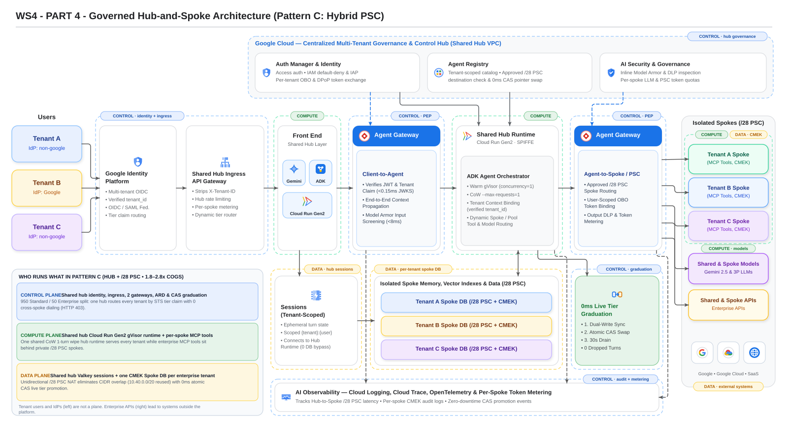
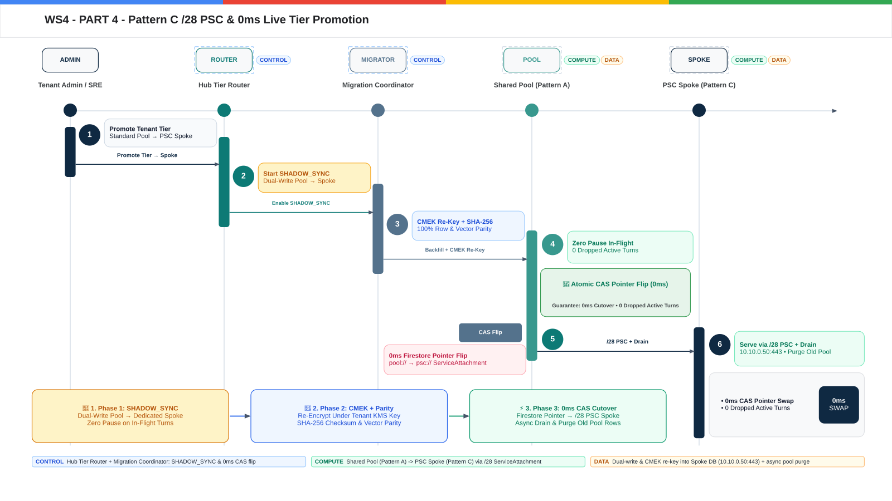
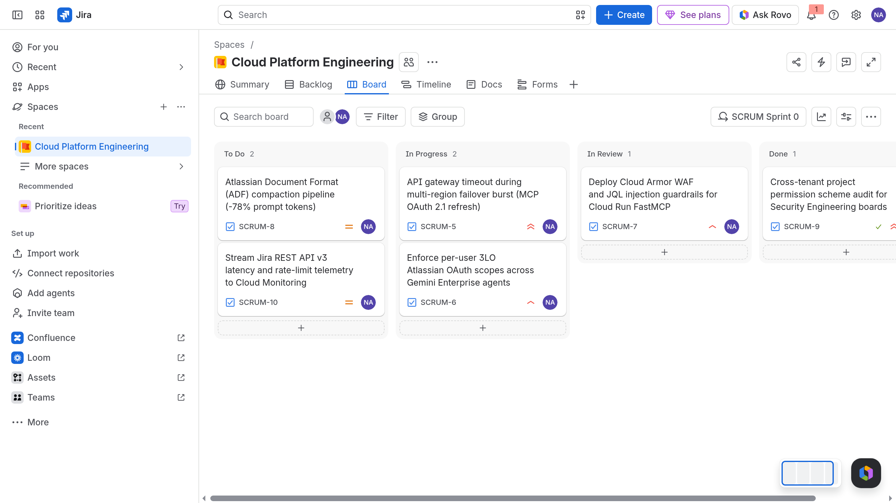
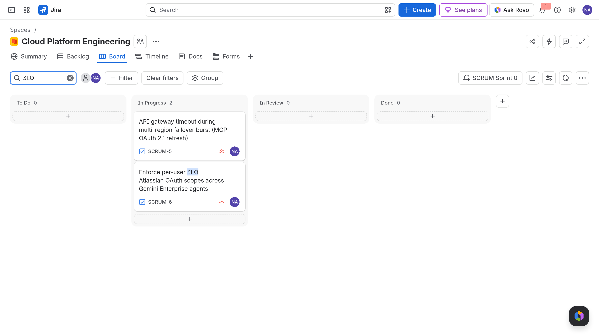
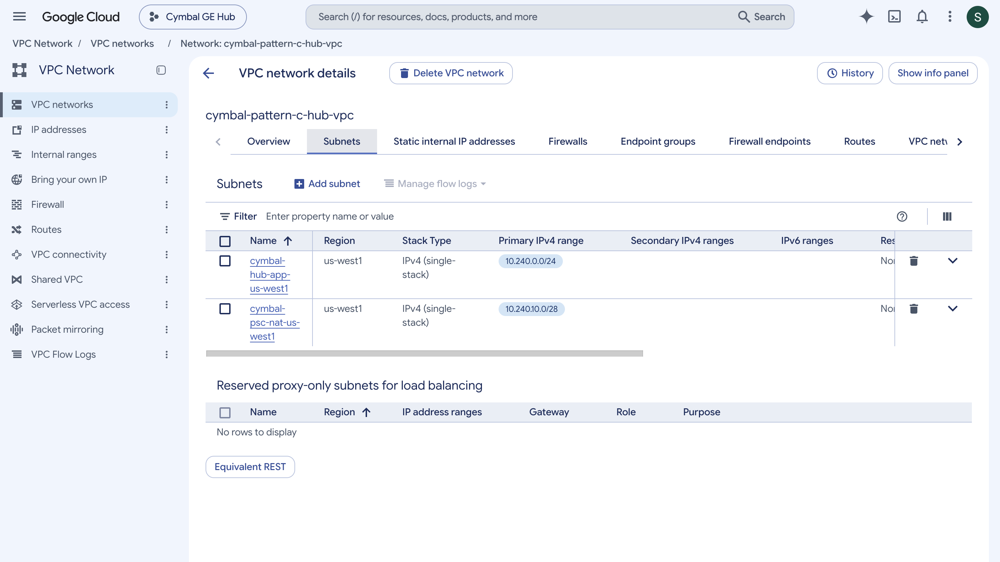
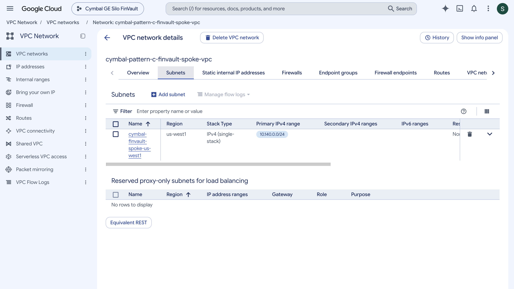
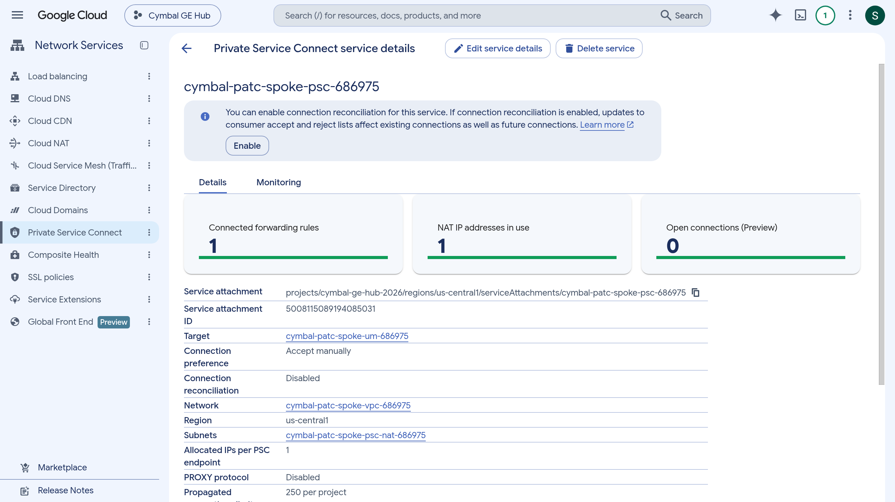

This document is **Part 4** of the Multi-Tenant Agentic AI series on Google Cloud. It presents **Pattern C (Governed Hub-and-Spoke Dynamic Hybrid Architecture)**—the commercial SaaS sweet spot for organizations serving hundreds of pooled commercial tenants alongside dozens of enterprise customers who require dedicated CMEK databases, regional data residency, or private MCP connectors without incurring `~15x` full-silo compute overhead. Pattern C keeps **`100%` of Hops 1–4 inside one shared Hub** while routing enterprise tenants over **unidirectional `/28` Private Service Connect (`PSC`) spokes**—and lets any tenant graduate live from Pattern A Pool to an Enterprise PSC Spoke with **`0 ms` downtime and `0` dropped active agent turns**.

> **Companion Architecture Assets:** [WS4 9-Slide Lean Visual Deck in Google Slides ↗](https://docs.google.com/presentation/d/1pMbcBaIa3XajlphcWjif_4ylrmGoNBiCOqqUEJhz46c/edit?resourcekey=0-nfE6x8lGqVjWoF7MRHA2IQ) ([`.pptx`](../slides/ws4-12slide-visual-deck.pptx)) · [WS4 10-Slide Executive Deck in Google Slides ↗](https://docs.google.com/presentation/d/1ju5AEtNrAuhR8RojxN8pc71Vp9vse7PeTV0w7hP8G0s/edit) ([`.pptx`](../slides/ws4-executive-architecture-10slide-deck.pptx)) · [Approved 12-Slide Series Deck (Slides 8–9) ↗](https://docs.google.com/presentation/d/1erUlsPYIcS7-8GntHaj96nsKLZMJuaIesMPkidQgmTk/edit#slide=id.p8) · [WS4 Google Doc ↗](https://docs.google.com/document/d/1T-2w2EYTgIJx195EmXvwt5Qg0UiK90ZsjoXcNbrMl0I/edit?resourcekey=0-I2qSR0LlhnB9ul1V-gZwPw) · [Hybrid Router & Migrator Codebase](../workstream-4-pattern-c-hybrid/4.3-solution-implementation/pattern_c_hybrid_router_and_migrator.py) · [Zero-Downtime Tier Upgrade Suite](../workstream-4-pattern-c-hybrid/4.5-zero-downtime-tier-upgrade-suite/run_tier_migration_suite.py) · [Terraform Hybrid PSC Blueprint](../workstream-4-pattern-c-hybrid/4.6-terraform-hybrid-psc-blueprint/main.tf).

---

## Executive summary: Pattern C governed hub-and-spoke hybrid architecture

Most scaling B2B SaaS platforms face an asymmetric tenant portfolio: `85%–95%` of accounts are commercial tiers that thrive on **Pattern A (`1.0x` COGS)**, while `5%–15%` are enterprise accounts whose HIPAA BAA, 21 CFR Part 11, or regional residency addenda mandate dedicated storage encryption keys and private network egress. Pattern C bridges both worlds cleanly:

- **Shared Hub Control & Compute (`80%` identical 5-Hop ADK core)**: Commercial and enterprise tenants share the Ingress Gateway, `Client-to-Agent` Gateway, `Auth Manager`, `Agent Registry (`ARD`)`, `Model Armor & DLP`, warm `Cloud Run Gen2 gVisor` compute (`concurrency=1`, `CoW --max-requests=1`), and the `32k` non-PII shared prefix cache (`89.1%` net prefix-cache turn token savings).
- **Unidirectional `/28` Private Service Connect (`PSC`) Spokes**: Enterprise tenants never share VPC peering tables (`0` transitive routing, `0` IP CIDR collisions—every spoke can reuse `10.40.0.0/20` behind its `/28` PSC NAT subnet). The Hub initiates connections strictly outbound into a verified producer `ServiceAttachment` for that tenant's dedicated CMEK AlloyDB and private MCP tools.
- **Blended Portfolio COGS (`1.8x` to `~2.8x` vs. `~15x` Full Silo)**: At a canonical `950` Pool / `50` Enterprise spoke split (`5%` Enterprise), portfolio infrastructure stays at **`1.8x` baseline COGS (`88%` savings vs. all-silo)**, scaling linearly to **`~2.8x`** at `~15%` Enterprise spoke share.



*Figure 1 (Approved Slide 08/12). Governed Hub-and-Spoke Architecture (`Pattern C: Hybrid PSC`) showing the shared Hub Control & Compute planes dispatching Standard tenants to pooled RLS storage and Enterprise tenants over unidirectional `/28` Private Service Connect spokes to dedicated CMEK AlloyDB + MCP endpoints.*

### Plane ownership boundaries (`WHO RUNS WHAT IN PATTERN C — HUB + PSC SPOKES`)

| Plane | Owning Components in Pattern C (Figure 1) | Isolation & Network Boundary | Primary Security / FinOps Guarantee |
| :--- | :--- | :--- | :--- |
| **Control Plane** (`Shared Hub Identity, Gateways, ARD & Tier Router`) | **Google Identity Platform (Multi-Tenancy) + Workload Identity Federation** (`OIDC/SAML` + `DPoP`), **Shared Hub Ingress API Gateway**, **Client-to-Agent Gateway**, **Auth Manager & Identity**, **Agent Registry (`ARD`)**, **Regional Model Armor (`modelarmor.<region>.rep.googleapis.com`) & Cloud DLP**, **Agent-to-Spoke / PSC Dynamic Tier Router** (`Cloud Run Agent Identity` SPIFFE mTLS), **Hub Observability (`Zero-PII OTel`)** | Strips untrusted headers at ingress; consults the signed STS `tenant_id` in the Firestore CAS route table (`pool://` vs. `psc://`) so a Standard tenant can never impersonate or dial an Enterprise spoke (`HTTP 403`) | **One unified governance plane (`<42 ms` p95), zero cross-spoke dialing (`HTTP 403 HYBRID_ROUTER_SPOKE_IMPERSONATION_BLOCKED`), and zero VPC peering sprawl** |
| **Compute Plane** (`Shared Hub Warm gVisor Runtime + 32k Prefix Cache`) | **Shared Hub App Front End**, **Shared Hub ADK Runtime** (`Cloud Run Gen2 gVisor`, `concurrency=1`, `CoW --max-requests=1` 1-turn dirty-page wipe), **Vertex AI Gemini `32k` Shared Prefix Cache** (plus optional regional CMEK inference for VIP spokes) | Identical Mode A 1-turn CoW heap wipe ensures Enterprise spoke payloads fetched during Turn 1 are purged from worker RAM before Turn 2 runs | **`81%–88%` COGS savings vs. Pattern B full silos while preserving 100% post-turn memory hygiene** |
| **Data Plane** (`Pooled Standard Store + Isolated /28 PSC Enterprise Spokes`) | **Standard Pool Store** (Shared Valkey + AlloyDB `FORCE RLS`) **AND** **Dedicated Enterprise Spokes (`Tenant A / B / C Spoke`)** behind unidirectional `/28` PSC NAT with customer CMEK AlloyDB, private MCP tools, and optional regional Cloud KMS revocation | Unidirectional consumer-to-producer PSC `ServiceAttachment` allows every spoke to reuse identical RFC 1918 CIDRs (`10.40.0.0/20`) with `0` spoke-to-spoke reachability | **Dedicated per-tenant CMEK database + zero CIDR overlap + `0 ms` atomic live tier graduation** |

---

## 3-phase zero-downtime live tier promotion (`0 ms` cutover, `0` dropped turns)

One of the hardest operational realities in B2B SaaS is **mid-contract tier upgrades**: a fast-growing PLG customer (such as `RetailStream Corp`) starts on **Pattern A (Pool)** and signs an enterprise addendum requiring a dedicated CMEK database spoke—without scheduling a maintenance window or breaking active multi-turn conversations. Figure 2 traces all five actors (`ADMIN → ROUTER → MIGRATOR → POOL → SPOKE`) across the exact three-phase state machine implemented in [`pattern_c_hybrid_router_and_migrator.py`](../workstream-4-pattern-c-hybrid/4.3-solution-implementation/pattern_c_hybrid_router_and_migrator.py).



*Figure 2 (Approved Slide 09/12). Five-actor UML sequence swimlane tracing zero-downtime live tier graduation from Pattern A Pool to a dedicated `/28` Enterprise PSC Spoke across `SHADOW_SYNC`, `CMEK Re-Key + SHA-256 Parity`, and `0 ms Atomic CAS Pointer Flip` + `30s` epoch drain.*

### Step-by-step live promotion sequence (5 actors in Figure 2)

1. **Phase 1 — `SHADOW_SYNC` Dual-Write Activation (`ADMIN → ROUTER → POOL & SPOKE`)**:
 - The Tenant Admin / SRE provisions the dedicated `/28` PSC Spoke (`cymbal-retailstream-spoke-prod`) via Terraform and triggers promotion in the **Migration Coordinator**.
 - The **Hub Tier Router** switches the tenant's routing descriptor to `SHADOW_SYNC`: reads continue serving from **Shared Pool (`Pattern A`)** with **`0` pause on in-flight turns**, while every new episodic memory write and vector insert is synchronously dual-written to both Pool and Spoke (`route_epoch = N`).
2. **Phase 2 — `CMEK Re-Key + SHA-256 Parity` Verification (`MIGRATOR → POOL → SPOKE`)**:
 - The **Migration Coordinator** streams historical AlloyDB rows and `pgvector` embeddings from the Shared Pool into the Enterprise Spoke, re-encrypting every page under the tenant's dedicated **Cloud KMS CMEK key**.
 - Before cutover is permitted, the coordinator computes deterministic **`SHA-256` parity digests** over row counts, primary keys, and vector norms across Pool and Spoke—failing closed if drift ≠ `0`.
3. **Phase 3 — `0 ms Atomic CAS Pointer Flip` & `30s` Graceful Drain (`MIGRATOR → ROUTER → SPOKE`)**:
 - Once parity hits **`100%`**, the coordinator executes a single **Firestore Compare-And-Swap (`CAS`)** transaction incrementing `route_epoch: N → N+1` and flipping the endpoint pointer atomically from `pool://cymbal-shared-alloydb` to `psc://projects/.../serviceAttachments/retailstream-spoke` (`10.10.0.50:443`).
 - All new turns route immediately to the `/28` PSC Spoke (`0 ms` downtime), while in-flight `route_epoch = N` turns drain cleanly over a **`30s` grace window** before the migrator asynchronously purges the tenant's historical rows from the Shared Pool (`0` dropped active turns, `0` orphaned data left in Pool).

---

## Cross-project `/28` PSC network design, backfill math & hard GCP quotas

### Why unidirectional `/28` Private Service Connect beats VPC Peering

Detailed in [`4.2 Hub-and-Spoke Demo Env Setup`](../workstream-4-pattern-c-hybrid/4.2-hub-and-spoke-demo-env-setup.md) and codified in [`4.6 Terraform Hybrid PSC Blueprint`](../workstream-4-pattern-c-hybrid/4.6-terraform-hybrid-psc-blueprint/main.tf), VPC Peering collapses at `25` peered networks and forbids overlapping IP ranges across enterprise customers. Pattern C replaces VPC Peering with **Private Service Connect (`PSC`)**:

1. **Zero CIDR Conflicts Across `100+` Enterprise Spokes**: Every enterprise spoke project uses the exact same internal RFC 1918 block (`10.40.0.0/20`) behind a producer **`ServiceAttachment`** backed by a `/28` PSC NAT subnet (`16` NAT IPs).
2. **Strictly Unidirectional Zero-Trust Data Flow**: Only the Hub's internal PSC consumer forwarding rule (`10.10.0.50:443`) can initiate TCP connections into a spoke's `ServiceAttachment`; a compromised spoke can **never** initiate a reverse connection back into the Hub or laterally into any peer spoke.
3. **Deterministic Suite Verification (`4.5-zero-downtime-tier-upgrade-suite/`)**: Running [`run_tier_migration_suite.py`](../workstream-4-pattern-c-hybrid/4.5-zero-downtime-tier-upgrade-suite/run_tier_migration_suite.py) executes live concurrent turns during `SHADOW_SYNC`, verifies `100%` `SHA-256` parity, performs the atomic CAS flip, proves `0` dropped turns, and confirms cross-spoke impersonation returns **`HTTP 403 HYBRID_ROUTER_SPOKE_IMPERSONATION_BLOCKED`**.

### Dimensionless backfill duration & blended COGS model

```formula
T_backfill = V_historical_rows / (B_psc_effective × (1 - u_live_write_load))
 • Cutover gate: Δ_parity(Pool, Spoke) == 0 (100% row + pgvector SHA-256 match)
 • Cutover downtime: τ_flip = 0 ms (single Firestore CAS route_epoch increment + 30s drain)

BlendedHybridCOGS(α_enterprise) = (1 - α) × 1.0x_Pool + α × C_Spoke_Data_Delta
 • At α = 5% (950 Pool / 50 Enterprise spokes) → ~1.8x baseline COGS (88% savings vs. ~15x all-silo)
 • At α = 15% (850 Pool / 150 Enterprise spokes) → ~2.8x baseline COGS (81% savings vs. ~15x all-silo)
```

### Hard Google Cloud quotas in Pattern C

| Google Cloud Resource | Hard Service Limit | Pattern C Scaling Risk | Production Engineering Guardrail |
| :--- | :--- | :--- | :--- |
| **PSC NAT `/28` Ephemeral Ports** | `16` NAT IPs per `/28` subnet (`12` usable × `64,512` ports per destination tuple) | Burst unpooled DB connections exhausting NAT source ports | Keep **PgBouncer (`pool_mode = transaction`)** in front of spoke AlloyDB + monitor NAT port utilization to add secondary `/28` PSC NAT subnets before `70%` saturation |
| **PSC Consumer Forwarding Rules per VPC** | Default regional quota per consumer VPC (quota-increasable) | Growing beyond hundreds of enterprise spokes hits single-VPC forwarding-rule limits | Shard Hub consumer VPCs per geographic region (`us-central1`, `europe-west4`) and automate quota alerts in Terraform |
| **Regional CMEK Endpoint Alignment** | Vertex AI `locations/global` rejects single-region CMEK | Routing a CMEK-spoke tenant to `locations/global` fails compliance checks | Bind the Hub Tier Router to pass regional Vertex endpoints (`us-central1` / `us-west1`) whenever `spoke_cmek_required == True` |

### Pattern C enforcement across all 10 live multi-cloud SaaS targets

Across all 10 AWS Bedrock AgentCore MCP targets (`cymbal-a2a-mcp-gateway-suyxm3caof`, `us-east-1`), Pattern C validates **zero-downtime Pool → `/28` PSC Spoke promotion** and blocks every cross-spoke impersonation attempt with **`HTTP 403 HYBRID_ROUTER_SPOKE_IMPERSONATION_BLOCKED`** (`10/10` positive + `10/10` adversarial assertions PASS in [`docs/cloudrun_to_aws_10_saas_live_receipt.json`](../docs/cloudrun_to_aws_10_saas_live_receipt.json)):

| SaaS & Target ID | Pattern C Hybrid PSC Control Enforced | Verified Spoke Impersonation Block | Live S3 Ledger |
| :--- | :--- | :--- | :--- |
| **`SAAS-01` ThoughtSpot (`HXGGFMZBKE`)** | Hub-routed Liveboard cutover from Pool to Enterprise PSC Spoke | `HTTP 403` `HYBRID_ROUTER_SPOKE_IMPERSONATION_BLOCKED` | [S3 Ledger JSON](https://t2zbugodcr2m7aimjudycgm65q0wopps.lambda-url.us-east-1.on.aws/saas-ui/thoughtspot-spotter?format=json) |
| **`SAAS-02` Sigma Computing (`IZVODT083Q`)** | `0 ms` workbook route switch (`Pool → FinVault PSC Spoke`) | `HTTP 403` cross-org / spoke route spoof blocked | [S3 Ledger JSON](https://t2zbugodcr2m7aimjudycgm65q0wopps.lambda-url.us-east-1.on.aws/saas-ui/sigma-computing?format=json) |
| **`SAAS-03` ServiceNow ITSM (`ZS9VGYHBQL`)** | Tier-aware `3LO` Vault routing across Hub and Enterprise Spoke | `HTTP 403` spoke spoof / `HTTP 401` missing 3LO | [S3 Ledger JSON](https://t2zbugodcr2m7aimjudycgm65q0wopps.lambda-url.us-east-1.on.aws/saas-ui/servicenow-itsm?format=json) |
| **`SAAS-04` Veeva / Muse EDC (`TWQU0KSRVF`)** | Spoke CMEK clinical enclave pinning via `/28` PSC endpoint | `HTTP 403` `HYBRID_ROUTER_SPOKE_IMPERSONATION_BLOCKED` | [S3 Ledger JSON](https://t2zbugodcr2m7aimjudycgm65q0wopps.lambda-url.us-east-1.on.aws/saas-ui/muse-poc?format=json) |
| **`SAAS-05` Salesforce & Jira (`K5JAEFCQ6E`)** | Continuous Hub Cloud SDP IBAN/SWIFT scrub across spoke cutover | `HTTP 403` spoke spoof (`raw_pii_leaked=False`) | [S3 Ledger JSON](https://t2zbugodcr2m7aimjudycgm65q0wopps.lambda-url.us-east-1.on.aws/saas-ui/salesforce-jira?format=json) |
| **`SAAS-06` Databricks Unity (`TERCK8SLBP`)** | Dynamic SQL route switch from shared catalog to spoke catalog | `HTTP 403` cross-spoke Unity catalog spoof blocked | [S3 Ledger JSON](https://t2zbugodcr2m7aimjudycgm65q0wopps.lambda-url.us-east-1.on.aws/saas-ui/databricks-unity?format=json) |
| **`SAAS-07` Snowflake Cortex (`CCMDEVZV2S`)** | Spoke CMEK warehouse binding + `SECONDARY ROLES NONE` guard | `HTTP 403` spoke impersonation / role escalation | [S3 Ledger JSON](https://t2zbugodcr2m7aimjudycgm65q0wopps.lambda-url.us-east-1.on.aws/saas-ui/snowflake-cortex?format=json) |
| **`SAAS-08` Workday HCM RaaS (`RAOTMUMJTZ`)** | Zero-drop principal `3LO` continuity across `CAS` cutover | `HTTP 403` spoke spoof / `401` principal mismatch | [S3 Ledger JSON](https://t2zbugodcr2m7aimjudycgm65q0wopps.lambda-url.us-east-1.on.aws/saas-ui/workday-raas?format=json) |
| **`SAAS-09` Datadog SRE (`G767QR3TQZ`)** | Uninterrupted `@tenant_id` OTel spans through Phase 1→3 | `HTTP 403` spoke spoof / `400` log injection block | [S3 Ledger JSON](https://t2zbugodcr2m7aimjudycgm65q0wopps.lambda-url.us-east-1.on.aws/saas-ui/datadog-sre?format=json) |
| **`SAAS-10` CrowdStrike / Okta (`C7EYM614F2`)** | Continuous `DPoP` (`jkt`) binding across Hub → PSC Spoke | `HTTP 403` spoke spoof / `401` `DPoP` replay block | [S3 Ledger JSON](https://t2zbugodcr2m7aimjudycgm65q0wopps.lambda-url.us-east-1.on.aws/saas-ui/crowdstrike-okta?format=json) |

<!-- GENUINE_3P_BEFORE_AFTER_START -->

## Live Before & After Proofs for WS4 (Atlassian Jira Cloud 3LO & Pattern C Hub → Spoke VPC)

> [!IMPORTANT]
> **2 Complete Live Before → After Console Pairs (`WS4-BA-01` Atlassian Jira Cloud + `WS4-BA-02` Google Cloud Pattern C Hub → Spoke VPC):** All `4` live screenshots below were captured live via live browser capture and passed automated screenshot verification. Open **`/blogs/ws4/screenshots`** for the interactive Side-by-Side & Split-Slider comparison viewer.

### WS4-BA-01 (BEFORE): Unfiltered Atlassian Jira Board Exposing All 6 Mixed Cross-Domain Issues (`SCRUM-5`..`SCRUM-10`)
**Provider:** Atlassian Jira Cloud (Live Commercial SaaS) • **Scope:** `gcp-team-sbiarllr.atlassian.net` • **State:** Empty board filter — all `6` mixed tickets exposed across `4` columns (`To Do 2 · In Progress 2 · In Review 1 · Done 1`) • Provenance (live) • **[Open Live Console ↗](https://gcp-team-sbiarllr.atlassian.net/jira/software/projects/SCRUM/boards/1)**


*WS4 BEFORE: Without Pattern C per-user 3LO OAuth & scope enforcement, all 6 mixed cross-domain issues (`SCRUM-5` through `SCRUM-10`) are exposed simultaneously across all 4 columns.*

### WS4-BA-01 (AFTER): Live `'3LO'` Scoped Query View (`SCRUM-5` & `SCRUM-6` Visible • 4 Non-Matching Tickets Filtered Out)
**Provider:** Atlassian Jira Cloud (Live Commercial SaaS) • **Scope:** `gcp-team-sbiarllr.atlassian.net` • **State:** Live board query filter (`textfields ~ "3LO*"`: `In Progress 2 · To Do 0 · In Review 0 · Done 0`) • Provenance (live) • **[Open Live Console ↗](https://gcp-team-sbiarllr.atlassian.net/jira/software/projects/SCRUM/boards/1)**


*WS4 AFTER: Live interactive `'3LO'` board query isolates strictly the 2 OAuth/3LO issues (`SCRUM-5` MCP OAuth 2.1 refresh & `SCRUM-6` per-user 3LO Atlassian OAuth scopes) while filtering out 4 non-matching tickets (`To Do 0`, `In Review 0`, `Done 0`). Hard server-side per-user 3LO OAuth and cross-spoke `HTTP 403` isolation are enforced by Pattern C's MCP gateway (`30/30` live assertions).*

### WS4-BA-02 (BEFORE): Shared Pattern C Commercial Hub VPC & `/28` PSC NAT Subnet (`cymbal-ge-hub-2026`)
**Provider:** Google Cloud Console (`VPC Network`) • **Project:** `cymbal-ge-hub-2026` (`#252968359259`) • **Subnets:** `cymbal-hub-app-us-west1` (`10.240.0.0/24`) + `cymbal-psc-nat-us-west1` (`10.240.10.0/28` PSC NAT) • Provenance (live) • **[Open Live Hub VPC Subnets ↗](https://console.cloud.google.com/networking/networks/details/cymbal-pattern-c-hub-vpc?project=cymbal-ge-hub-2026)**


*WS4 BEFORE: Commercial accounts begin in the shared Pattern C Hub VPC (`cymbal-pattern-c-hub-vpc` in `cymbal-ge-hub-2026`), provisioned with `cymbal-hub-app-us-west1` (`10.240.0.0/24`) and the `/28` Private Service Connect NAT subnet `cymbal-psc-nat-us-west1` (`10.240.10.0/28`).*

### WS4-BA-02 (AFTER): Dedicated Sovereign FinVault PSC Spoke VPC (`cymbal-ge-silo-2026`)
**Provider:** Google Cloud Console (`VPC Network`) • **Project:** `cymbal-ge-silo-2026` (`#495457819919`) • **Subnet:** `cymbal-finvault-spoke-us-west1` (`10.140.0.0/24`, isolated separate GCP project) • Provenance (live) • **[Open Live Spoke VPC Subnets ↗](https://console.cloud.google.com/networking/networks/details/cymbal-pattern-c-finvault-spoke-vpc?project=cymbal-ge-silo-2026)**


*WS4 AFTER: After Pattern C's zero-downtime live tier promotion, Enterprise accounts route over unidirectional `/28` Private Service Connect into their dedicated sovereign Spoke VPC (`cymbal-pattern-c-finvault-spoke-vpc`, `10.140.0.0/24` in separate project `cymbal-ge-silo-2026`) with zero VPC peering sprawl.*

<!-- GENUINE_3P_BEFORE_AFTER_END -->

---

## Deploy in Your Own GCP Project (Zero Modifications)

Run this blog's complete reference architecture directly in your own Google Cloud project with **zero code or `.tfvars` edits** ([blog-04-pattern-c-hybrid/README.md](../examples/blog-04-pattern-c-hybrid/README.md) · [Open in Cloud Shell](https://shell.cloud.google.com/cloudshell/editor?cloudshell_git_repo=https://github.com/cloud-ai-fde/ge-blogs&cloudshell_working_dir=examples/blog-04-pattern-c-hybrid) — note: `cloud-ai-fde/ge-blogs` is the FDE staging repository prior to public open-source launch):

- **What gets deployed:** Provisions 2 isolated VPCs (Hub `10.10.0.0/20` + Spoke `10.140.0.0/24`, zero VPC peering) in a single project by default (or 2 projects via `SPOKE_PROJECT_ID`), a real Regional Internal Application LB + `/28` Private Service Connect Service Attachment & Hub Consumer Endpoint, a named Firestore routing DB, and 3 authenticated Cloud Run services (`hub-router`, `shared-pool`, `enterprise-spoke`).
- **Live verification:** Proves live BEFORE (`retailstream` routed to `shared_pool`) → live atomic Firestore CAS promotion → AFTER (exact same Hub URL seamlessly routes to `enterprise_spoke` with `0` dropped turns).

```bash
git clone https://github.com/cloud-ai-fde/ge-blogs.git
cd ge-blogs/examples/blog-04-pattern-c-hybrid
./deploy.sh    # Auto-detects active gcloud project & region, builds app via Cloud Build, applies Terraform
./verify.sh    # Executes live BEFORE -> AFTER security & isolation proofs against your deployed resources
./destroy.sh   # Tears down all billable resources cleanly
```


*Live Google Cloud Network Services Console execution proof after running `examples/blog-04-pattern-c-hybrid` (`./deploy.sh && ./verify.sh`): unidirectional `/28` PSC service attachment `cymbal-patc-spoke-psc-686975` (`Connected forwarding rules: 1`, `NAT IP addresses in use: 1`, `Accept manually`) bridging Hub and Spoke with zero VPC peering.*

---

## References

- [Private Service Connect Overview](https://cloud.google.com/vpc/docs/private-service-connect) — Unidirectional consumer-to-producer `ServiceAttachment` connectivity across overlapping spoke CIDRs.
- [Cloud Run Direct VPC Egress](https://cloud.google.com/run/docs/configuring/vpc-direct-vpc) — Low-latency private routing from Hub Cloud Run Gen2 workers to PSC consumer endpoints.
- [Firestore Transactions & Atomic Compare-And-Swap](https://cloud.google.com/firestore/docs/manage-data/transactions) — Zero-downtime `route_epoch` pointer promotion across active tenant turns.
- [AlloyDB Customer-Managed Encryption Keys (CMEK)](https://cloud.google.com/alloydb/docs/cmek) — Per-spoke regional encryption isolation for graduated Enterprise tenants.
- [Google Cloud Architecture Center — Multi-tenant agentic AI system](https://docs.cloud.google.com/architecture/multi-tenant-agentic-ai-system) — Hub-and-spoke hybrid multi-tenancy reference patterns.

---

## What's next

- **Approved Architecture Presentations & Editable Diagrams (WS4 = Slides 8–9):**
 - **[Open WS4 9-Slide Lean Visual Deck in Google Slides ↗](https://docs.google.com/presentation/d/1pMbcBaIa3XajlphcWjif_4ylrmGoNBiCOqqUEJhz46c/edit?resourcekey=0-nfE6x8lGqVjWoF7MRHA2IQ)** • [Download WS4 9-Slide Lean Visual Deck (`.pptx`)](../slides/ws4-12slide-visual-deck.pptx)
 - **[Open WS4 10-Slide Executive Narrative Deck in Google Slides ↗](https://docs.google.com/presentation/d/1ju5AEtNrAuhR8RojxN8pc71Vp9vse7PeTV0w7hP8G0s/edit)** • [Download WS4 10-Slide Executive Deck (`.pptx`)](../slides/ws4-executive-architecture-10slide-deck.pptx)
 - [Open Approved 12-Slide Architecture Deck in Google Slides (WS4 = Slides 8–9) ↗](https://docs.google.com/presentation/d/1erUlsPYIcS7-8GntHaj96nsKLZMJuaIesMPkidQgmTk/edit#slide=id.p8)
 - [Figure 1 Pattern C Hybrid PSC (`.drawio`)](../diagrams/ws4-pattern-c-hybrid.drawio) • [Figure 2 0ms Live Tier Promotion (`.drawio`)](../diagrams/ws4-c4-l3-live-tier-promotion-swimlane.drawio)
- **Workstream 4 Codebase, Migration Suite & Terraform:**
 - **Hybrid Router & Live Migrator:** [`pattern_c_hybrid_router_and_migrator.py`](../workstream-4-pattern-c-hybrid/4.3-solution-implementation/pattern_c_hybrid_router_and_migrator.py) • [`run_tier_migration_suite.py`](../workstream-4-pattern-c-hybrid/4.5-zero-downtime-tier-upgrade-suite/run_tier_migration_suite.py)
 - **Terraform & Master Codelab:** [`4.6-terraform-hybrid-psc-blueprint/README.md`](../workstream-4-pattern-c-hybrid/4.6-terraform-hybrid-psc-blueprint/README.md) • [`90-Min Multi-Pattern Master Codelab`](../workstream-4-pattern-c-hybrid/4.8-codelab-and-workshop-deck/codelab-90min-multi-pattern-master-lab.md)
 - **Editable Whitepaper:** [Open WS4 Google Doc ↗](https://docs.google.com/document/d/1T-2w2EYTgIJx195EmXvwt5Qg0UiK90ZsjoXcNbrMl0I/edit?resourcekey=0-I2qSR0LlhnB9ul1V-gZwPw) • [Download `.docx`](../docs/word/ws4-pattern-c-hybrid-dynamic-tiering.docx)
- **Continue the 5-Part Multi-Tenancy Series:**
 - **Previous — Part 3 (`WS3`):** [Pattern B: Zero-Trust Sovereign Silos for Regulated Workloads](ws3-pattern-b-sovereign-silos.md)
 - **Next — Part 5 (`WS5`):** [Executive Decision Guide & The Multi-Tenant Agentic Triad](ws5-decision-guide-and-agentic-triad.md)
 - **Visual Atlas (`ATLAS`):** [10-SaaS Multi-Cloud Before/After Visual Verification & Red-Team Atlas](saas-10-visual-verification-and-redteam-atlas.md)

<!-- E2E_FLOW_START -->
<!-- Canonical Step-by-Step Logical & Technical E2E Flows served dynamically from diagrams/diagram_e2e_flows.json via toggleInlineFigureFlow(diagId) -->
<!-- E2E_FLOW_END -->
