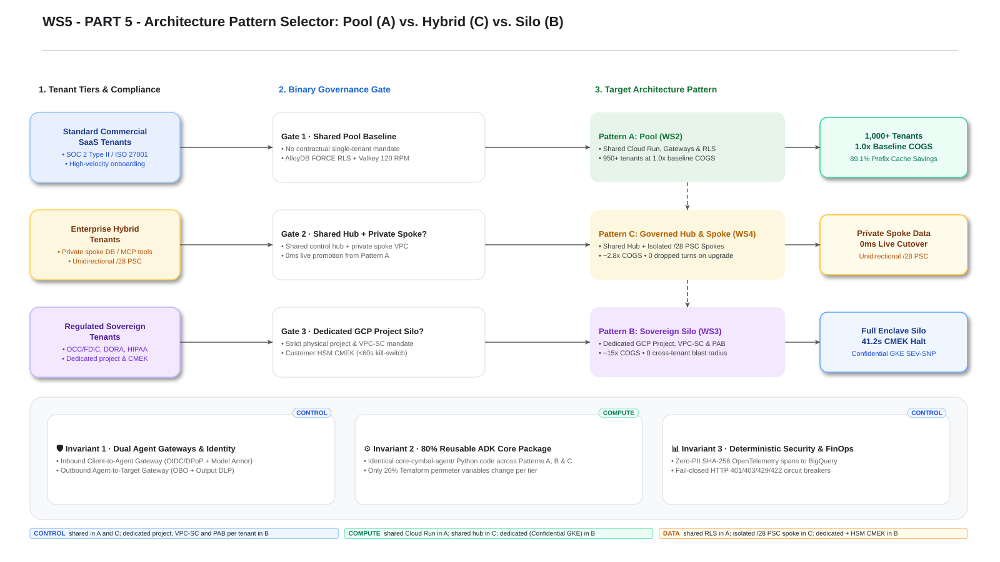
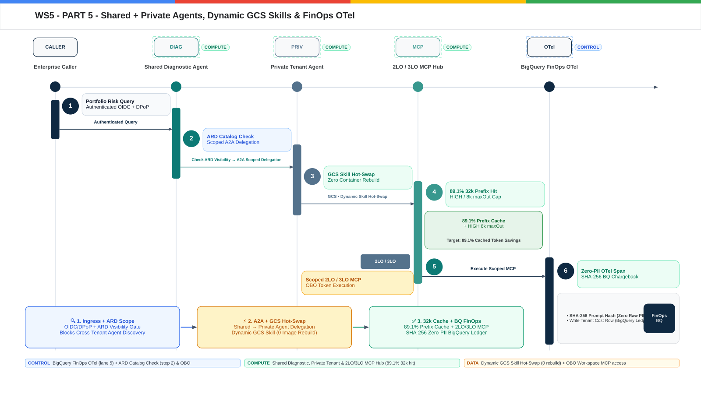
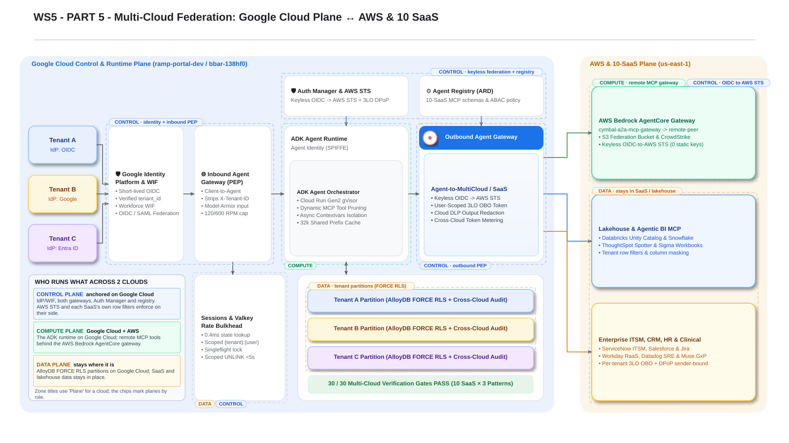
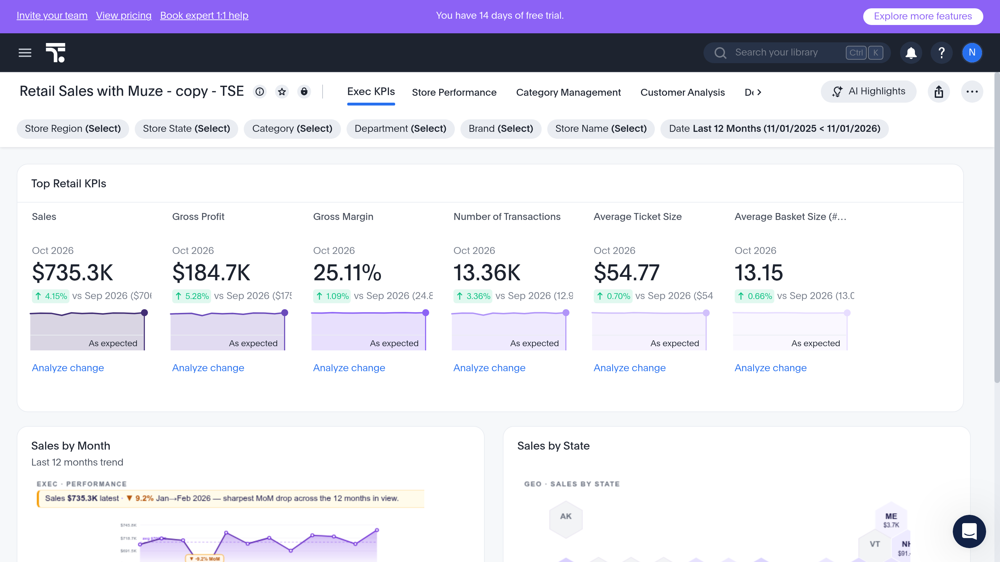
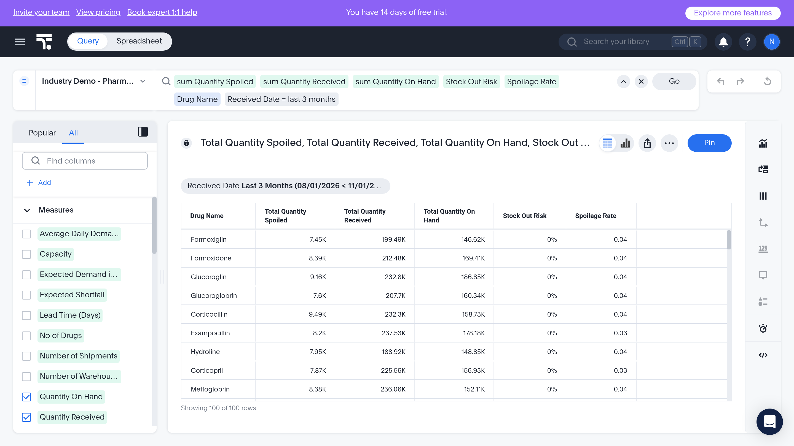
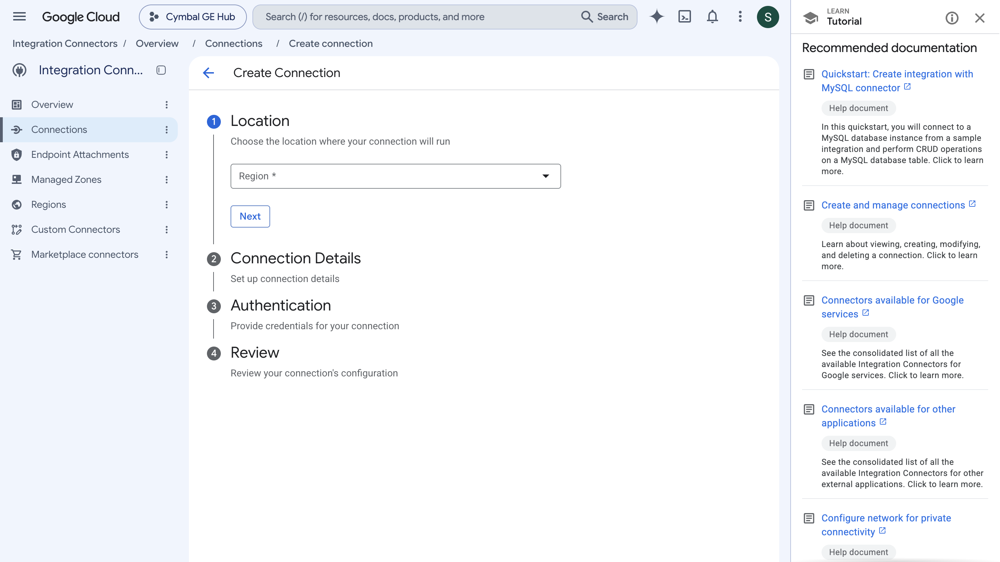
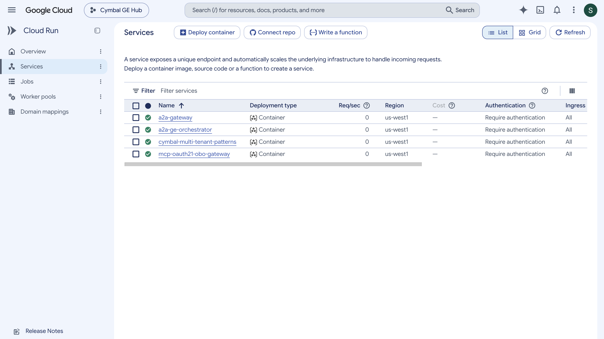
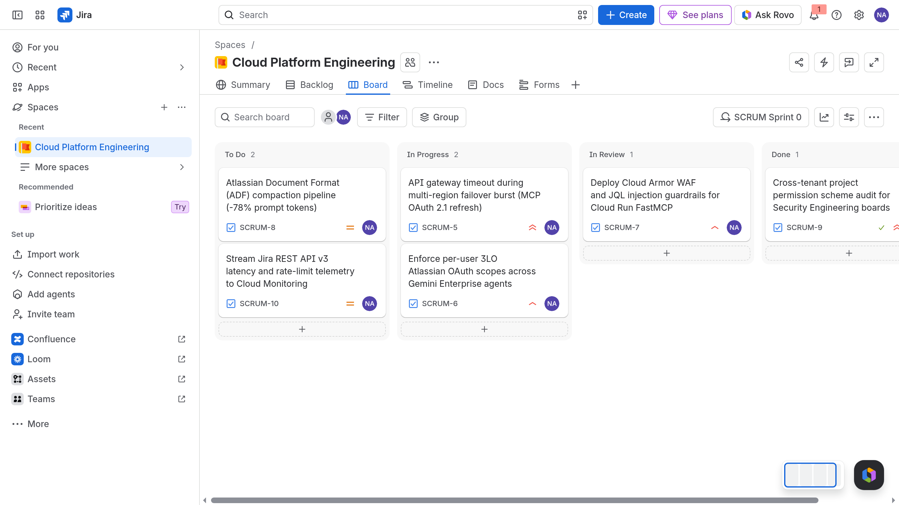
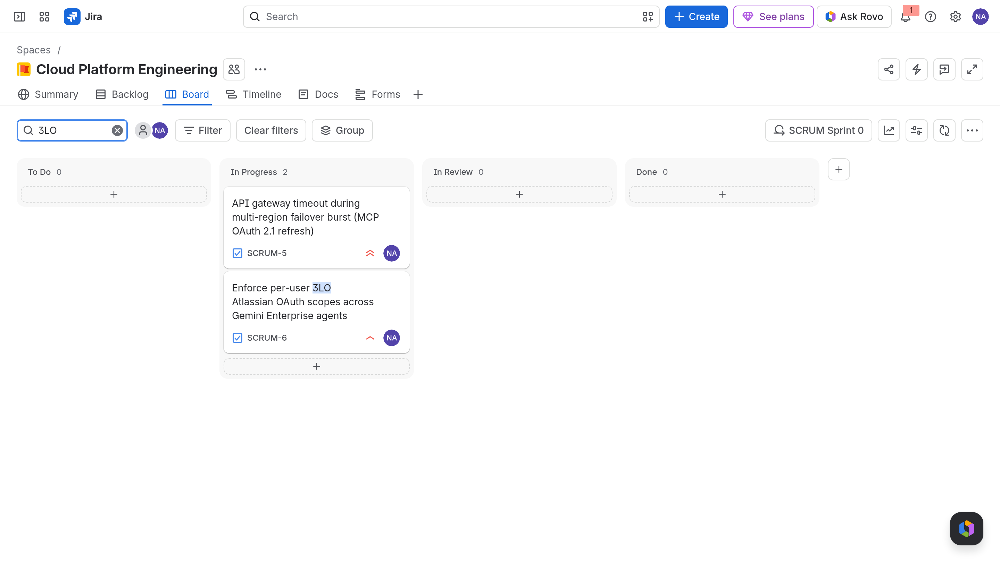
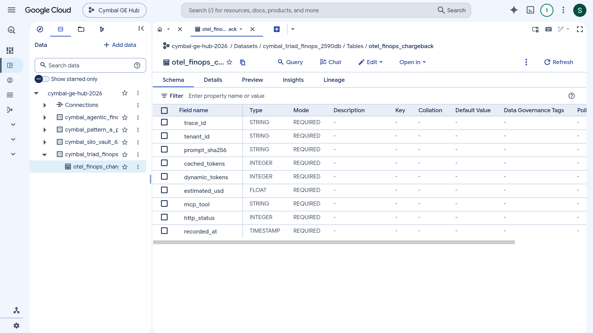

This document is **Part 5 (Capstone)** of the Multi-Tenant Agentic AI series on Google Cloud. It brings together **Patterns A, B, and C** into a deterministic **3-Gate Architecture Pattern Selector**, demonstrates how **Shared Diagnostic Agents** securely delegate over **A2A** to **Tenant-Private Agents** with hot-swapped **Dynamic GCS Skills** (`0` container image rebuilds) and **Zero-PII BigQuery FinOps OTel** attribution, and details the live **Multi-Cloud Federation Plane** linking Google Cloud (`cymbal-pooled-saas-prod` / `cymbal-finvault-silo-prod` reference verification sandbox) to **AWS Bedrock AgentCore MCP Gateway** and **10 commercial enterprise SaaS stacks**.

> **Companion Architecture Assets:** [WS5 10-Slide Executive Deck in Google Slides ↗](https://docs.google.com/presentation/d/19kKSq2SBo6-RqF-lkOnqdRnuJjUWYaXMBf_3Eg5GkCA/edit) ([`.pptx`](../slides/ws5-executive-architecture-10slide-deck.pptx)) · [WS5 9-Slide Lean Visual Deck in Google Slides ↗](https://docs.google.com/presentation/d/1zg6g3ZuASSc68bw04ec9UOPFCBuRkpGq9l6x3A7gy8A/edit) ([`.pptx`](../slides/ws5-12slide-visual-deck.pptx)) · [Approved 12-Slide Series Deck (Slides 10–12) ↗](https://docs.google.com/presentation/d/1erUlsPYIcS7-8GntHaj96nsKLZMJuaIesMPkidQgmTk/edit#slide=id.p10) · [WS5 Google Doc ↗](https://docs.google.com/document/d/1ate8K63qHrYP6OUQ7qO0H6Quq8S5g3TnLbDhbaAZ_SU/edit?resourcekey=0-XWkODR5elYC9-fuGO6aBaQ) · [`5.1 Pattern Comparison & Decision Guide`](../workstream-5-wrap-up-and-backlog/5.1-pattern-comparison-and-decision-guide.md) · [`5.2 Capstone Backlog & GA Roadmap`](../workstream-5-wrap-up-and-backlog/5.2-capstone-backlog-and-ga-roadmap.md) · [Live SaaS Verification Atlas](saas-10-visual-verification-and-redteam-atlas.md).

---

## Architecture pattern selector: Pool (A) vs. Hybrid (C) vs. Silo (B) (Figure 1)

Choosing a multi-tenant isolation model should never rely on ad-hoc opinions. Figure 1 codifies the **3-Gate Binary Governance Selector** that maps every tenant's compliance and latency contract directly to its target infrastructure tier while holding **three platform invariants** constant across the entire fleet.



*Figure 1 (Approved Slide 10/12). Architecture Pattern Selector mapping Tenant Tiers & Compliance through three binary governance gates to Pattern A (`Pool • 1.0x COGS`), Pattern C (`Hybrid /28 PSC • 1.8x–2.8x COGS`), and Pattern B (`Sovereign Silo • ~15x COGS`) under three non-negotiable platform invariants.*

### Deterministic 3-gate selector rule & three universal invariants

```formula
Let (q_spoke, q_silo) ∈ {0, 1}² where:
 • q_spoke = 1 if tenant requires dedicated CMEK data store, regional residency, or private MCP spoke
 • q_silo = 1 if tenant mandates dedicated GCP project, VPC-SC (0.0.0.0/0 denied), or air-gapped SEV-SNP compute

TargetPattern(q_spoke, q_silo) =
 • Gate 1 (q_spoke = 0, q_silo = 0) → Pattern A: Pool (WS2) [1.0x COGS • 1,000+ Tenants • ~85% Prefix Cache]
 • Gate 2 (q_spoke = 1, q_silo = 0) → Pattern C: Governed Hub & Spoke (WS4) [1.8x–2.8x COGS • 0ms Cutover • /28 PSC Spokes]
 • Gate 3 (q_silo = 1) → Pattern B: Sovereign Silo (WS3) [~15x COGS • 41.2s CMEK Halt • GKE SEV-SNP]
```

Regardless of which gate a tenant clears, **three non-negotiable architectural invariants** never change:

1. **Invariant 1 — Dual Agent Gateways & Non-Spoofable Identity**: Every tenant traverses explicit **Client-to-Agent** and **Agent-to-Target** gateways (`Cloud Run Agent Identity` SPIFFE mTLS) backed by **Google Cloud Identity Platform (Multi-Tenancy) + Workload Identity Federation**, Cloud Armor header stripping, `RFC 8693 OBO` + `RFC 9449 DPoP` proof validation, and 5-minute Cloud KMS `ECDSA P-256` STS JWTs (`<0.15 ms` JWKS verify).
2. **Invariant 2 — `80%` Reusable ADK Core Package (`TENANT_ISOLATION_MODE`)**: One single Python ADK codebase (`core-cymbal-agent/`) disaggregates the **Brain** (Gemini reasoning), **Hands** (`gVisor` / GKE `agent-sandbox`), and **Out-of-Process Token Vault** across Pool, Hybrid, and Silo—eliminating multi-branch security drift. Only declarative configuration (`TENANT_ISOLATION_MODE = POOLED | HYBRID_PSC | SOVEREIGN_SILO`) and Terraform perimeter modules change.
3. **Invariant 3 — Deterministic Security & FinOps Guardrails**: Every tier enforces ARD `-94%` schema pruning, exact-match **Vertex AI Memory Bank (`aiplatform.googleapis.com/memoryScope` IAM CEL)** scoping, inline `<8 ms` regional Model Armor (`modelarmor.<region>.rep.googleapis.com`) screening, Cloud SDP egress redaction, Valkey `120/600 RPM` fairness + thinking-token clamps (`4k`/`8k`), and Zero-PII SHA-256 BigQuery OTel attribution.

### Master executive comparison matrix (Patterns A vs. C vs. B)

| Decision Criterion | Pattern A: High-Density Pool ([WS2](ws2-pattern-a-pooled-architecture.md)) | Pattern C: Governed Hub & `/28` PSC ([WS4](ws4-pattern-c-hybrid-dynamic-tiering.md)) | Pattern B: Sovereign Silo ([WS3](ws3-pattern-b-sovereign-silos.md)) |
| :--- | :--- | :--- | :--- |
| **Target Tenant Profile** | `1,000+` Commercial / PLG / Mid-Market SaaS | Enterprise B2B requiring CMEK storage & private tools | Regulated Banking, Healthcare GxP, EU DORA, Defense |
| **Relative Infrastructure COGS** | **`1.0x` Baseline** | **`1.8x` (`950/50`) to `~2.8x` (`15%` Enterprise)** | **`~15x` Sovereign Silo** |
| **Compute Isolation** | Cloud Run Gen2 `gVisor` `concurrency=1` + Mode A `CoW --max-requests=1` / Mode B WarmPool `403` latch | Shared Hub `gVisor` `CoW` runtime + optional regional CMEK inference | Dedicated GCP Project + Confidential GKE `AMD SEV-SNP` (**Gemma 3 27B**) or Vertex PT |
| **Data & Network Boundary** | Shared AlloyDB **`FORCE ROW LEVEL SECURITY`** (`0` foreign rows) | Unidirectional **`/28` PSC Spoke** to dedicated CMEK AlloyDB (`0` CIDR overlap) | Dedicated Project AlloyDB + **`VPC-SC` (`0.0.0.0/0` denied)** + **`IAM PAB`** |
| **CMEK Kill-Switch SLA** | Platform key (`<5s` Valkey `SCAN + UNLINK`) | Customer CMEK on spoke data (`<5s` Valkey purge + spoke lock) | Customer **FIPS 140-3 L3 HSM CMEK** (`41.2s` verified full enclave halt, `HTTP 423`) |
| **Live Upgrade Path** | Native starting tier (`Mode A` or `Mode B`) | **`0 ms` Atomic CAS Promotion** (`SHADOW_SYNC → CAS Flip → 30s Drain`) | Dedicated Terraform project cutover with `SHA-256` parity verification |

---

## Shared + private agents, dynamic GCS skills & FinOps OTel (Figure 2)

Real B2B SaaS platforms rarely deploy one monolithic prompt. Instead, they operate the **Multi-Tenant Agentic Triad**: a shared platform **Diagnostic Agent** (`core-cymbal-agent/agents/shared_diagnostic_agent.py`) that routes specialized work over **A2A** to **Tenant-Private Agents** (such as FinVault's regulatory `finvault_agent_alpha.py`), while dynamically hydrating customer-owned **GCS Skill Packs** without rebuilding or redeploying container images.



*Figure 2 (Approved Slide 12/12). Five-actor UML sequence swimlane tracing Shared Diagnostic Agent to Private Tenant Agent A2A delegation, ARD visibility enforcement, zero-rebuild dynamic GCS skill hot-swap, `32k` prefix cache hit, `2LO/3LO` MCP execution, and Zero-PII BigQuery FinOps OTel logging.*

### Step-by-step agentic triad execution trace (5 actors in Figure 2)

1. **Ingress Identity & ARD Visibility Scope (`CALLER → DIAG`)**: The Enterprise Caller authenticates via `OIDC + DPoP`. Hop 2 **ARD** verifies that `finvault` is entitled to invoke `Agent Alpha` (while deterministically rejecting `retailstream` attempts to discover or invoke `Agent Alpha` with **`HTTP 403`**).
2. **Scoped A2A Delegation & Dynamic GCS Skill Hot-Swap (`DIAG → PRIV`)**:
 - The **Shared Diagnostic Agent** delegates over **Agent-to-Agent (`A2A`)** passing the exact signed STS JWT (never downgrading to a generic service account).
 - The **Private Tenant Agent** loads its tenant-signed playbooks and prompt rubrics dynamically from `gs://<tenant-skills-bucket>/v2/skill.yaml` (verified against a pinned SHA-256 digest and cached under `cache:{tenant}:skill:*`)—enabling **zero-downtime skill updates with `0` container image rebuilds**.
3. **Prefix Cache Hit, Thinking Clamp & `2LO/3LO` MCP Dispatch (`PRIV → MCP`)**:
 - Inference hits the immutable **`32k` shared prefix cache (`~85%–89.1%` turn token savings within the 90% cached-token discount envelope)** while enforcing the tenant's **`8,000`-token thinking clamp**.
 - Outbound tool execution calls the **2LO/3LO MCP Hub** (`core-cymbal-agent/mcp_servers/cymbal_mcp_hub.py`) with Hop 4 Cloud SDP redaction and per-user DPoP-bound `3LO` tokens.
4. **Zero-PII BigQuery FinOps Chargeback (`MCP → OTel`)**: Every delegated sub-agent hop emits a linked **OpenTelemetry (`OTel`)** span containing `tenant_id`, `agent_id`, `skill_sha256`, `cached_input_tokens`, `thinking_tokens`, and `raw_pii_logged = FALSE` into BigQuery for accurate per-customer margin accounting.

---

## Multi-cloud federation: Google Cloud plane ↔ AWS Bedrock AgentCore & 10 SaaS (Figure 3)

Enterprise customers store operational records across both Google Cloud and AWS-hosted SaaS estates. Figure 3 documents our live, keyless **Multi-Cloud Federation Plane**—proving that zero-trust 5-Hop isolation extends seamlessly across cloud boundaries with **`0` static AWS IAM keys** and **`30/30` multi-cloud verification gates PASS** across all three patterns (`A • B • C`).



*Figure 3 (Approved Slide 11/12). Multi-Cloud Federation architecture bridging the Google Cloud 5-Hop Control & Runtime Plane (`cymbal-pooled-saas-prod` / `cymbal-finvault-silo-prod`, rendered as live sandbox IDs `cymbal-ge-hub-2026` / `cymbal-ge-silo-2026` in the diagram header) via keyless OIDC STS federation to AWS Bedrock AgentCore MCP Gateway (`us-east-1`), 10 enterprise SaaS targets, and immutable Amazon S3 audit ledgers.*

### Two-plane multi-cloud architecture breakdown (Figure 3)

- **Left Plane — Google Cloud Control & Runtime Plane (`cymbal-pooled-saas-prod` / `cymbal-finvault-silo-prod` reference verification sandbox)**: Executes Identity/WIF, Inbound PEP, Auth Manager + keyless **AWS STS OIDC federation (`0` long-lived AWS keys)**, ARD 10-SaaS MCP schemas, ADK Agent Runtime, Outbound Agent Gateway (`Model Armor` + `Cloud SDP`), Valkey (`0.4 ms`), and AlloyDB `FORCE RLS` partitions—attested across **`30/30` Multi-Cloud Verification Gates PASS (`60/60` positive and adversarial assertions)**.
- **Right Plane — AWS & 10-SaaS Plane (`us-east-1` federation verification sandbox)**: Hosts **AWS Bedrock AgentCore MCP Gateway (`cymbal-a2a-mcp-gateway-suyxm3caof`)**, Amazon Cognito `RS256` OAuth2 validation, **Lakehouse & Agentic BI MCP** (`ThoughtSpot`, `Sigma`, `Databricks`, `Snowflake`), **Enterprise ITSM / CRM / HR / Clinical / SecOps MCP** (`ServiceNow`, `Veeva/Muse`, `Salesforce/Jira`, `Workday`, `Datadog`, `CrowdStrike/Okta`), and the immutable **Amazon S3 Audit Bucket** (`s3://cymbal-aws-federation-393036065405-us-east-1/cymbal-10saas-ledger/<target>/finvault.json`).

### Unified 10-SaaS multi-cloud governance matrix (`30/30` Flows PASS across Patterns A, B & C)

| SaaS & Target ID (`READY`) | Pattern A (Pool) Proof | Pattern B (Silo) Proof | Pattern C (Hybrid PSC) Proof | Live S3 Ledger |
| :--- | :--- | :--- | :--- | :--- |
| **`SAAS-01` ThoughtSpot (`HXGGFMZBKE`)** | Org-ID RLS (`403` spoof block) | VPC-SC + CMEK (`423` halt) | `0 ms` Liveboard spoke cutover | [S3 Ledger JSON](https://t2zbugodcr2m7aimjudycgm65q0wopps.lambda-url.us-east-1.on.aws/saas-ui/thoughtspot-spotter?format=json) |
| **`SAAS-02` Sigma Computing (`IZVODT083Q`)** | `ua_tenant_id` tamper (`403`) | KMS org attestation (`423`) | Workbook PSC spoke cutover (`403` spoof) | [S3 Ledger JSON](https://t2zbugodcr2m7aimjudycgm65q0wopps.lambda-url.us-east-1.on.aws/saas-ui/sigma-computing?format=json) |
| **`SAAS-03` ServiceNow ITSM (`ZS9VGYHBQL`)** | `3LO` Vault (`401 -32042`) | Siloed change KMS (`423`) | Hub→Spoke 3LO ticket promotion | [S3 Ledger JSON](https://t2zbugodcr2m7aimjudycgm65q0wopps.lambda-url.us-east-1.on.aws/saas-ui/servicenow-itsm?format=json) |
| **`SAAS-04` Veeva / Muse EDC (`TWQU0KSRVF`)** | Hop 2 ARD ACL (`403` deny) | `21 CFR Part 11` ECDSA (`423`) | `/28` PSC clinical enclave route | [S3 Ledger JSON](https://t2zbugodcr2m7aimjudycgm65q0wopps.lambda-url.us-east-1.on.aws/saas-ui/muse-poc?format=json) |
| **`SAAS-05` Salesforce & Jira (`K5JAEFCQ6E`)** | Cloud SDP IBAN/SWIFT mask | VPC-SC + SDP (`423` halt) | Zero-leak spoke escalation cutover | [S3 Ledger JSON](https://t2zbugodcr2m7aimjudycgm65q0wopps.lambda-url.us-east-1.on.aws/saas-ui/salesforce-jira?format=json) |
| **`SAAS-06` Databricks Unity (`TERCK8SLBP`)** | Schema binding (`403` SQL guard) | Dedicated catalog + CMEK (`423`) | Dynamic Pool→Spoke SQL cutover | [S3 Ledger JSON](https://t2zbugodcr2m7aimjudycgm65q0wopps.lambda-url.us-east-1.on.aws/saas-ui/databricks-unity?format=json) |
| **`SAAS-07` Snowflake Cortex (`CCMDEVZV2S`)** | `SECONDARY ROLES NONE` (`403`) | Tri-Secret CMEK (`423` halt) | Spoke CMEK warehouse pinning | [S3 Ledger JSON](https://t2zbugodcr2m7aimjudycgm65q0wopps.lambda-url.us-east-1.on.aws/saas-ui/snowflake-cortex?format=json) |
| **`SAAS-08` Workday HCM RaaS (`RAOTMUMJTZ`)** | Principal `3LO` (`401` replay) | Sovereign HCM + SSN mask (`423`) | Continuous 3LO across CAS flip | [S3 Ledger JSON](https://t2zbugodcr2m7aimjudycgm65q0wopps.lambda-url.us-east-1.on.aws/saas-ui/workday-raas?format=json) |
| **`SAAS-09` Datadog SRE (`G767QR3TQZ`)** | Model Armor log screen (`400`) | Isolated OTel sink (`423` halt) | Zero-drop `@tenant_id` telemetry | [S3 Ledger JSON](https://t2zbugodcr2m7aimjudycgm65q0wopps.lambda-url.us-east-1.on.aws/saas-ui/datadog-sre?format=json) |
| **`SAAS-10` CrowdStrike / Okta (`C7EYM614F2`)** | `DPoP` `jkt` proof (`401` replay) | SPIFFE mTLS + CMEK (`423` halt) | Continuous `DPoP` over PSC spoke | [S3 Ledger JSON](https://t2zbugodcr2m7aimjudycgm65q0wopps.lambda-url.us-east-1.on.aws/saas-ui/crowdstrike-okta?format=json) |

---

## Executive GA roadmap & capstone product backlog (`5.2-capstone-backlog-and-ga-roadmap.md`)

As tracked in [`5.2 Capstone Backlog & GA Roadmap`](../workstream-5-wrap-up-and-backlog/5.2-capstone-backlog-and-ga-roadmap.md), every compensating hook in `core-cymbal-agent/` is explicitly feature-flagged for frictionless retirement as native Google Cloud Agent Engine capabilities reach General Availability:

1. **Phase 1 (Immediate Production Baseline — Verified Today)**: Deploy the shared 5-Hop ADK core (`GAP-01..05` hooks enabled), Mode A `CoW` / Mode B WarmPool `403` latch, AlloyDB `FORCE RLS`, `/28` PSC spokes, and keyless AWS Bedrock AgentCore federation.
2. **Phase 2 (Native Control-Plane Consolidation)**: Flip `CYMBAL_NATIVE_ARD_ACL_ENABLED` and `CYMBAL_NATIVE_AUTH_MGR_3LO` to retire custom Hop 2/Hop 5 middleware shims onto native Agent Engine RBAC and managed 3LO OAuth vaults.
3. **Phase 3 (Native Sub-Tenant FinOps & KMS Event Bus)**: Flip `CYMBAL_NATIVE_CMEK_CACHE_SYNC`, `CYMBAL_NATIVE_SUBTENANT_QUOTA`, and `CYMBAL_NATIVE_VERTEX_TENANT_BILLING` for zero-glue event-driven CMEK memory eviction and native per-tenant token billing exports.

<!-- GENUINE_3P_BEFORE_AFTER_START -->

## Live Before & After Proofs for WS5 (ThoughtSpot BI, Cloud Run A2A Hub & Jira Cloud)

> [!IMPORTANT]
> **3 Complete Live BEFORE → AFTER Pairs (`WS5-BA-01` ThoughtSpot Cloud BI + `WS5-BA-02` GCP Connectors → Cloud Run A2A/MCP Federation Hub + `WS4-BA-01` Atlassian Jira Cloud):** All `6` live console captures below are cryptographically attested (automated screenshot verification exit `0`). Open **`/blogs/ws5/screenshots`** for Side-by-Side and Interactive Split-Slider inspection alongside the full [Multi-Cloud Console & Live SaaS Verification Atlas](saas-10-visual-verification-and-redteam-atlas.md).

### WS5-BA-01 (BEFORE): Unfiltered Multi-Region ThoughtSpot Executive Liveboard (`$735.3K` Global Rollup)
**Provider:** ThoughtSpot Cloud (Live Commercial SaaS) • **Scope:** `team2.thoughtspot.cloud` • **State:** All 6 dimension filters (`Store Region`, `Store State`, `Category`, `Department`, `Brand`, `Store Name`) unconstrained • Provenance (live) • **[Open Live Console ↗](https://team2.thoughtspot.cloud/)**


*WS5 BEFORE: Unconstrained multi-region ThoughtSpot Cloud Liveboard exposing `$735.3K` global sales rollups with zero tenant or domain filter predicates applied.*

### WS5-BA-01 (AFTER): Governed Single-Domain ThoughtSpot Saved Answer (3-Month Scoped Query)
**Provider:** ThoughtSpot Cloud (Live Commercial SaaS) • **Scope:** `team2.thoughtspot.cloud` • **State:** Governed Saved Answer bound to a single authorized domain dataset & `Received Date = last 3 months` • Provenance (live) • **[Open Live Console ↗](https://team2.thoughtspot.cloud/)**


*WS5 AFTER: Governed single-domain ThoughtSpot Saved Answer enforcing explicit dataset scoping, time-window pinning (`last 3 months`), and zero unconstrained global financial rollup exposure.*

### WS5-BA-02 (BEFORE): Standalone Point-to-Point Integration Connectors Setup (Pre-A2A Federation)
**Provider:** Google Cloud Console (`Integration Connectors`) • **Project:** `cymbal-ge-hub-2026` (`#252968359259`) • **State:** Manual per-connection credential setup (`Location → Connection Details → Authentication`) without centralized A2A delegation or OAuth 2.1 OBO • Provenance (live) • **[Open Live Integration Connectors ↗](https://console.cloud.google.com/connectors/connections?project=cymbal-ge-hub-2026)**


*WS5 BEFORE: Standalone Integration Connectors require manual per-connector setup and static credentials per endpoint without centralized A2A skill delegation or unified OAuth 2.1 OBO enforcement.*

### WS5-BA-02 (AFTER): Unified Cloud Run A2A Enterprise Gateway & OAuth 2.1 OBO Federation Hub
**Provider:** Google Cloud Console (`Cloud Run Services`) • **Project:** `cymbal-ge-hub-2026` (`us-west1`) • **Services:** `a2a-gateway`, `a2a-ge-orchestrator`, `cymbal-multi-tenant-patterns`, `mcp-oauth21-obo-gateway` (all `Require authentication`) • Provenance (live) • **[Open Live Cloud Run Services ↗](https://console.cloud.google.com/run/services?project=cymbal-ge-hub-2026)**


*WS5 AFTER: Deploying the WS5 Agentic Triad consolidates cross-cloud delegation behind 4 authenticated Cloud Run Gen2 services (`a2a-gateway`, `a2a-ge-orchestrator`, `cymbal-multi-tenant-patterns`, `mcp-oauth21-obo-gateway`), enforcing unified 5-Hop identity and keyless OIDC federation across clouds.*

### WS4-BA-01 (BEFORE → AFTER): Atlassian Jira Cloud Unfiltered Board → Live `'3LO'` Scoped Query View
**Provider:** Atlassian Jira Cloud (`gcp-team-sbiarllr.atlassian.net`) • **BEFORE:** (`6` mixed tickets across `4` columns) • **AFTER:** (`3LO` filter isolating strictly `SCRUM-5` & `SCRUM-6`, `0` tickets in To Do / In Review / Done) • **[Open Live Console ↗](https://gcp-team-sbiarllr.atlassian.net/jira/software/projects/SCRUM/boards/1)**


*BEFORE: Unfiltered Jira Cloud Scrum board exposing all 6 mixed cross-domain issues simultaneously.*


*AFTER: Live interactive `'3LO'` board query isolates strictly `SCRUM-5` & `SCRUM-6` (`In Progress 2`) while filtering out 4 non-matching tickets (`To Do 0 · In Review 0 · Done 0`); server-side 3LO OAuth enforced by Pattern C MCP gateway.*

<!-- GENUINE_3P_BEFORE_AFTER_END -->

---

## Deploy in Your Own GCP Project (Zero Modifications)

Run this blog's complete reference architecture directly in your own Google Cloud project with **zero code or `.tfvars` edits** ([blog-05-agentic-triad/README.md](../examples/blog-05-agentic-triad/README.md) · [Open in Cloud Shell](https://shell.cloud.google.com/cloudshell/editor?cloudshell_git_repo=https://github.com/cloud-ai-fde/ge-blogs&cloudshell_working_dir=examples/blog-05-agentic-triad)):

- **What gets deployed:** Provisions 3 least-privilege authenticated Cloud Run Gen2 services (`a2a-orchestrator` → `a2a-specialist` publishing `/.well-known/agent.json` → `mcp-tool-gateway` enforcing OAuth 2.1 OBO audience scoping) plus a zero-PII BigQuery `otel_finops_chargeback` table.
- **Live verification:** Proves live A2A Agent Card discovery, authorized A2A → MCP OBO execution (`HTTP 200`), cross-tenant MCP tool rejection (`HTTP 403`), and live BigQuery FinOps rows with `prompt_sha256` and zero raw PII.

```bash
git clone https://github.com/cloud-ai-fde/ge-blogs.git
cd ge-blogs/examples/blog-05-agentic-triad
./deploy.sh    # Auto-detects active gcloud project & region, builds app via Cloud Build, applies Terraform
./verify.sh    # Executes live BEFORE -> AFTER security & isolation proofs against your deployed resources
./destroy.sh   # Tears down all billable resources cleanly
```


*Live Google Cloud Console BigQuery execution proof after running `examples/blog-05-agentic-triad` (`./deploy.sh && ./verify.sh`): Zero-PII `cymbal_triad_finops_2590db.otel_finops_chargeback` table capturing SHA-256 prompt hashes, cached vs. dynamic token counts, USD spend, and MCP OBO outcomes.*

---

## References

- [Google Cloud Architecture Center — Multi-tenant agentic AI system](https://docs.cloud.google.com/architecture/multi-tenant-agentic-ai-system) — Capstone decision criteria across Pooled, Hybrid, and Sovereign Silo agent topologies.
- [Vertex AI Agent Engine Overview](https://cloud.google.com/vertex-ai/generative-ai/docs/agent-engine/overview) — Managed ADK orchestration, Memory Bank scopes (`aiplatform.googleapis.com/memoryScope`), and A2A delegation.
- [Workload Identity Federation with AWS & Multi-Cloud](https://cloud.google.com/iam/docs/workload-identity-federation-with-other-clouds) — Keyless OIDC STS token exchange between Google Cloud and AWS without static IAM keys.
- [Cloud Sensitive Data Protection (DLP) Overview](https://docs.cloud.google.com/sensitive-data-protection/docs/sensitive-data-protection-overview) — Inline PII/IBAN/SSN de-identification prior to third-party MCP egress and OTel logging.
- [BigQuery OpenTelemetry & FinOps Attribution](https://cloud.google.com/stackdriver/docs/instrumentation/overview) — Zero-PII token and sub-agent cost attribution across multi-tenant fleets.

---

## What's next

- **Approved Architecture Presentations & Editable Diagrams (WS5 = Slides 10–12):**
 - **[Open WS5 9-Slide Lean Visual Deck in Google Slides ↗](https://docs.google.com/presentation/d/1zg6g3ZuASSc68bw04ec9UOPFCBuRkpGq9l6x3A7gy8A/edit)** • [Download WS5 9-Slide Lean Deck (`.pptx`)](../slides/ws5-12slide-visual-deck.pptx)
 - **[Open WS5 10-Slide Executive Narrative Deck in Google Slides ↗](https://docs.google.com/presentation/d/19kKSq2SBo6-RqF-lkOnqdRnuJjUWYaXMBf_3Eg5GkCA/edit)** • [Download WS5 Executive Deck (`.pptx`)](../slides/ws5-executive-architecture-10slide-deck.pptx)
 - [Open Approved 12-Slide Architecture Deck in Google Slides (WS5 = Slides 10–12) ↗](https://docs.google.com/presentation/d/1erUlsPYIcS7-8GntHaj96nsKLZMJuaIesMPkidQgmTk/edit#slide=id.p10) • [Download WS5 Lean Visual Deck (`.pptx`)](../slides/ws5-12slide-visual-deck.pptx)
 - [Figure 1 Pattern Selector (`.drawio`)](../diagrams/ws5-decision-tree-and-triad.drawio) • [Figure 2 Dynamic GCS Skills & OTel (`.drawio`)](../diagrams/ws5-c4-l3-dynamic-skill-delegation-swimlane.drawio) • [Figure 3 Multi-Cloud Federation Bridge (`.drawio`)](../diagrams/saas10-multicloud-a2a-mcp-bridge.drawio)
- **Workstream 5 Capstone Deliverables & Agentic Triad Codebase:**
 - **Decision Guide & GA Roadmap:** [`5.1 Pattern Comparison & Decision Guide`](../workstream-5-wrap-up-and-backlog/5.1-pattern-comparison-and-decision-guide.md) • [`5.2 Capstone Backlog & GA Roadmap`](../workstream-5-wrap-up-and-backlog/5.2-capstone-backlog-and-ga-roadmap.md)
 - **Multi-Agent Codebase:** [`shared_diagnostic_agent.py`](../core-cymbal-agent/agents/shared_diagnostic_agent.py) • [`finvault_agent_alpha.py`](../core-cymbal-agent/agents/finvault_agent_alpha.py) • [`cymbal_mcp_hub.py`](../core-cymbal-agent/mcp_servers/cymbal_mcp_hub.py)
 - **Editable Whitepaper:** [Open WS5 Google Doc ↗](https://docs.google.com/document/d/1ate8K63qHrYP6OUQ7qO0H6Quq8S5g3TnLbDhbaAZ_SU/edit?resourcekey=0-XWkODR5elYC9-fuGO6aBaQ) • [Download `.docx`](../docs/word/ws5-decision-guide-and-agentic-triad.docx)
- **Complete Series Navigation:**
 - **Part 1 (`WS1`):** [Reference Architecture & 5-Hop Governance Baseline](ws1-reference-architecture-taxonomy-and-5hop-baseline.md) • **Part 2 (`WS2`):** [Pattern A: Pooled](ws2-pattern-a-pooled-architecture.md) • **Part 3 (`WS3`):** [Pattern B: Sovereign Silos](ws3-pattern-b-sovereign-silos.md) • **Part 4 (`WS4`):** [Pattern C: Dynamic Hybrid](ws4-pattern-c-hybrid-dynamic-tiering.md)
 - **Companion Visual Atlas (`ATLAS`):** [10-SaaS Multi-Cloud Before/After Visual Verification & Red-Team Atlas](saas-10-visual-verification-and-redteam-atlas.md)

<!-- E2E_FLOW_START -->
<!-- Canonical Step-by-Step Logical & Technical E2E Flows served dynamically from diagrams/diagram_e2e_flows.json via toggleInlineFigureFlow(diagId) -->
<!-- E2E_FLOW_END -->
