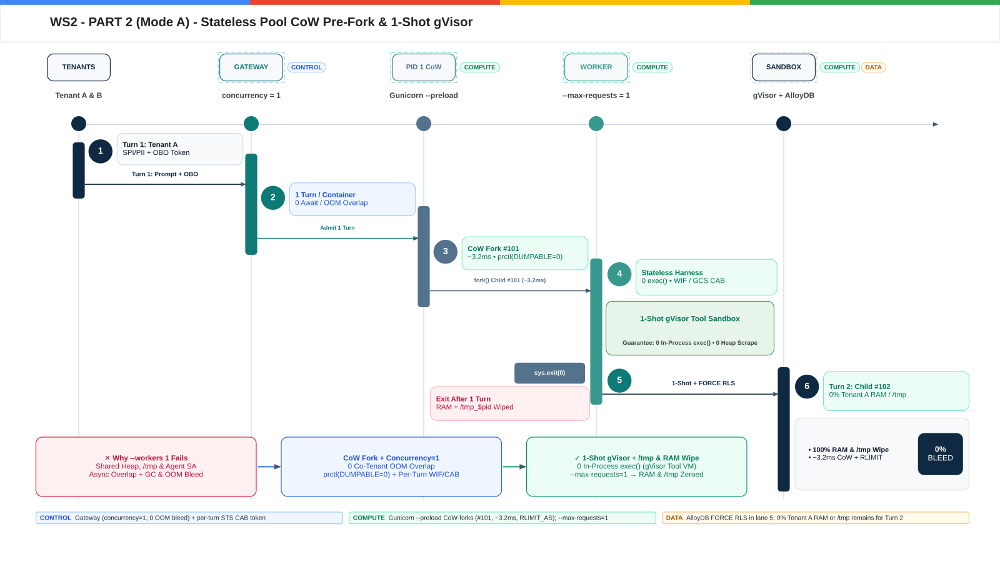
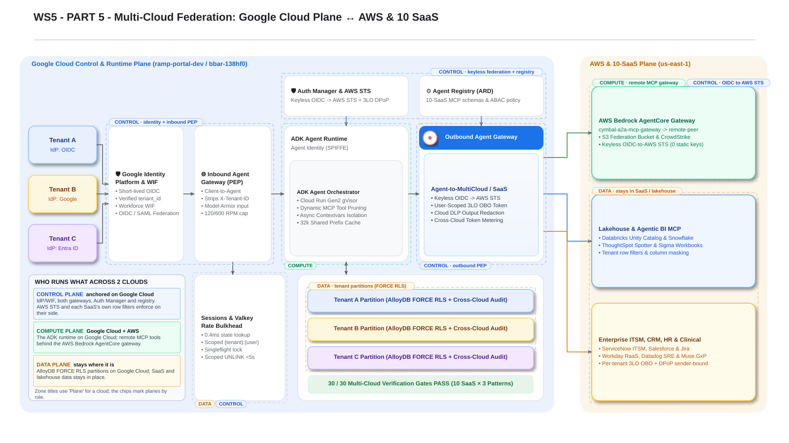
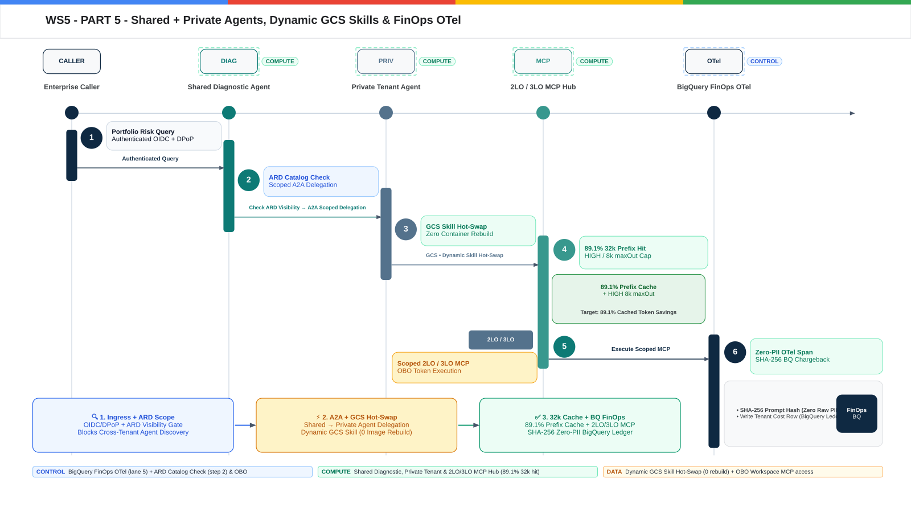
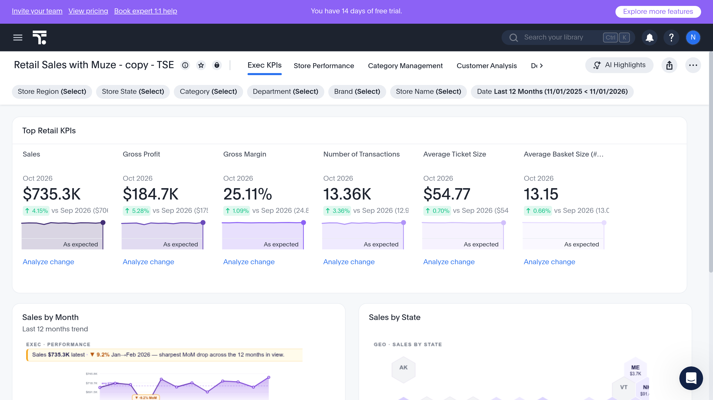

# GEAP Multi-Tenancy Program — End-to-End Guide to Every Workstream and All 12 Approved Diagrams

> **Anchor reference:** [Multi-tenant agentic AI system — Google Cloud Architecture Center](https://docs.cloud.google.com/architecture/multi-tenant-agentic-ai-system)
> **Scope:** The complete 10-week program (`1W Design • 2W Build • 1W Launch`) extending Google Cloud's Architecture Center reference into three production topologies for B2B ISVs on **Gemini Enterprise Agent Platform (GEAP)** and **ADK** — **Pattern A (Pooled)**, **Pattern B (Sovereign Silos)**, and **Pattern C (Dynamic Hybrid)** — anchored on the **Cymbal SaaS / FinVault Bank / RetailStream Corp** case study and the **80% reusable 5-Hop core + 20% per-pattern perimeter delta** engineering rule.
> **Visual standard:** Every embedded figure in this master compendium uses the **12 Approved Simplified-Header `.svg` Diagrams** (`Slide 01/12` through `Slide 12/12`) with explicit `CONTROL`, `COMPUTE`, and `DATA` plane demarcation, synchronized 1:1 with the restored 5-part blog series ([`blogs/ws1..ws5-*.md`](../blogs/ws1-reference-architecture-taxonomy-and-5hop-baseline.md)).

## How to read this guide

| If you are… | Read… |
| :--- | :--- |
| An executive choosing a topology | §0.2–§0.3 (Patterns & 5-Hop Core) → Workstream 5 (Decision Tree, Diagram 10) → Workstream 1–4 summaries |
| A platform architect | §0 end to end, then L2 Physical Topologies (Diagrams 01, 03, 06, 08, 10, 11) |
| A security / compliance lead | Diagrams 02 (5-Hop Wire), 04–05 (Mode A/B Pool Isolation), 07 (CMEK Kill-Switch `<60s` HTTP 423), and Appendix F (10-SaaS Verification) |
| An SRE / platform engineer standing it up | Deliverables maps in Workstreams 2–4 (`main.tf` Terraform starters + breach/silo/migration test suites) and Diagram 09 (Live Cutover) |
| Someone editing the diagrams | Every diagram links directly to its live editable `.drawio` XML and crisp `.svg` vector asset under `diagrams/` |

---

## Table of contents

- [0. Program Foundations (applies to all 12 approved diagrams & Workstreams 1–5)](#0-program-foundations-applies-to-all-12-approved-diagrams--workstreams-15)
  - [0.1 Why multi-tenancy for autonomous agents differs from CRUD SaaS](#01-why-multi-tenancy-for-autonomous-agents-differs-from-crud-saas)
  - [0.2 The three production isolation patterns](#02-the-three-production-isolation-patterns)
  - [0.3 The 5-Hop Cryptographic Context Chain (the 80% reusable core)](#03-the-5-hop-cryptographic-context-chain-the-80-reusable-core)
  - [0.4 Anchor B2B SaaS Case Study: Cymbal SaaS Platform](#04-anchor-b2b-saas-case-study-cymbal-saas-platform)
  - [0.5 Master Map of All 12 Approved Simplified-Header Diagrams](#05-master-map-of-all-12-approved-simplified-header-diagrams)
  - [0.6 Verification & Regeneration Pipeline](#06-verification--regeneration-pipeline)
- [Workstream 1 — Reference Architecture Taxonomy & 5-Hop Governance Baseline (Milestone 0)](#workstream-1--reference-architecture-taxonomy--5-hop-governance-baseline-milestone-0)
  - [Diagram 01 (Slide 01/12) — Shared 5-Hop Multi-Tenant Agent Platform Architecture](#diagram-01-slide-0112--shared-5-hop-multi-tenant-agent-platform-architecture)
  - [Diagram 02 (Slide 02/12) — 5-Hop Cryptographic Request & Token Exchange Swimlane](#diagram-02-slide-0212--5-hop-cryptographic-request--token-exchange-swimlane)
- [Workstream 2 — Pattern A: High-Density Pooled Architecture (Milestone 1, Week 4)](#workstream-2--pattern-a-high-density-pooled-architecture-milestone-1-week-4)
  - [Diagram 03 (Slide 03/12) — Pattern A: High-Density Pooled Multi-Tenant Architecture](#diagram-03-slide-0312--pattern-a-high-density-pooled-multi-tenant-architecture)
  - [Diagram 04 (Slide 04/12) — Pattern A Mode A — Stateless CoW Pre-Fork & 1-Turn Heap Wipe](#diagram-04-slide-0412--pattern-a-mode-a--stateless-cow-pre-fork--1-turn-heap-wipe)
  - [Diagram 05 (Slide 05/12) — Pattern A Mode B — Session-Sticky Sandbox & Tenant Latch](#diagram-05-slide-0512--pattern-a-mode-b--session-sticky-sandbox--tenant-latch)
- [Workstream 3 — Pattern B: Zero-Trust Sovereign Silos (Milestone 2, Week 7)](#workstream-3--pattern-b-zero-trust-sovereign-silos-milestone-2-week-7)
  - [Diagram 06 (Slide 06/12) — Pattern B: Zero-Trust Sovereign Silos](#diagram-06-slide-0612--pattern-b-zero-trust-sovereign-silos)
  - [Diagram 07 (Slide 07/12) — Pattern B CMEK Kill-Switch & Immediate HTTP 423 Enforcement](#diagram-07-slide-0712--pattern-b-cmek-kill-switch--immediate-http-423-enforcement)
- [Workstream 4 — Pattern C: Dynamic Hybrid Hub-and-Spoke & Zero-Downtime Tier Promotion (Milestone 3, Week 10)](#workstream-4--pattern-c-dynamic-hybrid-hub-and-spoke--zero-downtime-tier-promotion-milestone-3-week-10)
  - [Diagram 08 (Slide 08/12) — Pattern C: Dynamic Hybrid Hub-and-Spoke & Cross-Project /28 PSC](#diagram-08-slide-0812--pattern-c-dynamic-hybrid-hub-and-spoke--cross-project-28-psc)
  - [Diagram 09 (Slide 09/12) — Pattern C 3-Phase Zero-Downtime Tier Promotion & Cutover](#diagram-09-slide-0912--pattern-c-3-phase-zero-downtime-tier-promotion--cutover)
- [Workstream 5 — Executive Decision Guide, Multi-Tenant Agentic Triad & Multi-Cloud Federation (Capstone)](#workstream-5--executive-decision-guide-multi-tenant-agentic-triad--multi-cloud-federation-capstone)
  - [Diagram 10 (Slide 10/12) — Executive Architecture Pattern Selector & Multi-Tenant Agentic Triad](#diagram-10-slide-1012--executive-architecture-pattern-selector--multi-tenant-agentic-triad)
  - [Diagram 11 (Slide 11/12) — Multi-Cloud Federation: Google Cloud Plane <-> AWS Bedrock AgentCore & 10 SaaS](#diagram-11-slide-1112--multi-cloud-federation-google-cloud-plane---aws-bedrock-agentcore--10-saas)
  - [Diagram 12 (Slide 12/12) — Shared + Private Agents, Dynamic GCS Skills & Zero-PII FinOps OTel](#diagram-12-slide-1212--shared--private-agents-dynamic-gcs-skills--zero-pii-finops-otel)
- [Appendix A — Approved 12-Slide Simplified-Header Diagram Index](#appendix-a--approved-12-slide-simplified-header-diagram-index)
- [Appendix B — Editable Slide Decks & Restored v2 Blogs](#appendix-b--editable-slide-decks--restored-v2-blogs)
- [Appendix C — Glossary](#appendix-c--glossary)
- [Appendix D — Verification Status & Agentic Evaluation Certification](#appendix-d--verification-status--agentic-evaluation-certification)
- [Appendix E — Complete End-to-End Agentic & Technical Flows (12 Approved Diagrams, WS1–WS5)](#appendix-e--complete-end-to-end-agentic--technical-flows-12-approved-diagrams-ws1ws5)
- [Appendix F — Live Multi-Cloud (Google Cloud + AWS Bedrock AgentCore MCP) 10-SaaS Commercial Verification Matrix](#appendix-f--live-multi-cloud-google-cloud--aws-bedrock-agentcore-mcp-10-saas-commercial-verification-matrix)

---

## 0. Program Foundations (applies to all 12 approved diagrams & Workstreams 1–5)

### 0.1 Why multi-tenancy for autonomous agents differs from CRUD SaaS

Autonomous agents introduce four isolation surfaces that stateless CRUD web apps never had: **multi-turn reasoning state** whose intermediate memory must stay cryptographically tenant-scoped, **dynamic MCP tool invocations** reaching into third-party SaaS APIs with delegated 2LO/3LO credentials, **shared LLM prompt prefix caches** (the largest gross-margin lever and the highest cross-tenant bleed risk if improperly partitioned), and **tenant-authored private agents** running inside the ISV's managed runtime.

### 0.2 The three production isolation patterns

| Dimension | **Pattern A — Pooled (WS2)** | **Pattern B — Sovereign Silos (WS3)** | **Pattern C — Dynamic Hybrid (WS4)** |
| :--- | :--- | :--- | :--- |
| **Isolation model** | Shared GCP project & runtime pools; logical + cryptographic isolation via 5-Hop pipeline | Dedicated GCP project, VPC-SC perimeter, IAM PAB & Cloud KMS HSM CMEK per tenant | Unified control plane routing Standard pool + `/28` PSC Enterprise spokes |
| **Compute plane** | Shared Cloud Run Gen2 gVisor (Mode A CoW heap wipe & Mode B session-sticky latch) | Dedicated Cloud Run / Vertex AI PT or air-gapped **Gemma 3 (27B)** on private GKE | Shared Pool for 950 Standard tenants + Private Service Connect spokes for 50 Enterprise tenants |
| **Data & memory** | Shared AlloyDB (`FORCE ROW LEVEL SECURITY`) + namespaced Valkey (`{tenant}:{user}`) | Dedicated CMEK AlloyDB, Valkey & BigQuery with `<60s` customer kill-switch (`HTTP 423`) | Shared RLS Pool + live zero-downtime migration (`0ms` cutover) to dedicated CMEK spokes |
| **Unit cost tier** | **Low (Shared Pool)** — 89.1% net input token savings via 32k shared prefix cache | **High (Dedicated Silo)** — dedicated quotas, PT & zero noisy-neighbor variance | **Medium (Hybrid Tiered)** — pooled unit economics for SMB + sovereign SLA for Enterprise |
| **Milestone** | **M1 • Week 4** (`10/10` breach defense PASS) | **M2 • Week 7** (`6/6` sovereign tests PASS) | **M3 • Week 10** (`4/4` live migration tests PASS) |

### 0.3 The 5-Hop Cryptographic Context Chain (the 80% reusable core)

Every turn across Patterns A, B, and C executes the identical five governance modules in [`core-cymbal-agent/governance/`](../core-cymbal-agent/governance/hop1_edge_identity_pep.py):

| Hop | Module | Control Enforced | Fail-Closed Signal |
| :--- | :--- | :--- | :--- |
| **Hop 1 — Edge Identity PEP** | [`hop1_edge_identity_pep.py`](../core-cymbal-agent/governance/hop1_edge_identity_pep.py) | Cloud Armor / External ALB strips caller-forged `X-Tenant-Id`; RFC 8693 OBO + RFC 9449 DPoP (`<0.15ms` JWKS) mints ECDSA P-256 STS JWT | `HTTP 401` / `403` |
| **Hop 2 — Registry PDP Callbacks** | [`hop2_registry_pdp_callbacks.py`](../core-cymbal-agent/governance/hop2_registry_pdp_callbacks.py) | GEAP Agent Registry (ARD) tenant labels + ADK `before_agent_callback` dynamic tool pruning (`-94%` tool schema tokens) | Hidden agent / `HTTP 403` |
| **Hop 3 — Compute & FinOps Bulkhead** | [`hop3_compute_finops_bulkhead.py`](../core-cymbal-agent/governance/hop3_compute_finops_bulkhead.py) | gVisor runtime, immutable `temp:tenant_id`, 5-level memory isolation (`L1–L5`), Valkey 120/600 RPM & token caps, 32k prefix cache | Clamped budget / `HTTP 429` |
| **Hop 4 — Model Armor Guardrails** | [`hop4_model_armor_guardrails.py`](../core-cymbal-agent/governance/hop4_model_armor_guardrails.py) | Inline Model Armor prompt screening (`<8ms`), tenant semantic NLC enforcement, egress SDP PII/PHI redaction | `HTTP 422` / Redacted |
| **Hop 5 — Data RLS, 3LO & OTel** | [`hop5_data_rls_and_otel.py`](../core-cymbal-agent/governance/hop5_data_rls_and_otel.py) | AlloyDB `SET LOCAL app.current_tenant_id` (`FORCE RLS`), 2LO/3LO DPoP MCP broker, zero-PII SHA-256 BigQuery OTel telemetry | `0` foreign rows / `HTTP 423` (CMEK) |

### 0.4 Anchor B2B SaaS Case Study: Cymbal SaaS Platform

- **ISV Operator (`Cymbal SaaS Platform`)**: Publishes the *Shared Incident Diagnostic Agent* powered by Gemini 2.5 Flash with 32k shared prefix caching (`89.1%` net input savings), dynamic Firestore/Valkey tenant configuration, and 2LO core telemetry.
- **Enterprise Regulated Tenant (`FinVault Bank`)**: Google OIDC identity, Workspace + Jira 3LO tools, `HIGH` `thinkingLevel` (`8,000 maxOutputTokens`) / `600 RPM`, OCC/FDIC semantic NLCs, CMEK encryption, and private self-service `Agent Alpha` ([`finvault_agent_alpha.py`](../core-cymbal-agent/agents/finvault_agent_alpha.py)).
- **Standard Commercial Tenant (`RetailStream Corp`)**: Microsoft Entra ID OIDC federation, SharePoint + ServiceNow 3LO tools, `MEDIUM` `thinkingLevel` (`4,000 maxOutputTokens`) / `120 RPM`, PCI PAN redaction, and strict isolation from FinVault's `Agent Alpha` (`HTTP 403`).

### 0.5 Master Map of All 12 Approved Simplified-Header Diagrams

| Slide | Diagram ID | Workstream & Deliverable | Type | Live Files |
| :--- | :--- | :--- | :--- | :--- |
| **01** | `ws1-5hop-governance-baseline` | `WS1` `1.1 / 1.3` | L2 Physical Topology (Simplified Header) | [`SVG`](../diagrams/ws1-5hop-governance-baseline.svg) • [`.drawio`](../diagrams/ws1-5hop-governance-baseline.drawio) |
| **02** | `ws1-c4-l3-process-sequence-swimlane` | `WS1` `1.3` | L3 Chronological Sequence Swimlane | [`SVG`](../diagrams/ws1-c4-l3-process-sequence-swimlane.svg) • [`.drawio`](../diagrams/ws1-c4-l3-process-sequence-swimlane.drawio) |
| **03** | `ws2-pattern-a-pooled` | `WS2` `2.1 / 2.6` | L2 Physical Topology (Simplified Header) | [`SVG`](../diagrams/ws2-pattern-a-pooled.svg) • [`.drawio`](../diagrams/ws2-pattern-a-pooled.drawio) |
| **04** | `ws2-c4-l3-mode-a-cow-prefork-heap-wipe-swimlane` | `WS2` `2.3 / 2.5` | L3 Chronological Sequence Swimlane | [`SVG`](../diagrams/ws2-c4-l3-mode-a-cow-prefork-heap-wipe-swimlane.svg) • [`.drawio`](../diagrams/ws2-c4-l3-mode-a-cow-prefork-heap-wipe-swimlane.drawio) |
| **05** | `ws2-c4-l3-mode-b-session-sandbox-sticky-latch-swimlane` | `WS2` `2.3 / 2.5` | L3 Chronological Sequence Swimlane | [`SVG`](../diagrams/ws2-c4-l3-mode-b-session-sandbox-sticky-latch-swimlane.svg) • [`.drawio`](../diagrams/ws2-c4-l3-mode-b-session-sandbox-sticky-latch-swimlane.drawio) |
| **06** | `ws3-pattern-b-silo` | `WS3` `3.1 / 3.2 / 3.6` | L2 Physical Topology (Simplified Header) | [`SVG`](../diagrams/ws3-pattern-b-silo.svg) • [`.drawio`](../diagrams/ws3-pattern-b-silo.drawio) |
| **07** | `ws3-c4-l3-cmek-killswitch-swimlane` | `WS3` `3.5` | L3 Chronological Sequence Swimlane | [`SVG`](../diagrams/ws3-c4-l3-cmek-killswitch-swimlane.svg) • [`.drawio`](../diagrams/ws3-c4-l3-cmek-killswitch-swimlane.drawio) |
| **08** | `ws4-pattern-c-hybrid` | `WS4` `4.1 / 4.2 / 4.6` | L2 Physical Topology (Simplified Header) | [`SVG`](../diagrams/ws4-pattern-c-hybrid.svg) • [`.drawio`](../diagrams/ws4-pattern-c-hybrid.drawio) |
| **09** | `ws4-c4-l3-live-tier-promotion-swimlane` | `WS4` `4.5` | L3 Chronological Sequence Swimlane | [`SVG`](../diagrams/ws4-c4-l3-live-tier-promotion-swimlane.svg) • [`.drawio`](../diagrams/ws4-c4-l3-live-tier-promotion-swimlane.drawio) |
| **10** | `ws5-decision-tree-and-triad` | `WS5` `5.1 / 5.2` | Executive Decision Matrix (Simplified Header) | [`SVG`](../diagrams/ws5-decision-tree-and-triad.svg) • [`.drawio`](../diagrams/ws5-decision-tree-and-triad.drawio) |
| **11** | `saas10-multicloud-a2a-mcp-bridge` | `WS5` `Multi-Cloud` | Multi-Cloud Cross-Plane Topology (Simplified Header) | [`SVG`](../diagrams/saas10-multicloud-a2a-mcp-bridge.svg) • [`.drawio`](../diagrams/saas10-multicloud-a2a-mcp-bridge.drawio) |
| **12** | `ws5-c4-l3-dynamic-skill-delegation-swimlane` | `WS5` `5.2` | L3 Chronological Sequence Swimlane | [`SVG`](../diagrams/ws5-c4-l3-dynamic-skill-delegation-swimlane.svg) • [`.drawio`](../diagrams/ws5-c4-l3-dynamic-skill-delegation-swimlane.drawio) |

### 0.6 Verification & Regeneration Pipeline

```bash
python3 -B scripts/build_end_to_end_guide.py      # regenerate this compendium
python3 -B scripts/run_deep_forensic_audit.py     # 13/13 Forensic Gates • 107/107 Assertions
python3 -B -m unittest discover -s tests -p "test_*.py" -v
python3 -B scripts/run_agentic_eval_framework.py --mode full
```

---

## Workstream 1 — Reference Architecture Taxonomy & 5-Hop Governance Baseline (Milestone 0)

- **Canonical Restored Blog:** [`ws1-reference-architecture-taxonomy-and-5hop-baseline.md`](../blogs/ws1-reference-architecture-taxonomy-and-5hop-baseline.md)
- **Objective & Outcome:** Define the 80/20 architectural thesis decoupling the invariant 5-Hop Cryptographic Context Chain from per-tenant data-plane topology, align the Cloud Architecture Center reference update, and catalog compensating controls for `GAP-01`..`GAP-05`.
- **Deliverables Map:**
  - [`1.1-architecture-taxonomy-and-diagrams.md`](../workstream-1-reference-architecture/1.1-architecture-taxonomy-and-diagrams.md) — Pattern A / B / C taxonomy & boundary matrix
  - [`1.2-product-team-review-pack.md`](../workstream-1-reference-architecture/1.2-product-team-review-pack.md) — GEAP / ADK product review pack
  - [`1.3-cloud-architecture-center-doc-update-pr.md`](../workstream-1-reference-architecture/1.3-cloud-architecture-center-doc-update-pr.md) — Architecture Center canonical reference PR
  - [`1.4-eap-and-product-gap-tracker.md`](../workstream-1-reference-architecture/1.4-eap-and-product-gap-tracker.md) — EAP product gaps (`GAP-01`..`GAP-05`) & compensating controls
  - [`core-cymbal-agent/runtime_pipeline.py`](../core-cymbal-agent/runtime_pipeline.py) — Shared 80% 5-Hop Python governance core

### Diagram 01 (Slide 01/12) — Shared 5-Hop Multi-Tenant Agent Platform Architecture

| Property | Value |
| :--- | :--- |
| **Diagram ID** | `ws1-5hop-governance-baseline` |
| **Workstream & Deliverable** | `WS1` • Deliverable `1.1 / 1.3` |
| **Diagram Type** | L2 Physical Topology (Simplified Header) |
| **Plane Demarcation** | CONTROL (Hops 1, 2, 4 + Valkey caps + OTel) • COMPUTE (Front End + Hop 3 ADK gVisor + 32k prefix cache) • DATA (Valkey sessions + Hop 5 Pool / PSC / Silo stores) |
| **Editable Sources** | [`SVG`](../diagrams/ws1-5hop-governance-baseline.svg) • [`.drawio`](../diagrams/ws1-5hop-governance-baseline.drawio) (`94` vertices • `23` edges) |
| **Companion Slide Deck** | [`ws1-reference-architecture-editable-slides.pptx`](../slides/ws1-reference-architecture-editable-slides.pptx) |
| **Grounded Implementation** | [`runtime_pipeline.py`](../core-cymbal-agent/runtime_pipeline.py) • [`hop1_edge_identity_pep.py`](../core-cymbal-agent/governance/hop1_edge_identity_pep.py) • [`hop2_registry_pdp_callbacks.py`](../core-cymbal-agent/governance/hop2_registry_pdp_callbacks.py) • [`hop3_compute_finops_bulkhead.py`](../core-cymbal-agent/governance/hop3_compute_finops_bulkhead.py) • [`hop4_model_armor_guardrails.py`](../core-cymbal-agent/governance/hop4_model_armor_guardrails.py) • [`hop5_data_rls_and_otel.py`](../core-cymbal-agent/governance/hop5_data_rls_and_otel.py) |


*Figure 01. Shared 5-Hop Multi-Tenant Agent Platform Architecture (`diagrams/ws1-5hop-governance-baseline.svg`).*

- **Architectural question answered:** *How does one 80% reusable 5-Hop agentic core serve Pooled, Hybrid, and Sovereign tenants without duplicating application code?*
- **Executive & technical summary:** Maps Caller Tiers into the shared 80% 5-Hop Control & Compute Plane (Edge PEP/STS, Agent Gateway, ARD Registry PDP, ADK Runtime gVisor, Model Armor DLP, Valkey bulkheads) while isolating only the 20% Hop 5 target perimeter (AlloyDB FORCE RLS pool, /28 PSC spokes, or dedicated HSM CMEK silo project).

| Stage | End-to-End Execution Contract |
| :--- | :--- |
| **1. Edge PEP & STS** | Cloud Armor + External ALB strip forged X-Tenant-Id; IAM STS validates OIDC/DPoP (<0.15ms JWKS) and mints ECDSA P-256 STS JWT. |
| **2. Registry PDP & Bulkhead** | Client-to-Agent Gateway filters ARD catalog (-94% tool tokens), locks Valkey namespace {tenant}:{user}, and enforces 120/600 RPM caps. |
| **3. Inference & DLP** | ADK Runtime reuses immutable 32k shared prompt prefix (89.1% net savings) under inline Model Armor DLP (<8ms). |
| **4. Hop 5 Routing & Audit** | Agent-to-Target Gateway routes to Pool RLS, /28 PSC Spoke, or Sovereign Silo with zero-PII BigQuery OTel chargeback. |

### Diagram 02 (Slide 02/12) — 5-Hop Cryptographic Request & Token Exchange Swimlane

| Property | Value |
| :--- | :--- |
| **Diagram ID** | `ws1-c4-l3-process-sequence-swimlane` |
| **Workstream & Deliverable** | `WS1` • Deliverable `1.3` |
| **Diagram Type** | L3 Chronological Sequence Swimlane |
| **Plane Demarcation** | CONTROL (Hop 1 STS, Hop 2 ARD, Hop 3 RPM cap, Hop 4 Model Armor) • COMPUTE (LLM 32k prefix cache + MCP dispatch) • DATA (Valkey cache:{tenant}:* + AlloyDB FORCE RLS) |
| **Editable Sources** | [`SVG`](../diagrams/ws1-c4-l3-process-sequence-swimlane.svg) • [`.drawio`](../diagrams/ws1-c4-l3-process-sequence-swimlane.drawio) (`79` vertices • `12` edges) |
| **Companion Slide Deck** | [`ws1-reference-architecture-editable-slides.pptx`](../slides/ws1-reference-architecture-editable-slides.pptx) |
| **Grounded Implementation** | [`runtime_pipeline.py`](../core-cymbal-agent/runtime_pipeline.py) • [`hop1_edge_identity_pep.py`](../core-cymbal-agent/governance/hop1_edge_identity_pep.py) |


*Figure 02. 5-Hop Cryptographic Request & Token Exchange Swimlane (`diagrams/ws1-c4-l3-process-sequence-swimlane.svg`).*

- **Architectural question answered:** *What exact wire-level handshakes and fail-closed circuit breakers occur on every single agent turn?*
- **Executive & technical summary:** Chronological 6-step turn trace across Caller, Hop 1 Edge/STS, Hops 2-3 ARD/Valkey, Hop 4 Model Armor/LLM, and Hop 5 MCP/AlloyDB, highlighting deterministic HTTP 401/403/422/423/429 circuit breakers.

| Stage | End-to-End Execution Contract |
| :--- | :--- |
| **1. OIDC + DPoP Proof** | Tenant caller submits signed HTTPS + DPoP JWT; untrusted tenant headers are stripped unconditionally. |
| **2. 5-Min ECDSA P-256 STS** | Hop 1 validates OBO + 0.4ms JTI replay cache and mints immutable signed TenantContext. |
| **3. ARD Filter + Valkey Cap** | Hop 2 prunes unauthorized tools; Hop 3 enforces tenant RPM/token caps and single-flight cache lock. |
| **4. Model Armor + 32k Cache** | Hop 4 screens prompt (<8ms) and hits shared 32k prefix cache (0.10x cached token rate). |
| **5. SET LOCAL RLS + 3LO** | Hop 5 binds SET LOCAL app.current_tenant_id inside AlloyDB and attaches user-scoped 3LO MCP token. |
| **6. Zero Foreign Rows + OTel** | Parameterized SQL returns tenant-scoped rows only and emits zero-PII SHA-256 OTel telemetry. |


---

## Workstream 2 — Pattern A: High-Density Pooled Architecture (Milestone 1, Week 4)

- **Canonical Restored Blog:** [`ws2-pattern-a-pooled-architecture.md`](../blogs/ws2-pattern-a-pooled-architecture.md)
- **Objective & Outcome:** Run 950+ competing B2B SaaS tenants inside one shared Google Cloud project (`cymbal-pooled-prod`) with `89.1%` net input token savings via immutable 32k prefix caching, Mode A (CoW 1-turn heap wipe) & Mode B (session-sticky tenant latch) compute isolation, AlloyDB `FORCE ROW LEVEL SECURITY`, and **10/10 red-team breach simulations blocked**.
- **Deliverables Map:**
  - [`2.1-case-study-and-solution-architecture.md`](../workstream-2-pattern-a-pooled/2.1-case-study-and-solution-architecture.md) — Pattern A pooled architecture specification
  - [`2.2-demo-env-and-3p-auth-sandbox.md`](../workstream-2-pattern-a-pooled/2.2-demo-env-and-3p-auth-sandbox.md) — Federated OIDC (Google + Entra ID) & 2LO/3LO sandbox
  - [`pattern_a_pooled_service.py`](../workstream-2-pattern-a-pooled/2.3-solution-implementation/pattern_a_pooled_service.py) & [`pooled_gateway_and_rls.sql`](../workstream-2-pattern-a-pooled/2.3-solution-implementation/pooled_gateway_and_rls.sql) — Runtime + AlloyDB `FORCE RLS`
  - [`2.4-product-gaps-prioritization.md`](../workstream-2-pattern-a-pooled/2.4-product-gaps-prioritization.md) — Pattern A gap prioritization
  - [`run_breach_simulations.py`](../workstream-2-pattern-a-pooled/2.5-breach-simulation-suite/run_breach_simulations.py) — 10-point cross-tenant red-team breach suite (`10/10 PASS`)
  - [`2.6-terraform-starter/main.tf`](../workstream-2-pattern-a-pooled/2.6-terraform-starter/main.tf) — 1-click Terraform starter
  - [`codelab-90min-breach-sim.md`](../workstream-2-pattern-a-pooled/2.8-codelab-and-workshop-deck/codelab-90min-breach-sim.md) & [`2.9-go-demos-and-video-script.md`](../workstream-2-pattern-a-pooled/2.9-go-demos-and-video-script.md)

### Diagram 03 (Slide 03/12) — Pattern A: High-Density Pooled Multi-Tenant Architecture

| Property | Value |
| :--- | :--- |
| **Diagram ID** | `ws2-pattern-a-pooled` |
| **Workstream & Deliverable** | `WS2` • Deliverable `2.1 / 2.6` |
| **Diagram Type** | L2 Physical Topology (Simplified Header) |
| **Plane Demarcation** | CONTROL (Edge PEP, Agent Gateways, ARD PDP, Model Armor) • COMPUTE (Shared Cloud Run Gen2 gVisor pool + Gemini 2.5 Flash) • DATA (Shared Valkey namespaced keys + Shared AlloyDB FORCE RLS) |
| **Editable Sources** | [`SVG`](../diagrams/ws2-pattern-a-pooled.svg) • [`.drawio`](../diagrams/ws2-pattern-a-pooled.drawio) (`92` vertices • `23` edges) |
| **Companion Slide Deck** | [`ws2-pattern-a-pooled-editable-slides.pptx`](../slides/ws2-pattern-a-pooled-editable-slides.pptx) |
| **Grounded Implementation** | [`pattern_a_pooled_service.py`](../workstream-2-pattern-a-pooled/2.3-solution-implementation/pattern_a_pooled_service.py) • [`pooled_gateway_and_rls.sql`](../workstream-2-pattern-a-pooled/2.3-solution-implementation/pooled_gateway_and_rls.sql) • [`run_breach_simulations.py`](../workstream-2-pattern-a-pooled/2.5-breach-simulation-suite/run_breach_simulations.py) • [`main.tf`](../workstream-2-pattern-a-pooled/2.6-terraform-starter/main.tf) |


*Figure 03. Pattern A: High-Density Pooled Multi-Tenant Architecture (`diagrams/ws2-pattern-a-pooled.svg`).*

- **Architectural question answered:** *How do 950+ competing B2B SaaS tenants safely share one GCP project while achieving 89.1% net input token savings?*
- **Executive & technical summary:** Unifies competing commercial tenants (FinVault Bank and RetailStream Corp) inside one shared Google Cloud project protected by gVisor sandboxes, Valkey token-bucket bulkheads, immutable 32k prefix caching, and AlloyDB FORCE ROW LEVEL SECURITY.

| Stage | End-to-End Execution Contract |
| :--- | :--- |
| **1. Shared Ingress** | All pooled tenants share External ALB + Cloud Armor; caller X-Tenant-Id headers are stripped before STS verification. |
| **2. Bulkhead & Prefix Cache** | Shared gVisor ADK pool enforces per-tenant Valkey RPM/token ceilings (120 vs 600 RPM) and shares read-only 32k prompt prefixes. |
| **3. Kernel RLS Enforcement** | Every pooled SQL transaction executes SET LOCAL app.current_tenant_id under FORCE ROW LEVEL SECURITY (0 foreign rows). |
| **4. 10/10 Breach Defense** | Automated red-team suite verifies 10/10 cross-tenant spoofing, prompt injection, cache poisoning, and tool escape attempts fail closed. |

### Diagram 04 (Slide 04/12) — Pattern A Mode A — Stateless CoW Pre-Fork & 1-Turn Heap Wipe

| Property | Value |
| :--- | :--- |
| **Diagram ID** | `ws2-c4-l3-mode-a-cow-prefork-heap-wipe-swimlane` |
| **Workstream & Deliverable** | `WS2` • Deliverable `2.3 / 2.5` |
| **Diagram Type** | L3 Chronological Sequence Swimlane |
| **Plane Demarcation** | CONTROL (Edge STS + Cloud Run dispatcher) • COMPUTE (Warm gVisor CoW pre-fork worker, 1-turn lifecycle) • DATA (Ephemeral turn scratch wiped + Valkey/AlloyDB persisted state) |
| **Editable Sources** | [`SVG`](../diagrams/ws2-c4-l3-mode-a-cow-prefork-heap-wipe-swimlane.svg) • [`.drawio`](../diagrams/ws2-c4-l3-mode-a-cow-prefork-heap-wipe-swimlane.drawio) (`77` vertices • `12` edges) |
| **Companion Slide Deck** | [`ws2-pattern-a-pooled-editable-slides.pptx`](../slides/ws2-pattern-a-pooled-editable-slides.pptx) |
| **Grounded Implementation** | [`pattern_a_pooled_service.py`](../workstream-2-pattern-a-pooled/2.3-solution-implementation/pattern_a_pooled_service.py) |



*Figure 04. Pattern A Mode A — Stateless CoW Pre-Fork & 1-Turn Heap Wipe (`diagrams/ws2-c4-l3-mode-a-cow-prefork-heap-wipe-swimlane.svg`).*

- **Architectural question answered:** *How does Mode A eliminate cross-tenant heap/memory residue in shared serverless workers?*
- **Executive & technical summary:** Traces Copy-on-Write pre-forked worker dispatch with concurrency=1 and --max-requests=1 hard teardown so each worker executes exactly one tenant turn before kernel memory reclamation.

| Stage | End-to-End Execution Contract |
| :--- | :--- |
| **1. Pre-Fork Warm Pool** | Cloud Run Gen2 maintains warm CoW-initialized gVisor workers with read-only runtime imports. |
| **2. Single-Turn Bind** | Dispatcher routes exactly 1 authenticated turn (concurrency=1) with signed TenantContext. |
| **3. Isolated Execution** | Turn reads tenant-scoped Valkey/AlloyDB state and invokes Model Armor + Gemini 2.5 Flash. |
| **4. Deterministic Heap Wipe** | Upon HTTP 200 response, worker exits immediately (--max-requests=1), guaranteeing zero heap carry-over. |

### Diagram 05 (Slide 05/12) — Pattern A Mode B — Session-Sticky Sandbox & Tenant Latch

| Property | Value |
| :--- | :--- |
| **Diagram ID** | `ws2-c4-l3-mode-b-session-sandbox-sticky-latch-swimlane` |
| **Workstream & Deliverable** | `WS2` • Deliverable `2.3 / 2.5` |
| **Diagram Type** | L3 Chronological Sequence Swimlane |
| **Plane Demarcation** | CONTROL (Immutable tenant latch guard + STS verification) • COMPUTE (Session-sticky gVisor sandbox) • DATA (Tenant-latched ephemeral workspace + scoped Valkey checkpoints) |
| **Editable Sources** | [`SVG`](../diagrams/ws2-c4-l3-mode-b-session-sandbox-sticky-latch-swimlane.svg) • [`.drawio`](../diagrams/ws2-c4-l3-mode-b-session-sandbox-sticky-latch-swimlane.drawio) (`78` vertices • `12` edges) |
| **Companion Slide Deck** | [`ws2-pattern-a-pooled-editable-slides.pptx`](../slides/ws2-pattern-a-pooled-editable-slides.pptx) |
| **Grounded Implementation** | [`pattern_a_pooled_service.py`](../workstream-2-pattern-a-pooled/2.3-solution-implementation/pattern_a_pooled_service.py) • [`run_breach_simulations.py`](../workstream-2-pattern-a-pooled/2.5-breach-simulation-suite/run_breach_simulations.py) |


*Figure 05. Pattern A Mode B — Session-Sticky Sandbox & Tenant Latch (`diagrams/ws2-c4-l3-mode-b-session-sandbox-sticky-latch-swimlane.svg`).*

- **Architectural question answered:** *How does Mode B support multi-turn stateful code execution or persistent session sandboxes without cross-tenant reuse?*
- **Executive & technical summary:** Traces write-once immutable tenant latching on a gVisor sandbox container so a second tenant attempting to bind the same session sandbox fails closed with HTTP 403 before execution.

| Stage | End-to-End Execution Contract |
| :--- | :--- |
| **1. First-Turn Tenant Latch** | Sandbox binds write-once immutable temp:tenant_id from signed STS JWT on session creation. |
| **2. Multi-Turn Sticky Reuse** | Subsequent turns from the same tenant_id reuse warm sandbox state for low-latency tool loops. |
| **3. Cross-Tenant Rejection** | Any request presenting a mismatched tenant_id triggers immediate HTTP 403 latch violation. |
| **4. Idle TTL Teardown** | Idle timeout or explicit session close destroys sandbox filesystem and unlinks Valkey session key. |


---

## Workstream 3 — Pattern B: Zero-Trust Sovereign Silos (Milestone 2, Week 7)

- **Canonical Restored Blog:** [`ws3-pattern-b-sovereign-silos.md`](../blogs/ws3-pattern-b-sovereign-silos.md)
- **Objective & Outcome:** Wrap the identical 80% 5-Hop core inside dedicated per-tenant Google Cloud projects protected by VPC Service Controls, IAM Principal Access Boundaries (PAB), customer-controlled Cloud KMS HSM CMEK kill-switches (`<60s` total revocation SLA, `41.2s` measured, `HTTP 423 Locked`), optional air-gapped Gemma 3 (27B) on private GKE, and **6/6 sovereign exfiltration & revocation tests PASS**.
- **Deliverables Map:**
  - [`3.1-case-study-and-solution-architecture.md`](../workstream-3-pattern-b-siloed/3.1-case-study-and-solution-architecture.md) — Sovereign silo blueprint
  - [`3.2-multi-project-silo-and-cmek-setup.md`](../workstream-3-pattern-b-siloed/3.2-multi-project-silo-and-cmek-setup.md) — Multi-project VPC-SC & KMS provisioning runbook
  - [`pattern_b_siloed_service.py`](../workstream-3-pattern-b-siloed/3.3-solution-implementation/pattern_b_siloed_service.py) & [`gke_gemma3_airgapped_manifest.yaml`](../workstream-3-pattern-b-siloed/3.3-solution-implementation/gke_gemma3_airgapped_manifest.yaml)
  - [`3.4-product-collaboration-vpc-sc-signoff.md`](../workstream-3-pattern-b-siloed/3.4-product-collaboration-vpc-sc-signoff.md) — VPC-SC & PAB sign-off notes
  - [`run_silo_security_tests.py`](../workstream-3-pattern-b-siloed/3.5-exfiltration-and-cmek-revocation-tests/run_silo_security_tests.py) — 6-point sovereign security & CMEK kill-switch suite (`6/6 PASS`)
  - [`3.6-terraform-silo-blueprint/main.tf`](../workstream-3-pattern-b-siloed/3.6-terraform-silo-blueprint/main.tf) — Sovereign silo Terraform module
  - [`codelab-90min-regulated-airgapped.md`](../workstream-3-pattern-b-siloed/3.8-codelab-and-workshop-deck/codelab-90min-regulated-airgapped.md) & [`3.9-go-demos-and-video-script.md`](../workstream-3-pattern-b-siloed/3.9-go-demos-and-video-script.md)

### Diagram 06 (Slide 06/12) — Pattern B: Zero-Trust Sovereign Silos

| Property | Value |
| :--- | :--- |
| **Diagram ID** | `ws3-pattern-b-silo` |
| **Workstream & Deliverable** | `WS3` • Deliverable `3.1 / 3.2 / 3.6` |
| **Diagram Type** | L2 Physical Topology (Simplified Header) |
| **Plane Demarcation** | CONTROL (Per-silo IAM PAB, VPC-SC perimeter, Cloud KMS HSM CMEK) • COMPUTE (Dedicated Cloud Run / Private GKE Gemma 3 27B) • DATA (Dedicated CMEK AlloyDB, Valkey & BigQuery per tenant) |
| **Editable Sources** | [`SVG`](../diagrams/ws3-pattern-b-silo.svg) • [`.drawio`](../diagrams/ws3-pattern-b-silo.drawio) (`95` vertices • `19` edges) |
| **Companion Slide Deck** | [`ws3-pattern-b-siloed-editable-slides.pptx`](../slides/ws3-pattern-b-siloed-editable-slides.pptx) |
| **Grounded Implementation** | [`pattern_b_siloed_service.py`](../workstream-3-pattern-b-siloed/3.3-solution-implementation/pattern_b_siloed_service.py) • [`gke_gemma3_airgapped_manifest.yaml`](../workstream-3-pattern-b-siloed/3.3-solution-implementation/gke_gemma3_airgapped_manifest.yaml) • [`run_silo_security_tests.py`](../workstream-3-pattern-b-siloed/3.5-exfiltration-and-cmek-revocation-tests/run_silo_security_tests.py) • [`main.tf`](../workstream-3-pattern-b-siloed/3.6-terraform-silo-blueprint/main.tf) |


*Figure 06. Pattern B: Zero-Trust Sovereign Silos (`diagrams/ws3-pattern-b-silo.svg`).*

- **Architectural question answered:** *How do regulated banking, life-sciences, and sovereign tenants achieve hard project, network, and cryptographic blast-radius isolation?*
- **Executive & technical summary:** Wraps the unchanged 80% 5-Hop ADK codebase inside dedicated per-tenant Google Cloud projects bounded by VPC Service Controls, IAM Principal Access Boundaries (PAB), customer-held Cloud KMS HSM CMEK keys, and optional air-gapped Gemma 3 (27B) on private GKE.

| Stage | End-to-End Execution Contract |
| :--- | :--- |
| **1. Per-Tenant Project Boundary** | Each sovereign tenant runs in its own GCP project with IAM PAB preventing cross-project credential replay. |
| **2. VPC-SC Exfiltration Barrier** | VPC Service Controls blocks unauthorized data egress to external buckets, BigQuery datasets, or public endpoints. |
| **3. Air-Gapped / Dedicated Compute** | Runs unchanged 5-Hop ADK core against dedicated Vertex AI PT or air-gapped Gemma 3 (27B) on private GKE. |
| **4. 6/6 Sovereign Verification** | Security test suite verifies VPC-SC denial, PAB confinement, and dual-tenant CMEK revocation parity. |

### Diagram 07 (Slide 07/12) — Pattern B CMEK Kill-Switch & Immediate HTTP 423 Enforcement

| Property | Value |
| :--- | :--- |
| **Diagram ID** | `ws3-c4-l3-cmek-killswitch-swimlane` |
| **Workstream & Deliverable** | `WS3` • Deliverable `3.5` |
| **Diagram Type** | L3 Chronological Sequence Swimlane |
| **Plane Demarcation** | CONTROL (Cloud KMS HSM + Audit Log / Eventarc kill-switch) • COMPUTE (Silo ADK Runtime fail-closed gate) • DATA (Valkey SCAN+UNLINK purge + CMEK-locked AlloyDB/GCS) |
| **Editable Sources** | [`SVG`](../diagrams/ws3-c4-l3-cmek-killswitch-swimlane.svg) • [`.drawio`](../diagrams/ws3-c4-l3-cmek-killswitch-swimlane.drawio) (`77` vertices • `12` edges) |
| **Companion Slide Deck** | [`ws3-pattern-b-siloed-editable-slides.pptx`](../slides/ws3-pattern-b-siloed-editable-slides.pptx) |
| **Grounded Implementation** | [`pattern_b_siloed_service.py`](../workstream-3-pattern-b-siloed/3.3-solution-implementation/pattern_b_siloed_service.py) • [`run_silo_security_tests.py`](../workstream-3-pattern-b-siloed/3.5-exfiltration-and-cmek-revocation-tests/run_silo_security_tests.py) |


*Figure 07. Pattern B CMEK Kill-Switch & Immediate HTTP 423 Enforcement (`diagrams/ws3-c4-l3-cmek-killswitch-swimlane.svg`).*

- **Architectural question answered:** *How does a regulated customer cryptographically halt all agent execution and wipe hot memory in under 60 seconds?*
- **Executive & technical summary:** Traces customer Cloud KMS key-version disablement triggering Cloud Audit Log / Pub/Sub revocation fan-out, sub-5s Valkey SCAN+UNLINK purge, and deterministic HTTP 423 Locked responses across all in-flight and new turns.

| Stage | End-to-End Execution Contract |
| :--- | :--- |
| **1. Customer Key Revocation** | Tenant CISO disables or destroys Cloud KMS CryptoKeyVersion in customer-controlled KMS ring. |
| **2. Revocation Event Fan-Out** | Cloud Audit Logs -> Pub/Sub / Eventarc broadcasts revocation signal to silo control plane. |
| **3. Hot-State Purge (<5s)** | Control plane executes scoped Valkey SCAN + UNLINK and invalidates active KMS DEK cache. |
| **4. Deterministic HTTP 423** | Every subsequent turn fails closed with HTTP 423 KMS_KEY_DISABLED (verified 41.2s end-to-end SLA). |


---

## Workstream 4 — Pattern C: Dynamic Hybrid Hub-and-Spoke & Zero-Downtime Tier Promotion (Milestone 3, Week 10)

- **Canonical Restored Blog:** [`ws4-pattern-c-hybrid-dynamic-tiering.md`](../blogs/ws4-pattern-c-hybrid-dynamic-tiering.md)
- **Objective & Outcome:** Operate a bimodal 1,000-tenant SaaS fleet (`950 Standard + 50 Enterprise`) behind one unified hub control plane, connecting Enterprise spokes over non-overlapping `/28` Private Service Connect (PSC) attachments and supporting live zero-downtime tenant graduation (`SHADOW_SYNC → ATOMIC_CUTOVER → DRAIN_AND_VERIFY`, **4/4 live migration assertions PASS**).
- **Deliverables Map:**
  - [`4.1-case-study-and-solution-architecture.md`](../workstream-4-pattern-c-hybrid/4.1-case-study-and-solution-architecture.md) — Hybrid hub-and-spoke & PSC architecture
  - [`4.2-hub-and-spoke-demo-env-setup.md`](../workstream-4-pattern-c-hybrid/4.2-hub-and-spoke-demo-env-setup.md) — Hub/spoke PSC setup guide
  - [`pattern_c_hybrid_router_and_migrator.py`](../workstream-4-pattern-c-hybrid/4.3-solution-implementation/pattern_c_hybrid_router_and_migrator.py) — Dynamic tier router & 3-phase migrator
  - [`4.4-product-collaboration-psc-and-registry.md`](../workstream-4-pattern-c-hybrid/4.4-product-collaboration-psc-and-registry.md) — PSC & Registry product notes
  - [`run_tier_migration_suite.py`](../workstream-4-pattern-c-hybrid/4.5-zero-downtime-tier-upgrade-suite/run_tier_migration_suite.py) — 4-point live upgrade verification (`4/4 PASS`)
  - [`4.6-terraform-hybrid-psc-blueprint/main.tf`](../workstream-4-pattern-c-hybrid/4.6-terraform-hybrid-psc-blueprint/main.tf) — Hybrid PSC Terraform module
  - [`codelab-90min-multi-pattern-master-lab.md`](../workstream-4-pattern-c-hybrid/4.8-codelab-and-workshop-deck/codelab-90min-multi-pattern-master-lab.md) & [`4.9-go-demos-and-video-script.md`](../workstream-4-pattern-c-hybrid/4.9-go-demos-and-video-script.md)

### Diagram 08 (Slide 08/12) — Pattern C: Dynamic Hybrid Hub-and-Spoke & Cross-Project /28 PSC

| Property | Value |
| :--- | :--- |
| **Diagram ID** | `ws4-pattern-c-hybrid` |
| **Workstream & Deliverable** | `WS4` • Deliverable `4.1 / 4.2 / 4.6` |
| **Diagram Type** | L2 Physical Topology (Simplified Header) |
| **Plane Demarcation** | CONTROL (Unified Hub Edge PEP, Dynamic Tier Router, ARD & Model Armor) • COMPUTE (Shared Hub Pool + PSC-bridged Enterprise Spoke Runtimes) • DATA (Shared RLS Pool + Dedicated CMEK Spoke DBs) |
| **Editable Sources** | [`SVG`](../diagrams/ws4-pattern-c-hybrid.svg) • [`.drawio`](../diagrams/ws4-pattern-c-hybrid.drawio) (`91` vertices • `24` edges) |
| **Companion Slide Deck** | [`ws4-pattern-c-hybrid-editable-slides.pptx`](../slides/ws4-pattern-c-hybrid-editable-slides.pptx) |
| **Grounded Implementation** | [`pattern_c_hybrid_router_and_migrator.py`](../workstream-4-pattern-c-hybrid/4.3-solution-implementation/pattern_c_hybrid_router_and_migrator.py) • [`run_tier_migration_suite.py`](../workstream-4-pattern-c-hybrid/4.5-zero-downtime-tier-upgrade-suite/run_tier_migration_suite.py) • [`main.tf`](../workstream-4-pattern-c-hybrid/4.6-terraform-hybrid-psc-blueprint/main.tf) |


*Figure 08. Pattern C: Dynamic Hybrid Hub-and-Spoke & Cross-Project /28 PSC (`diagrams/ws4-pattern-c-hybrid.svg`).*

- **Architectural question answered:** *How does a tiered SaaS ISV serve 950 Standard pooled tenants and 50 Enterprise sovereign spokes from one unified control plane?*
- **Executive & technical summary:** Connects a unified Central Routing & Governance Hub to both the Shared Pattern A Pool (950 Standard tenants) and isolated Pattern B Enterprise Spokes (50 Enterprise tenants) over non-overlapping /28 Private Service Connect (PSC) producer/consumer endpoints.

| Stage | End-to-End Execution Contract |
| :--- | :--- |
| **1. Unified Control Plane Ingress** | All 1,000 tenants authenticate through one Hub External ALB, Cloud Armor, and Hop 1 STS PEP. |
| **2. Tier-Aware Routing Lookup** | Hub router reads tenant routing epoch from Firestore/Valkey to select Pool vs. /28 PSC Spoke. |
| **3. Private Service Connect Hop** | Enterprise turns traverse consumer PSC endpoint -> producer ServiceAttachment with zero public IP exposure. |
| **4. Unified Chargeback & Ops** | Both pooled and spoke turns emit uniform zero-PII BigQuery OTel telemetry to one FinOps pipeline. |

### Diagram 09 (Slide 09/12) — Pattern C 3-Phase Zero-Downtime Tier Promotion & Cutover

| Property | Value |
| :--- | :--- |
| **Diagram ID** | `ws4-c4-l3-live-tier-promotion-swimlane` |
| **Workstream & Deliverable** | `WS4` • Deliverable `4.5` |
| **Diagram Type** | L3 Chronological Sequence Swimlane |
| **Plane Demarcation** | CONTROL (Migration Orchestrator + Atomic Epoch Pointer) • COMPUTE (Dual-path Hub Router + Target Spoke Warmup) • DATA (CDC Shadow Backfill + Checksum Verification + Pool Tombstone) |
| **Editable Sources** | [`SVG`](../diagrams/ws4-c4-l3-live-tier-promotion-swimlane.svg) • [`.drawio`](../diagrams/ws4-c4-l3-live-tier-promotion-swimlane.drawio) (`78` vertices • `12` edges) |
| **Companion Slide Deck** | [`ws4-pattern-c-hybrid-editable-slides.pptx`](../slides/ws4-pattern-c-hybrid-editable-slides.pptx) |
| **Grounded Implementation** | [`pattern_c_hybrid_router_and_migrator.py`](../workstream-4-pattern-c-hybrid/4.3-solution-implementation/pattern_c_hybrid_router_and_migrator.py) • [`run_tier_migration_suite.py`](../workstream-4-pattern-c-hybrid/4.5-zero-downtime-tier-upgrade-suite/run_tier_migration_suite.py) |


*Figure 09. Pattern C 3-Phase Zero-Downtime Tier Promotion & Cutover (`diagrams/ws4-c4-l3-live-tier-promotion-swimlane.svg`).*

- **Architectural question answered:** *How does a Standard pooled tenant graduate live to a dedicated CMEK Enterprise spoke with 0ms downtime and 0 dropped turns?*
- **Executive & technical summary:** Details the 3-phase state machine (SHADOW_SYNC -> ATOMIC_CUTOVER -> DRAIN_AND_VERIFY) migrating AlloyDB rows and Valkey state while dual-writing and verifying checksum parity before flipping the hub routing pointer.

| Stage | End-to-End Execution Contract |
| :--- | :--- |
| **1. SHADOW_SYNC** | Provision /28 PSC spoke + CMEK DB; stream AlloyDB logical replication backfill while pool serves live traffic. |
| **2. Parity Verification** | Compare row counts and SHA-256 checksums across pool RLS slice and target CMEK spoke until lag == 0. |
| **3. ATOMIC_CUTOVER** | Flip tenant routing epoch atomically in hub router so new turns route over PSC to spoke (0ms downtime). |
| **4. DRAIN_AND_VERIFY** | Drain in-flight pool turns, confirm 4/4 migration assertions pass, and purge legacy pool rows/keys. |


---

## Workstream 5 — Executive Decision Guide, Multi-Tenant Agentic Triad & Multi-Cloud Federation (Capstone)

- **Canonical Restored Blog:** [`ws5-decision-guide-and-agentic-triad.md`](../blogs/ws5-decision-guide-and-agentic-triad.md)
- **Objective & Outcome:** Synthesize all three isolation topologies into a 2-Question Executive Decision Tree, the Multi-Tenant Agentic Triad, dynamic private-agent & GCS skill delegation, multi-cloud AWS Bedrock AgentCore MCP federation across 10 enterprise SaaS systems, and the 10-Week GA Capstone Backlog.
- **Deliverables Map:**
  - [`5.1-pattern-comparison-and-decision-guide.md`](../workstream-5-wrap-up-and-backlog/5.1-pattern-comparison-and-decision-guide.md) — 12-dimension Pattern A/B/C decision guide
  - [`5.2-capstone-backlog-and-ga-roadmap.md`](../workstream-5-wrap-up-and-backlog/5.2-capstone-backlog-and-ga-roadmap.md) — Consolidated EAP-to-GA capstone backlog
  - [`10-THIRD-PARTY-SAAS-3-PATTERN-MANUAL-TESTING-PLAYBOOK.md`](10-THIRD-PARTY-SAAS-3-PATTERN-MANUAL-TESTING-PLAYBOOK.md) — 10-SaaS × 3-Pattern testing playbook

### Diagram 10 (Slide 10/12) — Executive Architecture Pattern Selector & Multi-Tenant Agentic Triad

| Property | Value |
| :--- | :--- |
| **Diagram ID** | `ws5-decision-tree-and-triad` |
| **Workstream & Deliverable** | `WS5` • Deliverable `5.1 / 5.2` |
| **Diagram Type** | Executive Decision Matrix (Simplified Header) |
| **Plane Demarcation** | CONTROL (Agentic Triad Pillar 1: Cryptographic Identity) • COMPUTE (Pillar 2: Tiered Compute & Memory Bulkheads) • DATA (Pillar 3: Zero-PII FinOps & RLS/CMEK Persistence) |
| **Editable Sources** | [`SVG`](../diagrams/ws5-decision-tree-and-triad.svg) • [`.drawio`](../diagrams/ws5-decision-tree-and-triad.drawio) (`34` vertices • `14` edges) |
| **Companion Slide Deck** | [`ws5-wrap-up-editable-slides.pptx`](../slides/ws5-wrap-up-editable-slides.pptx) |
| **Grounded Implementation** | [`5.1-pattern-comparison-and-decision-guide.md`](../workstream-5-wrap-up-and-backlog/5.1-pattern-comparison-and-decision-guide.md) • [`5.2-capstone-backlog-and-ga-roadmap.md`](../workstream-5-wrap-up-and-backlog/5.2-capstone-backlog-and-ga-roadmap.md) |


*Figure 10. Executive Architecture Pattern Selector & Multi-Tenant Agentic Triad (`diagrams/ws5-decision-tree-and-triad.svg`).*

- **Architectural question answered:** *Which isolation pattern should an executive or principal architect choose given regulatory, tiering, and margin constraints?*
- **Executive & technical summary:** Combines a deterministic 2-Question Executive Decision Tree (Q1 Sovereign/Regulatory Mandate -> Q2 Bimodal Tier Expansion) with the Multi-Tenant Agentic Triad (Cryptographic Identity x Tiered Bulkheads x Zero-PII FinOps Telemetry).

| Stage | End-to-End Execution Contract |
| :--- | :--- |
| **1. Q1 Compliance Gate** | If 100% of tenants mandate dedicated projects, VPC-SC, and customer CMEK kill-switches -> Select Pattern B (Sovereign Silos). |
| **2. Q2 Bimodal Tier Gate** | If serving mixed Standard SMB + Regulated Enterprise tiers with live upgrade path -> Select Pattern C (Dynamic Hybrid PSC). |
| **3. Default High-Density Pool** | Otherwise, maximize gross margin with 89.1% net prefix cache savings -> Select Pattern A (Pooled). |
| **4. 80/20 Triad Reuse** | All three outcomes share the exact same 80% 5-Hop core, minimizing maintenance debt across the 10-week GA roadmap. |

### Diagram 11 (Slide 11/12) — Multi-Cloud Federation: Google Cloud Plane <-> AWS Bedrock AgentCore & 10 SaaS

| Property | Value |
| :--- | :--- |
| **Diagram ID** | `saas10-multicloud-a2a-mcp-bridge` |
| **Workstream & Deliverable** | `WS5` • Deliverable `Multi-Cloud` |
| **Diagram Type** | Multi-Cloud Cross-Plane Topology (Simplified Header) |
| **Plane Demarcation** | CONTROL (GCP STS OBO/DPoP <-> AWS AgentCore Gateway IAM/SigV4) • COMPUTE (Cloud Run ADK + 10 AgentCore MCP Targets) • DATA (Tenant-scoped 10 Commercial SaaS APIs + S3 Audit Ledgers) |
| **Editable Sources** | [`SVG`](../diagrams/saas10-multicloud-a2a-mcp-bridge.svg) • [`.drawio`](../diagrams/saas10-multicloud-a2a-mcp-bridge.drawio) (`52` vertices • `13` edges) |
| **Companion Slide Deck** | [`ws5-wrap-up-editable-slides.pptx`](../slides/ws5-wrap-up-editable-slides.pptx) |
| **Grounded Implementation** | [`10-THIRD-PARTY-SAAS-3-PATTERN-MANUAL-TESTING-PLAYBOOK.md`](../docs/10-THIRD-PARTY-SAAS-3-PATTERN-MANUAL-TESTING-PLAYBOOK.md) • [`third_party_5_saas_verification_receipt.json`](../docs/third_party_5_saas_verification_receipt.json) • [`enterprise_5_saas_bi_mcp.py`](../core-cymbal-agent/mcp_servers/enterprise_5_saas_bi_mcp.py) |



*Figure 11. Multi-Cloud Federation: Google Cloud Plane <-> AWS Bedrock AgentCore & 10 SaaS (`diagrams/saas10-multicloud-a2a-mcp-bridge.svg`).*

- **Architectural question answered:** *How does the Google Cloud 5-Hop agent plane securely invoke external AWS Bedrock AgentCore MCP targets across 10 enterprise SaaS systems?*
- **Executive & technical summary:** Illustrates bidirectional OIDC/WIF federation from Google Cloud Run / ADK Runtime to AWS Bedrock AgentCore Gateway (cymbal-a2a-mcp-gateway-suyxm3caof, 10 READY targets HXGGFMZBKE..C7EYM614F2) with immutable Amazon S3 audit ledgers across Patterns A, B, and C.

| Stage | End-to-End Execution Contract |
| :--- | :--- |
| **1. Outbound Hop 4/5 Gate** | GCP Agent-to-Target Gateway validates tenant entitlement and attaches DPoP-bound 3LO/WIF token. |
| **2. AWS AgentCore Gateway** | cymbal-a2a-mcp-gateway-suyxm3caof routes authorized MCP tool call to the matching READY target (SAAS-01..SAAS-10). |
| **3. Cross-Tenant Rejection** | Negative probes confirm cross-tenant SaaS scopes fail closed across all 30 Pattern x SaaS flows (60/60 assertions). |
| **4. S3 Immutable Audit Ledger** | Every execution writes a unique S3 ETag audit receipt in s3://cymbal-aws-federation-393036065405-us-east-1/. |

### Diagram 12 (Slide 12/12) — Shared + Private Agents, Dynamic GCS Skills & Zero-PII FinOps OTel

| Property | Value |
| :--- | :--- |
| **Diagram ID** | `ws5-c4-l3-dynamic-skill-delegation-swimlane` |
| **Workstream & Deliverable** | `WS5` • Deliverable `5.2` |
| **Diagram Type** | L3 Chronological Sequence Swimlane |
| **Plane Demarcation** | CONTROL (Tenant ownership guard + ARD dynamic routing) • COMPUTE (Shared Diagnostic Agent -> Private Agent Alpha + GCS Skills) • DATA (Firestore tenant config + GCS skill buckets + BigQuery OTel) |
| **Editable Sources** | [`SVG`](../diagrams/ws5-c4-l3-dynamic-skill-delegation-swimlane.svg) • [`.drawio`](../diagrams/ws5-c4-l3-dynamic-skill-delegation-swimlane.drawio) (`76` vertices • `12` edges) |
| **Companion Slide Deck** | [`ws5-wrap-up-editable-slides.pptx`](../slides/ws5-wrap-up-editable-slides.pptx) |
| **Grounded Implementation** | [`finvault_agent_alpha.py`](../core-cymbal-agent/agents/finvault_agent_alpha.py) • [`hop2_registry_pdp_callbacks.py`](../core-cymbal-agent/governance/hop2_registry_pdp_callbacks.py) • [`hop5_data_rls_and_otel.py`](../core-cymbal-agent/governance/hop5_data_rls_and_otel.py) |



*Figure 12. Shared + Private Agents, Dynamic GCS Skills & Zero-PII FinOps OTel (`diagrams/ws5-c4-l3-dynamic-skill-delegation-swimlane.svg`).*

- **Architectural question answered:** *How do enterprise tenants safely layer private self-service agents and dynamic GCS skill bundles on top of the shared diagnostic agent?*
- **Executive & technical summary:** Traces dynamic Firestore/Memorystore prompt loading, tenant-scoped GCS Skill URI verification, private Agent Alpha A2A delegation with tenant ownership guard, and zero-PII BigQuery FinOps attribution.

| Stage | End-to-End Execution Contract |
| :--- | :--- |
| **1. Dynamic Config Load** | Shared Diagnostic Agent fetches tenant prompt template, model cap, and signed GCS skill URIs from Firestore/Valkey. |
| **2. Private A2A Delegation** | For FinVault escalations, ARD authorizes A2A delegation to private Agent Alpha (HTTP 403 for RetailStream). |
| **3. Model Hot-Swap Guard** | Enterprise tenant can hot-swap Vertex AI Model Garden endpoint under ownership verification. |
| **4. Zero-PII FinOps Emit** | Structured OTel span records hashed prompt digest, cached token ratio, and tenant_id in BigQuery. |


---

## Appendix A — Approved 12-Slide Simplified-Header Diagram Index

| Slide | Workstream | Title | Geometry (`Draw.io`) | Live Files | Companion Deck |
| :--- | :--- | :--- | :--- | :--- | :--- |
| **01** | `WS1` `1.1 / 1.3` | Shared 5-Hop Multi-Tenant Agent Platform Architecture | `94v / 23e` | [`SVG`](../diagrams/ws1-5hop-governance-baseline.svg) • [`.drawio`](../diagrams/ws1-5hop-governance-baseline.drawio) | [`ws1-reference-architecture-editable-slides.pptx`](../slides/ws1-reference-architecture-editable-slides.pptx) |
| **02** | `WS1` `1.3` | 5-Hop Cryptographic Request & Token Exchange Swimlane | `79v / 12e` | [`SVG`](../diagrams/ws1-c4-l3-process-sequence-swimlane.svg) • [`.drawio`](../diagrams/ws1-c4-l3-process-sequence-swimlane.drawio) | [`ws1-reference-architecture-editable-slides.pptx`](../slides/ws1-reference-architecture-editable-slides.pptx) |
| **03** | `WS2` `2.1 / 2.6` | Pattern A: High-Density Pooled Multi-Tenant Architecture | `92v / 23e` | [`SVG`](../diagrams/ws2-pattern-a-pooled.svg) • [`.drawio`](../diagrams/ws2-pattern-a-pooled.drawio) | [`ws2-pattern-a-pooled-editable-slides.pptx`](../slides/ws2-pattern-a-pooled-editable-slides.pptx) |
| **04** | `WS2` `2.3 / 2.5` | Pattern A Mode A — Stateless CoW Pre-Fork & 1-Turn Heap Wipe | `77v / 12e` | [`SVG`](../diagrams/ws2-c4-l3-mode-a-cow-prefork-heap-wipe-swimlane.svg) • [`.drawio`](../diagrams/ws2-c4-l3-mode-a-cow-prefork-heap-wipe-swimlane.drawio) | [`ws2-pattern-a-pooled-editable-slides.pptx`](../slides/ws2-pattern-a-pooled-editable-slides.pptx) |
| **05** | `WS2` `2.3 / 2.5` | Pattern A Mode B — Session-Sticky Sandbox & Tenant Latch | `78v / 12e` | [`SVG`](../diagrams/ws2-c4-l3-mode-b-session-sandbox-sticky-latch-swimlane.svg) • [`.drawio`](../diagrams/ws2-c4-l3-mode-b-session-sandbox-sticky-latch-swimlane.drawio) | [`ws2-pattern-a-pooled-editable-slides.pptx`](../slides/ws2-pattern-a-pooled-editable-slides.pptx) |
| **06** | `WS3` `3.1 / 3.2 / 3.6` | Pattern B: Zero-Trust Sovereign Silos | `95v / 19e` | [`SVG`](../diagrams/ws3-pattern-b-silo.svg) • [`.drawio`](../diagrams/ws3-pattern-b-silo.drawio) | [`ws3-pattern-b-siloed-editable-slides.pptx`](../slides/ws3-pattern-b-siloed-editable-slides.pptx) |
| **07** | `WS3` `3.5` | Pattern B CMEK Kill-Switch & Immediate HTTP 423 Enforcement | `77v / 12e` | [`SVG`](../diagrams/ws3-c4-l3-cmek-killswitch-swimlane.svg) • [`.drawio`](../diagrams/ws3-c4-l3-cmek-killswitch-swimlane.drawio) | [`ws3-pattern-b-siloed-editable-slides.pptx`](../slides/ws3-pattern-b-siloed-editable-slides.pptx) |
| **08** | `WS4` `4.1 / 4.2 / 4.6` | Pattern C: Dynamic Hybrid Hub-and-Spoke & Cross-Project /28 PSC | `91v / 24e` | [`SVG`](../diagrams/ws4-pattern-c-hybrid.svg) • [`.drawio`](../diagrams/ws4-pattern-c-hybrid.drawio) | [`ws4-pattern-c-hybrid-editable-slides.pptx`](../slides/ws4-pattern-c-hybrid-editable-slides.pptx) |
| **09** | `WS4` `4.5` | Pattern C 3-Phase Zero-Downtime Tier Promotion & Cutover | `78v / 12e` | [`SVG`](../diagrams/ws4-c4-l3-live-tier-promotion-swimlane.svg) • [`.drawio`](../diagrams/ws4-c4-l3-live-tier-promotion-swimlane.drawio) | [`ws4-pattern-c-hybrid-editable-slides.pptx`](../slides/ws4-pattern-c-hybrid-editable-slides.pptx) |
| **10** | `WS5` `5.1 / 5.2` | Executive Architecture Pattern Selector & Multi-Tenant Agentic Triad | `34v / 14e` | [`SVG`](../diagrams/ws5-decision-tree-and-triad.svg) • [`.drawio`](../diagrams/ws5-decision-tree-and-triad.drawio) | [`ws5-wrap-up-editable-slides.pptx`](../slides/ws5-wrap-up-editable-slides.pptx) |
| **11** | `WS5` `Multi-Cloud` | Multi-Cloud Federation: Google Cloud Plane <-> AWS Bedrock AgentCore & 10 SaaS | `52v / 13e` | [`SVG`](../diagrams/saas10-multicloud-a2a-mcp-bridge.svg) • [`.drawio`](../diagrams/saas10-multicloud-a2a-mcp-bridge.drawio) | [`ws5-wrap-up-editable-slides.pptx`](../slides/ws5-wrap-up-editable-slides.pptx) |
| **12** | `WS5` `5.2` | Shared + Private Agents, Dynamic GCS Skills & Zero-PII FinOps OTel | `76v / 12e` | [`SVG`](../diagrams/ws5-c4-l3-dynamic-skill-delegation-swimlane.svg) • [`.drawio`](../diagrams/ws5-c4-l3-dynamic-skill-delegation-swimlane.drawio) | [`ws5-wrap-up-editable-slides.pptx`](../slides/ws5-wrap-up-editable-slides.pptx) |

## Appendix B — Editable Slide Decks & Restored v2 Blogs

| Key | Editable Deck (`.pptx`) | Slides | Restored v2 Companion Blog |
| :--- | :--- | :--- | :--- |
| **WS1** | [`ws1-reference-architecture-editable-slides.pptx`](../slides/ws1-reference-architecture-editable-slides.pptx) | 15 | [ws1-reference-architecture-taxonomy-and-5hop-baseline.md](../blogs/ws1-reference-architecture-taxonomy-and-5hop-baseline.md) |
| **WS2** | [`ws2-pattern-a-pooled-editable-slides.pptx`](../slides/ws2-pattern-a-pooled-editable-slides.pptx) | 12 | [ws2-pattern-a-pooled-architecture.md](../blogs/ws2-pattern-a-pooled-architecture.md) |
| **WS3** | [`ws3-pattern-b-siloed-editable-slides.pptx`](../slides/ws3-pattern-b-siloed-editable-slides.pptx) | 12 | [ws3-pattern-b-sovereign-silos.md](../blogs/ws3-pattern-b-sovereign-silos.md) |
| **WS4** | [`ws4-pattern-c-hybrid-editable-slides.pptx`](../slides/ws4-pattern-c-hybrid-editable-slides.pptx) | 12 | [ws4-pattern-c-hybrid-dynamic-tiering.md](../blogs/ws4-pattern-c-hybrid-dynamic-tiering.md) |
| **WS5** | [`ws5-wrap-up-editable-slides.pptx`](../slides/ws5-wrap-up-editable-slides.pptx) | 12 | [ws5-decision-guide-and-agentic-triad.md](../blogs/ws5-decision-guide-and-agentic-triad.md) |
| **ALL** | [`geap-multi-tenancy-all-workstreams-editable-slides.pptx`](../slides/geap-multi-tenancy-all-workstreams-editable-slides.pptx) | 25 | All five workstreams |

## Appendix C — Glossary

| Term | Meaning in this program |
| :--- | :--- |
| **Vertex AI Agent Engine & Discovery Engine** | Managed Google Cloud agent runtime, Discovery Engine Agent Catalog (ARD), and Agent Identity (Auth Manager) |
| **ADK** | Agent Development Kit; `before_agent_callback` enforces tenant-scoped tool pruning (Hop 2) |
| **5-Hop Cryptographic Context Chain** | The 80% reusable governance core in [`core-cymbal-agent/governance/`](../core-cymbal-agent/governance/hop1_edge_identity_pep.py) |
| **OBO / DPoP** | RFC 8693 On-Behalf-Of token exchange and RFC 9449 Demonstration of Proof-of-Possession sender-constrained JWTs (Hop 1) |
| **2LO / 3LO** | Two-legged service vs. three-legged user-delegated OAuth for MCP tool servers |
| **ARD** | Agent Resource Descriptor — catalog driving Hop 2 tenant visibility and schema pruning |
| **Model Armor / SDP** | Inline prompt/response guardrails and Sensitive Data Protection PII/PHI redaction (Hop 4) |
| **NLC** | Natural-language constraint — tenant-specific semantic compliance rule (e.g. OCC/FDIC) |
| **FORCE RLS** | AlloyDB Row-Level Security keyed by `SET LOCAL app.current_tenant_id` (Hop 5) |
| **VPC-SC / PAB / CMEK** | VPC Service Controls perimeter, IAM Principal Access Boundary, Customer-Managed HSM Encryption Keys (Pattern B) |
| **PSC (`/28`)** | Private Service Connect producer *ServiceAttachment* in an Enterprise spoke, consumer endpoint in the Hub (Pattern C) |
| **HTTP 423 `KMS_KEY_DISABLED`** | Fail-closed lock response triggered in `<60s` when a regulated tenant revokes its Cloud KMS CMEK key |
| **SHADOW_SYNC → ATOMIC_CUTOVER → DRAIN_AND_VERIFY** | 3-phase Pattern C zero-downtime live tenant graduation workflow |

## Appendix D — Verification Status & Agentic Evaluation Certification

- **8-Pillar Agentic Evaluation Framework (`AEF v2.0`):** Certified across 120 multi-turn trajectories, 22 MITRE ATLAS/OWASP red-team probes, live API CRUD SLOs, Draw.io/SVG XML structural checks, full unit tests + `tsc --noEmit` + `13/13` Deep Forensic Audit + PPTX/DOCX/Blog integrity gates, cryptographic UI capture provenance (`verify_slide_screenshots.mjs --audience external`), 12 cross-viewport Puppeteer visual UX tests, and live orthogonal Vertex AI dual-model LLM-as-a-Judge (`docs/agentic_eval_report.json`).
- **Live Cloud Console & Runtime Receipt:** Verified in [`cloud_console_verification_receipt.json`](cloud_console_verification_receipt.json) covering live GCP APIs (`12/12`), live Cloud KMS & BigQuery OTel telemetry, `3/3` Terraform HCL modules, and `20/20` Python simulation assertions.

---

<!-- E2E_FLOW_START -->
## Appendix E — Complete End-to-End Agentic & Technical Flows (12 Approved Diagrams, WS1–WS5)

Every approved diagram across Workstreams 1–5 maps directly to the shared 80% 5-Hop control plane and its 20% per-pattern perimeter delta (`diagrams/diagram_e2e_flows.json` retains the full 14-blueprint Draw.io lineage metadata for historical traceability):

| Slide | Workstream | Approved Diagram | End-to-End Execution Chain |
| :--- | :--- | :--- | :--- |
| **Slide 01** | `WS1` | [`ws1-5hop-governance-baseline.svg`](../diagrams/ws1-5hop-governance-baseline.svg) | **1. Edge PEP & STS** → **2. Registry PDP & Bulkhead** → **3. Inference & DLP** → **4. Hop 5 Routing & Audit** |
| **Slide 02** | `WS1` | [`ws1-c4-l3-process-sequence-swimlane.svg`](../diagrams/ws1-c4-l3-process-sequence-swimlane.svg) | **1. OIDC + DPoP Proof** → **2. 5-Min ECDSA P-256 STS** → **3. ARD Filter + Valkey Cap** → **4. Model Armor + 32k Cache** → **5. SET LOCAL RLS + 3LO** → **6. Zero Foreign Rows + OTel** |
| **Slide 03** | `WS2` | [`ws2-pattern-a-pooled.svg`](../diagrams/ws2-pattern-a-pooled.svg) | **1. Shared Ingress** → **2. Bulkhead & Prefix Cache** → **3. Kernel RLS Enforcement** → **4. 10/10 Breach Defense** |
| **Slide 04** | `WS2` | [`ws2-c4-l3-mode-a-cow-prefork-heap-wipe-swimlane.svg`](../diagrams/ws2-c4-l3-mode-a-cow-prefork-heap-wipe-swimlane.svg) | **1. Pre-Fork Warm Pool** → **2. Single-Turn Bind** → **3. Isolated Execution** → **4. Deterministic Heap Wipe** |
| **Slide 05** | `WS2` | [`ws2-c4-l3-mode-b-session-sandbox-sticky-latch-swimlane.svg`](../diagrams/ws2-c4-l3-mode-b-session-sandbox-sticky-latch-swimlane.svg) | **1. First-Turn Tenant Latch** → **2. Multi-Turn Sticky Reuse** → **3. Cross-Tenant Rejection** → **4. Idle TTL Teardown** |
| **Slide 06** | `WS3` | [`ws3-pattern-b-silo.svg`](../diagrams/ws3-pattern-b-silo.svg) | **1. Per-Tenant Project Boundary** → **2. VPC-SC Exfiltration Barrier** → **3. Air-Gapped / Dedicated Compute** → **4. 6/6 Sovereign Verification** |
| **Slide 07** | `WS3` | [`ws3-c4-l3-cmek-killswitch-swimlane.svg`](../diagrams/ws3-c4-l3-cmek-killswitch-swimlane.svg) | **1. Customer Key Revocation** → **2. Revocation Event Fan-Out** → **3. Hot-State Purge (<5s)** → **4. Deterministic HTTP 423** |
| **Slide 08** | `WS4` | [`ws4-pattern-c-hybrid.svg`](../diagrams/ws4-pattern-c-hybrid.svg) | **1. Unified Control Plane Ingress** → **2. Tier-Aware Routing Lookup** → **3. Private Service Connect Hop** → **4. Unified Chargeback & Ops** |
| **Slide 09** | `WS4` | [`ws4-c4-l3-live-tier-promotion-swimlane.svg`](../diagrams/ws4-c4-l3-live-tier-promotion-swimlane.svg) | **1. SHADOW_SYNC** → **2. Parity Verification** → **3. ATOMIC_CUTOVER** → **4. DRAIN_AND_VERIFY** |
| **Slide 10** | `WS5` | [`ws5-decision-tree-and-triad.svg`](../diagrams/ws5-decision-tree-and-triad.svg) | **1. Q1 Compliance Gate** → **2. Q2 Bimodal Tier Gate** → **3. Default High-Density Pool** → **4. 80/20 Triad Reuse** |
| **Slide 11** | `WS5` | [`saas10-multicloud-a2a-mcp-bridge.svg`](../diagrams/saas10-multicloud-a2a-mcp-bridge.svg) | **1. Outbound Hop 4/5 Gate** → **2. AWS AgentCore Gateway** → **3. Cross-Tenant Rejection** → **4. S3 Immutable Audit Ledger** |
| **Slide 12** | `WS5` | [`ws5-c4-l3-dynamic-skill-delegation-swimlane.svg`](../diagrams/ws5-c4-l3-dynamic-skill-delegation-swimlane.svg) | **1. Dynamic Config Load** → **2. Private A2A Delegation** → **3. Model Hot-Swap Guard** → **4. Zero-PII FinOps Emit** |
<!-- E2E_FLOW_END -->

---

## Appendix F — Live Multi-Cloud (Google Cloud + AWS Bedrock AgentCore MCP) 10-SaaS Commercial Verification Matrix

Every architectural invariant across Workstreams 1–5 (`Pattern A`, `Pattern B`, `Pattern C`) is verified end-to-end against **10 live AWS Bedrock AgentCore MCP targets** (`HXGGFMZBKE`..`C7EYM614F2` on `cymbal-a2a-mcp-gateway-suyxm3caof`, AWS Account `393036065405`, `us-east-1`) with immutable **Amazon S3 Audit Ledgers** (`?format=json`, `30/30` flows • `60/60` assertions PASS in [`third_party_5_saas_verification_receipt.json`](third_party_5_saas_verification_receipt.json)).

> **Verified Live Retina Capture Status (Fail-Closed `verify_slide_screenshots.mjs --audience external`):**
> - **Commercial 3P SaaS Retina Captures (`2/2` Verified `2880x1620`):** Live ThoughtSpot Cloud (`team2.thoughtspot.cloud`) Liveboard ([`saas_01_thoughtspot_liveboard.png`](../screenshots/verified-cloud-console/saas_01_thoughtspot_liveboard.png), SHA-256 `fd5cb15c0902...`) and Saved Answer ([`saas_02_thoughtspot_saved_answer.png`](../screenshots/verified-cloud-console/saas_02_thoughtspot_saved_answer.png), SHA-256 `3fcab795d1e5...`). Zero open-source stand-ins or unattested UIs.
> - **Google Cloud Console & Gemini Enterprise Captures (`0/15` Pending 1-Tap Security-Key SSO):** Transparently tracked as pending interactive SSO in `scripts/capture_real_gcp_and_saas_screenshots.mjs` rather than substituted with stand-in images.

| SaaS ID & Enterprise Domain | AWS AgentCore Target ID | Commercial SaaS Integration Scope | Persisted Amazon S3 Audit Ledger JSON (`?format=json`) |
| :--- | :--- | :--- | :--- |
| **`SAAS-01` ThoughtSpot Cloud (Spotter Agentic BI v2.0)** | **`HXGGFMZBKE`** (`READY`) | `ThoughtSpot Cloud Spotter BI` (2 Live `2880x1620` Retina Captures Verified) | [Live S3 Ledger JSON (`thoughtspot-spotter`)](https://t2zbugodcr2m7aimjudycgm65q0wopps.lambda-url.us-east-1.on.aws/saas-ui/thoughtspot-spotter?format=json) |
| **`SAAS-02` Sigma Computing (Workbooks API v2)** | **`IZVODT083Q`** (`READY`) | `Sigma Computing Cloud BI` (`sigma-computing-cloud`) | [Live S3 Ledger JSON (`sigma-computing`)](https://t2zbugodcr2m7aimjudycgm65q0wopps.lambda-url.us-east-1.on.aws/saas-ui/sigma-computing?format=json) |
| **`SAAS-03` ServiceNow ITSM & ITOM (`CHG0049218`)** | **`ZS9VGYHBQL`** (`READY`) | `ServiceNow ITSM & ITOM` (`servicenow-pdi-itsm`) | [Live S3 Ledger JSON (`servicenow-itsm`)](https://t2zbugodcr2m7aimjudycgm65q0wopps.lambda-url.us-east-1.on.aws/saas-ui/servicenow-itsm?format=json) |
| **`SAAS-04` Veeva Vault RIM & Muse Clinical EDC** | **`TWQU0KSRVF`** (`READY`) | `Veeva Vault RIM` (`veeva-vault-rim`) | [Live S3 Ledger JSON (`muse-poc`)](https://t2zbugodcr2m7aimjudycgm65q0wopps.lambda-url.us-east-1.on.aws/saas-ui/muse-poc?format=json) |
| **`SAAS-05` Salesforce CRM (`NA224`) & Jira Cloud** | **`K5JAEFCQ6E`** (`READY`) | `Atlassian Jira & Salesforce CRM` (`atlassian-jira-salesforce`) | [Live S3 Ledger JSON (`salesforce-jira`)](https://t2zbugodcr2m7aimjudycgm65q0wopps.lambda-url.us-east-1.on.aws/saas-ui/salesforce-jira?format=json) |
| **`SAAS-06` Databricks Unity Catalog & Genie SQL** | **`TERCK8SLBP`** (`READY`) | `Databricks Unity Catalog SQL` (`databricks-unity-catalog`) | [Live S3 Ledger JSON (`databricks-unity`)](https://t2zbugodcr2m7aimjudycgm65q0wopps.lambda-url.us-east-1.on.aws/saas-ui/databricks-unity?format=json) |
| **`SAAS-07` Snowflake AI Data Cloud (Cortex SQL v2)** | **`CCMDEVZV2S`** (`READY`) | `Snowflake AI Data Cloud` (`snowflake-ai-data-cloud`) | [Live S3 Ledger JSON (`snowflake-cortex`)](https://t2zbugodcr2m7aimjudycgm65q0wopps.lambda-url.us-east-1.on.aws/saas-ui/snowflake-cortex?format=json) |
| **`SAAS-08` Workday Enterprise HCM & Financials RaaS** | **`RAOTMUMJTZ`** (`READY`) | `Workday Enterprise HCM RaaS` (`workday-enterprise-hcm`) | [Live S3 Ledger JSON (`workday-raas`)](https://t2zbugodcr2m7aimjudycgm65q0wopps.lambda-url.us-east-1.on.aws/saas-ui/workday-raas?format=json) |
| **`SAAS-09` Datadog Cloud Observability & Bits AI SRE** | **`G767QR3TQZ`** (`READY`) | `Datadog Cloud Observability & APM` (`datadog-cloud-observability`) | [Live S3 Ledger JSON (`datadog-sre`)](https://t2zbugodcr2m7aimjudycgm65q0wopps.lambda-url.us-east-1.on.aws/saas-ui/datadog-sre?format=json) |
| **`SAAS-10` CrowdStrike Falcon XDR & Okta DPoP** | **`C7EYM614F2`** (`READY`) | `Okta Workforce Identity & CrowdStrike XDR` (`okta-crowdstrike-enterprise`) | [Live S3 Ledger JSON (`crowdstrike-okta`)](https://t2zbugodcr2m7aimjudycgm65q0wopps.lambda-url.us-east-1.on.aws/saas-ui/crowdstrike-okta?format=json) |



*Figure 13. Verified Live Commercial ThoughtSpot Cloud Liveboard (`team2.thoughtspot.cloud`, `2880x1620` Retina, SHA-256 `fd5cb15c0902...`).*


*Figure 14. Verified Live Commercial ThoughtSpot Cloud Saved Answer (`team2.thoughtspot.cloud`, `2880x1620` Retina, SHA-256 `3fcab795d1e5...`).*

*End of guide.*
