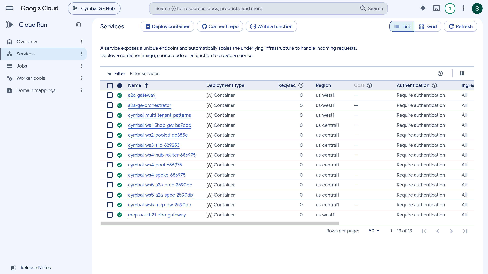

# Zero-Modification Runnable GCP Examples (Blogs 1–5)

Every directory below is a **self-contained, production-hardened Google Cloud deployment** you can execute directly in your own GCP project with **zero code or `.tfvars` edits**.

Each stack follows the exact same 3-command lifecycle:

```bash
./deploy.sh    # Auto-detects active gcloud project & region, enables APIs, builds app via Cloud Build, applies Terraform
./verify.sh    # Runs live BEFORE -> AFTER isolation & security proofs against your newly deployed GCP resources
./destroy.sh   # Cleanly destroys all billable resources
```

## Runnable Stack Matrix

| Blog | Folder | Core GCP Services Provisioned | Live `verify.sh` Proof | 1-Click Cloud Shell |
| :--- | :--- | :--- | :--- | :--- |
| **Blog 1 (WS1)** | [blog-01-5hop-baseline/](blog-01-5hop-baseline/README.md) | Cloud Armor WAF (2 policies), Vertex AI Model Armor (2 templates), Cloud KMS EC-P256, Cloud Run Gen2 + Vertex AI Gemini 2.5 Flash | Unprotected vs. Hardened Model Armor (`400`), Hop 1 spoof (`403`), KMS-signed Vertex AI turn (`200`) | [](https://shell.cloud.google.com/cloudshell/editor?cloudshell_git_repo=https://github.com/cloud-ai-fde/ge-blogs&cloudshell_working_dir=examples/blog-01-5hop-baseline) |
| **Blog 2 (WS2)** | [blog-02-pattern-a-pooled/](blog-02-pattern-a-pooled/README.md) | BigQuery multi-tenant table + native Row-Level Access Policy, named Firestore RPM limiter DB, Cloud Run Gen2 (`concurrency=1` gVisor) | BEFORE 7-row bleed → AFTER 2 FinVault rows + noisy-neighbor `HTTP 429` bulkhead | [](https://shell.cloud.google.com/cloudshell/editor?cloudshell_git_repo=https://github.com/cloud-ai-fde/ge-blogs&cloudshell_working_dir=examples/blog-02-pattern-a-pooled) |
| **Blog 3 (WS3)** | [blog-03-pattern-b-siloed/](blog-03-pattern-b-siloed/README.md) | Cloud KMS CMEK key + automatic BQ/GCS service-agent IAM, CMEK-encrypted BigQuery & GCS vault, Sovereign VPC, Cloud Run Gen2, optional VPC-SC | BEFORE `200` decrypt → live KMS disable → AFTER `HTTP 423 LOCKED` + BigQuery fail-closed → auto re-enable | [](https://shell.cloud.google.com/cloudshell/editor?cloudshell_git_repo=https://github.com/cloud-ai-fde/ge-blogs&cloudshell_working_dir=examples/blog-03-pattern-b-siloed) |
| **Blog 4 (WS4)** | [blog-04-pattern-c-hybrid/](blog-04-pattern-c-hybrid/README.md) | 2 isolated VPCs (Hub + Spoke, 0 peering), Regional ILB + `/28` PSC Service Attachment + Consumer Endpoint, Firestore routing DB, 3 Cloud Run services | BEFORE `shared_pool` → live atomic Firestore promotion → AFTER `enterprise_spoke` (`0` dropped turns) | [](https://shell.cloud.google.com/cloudshell/editor?cloudshell_git_repo=https://github.com/cloud-ai-fde/ge-blogs&cloudshell_working_dir=examples/blog-04-pattern-c-hybrid) |
| **Blog 5 (WS5)** | [blog-05-agentic-triad/](blog-05-agentic-triad/README.md) | 3 least-privilege Cloud Run services (`a2a-orchestrator` → `a2a-specialist` → `mcp-tool-gateway`) + Zero-PII BigQuery `otel_finops_chargeback` | `/.well-known/agent.json` discovery, authorized MCP OBO (`200`), cross-tenant block (`403`), SHA-256 FinOps rows | [](https://shell.cloud.google.com/cloudshell/editor?cloudshell_git_repo=https://github.com/cloud-ai-fde/ge-blogs&cloudshell_working_dir=examples/blog-05-agentic-triad) |

## Security & Portability Guarantees
- **Zero hardcoded project IDs, org IDs, or pre-hosted container images** — builds directly inside your own Artifact Registry via Cloud Build.
- **No `allUsers` public Cloud Run exposure** — every service uses least-privilege Service Accounts and requires Google Cloud IAM OIDC authentication (`gcloud auth print-identity-token`).
- **Single-project compatible by default** — no Org Admin required; collision-proof `random_id` suffixes prevent `409 Already Exists` on undeletable Cloud KMS keyrings or Firestore databases.

## Live Google Cloud Console Execution Proof (All 5 Stacks Deployed)


*Live Google Cloud Console verification after executing `./deploy.sh && ./verify.sh` across all 5 runnable blog stacks (9 authenticated Cloud Run Gen2 services green with `Require authentication`).*
