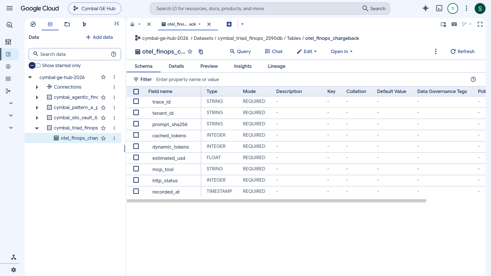

# Blog 5 (WS5) — Runnable Agentic Triad (A2A + MCP OBO) & Zero-PII BigQuery FinOps

[](https://shell.cloud.google.com/cloudshell/editor?cloudshell_git_repo=https://github.com/cloud-ai-fde/ge-blogs&cloudshell_working_dir=examples/blog-05-agentic-triad)

Self-contained, **zero-modification** deployment for [Blog 5: Executive Decision Guide & Agentic Triad](../../blogs/ws5-decision-guide-and-agentic-triad.md).

## What Gets Deployed
- **3 Authenticated Cloud Run Gen2 Services (Least-Privilege IAM Chain):**
  1. `a2a-orchestrator` — discovers specialist via `/.well-known/agent.json`, delegates tasks over Google Cloud OIDC, and logs zero-PII token chargeback rows to BigQuery.
  2. `a2a-specialist` — exposes A2A Agent Card and invokes downstream MCP tools using its own least-privilege Service Account.
  3. `mcp-tool-gateway` — enforces per-tenant OAuth 2.1 OBO audience scoping (`HTTP 200` for authorized tenant, `HTTP 403` for cross-tenant tool calls).
- **Zero-PII BigQuery Chargeback Table (`otel_finops_chargeback`):** Records `prompt_sha256`, `tenant_id`, cached vs. dynamic token counts, and estimated USD cost with zero raw prompt text.

## Quickstart (Zero Code Edits)

```bash
./deploy.sh    # Auto-detects active gcloud project, builds image, deploys 3 services + BigQuery (~3 min)
./verify.sh    # Proves A2A discovery, MCP OBO 200/403 isolation, and live Zero-PII BigQuery FinOps rows
./destroy.sh   # Cleanly removes all billable resources
```

## Live Google Cloud Console Execution Proof


*Live Google Cloud Console BigQuery verification after running `./deploy.sh && ./verify.sh`, confirming the Zero-PII `otel_finops_chargeback` table (`prompt_sha256`, `cached_tokens`, `dynamic_tokens`, `estimated_usd`, `mcp_tool`, `http_status`).*
