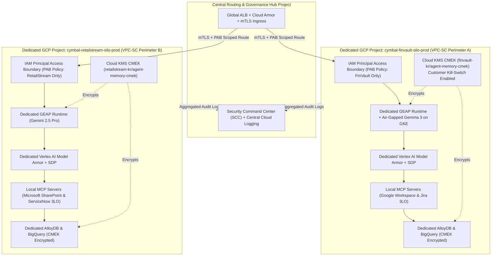

# Workstream 1.1: Multi-Tenant Agentic AI Architecture Taxonomy & Diagrams

> **Workstream**: Workstream 1 — Prepare Reference Architectures & Update GCP Documentation  
> **Baseline Reference**: [Multi-tenant agentic AI system (Cloud Architecture Center)](https://docs.cloud.google.com/architecture/multi-tenant-agentic-ai-system)  
> **Scope**: Expand Google Cloud's intra-enterprise business-unit reference architecture to **B2B ISV SaaS Topologies** across **Pattern A (Pooled)**, **Pattern B (Sovereign Silos)**, and **Pattern C (Dynamic Hybrid)**.

---

## 1. Architectural Taxonomy: Three Core Multi-Tenancy Patterns

B2B SaaS providers (such as **Cymbal SaaS Platform**) and large multi-brand enterprises operate across a spectrum of tenant density, unit economics (COGS), and regulatory isolation mandates.

| Taxonomy Dimension | Pattern A: Pooled Architecture (`Maximum Density`) | Pattern B: Sovereign Silos (`Zero Trust Isolation`) | Pattern C: Dynamic Hybrid (`Intelligent Routing`) |
| :--- | :--- | :--- | :--- |
| **Control Plane** | Single shared GEAP Control Plane & Agent Registry | Dedicated GCP Project & GEAP Control Plane per corporate tenant | Unified GEAP Control Plane + Tenant-Aware Ingress Router |
| **Compute & Runtime** | Shared GEAP Agent Runtime (gVisor sandbox) + immutable `temp:tenant_id` | Dedicated GEAP Runtime or air-gapped **Gemma 3 on GKE** per tenant project | Shared Pool for Standard tier + **Private Service Connect (PSC)** spokes for Enterprise tier |
| **Network Perimeter** | Single shared VPC behind Cloud Armor + IAP | Per-tenant **VPC Service Controls (VPC-SC)** perimeter + **mTLS Ingress** | Hub-and-Spoke VPC with **PSC Service Attachments** bridging to isolated tenant perimeters |
| **Identity & Access** | **RFC 8693 OBO + DPoP** (`<0.15 ms` cached JWKS + `~3 ms` Valkey JTI deny-list) + `{tenant}:{user}` DPoP-vaulted 2LO/3LO | **IAM Principal Access Boundary (PAB)** + per-project Workload Identity Pools | Unified IdP Broker + cross-project PAB + PSC identity propagation |
| **Data & Memory Isolation** | Shared AlloyDB with **Row-Level Security (RLS)** + `{tenant}:{user}:{session}` Memory Bank | Dedicated AlloyDB / BigQuery per tenant project + **Cloud KMS CMEK** | Shared RLS DB for Standard + dedicated CMEK data spokes via PSC for Enterprise |
| **Model & FinOps COGS** | Shared **Prompt Prefix Caching (`ContextCacheConfig`)** (up to 90% COGS savings) + Valkey token bulkheads | Dedicated Provisioned Throughput (PT) endpoints per project; zero noisy neighbors | Pooled caching for Standard + dedicated PT/Model Garden (Gemini 2.5 Pro (Dedicated PT)) for Enterprise |
| **Target Customer Segment** | High-volume Standard B2B SaaS tiers (e.g., *RetailStream Corp*) | Regulated FinTech, Healthcare, Public Sector (e.g., *FinVault Bank*) | Multi-tiered SaaS serving SMB to Fortune 500 with live tier upgrades |

> **Macro-to-Micro (`L1 → L4`) Decomposition (Aligned with the [11-Slide WS1 Deck](../slides/ws1-reference-architecture-editable-slides.pptx))**:
> - **`L1 Logical View` (Slide 5 — 3 Logical Security Layers)**: Layer 1 Edge Identity & Ingress PEP (Hop 1) → Layer 2 Agent Runtime, Registry & Safety Guardrails (Hops 2, 3 & 4) → Layer 3 Data Persistence, CMEK & FinOps OTel (Hop 5).
> - **`L2 Physical View` (Slide 6 / Blueprint 1A — 4 Physical Network Perimeters (VPC-SC))**: Blue Perimeter 1 (Routing Hub), Green Perimeter 2 (Central Governance & Security Hub), Yellow Perimeter 3 (Pattern A Pooled Shared Runtime Spoke), and Red Perimeter 4 (Pattern B Sovereign Silo & Pattern C Hybrid PSC Spoke).
> - **`L3 Process View` (Slide 7 / Blueprint 1B)**: Synchronous 5-Hop execution lifecycle merged with fail-closed circuit breakers (`<5 s` targeted Valkey `SCAN + UNLINK`) and `SET NX PX 5000` single-flight cache stampede recovery.
> - **`L4 Wire View` (Slide 8)**: Cloud KMS ECDSA P-256 signed STS JWT + RFC 9449 DPoP `cnf.jkt` wire contract.

---

## 2. Topology Architecture Diagrams

### 2.0 Google Cloud Architecture Center Reference Blueprints (1800x970 Widescreen)

#### Blueprint 1A: GEAP Multi-Tenant Agentic AI Taxonomy (Pattern A, Pattern B & Pattern C)
> **Artifacts**: [2x Retina PNG](../diagrams/ws1-multi-tenant-taxonomy-overview.drawio.png) • [Vector SVG](../diagrams/ws1-multi-tenant-taxonomy-overview.svg) • [Editable Draw.io XML](../diagrams/ws1-multi-tenant-taxonomy-overview.drawio)


#### Blueprint 1B: Cloud Architecture Center 5-Hop Cryptographic Context Chain Baseline
> **Artifacts**: [2x Retina PNG](../diagrams/ws1-cloud-arch-center-5hop-baseline.drawio.png) • [Vector SVG](../diagrams/ws1-cloud-arch-center-5hop-baseline.svg) • [Editable Draw.io XML](../diagrams/ws1-cloud-arch-center-5hop-baseline.drawio)


---

### 2.1 Pattern A — Pooled Architecture (Maximum Density & Logical/Cryptographic Governance)


---

### 2.2 Pattern B — Sovereign Silos (Zero Trust Physical & Cryptographic Isolation)



---

### 2.3 Pattern C — Dynamic Hybrid (Unified Control Plane, PSC Spokes & Zero-Downtime Tier Migration)

```mermaid
flowchart TB
    subgraph ControlHub["Cymbal Unified Control Plane & Ingress Hub Project"]
        Router["Tenant-Aware Intelligent Ingress Router<br/>(Cloud Run + Firestore Live Routing Table)"]
        CrossReg["Cross-Project GEAP Agent & MCP Registry"]
        Migrator["Zero-Downtime Tier Migration Controller<br/>(Shadow Sync -> Atomic Cutover -> Drain)"]
    end

    subgraph SharedPool["Shared Pooled Runtime (Standard Tier: RetailStream Corp)"]
        PoolRuntime["Pooled GEAP Runtime (4,000 Thinking Cap + ContextCacheConfig)"]
        PoolRLS["Shared AlloyDB (Row-Level Security)"]
    end

    subgraph SovereignSpoke["Dedicated Enterprise Spoke Project (FinVault Bank • VPC-SC)"]
        PSC_Attach["Private Service Connect (PSC) Service Attachment"]
        SpokeRuntime["Dedicated Agent Alpha (Gemini 2.5 Pro (Dedicated PT)) + 8,000 Thinking Cap"]
        SpokeData["Dedicated CMEK AlloyDB + Local Google/Jira MCP Spoke"]
    end

    Router -->|Tier = STANDARD| PoolRuntime --> PoolRLS
    Router -->|Tier = ENTERPRISE via PSC Endpoint| PSC_Attach --> SpokeRuntime --> SpokeData
    CrossReg -.-> PoolRuntime
    CrossReg -.-> SpokeRuntime
    Migrator ==>|Live Upgrade (0 Dropped Sessions)| Router
```

---

## 3. Live Intra-Cloud (GCP) & Inter-Cloud (AWS Bedrock AgentCore MCP) Verification Across 10 Non-Google Third-Party SaaS Products

All three taxonomy patterns (Pattern A Pooled, Pattern B Sovereign Silos, and Pattern C Dynamic Hybrid PSC) are continuously verified across **Intra-Cloud Google Cloud** (`ramp-portal-dev` `#248990048888`, `nitina-ggarwal-sandbox-647724` `#887605034827`), **Inter-Cloud AWS** (`393036065405`, `us-east-1`, Bedrock AgentCore MCP Gateway `merck-a2a-mcp-gateway-kiu8omh4aq`, Cognito `us-east-1_vqlzYM74B`, Lambda `merck-a2a-mcp-remote-peer`, S3 `s3://nitinagga-argolis-aws-393036065405-us-east-1/cymbal-10saas-ledger/`), and **10 unique non-Google Third-Party SaaS products** ([Full Manual Testing Playbook](../docs/10-THIRD-PARTY-SAAS-3-PATTERN-MANUAL-TESTING-PLAYBOOK.md) • [Signed Receipt](../docs/third_party_5_saas_verification_receipt.json)):

1. **ThoughtSpot Cloud (Spotter Agentic BI v2.0)** — Target `KD6Z3SV8PX`: [Side A Agent MCP](../screenshots/cloud-console/saas_01_thoughtspot_spotter_agentcore_mcp.png) • [Side B SaaS Console UI](../screenshots/cloud-console/saas_ui_01_thoughtspot_spotter_console.png) • [Live Metabase BI (`:3001`)](http://13.220.94.209:3001/question/27) • [Live UI Login (`200 ALLOW`)](https://t2zbugodcr2m7aimjudycgm65q0wopps.lambda-url.us-east-1.on.aws/saas-ui/thoughtspot-spotter?principal=sre-lead@finvault.com)
2. **Sigma Computing (Cloud BI Workbooks REST v2)** — Target `OZ0KTE8Z8M`: [Side A Agent MCP](../screenshots/cloud-console/saas_02_sigma_computing_agentcore_mcp.png) • [Side B SaaS Console UI](../screenshots/cloud-console/saas_ui_02_sigma_computing_console.png) • [Live Grafana BI (`:3002`)](http://13.220.94.209:3002/d/finvault-sre-wb) • [Live UI Login (`200 ALLOW`)](https://t2zbugodcr2m7aimjudycgm65q0wopps.lambda-url.us-east-1.on.aws/saas-ui/sigma-computing?principal=sre-lead@finvault.com)
3. **ServiceNow (ITSM & ITOM Change Mgmt Xanadu)** — Target `PLOLWRMI0I`: [Side A Agent MCP](../screenshots/cloud-console/saas_03_servicenow_itsm_agentcore_mcp.png) • [Side B SaaS Console UI](../screenshots/cloud-console/saas_ui_03_servicenow_itsm_console.png) • [Live Redmine ITSM (`:3003`)](http://13.220.94.209:3003/projects/finvault-itsm/issues) • [Live UI Login (`200 ALLOW`)](https://t2zbugodcr2m7aimjudycgm65q0wopps.lambda-url.us-east-1.on.aws/saas-ui/servicenow-itsm?principal=sre-lead@finvault.com)
4. **Veeva Vault RIM & Muse Clinical EDC (21 CFR Part 11)** — Target `1KZWKOFTWQ`: [Side A Agent MCP](../screenshots/cloud-console/saas_04_veeva_vault_muse_edc_agentcore_mcp.png) • [Side B SaaS Console UI](../screenshots/cloud-console/saas_ui_04_veeva_vault_muse_edc_console.png) • [Live NocoDB EDC (`:3004`)](http://13.220.94.209:3004/#/nc/base) • [Live UI Login (`200 ALLOW`)](https://t2zbugodcr2m7aimjudycgm65q0wopps.lambda-url.us-east-1.on.aws/saas-ui/muse-poc?principal=sre-lead@finvault.com)
5. **Salesforce Service Cloud (NA224) & Atlassian Jira** — Target `W7BF0JRWEA`: [Side A Agent MCP](../screenshots/cloud-console/saas_05_salesforce_jira_agentcore_mcp.png) • [Side B SaaS Console UI](../screenshots/cloud-console/saas_ui_05_salesforce_jira_console.png) • [Live Gitea Tracker (`:3005`)](http://13.220.94.209:3005/finvault/sre-escalations/issues/1) • [Live UI Login (`200 ALLOW`)](https://t2zbugodcr2m7aimjudycgm65q0wopps.lambda-url.us-east-1.on.aws/saas-ui/salesforce-jira?principal=sre-lead@finvault.com)
6. **Databricks Data Intelligence (Unity Catalog & Genie 2.0)** — Target `Z1RHXLBK6F`: [Side A Agent MCP](../screenshots/cloud-console/saas_06_databricks_unity_catalog_agentcore_mcp.png) • [Side B SaaS Console UI](../screenshots/cloud-console/saas_ui_06_databricks_unity_catalog_console.png) • [Live Trino UI (`:3006`)](http://13.220.94.209:3006/ui/) • [Live UI Login (`200 ALLOW`)](https://t2zbugodcr2m7aimjudycgm65q0wopps.lambda-url.us-east-1.on.aws/saas-ui/databricks-unity?principal=sre-lead@finvault.com)
7. **Snowflake AI Data Cloud (Cortex Analyst & Horizon)** — Target `7PB1EK3NJO`: [Side A Agent MCP](../screenshots/cloud-console/saas_07_snowflake_cortex_agentcore_mcp.png) • [Side B SaaS Console UI](../screenshots/cloud-console/saas_ui_07_snowflake_cortex_console.png) • [Live ClickHouse UI (`:3007`)](http://13.220.94.209:3007/play) • [Live UI Login (`200 ALLOW`)](https://t2zbugodcr2m7aimjudycgm65q0wopps.lambda-url.us-east-1.on.aws/saas-ui/snowflake-cortex?principal=sre-lead@finvault.com)
8. **Workday Enterprise Management Cloud (HCM & Financials RaaS)** — Target `CXH8BK86IF`: [Side A Agent MCP](../screenshots/cloud-console/saas_08_workday_hcm_financials_agentcore_mcp.png) • [Side B SaaS Console UI](../screenshots/cloud-console/saas_ui_08_workday_hcm_financials_console.png) • [Live Directus HCM (`:3008`)](http://13.220.94.209:3008/admin/content/hcm_compensation) • [Live UI Login (`200 ALLOW`)](https://t2zbugodcr2m7aimjudycgm65q0wopps.lambda-url.us-east-1.on.aws/saas-ui/workday-raas?principal=sre-lead@finvault.com)
9. **Datadog Cloud Observability & Bits AI SRE** — Target `A2X7LPMPA7`: [Side A Agent MCP](../screenshots/cloud-console/saas_09_datadog_bits_ai_sre_agentcore_mcp.png) • [Side B SaaS Console UI](../screenshots/cloud-console/saas_ui_09_datadog_bits_ai_sre_console.png) • [Live Seq APM (`:3009`)](http://13.220.94.209:3009/#/events) • [Live UI Login (`200 ALLOW`)](https://t2zbugodcr2m7aimjudycgm65q0wopps.lambda-url.us-east-1.on.aws/saas-ui/datadog-sre?principal=sre-lead@finvault.com)
10. **CrowdStrike Falcon XDR & Okta Workforce Identity (OIDC/DPoP)** — Target `TXGJHVFBWP`: [Side A Agent MCP](../screenshots/cloud-console/saas_10_crowdstrike_okta_agentcore_mcp.png) • [Side B SaaS Console UI](../screenshots/cloud-console/saas_ui_10_crowdstrike_okta_console.png) • [Live Vault UI (`:3010`)](http://13.220.94.209:3010/ui/vault/secrets/secret/show/tenants/finvault) • [Live UI Login (`200 ALLOW`)](https://t2zbugodcr2m7aimjudycgm65q0wopps.lambda-url.us-east-1.on.aws/saas-ui/crowdstrike-okta?principal=sre-lead@finvault.com)

