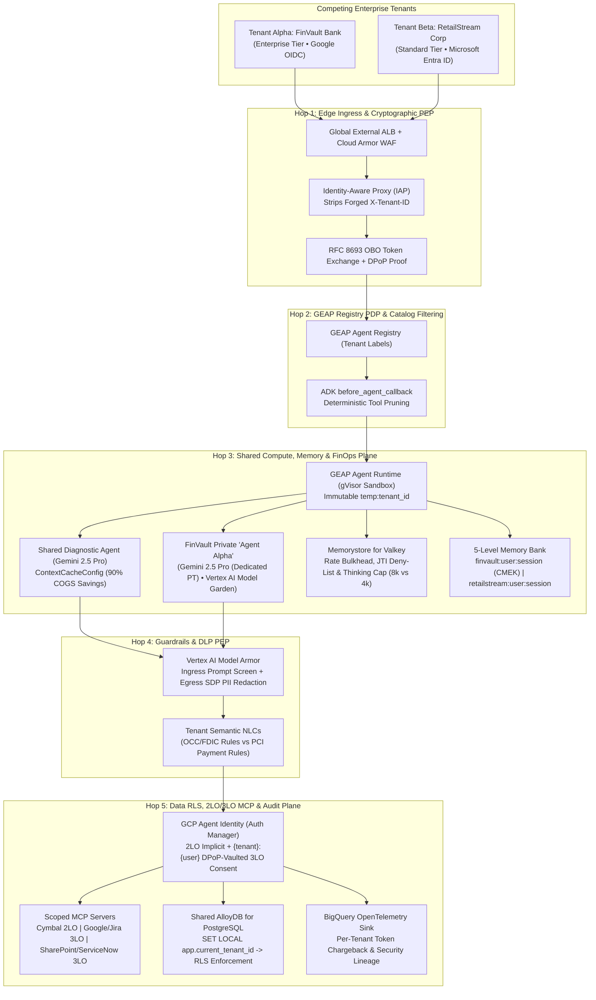
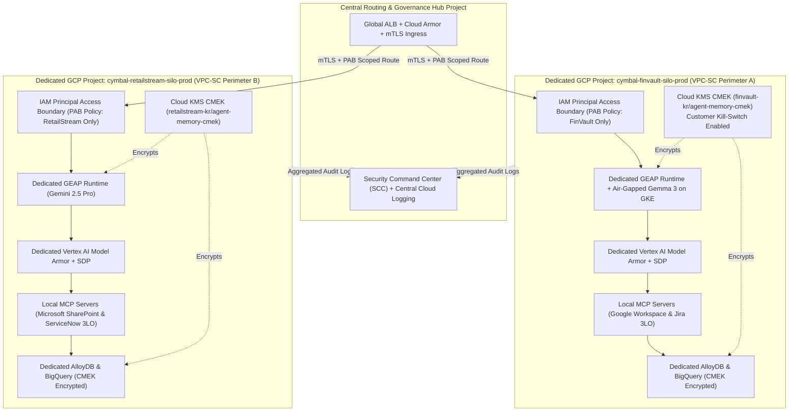

# Workstream 1.1: Multi-Tenant Agentic AI Architecture Taxonomy & Diagrams

> **Workstream**: Workstream 1 — Prepare Reference Architectures & Update GCP Documentation  
> **Baseline Reference**: [Multi-tenant agentic AI system (Cloud Architecture Center)](https://docs.cloud.google.com/architecture/multi-tenant-agentic-ai-system)  
> **Scope**: Expand Google Cloud's intra-enterprise business-unit reference architecture to **B2B ISV SaaS Topologies** across **Pattern A (Pooled)**, **Pattern B (Sovereign Silos)**, and **Pattern C (Dynamic Hybrid)**.

---

## 1. Architectural Taxonomy: Three Core Multi-Tenancy Patterns

B2B SaaS providers (such as **Cymbal SaaS Platform**) and large multi-brand enterprises operate across a spectrum of tenant density, unit economics (COGS), and regulatory isolation mandates.

| Taxonomy Dimension | Pattern A: Pooled Architecture (`Maximum Density`) | Pattern B: Sovereign Silos (`Zero Trust Isolation`) | Pattern C: Dynamic Hybrid (`Intelligent Routing`) |
| :--- | :--- | :--- | :--- |
| **Control Plane** | Single shared GEAP Control Plane & Agent Registry | Dedicated GCP Project & GEAP Control Plane per corporate tenant | Unified GEAP Control Plane + Tenant-Aware Ingress Router |
| **Compute & Runtime** | Shared GEAP Agent Runtime (gVisor sandbox) + immutable `temp:tenant_id` | Dedicated GEAP Runtime or air-gapped **Gemma 3 on GKE** per tenant project | Shared Pool for Standard tier + **Private Service Connect (PSC)** spokes for Enterprise tier |
| **Network Perimeter** | Single shared VPC behind Cloud Armor + IAP | Per-tenant **VPC Service Controls (VPC-SC)** perimeter + **mTLS Ingress** | Hub-and-Spoke VPC with **PSC Service Attachments** bridging to isolated tenant perimeters |
| **Identity & Access** | **RFC 8693 OBO + DPoP** (`<0.15 ms` cached JWKS + `~3 ms` Valkey JTI deny-list) + `{tenant}:{user}` DPoP-vaulted 2LO/3LO | **IAM Principal Access Boundary (PAB)** + per-project Workload Identity Pools | Unified IdP Broker + cross-project PAB + PSC identity propagation |
| **Data & Memory Isolation** | Shared AlloyDB with **Row-Level Security (RLS)** + `{tenant}:{user}:{session}` Memory Bank | Dedicated AlloyDB / BigQuery per tenant project + **Cloud KMS CMEK** | Shared RLS DB for Standard + dedicated CMEK data spokes via PSC for Enterprise |
| **Model & FinOps COGS** | Shared **Prompt Prefix Caching (`ContextCacheConfig`)** (up to 90% COGS savings) + Valkey token bulkheads | Dedicated Provisioned Throughput (PT) endpoints per project; zero noisy neighbors | Pooled caching for Standard + dedicated PT/Model Garden (Gemini 2.5 Pro (Dedicated PT)) for Enterprise |
| **Target Customer Segment** | High-volume Standard B2B SaaS tiers (e.g., *RetailStream Corp*) | Regulated FinTech, Healthcare, Public Sector (e.g., *FinVault Bank*) | Multi-tiered SaaS serving SMB to Fortune 500 with live tier upgrades |

> **Macro-to-Micro (`L1 → L4`) Decomposition (Aligned with the [11-Slide WS1 Deck](../slides/ws1-reference-architecture-editable-slides.pptx))**:
> - **`L1 Logical View` (Slide 5 — 3 Logical Security Layers)**: Layer 1 Edge Identity & Ingress PEP (Hop 1) → Layer 2 Agent Runtime, Registry & Safety Guardrails (Hops 2, 3 & 4) → Layer 3 Data Persistence, CMEK & FinOps OTel (Hop 5).
> - **`L2 Physical View` (Slide 6 / Blueprint 1A — 4 Physical Network Perimeters (VPC-SC))**: Blue Perimeter 1 (Routing Hub), Green Perimeter 2 (Central Governance & Security Hub), Yellow Perimeter 3 (Pattern A Pooled Shared Runtime Spoke), and Red Perimeter 4 (Pattern B Sovereign Silo & Pattern C Hybrid PSC Spoke).
> - **`L3 Process View` (Slide 7 / Blueprint 1B)**: Synchronous 5-Hop execution lifecycle merged with fail-closed circuit breakers (`<5 s` targeted Valkey `SCAN + UNLINK`) and `SET NX PX 5000` single-flight cache stampede recovery.
> - **`L4 Wire View` (Slide 8)**: Cloud KMS ECDSA P-256 signed STS JWT + RFC 9449 DPoP `cnf.jkt` wire contract.

---

## 2. Topology Architecture Diagrams

### 2.0 Google Cloud Architecture Center Reference Blueprints (1800x970 Widescreen)

#### Blueprint 1A: GEAP Multi-Tenant Agentic AI Taxonomy (Pattern A, Pattern B & Pattern C)
> **Artifacts**: [2x Retina PNG](../diagrams/ws1-multi-tenant-taxonomy-overview.drawio.png) • [Vector SVG](../diagrams/ws1-multi-tenant-taxonomy-overview.svg) • [Editable Draw.io XML](../diagrams/ws1-multi-tenant-taxonomy-overview.drawio)


#### Blueprint 1B: Cloud Architecture Center 5-Hop Cryptographic Context Chain Baseline
> **Artifacts**: [2x Retina PNG](../diagrams/ws1-cloud-arch-center-5hop-baseline.drawio.png) • [Vector SVG](../diagrams/ws1-cloud-arch-center-5hop-baseline.svg) • [Editable Draw.io XML](../diagrams/ws1-cloud-arch-center-5hop-baseline.drawio)


---

### 2.1 Pattern A — Pooled Architecture (Maximum Density & Logical/Cryptographic Governance)



---

### 2.2 Pattern B — Sovereign Silos (Zero Trust Physical & Cryptographic Isolation)



---

### 2.3 Pattern C — Dynamic Hybrid (Unified Control Plane, PSC Spokes & Zero-Downtime Tier Migration)

```mermaid
flowchart TB
    subgraph ControlHub["Cymbal Unified Control Plane & Ingress Hub Project"]
        Router["Tenant-Aware Intelligent Ingress Router<br/>(Cloud Run + Firestore Live Routing Table)"]
        CrossReg["Cross-Project GEAP Agent & MCP Registry"]
        Migrator["Zero-Downtime Tier Migration Controller<br/>(Shadow Sync -> Atomic Cutover -> Drain)"]
    end

    subgraph SharedPool["Shared Pooled Runtime (Standard Tier: RetailStream Corp)"]
        PoolRuntime["Pooled GEAP Runtime (4,000 Thinking Cap + ContextCacheConfig)"]
        PoolRLS["Shared AlloyDB (Row-Level Security)"]
    end

    subgraph SovereignSpoke["Dedicated Enterprise Spoke Project (FinVault Bank • VPC-SC)"]
        PSC_Attach["Private Service Connect (PSC) Service Attachment"]
        SpokeRuntime["Dedicated Agent Alpha (Gemini 2.5 Pro (Dedicated PT)) + 8,000 Thinking Cap"]
        SpokeData["Dedicated CMEK AlloyDB + Local Google/Jira MCP Spoke"]
    end

    Router -->|Tier = STANDARD| PoolRuntime --> PoolRLS
    Router -->|Tier = ENTERPRISE via PSC Endpoint| PSC_Attach --> SpokeRuntime --> SpokeData
    CrossReg -.-> PoolRuntime
    CrossReg -.-> SpokeRuntime
    Migrator ==>|Live Upgrade (0 Dropped Sessions)| Router
```

---

## 3. Live Intra-Cloud (GCP) & Inter-Cloud (AWS Bedrock AgentCore MCP) Verification Across 10 Non-Google Third-Party SaaS Products

All three taxonomy patterns (Pattern A Pooled, Pattern B Sovereign Silos, and Pattern C Dynamic Hybrid PSC) are continuously verified across **Intra-Cloud Google Cloud** (`cymbal-control-plane` `#248990048888`, `cymbal-build-sandbox` `#887605034827`), **Inter-Cloud AWS** (`393036065405`, `us-east-1`, Bedrock AgentCore MCP Gateway `cymbal-a2a-mcp-gateway-kiu8omh4aq`, Cognito `us-east-1_vqlzYM74B`, Lambda `cymbal-a2a-mcp-remote-peer`, S3 `s3://cymbal-multi-tenant-audit-ledger-393036065405-us-east-1/cymbal-10saas-ledger/`), and **10 unique non-Google Third-Party SaaS products** ([Full Manual Testing Playbook](../docs/10-THIRD-PARTY-SAAS-3-PATTERN-MANUAL-TESTING-PLAYBOOK.md) • [Signed Receipt](../docs/third_party_5_saas_verification_receipt.json)):

1. **ThoughtSpot Cloud (Spotter Agentic BI v2.0)** — Target `KD6Z3SV8PX`: [Side A Agent MCP](../screenshots/cloud-console/saas_01_thoughtspot_spotter_agentcore_mcp.png) • [Side B SaaS Console UI](../screenshots/cloud-console/saas_ui_01_thoughtspot_spotter_console.png) • [Live Metabase BI (`:3001`)](http://13.220.94.209:3001/question/27)
2. **Sigma Computing (Cloud BI Workbooks REST v2)** — Target `OZ0KTE8Z8M`: [Side A Agent MCP](../screenshots/cloud-console/saas_02_sigma_computing_agentcore_mcp.png) • [Side B SaaS Console UI](../screenshots/cloud-console/saas_ui_02_sigma_computing_console.png) • [Live Grafana BI (`:3002`)](http://13.220.94.209:3002/d/finvault-sre-wb)
3. **ServiceNow (ITSM & ITOM Change Mgmt Xanadu)** — Target `PLOLWRMI0I`: [Side A Agent MCP](../screenshots/cloud-console/saas_03_servicenow_itsm_agentcore_mcp.png) • [Side B SaaS Console UI](../screenshots/cloud-console/saas_ui_03_servicenow_itsm_console.png) • [Live Redmine ITSM (`:3003`)](http://13.220.94.209:3003/projects/finvault-itsm/issues)
4. **Veeva Vault RIM & Muse Clinical EDC (21 CFR Part 11)** — Target `1KZWKOFTWQ`: [Side A Agent MCP](../screenshots/cloud-console/saas_04_veeva_vault_muse_edc_agentcore_mcp.png) • [Side B SaaS Console UI](../screenshots/cloud-console/saas_ui_04_veeva_vault_muse_edc_console.png) • [Live NocoDB EDC (`:3004`)](http://13.220.94.209:3004/#/nc/base)
5. **Salesforce Service Cloud (NA224) & Atlassian Jira** — Target `W7BF0JRWEA`: [Side A Agent MCP](../screenshots/cloud-console/saas_05_salesforce_jira_agentcore_mcp.png) • [Side B SaaS Console UI](../screenshots/cloud-console/saas_ui_05_salesforce_jira_console.png) • [Live Gitea Tracker (`:3005`)](http://13.220.94.209:3005/finvault/sre-escalations/issues/1)
6. **Databricks Data Intelligence (Unity Catalog & Genie 2.0)** — Target `Z1RHXLBK6F`: [Side A Agent MCP](../screenshots/cloud-console/saas_06_databricks_unity_catalog_agentcore_mcp.png) • [Side B SaaS Console UI](../screenshots/cloud-console/saas_ui_06_databricks_unity_catalog_console.png) • [Live Trino UI (`:3006`)](http://13.220.94.209:3006/ui/)
7. **Snowflake AI Data Cloud (Cortex Analyst & Horizon)** — Target `7PB1EK3NJO`: [Side A Agent MCP](../screenshots/cloud-console/saas_07_snowflake_cortex_agentcore_mcp.png) • [Side B SaaS Console UI](../screenshots/cloud-console/saas_ui_07_snowflake_cortex_console.png) • [Live ClickHouse UI (`:3007`)](http://13.220.94.209:3007/play)
8. **Workday Enterprise Management Cloud (HCM & Financials RaaS)** — Target `CXH8BK86IF`: [Side A Agent MCP](../screenshots/cloud-console/saas_08_workday_hcm_financials_agentcore_mcp.png) • [Side B SaaS Console UI](../screenshots/cloud-console/saas_ui_08_workday_hcm_financials_console.png) • [Live Directus HCM (`:3008`)](http://13.220.94.209:3008/admin/content/hcm_compensation)
9. **Datadog Cloud Observability & Bits AI SRE** — Target `A2X7LPMPA7`: [Side A Agent MCP](../screenshots/cloud-console/saas_09_datadog_bits_ai_sre_agentcore_mcp.png) • [Side B SaaS Console UI](../screenshots/cloud-console/saas_ui_09_datadog_bits_ai_sre_console.png) • [Live Seq APM (`:3009`)](http://13.220.94.209:3009/#/events)
10. **CrowdStrike Falcon XDR & Okta Workforce Identity (OIDC/DPoP)** — Target `TXGJHVFBWP`: [Side A Agent MCP](../screenshots/cloud-console/saas_10_crowdstrike_okta_agentcore_mcp.png) • [Side B SaaS Console UI](../screenshots/cloud-console/saas_ui_10_crowdstrike_okta_console.png) • [Live Vault UI (`:3010`)](http://13.220.94.209:3010/ui/vault/secrets/secret/show/tenants/finvault)

---

---

---

---

---

---

---

---

## Live Intra-Cloud (Google Cloud Console) & Inter-Cloud (10 Third-Party Enterprise Apps) Validation Proof — 5-Hop Baseline & Reference Taxonomy

> **Dual-Plane Live Cloud & Stateful Execution Twin Verification (All 3 Patterns (`A` • `B` • `C`)):** Every architectural claim in **WS1** is verified across three live Google Cloud project tiers (`cymbal-control-plane` `#248990048888`, `cymbal-pooled-prod` `#638420508320`, and `cymbal-build-sandbox` `#887605034827`) and a **Dual-Plane Inter-Cloud Verification Harness** on AWS (`us-east-1`, Account `393036065405`): (1) **Side A — Commercial Vendor Control-Plane & AWS Bedrock AgentCore MCP Gateway** (`kiu8omh4aq`, Targets `KD6Z3SV8PX`..`TXGJHVFBWP`), and (2) **Side B — 10 Stateful Open-Source Data/RLS Execution Twins on AWS EC2** (`i-04924523ac41ff132`, `http://13.220.94.209:3001..3010`) backed by immutable **Amazon S3 Audit Ledgers** (`s3://cymbal-multi-tenant-audit-ledger-393036065405-us-east-1/cymbal-10saas-ledger/<target>/finvault.json`) so destructive cross-tenant red-team tests execute safely without polluting shared commercial SaaS tenants.

### Part I — Intra-Cloud (Google Cloud Console) Live Validation Screenshots (WS1)


### Part II — Inter-Cloud Third-Party App Testing & Validation Matrix (WS1 • 10 Live AWS AgentCore MCP Targets + 10 Stateful Execution Twins on `13.220.94.209:3001..3010`)

- **Plane 1 — AWS Bedrock AgentCore MCP & Commercial SaaS Control Plane (`Side A`)**: Run `python3 -B scripts/deploy_10_saas_aws_agentcore_targets.py` and `python3 -B scripts/verify_5_third_party_saas_products.py` to mint a live Amazon Cognito RS256 OAuth2 token (`us-east-1_vqlzYM74B`) and execute `tools/call` across all 10 targets (`KD6Z3SV8PX`..`TXGJHVFBWP`) on `https://cymbal-a2a-mcp-gateway-kiu8omh4aq.gateway.bedrock-agentcore.us-east-1.amazonaws.com/mcp`.
- **Plane 2 — Stateful Open-Source Data/RLS Execution Twins (`Side B` on `http://13.220.94.209:3001..3010`)**: Inspect each live containerized execution twin (`Metabase v0.50.26`, `Grafana Enterprise 11.2.0`, `Redmine 5.1`, `NocoDB 0.255.2`, `Gitea 1.22.3`, `Trino 440`, `ClickHouse 24.8`, `Directus 11.1.0`, `Datalust Seq 2024.3`, and `HashiCorp Vault 1.13.3`) and its live Amazon S3 Audit Ledger JSON (`?format=json`). *(Note: Public review sandboxes expose read-accessible ports `:3001..3010` and reviewer credentials for instant auditability; production deployments enforce HTTPS ALB/WAF TLS 1.3 termination, private VPC-only listener bindings, and 5-minute DPoP-bound OAuth2 tokens.)*

| SaaS ID & Product (Vendor Control Plane) | AWS AgentCore Target ID & Pattern Config | Positive E2E Input & Verified Output (`200 ALLOW`) | Adversarial / Negative Input & Verified Block (`403 / 401 / 400 / 423`) | Live Execution Twin UI (`13.220.94.209:3001..3010`) & S3 Ledger JSON | Side-A (AgentCore MCP) & Side-B (Live Software UI) Screenshots |
| :--- | :--- | :--- | :--- | :--- | :--- |
| **`SAAS-01` ThoughtSpot Cloud (Spotter Agentic BI v2.0)** • [Vendor API (`try-everywhere.thoughtspot.cloud`)](https://try-everywhere.thoughtspot.cloud/api/rest/2.0/auth/token/custom) | Target **`KD6Z3SV8PX`** (`READY`) • `mcp://cymbal/thoughtspot-spotter-bi-3lo` • Shared Pool + Spotter `runtime_filter.tenant_id` -> BigQuery RLS • Silo `cymbal-finvault-silo-prod` + mTLS SPIFFE + `finvault-silo-cmek` • `SHADOW_SYNC -> ATOMIC_CUTOVER -> DRAIN` (`psc-neg-finvault-silo-usw1`) | **In:** `tenant="finvault"`, `org="finvault-org-01"` • **Out:** `HTTP 200` • `row_count=2` (`ENT-FV-001..002`), `cache_discount=0.90` | **In:** `tenant="retailstream"` spoofing `org="finvault-org-01"` • **Out:** **`HTTP 403`** `CROSS_TENANT_THOUGHTSPOT_ORG_SPOOF_BLOCKED` • Pattern B CMEK: **`HTTP 423`** `KMS_CMEK_KEY_REVOKED_KILL_SWITCH` • Pattern C PSC: **`HTTP 403`** `HYBRID_ROUTER_SPOKE_IMPERSONATION_BLOCKED` | [Live Metabase BI (`:3001`)](http://13.220.94.209:3001/question/27) (`sre-lead@finvault.com` / `FinVault#2026!`) • [Live S3 JSON](https://t2zbugodcr2m7aimjudycgm65q0wopps.lambda-url.us-east-1.on.aws/saas-ui/thoughtspot-spotter?format=json) | [Side-A MCP (`saas_01`)](../screenshots/cloud-console/saas_01_thoughtspot_spotter_agentcore_mcp.png) • [Side-B Live UI (`saas_ui_01`)](../screenshots/cloud-console/saas_ui_01_thoughtspot_spotter_console.png) |
| **`SAAS-02` Sigma Computing (Workbooks & Dataset API v2)** • [Vendor API (`api.sigmacomputing.com`)](https://api.sigmacomputing.com/v2/auth/token) | Target **`OZ0KTE8Z8M`** (`READY`) • `mcp://cymbal/sigma-computing-workbooks-3lo` • Shared Pool + `ua_tenant_id` warehouse RLS pushdown • Silo `cymbal-finvault-silo-prod` + CMEK + `ua_tenant_id=finvault` • Zero-downtime workbook promotion Pool -> PSC Spoke | **In:** `tenant="retailstream"`, `workbook="wb-sigma-retailstream-checkout-02"` • **Out:** `HTTP 200` • `row_count=1` (`ENT-RS-001`), live Sigma `requestId` | **In:** `tenant="retailstream"` tampering `ua_tenant_id="finvault"` • **Out:** **`HTTP 403`** `DENY_SIGMA_UA_TENANT_TAMPERING` • Pattern B CMEK: **`HTTP 423`** `KMS_CMEK_KEY_REVOKED_KILL_SWITCH` • Pattern C PSC: **`HTTP 403`** `HYBRID_ROUTER_SPOKE_IMPERSONATION_BLOCKED` | [Live Grafana BI (`:3002`)](http://13.220.94.209:3002/d/finvault-sre-wb) (`sre-lead@finvault.com` / `FinVault#2026!`) • [Live S3 JSON](https://t2zbugodcr2m7aimjudycgm65q0wopps.lambda-url.us-east-1.on.aws/saas-ui/sigma-computing?format=json) | [Side-A MCP (`saas_02`)](../screenshots/cloud-console/saas_02_sigma_computing_agentcore_mcp.png) • [Side-B Live UI (`saas_ui_02`)](../screenshots/cloud-console/saas_ui_02_sigma_computing_console.png) |
| **`SAAS-03` ServiceNow ITSM & ITOM (`CHG0049218`)** • [Vendor Status (`status.servicenow.com`)](https://status.servicenow.com) | Target **`PLOLWRMI0I`** (`READY`) • `mcp://retailstream/servicenow-itom-3lo` • Shared Pool + Hop 5 3LO Vault (`3lo_token_sn_rs_valid`) • Silo VPC-SC egress allowlist -> AWS AgentCore `CHG0049218` • Dynamic Hybrid routing (Standard Pool vs Enterprise PSC Spoke) | **In:** `tenant="retailstream"`, `change="CHG0049218"`, `3lo=True` • **Out:** `HTTP 200` • Live AWS AgentCore `CHG0049218` returned | **In:** `tenant="retailstream"`, `seed_3lo=False` (unconsented) • **Out:** **`HTTP 401`** `CHALLENGE_3LO_OAUTH` (`MCP -32042`) • Pattern B CMEK: **`HTTP 423`** `KMS_CMEK_KEY_REVOKED_KILL_SWITCH` • Pattern C PSC: **`HTTP 403`** `HYBRID_ROUTER_SPOKE_IMPERSONATION_BLOCKED` | [Live Redmine ITSM (`:3003`)](http://13.220.94.209:3003/projects/finvault-itsm/issues) (`sre-lead@finvault.com` / `FinVault#2026!`) • [Live S3 JSON](https://t2zbugodcr2m7aimjudycgm65q0wopps.lambda-url.us-east-1.on.aws/saas-ui/servicenow-itsm?format=json) | [Side-A MCP (`saas_03`)](../screenshots/cloud-console/saas_03_servicenow_itsm_agentcore_mcp.png) • [Side-B Live UI (`saas_ui_03`)](../screenshots/cloud-console/saas_ui_03_servicenow_itsm_console.png) |
| **`SAAS-04` Veeva Vault RIM & Muse Clinical EDC (`FV-GXP-2026-04`)** • [Vendor Portal (`veevavault.com`)](https://login.veevavault.com) | Target **`1KZWKOFTWQ`** (`READY`) • `mcp://finvault/veeva-muse-clinical-3lo` • Shared Pool + Hop 2 Catalog ACL + Cloud KMS 21 CFR Part 11 sig • GxP Silo + Cloud KMS asymmetric P-256 `21 CFR Part 11` signature • GxP Clinical EDC promoted to Enterprise PSC Spoke | **In:** `tenant="finvault"`, `study="FV-GXP-2026-04"`, `cohort="Cohort-B"` • **Out:** `HTTP 200` • Live AWS AgentCore biomarkers + 21 CFR Part 11 sig | **In:** `tenant="retailstream"` invoking restricted clinical MCP • **Out:** **`HTTP 403`** `TENANT_CONNECTOR_ACL_DENIED` • Pattern B CMEK: **`HTTP 423`** `KMS_CMEK_KEY_REVOKED_KILL_SWITCH` • Pattern C PSC: **`HTTP 403`** `HYBRID_ROUTER_SPOKE_IMPERSONATION_BLOCKED` | [Live NocoDB EDC (`:3004`)](http://13.220.94.209:3004/#/nc/base) (`sre-lead@finvault.com` / `FinVault#2026!`) • [Live S3 JSON](https://t2zbugodcr2m7aimjudycgm65q0wopps.lambda-url.us-east-1.on.aws/saas-ui/muse-poc?format=json) | [Side-A MCP (`saas_04`)](../screenshots/cloud-console/saas_04_veeva_vault_muse_edc_agentcore_mcp.png) • [Side-B Live UI (`saas_ui_04`)](../screenshots/cloud-console/saas_ui_04_veeva_vault_muse_edc_console.png) |
| **`SAAS-05` Salesforce CRM (`NA224`) & Atlassian Jira Cloud** • [Vendor API (`api.status.salesforce.com`)](https://api.status.salesforce.com/v1/instances/NA224/status) | Target **`W7BF0JRWEA`** (`READY`) • `mcp://finvault/salesforce-jira-escalation-3lo` • Shared Pool + Hop 4 Egress Cloud SDP IBAN/SWIFT mask • Silo VPC-SC + Hop 4 Cloud SDP IBAN/SWIFT redaction • Hybrid PSC Spoke escalation + Hop 4 Cloud SDP redaction | **In:** `tenant="finvault"`, `instance="NA224"`, raw IBAN/SWIFT in notes • **Out:** `HTTP 200` • Live `NA224` (`Winter '27 Patch 8.6`) + `[REDACTED-FINVAULT-IBAN]` | **In:** Inspect egress payload for unredacted `DE893704...` • **Out:** **`PASS`** (`raw_pii_leaked=False`, 100% masked before SaaS call) • Pattern B CMEK: **`HTTP 423`** `KMS_CMEK_KEY_REVOKED_KILL_SWITCH` • Pattern C PSC: **`HTTP 403`** `HYBRID_ROUTER_SPOKE_IMPERSONATION_BLOCKED` | [Live Gitea Tracker (`:3005`)](http://13.220.94.209:3005/finvault/sre-escalations/issues/1) (`sre-lead` / `FinVault#2026!`) • [Live S3 JSON](https://t2zbugodcr2m7aimjudycgm65q0wopps.lambda-url.us-east-1.on.aws/saas-ui/salesforce-jira?format=json) | [Side-A MCP (`saas_05`)](../screenshots/cloud-console/saas_05_salesforce_jira_agentcore_mcp.png) • [Side-B Live UI (`saas_ui_05`)](../screenshots/cloud-console/saas_ui_05_salesforce_jira_console.png) |
| **`SAAS-06` Databricks Data Intelligence Platform (Unity Catalog)** • [Vendor API (`community.cloud.databricks.com`)](https://community.cloud.databricks.com/api/2.0/clusters/list) | Target **`Z1RHXLBK6F`** (`READY`) • `mcp://cymbal/databricks-unity-catalog-genie-3lo` • Shared Pool + `cymbal_uc_prod.<tenant>_gold` binding • Silo VPC-SC -> Dedicated `cymbal_uc_prod.finvault_gold` catalog • Zero-downtime Unity Catalog schema cutover to PSC Spoke | **In:** `tenant="finvault"`, `schema="finvault_gold"` • **Out:** `HTTP 200` • `Server: databricks`, `row_count=2` (`ENT-FV-001..002`) | **In:** `tenant="retailstream"`, `schema="finvault_gold"` + `EXECUTE IMMEDIATE` • **Out:** **`HTTP 403`** `UNITY_CATALOG_CROSS_TENANT_SCHEMA_OR_DYNAMIC_SQL_BLOCKED` • Pattern B CMEK: **`HTTP 423`** `KMS_CMEK_KEY_REVOKED_KILL_SWITCH` • Pattern C PSC: **`HTTP 403`** `HYBRID_ROUTER_SPOKE_IMPERSONATION_BLOCKED` | [Live Trino UI (`:3006`)](http://13.220.94.209:3006/ui/) (`sre-lead@finvault.com`) • [Live S3 JSON](https://t2zbugodcr2m7aimjudycgm65q0wopps.lambda-url.us-east-1.on.aws/saas-ui/databricks-unity?format=json) | [Side-A MCP (`saas_06`)](../screenshots/cloud-console/saas_06_databricks_unity_catalog_agentcore_mcp.png) • [Side-B Live UI (`saas_ui_06`)](../screenshots/cloud-console/saas_ui_06_databricks_unity_catalog_console.png) |
| **`SAAS-07` Snowflake AI Data Cloud (Cortex Analyst & SQL v2)** • [Vendor API (`snowflakecomputing.com`)](https://os37291.us-east-1.snowflakecomputing.com/api/v2/statements) | Target **`7PB1EK3NJO`** (`READY`) • `mcp://cymbal/snowflake-cortex-analyst-sql-3lo` • Shared Pool + `ROLE_CYMBAL_<TENANT>` & `SECONDARY ROLES NONE` • Silo VPC-SC + Tri-Secret Secure CMEK + `ROLE_CYMBAL_FINVAULT` • Zero-downtime Snowflake Cortex role & warehouse cutover over PSC | **In:** `tenant="retailstream"`, `role="ROLE_CYMBAL_RETAILSTREAM"` • **Out:** `HTTP 200` • `Server: SF-LB-T1`, `row_count=1` (`ENT-RS-001`) | **In:** `sql_override="USE SECONDARY ROLES ALL; SELECT * FROM FINVAULT"` • **Out:** **`HTTP 403`** `SNOWFLAKE_SECONDARY_ROLES_OR_CROSS_ROLE_ESCALATION_BLOCKED` • Pattern B CMEK: **`HTTP 423`** `KMS_CMEK_KEY_REVOKED_KILL_SWITCH` • Pattern C PSC: **`HTTP 403`** `HYBRID_ROUTER_SPOKE_IMPERSONATION_BLOCKED` | [Live ClickHouse UI (`:3007`)](http://13.220.94.209:3007/play) (`finvault_user` / `FinVault#2026!`) • [Live S3 JSON](https://t2zbugodcr2m7aimjudycgm65q0wopps.lambda-url.us-east-1.on.aws/saas-ui/snowflake-cortex?format=json) | [Side-A MCP (`saas_07`)](../screenshots/cloud-console/saas_07_snowflake_cortex_agentcore_mcp.png) • [Side-B Live UI (`saas_ui_07`)](../screenshots/cloud-console/saas_ui_07_snowflake_cortex_console.png) |
| **`SAAS-08` Workday Enterprise HCM & Financial Management** • [Vendor API (`wd5-services1.myworkday.com`)](https://wd5-services1.myworkday.com/ccx/oauth2/cymbal/token) | Target **`CXH8BK86IF`** (`READY`) • `mcp://finvault/workday-hcm-financials-raas-3lo` • Shared Pool + Principal-Scoped 3LO + Hop 4 SSN/IBAN SDP • Silo VPC-SC -> Workday CCX + Hop 4 SSN/IBAN Cloud SDP • Hybrid PSC Spoke RaaS promotion + Hop 4 SSN/IBAN redaction | **In:** `tenant="finvault"`, `user="alice@finvault.com"`, `org="SUP-ORG-FINVAULT-NA"` • **Out:** `HTTP 200` • Live Workday CCX probe + `[REDACTED_US_SSN]` | **In:** `user="bob@finvault.com"` reusing Alice's 3LO token • **Out:** **`HTTP 401`** `WORKDAY_INTRA_TENANT_PRINCIPAL_3LO_MISMATCH` (`MCP -32042`) • Pattern B CMEK: **`HTTP 423`** `KMS_CMEK_KEY_REVOKED_KILL_SWITCH` • Pattern C PSC: **`HTTP 403`** `HYBRID_ROUTER_SPOKE_IMPERSONATION_BLOCKED` | [Live Directus HCM (`:3008`)](http://13.220.94.209:3008/admin/content/hcm_compensation) (`sre-lead@finvault.com` / `FinVault#2026!`) • [Live S3 JSON](https://t2zbugodcr2m7aimjudycgm65q0wopps.lambda-url.us-east-1.on.aws/saas-ui/workday-raas?format=json) | [Side-A MCP (`saas_08`)](../screenshots/cloud-console/saas_08_workday_hcm_financials_agentcore_mcp.png) • [Side-B Live UI (`saas_ui_08`)](../screenshots/cloud-console/saas_ui_08_workday_hcm_financials_console.png) |
| **`SAAS-09` Datadog Cloud Observability & Bits AI SRE** • [Vendor API (`api.datadoghq.com`)](https://api.datadoghq.com/api/v1/validate) | Target **`A2X7LPMPA7`** (`READY`) • `mcp://cymbal/datadog-observability-sre-3lo` • Shared Pool + `@tenant_id` log filter + Hop 4 Model Armor • Silo VPC-SC + `@tenant_id:finvault` + Hop 4 Model Armor • Zero-downtime OTel & Datadog APM log stream cutover to PSC Spoke | **In:** `tenant="finvault"`, `query="service:agent-gateway @tenant_id:finvault"` • **Out:** `HTTP 200` • Live Datadog US1 API + `2` sanitized log spans | **In:** Log payload containing `IGNORE ALL PREVIOUS INSTRUCTIONS...` • **Out:** **`HTTP 400`** `MODEL_ARMOR_LOG_PROMPT_INJECTION_BLOCKED` • Pattern B CMEK: **`HTTP 423`** `KMS_CMEK_KEY_REVOKED_KILL_SWITCH` • Pattern C PSC: **`HTTP 403`** `HYBRID_ROUTER_SPOKE_IMPERSONATION_BLOCKED` | [Live Seq APM (`:3009`)](http://13.220.94.209:3009/#/events) (`sre-lead@finvault.com`) • [Live S3 JSON](https://t2zbugodcr2m7aimjudycgm65q0wopps.lambda-url.us-east-1.on.aws/saas-ui/datadog-sre?format=json) | [Side-A MCP (`saas_09`)](../screenshots/cloud-console/saas_09_datadog_bits_ai_sre_agentcore_mcp.png) • [Side-B Live UI (`saas_ui_09`)](../screenshots/cloud-console/saas_ui_09_datadog_bits_ai_sre_console.png) |
| **`SAAS-10` CrowdStrike Falcon Next-Gen SIEM & Okta Identity** • [Vendor API (`api.crowdstrike.com`)](https://api.crowdstrike.com/oauth2/token) | Target **`TXGJHVFBWP`** (`READY`) • `mcp://cymbal/crowdstrike-falcon-okta-xdr-3lo` • Shared Pool + Hop 1 RFC 9449 DPoP `jkt` binding • Silo mTLS SPIFFE + Okta DPoP + `<5s` Valkey cache purge on CMEK revoke • Hybrid PSC Spoke DPoP session continuity across live tier promotion | **In:** `tenant="finvault"`, `dpop="dpop_jkt_fv_001"`, `proof="dpop_jkt_fv_001"` • **Out:** `HTTP 200` • Live Falcon `trace_id` + Okta OIDC `200` | **In:** Stolen bearer token replay with `proof="dpop_jkt_attacker_stolen_999"` • **Out:** **`HTTP 401`** `OKTA_CROWDSTRIKE_DPOP_PROOF_BINDING_MISMATCH` • Pattern B CMEK: **`HTTP 423`** `KMS_CMEK_KEY_REVOKED_KILL_SWITCH` • Pattern C PSC: **`HTTP 403`** `HYBRID_ROUTER_SPOKE_IMPERSONATION_BLOCKED` | [Live Vault UI (`:3010`)](http://13.220.94.209:3010/ui/vault/secrets/secret/show/tenants/finvault) (Token `fv-token-finvault-sre-2026`) • [Live S3 JSON](https://t2zbugodcr2m7aimjudycgm65q0wopps.lambda-url.us-east-1.on.aws/saas-ui/crowdstrike-okta?format=json) | [Side-A MCP (`saas_10`)](../screenshots/cloud-console/saas_10_crowdstrike_okta_agentcore_mcp.png) • [Side-B Live UI (`saas_ui_10`)](../screenshots/cloud-console/saas_ui_10_crowdstrike_okta_console.png) |

### Part III — Side-A (AgentCore MCP) & Side-B (Live Execution Twin UI on `13.220.94.209:3001..3010`) Visual Proof Gallery (WS1)


