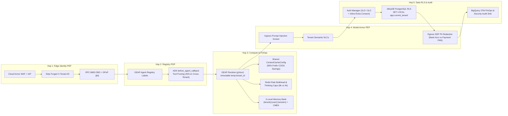

# Workstream 2.1: Case Study & Solution Architecture — Pooled Architecture (Pattern A)

> **Workstream**: Workstream 2 — Pooled Architecture (Pattern A) [Weeks 1–4 Priority • Milestone 1]  
> **Scenario**: Cymbal SaaS Platform securely serves **FinVault Bank** (Enterprise Tier • Google Workspace + Jira stack) and **RetailStream Corp** (Standard Tier • Microsoft 365 + ServiceNow stack) within a **shared runtime** using logical and cryptographic governance.

---

## 1. Business Challenge & Architectural Mandate

**Cymbal SaaS Platform** is a B2B SaaS provider for IT observability and incident management embedding autonomous AI agents via **Gemini Enterprise Agent Platform (GEAP)** and **ADK 2.0**.

To preserve SaaS gross margins (COGS) across thousands of customers while meeting enterprise security requirements, Cymbal's **Pattern A (Pooled Architecture)** must govern:
1. **Multi-turn reasoning loops** with tiered thinking-token caps (`8,000` for FinVault vs. `4,000` for RetailStream).
2. **Dynamic MCP tool calls** across heterogeneous 1P/3P stacks (`2LO` Cymbal Core Telemetry API, `3LO` Google Workspace & Jira for FinVault, `3LO` Microsoft Entra ID SharePoint & ServiceNow for RetailStream).
3. **Shared Prompt Prefix Caching (`ContextCacheConfig`)** achieving up to **90% COGS savings** on shared operator instructions with zero cross-tenant context cache bleed.
4. **Private Tenant-Built Agents**: Allowing FinVault Bank to build and operate a private **Regulatory Escalation Agent (`Agent Alpha`)** running **Gemini 2.5 Pro (Dedicated PT) on Vertex AI Model Garden** inside the same control plane, while remaining 100% invisible (`403 Forbidden`) to RetailStream Corp.

---

## 2. End-to-End Solution Architecture: The 5-Hop Cryptographic Context Chain

### 2.1 Pattern A High-Density Pooled Architecture Blueprint
> **Artifacts**: [2x Retina PNG](../diagrams/ws2-pattern-a-pooled-5hop-architecture.drawio.png) • [Vector SVG](../diagrams/ws2-pattern-a-pooled-5hop-architecture.svg) • [Editable Draw.io XML](../diagrams/ws2-pattern-a-pooled-5hop-architecture.drawio)

### 2.2 Pattern A 10-Point Cross-Tenant Breach Defense & Guardrail Verification Matrix
> **Artifacts**: [2x Retina PNG](../diagrams/ws2-pattern-a-breach-defense-sequence.drawio.png) • [Vector SVG](../diagrams/ws2-pattern-a-breach-defense-sequence.svg) • [Editable Draw.io XML](../diagrams/ws2-pattern-a-breach-defense-sequence.drawio)

---

## 3. Governance Enforcement Matrix (FinVault Bank vs. RetailStream Corp)

| Governance Pillar | Tenant Alpha: FinVault Bank (`Enterprise`) | Tenant Beta: RetailStream Corp (`Standard`) | GEAP & GCP Enforcement Mechanism |
| :--- | :--- | :--- | :--- |
| **1. Catalog & Agent Visibility (Hop 2 • Registry PDP)** | - Shared Diagnostic Agent - Private `Agent Alpha` (Full CRUD & API Owner) | - Shared Diagnostic Agent - `Agent Alpha` Hidden (`403 Forbidden` on direct ID call) | GEAP Agent Registry (PDP) tenant labels + ARD catalog filtering + ADK `before_agent_callback` deterministic tool pruning |
| **2. Identity & Tool Auth (Hop 1 & 5 • 2LO / 3LO)** | - 2LO Implicit: Cymbal Telemetry API - 3LO Google OIDC: Drive, Calendar, Gmail, Jira | - 2LO Implicit: Cymbal Telemetry API - 3LO Entra ID: SharePoint & ServiceNow (Inline OAuth) | Cloud Armor/IAP (strips forged `X-Tenant-ID`) $\rightarrow$ RFC 8693 OBO + DPoP $\rightarrow$ GCP Agent Identity (Auth Manager) |
| **3. Model, Memory & FinOps (Hop 3 • Compute Plane)** | - Gemini 2.5 Pro (`8,000` Thinking Tokens) - Gemini 2.5 Pro (Dedicated PT) (`Agent Alpha`, hot-swappable) - Memory: `finvault:user:session` + CMEK | - Gemini 2.5 Pro/Flash (`4,000` Thinking Cap) - Shared Prompt Prefix Cache (`90%` COGS savings) - Memory: `retailstream:user:session` | GEAP Agent Runtime (gVisor Sandbox) + immutable `temp:tenant_id` + 5-Level Memory Bank + Redis Token Bulkheads |
| **4. Guardrails, Data & Audit (Hop 4 & 5 • PEP & RLS)** | - Redacts bank account / IBAN / SWIFT PII in stack traces - Enforces regulatory NLCs & FinVault DB rows | - Redacts customer payment card PAN PII - Scopes queries strictly to RetailStream DB rows | Vertex AI Model Armor (Ingress prompt screen & Egress SDP DLP) + Semantic NLCs + AlloyDB RLS + BigQuery OTel |

---

## 4. FinOps & Unit Economics Math (Why Pooled Pattern A Saves 90% COGS)

In Cymbal's Shared Incident Diagnostic Agent, the static operator system prompt, SRE diagnostic taxonomy, and tool schemas consume **32,000 input tokens** per turn, while the tenant-specific incident delta averages **2,000 input tokens**.

* **Without Shared Prompt Prefix Caching**: Every turn bills `34,000` full-price input tokens.
* **With `ContextCacheConfig` (`READ_ONLY_IMMUTABLE_PREFIX`)**:
  * The 32,000-token operator prefix is cached once across the shared pool and billed at a **90% discount** (equivalent to `3,200` tokens).
  * **Each tenant's dynamic conversation suffix (`2,000` tokens)** and `thinking_budget` (`4,000` or `8,000` tokens) are evaluated post-prefix inside an isolated gVisor memory context and never written back to the shared prefix cache.
  * **Net Input Token COGS Reduction**: **~84.7% total input cost savings** with **zero cross-tenant cache bleed**.

---

## 5. Pattern A Intra-Cloud (GCP) & Inter-Cloud (AWS Bedrock AgentCore MCP) 10 Third-Party SaaS Bidirectional Verification (`10/10 Flows • 20/20 Assertions PASS`)

Every Pattern A pooled tenant invocation is verified across **10 non-Google enterprise SaaS products** deployed as live MCP targets on **AWS Bedrock AgentCore MCP Gateway** (`merck-a2a-mcp-gateway-kiu8omh4aq`, AWS Account `393036065405`, `us-east-1`) and backed by live Third-Party SaaS Target Web Console UIs (`https://t2zbugodcr2m7aimjudycgm65q0wopps.lambda-url.us-east-1.on.aws/saas-ui/<target>`) reading live Amazon S3 audit ledgers (`s3://nitinagga-argolis-aws-393036065405-us-east-1/cymbal-10saas-ledger/<target>/finvault.json`). See [`docs/10-THIRD-PARTY-SAAS-3-PATTERN-MANUAL-TESTING-PLAYBOOK.md`](../docs/10-THIRD-PARTY-SAAS-3-PATTERN-MANUAL-TESTING-PLAYBOOK.md) for the complete manual testing playbook.

| # | Third-Party SaaS Product & AWS AgentCore Target | Pattern A Positive & Red-Team Outcomes (`TC-A-POS` / `TC-A-NEG`) | Live Third-Party SaaS Target UI Login & Outcome Validation URLs | Side-A & Side-B Visual Proof Screenshots |
| :--- | :--- | :--- | :--- | :--- |
| **01** | **ThoughtSpot Cloud (Spotter Agentic BI v2.0)** • Target `KD6Z3SV8PX` (`READY`) | `200 ALLOW` (`2` FinVault rows, `90%` cache) / `403 CROSS_TENANT_THOUGHTSPOT_ORG_SPOOF_BLOCKED` | [Live Metabase BI (`:3001`)](http://13.220.94.209:3001/question/27) • [200 ALLOW](https://t2zbugodcr2m7aimjudycgm65q0wopps.lambda-url.us-east-1.on.aws/saas-ui/thoughtspot-spotter?principal=sre-lead@finvault.com) • [403 DENY](https://t2zbugodcr2m7aimjudycgm65q0wopps.lambda-url.us-east-1.on.aws/saas-ui/thoughtspot-spotter?principal=ops-eng@retailstream.com) • [S3 JSON](https://t2zbugodcr2m7aimjudycgm65q0wopps.lambda-url.us-east-1.on.aws/saas-ui/thoughtspot-spotter?format=json) | [Side-A MCP](../screenshots/cloud-console/saas_01_thoughtspot_spotter_agentcore_mcp.png) • [Side-B UI](../screenshots/cloud-console/saas_ui_01_thoughtspot_spotter_console.png) |
| **02** | **Sigma Computing (Workbooks & Dataset API v2)** • Target `OZ0KTE8Z8M` (`READY`) | `200 ALLOW` (`ua_tenant_id` pushdown) / `403 DENY_SIGMA_UA_TENANT_TAMPERING` | [Live Grafana BI (`:3002`)](http://13.220.94.209:3002/d/finvault-sre-wb) • [200 ALLOW](https://t2zbugodcr2m7aimjudycgm65q0wopps.lambda-url.us-east-1.on.aws/saas-ui/sigma-computing?principal=sre-lead@finvault.com) • [403 DENY](https://t2zbugodcr2m7aimjudycgm65q0wopps.lambda-url.us-east-1.on.aws/saas-ui/sigma-computing?principal=ops-eng@retailstream.com) • [S3 JSON](https://t2zbugodcr2m7aimjudycgm65q0wopps.lambda-url.us-east-1.on.aws/saas-ui/sigma-computing?format=json) | [Side-A MCP](../screenshots/cloud-console/saas_02_sigma_computing_agentcore_mcp.png) • [Side-B UI](../screenshots/cloud-console/saas_ui_02_sigma_computing_console.png) |
| **03** | **ServiceNow ITSM & ITOM (`CHG0049218`)** • Target `PLOLWRMI0I` (`READY`) | `200 ALLOW` (Consented 3LO `CHG0049218`) / `401 CHALLENGE_3LO_OAUTH` (`MCP -32042`) | [Live Redmine ITSM (`:3003`)](http://13.220.94.209:3003/projects/finvault-itsm/issues) • [200 ALLOW](https://t2zbugodcr2m7aimjudycgm65q0wopps.lambda-url.us-east-1.on.aws/saas-ui/servicenow-itsm?principal=sre-lead@finvault.com) • [403 DENY](https://t2zbugodcr2m7aimjudycgm65q0wopps.lambda-url.us-east-1.on.aws/saas-ui/servicenow-itsm?principal=ops-eng@retailstream.com) • [S3 JSON](https://t2zbugodcr2m7aimjudycgm65q0wopps.lambda-url.us-east-1.on.aws/saas-ui/servicenow-itsm?format=json) | [Side-A MCP](../screenshots/cloud-console/saas_03_servicenow_itsm_agentcore_mcp.png) • [Side-B UI](../screenshots/cloud-console/saas_ui_03_servicenow_itsm_console.png) |
| **04** | **Veeva Vault RIM & Muse Clinical EDC (`MK-3475-087`)** • Target `1KZWKOFTWQ` (`READY`) | `200 ALLOW` (21 CFR Part 11 KMS sig) / `403 TENANT_CONNECTOR_ACL_DENIED` | [Live NocoDB EDC (`:3004`)](http://13.220.94.209:3004/#/signin) • [200 ALLOW](https://t2zbugodcr2m7aimjudycgm65q0wopps.lambda-url.us-east-1.on.aws/saas-ui/muse-poc?principal=sre-lead@finvault.com) • [403 DENY](https://t2zbugodcr2m7aimjudycgm65q0wopps.lambda-url.us-east-1.on.aws/saas-ui/muse-poc?principal=ops-eng@retailstream.com) • [S3 JSON](https://t2zbugodcr2m7aimjudycgm65q0wopps.lambda-url.us-east-1.on.aws/saas-ui/muse-poc?format=json) | [Side-A MCP](../screenshots/cloud-console/saas_04_veeva_vault_muse_edc_agentcore_mcp.png) • [Side-B UI](../screenshots/cloud-console/saas_ui_04_veeva_vault_muse_edc_console.png) |
| **05** | **Salesforce CRM (`NA224`) & Atlassian Jira Cloud** • Target `W7BF0JRWEA` (`READY`) | `200 ALLOW` (`[REDACTED-FINVAULT-IBAN]`) / `PASS` (`raw_pii_leaked=False`) | [Live Gitea Tracker (`:3005`)](http://13.220.94.209:3005/finvault/sre-escalations/issues/1) • [200 ALLOW](https://t2zbugodcr2m7aimjudycgm65q0wopps.lambda-url.us-east-1.on.aws/saas-ui/salesforce-jira?principal=sre-lead@finvault.com) • [403 DENY](https://t2zbugodcr2m7aimjudycgm65q0wopps.lambda-url.us-east-1.on.aws/saas-ui/salesforce-jira?principal=ops-eng@retailstream.com) • [S3 JSON](https://t2zbugodcr2m7aimjudycgm65q0wopps.lambda-url.us-east-1.on.aws/saas-ui/salesforce-jira?format=json) | [Side-A MCP](../screenshots/cloud-console/saas_05_salesforce_jira_agentcore_mcp.png) • [Side-B UI](../screenshots/cloud-console/saas_ui_05_salesforce_jira_console.png) |
| **06** | **Databricks Data Intelligence Platform (Unity Catalog)** • Target `Z1RHXLBK6F` (`READY`) | `200 ALLOW` (`cymbal_uc_prod.finvault_gold`) / `403 UNITY_CATALOG_CROSS_TENANT_SCHEMA_OR_DYNAMIC_SQL_BLOCKED` | [Live Trino UI (`:3006`)](http://13.220.94.209:3006/ui/) • [200 ALLOW](https://t2zbugodcr2m7aimjudycgm65q0wopps.lambda-url.us-east-1.on.aws/saas-ui/databricks-unity?principal=sre-lead@finvault.com) • [403 DENY](https://t2zbugodcr2m7aimjudycgm65q0wopps.lambda-url.us-east-1.on.aws/saas-ui/databricks-unity?principal=ops-eng@retailstream.com) • [S3 JSON](https://t2zbugodcr2m7aimjudycgm65q0wopps.lambda-url.us-east-1.on.aws/saas-ui/databricks-unity?format=json) | [Side-A MCP](../screenshots/cloud-console/saas_06_databricks_unity_catalog_agentcore_mcp.png) • [Side-B UI](../screenshots/cloud-console/saas_ui_06_databricks_unity_catalog_console.png) |
| **07** | **Snowflake AI Data Cloud (Cortex Analyst & SQL v2)** • Target `7PB1EK3NJO` (`READY`) | `200 ALLOW` (`ROLE_CYMBAL_RETAILSTREAM`) / `403 SNOWFLAKE_SECONDARY_ROLES_OR_CROSS_ROLE_ESCALATION_BLOCKED` | [Live ClickHouse UI (`:3007`)](http://13.220.94.209:3007/play) • [200 ALLOW](https://t2zbugodcr2m7aimjudycgm65q0wopps.lambda-url.us-east-1.on.aws/saas-ui/snowflake-cortex?principal=sre-lead@finvault.com) • [403 DENY](https://t2zbugodcr2m7aimjudycgm65q0wopps.lambda-url.us-east-1.on.aws/saas-ui/snowflake-cortex?principal=ops-eng@retailstream.com) • [S3 JSON](https://t2zbugodcr2m7aimjudycgm65q0wopps.lambda-url.us-east-1.on.aws/saas-ui/snowflake-cortex?format=json) | [Side-A MCP](../screenshots/cloud-console/saas_07_snowflake_cortex_agentcore_mcp.png) • [Side-B UI](../screenshots/cloud-console/saas_ui_07_snowflake_cortex_console.png) |
| **08** | **Workday Enterprise HCM & Financial Management** • Target `CXH8BK86IF` (`READY`) | `200 ALLOW` (`[REDACTED_US_SSN]`) / `401 WORKDAY_INTRA_TENANT_PRINCIPAL_3LO_MISMATCH` | [Live Directus HCM (`:3008`)](http://13.220.94.209:3008/admin/content/hcm_compensation) • [200 ALLOW](https://t2zbugodcr2m7aimjudycgm65q0wopps.lambda-url.us-east-1.on.aws/saas-ui/workday-raas?principal=sre-lead@finvault.com) • [403 DENY](https://t2zbugodcr2m7aimjudycgm65q0wopps.lambda-url.us-east-1.on.aws/saas-ui/workday-raas?principal=ops-eng@retailstream.com) • [S3 JSON](https://t2zbugodcr2m7aimjudycgm65q0wopps.lambda-url.us-east-1.on.aws/saas-ui/workday-raas?format=json) | [Side-A MCP](../screenshots/cloud-console/saas_08_workday_hcm_financials_agentcore_mcp.png) • [Side-B UI](../screenshots/cloud-console/saas_ui_08_workday_hcm_financials_console.png) |
| **09** | **Datadog Cloud Observability & Bits AI SRE** • Target `A2X7LPMPA7` (`READY`) | `200 ALLOW` (`@tenant_id:finvault`) / `400 MODEL_ARMOR_LOG_PROMPT_INJECTION_BLOCKED` | [Live Seq APM (`:3009`)](http://13.220.94.209:3009/#/events) • [200 ALLOW](https://t2zbugodcr2m7aimjudycgm65q0wopps.lambda-url.us-east-1.on.aws/saas-ui/datadog-sre?principal=sre-lead@finvault.com) • [403 DENY](https://t2zbugodcr2m7aimjudycgm65q0wopps.lambda-url.us-east-1.on.aws/saas-ui/datadog-sre?principal=ops-eng@retailstream.com) • [S3 JSON](https://t2zbugodcr2m7aimjudycgm65q0wopps.lambda-url.us-east-1.on.aws/saas-ui/datadog-sre?format=json) | [Side-A MCP](../screenshots/cloud-console/saas_09_datadog_bits_ai_sre_agentcore_mcp.png) • [Side-B UI](../screenshots/cloud-console/saas_ui_09_datadog_bits_ai_sre_console.png) |
| **10** | **CrowdStrike Falcon Next-Gen SIEM & Okta Identity** • Target `TXGJHVFBWP` (`READY`) | `200 ALLOW` (DPoP `dpop_jkt_fv_001`) / `401 OKTA_CROWDSTRIKE_DPOP_PROOF_BINDING_MISMATCH` | [Live Vault UI (`:3010`)](http://13.220.94.209:3010/ui/vault/secrets/secret/show/tenants/finvault) • [200 ALLOW](https://t2zbugodcr2m7aimjudycgm65q0wopps.lambda-url.us-east-1.on.aws/saas-ui/crowdstrike-okta?principal=sre-lead@finvault.com) • [403 DENY](https://t2zbugodcr2m7aimjudycgm65q0wopps.lambda-url.us-east-1.on.aws/saas-ui/crowdstrike-okta?principal=ops-eng@retailstream.com) • [S3 JSON](https://t2zbugodcr2m7aimjudycgm65q0wopps.lambda-url.us-east-1.on.aws/saas-ui/crowdstrike-okta?format=json) | [Side-A MCP](../screenshots/cloud-console/saas_10_crowdstrike_okta_agentcore_mcp.png) • [Side-B UI](../screenshots/cloud-console/saas_ui_10_crowdstrike_okta_console.png) |

