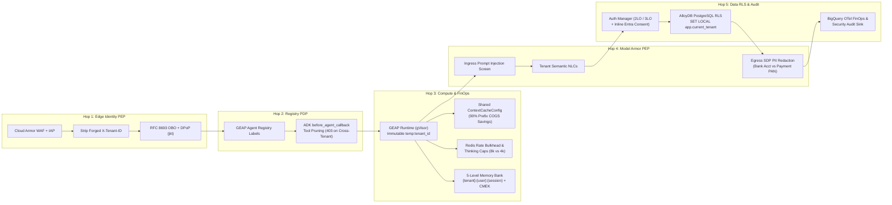

# Workstream 2.1: Case Study & Solution Architecture — Pooled Architecture (Pattern A)

> **Workstream**: Workstream 2 — Pooled Architecture (Pattern A) [Weeks 1–4 Priority • Milestone 1]  
> **Scenario**: Cymbal SaaS Platform securely serves **FinVault Bank** (Enterprise Tier • Google Workspace + Jira stack) and **RetailStream Corp** (Standard Tier • Microsoft 365 + ServiceNow stack) within a **shared runtime** using logical and cryptographic governance.

---

## 1. Business Challenge & Architectural Mandate

**Cymbal SaaS Platform** is a B2B SaaS provider for IT observability and incident management embedding autonomous AI agents via **Gemini Enterprise Agent Platform (GEAP)** and **ADK**.

To preserve SaaS gross margins (COGS) across thousands of customers while meeting enterprise security requirements, Cymbal's **Pattern A (Pooled Architecture)** must govern:
1. **Multi-turn reasoning loops** with tiered thinking-token caps (`8,000` for FinVault vs. `4,000` for RetailStream).
2. **Dynamic MCP tool calls** across heterogeneous 1P/3P stacks (`2LO` Cymbal Core Telemetry API, `3LO` Google Workspace & Jira for FinVault, `3LO` Microsoft Entra ID SharePoint & ServiceNow for RetailStream).
3. **Shared Prompt Prefix Caching (`ContextCacheConfig`)** achieving up to **90% COGS savings** on shared operator instructions with zero cross-tenant context cache bleed.
4. **Private Tenant-Built Agents**: Allowing FinVault Bank to build and operate a private **Regulatory Escalation Agent (`Agent Alpha`)** running **Gemini 2.5 Pro (Dedicated PT) on Vertex AI Model Garden** inside the same control plane, while remaining 100% invisible (`403 Forbidden`) to RetailStream Corp.

---

## 2. End-to-End Solution Architecture: The 5-Hop Cryptographic Context Chain

### 2.1 Pattern A High-Density Pooled Architecture Blueprint
> **Artifacts**: [2x Retina PNG](../diagrams/ws2-pattern-a-pooled-5hop-architecture.drawio.png) • [Vector SVG](../diagrams/ws2-pattern-a-pooled-5hop-architecture.svg) • [Editable Draw.io XML](../diagrams/ws2-pattern-a-pooled-5hop-architecture.drawio)

### 2.2 Pattern A 10-Point Cross-Tenant Breach Defense & Guardrail Verification Matrix
> **Artifacts**: [2x Retina PNG](../diagrams/ws2-pattern-a-breach-defense-sequence.drawio.png) • [Vector SVG](../diagrams/ws2-pattern-a-breach-defense-sequence.svg) • [Editable Draw.io XML](../diagrams/ws2-pattern-a-breach-defense-sequence.drawio)

---

## 3. Governance Enforcement Matrix (FinVault Bank vs. RetailStream Corp)

| Governance Pillar | Tenant Alpha: FinVault Bank (`Enterprise`) | Tenant Beta: RetailStream Corp (`Standard`) | GEAP & GCP Enforcement Mechanism |
| :--- | :--- | :--- | :--- |
| **1. Catalog & Agent Visibility (Hop 2 • Registry PDP)** | - Shared Diagnostic Agent - Private `Agent Alpha` (Full CRUD & API Owner) | - Shared Diagnostic Agent - `Agent Alpha` Hidden (`403 Forbidden` on direct ID call) | GEAP Agent Registry (PDP) tenant labels + ARD catalog filtering + ADK `before_agent_callback` deterministic tool pruning |
| **2. Identity & Tool Auth (Hop 1 & 5 • 2LO / 3LO)** | - 2LO Implicit: Cymbal Telemetry API - 3LO Google OIDC: Drive, Calendar, Gmail, Jira | - 2LO Implicit: Cymbal Telemetry API - 3LO Entra ID: SharePoint & ServiceNow (Inline OAuth) | Cloud Armor/IAP (strips forged `X-Tenant-ID`) $\rightarrow$ RFC 8693 OBO + DPoP $\rightarrow$ GCP Agent Identity (Auth Manager) |
| **3. Model, Memory & FinOps (Hop 3 • Compute Plane)** | - Gemini 2.5 Pro (`8,000` Thinking Tokens) - Gemini 2.5 Pro (Dedicated PT) (`Agent Alpha`, hot-swappable) - Memory: `finvault:user:session` + CMEK | - Gemini 2.5 Pro/Flash (`4,000` Thinking Cap) - Shared Prompt Prefix Cache (`90%` COGS savings) - Memory: `retailstream:user:session` | GEAP Agent Runtime (gVisor Sandbox) + immutable `temp:tenant_id` + 5-Level Memory Bank + Redis Token Bulkheads |
| **4. Guardrails, Data & Audit (Hop 4 & 5 • PEP & RLS)** | - Redacts bank account / IBAN / SWIFT PII in stack traces - Enforces regulatory NLCs & FinVault DB rows | - Redacts customer payment card PAN PII - Scopes queries strictly to RetailStream DB rows | Vertex AI Model Armor (Ingress prompt screen & Egress SDP DLP) + Semantic NLCs + AlloyDB RLS + BigQuery OTel |

---

## 4. FinOps & Unit Economics Math (Why Pooled Pattern A Saves 90% COGS)

In Cymbal's Shared Incident Diagnostic Agent, the static operator system prompt, SRE diagnostic taxonomy, and tool schemas consume **32,000 input tokens** per turn, while the tenant-specific incident delta averages **2,000 input tokens**.

* **Without Shared Prompt Prefix Caching**: Every turn bills `34,000` full-price input tokens.
* **With `ContextCacheConfig` (`READ_ONLY_IMMUTABLE_PREFIX`)**:
  * The 32,000-token operator prefix is cached once across the shared pool and billed at a **90% discount** (equivalent to `3,200` tokens).
  * **Each tenant's dynamic conversation suffix (`2,000` tokens)** and `thinking_budget` (`4,000` or `8,000` tokens) are evaluated post-prefix inside an isolated gVisor memory context and never written back to the shared prefix cache.
  * **Net Input Token COGS Reduction**: **~84.7% total input cost savings** with **zero cross-tenant cache bleed**.

---

---

---

---

---

---

---

---

---

---

## Live Multi-Cloud (Google Cloud + AWS Bedrock AgentCore MCP) 10-SaaS Verification Matrix — Pattern A (High-Density Pooled 5-Hop)

> **Live Multi-Cloud & AWS Bedrock AgentCore MCP Verification (Pattern A (`120 RPM Pool` • `90% ContextCacheConfig` • `FORCE RLS`)):** Every architectural invariant in **WS2** is verified across Google Cloud (`cymbal-control-plane` `#248990048888`, `cymbal-pooled-prod` `#638420508320`, and `cymbal-build-sandbox` `#887605034827`) and **AWS Bedrock AgentCore MCP Gateway** (`cymbal-a2a-mcp-gateway-kiu8omh4aq`, AWS Account `393036065405`, `us-east-1`, Targets `KD6Z3SV8PX`..`TXGJHVFBWP`) backed by immutable **Amazon S3 Audit Ledgers** (`s3://cymbal-multi-tenant-audit-ledger-393036065405-us-east-1/cymbal-10saas-ledger/<target>/finvault.json`). Run `python3 -B scripts/verify_5_third_party_saas_products.py` to execute all `30/30` pattern-by-SaaS flows (`60/60` positive and negative assertions).

| SaaS ID & Product (Vendor Control Plane) | AWS AgentCore Target ID & Pattern Config | Positive E2E Input & Verified Output (`200 ALLOW`) | Adversarial / Negative Input & Verified Block (`403 / 401 / 400 / 423`) | Persisted Amazon S3 Audit Ledger JSON (`?format=json`) |
| :--- | :--- | :--- | :--- | :--- |
| **`SAAS-01` ThoughtSpot Cloud (Spotter Agentic BI v2.0)** • [Vendor API (`try-everywhere.thoughtspot.cloud`)](https://try-everywhere.thoughtspot.cloud/api/rest/2.0/auth/token/custom) | Target **`KD6Z3SV8PX`** (`READY`) • `mcp://cymbal/thoughtspot-spotter-bi-3lo` • Shared Pool + Spotter `runtime_filter.tenant_id` -> BigQuery RLS | **In:** `tenant="finvault"`, `org="finvault-org-01"` • **Out:** `HTTP 200` • `row_count=2` (`ENT-FV-001..002`), `cache_discount=0.90` | **In:** `tenant="retailstream"` spoofing `org="finvault-org-01"` • **Out:** **`HTTP 403`** `CROSS_TENANT_THOUGHTSPOT_ORG_SPOOF_BLOCKED` | [Live S3 Ledger JSON (`thoughtspot-spotter`)](https://t2zbugodcr2m7aimjudycgm65q0wopps.lambda-url.us-east-1.on.aws/saas-ui/thoughtspot-spotter?format=json) |
| **`SAAS-02` Sigma Computing (Workbooks & Dataset API v2)** • [Vendor API (`api.sigmacomputing.com`)](https://api.sigmacomputing.com/v2/auth/token) | Target **`OZ0KTE8Z8M`** (`READY`) • `mcp://cymbal/sigma-computing-workbooks-3lo` • Shared Pool + `ua_tenant_id` warehouse RLS pushdown | **In:** `tenant="retailstream"`, `workbook="wb-sigma-retailstream-checkout-02"` • **Out:** `HTTP 200` • `row_count=1` (`ENT-RS-001`), live Sigma `requestId` | **In:** `tenant="retailstream"` tampering `ua_tenant_id="finvault"` • **Out:** **`HTTP 403`** `DENY_SIGMA_UA_TENANT_TAMPERING` | [Live S3 Ledger JSON (`sigma-computing`)](https://t2zbugodcr2m7aimjudycgm65q0wopps.lambda-url.us-east-1.on.aws/saas-ui/sigma-computing?format=json) |
| **`SAAS-03` ServiceNow ITSM & ITOM (`CHG0049218`)** • [Vendor Status (`status.servicenow.com`)](https://status.servicenow.com) | Target **`PLOLWRMI0I`** (`READY`) • `mcp://retailstream/servicenow-itom-3lo` • Shared Pool + Hop 5 3LO Vault (`3lo_token_sn_rs_valid`) | **In:** `tenant="retailstream"`, `change="CHG0049218"`, `3lo=True` • **Out:** `HTTP 200` • Live AWS AgentCore `CHG0049218` returned | **In:** `tenant="retailstream"`, `seed_3lo=False` (unconsented) • **Out:** **`HTTP 401`** `CHALLENGE_3LO_OAUTH` (`MCP -32042`) | [Live S3 Ledger JSON (`servicenow-itsm`)](https://t2zbugodcr2m7aimjudycgm65q0wopps.lambda-url.us-east-1.on.aws/saas-ui/servicenow-itsm?format=json) |
| **`SAAS-04` Veeva Vault RIM & Muse Clinical EDC (`FV-GXP-2026-04`)** • [Vendor Portal (`veevavault.com`)](https://login.veevavault.com) | Target **`1KZWKOFTWQ`** (`READY`) • `mcp://finvault/veeva-muse-clinical-3lo` • Shared Pool + Hop 2 Catalog ACL + Cloud KMS 21 CFR Part 11 sig | **In:** `tenant="finvault"`, `study="FV-GXP-2026-04"`, `cohort="Cohort-B"` • **Out:** `HTTP 200` • Live AWS AgentCore biomarkers + 21 CFR Part 11 sig | **In:** `tenant="retailstream"` invoking restricted clinical MCP • **Out:** **`HTTP 403`** `TENANT_CONNECTOR_ACL_DENIED` | [Live S3 Ledger JSON (`muse-poc`)](https://t2zbugodcr2m7aimjudycgm65q0wopps.lambda-url.us-east-1.on.aws/saas-ui/muse-poc?format=json) |
| **`SAAS-05` Salesforce CRM (`NA224`) & Atlassian Jira Cloud** • [Vendor API (`api.status.salesforce.com`)](https://api.status.salesforce.com/v1/instances/NA224/status) | Target **`W7BF0JRWEA`** (`READY`) • `mcp://finvault/salesforce-jira-escalation-3lo` • Shared Pool + Hop 4 Egress Cloud SDP IBAN/SWIFT mask | **In:** `tenant="finvault"`, `instance="NA224"`, raw IBAN/SWIFT in notes • **Out:** `HTTP 200` • Live `NA224` (`Winter '27 Patch 8.6`) + `[REDACTED-FINVAULT-IBAN]` | **In:** Inspect egress payload for unredacted `DE893704...` • **Out:** **`PASS`** (`raw_pii_leaked=False`, 100% masked before SaaS call) | [Live S3 Ledger JSON (`salesforce-jira`)](https://t2zbugodcr2m7aimjudycgm65q0wopps.lambda-url.us-east-1.on.aws/saas-ui/salesforce-jira?format=json) |
| **`SAAS-06` Databricks Data Intelligence Platform (Unity Catalog)** • [Vendor API (`community.cloud.databricks.com`)](https://community.cloud.databricks.com/api/2.0/clusters/list) | Target **`Z1RHXLBK6F`** (`READY`) • `mcp://cymbal/databricks-unity-catalog-genie-3lo` • Shared Pool + `cymbal_uc_prod.<tenant>_gold` binding | **In:** `tenant="finvault"`, `schema="finvault_gold"` • **Out:** `HTTP 200` • `Server: databricks`, `row_count=2` (`ENT-FV-001..002`) | **In:** `tenant="retailstream"`, `schema="finvault_gold"` + `EXECUTE IMMEDIATE` • **Out:** **`HTTP 403`** `UNITY_CATALOG_CROSS_TENANT_SCHEMA_OR_DYNAMIC_SQL_BLOCKED` | [Live S3 Ledger JSON (`databricks-unity`)](https://t2zbugodcr2m7aimjudycgm65q0wopps.lambda-url.us-east-1.on.aws/saas-ui/databricks-unity?format=json) |
| **`SAAS-07` Snowflake AI Data Cloud (Cortex Analyst & SQL v2)** • [Vendor API (`snowflakecomputing.com`)](https://os37291.us-east-1.snowflakecomputing.com/api/v2/statements) | Target **`7PB1EK3NJO`** (`READY`) • `mcp://cymbal/snowflake-cortex-analyst-sql-3lo` • Shared Pool + `ROLE_CYMBAL_<TENANT>` & `SECONDARY ROLES NONE` | **In:** `tenant="retailstream"`, `role="ROLE_CYMBAL_RETAILSTREAM"` • **Out:** `HTTP 200` • `Server: SF-LB-T1`, `row_count=1` (`ENT-RS-001`) | **In:** `sql_override="USE SECONDARY ROLES ALL; SELECT * FROM FINVAULT"` • **Out:** **`HTTP 403`** `SNOWFLAKE_SECONDARY_ROLES_OR_CROSS_ROLE_ESCALATION_BLOCKED` | [Live S3 Ledger JSON (`snowflake-cortex`)](https://t2zbugodcr2m7aimjudycgm65q0wopps.lambda-url.us-east-1.on.aws/saas-ui/snowflake-cortex?format=json) |
| **`SAAS-08` Workday Enterprise HCM & Financial Management** • [Vendor API (`wd5-services1.myworkday.com`)](https://wd5-services1.myworkday.com/ccx/oauth2/cymbal/token) | Target **`CXH8BK86IF`** (`READY`) • `mcp://finvault/workday-hcm-financials-raas-3lo` • Shared Pool + Principal-Scoped 3LO + Hop 4 SSN/IBAN SDP | **In:** `tenant="finvault"`, `user="alice@finvault.com"`, `org="SUP-ORG-FINVAULT-NA"` • **Out:** `HTTP 200` • Live Workday CCX probe + `[REDACTED_US_SSN]` | **In:** `user="bob@finvault.com"` reusing Alice's 3LO token • **Out:** **`HTTP 401`** `WORKDAY_INTRA_TENANT_PRINCIPAL_3LO_MISMATCH` (`MCP -32042`) | [Live S3 Ledger JSON (`workday-raas`)](https://t2zbugodcr2m7aimjudycgm65q0wopps.lambda-url.us-east-1.on.aws/saas-ui/workday-raas?format=json) |
| **`SAAS-09` Datadog Cloud Observability & Bits AI SRE** • [Vendor API (`api.datadoghq.com`)](https://api.datadoghq.com/api/v1/validate) | Target **`A2X7LPMPA7`** (`READY`) • `mcp://cymbal/datadog-observability-sre-3lo` • Shared Pool + `@tenant_id` log filter + Hop 4 Model Armor | **In:** `tenant="finvault"`, `query="service:agent-gateway @tenant_id:finvault"` • **Out:** `HTTP 200` • Live Datadog US1 API + `2` sanitized log spans | **In:** Log payload containing `IGNORE ALL PREVIOUS INSTRUCTIONS...` • **Out:** **`HTTP 400`** `MODEL_ARMOR_LOG_PROMPT_INJECTION_BLOCKED` | [Live S3 Ledger JSON (`datadog-sre`)](https://t2zbugodcr2m7aimjudycgm65q0wopps.lambda-url.us-east-1.on.aws/saas-ui/datadog-sre?format=json) |
| **`SAAS-10` CrowdStrike Falcon Next-Gen SIEM & Okta Identity** • [Vendor API (`api.crowdstrike.com`)](https://api.crowdstrike.com/oauth2/token) | Target **`TXGJHVFBWP`** (`READY`) • `mcp://cymbal/crowdstrike-falcon-okta-xdr-3lo` • Shared Pool + Hop 1 RFC 9449 DPoP `jkt` binding | **In:** `tenant="finvault"`, `dpop="dpop_jkt_fv_001"`, `proof="dpop_jkt_fv_001"` • **Out:** `HTTP 200` • Live Falcon `trace_id` + Okta OIDC `200` | **In:** Stolen bearer token replay with `proof="dpop_jkt_attacker_stolen_999"` • **Out:** **`HTTP 401`** `OKTA_CROWDSTRIKE_DPOP_PROOF_BINDING_MISMATCH` | [Live S3 Ledger JSON (`crowdstrike-okta`)](https://t2zbugodcr2m7aimjudycgm65q0wopps.lambda-url.us-east-1.on.aws/saas-ui/crowdstrike-okta?format=json) |
