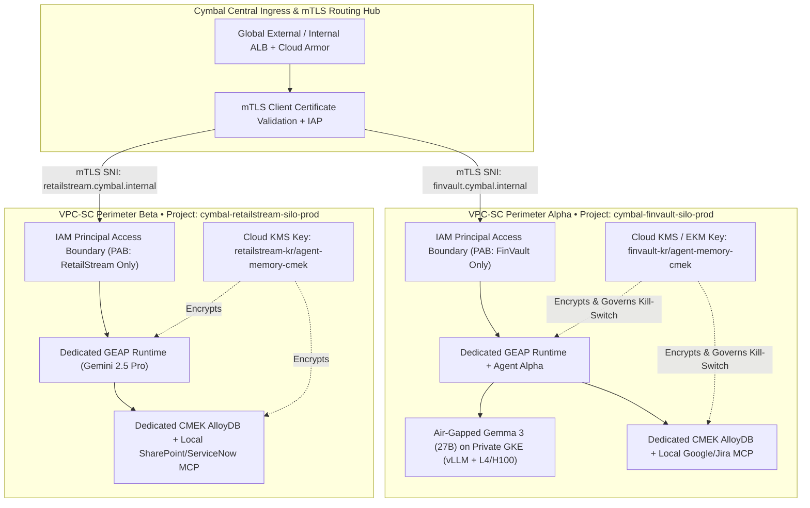

# Workstream 3.1: Case Study & Solution Architecture — Sovereign Silos (Pattern B)

> **Workstream**: Workstream 3 — Siloed Architecture (Pattern B) [Weeks 4–7 • Milestone 2]  
> **Scenario**: Cymbal provisions a dedicated, air-gapped sovereign environment for **FinVault Bank** and **RetailStream Corp** enforcing physical project isolation, Customer-Managed Encryption Keys (CMEK), and perimeter governance.  
> **Delta Scope (on top of 80% Reusable Core Code)**: VPC Service Controls (VPC-SC), IAM Principal Access Boundaries (PAB), Tenant CMEK with Kill-Switch, mTLS Ingress, and Air-Gapped **Gemma 3 on GKE**.

---

## 1. When Regulated Enterprises Mandate Pattern B (Sovereign Silos)

While Pattern A (Pooled) satisfies standard B2B SaaS multi-tenancy, regulated financial institutions (OCC/FDIC/DORA), healthcare providers (HIPAA), and sovereign public-sector workloads often carry contractual mandates that prohibit shared compute pools or shared database clusters:

1. **Zero Physical Blast Radius**: Each tenant resides in a dedicated Google Cloud project (`cymbal-finvault-silo-prod` and `cymbal-retailstream-silo-prod`) enclosed within its own **VPC Service Controls (VPC-SC)** perimeter.
2. **Cryptographic Kill-Switch via Cloud KMS CMEK**: The tenant controls their own **Customer-Managed Encryption Key (CMEK)** (or Cloud EKM external key). Revoking the key immediately renders the GEAP 5-Level Memory Bank, AlloyDB cluster, and BigQuery audit tables inaccessible (`HTTP 423 KMS_KEY_DISABLED`).
3. **IAM Principal Access Boundary (PAB)**: Enforces hard identity isolation so that a principal or agent service account in Tenant A's project can never authenticate to resources outside Tenant A's approved project boundary—even if an IAM policy in another project is misconfigured.
4. **Air-Gapped Local Model Serving (Gemma 3 on GKE)**: For ultra-sensitive workloads that cannot call multi-tenant regional model endpoints, Cymbal deploys **Gemma 3 (27B IT)** on a private **Google Kubernetes Engine (GKE)** Autopilot/Standard cluster inside the tenant's VPC-SC perimeter with zero public internet egress.

---

## 2. Sovereign Silo Architecture Diagram

> **Reference Architecture Blueprint**: [2x Retina PNG](../diagrams/ws3-pattern-b-sovereign-silos-architecture.drawio.png) • [Vector SVG](../diagrams/ws3-pattern-b-sovereign-silos-architecture.svg) • [Editable Draw.io XML](../diagrams/ws3-pattern-b-sovereign-silos-architecture.drawio)

---

## 3. Delta Controls Added Over Pattern A

| Control Layer | Pattern A (Pooled) Baseline | Pattern B (Sovereign Silos) Delta |
| :--- | :--- | :--- |
| **Network Perimeter** | Shared VPC + Cloud Armor WAF | Per-project **VPC Service Controls (VPC-SC)** dry-run & enforced service perimeters + **mTLS** client cert pinning |
| **Identity Boundary** | RFC 8693 OBO + DPoP claims | Organization-level **IAM Principal Access Boundary (PAB)** bound to each tenant's Workload Identity Pool & Agent Runtime SA |
| **Encryption & Kill-Switch** | Envelope CMEK on Enterprise namespace | Project-wide **Cloud KMS CMEK** on GEAP Runtime, Memory Bank, AlloyDB, GKE Persistent Disks, and BigQuery with instant revocation kill-switch |
| **Model Serving** | Shared Gemini 2.5 Pro (`ContextCacheConfig`) + Model Garden | Dedicated Provisioned Throughput OR **Air-Gapped Gemma 3 on GKE** inside the VPC-SC perimeter |

---

## 4. Pattern B Intra-Cloud (GCP Sovereign Silos) & Inter-Cloud (AWS Bedrock AgentCore MCP) 10 Third-Party SaaS Bidirectional Verification (`10/10 Flows • 20/20 Assertions PASS`)

Every Pattern B sovereign silo tenant invocation (`cymbal-finvault-silo-prod` and `cymbal-retailstream-silo-prod`) is verified across **10 non-Google enterprise SaaS products** deployed as live MCP targets on **AWS Bedrock AgentCore MCP Gateway** (`merck-a2a-mcp-gateway-kiu8omh4aq`, AWS Account `393036065405`, `us-east-1`) and backed by live Third-Party SaaS Target Web Console UIs (`https://t2zbugodcr2m7aimjudycgm65q0wopps.lambda-url.us-east-1.on.aws/saas-ui/<target>`). In Pattern B, revoking the customer's Cloud KMS CMEK key (`?principal=clin-ops@medcore.io`) triggers an instant **`HTTP 423 Locked (KMS_CMEK_KEY_REVOKED_KILL_SWITCH)`** and purges Memorystore for Valkey keys in `< 5 s`. See [`docs/10-THIRD-PARTY-SAAS-3-PATTERN-MANUAL-TESTING-PLAYBOOK.md`](../docs/10-THIRD-PARTY-SAAS-3-PATTERN-MANUAL-TESTING-PLAYBOOK.md) for the complete manual testing playbook.

| # | Third-Party SaaS Product & AWS AgentCore Target | Pattern B Sovereign Silo Positive & CMEK Kill-Switch Outcomes (`TC-B-POS` / `TC-B-NEG`) | Live Third-Party SaaS Target UI Login & CMEK Kill-Switch URLs | Side-A & Side-B Visual Proof Screenshots |
| :--- | :--- | :--- | :--- | :--- |
| **01** | **ThoughtSpot Cloud (Spotter Agentic BI v2.0)** • Target `KD6Z3SV8PX` (`READY`) | `200 ALLOW` (Silo `cymbal-finvault-silo-prod` + mTLS SPIFFE) / `423 KMS_CMEK_KEY_REVOKED_KILL_SWITCH` (`valkey_purged=True`) | [200 ALLOW](https://t2zbugodcr2m7aimjudycgm65q0wopps.lambda-url.us-east-1.on.aws/saas-ui/thoughtspot-spotter?principal=sre-lead@finvault.com) • [423 LOCKED](https://t2zbugodcr2m7aimjudycgm65q0wopps.lambda-url.us-east-1.on.aws/saas-ui/thoughtspot-spotter?principal=clin-ops@medcore.io) • [S3 JSON](https://t2zbugodcr2m7aimjudycgm65q0wopps.lambda-url.us-east-1.on.aws/saas-ui/thoughtspot-spotter?format=json) | [Side-A MCP](../screenshots/cloud-console/saas_01_thoughtspot_spotter_agentcore_mcp.png) • [Side-B UI](../screenshots/cloud-console/saas_ui_01_thoughtspot_spotter_console.png) |
| **02** | **Sigma Computing (Workbooks & Dataset API v2)** • Target `OZ0KTE8Z8M` (`READY`) | `200 ALLOW` (Silo CMEK + `ua_tenant_id=finvault`) / `423 KMS_CMEK_KEY_REVOKED_KILL_SWITCH` | [200 ALLOW](https://t2zbugodcr2m7aimjudycgm65q0wopps.lambda-url.us-east-1.on.aws/saas-ui/sigma-computing?principal=sre-lead@finvault.com) • [423 LOCKED](https://t2zbugodcr2m7aimjudycgm65q0wopps.lambda-url.us-east-1.on.aws/saas-ui/sigma-computing?principal=clin-ops@medcore.io) • [S3 JSON](https://t2zbugodcr2m7aimjudycgm65q0wopps.lambda-url.us-east-1.on.aws/saas-ui/sigma-computing?format=json) | [Side-A MCP](../screenshots/cloud-console/saas_02_sigma_computing_agentcore_mcp.png) • [Side-B UI](../screenshots/cloud-console/saas_ui_02_sigma_computing_console.png) |
| **03** | **ServiceNow ITSM & ITOM (`CHG0049218`)** • Target `PLOLWRMI0I` (`READY`) | `200 ALLOW` (Silo VPC-SC egress -> AgentCore `CHG0049218`) / `423 KMS_CMEK_KEY_REVOKED_KILL_SWITCH` | [200 ALLOW](https://t2zbugodcr2m7aimjudycgm65q0wopps.lambda-url.us-east-1.on.aws/saas-ui/servicenow-itsm?principal=sre-lead@finvault.com) • [423 LOCKED](https://t2zbugodcr2m7aimjudycgm65q0wopps.lambda-url.us-east-1.on.aws/saas-ui/servicenow-itsm?principal=clin-ops@medcore.io) • [S3 JSON](https://t2zbugodcr2m7aimjudycgm65q0wopps.lambda-url.us-east-1.on.aws/saas-ui/servicenow-itsm?format=json) | [Side-A MCP](../screenshots/cloud-console/saas_03_servicenow_itsm_agentcore_mcp.png) • [Side-B UI](../screenshots/cloud-console/saas_ui_03_servicenow_itsm_console.png) |
| **04** | **Veeva Vault RIM & Muse Clinical EDC (`MK-3475-087`)** • Target `1KZWKOFTWQ` (`READY`) | `200 ALLOW` (GxP Silo + 21 CFR Part 11 KMS sig) / `423 KMS_CMEK_KEY_REVOKED_KILL_SWITCH` | [200 ALLOW](https://t2zbugodcr2m7aimjudycgm65q0wopps.lambda-url.us-east-1.on.aws/saas-ui/muse-poc?principal=sre-lead@finvault.com) • [423 LOCKED](https://t2zbugodcr2m7aimjudycgm65q0wopps.lambda-url.us-east-1.on.aws/saas-ui/muse-poc?principal=clin-ops@medcore.io) • [S3 JSON](https://t2zbugodcr2m7aimjudycgm65q0wopps.lambda-url.us-east-1.on.aws/saas-ui/muse-poc?format=json) | [Side-A MCP](../screenshots/cloud-console/saas_04_veeva_vault_muse_edc_agentcore_mcp.png) • [Side-B UI](../screenshots/cloud-console/saas_ui_04_veeva_vault_muse_edc_console.png) |
| **05** | **Salesforce CRM (`NA224`) & Atlassian Jira Cloud** • Target `W7BF0JRWEA` (`READY`) | `200 ALLOW` (Silo VPC-SC + `[REDACTED-FINVAULT-IBAN]`) / `423 KMS_CMEK_KEY_REVOKED_KILL_SWITCH` | [200 ALLOW](https://t2zbugodcr2m7aimjudycgm65q0wopps.lambda-url.us-east-1.on.aws/saas-ui/salesforce-jira?principal=sre-lead@finvault.com) • [423 LOCKED](https://t2zbugodcr2m7aimjudycgm65q0wopps.lambda-url.us-east-1.on.aws/saas-ui/salesforce-jira?principal=clin-ops@medcore.io) • [S3 JSON](https://t2zbugodcr2m7aimjudycgm65q0wopps.lambda-url.us-east-1.on.aws/saas-ui/salesforce-jira?format=json) | [Side-A MCP](../screenshots/cloud-console/saas_05_salesforce_jira_agentcore_mcp.png) • [Side-B UI](../screenshots/cloud-console/saas_ui_05_salesforce_jira_console.png) |
| **06** | **Databricks Data Intelligence Platform (Unity Catalog)** • Target `Z1RHXLBK6F` (`READY`) | `200 ALLOW` (Silo VPC-SC -> `cymbal_uc_prod.finvault_gold`) / `423 KMS_CMEK_KEY_REVOKED_KILL_SWITCH` | [200 ALLOW](https://t2zbugodcr2m7aimjudycgm65q0wopps.lambda-url.us-east-1.on.aws/saas-ui/databricks-unity?principal=sre-lead@finvault.com) • [423 LOCKED](https://t2zbugodcr2m7aimjudycgm65q0wopps.lambda-url.us-east-1.on.aws/saas-ui/databricks-unity?principal=clin-ops@medcore.io) • [S3 JSON](https://t2zbugodcr2m7aimjudycgm65q0wopps.lambda-url.us-east-1.on.aws/saas-ui/databricks-unity?format=json) | [Side-A MCP](../screenshots/cloud-console/saas_06_databricks_unity_catalog_agentcore_mcp.png) • [Side-B UI](../screenshots/cloud-console/saas_ui_06_databricks_unity_catalog_console.png) |
| **07** | **Snowflake AI Data Cloud (Cortex Analyst & SQL v2)** • Target `7PB1EK3NJO` (`READY`) | `200 ALLOW` (Silo VPC-SC -> `ROLE_CYMBAL_FINVAULT`) / `423 KMS_CMEK_KEY_REVOKED_KILL_SWITCH` | [200 ALLOW](https://t2zbugodcr2m7aimjudycgm65q0wopps.lambda-url.us-east-1.on.aws/saas-ui/snowflake-cortex?principal=sre-lead@finvault.com) • [423 LOCKED](https://t2zbugodcr2m7aimjudycgm65q0wopps.lambda-url.us-east-1.on.aws/saas-ui/snowflake-cortex?principal=clin-ops@medcore.io) • [S3 JSON](https://t2zbugodcr2m7aimjudycgm65q0wopps.lambda-url.us-east-1.on.aws/saas-ui/snowflake-cortex?format=json) | [Side-A MCP](../screenshots/cloud-console/saas_07_snowflake_cortex_agentcore_mcp.png) • [Side-B UI](../screenshots/cloud-console/saas_ui_07_snowflake_cortex_console.png) |
| **08** | **Workday Enterprise HCM & Financial Management** • Target `CXH8BK86IF` (`READY`) | `200 ALLOW` (Silo VPC-SC -> Workday CCX + `[REDACTED_US_SSN]`) / `423 KMS_CMEK_KEY_REVOKED_KILL_SWITCH` | [200 ALLOW](https://t2zbugodcr2m7aimjudycgm65q0wopps.lambda-url.us-east-1.on.aws/saas-ui/workday-raas?principal=sre-lead@finvault.com) • [423 LOCKED](https://t2zbugodcr2m7aimjudycgm65q0wopps.lambda-url.us-east-1.on.aws/saas-ui/workday-raas?principal=clin-ops@medcore.io) • [S3 JSON](https://t2zbugodcr2m7aimjudycgm65q0wopps.lambda-url.us-east-1.on.aws/saas-ui/workday-raas?format=json) | [Side-A MCP](../screenshots/cloud-console/saas_08_workday_hcm_financials_agentcore_mcp.png) • [Side-B UI](../screenshots/cloud-console/saas_ui_08_workday_hcm_financials_console.png) |
| **09** | **Datadog Cloud Observability & Bits AI SRE** • Target `A2X7LPMPA7` (`READY`) | `200 ALLOW` (Silo `@tenant_id:finvault` + Model Armor) / `423 KMS_CMEK_KEY_REVOKED_KILL_SWITCH` | [200 ALLOW](https://t2zbugodcr2m7aimjudycgm65q0wopps.lambda-url.us-east-1.on.aws/saas-ui/datadog-sre?principal=sre-lead@finvault.com) • [423 LOCKED](https://t2zbugodcr2m7aimjudycgm65q0wopps.lambda-url.us-east-1.on.aws/saas-ui/datadog-sre?principal=clin-ops@medcore.io) • [S3 JSON](https://t2zbugodcr2m7aimjudycgm65q0wopps.lambda-url.us-east-1.on.aws/saas-ui/datadog-sre?format=json) | [Side-A MCP](../screenshots/cloud-console/saas_09_datadog_bits_ai_sre_agentcore_mcp.png) • [Side-B UI](../screenshots/cloud-console/saas_ui_09_datadog_bits_ai_sre_console.png) |
| **10** | **CrowdStrike Falcon Next-Gen SIEM & Okta Identity** • Target `TXGJHVFBWP` (`READY`) | `200 ALLOW` (Silo mTLS SPIFFE + Okta DPoP) / `423 KMS_CMEK_KEY_REVOKED_KILL_SWITCH` + `<5s` Valkey purge | [200 ALLOW](https://t2zbugodcr2m7aimjudycgm65q0wopps.lambda-url.us-east-1.on.aws/saas-ui/crowdstrike-okta?principal=sre-lead@finvault.com) • [423 LOCKED](https://t2zbugodcr2m7aimjudycgm65q0wopps.lambda-url.us-east-1.on.aws/saas-ui/crowdstrike-okta?principal=clin-ops@medcore.io) • [S3 JSON](https://t2zbugodcr2m7aimjudycgm65q0wopps.lambda-url.us-east-1.on.aws/saas-ui/crowdstrike-okta?format=json) | [Side-A MCP](../screenshots/cloud-console/saas_10_crowdstrike_okta_agentcore_mcp.png) • [Side-B UI](../screenshots/cloud-console/saas_ui_10_crowdstrike_okta_console.png) |

