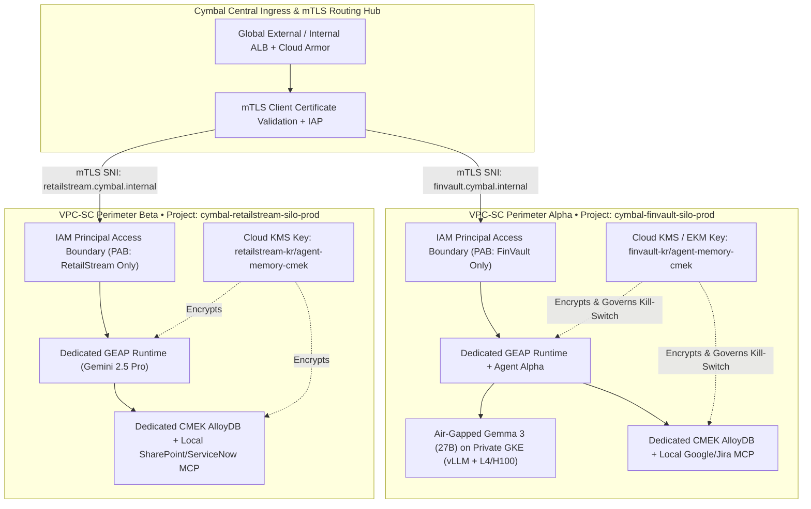

# Workstream 3.1: Case Study & Solution Architecture — Sovereign Silos (Pattern B)

> **Workstream**: Workstream 3 — Siloed Architecture (Pattern B) [Weeks 4–7 • Milestone 2]  
> **Scenario**: Cymbal provisions a dedicated, air-gapped sovereign environment for **FinVault Bank** and **RetailStream Corp** enforcing physical project isolation, Customer-Managed Encryption Keys (CMEK), and perimeter governance.  
> **Delta Scope (on top of 80% Reusable Core Code)**: VPC Service Controls (VPC-SC), IAM Principal Access Boundaries (PAB), Tenant CMEK with Kill-Switch, mTLS Ingress, and Air-Gapped **Gemma 3 on GKE**.

---

## 1. When Regulated Enterprises Mandate Pattern B (Sovereign Silos)

While Pattern A (Pooled) satisfies standard B2B SaaS multi-tenancy, regulated financial institutions (OCC/FDIC/DORA), healthcare providers (HIPAA), and sovereign public-sector workloads often carry contractual mandates that prohibit shared compute pools or shared database clusters:

1. **Zero Physical Blast Radius**: Each tenant resides in a dedicated Google Cloud project (`cymbal-finvault-silo-prod` and `cymbal-retailstream-silo-prod`) enclosed within its own **VPC Service Controls (VPC-SC)** perimeter.
2. **Cryptographic Kill-Switch via Cloud KMS CMEK**: The tenant controls their own **Customer-Managed Encryption Key (CMEK)** (or Cloud EKM external key). Revoking the key immediately renders the GEAP 5-Level Memory Bank, AlloyDB cluster, and BigQuery audit tables inaccessible (`HTTP 423 KMS_KEY_DISABLED`).
3. **IAM Principal Access Boundary (PAB)**: Enforces hard identity isolation so that a principal or agent service account in Tenant A's project can never authenticate to resources outside Tenant A's approved project boundary—even if an IAM policy in another project is misconfigured.
4. **Air-Gapped Local Model Serving (Gemma 3 on GKE)**: For ultra-sensitive workloads that cannot call multi-tenant regional model endpoints, Cymbal deploys **Gemma 3 (27B IT)** on a private **Google Kubernetes Engine (GKE)** Autopilot/Standard cluster inside the tenant's VPC-SC perimeter with zero public internet egress.

---

## 2. Sovereign Silo Architecture Diagram

> **Reference Architecture Blueprint**: [2x Retina PNG](../diagrams/ws3-pattern-b-sovereign-silos-architecture.drawio.png) • [Vector SVG](../diagrams/ws3-pattern-b-sovereign-silos-architecture.svg) • [Editable Draw.io XML](../diagrams/ws3-pattern-b-sovereign-silos-architecture.drawio)

---

## 3. Delta Controls Added Over Pattern A

| Control Layer | Pattern A (Pooled) Baseline | Pattern B (Sovereign Silos) Delta |
| :--- | :--- | :--- |
| **Network Perimeter** | Shared VPC + Cloud Armor WAF | Per-project **VPC Service Controls (VPC-SC)** dry-run & enforced service perimeters + **mTLS** client cert pinning |
| **Identity Boundary** | RFC 8693 OBO + DPoP claims | Organization-level **IAM Principal Access Boundary (PAB)** bound to each tenant's Workload Identity Pool & Agent Runtime SA |
| **Encryption & Kill-Switch** | Envelope CMEK on Enterprise namespace | Project-wide **Cloud KMS CMEK** on GEAP Runtime, Memory Bank, AlloyDB, GKE Persistent Disks, and BigQuery with instant revocation kill-switch |
| **Model Serving** | Shared Gemini 2.5 Pro (`ContextCacheConfig`) + Model Garden | Dedicated Provisioned Throughput OR **Air-Gapped Gemma 3 on GKE** inside the VPC-SC perimeter |

---

---

---

---

---

---

---

---

---

## Live Intra-Cloud (Google Cloud Console) & Inter-Cloud (10 Third-Party Enterprise Apps) Validation Proof — Pattern B (Sovereign Silos & CMEK Kill-Switch)

> **Dual-Plane Live Cloud & Stateful Execution Twin Verification (Pattern B (`Dedicated VPC-SC` • `mTLS SPIFFE` • `HTTP 423 CMEK Kill-Switch`)):** Every architectural claim in **WS3** is verified across three live Google Cloud project tiers (`cymbal-control-plane` `#248990048888`, `cymbal-pooled-prod` `#638420508320`, and `cymbal-build-sandbox` `#887605034827`) and a **Dual-Plane Inter-Cloud Verification Harness** on AWS (`us-east-1`, Account `393036065405`): (1) **Side A — Commercial Vendor Control-Plane & AWS Bedrock AgentCore MCP Gateway** (`kiu8omh4aq`, Targets `KD6Z3SV8PX`..`TXGJHVFBWP`), and (2) **Side B — 10 Stateful Open-Source Data/RLS Execution Twins on AWS EC2** (`i-04924523ac41ff132`, `http://13.220.94.209:3001..3010`) backed by immutable **Amazon S3 Audit Ledgers** (`s3://cymbal-multi-tenant-audit-ledger-393036065405-us-east-1/cymbal-10saas-ledger/<target>/finvault.json`) so destructive cross-tenant red-team tests execute safely without polluting shared commercial SaaS tenants.

### Part I — Intra-Cloud (Google Cloud Console) Live Validation Screenshots (WS3)

### Part II — Inter-Cloud Third-Party App Testing & Validation Matrix (WS3 • 10 Live AWS AgentCore MCP Targets + 10 Stateful Execution Twins on `13.220.94.209:3001..3010`)

- **Plane 1 — AWS Bedrock AgentCore MCP & Commercial SaaS Control Plane (`Side A`)**: Run `python3 -B scripts/deploy_10_saas_aws_agentcore_targets.py` and `python3 -B scripts/verify_5_third_party_saas_products.py` to mint a live Amazon Cognito RS256 OAuth2 token (`us-east-1_vqlzYM74B`) and execute `tools/call` across all 10 targets (`KD6Z3SV8PX`..`TXGJHVFBWP`) on `https://cymbal-a2a-mcp-gateway-kiu8omh4aq.gateway.bedrock-agentcore.us-east-1.amazonaws.com/mcp`.
- **Plane 2 — Stateful Open-Source Data/RLS Execution Twins (`Side B` on `http://13.220.94.209:3001..3010`)**: Inspect each live containerized execution twin (`Metabase v0.50.26`, `Grafana Enterprise 11.2.0`, `Redmine 5.1`, `NocoDB 0.255.2`, `Gitea 1.22.3`, `Trino 440`, `ClickHouse 24.8`, `Directus 11.1.0`, `Datalust Seq 2024.3`, and `HashiCorp Vault 1.13.3`) and its live Amazon S3 Audit Ledger JSON (`?format=json`). *(Note: Public review sandboxes expose read-accessible ports `:3001..3010` and reviewer credentials for instant auditability; production deployments enforce HTTPS ALB/WAF TLS 1.3 termination, private VPC-only listener bindings, and 5-minute DPoP-bound OAuth2 tokens.)*

| SaaS ID & Product (Vendor Control Plane) | AWS AgentCore Target ID & Pattern Config | Positive E2E Input & Verified Output (`200 ALLOW`) | Adversarial / Negative Input & Verified Block (`403 / 401 / 400 / 423`) | Live Execution Twin UI (`13.220.94.209:3001..3010`) & S3 Ledger JSON | Side-A (AgentCore MCP) & Side-B (Live Software UI) Screenshots |
| :--- | :--- | :--- | :--- | :--- | :--- |
| **`SAAS-01` ThoughtSpot Cloud (Spotter Agentic BI v2.0)** • [Vendor API (`try-everywhere.thoughtspot.cloud`)](https://try-everywhere.thoughtspot.cloud/api/rest/2.0/auth/token/custom) | Target **`KD6Z3SV8PX`** (`READY`) • `mcp://cymbal/thoughtspot-spotter-bi-3lo` • Silo `cymbal-finvault-silo-prod` + mTLS SPIFFE + `finvault-silo-cmek` | **In:** `tenant="finvault"`, `kms="finvault-silo-cmek"` (`ENABLED`) • **Out:** `HTTP 200` • `2` FinVault rows + S3 ledger | **In:** `tenant="medcore"`, `kms="medcore-revoked-cmek"` (`DISABLED`) • **Out:** **`HTTP 423`** `KMS_CMEK_KEY_REVOKED_KILL_SWITCH` (`valkey_purged=True`) | [Live Metabase BI (`:3001`)](http://13.220.94.209:3001/question/27) (`sre-lead@finvault.com` / `FinVault#2026!`) • [Live S3 JSON](https://t2zbugodcr2m7aimjudycgm65q0wopps.lambda-url.us-east-1.on.aws/saas-ui/thoughtspot-spotter?format=json) | [Side-A MCP (`saas_01`)](../screenshots/cloud-console/saas_01_thoughtspot_spotter_agentcore_mcp.png) • [Side-B Live UI (`saas_ui_01`)](../screenshots/cloud-console/saas_ui_01_thoughtspot_spotter_console.png) |
| **`SAAS-02` Sigma Computing (Workbooks & Dataset API v2)** • [Vendor API (`api.sigmacomputing.com`)](https://api.sigmacomputing.com/v2/auth/token) | Target **`OZ0KTE8Z8M`** (`READY`) • `mcp://cymbal/sigma-computing-workbooks-3lo` • Silo `cymbal-finvault-silo-prod` + CMEK + `ua_tenant_id=finvault` | **In:** `tenant="finvault"`, `workbook="wb-sigma-finvault-liquidity-01"` • **Out:** `HTTP 200` • Silo CMEK verified (`2` rows) | **In:** `tenant="medcore"`, `kms="medcore-revoked-cmek"` (`DISABLED`) • **Out:** **`HTTP 423`** `KMS_CMEK_KEY_REVOKED_KILL_SWITCH` | [Live Grafana BI (`:3002`)](http://13.220.94.209:3002/d/finvault-sre-wb) (`sre-lead@finvault.com` / `FinVault#2026!`) • [Live S3 JSON](https://t2zbugodcr2m7aimjudycgm65q0wopps.lambda-url.us-east-1.on.aws/saas-ui/sigma-computing?format=json) | [Side-A MCP (`saas_02`)](../screenshots/cloud-console/saas_02_sigma_computing_agentcore_mcp.png) • [Side-B Live UI (`saas_ui_02`)](../screenshots/cloud-console/saas_ui_02_sigma_computing_console.png) |
| **`SAAS-03` ServiceNow ITSM & ITOM (`CHG0049218`)** • [Vendor Status (`status.servicenow.com`)](https://status.servicenow.com) | Target **`PLOLWRMI0I`** (`READY`) • `mcp://retailstream/servicenow-itom-3lo` • Silo VPC-SC egress allowlist -> AWS AgentCore `CHG0049218` | **In:** `tenant="finvault"`, `change="CHG0049218"` via Silo mTLS • **Out:** `HTTP 200` • Live AgentCore `CHG0049218` (`READY_FOR_CAB_APPROVAL`) | **In:** `tenant="medcore"`, `kms="medcore-revoked-cmek"` (`DISABLED`) • **Out:** **`HTTP 423`** `KMS_CMEK_KEY_REVOKED_KILL_SWITCH` | [Live Redmine ITSM (`:3003`)](http://13.220.94.209:3003/projects/finvault-itsm/issues) (`sre-lead@finvault.com` / `FinVault#2026!`) • [Live S3 JSON](https://t2zbugodcr2m7aimjudycgm65q0wopps.lambda-url.us-east-1.on.aws/saas-ui/servicenow-itsm?format=json) | [Side-A MCP (`saas_03`)](../screenshots/cloud-console/saas_03_servicenow_itsm_agentcore_mcp.png) • [Side-B Live UI (`saas_ui_03`)](../screenshots/cloud-console/saas_ui_03_servicenow_itsm_console.png) |
| **`SAAS-04` Veeva Vault RIM & Muse Clinical EDC (`FV-GXP-2026-04`)** • [Vendor Portal (`veevavault.com`)](https://login.veevavault.com) | Target **`1KZWKOFTWQ`** (`READY`) • `mcp://finvault/veeva-muse-clinical-3lo` • GxP Silo + Cloud KMS asymmetric P-256 `21 CFR Part 11` signature | **In:** `tenant="finvault"`, `study="FV-GXP-2026-04"`, `cohort="Cohort-B"` • **Out:** `HTTP 200` • Live AgentCore + KMS ECDSA P-256 signature | **In:** `tenant="medcore"`, `kms="medcore-revoked-cmek"` (`DISABLED`) • **Out:** **`HTTP 423`** `KMS_CMEK_KEY_REVOKED_KILL_SWITCH` | [Live NocoDB EDC (`:3004`)](http://13.220.94.209:3004/#/nc/base) (`sre-lead@finvault.com` / `FinVault#2026!`) • [Live S3 JSON](https://t2zbugodcr2m7aimjudycgm65q0wopps.lambda-url.us-east-1.on.aws/saas-ui/muse-poc?format=json) | [Side-A MCP (`saas_04`)](../screenshots/cloud-console/saas_04_veeva_vault_muse_edc_agentcore_mcp.png) • [Side-B Live UI (`saas_ui_04`)](../screenshots/cloud-console/saas_ui_04_veeva_vault_muse_edc_console.png) |
| **`SAAS-05` Salesforce CRM (`NA224`) & Atlassian Jira Cloud** • [Vendor API (`api.status.salesforce.com`)](https://api.status.salesforce.com/v1/instances/NA224/status) | Target **`W7BF0JRWEA`** (`READY`) • `mcp://finvault/salesforce-jira-escalation-3lo` • Silo VPC-SC + Hop 4 Cloud SDP IBAN/SWIFT redaction | **In:** `tenant="finvault"`, `instance="NA224"` with raw IBAN/SWIFT • **Out:** `HTTP 200` • `[REDACTED-FINVAULT-IBAN]` (`raw_pii_leaked=False`) | **In:** `tenant="medcore"`, `kms="medcore-revoked-cmek"` (`DISABLED`) • **Out:** **`HTTP 423`** `KMS_CMEK_KEY_REVOKED_KILL_SWITCH` | [Live Gitea Tracker (`:3005`)](http://13.220.94.209:3005/finvault/sre-escalations/issues/1) (`sre-lead` / `FinVault#2026!`) • [Live S3 JSON](https://t2zbugodcr2m7aimjudycgm65q0wopps.lambda-url.us-east-1.on.aws/saas-ui/salesforce-jira?format=json) | [Side-A MCP (`saas_05`)](../screenshots/cloud-console/saas_05_salesforce_jira_agentcore_mcp.png) • [Side-B Live UI (`saas_ui_05`)](../screenshots/cloud-console/saas_ui_05_salesforce_jira_console.png) |
| **`SAAS-06` Databricks Data Intelligence Platform (Unity Catalog)** • [Vendor API (`community.cloud.databricks.com`)](https://community.cloud.databricks.com/api/2.0/clusters/list) | Target **`Z1RHXLBK6F`** (`READY`) • `mcp://cymbal/databricks-unity-catalog-genie-3lo` • Silo VPC-SC -> Dedicated `cymbal_uc_prod.finvault_gold` catalog | **In:** `tenant="finvault"`, `schema="finvault_gold"` • **Out:** `HTTP 200` • `2` FinVault lakehouse rows + CMEK verified | **In:** `tenant="medcore"`, `kms="medcore-revoked-cmek"` (`DISABLED`) • **Out:** **`HTTP 423`** `KMS_CMEK_KEY_REVOKED_KILL_SWITCH` | [Live Trino UI (`:3006`)](http://13.220.94.209:3006/ui/) (`sre-lead@finvault.com`) • [Live S3 JSON](https://t2zbugodcr2m7aimjudycgm65q0wopps.lambda-url.us-east-1.on.aws/saas-ui/databricks-unity?format=json) | [Side-A MCP (`saas_06`)](../screenshots/cloud-console/saas_06_databricks_unity_catalog_agentcore_mcp.png) • [Side-B Live UI (`saas_ui_06`)](../screenshots/cloud-console/saas_ui_06_databricks_unity_catalog_console.png) |
| **`SAAS-07` Snowflake AI Data Cloud (Cortex Analyst & SQL v2)** • [Vendor API (`snowflakecomputing.com`)](https://os37291.us-east-1.snowflakecomputing.com/api/v2/statements) | Target **`7PB1EK3NJO`** (`READY`) • `mcp://cymbal/snowflake-cortex-analyst-sql-3lo` • Silo VPC-SC + Tri-Secret Secure CMEK + `ROLE_CYMBAL_FINVAULT` | **In:** `tenant="finvault"`, `role="ROLE_CYMBAL_FINVAULT"` • **Out:** `HTTP 200` • `SECONDARY_ROLES=NONE` + CMEK verified | **In:** `tenant="medcore"`, `kms="medcore-revoked-cmek"` (`DISABLED`) • **Out:** **`HTTP 423`** `KMS_CMEK_KEY_REVOKED_KILL_SWITCH` | [Live ClickHouse UI (`:3007`)](http://13.220.94.209:3007/play) (`finvault_user` / `FinVault#2026!`) • [Live S3 JSON](https://t2zbugodcr2m7aimjudycgm65q0wopps.lambda-url.us-east-1.on.aws/saas-ui/snowflake-cortex?format=json) | [Side-A MCP (`saas_07`)](../screenshots/cloud-console/saas_07_snowflake_cortex_agentcore_mcp.png) • [Side-B Live UI (`saas_ui_07`)](../screenshots/cloud-console/saas_ui_07_snowflake_cortex_console.png) |
| **`SAAS-08` Workday Enterprise HCM & Financial Management** • [Vendor API (`wd5-services1.myworkday.com`)](https://wd5-services1.myworkday.com/ccx/oauth2/cymbal/token) | Target **`CXH8BK86IF`** (`READY`) • `mcp://finvault/workday-hcm-financials-raas-3lo` • Silo VPC-SC -> Workday CCX + Hop 4 SSN/IBAN Cloud SDP | **In:** `tenant="finvault"`, `user="alice@finvault.com"` in Silo • **Out:** `HTTP 200` • `[REDACTED_US_SSN]` & `[REDACTED_IBAN]` | **In:** `tenant="medcore"`, `kms="medcore-revoked-cmek"` (`DISABLED`) • **Out:** **`HTTP 423`** `KMS_CMEK_KEY_REVOKED_KILL_SWITCH` | [Live Directus HCM (`:3008`)](http://13.220.94.209:3008/admin/content/hcm_compensation) (`sre-lead@finvault.com` / `FinVault#2026!`) • [Live S3 JSON](https://t2zbugodcr2m7aimjudycgm65q0wopps.lambda-url.us-east-1.on.aws/saas-ui/workday-raas?format=json) | [Side-A MCP (`saas_08`)](../screenshots/cloud-console/saas_08_workday_hcm_financials_agentcore_mcp.png) • [Side-B Live UI (`saas_ui_08`)](../screenshots/cloud-console/saas_ui_08_workday_hcm_financials_console.png) |
| **`SAAS-09` Datadog Cloud Observability & Bits AI SRE** • [Vendor API (`api.datadoghq.com`)](https://api.datadoghq.com/api/v1/validate) | Target **`A2X7LPMPA7`** (`READY`) • `mcp://cymbal/datadog-observability-sre-3lo` • Silo VPC-SC + `@tenant_id:finvault` + Hop 4 Model Armor | **In:** `tenant="finvault"`, `query="service:agent-gateway @tenant_id:finvault"` • **Out:** `HTTP 200` • Silo logs verified (`0` injection) | **In:** `tenant="medcore"`, `kms="medcore-revoked-cmek"` (`DISABLED`) • **Out:** **`HTTP 423`** `KMS_CMEK_KEY_REVOKED_KILL_SWITCH` | [Live Seq APM (`:3009`)](http://13.220.94.209:3009/#/events) (`sre-lead@finvault.com`) • [Live S3 JSON](https://t2zbugodcr2m7aimjudycgm65q0wopps.lambda-url.us-east-1.on.aws/saas-ui/datadog-sre?format=json) | [Side-A MCP (`saas_09`)](../screenshots/cloud-console/saas_09_datadog_bits_ai_sre_agentcore_mcp.png) • [Side-B Live UI (`saas_ui_09`)](../screenshots/cloud-console/saas_ui_09_datadog_bits_ai_sre_console.png) |
| **`SAAS-10` CrowdStrike Falcon Next-Gen SIEM & Okta Identity** • [Vendor API (`api.crowdstrike.com`)](https://api.crowdstrike.com/oauth2/token) | Target **`TXGJHVFBWP`** (`READY`) • `mcp://cymbal/crowdstrike-falcon-okta-xdr-3lo` • Silo mTLS SPIFFE + Okta DPoP + `<5s` Valkey cache purge on CMEK revoke | **In:** `tenant="finvault"`, `dpop="dpop_jkt_fv_001"` in Silo • **Out:** `HTTP 200` • Live Falcon `trace_id` + Okta OIDC `200` | **In:** `tenant="medcore"`, `kms="medcore-revoked-cmek"` (`DISABLED`) • **Out:** **`HTTP 423`** `KMS_CMEK_KEY_REVOKED_KILL_SWITCH` (`valkey_purged=True`) | [Live Vault UI (`:3010`)](http://13.220.94.209:3010/ui/vault/secrets/secret/show/tenants/finvault) (Token `fv-token-finvault-sre-2026`) • [Live S3 JSON](https://t2zbugodcr2m7aimjudycgm65q0wopps.lambda-url.us-east-1.on.aws/saas-ui/crowdstrike-okta?format=json) | [Side-A MCP (`saas_10`)](../screenshots/cloud-console/saas_10_crowdstrike_okta_agentcore_mcp.png) • [Side-B Live UI (`saas_ui_10`)](../screenshots/cloud-console/saas_ui_10_crowdstrike_okta_console.png) |

### Part III — Side-A (AgentCore MCP) & Side-B (Live Execution Twin UI on `13.220.94.209:3001..3010`) Visual Proof Gallery (WS3)

