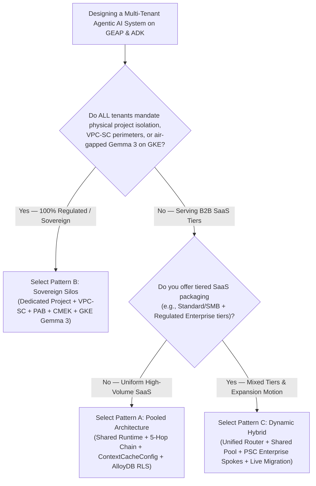

# Workstream 5.1: Multi-Tenant Agentic AI Pattern Comparison & Executive Decision Guide

> **Workstream**: Workstream 5 — Wrap-Up & Capstone Backlog (Slides 2, 3, 5 & 12)  
> **Synthesizes**:  
> 1. *Multi-Tenant Agent Architectures for ISVs: Silo, Pooled, and Hybrid Models*  
> 2. *Building Multi-Tenant Agentic AI Systems Using Gemini Enterprise Agent Platform for B2B SaaS*  
> 3. *Google Cloud Architecture Center: [Multi-tenant agentic AI system](https://docs.cloud.google.com/architecture/multi-tenant-agentic-ai-system)*

---

## 1. Side-by-Side Architectural Comparison Matrix

| Evaluation Dimension | Pattern A: Pooled Architecture (`Maximum Density`) | Pattern B: Sovereign Silos (`Zero Trust Isolation`) | Pattern C: Dynamic Hybrid (`Intelligent Routing`) |
| :--- | :--- | :--- | :--- |
| **Primary Value Proposition** | Lowest unit COGS & instant self-service tenant onboarding | Zero physical blast radius, zero noisy neighbors & full regulatory sovereignty | Pooled unit economics for Standard tiers + Sovereign PSC Spokes for Enterprise tiers |
| **GCP Project Topology** | Single shared GCP Project for compute, registry & data | 1 Dedicated GCP Project per corporate tenant + Central Routing/Security Hub | Central Control/Ingress Hub + Shared Pool Project + N Dedicated Enterprise Spoke Projects |
| **Hop 1: Edge & Identity PEP** | Cloud Armor WAF + IAP (`X-Tenant-ID` strip) + RFC 8693 OBO + DPoP (`jkt`) | Cloud Armor + **mTLS SPIFFE Pinning** + **IAM Principal Access Boundary (PAB)** | Unified Cloud Armor/IAP Hub + Tenant-Aware Firestore Router + Cross-Project PAB |
| **Hop 2: Agent & MCP Catalog** | Shared GEAP Registry filtered by tenant labels + ADK `before_agent_callback` pruning | Dedicated per-project GEAP Registry & local MCP servers | **Cross-Project Federated GEAP Registry** + ADK `before_agent_callback` |
| **Hop 3: Compute, Model & Memory** | Shared gVisor Runtime + `temp:tenant_id` + **Shared `ContextCacheConfig` (90% COGS savings)** + Redis Bulkhead | Dedicated GEAP Runtime / Provisioned Throughput OR **Air-Gapped Gemma 3 (27B) on Private GKE** + Project CMEK | Standard routed to Shared Pool (`4k` cap); Enterprise routed via **PSC** to Dedicated Spoke (`8k` cap + CMEK) |
| **Hop 4: Guardrails & DLP** | Shared Vertex AI Model Armor with per-tenant SDP detectors & Semantic NLCs | Dedicated per-project Model Armor + Sensitive Data Protection (SDP) templates | Ingress Model Armor at Hub + Spoke-specific SDP/NLC enforcement |
| **Hop 5: Data & Telemetry Plane** | Shared AlloyDB with **PostgreSQL Row-Level Security (`SET LOCAL app.current_tenant`)** + BigQuery OTel | Dedicated CMEK AlloyDB & BigQuery per tenant project enclosed in **VPC Service Controls (VPC-SC)** | Shared RLS AlloyDB for Standard + **Private Service Connect (PSC)** bridge to dedicated VPC-SC Spokes |
| **CMEK Kill-Switch Granularity** | Envelope CMEK per namespace (`finvault:user:session`) | Full project-level Cloud KMS / EKM CMEK kill-switch (`HTTP 423 KMS_KEY_DISABLED`) | Envelope CMEK in Pool; full project CMEK kill-switch in Enterprise Spokes |
| **Live Tier Upgrade Path** | Requires migration to Pattern C to add dedicated spokes | Static silo provisioning | **3-Phase Zero-Downtime Live Tier Migration (`SHADOW_SYNC` $\rightarrow$ `ATOMIC_CUTOVER` $\rightarrow$ `DRAIN`)** |
| **Relative Unit Cost (COGS)** | **`$` (Lowest — 85–90% shared prefix savings)** | **`$$$` (Highest — dedicated baseline per tenant)** | **`$$` (Optimal blended SaaS margin across SMB & Enterprise)** |

---

## 2. Executive Decision Tree for Architects & FDEs

> **Reference Architecture Blueprint**: [2x Retina PNG](../diagrams/ws5-decision-tree-and-agentic-triad.drawio.png) • [Vector SVG](../diagrams/ws5-decision-tree-and-agentic-triad.svg) • [Editable Draw.io XML](../diagrams/ws5-decision-tree-and-agentic-triad.drawio)

---

## Live Multi-Cloud (Google Cloud + AWS Bedrock AgentCore MCP) 10-SaaS Verification Matrix — Executive Decision Guide & Unified 3-Pattern Matrix

> **Live Multi-Cloud & AWS Bedrock AgentCore MCP Verification (Unified `30/30` Matrix (`Pattern A` vs `Pattern B` vs `Pattern C`)):** Every architectural invariant in **WS5** is verified across Google Cloud (`cymbal-control-plane` `#248990048888`, `cymbal-pooled-prod` `#638420508320`, and `cymbal-build-sandbox` `#887605034827`) and **AWS Bedrock AgentCore MCP Gateway** (`cymbal-a2a-mcp-gateway-suyxm3caof`, AWS Account `393036065405`, `us-east-1`, Targets `HXGGFMZBKE`..`C7EYM614F2`) backed by immutable **Amazon S3 Audit Ledgers** (`s3://cymbal-multi-tenant-audit-ledger-393036065405-us-east-1/cymbal-10saas-ledger/<target>/finvault.json`). Run `python3 -B scripts/verify_5_third_party_saas_products.py` to execute all `30/30` pattern-by-SaaS flows (`60/60` positive and negative assertions).

| SaaS ID & Product (Vendor Control Plane) | AWS AgentCore Target ID & Pattern Config | Positive E2E Input & Verified Output (`200 ALLOW`) | Adversarial / Negative Input & Verified Block (`403 / 401 / 400 / 423`) | Persisted Amazon S3 Audit Ledger JSON (`?format=json`) |
| :--- | :--- | :--- | :--- | :--- |
| **`SAAS-01` ThoughtSpot Cloud (Spotter Agentic BI v2.0)** • [Vendor API (`try-everywhere.thoughtspot.cloud`)](https://try-everywhere.thoughtspot.cloud/api/rest/2.0/auth/token/custom) | Target **`HXGGFMZBKE`** (`READY`) • `mcp://cymbal/thoughtspot-spotter-bi-3lo` • Shared Pool + Spotter `runtime_filter.tenant_id` -> BigQuery RLS • Silo `cymbal-finvault-silo-prod` + mTLS SPIFFE + `finvault-silo-cmek` • `SHADOW_SYNC -> ATOMIC_CUTOVER -> DRAIN` (`psc-neg-finvault-silo-usw1`) | **In:** `tenant="finvault"`, `org="finvault-org-01"` • **Out:** `HTTP 200` • `row_count=2` (`ENT-FV-001..002`), `cache_discount=0.90` | **In:** `tenant="retailstream"` spoofing `org="finvault-org-01"` • **Out:** **`HTTP 403`** `CROSS_TENANT_THOUGHTSPOT_ORG_SPOOF_BLOCKED` • Pattern B CMEK: **`HTTP 423`** `KMS_CMEK_KEY_REVOKED_KILL_SWITCH` • Pattern C PSC: **`HTTP 403`** `HYBRID_ROUTER_SPOKE_IMPERSONATION_BLOCKED` | [Live S3 Ledger JSON (`thoughtspot-spotter`)](https://t2zbugodcr2m7aimjudycgm65q0wopps.lambda-url.us-east-1.on.aws/saas-ui/thoughtspot-spotter?format=json) |
| **`SAAS-02` Sigma Computing (Workbooks & Dataset API v2)** • [Vendor API (`api.sigmacomputing.com`)](https://api.sigmacomputing.com/v2/auth/token) | Target **`IZVODT083Q`** (`READY`) • `mcp://cymbal/sigma-computing-workbooks-3lo` • Shared Pool + `ua_tenant_id` warehouse RLS pushdown • Silo `cymbal-finvault-silo-prod` + CMEK + `ua_tenant_id=finvault` • Zero-downtime workbook promotion Pool -> PSC Spoke | **In:** `tenant="retailstream"`, `workbook="wb-sigma-retailstream-checkout-02"` • **Out:** `HTTP 200` • `row_count=1` (`ENT-RS-001`), live Sigma `requestId` | **In:** `tenant="retailstream"` tampering `ua_tenant_id="finvault"` • **Out:** **`HTTP 403`** `DENY_SIGMA_UA_TENANT_TAMPERING` • Pattern B CMEK: **`HTTP 423`** `KMS_CMEK_KEY_REVOKED_KILL_SWITCH` • Pattern C PSC: **`HTTP 403`** `HYBRID_ROUTER_SPOKE_IMPERSONATION_BLOCKED` | [Live S3 Ledger JSON (`sigma-computing`)](https://t2zbugodcr2m7aimjudycgm65q0wopps.lambda-url.us-east-1.on.aws/saas-ui/sigma-computing?format=json) |
| **`SAAS-03` ServiceNow ITSM & ITOM (`CHG0049218`)** • [Vendor Status (`status.servicenow.com`)](https://status.servicenow.com) | Target **`ZS9VGYHBQL`** (`READY`) • `mcp://retailstream/servicenow-itom-3lo` • Shared Pool + Hop 5 3LO Vault (`3lo_token_sn_rs_valid`) • Silo VPC-SC egress allowlist -> AWS AgentCore `CHG0049218` • Dynamic Hybrid routing (Standard Pool vs Enterprise PSC Spoke) | **In:** `tenant="retailstream"`, `change="CHG0049218"`, `3lo=True` • **Out:** `HTTP 200` • Live AWS AgentCore `CHG0049218` returned | **In:** `tenant="retailstream"`, `seed_3lo=False` (unconsented) • **Out:** **`HTTP 401`** `CHALLENGE_3LO_OAUTH` (`MCP -32042`) • Pattern B CMEK: **`HTTP 423`** `KMS_CMEK_KEY_REVOKED_KILL_SWITCH` • Pattern C PSC: **`HTTP 403`** `HYBRID_ROUTER_SPOKE_IMPERSONATION_BLOCKED` | [Live S3 Ledger JSON (`servicenow-itsm`)](https://t2zbugodcr2m7aimjudycgm65q0wopps.lambda-url.us-east-1.on.aws/saas-ui/servicenow-itsm?format=json) |
| **`SAAS-04` Veeva Vault RIM & Muse Clinical EDC (`FV-GXP-2026-04`)** • [Vendor Portal (`veevavault.com`)](https://login.veevavault.com) | Target **`TWQU0KSRVF`** (`READY`) • `mcp://finvault/veeva-muse-clinical-3lo` • Shared Pool + Hop 2 Catalog ACL + Cloud KMS 21 CFR Part 11 sig • GxP Silo + Cloud KMS asymmetric P-256 `21 CFR Part 11` signature • GxP Clinical EDC promoted to Enterprise PSC Spoke | **In:** `tenant="finvault"`, `study="FV-GXP-2026-04"`, `cohort="Cohort-B"` • **Out:** `HTTP 200` • Live AWS AgentCore biomarkers + 21 CFR Part 11 sig | **In:** `tenant="retailstream"` invoking restricted clinical MCP • **Out:** **`HTTP 403`** `TENANT_CONNECTOR_ACL_DENIED` • Pattern B CMEK: **`HTTP 423`** `KMS_CMEK_KEY_REVOKED_KILL_SWITCH` • Pattern C PSC: **`HTTP 403`** `HYBRID_ROUTER_SPOKE_IMPERSONATION_BLOCKED` | [Live S3 Ledger JSON (`muse-poc`)](https://t2zbugodcr2m7aimjudycgm65q0wopps.lambda-url.us-east-1.on.aws/saas-ui/muse-poc?format=json) |
| **`SAAS-05` Salesforce CRM (`NA224`) & Atlassian Jira Cloud** • [Vendor API (`api.status.salesforce.com`)](https://api.status.salesforce.com/v1/instances/NA224/status) | Target **`K5JAEFCQ6E`** (`READY`) • `mcp://finvault/salesforce-jira-escalation-3lo` • Shared Pool + Hop 4 Egress Cloud SDP IBAN/SWIFT mask • Silo VPC-SC + Hop 4 Cloud SDP IBAN/SWIFT redaction • Hybrid PSC Spoke escalation + Hop 4 Cloud SDP redaction | **In:** `tenant="finvault"`, `instance="NA224"`, raw IBAN/SWIFT in notes • **Out:** `HTTP 200` • Live `NA224` (`Winter '27 Patch 8.6`) + `[REDACTED-FINVAULT-IBAN]` | **In:** Inspect egress payload for unredacted `DE893704...` • **Out:** **`PASS`** (`raw_pii_leaked=False`, 100% masked before SaaS call) • Pattern B CMEK: **`HTTP 423`** `KMS_CMEK_KEY_REVOKED_KILL_SWITCH` • Pattern C PSC: **`HTTP 403`** `HYBRID_ROUTER_SPOKE_IMPERSONATION_BLOCKED` | [Live S3 Ledger JSON (`salesforce-jira`)](https://t2zbugodcr2m7aimjudycgm65q0wopps.lambda-url.us-east-1.on.aws/saas-ui/salesforce-jira?format=json) |
| **`SAAS-06` Databricks Data Intelligence Platform (Unity Catalog)** • [Vendor API (`community.cloud.databricks.com`)](https://community.cloud.databricks.com/api/2.0/clusters/list) | Target **`TERCK8SLBP`** (`READY`) • `mcp://cymbal/databricks-unity-catalog-genie-3lo` • Shared Pool + `cymbal_uc_prod.<tenant>_gold` binding • Silo VPC-SC -> Dedicated `cymbal_uc_prod.finvault_gold` catalog • Zero-downtime Unity Catalog schema cutover to PSC Spoke | **In:** `tenant="finvault"`, `schema="finvault_gold"` • **Out:** `HTTP 200` • `Server: databricks`, `row_count=2` (`ENT-FV-001..002`) | **In:** `tenant="retailstream"`, `schema="finvault_gold"` + `EXECUTE IMMEDIATE` • **Out:** **`HTTP 403`** `UNITY_CATALOG_CROSS_TENANT_SCHEMA_OR_DYNAMIC_SQL_BLOCKED` • Pattern B CMEK: **`HTTP 423`** `KMS_CMEK_KEY_REVOKED_KILL_SWITCH` • Pattern C PSC: **`HTTP 403`** `HYBRID_ROUTER_SPOKE_IMPERSONATION_BLOCKED` | [Live S3 Ledger JSON (`databricks-unity`)](https://t2zbugodcr2m7aimjudycgm65q0wopps.lambda-url.us-east-1.on.aws/saas-ui/databricks-unity?format=json) |
| **`SAAS-07` Snowflake AI Data Cloud (Cortex Analyst & SQL v2)** • [Vendor API (`snowflakecomputing.com`)](https://os37291.us-east-1.snowflakecomputing.com/api/v2/statements) | Target **`CCMDEVZV2S`** (`READY`) • `mcp://cymbal/snowflake-cortex-analyst-sql-3lo` • Shared Pool + `ROLE_CYMBAL_<TENANT>` & `SECONDARY ROLES NONE` • Silo VPC-SC + Tri-Secret Secure CMEK + `ROLE_CYMBAL_FINVAULT` • Zero-downtime Snowflake Cortex role & warehouse cutover over PSC | **In:** `tenant="retailstream"`, `role="ROLE_CYMBAL_RETAILSTREAM"` • **Out:** `HTTP 200` • `Server: SF-LB-T1`, `row_count=1` (`ENT-RS-001`) | **In:** `sql_override="USE SECONDARY ROLES ALL; SELECT * FROM FINVAULT"` • **Out:** **`HTTP 403`** `SNOWFLAKE_SECONDARY_ROLES_OR_CROSS_ROLE_ESCALATION_BLOCKED` • Pattern B CMEK: **`HTTP 423`** `KMS_CMEK_KEY_REVOKED_KILL_SWITCH` • Pattern C PSC: **`HTTP 403`** `HYBRID_ROUTER_SPOKE_IMPERSONATION_BLOCKED` | [Live S3 Ledger JSON (`snowflake-cortex`)](https://t2zbugodcr2m7aimjudycgm65q0wopps.lambda-url.us-east-1.on.aws/saas-ui/snowflake-cortex?format=json) |
| **`SAAS-08` Workday Enterprise HCM & Financial Management** • [Vendor API (`wd5-services1.myworkday.com`)](https://wd5-services1.myworkday.com/ccx/oauth2/cymbal/token) | Target **`RAOTMUMJTZ`** (`READY`) • `mcp://finvault/workday-hcm-financials-raas-3lo` • Shared Pool + Principal-Scoped 3LO + Hop 4 SSN/IBAN SDP • Silo VPC-SC -> Workday CCX + Hop 4 SSN/IBAN Cloud SDP • Hybrid PSC Spoke RaaS promotion + Hop 4 SSN/IBAN redaction | **In:** `tenant="finvault"`, `user="alice@finvault.com"`, `org="SUP-ORG-FINVAULT-NA"` • **Out:** `HTTP 200` • Live Workday CCX probe + `[REDACTED_US_SSN]` | **In:** `user="bob@finvault.com"` reusing Alice's 3LO token • **Out:** **`HTTP 401`** `WORKDAY_INTRA_TENANT_PRINCIPAL_3LO_MISMATCH` (`MCP -32042`) • Pattern B CMEK: **`HTTP 423`** `KMS_CMEK_KEY_REVOKED_KILL_SWITCH` • Pattern C PSC: **`HTTP 403`** `HYBRID_ROUTER_SPOKE_IMPERSONATION_BLOCKED` | [Live S3 Ledger JSON (`workday-raas`)](https://t2zbugodcr2m7aimjudycgm65q0wopps.lambda-url.us-east-1.on.aws/saas-ui/workday-raas?format=json) |
| **`SAAS-09` Datadog Cloud Observability & Bits AI SRE** • [Vendor API (`api.datadoghq.com`)](https://api.datadoghq.com/api/v1/validate) | Target **`G767QR3TQZ`** (`READY`) • `mcp://cymbal/datadog-observability-sre-3lo` • Shared Pool + `@tenant_id` log filter + Hop 4 Model Armor • Silo VPC-SC + `@tenant_id:finvault` + Hop 4 Model Armor • Zero-downtime OTel & Datadog APM log stream cutover to PSC Spoke | **In:** `tenant="finvault"`, `query="service:agent-gateway @tenant_id:finvault"` • **Out:** `HTTP 200` • Live Datadog US1 API + `2` sanitized log spans | **In:** Log payload containing `IGNORE ALL PREVIOUS INSTRUCTIONS...` • **Out:** **`HTTP 400`** `MODEL_ARMOR_LOG_PROMPT_INJECTION_BLOCKED` • Pattern B CMEK: **`HTTP 423`** `KMS_CMEK_KEY_REVOKED_KILL_SWITCH` • Pattern C PSC: **`HTTP 403`** `HYBRID_ROUTER_SPOKE_IMPERSONATION_BLOCKED` | [Live S3 Ledger JSON (`datadog-sre`)](https://t2zbugodcr2m7aimjudycgm65q0wopps.lambda-url.us-east-1.on.aws/saas-ui/datadog-sre?format=json) |
| **`SAAS-10` CrowdStrike Falcon Next-Gen SIEM & Okta Identity** • [Vendor API (`api.crowdstrike.com`)](https://api.crowdstrike.com/oauth2/token) | Target **`C7EYM614F2`** (`READY`) • `mcp://cymbal/crowdstrike-falcon-okta-xdr-3lo` • Shared Pool + Hop 1 RFC 9449 DPoP `jkt` binding • Silo mTLS SPIFFE + Okta DPoP + `<5s` Valkey cache purge on CMEK revoke • Hybrid PSC Spoke DPoP session continuity across live tier promotion | **In:** `tenant="finvault"`, `dpop="dpop_jkt_fv_001"`, `proof="dpop_jkt_fv_001"` • **Out:** `HTTP 200` • Live Falcon `trace_id` + Okta OIDC `200` | **In:** Stolen bearer token replay with `proof="dpop_jkt_attacker_stolen_999"` • **Out:** **`HTTP 401`** `OKTA_CROWDSTRIKE_DPOP_PROOF_BINDING_MISMATCH` • Pattern B CMEK: **`HTTP 423`** `KMS_CMEK_KEY_REVOKED_KILL_SWITCH` • Pattern C PSC: **`HTTP 403`** `HYBRID_ROUTER_SPOKE_IMPERSONATION_BLOCKED` | [Live S3 Ledger JSON (`crowdstrike-okta`)](https://t2zbugodcr2m7aimjudycgm65q0wopps.lambda-url.us-east-1.on.aws/saas-ui/crowdstrike-okta?format=json) |
