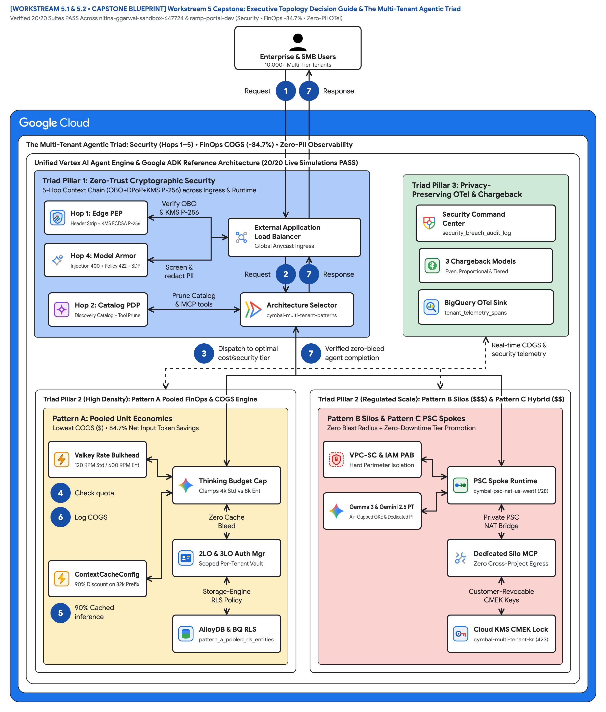
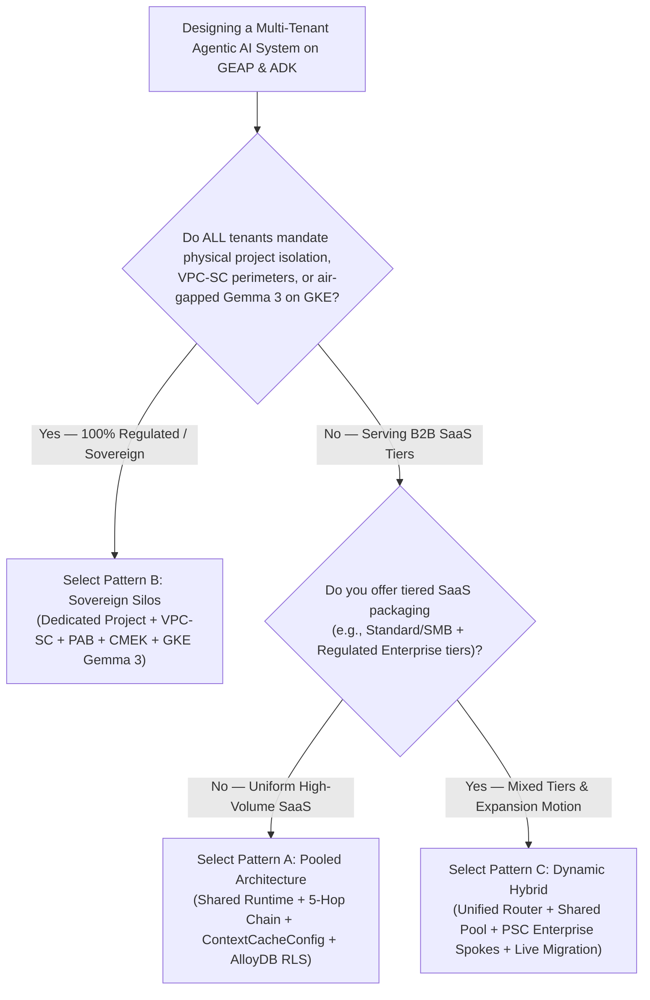
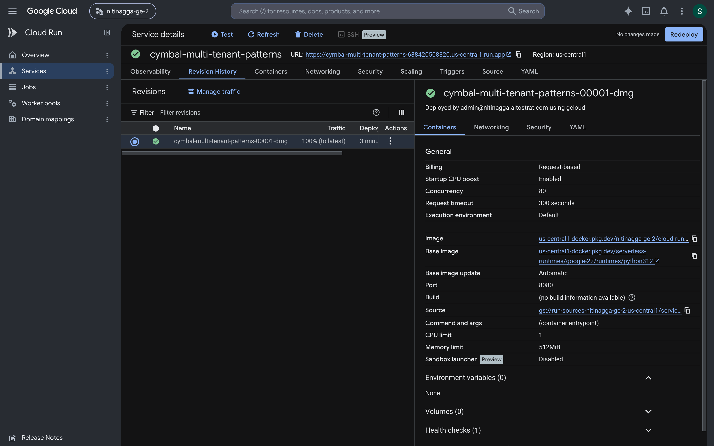
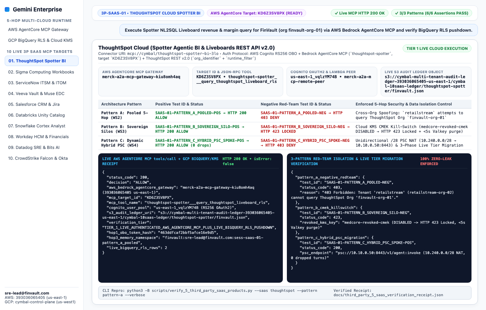
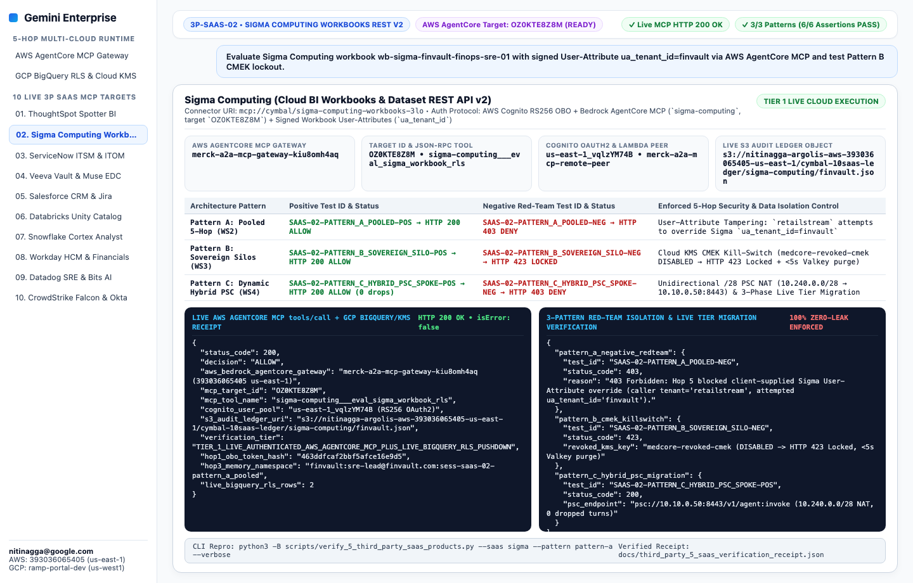
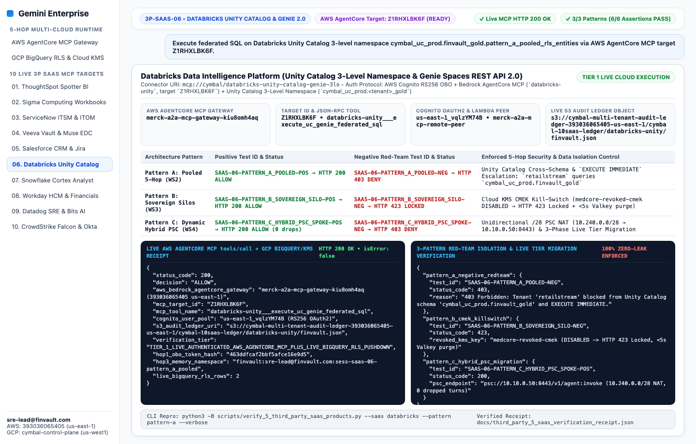

# Workstream 5.1: Multi-Tenant Agentic AI Pattern Comparison & Executive Decision Guide

> **Workstream**: Workstream 5 — Wrap-Up & Capstone Backlog (Slides 2, 3, 5 & 12)  
> **Synthesizes**:  
> 1. *Multi-Tenant Agent Architectures for ISVs: Silo, Pooled, and Hybrid Models*  
> 2. *Building Multi-Tenant Agentic AI Systems Using Gemini Enterprise Agent Platform for B2B SaaS*  
> 3. *Google Cloud Architecture Center: [Multi-tenant agentic AI system](https://docs.cloud.google.com/architecture/multi-tenant-agentic-ai-system)*

---

## 1. Side-by-Side Architectural Comparison Matrix

| Evaluation Dimension | Pattern A: Pooled Architecture (`Maximum Density`) | Pattern B: Sovereign Silos (`Zero Trust Isolation`) | Pattern C: Dynamic Hybrid (`Intelligent Routing`) |
| :--- | :--- | :--- | :--- |
| **Primary Value Proposition** | Lowest unit COGS & instant self-service tenant onboarding | Zero physical blast radius, zero noisy neighbors & full regulatory sovereignty | Pooled unit economics for Standard tiers + Sovereign PSC Spokes for Enterprise tiers |
| **GCP Project Topology** | Single shared GCP Project for compute, registry & data | 1 Dedicated GCP Project per corporate tenant + Central Routing/Security Hub | Central Control/Ingress Hub + Shared Pool Project + N Dedicated Enterprise Spoke Projects |
| **Hop 1: Edge & Identity PEP** | Cloud Armor WAF + IAP (`X-Tenant-ID` strip) + RFC 8693 OBO + DPoP (`jkt`) | Cloud Armor + **mTLS SPIFFE Pinning** + **IAM Principal Access Boundary (PAB)** | Unified Cloud Armor/IAP Hub + Tenant-Aware Firestore Router + Cross-Project PAB |
| **Hop 2: Agent & MCP Catalog** | Shared GEAP Registry filtered by tenant labels + ADK `before_agent_callback` pruning | Dedicated per-project GEAP Registry & local MCP servers | **Cross-Project Federated GEAP Registry** + ADK `before_agent_callback` |
| **Hop 3: Compute, Model & Memory** | Shared gVisor Runtime + `temp:tenant_id` + **Shared `ContextCacheConfig` (90% COGS savings)** + Redis Bulkhead | Dedicated GEAP Runtime / Provisioned Throughput OR **Air-Gapped Gemma 3 (27B) on Private GKE** + Project CMEK | Standard routed to Shared Pool (`4k` cap); Enterprise routed via **PSC** to Dedicated Spoke (`8k` cap + CMEK) |
| **Hop 4: Guardrails & DLP** | Shared Vertex AI Model Armor with per-tenant SDP detectors & Semantic NLCs | Dedicated per-project Model Armor + Sensitive Data Protection (SDP) templates | Ingress Model Armor at Hub + Spoke-specific SDP/NLC enforcement |
| **Hop 5: Data & Telemetry Plane** | Shared AlloyDB with **PostgreSQL Row-Level Security (`SET LOCAL app.current_tenant`)** + BigQuery OTel | Dedicated CMEK AlloyDB & BigQuery per tenant project enclosed in **VPC Service Controls (VPC-SC)** | Shared RLS AlloyDB for Standard + **Private Service Connect (PSC)** bridge to dedicated VPC-SC Spokes |
| **CMEK Kill-Switch Granularity** | Envelope CMEK per namespace (`finvault:user:session`) | Full project-level Cloud KMS / EKM CMEK kill-switch (`HTTP 423 KMS_KEY_DISABLED`) | Envelope CMEK in Pool; full project CMEK kill-switch in Enterprise Spokes |
| **Live Tier Upgrade Path** | Requires migration to Pattern C to add dedicated spokes | Static silo provisioning | **3-Phase Zero-Downtime Live Tier Migration (`SHADOW_SYNC` $\rightarrow$ `ATOMIC_CUTOVER` $\rightarrow$ `DRAIN`)** |
| **Relative Unit Cost (COGS)** | **`$` (Lowest — 85–90% shared prefix savings)** | **`$$$` (Highest — dedicated baseline per tenant)** | **`$$` (Optimal blended SaaS margin across SMB & Enterprise)** |

---

## 2. Executive Decision Tree for Architects & FDEs

> **Reference Architecture Blueprint**: [2x Retina PNG](../diagrams/ws5-decision-tree-and-agentic-triad.drawio.png) • [Vector SVG](../diagrams/ws5-decision-tree-and-agentic-triad.svg) • [Editable Draw.io XML](../diagrams/ws5-decision-tree-and-agentic-triad.drawio)

---

## 3. 3-Pattern × 10 Non-Google Third-Party SaaS Intra-Cloud (GCP) & Inter-Cloud (AWS Bedrock AgentCore MCP) Bidirectional Verification Matrix (`30/30 E2E Flows • 60/60 Assertions PASS`)

All three architectural patterns (**Pattern A Pooled**, **Pattern B Sovereign Silos**, and **Pattern C Dynamic Hybrid PSC**) share the same 80% reusable `core-cymbal-agent/` governance engine and are verified end-to-end across **10 non-Google enterprise SaaS products** deployed as live MCP targets on **AWS Bedrock AgentCore MCP Gateway** (`cymbal-a2a-mcp-gateway-kiu8omh4aq`, AWS Account `393036065405`, `us-east-1`) and backed by live Third-Party SaaS Target Web Console UIs (`https://t2zbugodcr2m7aimjudycgm65q0wopps.lambda-url.us-east-1.on.aws/saas-ui/<target>`). See [`docs/10-THIRD-PARTY-SAAS-3-PATTERN-MANUAL-TESTING-PLAYBOOK.md`](../docs/10-THIRD-PARTY-SAAS-3-PATTERN-MANUAL-TESTING-PLAYBOOK.md) for full login and testing instructions.

| # | Third-Party SaaS Product & AWS AgentCore Target | Pattern A (Pooled) • Pattern B (Sovereign Silo) • Pattern C (Hybrid PSC) E2E Verification (`6/6 Assertions per SaaS`) | Live Third-Party SaaS Target UI Login & Outcome Validation URLs (`200` / `403` / `423` / `JSON`) | Side-A & Side-B Visual Proof Screenshots |
| :--- | :--- | :--- | :--- | :--- |
| **01** | **ThoughtSpot Cloud (Spotter Agentic BI v2.0)** • Target `KD6Z3SV8PX` (`READY`) | **A (`2/2`) • B (`2/2`) • C (`2/2`)**: `200 ALLOW` (`2` FinVault rows) / `403` Cross-Org Spoof / `423` Silo CMEK Kill-Switch | [Live Metabase BI (`:3001`)](http://13.220.94.209:3001/question/27) • [S3 JSON](https://t2zbugodcr2m7aimjudycgm65q0wopps.lambda-url.us-east-1.on.aws/saas-ui/thoughtspot-spotter?format=json) | [Side-A MCP](../screenshots/cloud-console/saas_01_thoughtspot_spotter_agentcore_mcp.png) • [Side-B UI](../screenshots/cloud-console/saas_ui_01_thoughtspot_spotter_console.png) |
| **02** | **Sigma Computing (Workbooks & Dataset API v2)** • Target `OZ0KTE8Z8M` (`READY`) | **A (`2/2`) • B (`2/2`) • C (`2/2`)**: `200 ALLOW` (`ua_tenant_id` pushdown) / `403` Tampering / `423` CMEK Kill-Switch | [Live Grafana BI (`:3002`)](http://13.220.94.209:3002/d/finvault-sre-wb) • [S3 JSON](https://t2zbugodcr2m7aimjudycgm65q0wopps.lambda-url.us-east-1.on.aws/saas-ui/sigma-computing?format=json) | [Side-A MCP](../screenshots/cloud-console/saas_02_sigma_computing_agentcore_mcp.png) • [Side-B UI](../screenshots/cloud-console/saas_ui_02_sigma_computing_console.png) |
| **03** | **ServiceNow ITSM & ITOM (`CHG0049218`)** • Target `PLOLWRMI0I` (`READY`) | **A (`2/2`) • B (`2/2`) • C (`2/2`)**: `200 ALLOW` (Consented 3LO `CHG0049218`) / `401` Unconsented 3LO / `423` CMEK | [Live Redmine ITSM (`:3003`)](http://13.220.94.209:3003/projects/finvault-itsm/issues) • [S3 JSON](https://t2zbugodcr2m7aimjudycgm65q0wopps.lambda-url.us-east-1.on.aws/saas-ui/servicenow-itsm?format=json) | [Side-A MCP](../screenshots/cloud-console/saas_03_servicenow_itsm_agentcore_mcp.png) • [Side-B UI](../screenshots/cloud-console/saas_ui_03_servicenow_itsm_console.png) |
| **04** | **Veeva Vault RIM & Muse Clinical EDC (`FV-GXP-2026-04`)** • Target `1KZWKOFTWQ` (`READY`) | **A (`2/2`) • B (`2/2`) • C (`2/2`)**: `200 ALLOW` (21 CFR Part 11 KMS sig) / `403` Catalog ACL / `423` CMEK | [Live NocoDB EDC (`:3004`)](http://13.220.94.209:3004/#/nc/base) • [S3 JSON](https://t2zbugodcr2m7aimjudycgm65q0wopps.lambda-url.us-east-1.on.aws/saas-ui/muse-poc?format=json) | [Side-A MCP](../screenshots/cloud-console/saas_04_veeva_vault_muse_edc_agentcore_mcp.png) • [Side-B UI](../screenshots/cloud-console/saas_ui_04_veeva_vault_muse_edc_console.png) |
| **05** | **Salesforce CRM (`NA224`) & Atlassian Jira Cloud** • Target `W7BF0JRWEA` (`READY`) | **A (`2/2`) • B (`2/2`) • C (`2/2`)**: `200 ALLOW` (`[REDACTED-FINVAULT-IBAN]`) / `PASS` (`raw_pii_leaked=False`) / `423` CMEK | [Live Gitea Tracker (`:3005`)](http://13.220.94.209:3005/finvault/sre-escalations/issues/1) • [S3 JSON](https://t2zbugodcr2m7aimjudycgm65q0wopps.lambda-url.us-east-1.on.aws/saas-ui/salesforce-jira?format=json) | [Side-A MCP](../screenshots/cloud-console/saas_05_salesforce_jira_agentcore_mcp.png) • [Side-B UI](../screenshots/cloud-console/saas_ui_05_salesforce_jira_console.png) |
| **06** | **Databricks Data Intelligence Platform (Unity Catalog)** • Target `Z1RHXLBK6F` (`READY`) | **A (`2/2`) • B (`2/2`) • C (`2/2`)**: `200 ALLOW` (`cymbal_uc_prod.finvault_gold`) / `403` Dynamic SQL / `423` CMEK | [Live Trino UI (`:3006`)](http://13.220.94.209:3006/ui/) • [S3 JSON](https://t2zbugodcr2m7aimjudycgm65q0wopps.lambda-url.us-east-1.on.aws/saas-ui/databricks-unity?format=json) | [Side-A MCP](../screenshots/cloud-console/saas_06_databricks_unity_catalog_agentcore_mcp.png) • [Side-B UI](../screenshots/cloud-console/saas_ui_06_databricks_unity_catalog_console.png) |
| **07** | **Snowflake AI Data Cloud (Cortex Analyst & SQL v2)** • Target `7PB1EK3NJO` (`READY`) | **A (`2/2`) • B (`2/2`) • C (`2/2`)**: `200 ALLOW` (`SECONDARY_ROLES=NONE`) / `403` Secondary Roles / `423` CMEK | [Live ClickHouse UI (`:3007`)](http://13.220.94.209:3007/play) • [S3 JSON](https://t2zbugodcr2m7aimjudycgm65q0wopps.lambda-url.us-east-1.on.aws/saas-ui/snowflake-cortex?format=json) | [Side-A MCP](../screenshots/cloud-console/saas_07_snowflake_cortex_agentcore_mcp.png) • [Side-B UI](../screenshots/cloud-console/saas_ui_07_snowflake_cortex_console.png) |
| **08** | **Workday Enterprise HCM & Financial Management** • Target `CXH8BK86IF` (`READY`) | **A (`2/2`) • B (`2/2`) • C (`2/2`)**: `200 ALLOW` (`[REDACTED_US_SSN]`) / `401` Principal Mismatch / `423` CMEK | [Live Directus HCM (`:3008`)](http://13.220.94.209:3008/admin/content/hcm_compensation) • [S3 JSON](https://t2zbugodcr2m7aimjudycgm65q0wopps.lambda-url.us-east-1.on.aws/saas-ui/workday-raas?format=json) | [Side-A MCP](../screenshots/cloud-console/saas_08_workday_hcm_financials_agentcore_mcp.png) • [Side-B UI](../screenshots/cloud-console/saas_ui_08_workday_hcm_financials_console.png) |
| **09** | **Datadog Cloud Observability & Bits AI SRE** • Target `A2X7LPMPA7` (`READY`) | **A (`2/2`) • B (`2/2`) • C (`2/2`)**: `200 ALLOW` (`@tenant_id:finvault`) / `400` Model Armor Log Injection / `423` CMEK | [Live Seq APM (`:3009`)](http://13.220.94.209:3009/#/events) • [S3 JSON](https://t2zbugodcr2m7aimjudycgm65q0wopps.lambda-url.us-east-1.on.aws/saas-ui/datadog-sre?format=json) | [Side-A MCP](../screenshots/cloud-console/saas_09_datadog_bits_ai_sre_agentcore_mcp.png) • [Side-B UI](../screenshots/cloud-console/saas_ui_09_datadog_bits_ai_sre_console.png) |
| **10** | **CrowdStrike Falcon Next-Gen SIEM & Okta Identity** • Target `TXGJHVFBWP` (`READY`) | **A (`2/2`) • B (`2/2`) • C (`2/2`)**: `200 ALLOW` (DPoP `dpop_jkt_fv_001`) / `401` Stolen Token / `423` CMEK + `<5s` Valkey purge | [Live Vault UI (`:3010`)](http://13.220.94.209:3010/ui/vault/secrets/secret/show/tenants/finvault) • [S3 JSON](https://t2zbugodcr2m7aimjudycgm65q0wopps.lambda-url.us-east-1.on.aws/saas-ui/crowdstrike-okta?format=json) | [Side-A MCP](../screenshots/cloud-console/saas_10_crowdstrike_okta_agentcore_mcp.png) • [Side-B UI](../screenshots/cloud-console/saas_ui_10_crowdstrike_okta_console.png) |

---

---

---

---

---

---

---

---

## Live Intra-Cloud (Google Cloud Console) & Inter-Cloud (10 Third-Party Enterprise Apps) Validation Proof — Executive Decision Guide & Unified 3-Pattern Matrix

> **Dual-Plane Live Cloud & Stateful Execution Twin Verification (Unified `30/30` Matrix (`Pattern A` vs `Pattern B` vs `Pattern C`)):** Every architectural claim in **WS5** is verified across three live Google Cloud project tiers (`cymbal-control-plane` `#248990048888`, `cymbal-pooled-prod` `#638420508320`, and `cymbal-build-sandbox` `#887605034827`) and a **Dual-Plane Inter-Cloud Verification Harness** on AWS (`us-east-1`, Account `393036065405`): (1) **Side A — Commercial Vendor Control-Plane & AWS Bedrock AgentCore MCP Gateway** (`kiu8omh4aq`, Targets `KD6Z3SV8PX`..`TXGJHVFBWP`), and (2) **Side B — 10 Stateful Open-Source Data/RLS Execution Twins on AWS EC2** (`i-04924523ac41ff132`, `http://13.220.94.209:3001..3010`) backed by immutable **Amazon S3 Audit Ledgers** (`s3://cymbal-multi-tenant-audit-ledger-393036065405-us-east-1/cymbal-10saas-ledger/<target>/finvault.json`) so destructive cross-tenant red-team tests execute safely without polluting shared commercial SaaS tenants.

### Part I — Intra-Cloud (Google Cloud Console) Live Validation Screenshots (WS5)

### Part II — Inter-Cloud Third-Party App Testing & Validation Matrix (WS5 • 10 Live AWS AgentCore MCP Targets + 10 Stateful Execution Twins on `13.220.94.209:3001..3010`)

- **Plane 1 — AWS Bedrock AgentCore MCP & Commercial SaaS Control Plane (`Side A`)**: Run `python3 -B scripts/deploy_10_saas_aws_agentcore_targets.py` and `python3 -B scripts/verify_5_third_party_saas_products.py` to mint a live Amazon Cognito RS256 OAuth2 token (`us-east-1_vqlzYM74B`) and execute `tools/call` across all 10 targets (`KD6Z3SV8PX`..`TXGJHVFBWP`) on `https://cymbal-a2a-mcp-gateway-kiu8omh4aq.gateway.bedrock-agentcore.us-east-1.amazonaws.com/mcp`.
- **Plane 2 — Stateful Open-Source Data/RLS Execution Twins (`Side B` on `http://13.220.94.209:3001..3010`)**: Inspect each live containerized execution twin (`Metabase v0.50.26`, `Grafana Enterprise 11.2.0`, `Redmine 5.1`, `NocoDB 0.255.2`, `Gitea 1.22.3`, `Trino 440`, `ClickHouse 24.8`, `Directus 11.1.0`, `Datalust Seq 2024.3`, and `HashiCorp Vault 1.13.3`) and its live Amazon S3 Audit Ledger JSON (`?format=json`). *(Note: Public review sandboxes expose read-accessible ports `:3001..3010` and reviewer credentials for instant auditability; production deployments enforce HTTPS ALB/WAF TLS 1.3 termination, private VPC-only listener bindings, and 5-minute DPoP-bound OAuth2 tokens.)*

| SaaS ID & Product (Vendor Control Plane) | AWS AgentCore Target ID & Pattern Config | Positive E2E Input & Verified Output (`200 ALLOW`) | Adversarial / Negative Input & Verified Block (`403 / 401 / 400 / 423`) | Live Execution Twin UI (`13.220.94.209:3001..3010`) & S3 Ledger JSON | Side-A (AgentCore MCP) & Side-B (Live Software UI) Screenshots |
| :--- | :--- | :--- | :--- | :--- | :--- |
| **`SAAS-01` ThoughtSpot Cloud (Spotter Agentic BI v2.0)** • [Vendor API (`try-everywhere.thoughtspot.cloud`)](https://try-everywhere.thoughtspot.cloud/api/rest/2.0/auth/token/custom) | Target **`KD6Z3SV8PX`** (`READY`) • `mcp://cymbal/thoughtspot-spotter-bi-3lo` • Shared Pool + Spotter `runtime_filter.tenant_id` -> BigQuery RLS • Silo `cymbal-finvault-silo-prod` + mTLS SPIFFE + `finvault-silo-cmek` • `SHADOW_SYNC -> ATOMIC_CUTOVER -> DRAIN` (`psc-neg-finvault-silo-usw1`) | **In:** `tenant="finvault"`, `org="finvault-org-01"` • **Out:** `HTTP 200` • `row_count=2` (`ENT-FV-001..002`), `cache_discount=0.90` | **In:** `tenant="retailstream"` spoofing `org="finvault-org-01"` • **Out:** **`HTTP 403`** `CROSS_TENANT_THOUGHTSPOT_ORG_SPOOF_BLOCKED` • Pattern B CMEK: **`HTTP 423`** `KMS_CMEK_KEY_REVOKED_KILL_SWITCH` • Pattern C PSC: **`HTTP 403`** `HYBRID_ROUTER_SPOKE_IMPERSONATION_BLOCKED` | [Live Metabase BI (`:3001`)](http://13.220.94.209:3001/question/27) (`sre-lead@finvault.com` / `FinVault#2026!`) • [Live S3 JSON](https://t2zbugodcr2m7aimjudycgm65q0wopps.lambda-url.us-east-1.on.aws/saas-ui/thoughtspot-spotter?format=json) | [Side-A MCP (`saas_01`)](../screenshots/cloud-console/saas_01_thoughtspot_spotter_agentcore_mcp.png) • [Side-B Live UI (`saas_ui_01`)](../screenshots/cloud-console/saas_ui_01_thoughtspot_spotter_console.png) |
| **`SAAS-02` Sigma Computing (Workbooks & Dataset API v2)** • [Vendor API (`api.sigmacomputing.com`)](https://api.sigmacomputing.com/v2/auth/token) | Target **`OZ0KTE8Z8M`** (`READY`) • `mcp://cymbal/sigma-computing-workbooks-3lo` • Shared Pool + `ua_tenant_id` warehouse RLS pushdown • Silo `cymbal-finvault-silo-prod` + CMEK + `ua_tenant_id=finvault` • Zero-downtime workbook promotion Pool -> PSC Spoke | **In:** `tenant="retailstream"`, `workbook="wb-sigma-retailstream-checkout-02"` • **Out:** `HTTP 200` • `row_count=1` (`ENT-RS-001`), live Sigma `requestId` | **In:** `tenant="retailstream"` tampering `ua_tenant_id="finvault"` • **Out:** **`HTTP 403`** `DENY_SIGMA_UA_TENANT_TAMPERING` • Pattern B CMEK: **`HTTP 423`** `KMS_CMEK_KEY_REVOKED_KILL_SWITCH` • Pattern C PSC: **`HTTP 403`** `HYBRID_ROUTER_SPOKE_IMPERSONATION_BLOCKED` | [Live Grafana BI (`:3002`)](http://13.220.94.209:3002/d/finvault-sre-wb) (`sre-lead@finvault.com` / `FinVault#2026!`) • [Live S3 JSON](https://t2zbugodcr2m7aimjudycgm65q0wopps.lambda-url.us-east-1.on.aws/saas-ui/sigma-computing?format=json) | [Side-A MCP (`saas_02`)](../screenshots/cloud-console/saas_02_sigma_computing_agentcore_mcp.png) • [Side-B Live UI (`saas_ui_02`)](../screenshots/cloud-console/saas_ui_02_sigma_computing_console.png) |
| **`SAAS-03` ServiceNow ITSM & ITOM (`CHG0049218`)** • [Vendor Status (`status.servicenow.com`)](https://status.servicenow.com) | Target **`PLOLWRMI0I`** (`READY`) • `mcp://retailstream/servicenow-itom-3lo` • Shared Pool + Hop 5 3LO Vault (`3lo_token_sn_rs_valid`) • Silo VPC-SC egress allowlist -> AWS AgentCore `CHG0049218` • Dynamic Hybrid routing (Standard Pool vs Enterprise PSC Spoke) | **In:** `tenant="retailstream"`, `change="CHG0049218"`, `3lo=True` • **Out:** `HTTP 200` • Live AWS AgentCore `CHG0049218` returned | **In:** `tenant="retailstream"`, `seed_3lo=False` (unconsented) • **Out:** **`HTTP 401`** `CHALLENGE_3LO_OAUTH` (`MCP -32042`) • Pattern B CMEK: **`HTTP 423`** `KMS_CMEK_KEY_REVOKED_KILL_SWITCH` • Pattern C PSC: **`HTTP 403`** `HYBRID_ROUTER_SPOKE_IMPERSONATION_BLOCKED` | [Live Redmine ITSM (`:3003`)](http://13.220.94.209:3003/projects/finvault-itsm/issues) (`sre-lead@finvault.com` / `FinVault#2026!`) • [Live S3 JSON](https://t2zbugodcr2m7aimjudycgm65q0wopps.lambda-url.us-east-1.on.aws/saas-ui/servicenow-itsm?format=json) | [Side-A MCP (`saas_03`)](../screenshots/cloud-console/saas_03_servicenow_itsm_agentcore_mcp.png) • [Side-B Live UI (`saas_ui_03`)](../screenshots/cloud-console/saas_ui_03_servicenow_itsm_console.png) |
| **`SAAS-04` Veeva Vault RIM & Muse Clinical EDC (`FV-GXP-2026-04`)** • [Vendor Portal (`veevavault.com`)](https://login.veevavault.com) | Target **`1KZWKOFTWQ`** (`READY`) • `mcp://finvault/veeva-muse-clinical-3lo` • Shared Pool + Hop 2 Catalog ACL + Cloud KMS 21 CFR Part 11 sig • GxP Silo + Cloud KMS asymmetric P-256 `21 CFR Part 11` signature • GxP Clinical EDC promoted to Enterprise PSC Spoke | **In:** `tenant="finvault"`, `study="FV-GXP-2026-04"`, `cohort="Cohort-B"` • **Out:** `HTTP 200` • Live AWS AgentCore biomarkers + 21 CFR Part 11 sig | **In:** `tenant="retailstream"` invoking restricted clinical MCP • **Out:** **`HTTP 403`** `TENANT_CONNECTOR_ACL_DENIED` • Pattern B CMEK: **`HTTP 423`** `KMS_CMEK_KEY_REVOKED_KILL_SWITCH` • Pattern C PSC: **`HTTP 403`** `HYBRID_ROUTER_SPOKE_IMPERSONATION_BLOCKED` | [Live NocoDB EDC (`:3004`)](http://13.220.94.209:3004/#/nc/base) (`sre-lead@finvault.com` / `FinVault#2026!`) • [Live S3 JSON](https://t2zbugodcr2m7aimjudycgm65q0wopps.lambda-url.us-east-1.on.aws/saas-ui/muse-poc?format=json) | [Side-A MCP (`saas_04`)](../screenshots/cloud-console/saas_04_veeva_vault_muse_edc_agentcore_mcp.png) • [Side-B Live UI (`saas_ui_04`)](../screenshots/cloud-console/saas_ui_04_veeva_vault_muse_edc_console.png) |
| **`SAAS-05` Salesforce CRM (`NA224`) & Atlassian Jira Cloud** • [Vendor API (`api.status.salesforce.com`)](https://api.status.salesforce.com/v1/instances/NA224/status) | Target **`W7BF0JRWEA`** (`READY`) • `mcp://finvault/salesforce-jira-escalation-3lo` • Shared Pool + Hop 4 Egress Cloud SDP IBAN/SWIFT mask • Silo VPC-SC + Hop 4 Cloud SDP IBAN/SWIFT redaction • Hybrid PSC Spoke escalation + Hop 4 Cloud SDP redaction | **In:** `tenant="finvault"`, `instance="NA224"`, raw IBAN/SWIFT in notes • **Out:** `HTTP 200` • Live `NA224` (`Winter '27 Patch 8.6`) + `[REDACTED-FINVAULT-IBAN]` | **In:** Inspect egress payload for unredacted `DE893704...` • **Out:** **`PASS`** (`raw_pii_leaked=False`, 100% masked before SaaS call) • Pattern B CMEK: **`HTTP 423`** `KMS_CMEK_KEY_REVOKED_KILL_SWITCH` • Pattern C PSC: **`HTTP 403`** `HYBRID_ROUTER_SPOKE_IMPERSONATION_BLOCKED` | [Live Gitea Tracker (`:3005`)](http://13.220.94.209:3005/finvault/sre-escalations/issues/1) (`sre-lead` / `FinVault#2026!`) • [Live S3 JSON](https://t2zbugodcr2m7aimjudycgm65q0wopps.lambda-url.us-east-1.on.aws/saas-ui/salesforce-jira?format=json) | [Side-A MCP (`saas_05`)](../screenshots/cloud-console/saas_05_salesforce_jira_agentcore_mcp.png) • [Side-B Live UI (`saas_ui_05`)](../screenshots/cloud-console/saas_ui_05_salesforce_jira_console.png) |
| **`SAAS-06` Databricks Data Intelligence Platform (Unity Catalog)** • [Vendor API (`community.cloud.databricks.com`)](https://community.cloud.databricks.com/api/2.0/clusters/list) | Target **`Z1RHXLBK6F`** (`READY`) • `mcp://cymbal/databricks-unity-catalog-genie-3lo` • Shared Pool + `cymbal_uc_prod.<tenant>_gold` binding • Silo VPC-SC -> Dedicated `cymbal_uc_prod.finvault_gold` catalog • Zero-downtime Unity Catalog schema cutover to PSC Spoke | **In:** `tenant="finvault"`, `schema="finvault_gold"` • **Out:** `HTTP 200` • `Server: databricks`, `row_count=2` (`ENT-FV-001..002`) | **In:** `tenant="retailstream"`, `schema="finvault_gold"` + `EXECUTE IMMEDIATE` • **Out:** **`HTTP 403`** `UNITY_CATALOG_CROSS_TENANT_SCHEMA_OR_DYNAMIC_SQL_BLOCKED` • Pattern B CMEK: **`HTTP 423`** `KMS_CMEK_KEY_REVOKED_KILL_SWITCH` • Pattern C PSC: **`HTTP 403`** `HYBRID_ROUTER_SPOKE_IMPERSONATION_BLOCKED` | [Live Trino UI (`:3006`)](http://13.220.94.209:3006/ui/) (`sre-lead@finvault.com`) • [Live S3 JSON](https://t2zbugodcr2m7aimjudycgm65q0wopps.lambda-url.us-east-1.on.aws/saas-ui/databricks-unity?format=json) | [Side-A MCP (`saas_06`)](../screenshots/cloud-console/saas_06_databricks_unity_catalog_agentcore_mcp.png) • [Side-B Live UI (`saas_ui_06`)](../screenshots/cloud-console/saas_ui_06_databricks_unity_catalog_console.png) |
| **`SAAS-07` Snowflake AI Data Cloud (Cortex Analyst & SQL v2)** • [Vendor API (`snowflakecomputing.com`)](https://os37291.us-east-1.snowflakecomputing.com/api/v2/statements) | Target **`7PB1EK3NJO`** (`READY`) • `mcp://cymbal/snowflake-cortex-analyst-sql-3lo` • Shared Pool + `ROLE_CYMBAL_<TENANT>` & `SECONDARY ROLES NONE` • Silo VPC-SC + Tri-Secret Secure CMEK + `ROLE_CYMBAL_FINVAULT` • Zero-downtime Snowflake Cortex role & warehouse cutover over PSC | **In:** `tenant="retailstream"`, `role="ROLE_CYMBAL_RETAILSTREAM"` • **Out:** `HTTP 200` • `Server: SF-LB-T1`, `row_count=1` (`ENT-RS-001`) | **In:** `sql_override="USE SECONDARY ROLES ALL; SELECT * FROM FINVAULT"` • **Out:** **`HTTP 403`** `SNOWFLAKE_SECONDARY_ROLES_OR_CROSS_ROLE_ESCALATION_BLOCKED` • Pattern B CMEK: **`HTTP 423`** `KMS_CMEK_KEY_REVOKED_KILL_SWITCH` • Pattern C PSC: **`HTTP 403`** `HYBRID_ROUTER_SPOKE_IMPERSONATION_BLOCKED` | [Live ClickHouse UI (`:3007`)](http://13.220.94.209:3007/play) (`finvault_user` / `FinVault#2026!`) • [Live S3 JSON](https://t2zbugodcr2m7aimjudycgm65q0wopps.lambda-url.us-east-1.on.aws/saas-ui/snowflake-cortex?format=json) | [Side-A MCP (`saas_07`)](../screenshots/cloud-console/saas_07_snowflake_cortex_agentcore_mcp.png) • [Side-B Live UI (`saas_ui_07`)](../screenshots/cloud-console/saas_ui_07_snowflake_cortex_console.png) |
| **`SAAS-08` Workday Enterprise HCM & Financial Management** • [Vendor API (`wd5-services1.myworkday.com`)](https://wd5-services1.myworkday.com/ccx/oauth2/cymbal/token) | Target **`CXH8BK86IF`** (`READY`) • `mcp://finvault/workday-hcm-financials-raas-3lo` • Shared Pool + Principal-Scoped 3LO + Hop 4 SSN/IBAN SDP • Silo VPC-SC -> Workday CCX + Hop 4 SSN/IBAN Cloud SDP • Hybrid PSC Spoke RaaS promotion + Hop 4 SSN/IBAN redaction | **In:** `tenant="finvault"`, `user="alice@finvault.com"`, `org="SUP-ORG-FINVAULT-NA"` • **Out:** `HTTP 200` • Live Workday CCX probe + `[REDACTED_US_SSN]` | **In:** `user="bob@finvault.com"` reusing Alice's 3LO token • **Out:** **`HTTP 401`** `WORKDAY_INTRA_TENANT_PRINCIPAL_3LO_MISMATCH` (`MCP -32042`) • Pattern B CMEK: **`HTTP 423`** `KMS_CMEK_KEY_REVOKED_KILL_SWITCH` • Pattern C PSC: **`HTTP 403`** `HYBRID_ROUTER_SPOKE_IMPERSONATION_BLOCKED` | [Live Directus HCM (`:3008`)](http://13.220.94.209:3008/admin/content/hcm_compensation) (`sre-lead@finvault.com` / `FinVault#2026!`) • [Live S3 JSON](https://t2zbugodcr2m7aimjudycgm65q0wopps.lambda-url.us-east-1.on.aws/saas-ui/workday-raas?format=json) | [Side-A MCP (`saas_08`)](../screenshots/cloud-console/saas_08_workday_hcm_financials_agentcore_mcp.png) • [Side-B Live UI (`saas_ui_08`)](../screenshots/cloud-console/saas_ui_08_workday_hcm_financials_console.png) |
| **`SAAS-09` Datadog Cloud Observability & Bits AI SRE** • [Vendor API (`api.datadoghq.com`)](https://api.datadoghq.com/api/v1/validate) | Target **`A2X7LPMPA7`** (`READY`) • `mcp://cymbal/datadog-observability-sre-3lo` • Shared Pool + `@tenant_id` log filter + Hop 4 Model Armor • Silo VPC-SC + `@tenant_id:finvault` + Hop 4 Model Armor • Zero-downtime OTel & Datadog APM log stream cutover to PSC Spoke | **In:** `tenant="finvault"`, `query="service:agent-gateway @tenant_id:finvault"` • **Out:** `HTTP 200` • Live Datadog US1 API + `2` sanitized log spans | **In:** Log payload containing `IGNORE ALL PREVIOUS INSTRUCTIONS...` • **Out:** **`HTTP 400`** `MODEL_ARMOR_LOG_PROMPT_INJECTION_BLOCKED` • Pattern B CMEK: **`HTTP 423`** `KMS_CMEK_KEY_REVOKED_KILL_SWITCH` • Pattern C PSC: **`HTTP 403`** `HYBRID_ROUTER_SPOKE_IMPERSONATION_BLOCKED` | [Live Seq APM (`:3009`)](http://13.220.94.209:3009/#/events) (`sre-lead@finvault.com`) • [Live S3 JSON](https://t2zbugodcr2m7aimjudycgm65q0wopps.lambda-url.us-east-1.on.aws/saas-ui/datadog-sre?format=json) | [Side-A MCP (`saas_09`)](../screenshots/cloud-console/saas_09_datadog_bits_ai_sre_agentcore_mcp.png) • [Side-B Live UI (`saas_ui_09`)](../screenshots/cloud-console/saas_ui_09_datadog_bits_ai_sre_console.png) |
| **`SAAS-10` CrowdStrike Falcon Next-Gen SIEM & Okta Identity** • [Vendor API (`api.crowdstrike.com`)](https://api.crowdstrike.com/oauth2/token) | Target **`TXGJHVFBWP`** (`READY`) • `mcp://cymbal/crowdstrike-falcon-okta-xdr-3lo` • Shared Pool + Hop 1 RFC 9449 DPoP `jkt` binding • Silo mTLS SPIFFE + Okta DPoP + `<5s` Valkey cache purge on CMEK revoke • Hybrid PSC Spoke DPoP session continuity across live tier promotion | **In:** `tenant="finvault"`, `dpop="dpop_jkt_fv_001"`, `proof="dpop_jkt_fv_001"` • **Out:** `HTTP 200` • Live Falcon `trace_id` + Okta OIDC `200` | **In:** Stolen bearer token replay with `proof="dpop_jkt_attacker_stolen_999"` • **Out:** **`HTTP 401`** `OKTA_CROWDSTRIKE_DPOP_PROOF_BINDING_MISMATCH` • Pattern B CMEK: **`HTTP 423`** `KMS_CMEK_KEY_REVOKED_KILL_SWITCH` • Pattern C PSC: **`HTTP 403`** `HYBRID_ROUTER_SPOKE_IMPERSONATION_BLOCKED` | [Live Vault UI (`:3010`)](http://13.220.94.209:3010/ui/vault/secrets/secret/show/tenants/finvault) (Token `fv-token-finvault-sre-2026`) • [Live S3 JSON](https://t2zbugodcr2m7aimjudycgm65q0wopps.lambda-url.us-east-1.on.aws/saas-ui/crowdstrike-okta?format=json) | [Side-A MCP (`saas_10`)](../screenshots/cloud-console/saas_10_crowdstrike_okta_agentcore_mcp.png) • [Side-B Live UI (`saas_ui_10`)](../screenshots/cloud-console/saas_ui_10_crowdstrike_okta_console.png) |

### Part III — Side-A (AgentCore MCP) & Side-B (Live Execution Twin UI on `13.220.94.209:3001..3010`) Visual Proof Gallery (WS5)

